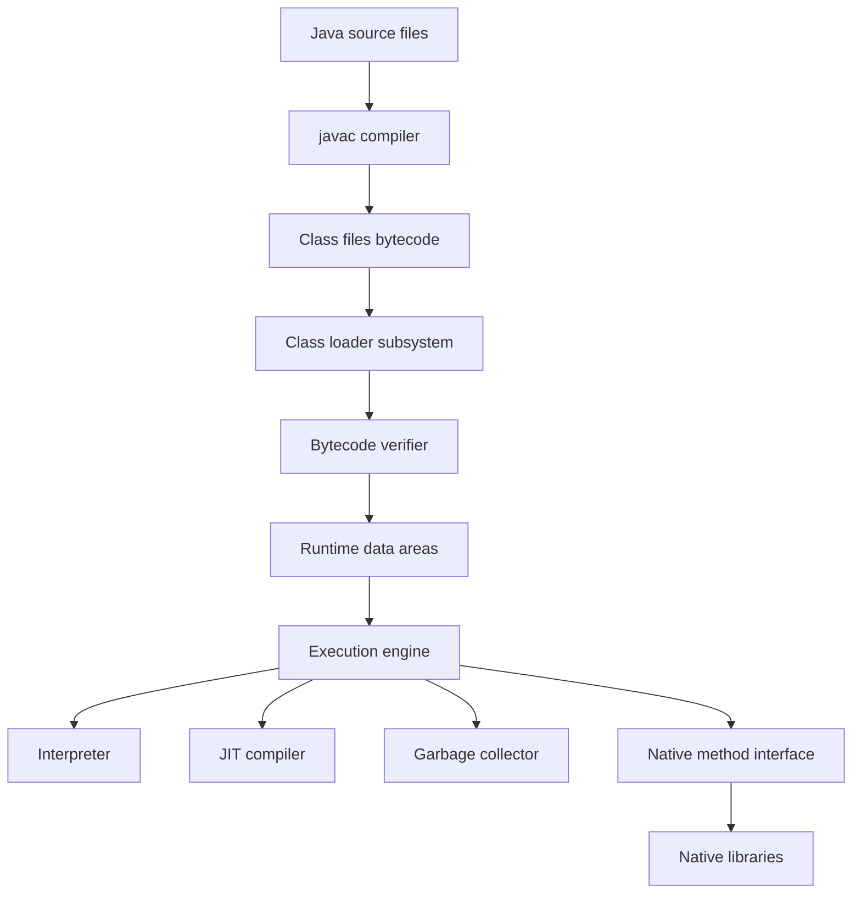
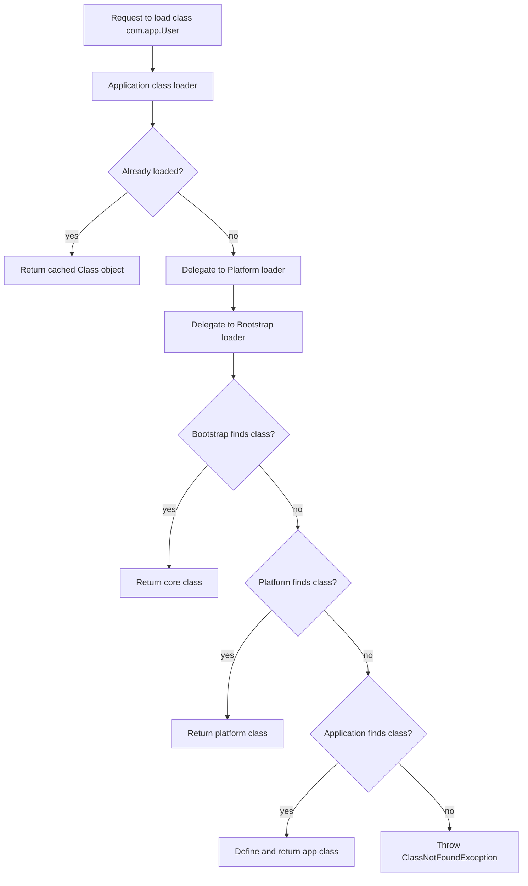
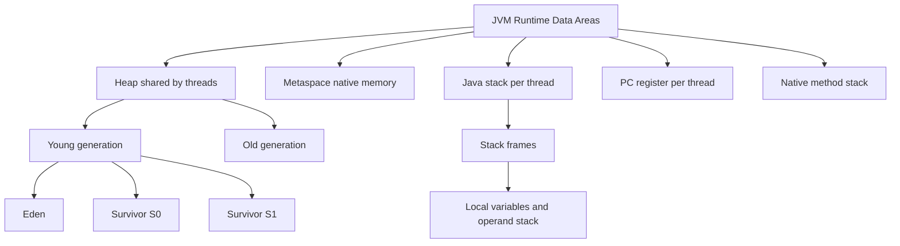
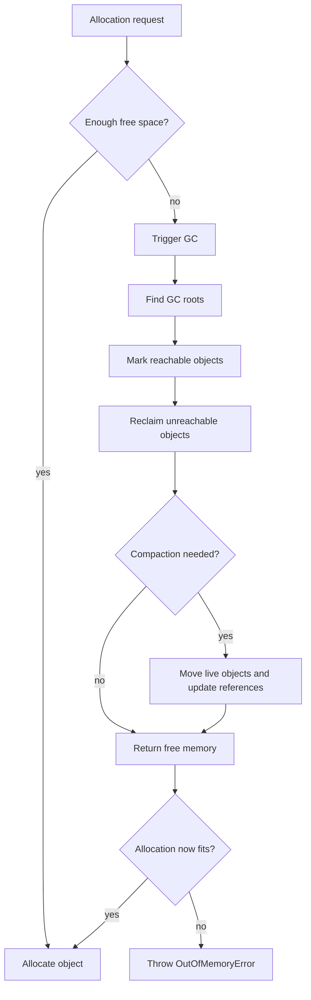
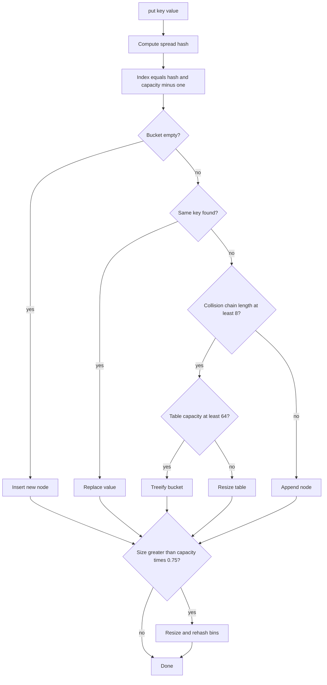

# 02a · Core Java and JVM Fundamentals

This part covers interview-ready Core Java fundamentals, JVM architecture, class loading, memory management, GC, strings, equality, and core collection internals. Use Part B for streams, generics, exceptions, design patterns, modern Java, and tricky output questions.

**Legend:** 🟢 Beginner · 🟡 Intermediate · 🔴 Advanced · ⚫ FAANG · 🔥 = very frequently asked

## Table of Contents
- [Beginner guide to this file](#beginner-guide-to-this-file)
- [Foundations and OOP](#foundations-and-oop)
- [JDK, JRE, JVM and Class Loading](#jdk-jre-jvm-and-class-loading)
- [JVM Memory and Garbage Collection](#jvm-memory-and-garbage-collection)
- [Strings, Equality and Core Collections](#strings-equality-and-core-collections)
- [Revision Cheat Sheet](#revision-cheat-sheet)
- [Flashcards](#flashcards)

## Beginner guide to this file

### What this file teaches
This file teaches the foundations behind day-to-day Java backend code: how objects model behavior, how the
Java Development Kit (JDK), Java Runtime Environment (JRE), and Java Virtual Machine (JVM) run a program,
how memory and garbage collection behave, and why core collections work the way they do. Interviewers ask
these topics because bugs in services often come from wrong assumptions about equality, class loading,
object lifetime, strings, or collection performance.

### Mental model
Think of a Java service as a busy warehouse: classes are blueprints, objects are packages, the JVM is the
warehouse machinery, garbage collection is cleanup, and collections are storage shelves with different access
patterns.
- Object-oriented programming (OOP) gives names and boundaries to business behavior.
- Class loading turns compiled class files into runtime types before code can execute.
- Heap, stack, metaspace, and program counter areas separate object data from method execution state.
- Garbage collection (GC) starts from reachable roots and reclaims objects no longer reachable.
- Collection choice depends on lookup pattern, ordering need, mutation rate, and equality rules.
- Java 17 behavior matters because it is a common long-term-support baseline in backend teams.

### How to think through any question here
1. First classify the question as language design, runtime execution, memory, GC, strings, or collections.
2. State the plain rule before naming the precise Java term.
3. Ask whether the decision happens at compile time, class-load time, runtime dispatch, or GC time.
4. For memory questions, identify what is on the stack, heap, metaspace, or referenced by GC roots.
5. For equality and collections, separate object identity, logical equality, hash code, ordering, and mutability.
6. Mention Java 17 defaults and version-sensitive behavior, especially JVM flags and collector choices.
7. Add the production impact: latency pauses, leaks, thread safety, API stability, or data corruption risk.

### Pattern recognition cues
| If the question mentions... | Think about... | Why it fits |
|---|---|---|
| is-a, has-a, interface, abstract class | inheritance, composition, abstraction boundaries | These decide how backend code evolves safely. |
| same method name, null argument, parent reference | overload resolution versus overriding | The compiler chooses overloads, runtime dispatch chooses overrides. |
| JDK, JRE, JVM, javac, bytecode | build tools versus runtime engine | Candidates must know what compiles and what executes. |
| class loader, parent delegation, static block | load, link, initialize lifecycle | Startup bugs often come from type initialization order. |
| heap, stack, metaspace, stack overflow | where data lives | Memory-area questions test runtime mental models. |
| minor, major, full GC, pauses | reachability and collector trade-offs | Production services care about latency and throughput. |
| String pool, intern, immutability | shared literals and safe reuse | Strings appear in keys, security checks, and memory usage. |
| equals, hashCode, HashMap, HashSet | bucket lookup and contracts | Broken equality corrupts collection behavior. |
| ArrayList, LinkedList, TreeMap, PriorityQueue | data structure cost and ordering | Interviews expect choosing by access pattern, not memorized names. |
| LRU cache, fail-fast iterator | mutation order and concurrent modification | These reveal subtle collection semantics. |

### Abbreviations and key terms
| Short form | Expanded form | Plain meaning |
|---|---|---|
| AOT | Ahead-of-time compilation | Compiling before the program starts, often for faster startup with trade-offs. |
| API | Application Programming Interface | The public contract other code calls. |
| CLI | Command-line interface | A tool run from the terminal. |
| CPU | Central Processing Unit | The processor executing machine instructions. |
| DSA | Data Structures and Algorithms | The study of organizing data and solving problems efficiently. |
| FAANG | Facebook or Meta, Amazon, Apple, Netflix, Google | Shorthand for large product-company interview style. |
| G1 | Garbage-First Garbage Collector | Region-based Java collector that balances throughput and pauses. |
| GC | Garbage collection | Automatic memory cleanup for unreachable objects. |
| JDBC | Java Database Connectivity | Standard Java API for talking to relational databases. |
| JDK | Java Development Kit | Compiler, tools, runtime, and libraries for developing Java. |
| JIT | Just-in-time compilation | Runtime compilation of hot bytecode into optimized machine code. |
| JNI | Java Native Interface | Bridge between Java code and native code. |
| JPA | Java Persistence API | Standard abstraction used by many Java object-relational mapping tools. |
| JRE | Java Runtime Environment | Runtime libraries plus JVM for running Java applications. |
| JVM | Java Virtual Machine | Runtime engine that loads classes, manages memory, and executes bytecode. |
| LLD | Low-level design | Class and component design detail, usually below system design. |
| LR | Left to right | Mermaid diagram direction used in flowcharts. |
| LRU | Least recently used | Eviction policy that removes the entry unused for the longest time. |
| MAT | Memory Analyzer Tool | Tool often used to inspect Java heap dumps. |
| OOM | Out of memory | Failure when the JVM cannot allocate required memory. |
| OOP | Object-oriented programming | Modeling software as interacting objects with state and behavior. |
| OS | Operating system | The platform process, threads, files, and sockets run on. |
| PC | Program counter | JVM memory area that tracks the current instruction for a thread. |
| REST | Representational State Transfer | Common HTTP style for service APIs. |
| S0 and S1 | Survivor space 0 and survivor space 1 | Young-generation areas used by some generational collectors. |
| SDE-1 | Software Development Engineer level 1 | Entry-level software engineering role. |
| SLA | Service-level agreement | Reliability or latency promise a system is expected to meet. |
| SQL | Structured Query Language | Language used to query relational databases. |
| TD | Top down | Mermaid diagram direction used in flowcharts. |
| TTL | Time to live | Duration after which cached or stored data expires. |
| UPI | Unified Payments Interface | Indian instant-payment system used in examples. |
| VM | Virtual machine | Software runtime that abstracts the underlying hardware or process details. |
| XX | HotSpot non-standard flag prefix | Prefix for many advanced JVM tuning flags. |
| ZGC | Z Garbage Collector | Low-latency garbage collector for large heaps. |
| class loading | Not an abbreviation | Process of finding, verifying, preparing, resolving, and initializing classes. |
| hash bucket | Not an abbreviation | Slot where hash-based collections group entries. |
| metaspace | Not an abbreviation | Native-memory area that stores class metadata. |
| reachability | Not an abbreviation | Whether an object can still be found from live roots. |
| treeification | Not an abbreviation | HashMap converting a long bucket chain into a tree after thresholds. |

### Common beginner traps
- Treating abstraction and encapsulation as synonyms instead of separate design ideas.
- Forgetting that overload selection is compile time while overriding dispatch is runtime.
- Saying objects live on the stack without mentioning that the Java model treats objects as heap allocations
  unless the JVM optimizes internally.
- Assuming garbage collection immediately frees memory or closes files, sockets, and database connections.
- Using mutable objects as HashMap keys and then changing fields involved in equals or hashCode.
- Memorizing collection names without connecting them to lookup, insertion, ordering, and thread-safety needs.

### How to study this file
1. Read each short answer first and say it aloud in 20 to 40 seconds.
2. Use the detailed answer to draw the runtime flow or data structure shape in your own words.
3. Turn each common mistake into a yes-or-no self-test before reading the follow-ups.
4. Use the flashcards for spaced repetition after you can already explain the mental model.
5. Practice by predicting tiny code outputs, then justify every step using compile-time and runtime rules.

### Scalability and production lens
In a toy program, GC, collection choice, and class loading feel invisible. In production, they affect startup
time, pause latency, memory footprint, cache correctness, and incident diagnosis. Prefer clear APIs, immutable
keys, bounded caches, explicit resource closing, measured JVM flags, and evidence from logs or profilers before
tuning.

## Foundations and OOP

### Q1. What are the four pillars of OOP in Java?
`🟢 Beginner` `🔥` `Must-know SDE-1`

**Why they ask:** They check whether you can model backend code beyond syntax.

**Beginner lens:** Think of OOP as assigning clear jobs to teammates in a service. Encapsulation protects
each teammate's private notes, abstraction exposes a simple request desk, inheritance shares stable family
behavior, and polymorphism lets the same request be handled by different implementations. Interviewers are
testing whether you can design classes that are easy to replace, test, and extend, not just recite four
words. In backend work, this appears when controllers depend on service interfaces, services depend on
repositories, and tests swap real collaborators with fakes.

**Short answer (say this first, 20-40 sec):**
OOP has encapsulation, abstraction, inheritance, and polymorphism. Encapsulation protects state, abstraction exposes only essential behavior, inheritance reuses or specializes behavior, and polymorphism lets one interface have multiple runtime implementations.

**Detailed answer:**
- **Encapsulation:** keep fields private and expose behavior through methods.
- **Abstraction:** hide implementation details behind interfaces or abstract classes.
- **Inheritance:** `extends` for class specialization; Java supports single class inheritance.
- **Polymorphism:** method overloading at compile time and overriding at runtime.

```java
interface PaymentGateway {
    boolean charge(int amountInPaise);
}

final class UpiGateway implements PaymentGateway {
    private final String provider;

    UpiGateway(String provider) {
        this.provider = provider;
    }

    @Override
    public boolean charge(int amountInPaise) {
        return amountInPaise > 0 && provider != null;
    }
}
```

For a Spring Boot REST service, you usually inject an interface like `PaymentGateway`; tests can use a fake implementation and production can use UPI, card, or wallet implementations.

**Common mistakes:**
- Saying abstraction and encapsulation are the same.
- Using inheritance where composition is simpler.
- Forgetting runtime polymorphism requires overriding, not overloading.

**Follow-ups:**
- *Is Java fully object-oriented?* → No. It has primitives like `int`, though wrappers and autoboxing bridge the gap.
- *Why prefer interfaces?* → They decouple callers from implementation and make testing easier.

### Q2. Encapsulation vs abstraction: what is the difference?
`🟢 Beginner` `🔥` `Must-know SDE-1`

**Why they ask:** Many candidates memorize terms but cannot design classes cleanly.

**Beginner lens:** Encapsulation is like locking a drawer so state cannot be changed carelessly; abstraction
is like giving users a clean control panel without showing wires. The key distinction is data protection
versus complexity hiding. Recognize this question when the interviewer asks about private fields,
interfaces, repositories, or leaked implementation details. A strong answer says both often work together: a
BankAccount can encapsulate balance while an AccountRepository abstracts storage. Avoid claiming every
abstraction must be an abstract class.

**Short answer (say this first, 20-40 sec):**
Encapsulation is about hiding and protecting an object's internal state. Abstraction is about exposing a simplified contract while hiding implementation complexity.

**Detailed answer:**
| Concept | Focus | Java tools | Example |
|---|---|---|---|
| Encapsulation | Data safety | `private`, validation methods, immutable classes | `BankAccount.withdraw()` validates balance |
| Abstraction | Simplified contract | `interface`, `abstract class` | `Repository.save()` hides SQL/JPA details |

```java
final class BankAccount {
    private long balance;

    public void deposit(long amount) {
        if (amount <= 0) throw new IllegalArgumentException("amount must be positive");
        balance += amount;
    }

    public long balance() {
        return balance;
    }
}
```

The private field is encapsulation. A service depending on `AccountRepository` instead of a specific SQL class is abstraction.

**Common mistakes:**
- Exposing mutable fields through getters.
- Creating interfaces for every class without a real abstraction.
- Thinking abstraction always means abstract class.

**Follow-ups:**
- *Can a class be encapsulated but not abstracted?* → Yes, a simple value object can hide fields without implementing an interface.
- *Can abstraction leak?* → Yes, for example a repository method exposing SQL-specific exceptions leaks persistence details.

### Q3. Inheritance vs composition: when should you use each?
`🟡 Intermediate` `🔥` `Must-know SDE-1`

**Why they ask:** Good Java design avoids fragile inheritance hierarchies.

**Beginner lens:** Use the family-tree analogy carefully: inheritance says a subtype really is a specialized
parent, while composition says an object uses another object to do part of its work. The interviewer is
testing whether you avoid fragile base classes. Recognize the pattern when behavior may change
independently, such as discount rules, payment gateways, or notification channels. In production Java,
composition usually fits Spring dependency injection better because you can replace one collaborator without
rebuilding the entire class hierarchy.

**Short answer (say this first, 20-40 sec):**
Use inheritance for a true "is-a" relationship with stable behavior. Prefer composition for "has-a" behavior, optional capabilities, and code that must evolve without breaking subclasses.

**Detailed answer:**
Inheritance couples a subclass to parent implementation details. Composition delegates work to another object and is easier to test or replace.

```java
interface DiscountPolicy {
    long discount(long cartValue);
}

final class CheckoutService {
    private final DiscountPolicy discountPolicy;

    CheckoutService(DiscountPolicy discountPolicy) {
        this.discountPolicy = discountPolicy;
    }

    long payableAmount(long cartValue) {
        return cartValue - discountPolicy.discount(cartValue);
    }
}
```

This is better than `FestivalCheckoutService extends CheckoutService` because policies can change independently. In backend systems, composition also works well with dependency injection.

**Common mistakes:**
- Extending a class just to reuse one method.
- Making deep inheritance trees that are hard to reason about.
- Violating Liskov Substitution by weakening parent behavior.

**Follow-ups:**
- *Where is inheritance useful?* → Framework base classes, sealed hierarchies, and domain types with stable common behavior.
- *What is the fragile base class problem?* → A parent change unexpectedly breaks subclasses that depend on internal behavior.

### Q4. What is polymorphism in Java?
`🟢 Beginner` `🔥` `Must-know SDE-1`

**Why they ask:** Runtime dispatch appears in almost every Java backend interview.

**Beginner lens:** Polymorphism means the caller presses the same button but the actual object decides which
behavior runs. The mental split is compile-time type for what calls are allowed, runtime object type for
overridden instance methods. This applies whenever a parent reference points to a child object or an
interface reference points to an implementation. Interviewers use it to see if you understand dynamic
dispatch, mocks, and plugin-style design. Remember that fields, private methods, static methods, and
constructors do not behave like overridden instance methods.

**Short answer (say this first, 20-40 sec):**
Polymorphism means the same call can execute different behavior based on the object type. Overloading is compile-time polymorphism; overriding is runtime polymorphism using dynamic dispatch.

**Detailed answer:**
```java
class Animal {
    String sound() {
        return "unknown";
    }
}

class Dog extends Animal {
    @Override
    String sound() {
        return "bark";
    }
}

Animal animal = new Dog();
System.out.println(animal.sound()); // bark
```

The variable type is `Animal`, but the object is `Dog`; overridden instance methods dispatch at runtime. Static methods, private methods, and fields are not overridden in the same way.

**Common mistakes:**
- Confusing method overloading with overriding.
- Thinking fields are polymorphic.
- Forgetting static method calls are resolved by reference type.

**Follow-ups:**
- *Can constructors be overridden?* → No. Constructors are not inherited.
- *Can return type differ in overriding?* → Yes, with covariant return types.

### Q5. Overloading vs overriding: how does Java choose a method?
`🟡 Intermediate` `🔥` `Must-know SDE-1`

**Why they ask:** It is a common source of output-based questions.

**Beginner lens:** Mentally trace this in two passes. First, the compiler picks the overloaded method using
the reference type and argument types. Second, if that chosen method is overridden, the JVM dispatches to
the runtime object. The interviewer is testing output reasoning and exact method selection, especially with
null, boxing, widening, and varargs. A useful habit is to write compile-time type above each variable, then
runtime object below it. This prevents the common mistake of letting the runtime object influence overload
selection.

**Short answer (say this first, 20-40 sec):**
Overloading is chosen at compile time from the reference type and argument types. Overriding is chosen at runtime from the actual object type.

**Detailed answer:**
```java
class Printer {
    void print(Object value) { System.out.println("object"); }
    void print(String value) { System.out.println("string"); }
}

Printer printer = new Printer();
printer.print(null); // string, because String is more specific than Object
```

Overload resolution prefers exact match, widening, boxing, varargs in that rough order. For overriding, Java uses dynamic dispatch only for instance methods.

```java
class Parent {
    void run() { System.out.println("parent"); }
}
class Child extends Parent {
    @Override void run() { System.out.println("child"); }
}
Parent p = new Child();
p.run(); // child
```

**Common mistakes:**
- Expecting runtime type to affect overload selection.
- Overloading with ambiguous `null` arguments.
- Reducing visibility while overriding; Java forbids it.

**Follow-ups:**
- *Can checked exceptions change in overriding?* → The child cannot throw broader checked exceptions than the parent method.
- *Can overloaded methods differ only by return type?* → No.

### Q6. What is the difference between interface and abstract class?
`🟢 Beginner` `🔥` `Must-know SDE-1`

**Why they ask:** It tests API design and Java language basics.

**Beginner lens:** Think of an interface as a promise any unrelated class can sign, and an abstract class as
a partially built base with shared state or behavior. The interviewer is testing API design, not only
syntax. Choose interfaces for capabilities such as Runnable, Comparable, or PaymentGateway; choose abstract
classes when subclasses truly share fields, constructors, or protected workflow. In Java 17, interfaces can
have default, static, and private helper methods, but they still should not become stateful inheritance
substitutes.

**Short answer (say this first, 20-40 sec):**
Use an interface to define a capability or contract that many unrelated classes can implement. Use an abstract class when implementations share state or common protected behavior.

**Detailed answer:**
| Feature | Interface | Abstract class |
|---|---|---|
| Multiple inheritance | A class can implement many | A class extends only one |
| Fields | `public static final` constants | Instance fields allowed |
| Methods | Abstract, default, static, private helper methods | Abstract and concrete methods |
| Constructor | No instance constructor | Constructor allowed |

```java
interface Auditable {
    default void audit(String action) {
        System.out.println("audit: " + action);
    }
}

abstract class BaseEntity {
    private final long createdAt = System.currentTimeMillis();
    long createdAt() { return createdAt; }
}
```

Since Java 8, interfaces can have `default` methods, but they should not become stateful base classes.

**Common mistakes:**
- Saying interfaces cannot have implemented methods; Java 8 changed that.
- Putting mutable shared state in interfaces.
- Choosing abstract class when multiple capabilities are needed.

**Follow-ups:**
- *What if two interfaces have same default method?* → The implementing class must override and resolve the conflict.
- *Can interfaces have private methods?* → Yes, since Java 9, for helper logic inside default/static methods.

### Q7. What are access modifiers in Java?
`🟢 Beginner` `🔥` `Must-know SDE-1`

**Why they ask:** Access control affects API boundaries and encapsulation.

**Beginner lens:** Access modifiers are boundary controls. Private is inside the room, package-private is
inside the module hallway, protected is package plus subclass access, and public is the street-facing API.
The interviewer wants to know whether you design small surfaces and protect invariants. Recognize this in
questions about encapsulation, library compatibility, and tests that need internal helpers. The production
concern is that every public method becomes harder to change later, so expose the narrowest visibility that
supports the design.

**Short answer (say this first, 20-40 sec):**
Java has `private`, package-private, `protected`, and `public`. Use the most restrictive visibility that still supports the design.

**Detailed answer:**
| Modifier | Same class | Same package | Subclass outside package | Everywhere |
|---|---:|---:|---:|---:|
| `private` | Yes | No | No | No |
| package-private | Yes | Yes | No | No |
| `protected` | Yes | Yes | Yes, through inheritance | No |
| `public` | Yes | Yes | Yes | Yes |

Package-private is often useful for testable internal helpers without making them public API. In libraries, every public method becomes a compatibility promise.

**Common mistakes:**
- Making fields `public`.
- Thinking `protected` means package-only; it also allows subclass access.
- Overexposing service internals for tests.

**Follow-ups:**
- *Can top-level classes be private?* → No. Top-level classes can be public or package-private.
- *Can an overriding method reduce visibility?* → No, it can only keep or widen visibility.

### Q8. What are `final`, `finally`, and `finalize()`?
`🟢 Beginner` `🔥` `Must-know SDE-1`

**Why they ask:** Similar names cause confusion in interviews.

**Beginner lens:** These names sound related but live in different parts of Java. Final freezes reassignment
or extension choices, finally is cleanup control flow, and finalize is an obsolete cleanup hook that should
not be used. Interviewers ask because candidates often mix memory management with exception handling. The
key mental model is that final does not make a mutable object immutable, and finally can accidentally hide
returns or exceptions. For resources, prefer try-with-resources and AutoCloseable instead of relying on
garbage collection or finalization.

**Short answer (say this first, 20-40 sec):**
`final` is a modifier for variables, methods, or classes. `finally` is an exception-handling block. `finalize()` was a cleanup hook but is deprecated and should not be used.

**Detailed answer:**
- `final` variable: cannot be reassigned after initialization.
- `final` method: cannot be overridden.
- `final` class: cannot be extended.
- `finally`: usually runs after `try`/`catch`, even when an exception is thrown.
- `finalize()`: unreliable, deprecated for removal; use `try-with-resources`, cleaners only when unavoidable.

```java
try (var stream = java.nio.file.Files.lines(java.nio.file.Path.of("data.txt"))) {
    stream.limit(1).forEach(System.out::println);
}
```

**Common mistakes:**
- Using `finalize()` for file or socket cleanup.
- Thinking `final` makes an object immutable; it only prevents reassignment.
- Returning from `finally`, which can suppress exceptions or earlier returns.

**Follow-ups:**
- *Does `finally` always run?* → Not after JVM crash, `System.exit`, process kill, or infinite loop before the block.
- *What makes an object immutable?* → No observable state changes, defensive copies, and no leaked mutable internals.

### Q9. Is Java pass-by-value or pass-by-reference?
`🟢 Beginner` `🔥` `Must-know SDE-1`

**Why they ask:** This is a classic misconception.

**Beginner lens:** Picture Java handing a method a photocopy of an address card. The copy points to the same
object, so mutating that object is visible, but replacing the copied card does not change the caller's card.
The interviewer is testing the difference between object mutation and reference reassignment. Recognize this
in swap examples, StringBuilder examples, and array mutation examples. For output questions, trace whether
the code mutates the object itself or only reassigns the local parameter.

**Short answer (say this first, 20-40 sec):**
Java is always pass-by-value. For objects, the value passed is a copy of the reference, so methods can mutate the object but cannot reassign the caller's reference.

**Detailed answer:**
```java
static void change(StringBuilder sb) {
    sb.append("X");               // mutates same object
    sb = new StringBuilder("Y");   // local reference only
}

StringBuilder value = new StringBuilder("A");
change(value);
System.out.println(value); // AX
```

The reference copy points to the same object initially. Reassigning the parameter changes only the local copy.

**Common mistakes:**
- Saying Java is pass-by-reference for objects.
- Confusing object mutation with reference reassignment.
- Assuming immutable objects like `String` can be changed by a method.

**Follow-ups:**
- *Can a method swap two caller variables?* → Not directly, because references are passed by value.
- *How can mutation be avoided?* → Use immutable classes or defensive copies.

### Q10. What is object lifecycle in Java?
`🟡 Intermediate` `Must-know SDE-1`

**Why they ask:** It connects constructors, references, GC, and resource management.

**Beginner lens:** An object's life is like a rented workspace: it is allocated, initialized, used while
someone can still reach it, then becomes eligible for cleanup when no live path reaches it. The interviewer
is testing how constructors, references, garbage collection, and resource cleanup connect. The key
distinction is memory versus external resources. Garbage collection can reclaim heap memory eventually, but
it will not promptly close files, sockets, locks, or database connections; use try-with-resources for those.

**Short answer (say this first, 20-40 sec):**
An object is allocated, initialized by constructors, used while reachable, becomes eligible for GC when unreachable, and is eventually reclaimed by the garbage collector. Non-memory resources must be closed explicitly.

**Detailed answer:**
Typical lifecycle:
1. Class is loaded and initialized if needed.
2. Memory is allocated on heap, or optimized away by JIT escape analysis.
3. Fields get default values, then initializers and constructors run.
4. Object is used while reachable from GC roots.
5. When unreachable, memory can be reclaimed.

```java
try (DatabaseConnection connection = pool.getConnection()) {
    connection.query("select 1");
}
```

GC handles heap memory, not timely release of database connections, files, locks, or sockets. Use `AutoCloseable` and `try-with-resources`.

**Common mistakes:**
- Assuming GC runs immediately when an object becomes unreachable.
- Using GC for resource cleanup.
- Leaking `this` from a constructor before the object is fully initialized.

**Follow-ups:**
- *What are GC roots?* → Active thread stacks, static fields, JNI references, and some VM internals.
- *What is escape analysis?* → JIT analysis that can allocate objects on stack or eliminate allocation if object does not escape.

## JDK, JRE, JVM and Class Loading

### Q11. What is the difference between JDK, JRE, and JVM?
`🟢 Beginner` `🔥` `Must-know SDE-1`

**Why they ask:** It verifies basic platform understanding.

**Beginner lens:** Use the toolbox analogy: the JVM is the engine that runs bytecode, the JRE is the engine
plus standard runtime parts, and the JDK is the full developer toolbox with compiler and tools. Interviewers
ask this to ensure you understand build versus run responsibilities. In modern Java distributions, the old
separate JRE packaging is less visible, but the conceptual distinction still matters. For backend work,
developers install a JDK because services need compilation, tests, packaging, diagnostics, and sometimes
jlink.

**Short answer (say this first, 20-40 sec):**
JVM runs bytecode, JRE provides JVM plus runtime libraries, and JDK provides JRE plus developer tools like `javac`, `jar`, `jdb`, and `jlink`.

**Detailed answer:**
| Term | Contains | Used by |
|---|---|---|
| JVM | Class loader, runtime memory, execution engine, GC | Running Java bytecode |
| JRE | JVM plus standard libraries | End users running apps |
| JDK | JRE plus compilers and tools | Developers building apps |

Since Java 9 modularization, the old standalone JRE distribution model changed; many deployments build custom runtimes with `jlink`. In interviews, still explain the conceptual layering.

**Common mistakes:**
- Saying JDK and JVM are the same.
- Saying JVM compiles `.java`; `javac` does that.
- Ignoring Java 9 module/runtime image changes.

**Follow-ups:**
- *What does `javac` produce?* → Platform-independent bytecode in `.class` files.
- *Why is Java called platform independent?* → Bytecode runs on any compatible JVM, but native libraries still depend on OS/CPU.

### Q12. Explain JVM architecture.
`🟡 Intermediate` `🔥` `Must-know SDE-1`

**Why they ask:** JVM architecture is the base for class loading, GC, JIT, and performance tuning.

**Beginner lens:** Treat the JVM as a small operating environment inside the process: class loaders bring
code in, memory areas store runtime state, the execution engine runs bytecode, and garbage collection cleans
unreachable heap objects. The interviewer is testing whether you can connect architecture pieces to real
failures. ClassNotFoundException points toward loading, StackOverflowError points toward stack depth,
OutOfMemoryError points toward memory pressure, and slow pauses point toward garbage collection or
allocation patterns.

**Short answer (say this first, 20-40 sec):**
The JVM loads class files, verifies bytecode, stores runtime data in memory areas, executes code through interpreter and JIT compiler, and manages memory through garbage collection.

**Detailed answer:**


Runtime data areas include heap, stacks, metaspace, PC registers, and native method stacks. HotSpot first interprets bytecode, profiles hot methods, then JIT-compiles them to optimized machine code.

**Common mistakes:**
- Thinking Java is only interpreted.
- Ignoring bytecode verification and security checks.
- Treating heap and stack as the only JVM memory areas.

**Follow-ups:**
- *What is HotSpot?* → The most commonly used OpenJDK JVM implementation.
- *What is JIT?* → Just-in-time compilation of hot bytecode to native code at runtime.

### Q13. What happens when you run `java Main`?
`🟡 Intermediate` `🔥` `Must-know SDE-1`

**Why they ask:** It checks end-to-end understanding from classpath to execution.

**Beginner lens:** Trace java Main as a pipeline: locate the class, load and verify bytecode, initialize
required classes, find public static void main, execute bytecode, and let just-in-time compilation optimize
hot paths later. Interviewers ask this to see if you understand startup beyond just main runs. The
production angle is startup time and classpath or module-path problems. If an app fails before business code
starts, suspect missing classes, wrong main class, static initialization failure, or incompatible bytecode
version.

**Short answer (say this first, 20-40 sec):**
The JVM starts, locates `Main`, loads and verifies classes, initializes static state, finds `public static void main(String[] args)`, and executes bytecode using interpreter/JIT while GC manages memory.

**Detailed answer:**
Steps:
1. Launcher starts JVM with classpath or module path.
2. Application class loader finds `Main.class`.
3. JVM verifies bytecode for type safety and stack correctness.
4. Class preparation creates static fields with default values.
5. Class initialization runs static initializers.
6. JVM invokes `main`.
7. Execution engine interprets/JIT-compiles hot code.

```java
public class Main {
    static { System.out.println("init"); }
    public static void main(String[] args) {
        System.out.println("run");
    }
}
```

Output is `init` then `run`, because class initialization happens before `main`.

**Common mistakes:**
- Forgetting class initialization before `main`.
- Thinking every referenced class loads at startup.
- Confusing class loading with object creation.

**Follow-ups:**
- *When is a class initialized?* → On active use, such as `new`, static method call, or non-constant static field access.
- *What is lazy loading?* → Classes are loaded when needed, not necessarily all at startup.

### Q14. Explain class loading phases.
`🟡 Intermediate` `🔥` `Must-know SDE-1`

**Why they ask:** Class loading appears in framework, reflection, and classpath issues.

**Beginner lens:** Class loading is like admitting a new machine to a factory: find it, check it is safe,
allocate its static storage, resolve symbolic references when needed, then run static initialization. The
interviewer is testing the order: loading, linking, and initialization. Recognize this in questions about
static blocks, constants, ClassNotFoundException, and NoClassDefFoundError. A useful trace is to ask whether
the class is merely referenced, actively used, or forced to initialize by creating an object or accessing a
non-constant static member.

**Short answer (say this first, 20-40 sec):**
Class loading has loading, linking, and initialization. Linking includes verification, preparation, and optional resolution.

**Detailed answer:**
- **Loading:** find class bytes and create `Class<?>` metadata.
- **Verification:** ensure bytecode safety.
- **Preparation:** allocate static fields and set default values.
- **Resolution:** convert symbolic references to direct references as needed.
- **Initialization:** run static field initializers and static blocks in textual order.

```java
class Demo {
    static int x = value();
    static { System.out.println("block " + x); }
    static int value() {
        System.out.println("field");
        return 10;
    }
}
```

Initialization order matters and is a frequent output-question target.

**Common mistakes:**
- Saying static fields get explicit values during preparation; explicit values happen during initialization.
- Assuming resolution always happens eagerly.
- Ignoring parent class initialization before child initialization.

**Follow-ups:**
- *What is `ClassNotFoundException`?* → Checked exception usually from dynamic loading by name.
- *What is `NoClassDefFoundError`?* → Runtime linkage error when a class was available at compile time but missing or failed at runtime.

### Q15. What are Bootstrap, Platform, and Application class loaders?
`🟡 Intermediate` `🔥` `Must-know SDE-1`

**Why they ask:** It tests how Java finds classes and avoids conflicts.

**Beginner lens:** Think of class loaders as nested search desks. The bootstrap loader knows core Java
classes, the platform loader knows platform modules, and the application loader knows your classpath or
module path. The interviewer is testing whether you know who loads what and why isolation matters. In Java
17, the platform loader replaced older extension-loader thinking. In production, class-loader mistakes show
up in application servers, plugins, agents, and dependency conflicts where two classes with the same name
are not necessarily the same runtime type.

**Short answer (say this first, 20-40 sec):**
Bootstrap loads core Java classes, Platform loads platform modules, and Application loads application classpath or module-path classes. They normally follow parent-first delegation.

**Detailed answer:**
| Loader | Java 9+ role | Examples |
|---|---|---|
| Bootstrap | Core modules | `java.lang.String`, `java.util.List` |
| Platform | Platform modules outside core | Some JDK service/provider APIs |
| Application | App classes and dependencies | Your Spring Boot code, library jars |

In Java 8 and earlier, you often hear Extension loader instead of Platform loader. Java 9 modules changed the exact implementation, but parent delegation remains the interview model.

**Common mistakes:**
- Saying application loader loads `String`.
- Using Java 8 Extension loader terminology without noting Java 9 changes.
- Assuming custom class loaders always use parent-first; some frameworks use child-first.

**Follow-ups:**
- *Can two classes with same name coexist?* → Yes, if loaded by different class loaders; identity is class name plus defining loader.
- *Why cannot we easily override `java.lang.String`?* → Parent delegation and JVM protections prevent normal app code from replacing core classes.

### Q16. Explain parent delegation model in class loading.
`🔴 Advanced` `🔥` `Must-know SDE-1`

**Why they ask:** It is crucial for classpath conflicts and framework behavior.

**Beginner lens:** Parent delegation means a child loader asks its parent first before defining a class
itself, like checking the central registry before accepting a local copy. The interviewer is testing safety
and consistency: application code should not replace java.lang.String with a fake version. Recognize this in
classpath shadowing, plugin isolation, and NoClassDefFoundError discussions. Some frameworks intentionally
break or customize delegation for isolation, but the default model protects core classes and avoids
duplicate definitions.

**Short answer (say this first, 20-40 sec):**
In parent delegation, a class loader asks its parent to load a class first. Only if the parent cannot load it does the child try, which protects core Java classes and reduces duplicate loading.

**Detailed answer:**


Custom loaders may intentionally break this model for plugins, app servers, OSGi, or hot reload. That adds flexibility but can create class-cast problems because the same class name loaded twice is not the same type.

**Common mistakes:**
- Saying delegation starts from Bootstrap; the request starts at a child and delegates upward.
- Forgetting the loaded class cache.
- Ignoring custom class loader exceptions.

**Follow-ups:**
- *Why parent-first?* → Security, consistency, and avoiding duplicate core classes.
- *What is class loader leak?* → A long-lived reference prevents an old loader and all its classes from being GCed.

### Q17. What is JIT compilation?
`🟡 Intermediate` `🔥` `Must-know SDE-1`

**Why they ask:** It connects Java performance with runtime optimization.

**Beginner lens:** Just-in-time compilation is the JVM noticing a frequently used route and paving it into
faster native machine code while the program runs. The interviewer is testing why Java can start as bytecode
yet become fast after warm-up. Recognize it in performance, warm-up, benchmark, and hotspot questions. The
key distinction is interpretation first, profiling during execution, then optimized compilation of hot
methods. Production services may need warm-up time before latency stabilizes.

**Short answer (say this first, 20-40 sec):**
JIT compiles frequently executed bytecode into optimized native machine code at runtime. The JVM profiles code first, then optimizes hot paths using techniques like inlining and escape analysis.

**Detailed answer:**
HotSpot starts with interpretation, gathers profiling data, and compiles hot methods. Optimizations include:
- method inlining,
- dead-code elimination,
- lock elision,
- escape analysis and scalar replacement,
- deoptimization if assumptions become invalid.

This is why Java programs may warm up: performance can improve after hot code is compiled. For latency-sensitive services, warm-up and GC behavior matter.

**Common mistakes:**
- Saying Java is slower because it is interpreted only.
- Benchmarking Java without warm-up.
- Ignoring deoptimization and tiered compilation.

**Follow-ups:**
- *What is escape analysis?* → It determines whether an object escapes a method/thread; non-escaping allocations can be optimized.
- *What is AOT?* → Ahead-of-time compilation; used by tools like GraalVM Native Image with different trade-offs.

## JVM Memory and Garbage Collection

### Q18. Explain JVM memory areas.
`🟡 Intermediate` `🔥` `Must-know SDE-1`

**Why they ask:** Memory questions are common in Java backend interviews.

**Beginner lens:** JVM memory is easier if you separate shared object storage from per-thread execution
storage. Heap holds objects, stacks hold method frames and local variables, metaspace holds class metadata,
program counters track bytecode position, and native stacks support native calls. Interviewers ask this to
diagnose errors: StackOverflowError is usually deep recursion, heap OutOfMemoryError is object retention or
allocation pressure, and metaspace issues suggest class-loading growth. For Java 17, metaspace is native
memory, not the old permanent generation.

**Short answer (say this first, 20-40 sec):**
The JVM has heap for objects, thread stacks for frames and local variables, metaspace for class metadata, PC registers for current bytecode position, and native method stacks for native calls.

**Detailed answer:**


Heap and metaspace are shared across threads. Each thread has its own stack; stack overflow usually means deep recursion, while heap OOM means object allocation pressure or leaks.

**Common mistakes:**
- Saying metaspace is inside heap; since Java 8 it uses native memory.
- Thinking local primitive variables always live on stack; JIT may optimize differently.
- Ignoring per-thread stack memory in highly threaded apps.

**Follow-ups:**
- *Where are static fields stored?* → The field values are associated with class metadata; referenced objects are still on heap.
- *Where is the string pool?* → Since Java 7, the string intern pool is in the heap.

### Q19. What are heap generations?
`🟡 Intermediate` `🔥` `Must-know SDE-1`

**Why they ask:** Most GC explanations start with generational behavior.

**Beginner lens:** Heap generations are based on the observation that many objects die young. The young
generation is like a temporary desk for short-lived request objects; survivors may move toward old
generation if they keep living. Interviewers ask because this explains minor collections, promotion, and
pause behavior. In Java 17, the exact layout depends on the collector, especially G1's region model, so
explain the concept rather than overpromising fixed spaces. Production tuning starts from allocation rate
and pause evidence.

**Short answer (say this first, 20-40 sec):**
Generational collectors divide heap into young and old regions because most objects die young. New objects usually start in Eden, surviving objects move through survivor spaces, and long-lived objects are promoted to old generation.

**Detailed answer:**
The generational hypothesis says:
- most objects become unreachable quickly,
- a smaller set lives much longer.

Young GC collects Eden and survivor spaces frequently. Objects that survive enough young collections, or are too large for young space, may be promoted to old generation. G1 uses regions rather than fixed contiguous young/old spaces, but still applies generational ideas. ZGC in Java 21 supports generational ZGC.

**Common mistakes:**
- Thinking every collector has the same physical generation layout.
- Saying old generation is never collected.
- Ignoring large object allocation behavior.

**Follow-ups:**
- *What is promotion failure?* → A young GC cannot promote survivors because old gen lacks space, often triggering a more expensive collection.
- *What is survivor ratio?* → A tuning parameter that affects Eden vs survivor sizing for some collectors.

### Q20. What is stack memory and what causes `StackOverflowError`?
`🟢 Beginner` `🔥` `Must-know SDE-1`

**Why they ask:** Stack vs heap is a must-know distinction.

**Beginner lens:** Stack memory is each thread's call notebook. Every method call adds a frame with locals
and return information; every return removes one. StackOverflowError happens when calls nest too deeply,
often because of missing recursion base cases or cyclic toString and equals methods. Interviewers test
whether you separate stack growth from heap object allocation. For output or debugging questions, draw the
call chain and ask whether it can terminate. Increasing stack size may hide symptoms but rarely fixes bad
recursion.

**Short answer (say this first, 20-40 sec):**
Each Java thread has its own stack containing method call frames, local variables, operand stack, and return information. `StackOverflowError` usually happens from very deep or infinite recursion.

**Detailed answer:**
```java
static int factorial(int n) {
    if (n <= 1) return 1;
    return n * factorial(n - 1);
}
```

Every recursive call adds a frame. With a huge `n`, the stack can overflow. Stack size is controlled with `-Xss`, but increasing it is not a substitute for fixing unbounded recursion.

**Common mistakes:**
- Calling all local objects stack-allocated; object instances are conceptually heap objects unless optimized.
- Catching `StackOverflowError` as normal control flow.
- Ignoring thread count; many threads multiply stack memory use.

**Follow-ups:**
- *Can Java objects be stack-allocated?* → JIT may eliminate or scalar-replace allocations if escape analysis proves safety.
- *What causes `OutOfMemoryError: unable to create native thread`?* → Too many threads or insufficient native memory for stacks.

### Q21. What is metaspace?
`🟡 Intermediate` `🔥` `Must-know SDE-1`

**Why they ask:** It replaced PermGen and appears in production OOMs.

**Beginner lens:** Metaspace is where the JVM keeps class metadata, like a registry of loaded type
definitions rather than ordinary business objects. Interviewers ask because older answers mention permanent
generation, which is outdated for modern Java. In Java 17, metaspace uses native memory and can grow unless
limited. Recognize this in applications that generate many proxy classes, reload plugins, or repeatedly
create class loaders. The production concern is class-loader leaks: old loaders stay reachable, so their
classes and metadata cannot be unloaded.

**Short answer (say this first, 20-40 sec):**
Metaspace stores class metadata in native memory. It replaced PermGen in Java 8, grows by default up to available native memory, and can be capped with `-XX:MaxMetaspaceSize`.

**Detailed answer:**
Metaspace contains class metadata such as method metadata, constant pool information, and runtime class structures. It can leak when class loaders cannot be garbage collected, common in hot-redeploy systems, plugin systems, or apps that generate many classes.

Useful flags:
- `-XX:MaxMetaspaceSize=256m`
- `-XX:+TraceClassLoading` was older; modern JDKs use unified logging like `-Xlog:class+load`.

**Common mistakes:**
- Saying PermGen exists in Java 8+ HotSpot.
- Setting metaspace too low and causing startup failures.
- Ignoring class loader leaks.

**Follow-ups:**
- *Can classes be unloaded?* → Yes, when their defining class loader becomes unreachable.
- *What is CompressedClassSpace?* → A separate area related to compressed class pointers in HotSpot.

### Q22. How does garbage collection work at a high level?
`🟡 Intermediate` `🔥` `Must-know SDE-1`

**Why they ask:** GC is essential for diagnosing latency and memory problems.

**Beginner lens:** Garbage collection is reachability cleanup, not a timer and not manual delete. The
collector starts from live roots such as thread stacks and static fields, marks objects reachable from them,
and eventually reclaims unreachable heap memory. Interviewers test this mental model because it explains
leaks: an object can be unwanted but still reachable. In production, focus on allocation rate, object
retention paths, and pause goals. You normally tune after reading logs or heap dumps, not by guessing flags.

**Short answer (say this first, 20-40 sec):**
GC finds objects reachable from roots, marks reachable objects, reclaims unreachable ones, and may compact or relocate memory to reduce fragmentation. Some phases can stop application threads.

**Detailed answer:**


GC roots include thread stacks, static references, JNI references, and JVM internals. Modern collectors try to reduce stop-the-world pauses using concurrent and parallel phases.

**Common mistakes:**
- Thinking GC prevents all memory leaks.
- Equating unreachable with immediately collected.
- Ignoring pause-time vs throughput trade-offs.

**Follow-ups:**
- *What is stop-the-world?* → Application threads pause while GC performs a phase requiring a stable object graph.
- *What is compaction?* → Moving live objects together to create contiguous free space.

### Q23. Compare Serial, Parallel, G1, ZGC, and Shenandoah.
`🔴 Advanced` `🔥` `Must-know SDE-1`

**Why they ask:** They want practical collector selection, not just names.

**Beginner lens:** Collectors are different cleanup strategies with different promises. Serial is simple,
Parallel favors throughput, G1 balances pauses and throughput and is the common Java 17 default, while ZGC
and Shenandoah target very low pauses for large heaps. The interviewer is testing trade-off thinking, not
flag memorization. Recognize this in latency-sensitive services, batch jobs, tiny tools, and large heaps.
Always say collector choice depends on heap size, pause target, CPU budget, and measurement.

**Short answer (say this first, 20-40 sec):**
Parallel GC maximizes throughput with longer pauses, G1 balances throughput and predictable pauses, and ZGC/Shenandoah target very low pauses using concurrent relocation. Serial is mainly for small heaps or single-core environments.

**Detailed answer:**
| Collector | Main goal | Strength | Trade-off | Typical use |
|---|---|---|---|---|
| Serial | Simplicity | Low overhead on tiny apps | Long pauses | Small CLI tools |
| Parallel | Throughput | Uses multiple GC threads | Higher pause times | Batch jobs |
| G1 | Balanced latency | Region-based, pause target | More overhead than Parallel | Default server choice in many JDKs |
| ZGC | Very low pauses | Concurrent, colored pointers/load barriers | More CPU overhead, newer behavior | Large heaps, latency-sensitive services |
| Shenandoah | Very low pauses | Concurrent compaction | Availability depends on JDK distribution | Low-latency workloads |

Java version matters: G1 became default in JDK 9. ZGC became production-ready in JDK 15, and Java 21 includes generational ZGC.

**Common mistakes:**
- Claiming one collector is always best.
- Tuning collector before measuring GC logs.
- Using low-pause collectors for CPU-starved services without testing overhead.

**Follow-ups:**
- *Which for API latency?* → Start with G1; evaluate ZGC/Shenandoah for strict tail-latency and large heaps.
- *Which for batch throughput?* → Parallel can be strong if pauses are acceptable.

### Q24. How do you read basic GC logs?
`🔴 Advanced` `Must-know SDE-1`

**Why they ask:** Production Java roles require diagnosis, not only theory.

**Beginner lens:** Read GC logs like a doctor's chart: when did collection happen, what kind was it, how
much memory changed, and how long did the pause last. The interviewer wants practical troubleshooting, not
every log token. Start with timestamps, collector name, before-and-after heap, pause duration, and
frequency. If pauses are long or frequent, ask whether allocation rate is high, old objects are retained, or
heap sizing is wrong. Java 17 unified logging uses tags such as gc and safepoint.

**Short answer (say this first, 20-40 sec):**
GC logs show when collections happen, why they happen, pause duration, heap before/after, and collector phases. Look for frequent collections, long pauses, promotion failures, allocation pressure, and whether heap returns to a stable baseline.

**Detailed answer:**
For modern JDKs:
```bash
java -Xlog:gc*,safepoint:file=gc.log:time,uptime,level,tags -jar app.jar
```

Read:
- **Cause:** allocation failure, metadata threshold, humongous allocation.
- **Before/after heap:** if after-GC keeps rising, suspect leak.
- **Pause time:** compare with SLA.
- **Frequency:** too frequent young GC may mean high allocation rate.
- **Old gen trend:** steady growth suggests retained objects.

For a Spring Boot API going from 100 ms to 5 s, check p95/p99 latency, GC pause timestamps, heap usage, thread dumps, and recent traffic or deployment changes.

**Common mistakes:**
- Looking only at average pause, not tail latency.
- Treating one full GC as proof of a leak.
- Ignoring allocation rate and object churn.

**Follow-ups:**
- *What tool can inspect heap dumps?* → Eclipse MAT, VisualVM, JDK Mission Control, or IntelliJ profiler.
- *What is a humongous object in G1?* → An object larger than half a G1 region, handled specially.

### Q25. What JVM flags are commonly used for heap sizing?
`🟡 Intermediate` `Must-know SDE-1`

**Why they ask:** Backend engineers often configure JVMs in Docker or servers.

**Beginner lens:** Heap sizing flags set the playground boundaries for object allocation. Xms is starting
heap, Xmx is maximum heap, and newer percentage flags size heaps relative to container memory. Interviewers
ask because backend services often run in containers where old machine-memory assumptions fail. The key
mental model is that too small a heap causes frequent collections, while too large a heap can increase
memory footprint and sometimes pause cost. In production, align JVM limits with container limits and monitor
actual usage.

**Short answer (say this first, 20-40 sec):**
Use `-Xms` for initial heap, `-Xmx` for max heap, and collector-specific flags only after measurement. In containers, use modern JDK container awareness and consider percentage-based heap flags.

**Detailed answer:**
Common options:
- `-Xms512m`
- `-Xmx2g`
- `-XX:MaxRAMPercentage=75`
- `-XX:+UseG1GC`
- `-XX:MaxGCPauseMillis=200`
- `-Xlog:gc*`

Set heap too low and GC becomes frequent. Set heap too high and pauses or memory pressure can increase. In Docker/Kubernetes, leave memory for metaspace, thread stacks, direct buffers, native libraries, and OS overhead.

**Common mistakes:**
- Setting `-Xmx` equal to container memory limit.
- Copy-pasting GC flags without logs.
- Over-tuning before fixing object churn.

**Follow-ups:**
- *Should `Xms` equal `Xmx`?* → Sometimes for predictable latency, but it commits memory earlier; test for your workload.
- *What else uses memory besides heap?* → Metaspace, stacks, direct buffers, code cache, native allocations.

### Q26. What are minor, major, and full GC?
`🟡 Intermediate` `🔥` `Must-know SDE-1`

**Why they ask:** These terms appear in logs and production incidents.

**Beginner lens:** Minor, major, and full GC labels describe collection scope, but exact meaning varies by
collector. Think of minor as young-area cleanup, major as old-area-focused cleanup, and full as broad
stop-the-world cleanup involving much more of the heap or metadata. Interviewers test whether you avoid
outdated universal definitions. In Java 17 with G1, log wording matters more than memorized names. For
production, explain impact in terms of pause duration, frequency, and whether old objects are accumulating.

**Short answer (say this first, 20-40 sec):**
Minor GC usually collects young generation. Major GC usually refers to old generation collection, and Full GC often means collecting the entire heap plus class metadata, but terminology varies by collector and log format.

**Detailed answer:**
Use careful wording because JVM logs and collectors differ. In a generational collector:
- **Young/minor GC:** collects young generation.
- **Mixed GC in G1:** collects young regions plus selected old regions.
- **Full GC:** stop-the-world fallback that compacts or collects broad heap areas.

The important interview answer is not the label but impact: pause duration, frequency, cause, and whether memory after GC drops.

**Common mistakes:**
- Treating major and full GC as universally identical.
- Ignoring collector-specific terminology.
- Saying Full GC always means leak.

**Follow-ups:**
- *Why is Full GC bad?* → It often has longer stop-the-world pauses and indicates pressure or fallback.
- *Can young GC be expensive?* → Yes, if live set is large or promotion is difficult.

### Q27. What are common Java memory leak patterns?
`🟡 Intermediate` `🔥` `Must-know SDE-1`

**Why they ask:** GC does not prevent leaks from unintended strong references.

**Beginner lens:** A memory leak in Java means objects are still reachable even though the application no
longer needs them. The interviewer is testing reachability thinking, not manual free calls. Recognize leaks
in static collections, unbounded caches, ThreadLocal values, listeners not removed, and class loaders kept
alive. The production flow is to reproduce growth, capture heap evidence, find retaining paths from GC
roots, then remove or bound the reference. Time-to-live caches and finally blocks alone are not enough if
references remain.

**Short answer (say this first, 20-40 sec):**
Java leaks happen when objects are no longer useful but remain strongly reachable. Common sources are static collections, unbounded caches, listeners not removed, `ThreadLocal`, unclosed resources, and class loader leaks.

**Detailed answer:**
Examples:
- `static Map` grows forever.
- Cache has no eviction or max size.
- Event listener registered but never unregistered.
- `ThreadLocal` value not removed in pooled threads.
- JDBC/file resources not closed.
- Class loader retained by static references during redeploy.

```java
private static final ThreadLocal<byte[]> BUFFER = new ThreadLocal<>();

void handle() {
    try {
        BUFFER.set(new byte[1024 * 1024]);
        // work
    } finally {
        BUFFER.remove();
    }
}
```

**Common mistakes:**
- Saying Java cannot leak memory.
- Relying on finalizers for cleanup.
- Adding caches without size or TTL.

**Follow-ups:**
- *How do you confirm a leak?* → Heap dump comparison, retained-size analysis, and after-GC baseline trend.
- *What is retained size?* → Memory that would be freed if a given object were collected.

## Strings, Equality and Core Collections

### Q28. Why is `String` immutable in Java?
`🟢 Beginner` `🔥` `Must-know SDE-1`

**Why they ask:** It connects security, caching, class loading, and hash-based collections.

**Beginner lens:** String immutability is like printing a label in permanent ink: once created, its text
cannot change, so many callers can safely share it. Interviewers ask because String is used in keys, class
names, URLs, credentials, and thread-shared data. The mental model connects security, hash caching, pooling,
and thread safety. Recognize this when asked why String works well as a HashMap key. The caveat is that a
final reference to a String is not the same concept as making every object immutable.

**Short answer (say this first, 20-40 sec):**
`String` is immutable so it is safe to share, cache, intern, use as a map key, and pass to security-sensitive APIs. Once created, its content cannot change.

**Detailed answer:**
Benefits:
- string pool sharing,
- cached hash code,
- thread safety,
- safe file paths, class names, URLs, and SQL identifiers,
- predictable `HashMap` keys.

```java
String a = "java";
String b = a.toUpperCase();
System.out.println(a); // java
System.out.println(b); // JAVA
```

Modern Java stores `String` internally as compact byte arrays plus coder flag since Java 9, not always `char[]`; immutability is the important concept.

**Common mistakes:**
- Saying `String` methods modify the original object.
- Assuming immutability means no internal optimization.
- Confusing `final` reference with immutable object.

**Follow-ups:**
- *When use `StringBuilder`?* → For repeated mutation in a single thread.
- *When use `StringBuffer`?* → Rarely; it is synchronized and older.

### Q29. What is the String pool?
`🟡 Intermediate` `🔥` `Must-know SDE-1`

**Why they ask:** It is a frequent output and memory question.

**Beginner lens:** The String pool is a shared shelf for string literals and explicitly interned strings. If
two literals have the same content, they can point to the same pooled object, while new String creates a
separate heap object. Interviewers use this to test identity versus content comparison. For output
questions, trace whether the value is a compile-time constant, runtime concatenation, or explicitly
interned. In business logic, compare text with equals or Objects.equals, not with reference identity.

**Short answer (say this first, 20-40 sec):**
The String pool stores interned string instances so identical literals can share one object. String literals are automatically interned; `new String("x")` creates a separate object unless interned.

**Detailed answer:**
```java
String a = "hello";
String b = "hello";
String c = new String("hello");

System.out.println(a == b);      // true
System.out.println(a == c);      // false
System.out.println(a == c.intern()); // true
```

Since Java 7, the intern pool is in the heap. Use `equals()` for content comparison; use `==` only for reference identity.

**Common mistakes:**
- Comparing strings with `==`.
- Interning arbitrary user data and growing memory pressure.
- Thinking every runtime concatenation is automatically pooled.

**Follow-ups:**
- *Are compile-time constants pooled?* → Yes, constant expressions like `"a" + "b"` become interned literals.
- *Is `intern()` always good?* → No. It can increase pool pressure and should be used deliberately.

### Q30. Explain `equals()` and `hashCode()` contract.
`🟢 Beginner` `🔥` `Must-know SDE-1`

**Why they ask:** It is essential for hash-based collections.

**Beginner lens:** Equals and hashCode form a lookup contract: equals says two objects represent the same
logical value, and hashCode helps hash collections find the right bucket. The interviewer is testing whether
your objects behave correctly in HashMap and HashSet. If two objects are equal, they must have the same hash
code; unequal objects may still collide. Recognize this in entity keys, value objects, records, and broken
set examples. Mutable fields used in the contract are dangerous after insertion.

**Short answer (say this first, 20-40 sec):**
If two objects are equal by `equals()`, they must have the same `hashCode()`. Equal objects must remain equal while used as keys in hash-based collections.

**Detailed answer:**
Contract:
- `equals` is reflexive, symmetric, transitive, consistent, and handles `null`.
- Equal objects must have equal hash codes.
- Unequal objects may have same hash code, causing collisions.

```java
import java.util.Objects;

final class UserKey {
    private final long id;
    private final String tenant;

    UserKey(long id, String tenant) {
        this.id = id;
        this.tenant = tenant;
    }

    @Override public boolean equals(Object o) {
        if (this == o) return true;
        if (!(o instanceof UserKey other)) return false;
        return id == other.id && Objects.equals(tenant, other.tenant);
    }

    @Override public int hashCode() {
        return Objects.hash(id, tenant);
    }
}
```

Records generate correct `equals` and `hashCode` for components.

**Common mistakes:**
- Overriding `equals` but not `hashCode`.
- Using mutable fields in hash keys.
- Using `getClass()` vs `instanceof` without understanding inheritance implications.

**Follow-ups:**
- *Can two unequal objects have same hash code?* → Yes, collision is allowed.
- *Why are mutable keys dangerous?* → If hash-relevant fields change, the object may become unreachable in the map bucket.

### Q31. How does `HashMap` work internally?
`🟡 Intermediate` `🔥` `Must-know SDE-1`

**Why they ask:** It is one of the most common Java collection questions.

**Beginner lens:** A HashMap is like a labeled warehouse aisle: the hash chooses a bucket, equals finds the
exact entry inside the bucket, and resizing creates more aisles when the map gets crowded. Interviewers test
whether you know average constant-time lookup depends on good hash distribution and correct equality. In
Java 17, long collision chains may treeify under conditions. Production concerns include mutable keys, poor
hash functions, memory overhead, and lack of thread safety.

**Short answer (say this first, 20-40 sec):**
`HashMap` stores entries in an array of buckets. It hashes the key, maps the hash to a bucket, resolves collisions using linked lists or red-black trees, and resizes when size exceeds capacity times load factor.

**Detailed answer:**
Default initial capacity is 16 and default load factor is 0.75. Java 8+ treeifies long collision chains when a bucket reaches 8 entries and the table is at least 64; it untreeifies when entries shrink to 6.



Average `get`/`put` is O(1), worst case improved to O(log n) for treeified buckets with comparable keys.

**Common mistakes:**
- Saying HashMap always uses linked lists.
- Forgetting resize threshold uses load factor.
- Assuming HashMap is thread-safe.

**Follow-ups:**
- *Can HashMap store null?* → One null key and multiple null values.
- *What changed in Java 8?* → Buckets can become red-black trees under high collision.

### Q32. Why should keys in `HashMap` be immutable?
`🟡 Intermediate` `🔥` `Must-know SDE-1`

**Why they ask:** It tests practical bug awareness.

**Beginner lens:** HashMap keys should be stable because the map records where a key belongs using its hash
at insertion time. If fields used by hashCode or equals change later, the key can be in the wrong bucket and
become hard to find. Interviewers ask this because it causes subtle production bugs. Recognize it in keys
built from lists, dates, entity objects, or mutable DTOs. Prefer immutable keys, records with immutable
components, or defensive copies for key fields.

**Short answer (say this first, 20-40 sec):**
If a key's hash-relevant fields change after insertion, the map may search the wrong bucket and fail to find the entry. Immutable keys prevent that class of bug.

**Detailed answer:**
```java
import java.util.*;

class Key {
    int id;
    Key(int id) { this.id = id; }
    @Override public boolean equals(Object o) {
        return o instanceof Key other && id == other.id;
    }
    @Override public int hashCode() { return id; }
}

Map<Key, String> map = new HashMap<>();
Key key = new Key(1);
map.put(key, "value");
key.id = 2;
System.out.println(map.get(key)); // often null
```

The entry remains in the bucket for hash `1`, but lookup uses hash `2`.

**Common mistakes:**
- Mutating fields used in `equals`/`hashCode`.
- Using arrays directly as keys without wrapping.
- Assuming `final` reference means key state cannot mutate.

**Follow-ups:**
- *Are records good map keys?* → Yes, if their components are themselves immutable or treated immutably.
- *Can `StringBuilder` be a good key?* → Usually no, because it is mutable and does not override `equals` by content.

### Q33. How does `HashMap` resizing work?
`🔴 Advanced` `🔥` `Must-know SDE-1`

**Why they ask:** It checks beyond the basic hash-bucket answer.

**Beginner lens:** Resizing is HashMap expanding its bucket table when entries exceed the load-factor
threshold. The interviewer is testing performance intuition: resizing is not wrong, but it costs time
because entries must be redistributed. Recognize this in questions about initial capacity, load factor, and
large imports. In production, if you know approximate size, creating a map with enough capacity can reduce
resize spikes. Do not over-tune small maps; clarity matters unless profiling shows a problem.

**Short answer (say this first, 20-40 sec):**
When size exceeds threshold, HashMap doubles capacity and redistributes buckets. Since capacities are powers of two, Java 8 can split nodes into same index or old index plus old capacity based on one hash bit.

**Detailed answer:**
Threshold is `capacity * loadFactor`. With default capacity 16 and load factor 0.75, first threshold is 12. Resizing is expensive because bucket structure must be moved, so choose initial capacity if expected size is known.

```java
int expected = 10_000;
int capacity = (int) (expected / 0.75f) + 1;
Map<String, Integer> counts = new HashMap<>(capacity);
```

This reduces repeated resizes during bulk loading. Very high load factors save memory but increase collision probability.

**Common mistakes:**
- Thinking resize happens at 75 percent of current size rather than capacity.
- Forgetting capacity is rounded to a power of two.
- Oversizing maps unnecessarily and wasting memory.

**Follow-ups:**
- *Does resize recompute full hashes?* → Hash is stored in nodes; redistribution uses hash bits.
- *Why power-of-two capacity?* → It enables fast index calculation with `hash & (n - 1)`.

### Q34. Is `HashMap` thread-safe?
`🟢 Beginner` `🔥` `Must-know SDE-1`

**Why they ask:** Collections and concurrency often meet in backend systems.

**Beginner lens:** HashMap is unsafe for concurrent mutation because its internal structure assumes one
writer at a time. The interviewer is testing whether you distinguish read-only sharing from mixed read-write
access. Recognize this in shared caches, counters, and request-scoped versus application-scoped maps. Use
ConcurrentHashMap for concurrent access, and use atomic methods such as compute, merge, or putIfAbsent
instead of get-then-put races. Synchronizing externally can work, but it is easier to get iteration and
compound actions wrong.

**Short answer (say this first, 20-40 sec):**
No, `HashMap` is not thread-safe for concurrent modification. Use `ConcurrentHashMap`, synchronization, or immutable maps depending on the use case.

**Detailed answer:**
Concurrent modification can cause lost updates, inconsistent reads, or structural corruption in older implementations. Even if corruption is less likely in modern JDKs, data races are still incorrect.

```java
import java.util.concurrent.ConcurrentHashMap;
import java.util.concurrent.ConcurrentMap;

ConcurrentMap<String, Integer> counts = new ConcurrentHashMap<>();
counts.merge("java", 1, Integer::sum);
```

For read-only data, build a map safely and publish it as immutable using `Map.copyOf`.

**Common mistakes:**
- Wrapping with `Collections.synchronizedMap` but iterating without external synchronization.
- Using `volatile HashMap` and assuming internal operations become thread-safe.
- Using `ConcurrentHashMap` with non-atomic get-then-put sequences.

**Follow-ups:**
- *Does `ConcurrentHashMap` allow null?* → No null keys or values.
- *What is fail-fast?* → Iterators may throw `ConcurrentModificationException` on structural modification.

### Q35. Compare `ArrayList` and `LinkedList`.
`🟢 Beginner` `🔥` `Must-know SDE-1`

**Why they ask:** It tests Big-O plus real-world performance intuition.

**Beginner lens:** ArrayList is like a resizable array shelf with fast index access; LinkedList is like a
chain where reaching the middle requires walking links. Interviewers test whether you know Big-O beyond
names. In real Java backend code, ArrayList usually wins due to locality and lower object overhead.
LinkedList helps rarely, mainly when you already have a list iterator positioned for frequent insertions or
removals. Recognize this in random access, iteration, memory overhead, and queue-like workloads.

**Short answer (say this first, 20-40 sec):**
`ArrayList` uses a resizable array and is usually better for random access and iteration. `LinkedList` uses nodes and is better only for frequent insert/delete when you already have the node position, but it has poor cache locality.

**Detailed answer:**
| Operation | ArrayList | LinkedList |
|---|---:|---:|
| Get by index | O(1) | O(n) |
| Append | Amortized O(1) | O(1) |
| Insert middle by index | O(n) shift | O(n) traversal plus O(1) link |
| Memory | Lower | Higher due to nodes |
| Iteration | Cache-friendly | Pointer chasing |

In most backend code, prefer `ArrayList` unless you specifically need queue/deque behavior; then consider `ArrayDeque`.

**Common mistakes:**
- Saying LinkedList is always faster for insertion.
- Ignoring traversal cost.
- Using `LinkedList` as a stack instead of `ArrayDeque`.

**Follow-ups:**
- *What is ArrayList growth policy?* → Implementation detail, but it grows by allocating a larger array and copying elements.
- *Is ArrayList synchronized?* → No.

### Q36. What is `TreeMap` and when is it used?
`🟡 Intermediate` `🔥` `Must-know SDE-1`

**Why they ask:** Ordered maps are common in range-query problems.

**Beginner lens:** TreeMap is a sorted map, like a phonebook that stays ordered by key rather than by
insertion. The interviewer is testing when ordering and range queries matter more than average hash lookup
speed. Recognize it in nearest key, floor, ceiling, prefix-like range, and sorted output questions. It
relies on natural ordering or a Comparator, so comparison must be consistent with equality. In production,
choose it for order-sensitive logic, not as a default replacement for HashMap.

**Short answer (say this first, 20-40 sec):**
`TreeMap` is a sorted map implemented using a red-black tree. It gives O(log n) get, put, remove, and supports ordered operations like floor, ceiling, first, last, and range views.

**Detailed answer:**
```java
import java.util.*;

TreeMap<Integer, String> map = new TreeMap<>();
map.put(10, "ten");
map.put(20, "twenty");
System.out.println(map.floorKey(15));   // 10
System.out.println(map.ceilingKey(15)); // 20
```

Use it when sorted order or range queries matter. Use `HashMap` when only key lookup matters and order is irrelevant.

**Common mistakes:**
- Expecting O(1) lookup.
- Mutating keys after insertion.
- Providing a comparator inconsistent with equals and getting surprising map behavior.

**Follow-ups:**
- *Can TreeMap have null keys?* → Natural ordering does not allow null; a custom comparator may handle null but avoid it.
- *What is `subMap`?* → A view over a key range, backed by the original map.

### Q37. How does `LinkedHashMap` work and how can it implement LRU?
`🟡 Intermediate` `🔥` `Must-know SDE-1`

**Why they ask:** It appears in cache design and LLD warm-ups.

**Beginner lens:** LinkedHashMap adds a linked order list to hash-table lookup, like keeping both a fast
index and a recent-use queue. Interviewers ask because it is the standard simple way to explain an LRU
cache. The mental model is HashMap for lookup plus ordering links for iteration or access order. Recognize
it in cache eviction and predictable iteration questions. Production caches usually need more: size limits,
expiry, concurrency, metrics, and libraries such as Caffeine rather than a handmade map.

**Short answer (say this first, 20-40 sec):**
`LinkedHashMap` combines hash table lookup with a doubly linked list for predictable iteration order. With `accessOrder=true` and `removeEldestEntry`, it can implement a simple LRU cache.

**Detailed answer:**
```java
import java.util.LinkedHashMap;
import java.util.Map;

class LruCache<K, V> extends LinkedHashMap<K, V> {
    private final int capacity;

    LruCache(int capacity) {
        super(capacity, 0.75f, true);
        this.capacity = capacity;
    }

    @Override
    protected boolean removeEldestEntry(Map.Entry<K, V> eldest) {
        return size() > capacity;
    }
}
```

`accessOrder=false` preserves insertion order. `accessOrder=true` moves entries to the end when accessed.

**Common mistakes:**
- Forgetting `accessOrder=true` for LRU.
- Treating this as a production distributed cache.
- Ignoring synchronization for shared access.

**Follow-ups:**
- *What is insertion order?* → Iteration follows first insertion order.
- *What is access order?* → Iteration follows least-recently accessed to most-recently accessed.

### Q38. How does `PriorityQueue` work?
`🟡 Intermediate` `🔥` `Must-know SDE-1`

**Why they ask:** Heap-based priority queues are common in DSA and backend scheduling.

**Beginner lens:** PriorityQueue is a heap-backed structure where the next removed element is the smallest
or highest-priority item by comparator, not necessarily the first inserted. The interviewer is testing
whether you distinguish priority ordering from full sorting. Recognize it in top K, scheduling, merging
sorted streams, and shortest-path style problems. Peek and poll are efficient for the head; arbitrary
contains or removal is not. In production, be explicit about comparator rules and remember it is not
thread-safe.

**Short answer (say this first, 20-40 sec):**
Java `PriorityQueue` is a binary heap. The head is the least element by natural order or comparator; offer and poll are O(log n), peek is O(1).

**Detailed answer:**
```java
import java.util.Comparator;
import java.util.PriorityQueue;

PriorityQueue<Integer> maxHeap = new PriorityQueue<>(Comparator.reverseOrder());
maxHeap.offer(3);
maxHeap.offer(10);
maxHeap.offer(5);
System.out.println(maxHeap.poll()); // 10
```

Iteration order is not sorted. To consume in priority order, repeatedly `poll()`. It does not allow null elements and is not thread-safe.

**Common mistakes:**
- Expecting iterator to return sorted order.
- Forgetting Java's default is min-heap.
- Mutating an element's priority while inside the queue.

**Follow-ups:**
- *What for thread-safe priority queue?* → `PriorityBlockingQueue`, with caveats about unbounded capacity by default.
- *Can comparator be inconsistent?* → Yes, but it can cause surprising ordering behavior.

### Q39. What are fail-fast and fail-safe iterators?
`🟡 Intermediate` `🔥` `Must-know SDE-1`

**Why they ask:** It tests collection behavior under modification.

**Beginner lens:** Fail-fast iterators are like a guard noticing the collection changed unexpectedly and
throwing ConcurrentModificationException quickly. Fail-safe is a loose interview term often used for
iterators over snapshots or weakly consistent concurrent views. The interviewer is testing whether you know
modification rules during iteration. Recognize it when code removes from a list inside a for-each loop. The
safe flow is to use Iterator.remove, collect changes separately, or choose a concurrent collection with
documented iteration semantics.

**Short answer (say this first, 20-40 sec):**
Fail-fast iterators detect structural modification and may throw `ConcurrentModificationException`. Fail-safe is an informal term for iterators that work on a snapshot or weakly consistent view, such as `CopyOnWriteArrayList` or `ConcurrentHashMap`.

**Detailed answer:**
```java
import java.util.*;

List<Integer> list = new ArrayList<>(List.of(1, 2, 3));
for (Integer value : list) {
    if (value == 2) {
        list.remove(value); // may throw ConcurrentModificationException
    }
}
```

Correct removal:
```java
Iterator<Integer> iterator = list.iterator();
while (iterator.hasNext()) {
    if (iterator.next() == 2) {
        iterator.remove();
    }
}
```

Fail-fast is best-effort, not a correctness guarantee.

**Common mistakes:**
- Calling fail-safe an official Java term.
- Depending on `ConcurrentModificationException` for synchronization.
- Modifying a list inside enhanced for loop.

**Follow-ups:**
- *How does CopyOnWriteArrayList iterator behave?* → It iterates over an immutable snapshot.
- *How does ConcurrentHashMap iterator behave?* → It is weakly consistent and does not throw fail-fast exceptions.

### Q40. Comparable vs Comparator?
`🟢 Beginner` `🔥` `Must-know SDE-1`

**Why they ask:** Sorting custom objects is a basic Java skill.

**Beginner lens:** Comparable is an object's natural ordering, like a Person deciding its own default sort
by id. Comparator is an external ordering strategy, like sorting the same people by name or age for a
particular screen. Interviewers test whether you design sorting flexibly. Use Comparable when one obvious
stable order exists; use Comparator for multiple context-specific orders. The production concern is
consistency: comparison should be transitive and, when used in sorted sets or maps, should align with
equality when logical uniqueness matters.

**Short answer (say this first, 20-40 sec):**
`Comparable` defines natural ordering inside the class using `compareTo`. `Comparator` defines external, possibly multiple orderings.

**Detailed answer:**
```java
import java.util.*;

record Employee(String name, int salary) implements Comparable<Employee> {
    @Override
    public int compareTo(Employee other) {
        return this.name.compareTo(other.name);
    }
}

List<Employee> employees = new ArrayList<>();
employees.sort(Comparator.comparingInt(Employee::salary).reversed());
```

Use `Integer.compare(a, b)` instead of `a - b` to avoid overflow.

**Common mistakes:**
- Returning only `1` or `-1` and never `0`.
- Subtracting ints in comparator and causing overflow.
- Making comparator inconsistent with equals in sorted sets/maps.

**Follow-ups:**
- *Can a class have multiple Comparable orders?* → No, only one natural order; use comparators for alternatives.
- *What does comparator consistent with equals mean?* → `compare(a,b)==0` should generally imply `a.equals(b)` for sorted collections.

## Revision Cheat Sheet

- OOP pillars: encapsulation protects state; abstraction exposes contracts; inheritance specializes; polymorphism dispatches behavior.
- Prefer composition over inheritance unless there is a stable "is-a" relationship.
- Overloading is compile-time; overriding is runtime for instance methods.
- JDK = developer tools plus runtime; JRE = runtime libraries plus JVM; JVM = bytecode execution engine.
- Class loading: loading, linking, initialization; linking includes verification, preparation, resolution.
- Parent delegation protects core classes and reduces duplicate loading.
- JVM memory: heap, stacks, metaspace, PC registers, native stacks.
- Young/old generation exists because most objects die young.
- GC marks reachable objects from roots and reclaims unreachable objects; pause/throughput trade-offs matter.
- G1 is a balanced default; Parallel is throughput-oriented; ZGC/Shenandoah target low pauses.
- `String` is immutable, poolable, thread-safe, and safe as a key.
- `equals` and `hashCode`: equal objects must have equal hash codes.
- `HashMap` uses buckets, collisions, treeification at 8, untreeification at 6, and resize near load factor 0.75.
- Prefer `ArrayList` for most list use; prefer `ArrayDeque` for stack/queue; use `TreeMap` for sorted keys.
- Fail-fast iterators are best-effort bug detectors, not synchronization.

## Flashcards

- Q → What does JVM execute? A → Bytecode from `.class` files.
- Q → Which is bigger conceptually, JDK or JRE? A → JDK includes JRE plus development tools.
- Q → Where are objects allocated? A → Conceptually on heap, unless optimized by JIT.
- Q → What replaced PermGen in Java 8? A → Metaspace.
- Q → What is default HashMap load factor? A → 0.75.
- Q → When does HashMap treeify a bucket? A → Around 8 entries if table capacity is at least 64.
- Q → What is String pool used for? A → Sharing interned string instances.
- Q → Equal objects must have what? A → Same hash code.
- Q → ArrayList random access complexity? A → O(1).
- Q → TreeMap lookup complexity? A → O(log n).
- Q → PriorityQueue default order? A → Min-heap by natural order.
- Q → Is HashMap thread-safe? A → No.
- Q → What causes StackOverflowError? A → Usually unbounded or very deep recursion.
- Q → What is Full GC? A → Broad stop-the-world collection, exact meaning varies by collector.
- Q → What is the safest resource cleanup pattern? A → `try-with-resources`.


