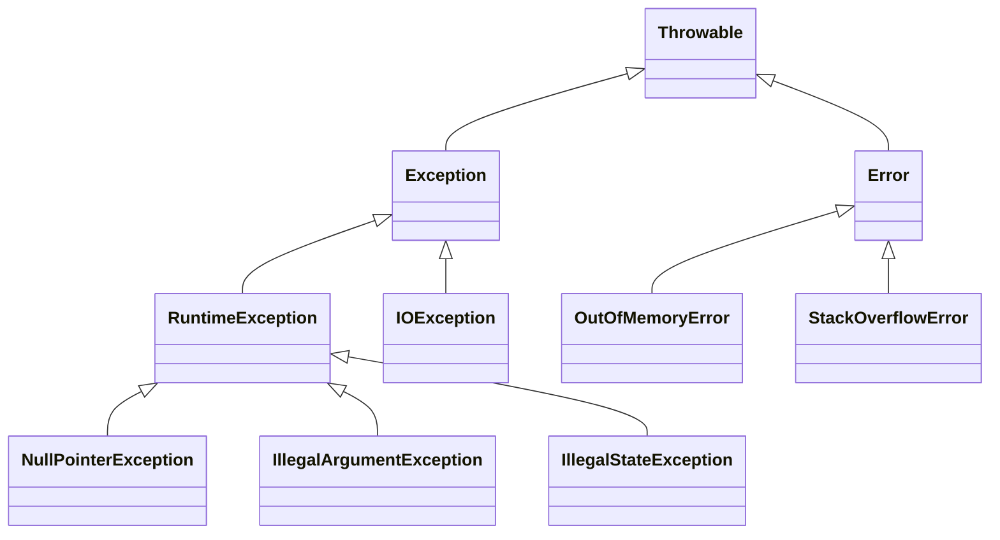

# 02b · Core Java APIs, Modern Java and Tricky Output Questions

This part continues the Core Java study guide with concurrent collections overview, streams, lambdas, generics, reflection, serialization, exceptions, design patterns, SOLID, immutability, Java 8 to 21 features, memory leaks, and tricky output questions.

**Legend:** 🟢 Beginner · 🟡 Intermediate · 🔴 Advanced · ⚫ FAANG · 🔥 = very frequently asked

## Table of Contents
- [Concurrent Collections and Streams](#concurrent-collections-and-streams)
- [Functional Java, Optional and Generics](#functional-java-optional-and-generics)
- [Reflection, Serialization and Exceptions](#reflection-serialization-and-exceptions)
- [Design, SOLID, Immutability and Modern Java](#design-solid-immutability-and-modern-java)
- [Tricky Output Questions](#tricky-output-questions)
- [Revision Cheat Sheet](#revision-cheat-sheet)
- [Flashcards](#flashcards)

## Concurrent Collections and Streams

### Q41. What concurrent collections should a Java developer know?
`🟡 Intermediate` `🔥` `Must-know SDE-1`

**Why they ask:** They want awareness of safe shared data structures without going deep into concurrency.

**Short answer (say this first, 20-40 sec):**
Use `ConcurrentHashMap` for concurrent key-value access, `CopyOnWriteArrayList` for read-heavy listener lists, blocking queues for producer-consumer workflows, and concurrent queues for non-blocking queue access. Choose based on read/write ratio and required blocking behavior.

**Detailed answer:**
| Collection | Best use | Important note |
|---|---|---|
| `ConcurrentHashMap` | Shared counters/cache metadata | No null keys/values |
| `CopyOnWriteArrayList` | Read-heavy observers/listeners | Writes copy the array, expensive |
| `ArrayBlockingQueue` | Bounded producer-consumer | Applies backpressure |
| `LinkedBlockingQueue` | Producer-consumer | Optionally bounded; unbounded can grow |
| `ConcurrentLinkedQueue` | Non-blocking FIFO | No blocking waits |
| `PriorityBlockingQueue` | Thread-safe priority queue | Unbounded by default |

```java
import java.util.concurrent.ConcurrentHashMap;
import java.util.concurrent.ConcurrentMap;

ConcurrentMap<String, Long> hits = new ConcurrentHashMap<>();
hits.merge("/api/email", 1L, Long::sum);
```

Concurrency is covered deeply elsewhere; here, the interview expectation is choosing the right collection and using atomic methods.

**Common mistakes:**
- Using `Collections.synchronizedMap` and then iterating unsafely.
- Doing `get` then `put` instead of atomic `compute` or `merge`.
- Using `CopyOnWriteArrayList` for write-heavy workloads.

**Follow-ups:**
- *Why no null in ConcurrentHashMap?* → Null would create ambiguity with absence in concurrent reads.
- *What gives backpressure?* → Bounded blocking queues.

### Q42. What is lazy evaluation in Java Streams?
`🟡 Intermediate` `🔥` `Must-know SDE-1`

**Why they ask:** Streams are widely used, and laziness affects correctness and performance.

**Short answer (say this first, 20-40 sec):**
Intermediate stream operations are lazy; they do not run until a terminal operation is invoked. The pipeline processes elements through operations, often one element at a time, with short-circuiting when possible.

**Detailed answer:**


```java
import java.util.List;

List<String> names = List.of("Azam", "Aman", "Riya");
List<String> result = names.stream()
        .filter(name -> name.startsWith("A"))
        .map(String::toUpperCase)
        .toList();
```

Nothing executes until `toList()` is called. Since Java 16, `Stream.toList()` returns an unmodifiable list; `Collectors.toList()` does not guarantee mutability but often returns `ArrayList`.

**Common mistakes:**
- Creating a stream pipeline without a terminal operation.
- Reusing a stream after terminal operation.
- Adding side effects in `map` or `filter`.

**Follow-ups:**
- *Name terminal operations.* → `collect`, `toList`, `forEach`, `reduce`, `count`, `findFirst`, `anyMatch`.
- *What is short-circuiting?* → Operations like `limit`, `findFirst`, and `anyMatch` can stop early.

### Q43. What is the difference between `map` and `flatMap`?
`🟢 Beginner` `🔥` `Must-know SDE-1`

**Why they ask:** It is one of the most common Streams API questions.

**Short answer (say this first, 20-40 sec):**
`map` transforms each element into one value. `flatMap` transforms each element into a stream and flattens all produced streams into one stream.

**Detailed answer:**
```java
import java.util.List;

List<String> words = List.of("java streams", "spring boot");

List<String> mapped = words.stream()
        .map(String::toUpperCase)
        .toList();

List<String> flattened = words.stream()
        .flatMap(line -> List.of(line.split(" ")).stream())
        .toList();

System.out.println(mapped);    // [JAVA STREAMS, SPRING BOOT]
System.out.println(flattened); // [java, streams, spring, boot]
```

Use `flatMap` when one input can produce zero, one, or many outputs. It is common for nested lists, optional values, and tokenization.

**Common mistakes:**
- Returning `Stream<Stream<T>>` accidentally.
- Using `flatMap` when one-to-one `map` is simpler.
- Creating streams from nullable values without handling null.

**Follow-ups:**
- *How to flatten `List<List<Integer>>`?* → `lists.stream().flatMap(List::stream).toList()`.
- *Can `Optional` use flatMap?* → Yes, to avoid nested `Optional<Optional<T>>`.

### Q44. How do `groupingBy` and `partitioningBy` collectors differ?
`🟡 Intermediate` `🔥` `Must-know SDE-1`

**Why they ask:** Real service code often aggregates DTOs and query results.

**Short answer (say this first, 20-40 sec):**
`groupingBy` groups elements by any classifier key. `partitioningBy` splits elements into exactly two groups: `true` and `false`.

**Detailed answer:**
```java
import java.util.*;
import java.util.stream.Collectors;

record Employee(String team, int salary) {}

List<Employee> employees = List.of(
        new Employee("Data", 100),
        new Employee("Backend", 120),
        new Employee("Data", 150)
);

Map<String, List<Employee>> byTeam = employees.stream()
        .collect(Collectors.groupingBy(Employee::team));

Map<Boolean, List<Employee>> highPaid = employees.stream()
        .collect(Collectors.partitioningBy(e -> e.salary() >= 120));
```

`groupingBy` can use downstream collectors like `counting`, `mapping`, or `summarizingInt`.

**Common mistakes:**
- Using `groupingBy` for a boolean split where `partitioningBy` is clearer.
- Forgetting `groupingByConcurrent` is only useful with parallel streams and concurrent downstream behavior.
- Assuming output map type unless specifying supplier.

**Follow-ups:**
- *How count by team?* → `groupingBy(Employee::team, counting())`.
- *How group into TreeMap?* → Use `groupingBy(classifier, TreeMap::new, downstream)`.

### Q45. What are common parallel stream pitfalls?
`🔴 Advanced` `🔥` `Must-know SDE-1`

**Why they ask:** Parallel streams are easy to misuse in backend applications.

**Short answer (say this first, 20-40 sec):**
Parallel streams can help CPU-bound, independent, large workloads, but they can hurt for small tasks, blocking I/O, shared mutable state, ordering requirements, or common-pool contention.

**Detailed answer:**
Bad:
```java
import java.util.*;

List<Integer> result = new ArrayList<>();
List.of(1, 2, 3, 4).parallelStream()
        .forEach(result::add); // unsafe shared mutation
```

Better:
```java
List<Integer> result = List.of(1, 2, 3, 4).parallelStream()
        .map(x -> x * x)
        .toList();
```

Pitfalls:
- uses common `ForkJoinPool` by default,
- blocking database/API calls can starve unrelated parallel tasks,
- encounter order can reduce parallel benefit,
- side effects cause races,
- overhead may exceed work.

**Common mistakes:**
- Adding `.parallel()` to make slow I/O faster.
- Mutating shared collections.
- Benchmarking without realistic data size and warm-up.

**Follow-ups:**
- *When consider parallel stream?* → Large in-memory CPU-bound transformations with no shared state.
- *What for async I/O?* → Use proper async APIs, executor services, reactive stacks, or virtual threads depending on design.

## Functional Java, Optional and Generics

### Q46. What are functional interfaces?
`🟢 Beginner` `🔥` `Must-know SDE-1`

**Why they ask:** Lambdas and streams are built around functional interfaces.

**Short answer (say this first, 20-40 sec):**
A functional interface has exactly one abstract method and can be implemented with a lambda or method reference. `@FunctionalInterface` is optional but helps the compiler catch mistakes.

**Detailed answer:**
Common interfaces:
- `Predicate<T>` → `boolean test(T t)`
- `Function<T,R>` → `R apply(T t)`
- `Consumer<T>` → `void accept(T t)`
- `Supplier<T>` → `T get()`
- `BiFunction<T,U,R>` → `R apply(T t, U u)`

```java
import java.util.function.Predicate;

Predicate<String> nonBlank = value -> value != null && !value.isBlank();
System.out.println(nonBlank.test("java")); // true
```

Default and static methods do not count toward the single abstract method limit.

**Common mistakes:**
- Thinking a functional interface cannot have default methods.
- Creating custom interfaces when standard ones are clearer.
- Throwing checked exceptions from lambdas without handling them.

**Follow-ups:**
- *What is SAM?* → Single Abstract Method.
- *Can lambda implement an abstract class?* → No, only functional interfaces.

### Q47. What does effectively final mean in lambdas?
`🟡 Intermediate` `🔥` `Must-know SDE-1`

**Why they ask:** It reveals how lambdas capture local variables.

**Short answer (say this first, 20-40 sec):**
A local variable captured by a lambda must be final or effectively final, meaning it is assigned once and not changed afterward. The lambda captures the value, not a mutable local variable slot.

**Detailed answer:**
```java
int factor = 10;
var values = java.util.List.of(1, 2, 3);
var scaled = values.stream()
        .map(value -> value * factor)
        .toList();
```

This compiles because `factor` is not reassigned. This does not mean objects must be immutable:

```java
StringBuilder sb = new StringBuilder();
Runnable r = () -> sb.append("x"); // compiles, but mutation may be unsafe
```

**Common mistakes:**
- Reassigning a captured local variable.
- Using arrays or holders to work around effectively final and creating unclear code.
- Mutating captured objects in parallel streams.

**Follow-ups:**
- *Can lambdas access instance fields?* → Yes; they capture `this`, so field mutation is possible.
- *Why this rule?* → It avoids confusing local-variable lifetime and thread-visibility semantics.

### Q48. What are method references?
`🟢 Beginner` `🔥` `Must-know SDE-1`

**Why they ask:** Method references make stream code concise but can be confusing.

**Short answer (say this first, 20-40 sec):**
A method reference is shorthand for a lambda that calls an existing method. Forms include static method, instance method of a particular object, instance method of an arbitrary object, and constructor reference.

**Detailed answer:**
```java
import java.util.List;

List<String> names = List.of("azam", "riya");
names.stream()
        .map(String::toUpperCase)
        .forEach(System.out::println);
```

Forms:
- `Integer::parseInt`
- `System.out::println`
- `String::trim`
- `ArrayList::new`

Use method references when they improve readability; use lambdas when arguments need transformation or names clarify intent.

**Common mistakes:**
- Using method references that hide important logic.
- Confusing `object::method` with `ClassName::method`.
- Forgetting checked exceptions still need handling.

**Follow-ups:**
- *What is `String::trim` equivalent to?* → `s -> s.trim()`.
- *What is `User::new`?* → Constructor reference matching a functional interface.

### Q49. How should `Optional` be used and misused?
`🟡 Intermediate` `🔥` `Must-know SDE-1`

**Why they ask:** Optional improves null handling only when used idiomatically.

**Short answer (say this first, 20-40 sec):**
Use `Optional` mainly as a return type when a value may be absent. Avoid using it for fields, method parameters, collections, serialization DTOs, or calling `get()` without checking.

**Detailed answer:**
Good:
```java
import java.util.Optional;

Optional<String> findEmail(long userId) {
    return userId > 0 ? Optional.of("a@example.com") : Optional.empty();
}

String email = findEmail(1)
        .filter(e -> e.endsWith("@example.com"))
        .orElse("unknown@example.com");
```

Misuse:
```java
Optional<String> name = Optional.ofNullable(null);
name.get(); // NoSuchElementException
```

Prefer `orElseGet` when fallback is expensive because `orElse` evaluates eagerly.

**Common mistakes:**
- Returning `null` from a method declared as `Optional<T>`.
- Using `Optional.get()` as a replacement for null check.
- Storing `Optional` in entity fields.

**Follow-ups:**
- *`orElse` vs `orElseGet`?* → `orElse` eagerly evaluates fallback; `orElseGet` calls supplier only if empty.
- *Can Optional contain null?* → No. `of(null)` throws; `ofNullable(null)` gives empty.

### Q50. What is type erasure in Java generics?
`🟡 Intermediate` `🔥` `Must-know SDE-1`

**Why they ask:** It explains many generic limitations and warnings.

**Short answer (say this first, 20-40 sec):**
Java implements generics mostly by type erasure. Generic type information is checked at compile time, then erased to raw types or bounds in bytecode, with casts inserted where needed.

**Detailed answer:**
```java
import java.util.List;

List<String> names = List.of("Azam");
// Runtime class is usually java.util.ImmutableCollections implementation, not List<String>.
System.out.println(names.getClass());
```

Consequences:
- cannot create `new T()`,
- cannot create generic arrays safely,
- cannot use `instanceof List<String>`,
- overloaded methods cannot differ only by generic type parameter,
- bridge methods may be generated for polymorphism.

**Common mistakes:**
- Expecting generic type at runtime for normal collections.
- Ignoring unchecked warnings.
- Using raw types.

**Follow-ups:**
- *Are all generic details erased?* → Some metadata remains in signatures for reflection, but runtime object identity is not parameterized.
- *What are reified generics?* → Runtime-retained generic types; Java does not have them for normal generics.

### Q51. Explain wildcards and PECS.
`🔴 Advanced` `🔥` `Must-know SDE-1`

**Why they ask:** It tests API design with generics.

**Short answer (say this first, 20-40 sec):**
PECS means Producer Extends, Consumer Super. Use `? extends T` when reading values as `T`; use `? super T` when writing values of type `T`.

**Detailed answer:**
```java
import java.util.*;

static double sum(List<? extends Number> numbers) {
    double total = 0;
    for (Number number : numbers) total += number.doubleValue();
    return total;
}

static void addIntegers(List<? super Integer> values) {
    values.add(1);
    values.add(2);
}
```

`List<? extends Number>` could be `List<Integer>` or `List<Double>`, so adding a `Double` would be unsafe. `List<? super Integer>` can accept integers, but reading gives `Object`.

**Common mistakes:**
- Using `List<Object>` when `List<?>` is intended.
- Trying to add to `? extends`.
- Forgetting reads from `? super T` are only safely `Object`.

**Follow-ups:**
- *Is `List<String>` a subtype of `List<Object>`?* → No. Generics are invariant.
- *What does unbounded wildcard mean?* → `List<?>` means list of unknown element type, safe for reading as `Object`.

## Reflection, Serialization and Exceptions

### Q52. What is reflection and when should it be used?
`🟡 Intermediate` `🔥` `Must-know SDE-1`

**Why they ask:** Frameworks like Spring, Hibernate, and testing tools use reflection heavily.

**Short answer (say this first, 20-40 sec):**
Reflection lets code inspect and invoke classes, methods, fields, annotations, and constructors at runtime. Use it for frameworks and tooling, but avoid it in normal business code unless needed.

**Detailed answer:**
```java
import java.lang.reflect.Method;

class Greeting {
    public String hello(String name) {
        return "Hello " + name;
    }
}

Method method = Greeting.class.getMethod("hello", String.class);
String result = (String) method.invoke(new Greeting(), "Azam");
System.out.println(result);
```

Trade-offs:
- slower than direct calls,
- weaker compile-time safety,
- access restrictions under modules,
- possible security concerns,
- harder refactoring.

**Common mistakes:**
- Using reflection instead of polymorphism.
- Ignoring checked exceptions from reflective calls.
- Accessing private fields casually in production code.

**Follow-ups:**
- *Where does Spring use reflection?* → Dependency injection, annotations, proxies, data binding, and configuration.
- *What is annotation retention?* → Whether annotations are available in source, class file, or runtime.

### Q53. Explain Java serialization, `serialVersionUID`, and `transient`.
`🟡 Intermediate` `🔥` `Must-know SDE-1`

**Why they ask:** Serialization appears in caching, messaging, and legacy systems.

**Short answer (say this first, 20-40 sec):**
Java serialization converts an object graph to bytes and back. `serialVersionUID` controls class version compatibility, and `transient` excludes fields from default serialization.

**Detailed answer:**
```java
import java.io.Serializable;

class SessionData implements Serializable {
    private static final long serialVersionUID = 1L;

    private final String userId;
    private transient String accessToken;

    SessionData(String userId, String accessToken) {
        this.userId = userId;
        this.accessToken = accessToken;
    }
}
```

If no `serialVersionUID` is declared, the JVM computes one from class details; small code changes can break deserialization. `transient` fields deserialize to default values unless custom methods restore them.

**Common mistakes:**
- Serializing secrets accidentally.
- Forgetting `serialVersionUID`.
- Treating Java serialization as safe for untrusted input.

**Follow-ups:**
- *What is serialized?* → Non-transient, non-static instance fields of serializable object graph.
- *Are static fields serialized?* → No, they belong to the class, not object state.

### Q54. What is `Externalizable` and why is deserialization risky?
`🔴 Advanced` `Stretch`

**Why they ask:** They check security awareness around object input.

**Short answer (say this first, 20-40 sec):**
`Externalizable` gives full control over serialization via `writeExternal` and `readExternal`, but requires a public no-arg constructor. Deserialization is risky because untrusted bytes can trigger gadget chains, unexpected object creation, and invariant bypass.

**Detailed answer:**
```java
import java.io.*;

class Point implements Externalizable {
    private int x;
    private int y;

    public Point() { }

    Point(int x, int y) {
        this.x = x;
        this.y = y;
    }

    @Override public void writeExternal(ObjectOutput out) throws IOException {
        out.writeInt(x);
        out.writeInt(y);
    }

    @Override public void readExternal(ObjectInput in) throws IOException {
        x = in.readInt();
        y = in.readInt();
    }
}
```

For external data, prefer JSON/Protobuf with validation, allow-lists, and no arbitrary object deserialization.

**Common mistakes:**
- Deserializing untrusted data.
- Forgetting no-arg constructor for `Externalizable`.
- Not validating invariants in `readObject` or `readExternal`.

**Follow-ups:**
- *What is a serialization proxy?* → A safer pattern where a simple proxy object represents serialized form.
- *What is `readResolve`?* → A hook that can replace deserialized object, often used for singletons.

### Q55. Explain Java exception hierarchy.
`🟢 Beginner` `🔥` `Must-know SDE-1`

**Why they ask:** Exception design affects API contracts and reliability.

**Short answer (say this first, 20-40 sec):**
`Throwable` is the root. `Error` represents serious JVM/system problems, while `Exception` represents conditions applications may handle. `RuntimeException` and its subclasses are unchecked; other exceptions are checked.

**Detailed answer:**


Checked exceptions must be caught or declared. Unchecked exceptions do not need declaration and usually represent programming errors or invalid state.

**Common mistakes:**
- Catching `Throwable` broadly.
- Treating `Error` as normal recoverable exception.
- Swallowing exceptions without logging or rethrowing.

**Follow-ups:**
- *Is `RuntimeException` checked?* → No, it is unchecked.
- *Should you catch `OutOfMemoryError`?* → Usually no; the process may be unstable.

### Q56. Checked vs unchecked exceptions: when to use each?
`🟡 Intermediate` `🔥` `Must-know SDE-1`

**Why they ask:** They evaluate API design judgment.

**Short answer (say this first, 20-40 sec):**
Use checked exceptions for recoverable conditions the caller is expected to handle. Use unchecked exceptions for programming errors, invalid arguments, illegal state, or failures that most callers cannot reasonably recover from.

**Detailed answer:**
```java
class InvalidOrderException extends RuntimeException {
    InvalidOrderException(String message) {
        super(message);
    }
}

void placeOrder(int quantity) {
    if (quantity <= 0) {
        throw new InvalidOrderException("quantity must be positive");
    }
}
```

In REST APIs, map domain exceptions to clear HTTP responses using exception handlers. Preserve causes when wrapping exceptions:

```java
throw new IllegalStateException("Failed to load config", originalException);
```

**Common mistakes:**
- Catching and ignoring exceptions.
- Losing stack trace by throwing a new exception without cause.
- Using checked exceptions for every business rule.

**Follow-ups:**
- *Can constructors throw exceptions?* → Yes.
- *Can overriding method throw broader checked exceptions?* → No.

### Q57. How does try-with-resources work?
`🟡 Intermediate` `🔥` `Must-know SDE-1`

**Why they ask:** Resource cleanup is production-critical.

**Short answer (say this first, 20-40 sec):**
Try-with-resources automatically closes resources implementing `AutoCloseable` in reverse order after the try block. If both body and close throw, close exceptions are suppressed and attached to the primary exception.

**Detailed answer:**
```java
import java.io.BufferedReader;
import java.io.IOException;
import java.nio.file.Files;
import java.nio.file.Path;

String firstLine(Path path) throws IOException {
    try (BufferedReader reader = Files.newBufferedReader(path)) {
        return reader.readLine();
    }
}
```

Suppressed exceptions can be inspected using `getSuppressed()`. Java 9 allows effectively final resources declared before the try to be used in try-with-resources.

**Common mistakes:**
- Closing resources manually and missing exception paths.
- Returning from `finally`.
- Ignoring suppressed exceptions in debugging.

**Follow-ups:**
- *Close order?* → Reverse order of resource declaration.
- *Difference between `Closeable` and `AutoCloseable`?* → `Closeable.close` throws `IOException`; `AutoCloseable.close` throws `Exception`.

### Q58. What are `finally` edge cases?
`🟡 Intermediate` `🔥` `Must-know SDE-1`

**Why they ask:** It is a classic tricky output area.

**Short answer (say this first, 20-40 sec):**
`finally` usually runs, but it can be skipped by JVM termination or process crash. A return or exception in `finally` can override earlier returns or exceptions, so avoid control flow in `finally`.

**Detailed answer:**
```java
static int value() {
    try {
        return 1;
    } finally {
        return 2;
    }
}

System.out.println(value()); // 2
```

Bad practice: returning from `finally` hides the original result and can suppress exceptions. Use `finally` only for cleanup when try-with-resources is not enough.

`finally` may not run if:
- `System.exit` is called,
- JVM crashes,
- OS kills process,
- hardware failure,
- daemon thread ends with JVM shutdown.

**Common mistakes:**
- Saying `finally` always runs.
- Returning from `finally`.
- Throwing from cleanup and losing original exception context.

**Follow-ups:**
- *Does finally run after catch?* → Yes, after try/catch completes normally or abruptly.
- *What is better for resources?* → Try-with-resources.

## Design, SOLID, Immutability and Modern Java

### Q59. Give an overview of common design patterns in Java.
`🟡 Intermediate` `🔥` `Must-know SDE-1`

**Why they ask:** They expect pattern literacy but not full LLD depth in Core Java.

**Short answer (say this first, 20-40 sec):**
Patterns are reusable design solutions. Know Singleton, Builder, Factory, Strategy, Observer, Decorator, Adapter, Proxy, and Template at a high level; use them when they simplify design, not to force pattern names.

**Detailed answer:**
| Pattern | Intent | Java example |
|---|---|---|
| Singleton | One instance | `enum AppConfig { INSTANCE }` |
| Builder | Construct complex object readably | `User.builder().name("A").build()` |
| Factory | Hide creation decision | `PaymentGatewayFactory.create(type)` |
| Strategy | Swap algorithm | `Comparator`, discount policy |
| Observer | Notify subscribers | listeners, events |
| Decorator | Add behavior by wrapping | `BufferedInputStream` |
| Adapter | Convert interface | legacy API wrapper |
| Proxy | Control access | Spring AOP proxy |
| Template | Fixed skeleton, variable steps | framework lifecycle hooks |

Singleton variants:
```java
enum Config {
    INSTANCE;
}

final class LazyConfig {
    private static volatile LazyConfig instance;
    private LazyConfig() { }

    static LazyConfig getInstance() {
        LazyConfig local = instance;
        if (local == null) {
            synchronized (LazyConfig.class) {
                local = instance;
                if (local == null) {
                    instance = local = new LazyConfig();
                }
            }
        }
        return local;
    }
}
```

`volatile` is required for safe double-checked locking. Enum singleton is simplest and serialization-safe.

**Common mistakes:**
- Implementing unsafe lazy singleton without `volatile`.
- Overusing Singleton and creating hidden global state.
- Calling every `if` statement a Factory pattern.

**Follow-ups:**
- *Why Builder?* → Avoid telescoping constructors and improve readability for many optional fields.
- *Why Strategy in Spring?* → Inject an interface implementation for runtime behavior selection.

### Q60. Explain SOLID with a bad-to-good Java example.
`🔴 Advanced` `🔥` `Must-know SDE-1`

**Why they ask:** SOLID tests maintainable design judgment.

**Short answer (say this first, 20-40 sec):**
SOLID means Single Responsibility, Open/Closed, Liskov Substitution, Interface Segregation, and Dependency Inversion. In Java, it usually means small cohesive classes, interfaces for stable contracts, composition, and dependency injection.

**Detailed answer:**
Bad: one class validates, saves, and emails.
```java
class OrderServiceBad {
    void place(Order order) {
        if (order.total() <= 0) throw new IllegalArgumentException();
        // save to database
        // send email
    }
}
record Order(long total) {}
```

Good: separate responsibilities and depend on abstractions.
```java
interface OrderRepository {
    void save(Order order);
}

interface Notifier {
    void sendOrderPlaced(Order order);
}

final class OrderService {
    private final OrderRepository repository;
    private final Notifier notifier;

    OrderService(OrderRepository repository, Notifier notifier) {
        this.repository = repository;
        this.notifier = notifier;
    }

    void place(Order order) {
        if (order.total() <= 0) throw new IllegalArgumentException("total must be positive");
        repository.save(order);
        notifier.sendOrderPlaced(order);
    }
}
```

This supports testing with fake repository/notifier and adding SMS notification without changing validation logic.

**Common mistakes:**
- Treating SOLID as mandatory class explosion.
- Creating interfaces for every implementation without reason.
- Violating LSP by subclasses that throw unsupported-operation exceptions.

**Follow-ups:**
- *Open/Closed meaning?* → Open for extension, closed for modification.
- *Dependency inversion vs injection?* → DIP is the principle; DI is a technique to supply dependencies.

### Q61. How do you write an immutable class?
`🟡 Intermediate` `🔥` `Must-know SDE-1`

**Why they ask:** Immutability improves thread safety and key correctness.

**Short answer (say this first, 20-40 sec):**
Make the class final, fields private final, no setters, validate in constructor, defensively copy mutable inputs, and return defensive copies or unmodifiable views for mutable fields.

**Detailed answer:**
```java
import java.time.LocalDate;
import java.util.List;

public final class UserProfile {
    private final String name;
    private final LocalDate birthDate;
    private final List<String> skills;

    public UserProfile(String name, LocalDate birthDate, List<String> skills) {
        this.name = name;
        this.birthDate = birthDate;
        this.skills = List.copyOf(skills);
    }

    public String name() { return name; }
    public LocalDate birthDate() { return birthDate; }
    public List<String> skills() { return skills; }
}
```

`LocalDate` is immutable, and `List.copyOf` prevents external mutation. Records are shallowly immutable only if component objects are immutable or defensively copied in a compact constructor.

**Common mistakes:**
- Returning mutable internal lists.
- Assuming `final` class fields make referenced objects immutable.
- Forgetting defensive copies for `Date`, arrays, collections, or builders.

**Follow-ups:**
- *Are records immutable?* → They are shallowly immutable; components can reference mutable objects.
- *Why final class?* → Prevent subclass from adding mutability or breaking invariants.

### Q62. What changed from Java 8 to Java 21?
`🟡 Intermediate` `🔥` `Must-know SDE-1`

**Why they ask:** Modern Java knowledge matters for current backend roles.

**Short answer (say this first, 20-40 sec):**
Java 8 added lambdas, streams, Optional, and time API. Later releases added `var`, text blocks, records, sealed classes, pattern matching, switch expressions, and Java 21 virtual threads.

**Detailed answer:**
| Feature | Version | Use |
|---|---:|---|
| Lambdas, Streams, Optional | 8 | Functional style and pipelines |
| `var` local variables | 10 | Reduce local verbosity |
| Text blocks | 15 | Multi-line strings |
| Records | 16 | Transparent data carriers |
| Sealed classes | 17 | Controlled inheritance |
| Pattern matching for `instanceof` | 16 | Safer casts |
| Pattern matching switch | 21 | Type/guard-based switch |
| Virtual threads | 21 | Lightweight blocking-style concurrency |

```java
record ApiResponse(String status, String message) {}

sealed interface Shape permits Circle, Rectangle {}
record Circle(double radius) implements Shape {}
record Rectangle(double width, double height) implements Shape {}
```

**Common mistakes:**
- Using `var` for fields; it is local variables only.
- Treating records as JPA entity replacements by default.
- Assuming all Java 21 features are supported in older Spring Boot/runtime setups.

**Follow-ups:**
- *When use records?* → Immutable DTOs/value carriers with clear components.
- *When use sealed classes?* → When valid subtypes are known and controlled.

### Q63. What are records and how are they different from normal classes?
`🟡 Intermediate` `🔥` `Must-know SDE-1`

**Why they ask:** Records are common in modern DTO and value modeling.

**Short answer (say this first, 20-40 sec):**
Records are concise classes for transparent data carriers. Java generates constructor, accessors, `equals`, `hashCode`, and `toString` based on components.

**Detailed answer:**
```java
record UserDto(long id, String name) {
    UserDto {
        if (id <= 0) throw new IllegalArgumentException("id must be positive");
        if (name == null || name.isBlank()) throw new IllegalArgumentException("name required");
    }
}
```

Records are final, cannot extend another class, and their component fields are final. They can implement interfaces and define methods. They are not deeply immutable if components are mutable.

**Common mistakes:**
- Adding business behavior-heavy mutable state to records.
- Assuming record components are deeply immutable.
- Trying to add instance fields outside components.

**Follow-ups:**
- *Are record accessors named `getName`?* → No, accessor is `name()`.
- *Can records have compact constructors?* → Yes, for validation and normalization.

### Q64. What are sealed classes?
`🔴 Advanced` `Must-know SDE-1`

**Why they ask:** Sealed types improve domain modeling and pattern matching.

**Short answer (say this first, 20-40 sec):**
Sealed classes/interfaces restrict which classes can extend or implement them. They are useful when the set of valid subtypes is known.

**Detailed answer:**
```java
sealed interface PaymentResult permits Success, Failure {}
record Success(String transactionId) implements PaymentResult {}
record Failure(String reason) implements PaymentResult {}

static String message(PaymentResult result) {
    return switch (result) {
        case Success s -> "Paid " + s.transactionId();
        case Failure f -> "Failed " + f.reason();
    };
}
```

In Java 21, pattern matching for switch is finalized. Sealed hierarchies let the compiler check exhaustiveness in many switch expressions.

**Common mistakes:**
- Forgetting permitted subclasses must be accessible and declare `final`, `sealed`, or `non-sealed`.
- Using sealed types for extension points meant for external users.
- Confusing sealed with immutable.

**Follow-ups:**
- *What does `non-sealed` mean?* → It reopens extension below that subtype.
- *Can sealed interface be implemented by records?* → Yes.

### Q65. What are text blocks, switch expressions, and `var`?
`🟢 Beginner` `Must-know SDE-1`

**Why they ask:** These are practical modern Java features.

**Short answer (say this first, 20-40 sec):**
Text blocks simplify multi-line strings, switch expressions return values, and `var` lets the compiler infer local variable types. They improve readability when used carefully.

**Detailed answer:**
```java
var status = "ACTIVE";

String sql = """
        SELECT id, name
        FROM users
        WHERE status = ?
        """;

String label = switch (status) {
    case "ACTIVE" -> "User is active";
    case "BLOCKED" -> "User is blocked";
    default -> "Unknown";
};
```

Use `var` when the type is obvious from the right-hand side. Avoid it when it hides important types in complex code.

**Common mistakes:**
- Using `var` for fields or method parameters in normal Java; it is local variables only.
- Forgetting switch expressions must be exhaustive.
- Accidentally changing indentation in text blocks.

**Follow-ups:**
- *Can `var x = null` compile?* → No, compiler cannot infer type.
- *What is `yield` in switch?* → It returns a value from a block-style switch case.

### Q66. What are virtual threads in Java 21?
`🔴 Advanced` `Stretch`

**Why they ask:** Virtual threads are important but concurrency is covered deeply elsewhere.

**Short answer (say this first, 20-40 sec):**
Virtual threads are lightweight JVM-managed threads designed for high-concurrency blocking-style code. They make it cheaper to have many concurrent tasks, especially I/O-bound tasks, without switching to callback-heavy code.

**Detailed answer:**
```java
import java.util.concurrent.Executors;

try (var executor = Executors.newVirtualThreadPerTaskExecutor()) {
    for (int i = 0; i < 1000; i++) {
        int id = i;
        executor.submit(() -> "task " + id);
    }
}
```

Virtual threads are not faster CPU threads. They help when tasks block on I/O and can unmount from carrier threads. Avoid pinning carrier threads with long synchronized blocking sections or unsupported native blocking.

**Common mistakes:**
- Using virtual threads to speed up CPU-bound loops.
- Keeping small database connection pools and expecting unlimited throughput.
- Ignoring backpressure and downstream limits.

**Follow-ups:**
- *Are virtual threads daemon threads?* → They are threads managed by JVM; lifecycle depends on executor/use.
- *Do you still need connection pools?* → Yes, downstream resources remain limited.

### Q67. What are common memory leak patterns in modern Java apps?
`🟡 Intermediate` `🔥` `Must-know SDE-1`

**Why they ask:** This bridges Core Java with production debugging.

**Short answer (say this first, 20-40 sec):**
Leaks happen when unused objects remain reachable. Common patterns include unbounded caches, static collections, listeners, `ThreadLocal` in pools, class loader leaks, direct buffers, and unclosed resources.

**Detailed answer:**
Production checklist:
- Check heap after full GC over time.
- Capture heap dump when memory is high.
- Inspect dominator tree and retained size.
- Look for large maps, lists, caches, sessions, byte arrays.
- Check thread locals and listener registries.
- Check off-heap/direct memory if heap looks stable.

```java
import java.util.LinkedHashMap;
import java.util.Map;

Map<String, byte[]> cache = new LinkedHashMap<>() {
    @Override
    protected boolean removeEldestEntry(Map.Entry<String, byte[]> eldest) {
        return size() > 1_000;
    }
};
```

**Common mistakes:**
- Calling `System.gc()` as a fix.
- Looking only at heap when direct memory or threads are the issue.
- Adding caches without bounds.

**Follow-ups:**
- *What tools help?* → JFR, JDK Mission Control, VisualVM, Eclipse MAT.
- *What is a dominator tree?* → A heap-dump view showing objects retaining other objects.

### Q68. What is pattern matching for `instanceof` and switch?
`🟡 Intermediate` `Must-know SDE-1`

**Why they ask:** It tests current Java syntax and safe casting.

**Short answer (say this first, 20-40 sec):**
Pattern matching combines type check and cast. `instanceof` patterns reduce boilerplate, and Java 21 switch patterns can branch by type with exhaustiveness support.

**Detailed answer:**
```java
static int length(Object value) {
    if (value instanceof String text) {
        return text.length();
    }
    return 0;
}

static String describe(Object value) {
    return switch (value) {
        case null -> "null";
        case String s -> "string " + s.length();
        case Integer i -> "integer " + i;
        default -> "other";
    };
}
```

With sealed hierarchies, switch can be exhaustive without a default if all permitted types are covered.

**Common mistakes:**
- Using pattern variable outside its flow scope.
- Forgetting `case null` if null input is possible.
- Using pattern switch on older Java versions.

**Follow-ups:**
- *What is flow scoping?* → Pattern variable is available only where the compiler knows the match succeeded.
- *Is pattern switch Java 8?* → No, it is a modern Java feature finalized in Java 21.

## Tricky Output Questions

### Q69. What does this print: Integer cache with `==`?
`🟢 Beginner` `🔥` `Must-know SDE-1`

**Why they ask:** It exposes wrapper caching and reference comparison.

**Short answer (say this first, 20-40 sec):**
It prints `true` then `false` on standard settings. Small boxed integers are cached, but larger ones usually create different objects.

**Detailed answer:**
```java
Integer a = 127;
Integer b = 127;
Integer c = 128;
Integer d = 128;

System.out.println(a == b);
System.out.println(c == d);
```

Output:
```text
true
false
```

Java caches `Integer` values from -128 to 127 by default. `==` compares references for wrappers; use `equals()` for numeric value comparison. The upper cache bound can be tuned in some JVMs, but do not rely on that.

**Common mistakes:**
- Saying both are true because values match.
- Saying both are false because wrappers are objects.
- Using `==` for boxed values in business logic.

**Follow-ups:**
- *Does unboxing affect comparison?* → If one side is primitive, unboxing happens and numeric comparison is used.
- *Which wrappers cache values?* → Boolean, Byte, Short, Character small range, Integer/Long small range; exact details vary by type.

### Q70. What does this print: String literal vs `new String`?
`🟢 Beginner` `🔥` `Must-know SDE-1`

**Why they ask:** It tests String pool and reference equality.

**Short answer (say this first, 20-40 sec):**
It prints `true`, `false`, `true`. Literals share the pool, `new String` creates a different object, and `equals` compares content.

**Detailed answer:**
```java
String a = "java";
String b = "ja" + "va";
String c = new String("java");

System.out.println(a == b);
System.out.println(a == c);
System.out.println(a.equals(c));
```

Output:
```text
true
false
true
```

`"ja" + "va"` is a compile-time constant and is interned as `"java"`. `new String("java")` creates a separate heap object.

**Common mistakes:**
- Using `==` for content comparison.
- Thinking all concatenation is compile-time.
- Forgetting `equals` can throw NPE if called on null reference.

**Follow-ups:**
- *What about variable concatenation?* → It is runtime concatenation unless compiler can prove constants.
- *How compare null-safe?* → `Objects.equals(a, b)`.

### Q71. What does this print: static and instance initialization order?
`🟡 Intermediate` `🔥` `Must-know SDE-1`

**Why they ask:** Initialization order is common in Java output rounds.

**Short answer (say this first, 20-40 sec):**
Parent static runs first, then child static, then parent instance initialization and constructor, then child instance initialization and constructor.

**Detailed answer:**
```java
class Parent {
    static { System.out.print("PS "); }
    { System.out.print("PI "); }
    Parent() { System.out.print("PC "); }
}
class Child extends Parent {
    static { System.out.print("CS "); }
    { System.out.print("CI "); }
    Child() { System.out.print("CC "); }
}
new Child();
```

Output:
```text
PS CS PI PC CI CC
```

Static initialization happens once per class before first active use. Instance initialization runs each time an object is created, after `super()` begins parent construction.

**Common mistakes:**
- Running child instance block before parent constructor.
- Forgetting static blocks run only once.
- Ignoring implicit `super()`.

**Follow-ups:**
- *What if you create another Child?* → Only `PI PC CI CC` prints again.
- *Do field initializers follow textual order?* → Yes, with instance blocks in textual order.

### Q72. What does this print: overloading vs overriding?
`🟡 Intermediate` `🔥` `Must-know SDE-1`

**Why they ask:** It checks compile-time overload and runtime override together.

**Short answer (say this first, 20-40 sec):**
It prints `parent object`. Overload selection uses compile-time reference types; then overriding dispatches the selected method at runtime.

**Detailed answer:**
```java
class Parent {
    void print(Object o) { System.out.println("parent object"); }
}
class Child extends Parent {
    void print(String s) { System.out.println("child string"); }
}

Parent p = new Child();
p.print("hello");
```

Output:
```text
parent object
```

The reference type `Parent` has only `print(Object)`, so that overload is selected. `Child` does not override `print(Object)`; it overloads `print(String)`.

**Common mistakes:**
- Choosing `child string` because runtime object is Child.
- Forgetting overload selection is compile-time.
- Missing `@Override`, which would catch accidental overloads.

**Follow-ups:**
- *What if Child overrides `print(Object)`?* → Then runtime dispatch calls child implementation.
- *What if reference is `Child`?* → `print(String)` is selected for a string argument.

### Q73. What does this print: return in `finally`?
`🟡 Intermediate` `🔥` `Must-know SDE-1`

**Why they ask:** It reveals dangerous control flow in exception handling.

**Short answer (say this first, 20-40 sec):**
It prints `2`. A return in `finally` overrides the return from `try`, which is why returning from `finally` should be avoided.

**Detailed answer:**
```java
static int test() {
    try {
        return 1;
    } finally {
        return 2;
    }
}

System.out.println(test());
```

Output:
```text
2
```

If `try` threw an exception and `finally` returned, the exception would be suppressed. This can hide serious bugs.

**Common mistakes:**
- Saying `finally` cannot affect return.
- Using return in cleanup blocks.
- Forgetting `finally` can also throw and mask original exceptions.

**Follow-ups:**
- *Should finally return values?* → No.
- *What should finally do?* → Minimal cleanup only, preferably replaced by try-with-resources.

### Q74. What does this print: Java pass-by-value?
`🟢 Beginner` `🔥` `Must-know SDE-1`

**Why they ask:** It catches pass-by-reference misconception.

**Short answer (say this first, 20-40 sec):**
It prints `AX`. The method mutates the object through the copied reference, but reassignment affects only the local parameter.

**Detailed answer:**
```java
static void modify(StringBuilder builder) {
    builder.append("X");
    builder = new StringBuilder("B");
    builder.append("Y");
}

StringBuilder sb = new StringBuilder("A");
modify(sb);
System.out.println(sb);
```

Output:
```text
AX
```

Java passes a copy of the reference. Both references initially point to the same `StringBuilder`, so mutation is visible. Reassignment points only the local variable to a new object.

**Common mistakes:**
- Saying Java passes objects by reference.
- Expecting output `B Y` or `BY`.
- Confusing mutation and reassignment.

**Follow-ups:**
- *Can you swap two references in a method?* → Not directly.
- *How avoid mutation?* → Use immutable objects or copy before modifying.

### Q75. What does this print: `List.of` immutability?
`🟢 Beginner` `Must-know SDE-1`

**Why they ask:** Modern collection factory methods are common.

**Short answer (say this first, 20-40 sec):**
It prints `UnsupportedOperationException` as an exception. `List.of` returns an unmodifiable list.

**Detailed answer:**
```java
import java.util.List;

List<String> names = List.of("A", "B");
names.add("C");
System.out.println(names);
```

Output:
```text
Exception in thread "main" java.lang.UnsupportedOperationException
```

`List.of` also rejects null elements. If you need a mutable list, create `new ArrayList<>(List.of("A", "B"))`.

**Common mistakes:**
- Assuming `List.of` behaves like `Arrays.asList`.
- Adding null to `List.of`.
- Assuming unmodifiable means deeply immutable for contained objects.

**Follow-ups:**
- *Can elements inside be mutable?* → Yes, the list structure is unmodifiable, not necessarily elements.
- *What about `Arrays.asList`?* → Fixed-size list backed by array; `set` works, `add` does not.

### Q76. What does this print: `Arrays.asList` fixed-size behavior?
`🟡 Intermediate` `🔥` `Must-know SDE-1`

**Why they ask:** It tests subtle collection factory differences.

**Short answer (say this first, 20-40 sec):**
It prints `[X, B]` and then throws `UnsupportedOperationException` on add. `Arrays.asList` returns a fixed-size list backed by the array.

**Detailed answer:**
```java
import java.util.Arrays;
import java.util.List;

String[] array = {"A", "B"};
List<String> list = Arrays.asList(array);
list.set(0, "X");
System.out.println(Arrays.toString(array));
list.add("C");
```

Output:
```text
[X, B]
Exception in thread "main" java.lang.UnsupportedOperationException
```

The list supports replacement but not structural changes. Changes through the list reflect in the backing array.

**Common mistakes:**
- Treating it as a normal mutable `ArrayList`.
- Forgetting primitive arrays behave differently with `Arrays.asList`.
- Confusing it with `List.of`.

**Follow-ups:**
- *How make mutable?* → `new ArrayList<>(Arrays.asList(array))`.
- *What does `Arrays.asList(int[])` produce?* → A `List<int[]>` with one element, not `List<Integer>`.

### Q77. What does this print: `HashSet` with broken `equals` and `hashCode`?
`🟡 Intermediate` `🔥` `Must-know SDE-1`

**Why they ask:** It reinforces equality contracts through observable behavior.

**Short answer (say this first, 20-40 sec):**
It prints `2` because the class does not override `equals` and `hashCode`, so the two objects are considered different by identity.

**Detailed answer:**
```java
import java.util.HashSet;
import java.util.Set;

class User {
    final int id;
    User(int id) { this.id = id; }
}

Set<User> users = new HashSet<>();
users.add(new User(1));
users.add(new User(1));
System.out.println(users.size());
```

Output:
```text
2
```

Default `Object.equals` compares identity. To make logical duplicates collapse, override both `equals` and `hashCode` based on `id`, or use a record.

**Common mistakes:**
- Overriding only `equals`.
- Using mutable fields for set identity.
- Assuming `HashSet` checks all fields automatically.

**Follow-ups:**
- *What if `User` is `record User(int id)`?* → Size becomes `1`.
- *What if only hashCode is same?* → Set still uses `equals` to confirm equality.

### Q78. What does this print: `Optional.orElse` eager evaluation?
`🟡 Intermediate` `🔥` `Must-know SDE-1`

**Why they ask:** It catches a real Optional performance and side-effect pitfall.

**Short answer (say this first, 20-40 sec):**
It prints `fallback` and then `value`. `orElse` evaluates its argument eagerly even when the Optional has a value.

**Detailed answer:**
```java
import java.util.Optional;

static String fallback() {
    System.out.println("fallback");
    return "default";
}

String result = Optional.of("value").orElse(fallback());
System.out.println(result);
```

Output:
```text
fallback
value
```

Use `orElseGet` for lazy fallback:

```java
String result = Optional.of("value").orElseGet(() -> fallback());
```

In this version, `fallback()` is not called.

**Common mistakes:**
- Calling database/API fallback inside `orElse`.
- Assuming Optional is always lazy.
- Returning null from `orElseGet` supplier.

**Follow-ups:**
- *When use `orElse`?* → When fallback is a cheap constant.
- *When use `orElseThrow`?* → When absence is exceptional and should fail fast.

## Revision Cheat Sheet

- `ConcurrentHashMap` supports safe concurrent access; use atomic methods like `merge` and `compute`.
- Streams are lazy until terminal operations; avoid side effects.
- `map` is one-to-one; `flatMap` is one-to-many plus flattening.
- `groupingBy` groups by any key; `partitioningBy` splits by boolean.
- Parallel streams are for large CPU-bound independent workloads, not blocking I/O by default.
- Functional interfaces have one abstract method; lambdas implement them.
- Captured local variables in lambdas must be final or effectively final.
- Use Optional mainly as a return type; avoid fields, parameters, and blind `get()`.
- Generics use type erasure; normal generic type parameters are not retained as runtime object types.
- PECS: producer extends, consumer super.
- Reflection powers frameworks but costs type safety, speed, and simplicity.
- Java serialization is risky for untrusted input; prefer safer formats and validation.
- Checked exceptions are for recoverable caller-handled cases; unchecked for programming/state errors.
- Try-with-resources closes in reverse order and preserves suppressed exceptions.
- Singleton: enum is safest; double-checked locking requires `volatile`.
- SOLID favors cohesive classes, abstractions, substitutability, focused interfaces, and dependency inversion.
- Immutable classes need final fields, no setters, defensive copies, and no leaked mutable state.
- Java 21 adds virtual threads and finalized pattern matching switch; records and sealed classes are modern modeling tools.
- Tricky output questions usually test reference equality, initialization order, overload resolution, and hidden eager evaluation.

## Flashcards

- Q → Which concurrent map rejects null keys? A → `ConcurrentHashMap`.
- Q → Are stream intermediate operations eager? A → No, they are lazy.
- Q → `map` vs `flatMap`? A → `map` returns one result per input; `flatMap` flattens nested streams.
- Q → `partitioningBy` returns how many groups? A → Two: true and false.
- Q → Can captured local variables in lambdas be reassigned? A → No, they must be final or effectively final.
- Q → Main Optional misuse? A → Calling `get()` without checking or using it for fields/parameters.
- Q → What is PECS? A → Producer extends, consumer super.
- Q → What does type erasure remove? A → Most generic type information from runtime object types.
- Q → What does `transient` do? A → Excludes a field from default serialization.
- Q → What is `serialVersionUID` for? A → Serialization compatibility versioning.
- Q → Should you catch `Throwable` broadly? A → No.
- Q → What closes resources automatically? A → Try-with-resources.
- Q → Safest simple singleton? A → Enum singleton.
- Q → Are records deeply immutable? A → No, only shallowly by default.
- Q → Are virtual threads for CPU speedup? A → No, mainly for high-concurrency blocking I/O.


