# 03 · Concurrency and Multithreading

A complete Java backend interview study guide for race conditions, executors, locks, the Java Memory Model, concurrent collections, Java 21 virtual threads, and distributed concurrency. Answers are tuned for SDE-1/SDE-2 backend interviews and production debugging.

🟢 Beginner · 🟡 Intermediate · 🔴 Advanced · ⚫ FAANG · 🔥 = very frequently asked

## Table of Contents
- [Beginner guide to this file](#beginner-guide-to-this-file)
- [Real Interview Questions](#real-interview-questions)
- [Thread Basics and Executors](#thread-basics-and-executors)
- [Locks, Memory Model, and Atomicity](#locks-memory-model-and-atomicity)
- [Concurrent Collections and Coordination](#concurrent-collections-and-coordination)
- [Async, ForkJoin, and Virtual Threads](#async-forkjoin-and-virtual-threads)
- [Production and Distributed Concurrency](#production-and-distributed-concurrency)
- [Testing Concurrent Code](#testing-concurrent-code)
- [Revision Cheat Sheet](#revision-cheat-sheet)
- [Flashcards](#flashcards)

## Beginner guide to this file

### What this file teaches
This file teaches how Java code behaves when many tasks run at the same time. Interviewers ask these
questions because backend services handle many requests, retries, cache loads, database updates, and queue
messages concurrently. In real work, the hard part is not starting threads; it is protecting shared state,
choosing the right ordering guarantee, and keeping production systems responsive when work arrives faster
than it can be processed.

### Mental model
Think of a busy restaurant kitchen: many cooks move around the same counters, ingredients, ovens, tickets,
and serving window. The food is correct only when each shared resource has a clear rule for who may touch it
and when others can trust the result.

- Shared state is any counter, map, cache entry, database row, or message key that more than one worker can
  use.
- Interleavings are the many possible step-by-step orders in which workers can read, pause, and write.
- Atomicity means a whole update acts like one indivisible action, not a half-finished recipe.
- Visibility and ordering are the Java Memory Model rules that decide when one thread sees another thread's
  write.
- Locks, atomics, concurrent collections, queues, and transactions are different ways to draw the safe
  boundary.
- Executors and backpressure control how much work enters the kitchen so workers and queues do not collapse.

### How to think through any question here
1. Name the real shared resource: heap object, map key, cache value, database row, queue partition, or
   external API.
2. Ask which operations must be atomic together; a single variable update is different from a multi-field
   invariant.
3. List possible interleavings: read-read, read-write, write-write, check-then-act, resize, retry, or queue
   redelivery.
4. Decide the visibility and ordering rule needed: final field, volatile, synchronized, lock, concurrent
   collection, Future completion, or transaction commit.
5. Pick the narrowest safe mechanism: immutability first, then confinement, atomics, locks, concurrent
   collections, executor design, database constraints, or distributed coordination.
6. Check liveness separately: deadlock, livelock, starvation, executor saturation, unbounded queues, and
   blocked I/O.
7. Add the production lens: metrics, timeouts, rejection behavior, idempotency, safe shutdown, and evidence
   from thread dumps or profiles.

### Pattern recognition cues
| If the question mentions... | Think about... | Why it fits |
|---|---|---|
| count++, balance update, or check-then-act | Atomicity and races | The read, decision, and write can interleave with another thread. |
| volatile, stale value, or safe publication | Visibility and ordering | The bug may be that a write happened but another thread cannot reliably see it. |
| synchronized, ReentrantLock, or monitors | Lock scope | Correctness depends on every access using the same lock and covering the whole invariant. |
| ConcurrentHashMap, compute, merge, or putIfAbsent | Per-key atomic map operations | Map methods can protect one key, but not every multi-key business rule. |
| executor queue, rejection, or p99 latency | Pool sizing and backpressure | Threads, queues, downstream limits, and retries decide overload behavior. |
| wait, notify, latch, barrier, or semaphore | Coordination protocol | The question is about ordering workers, not just protecting data. |
| deadlock, livelock, or starvation | Liveness | The code may be safe from corruption but still unable to make progress. |
| multiple pods, Redis lock, or idempotency | Distributed concurrency | A Java lock protects only one Java Virtual Machine heap. |
| high Central Processing Unit usage | Busy loops, spinning, resize bugs, or retry storms | Concurrency failures often appear as load, not clean exceptions. |
| ThreadLocal or caches | Lifetime and memory leaks | Values can outlive requests or grow without bounds in pooled threads. |
| virtual threads or parallel streams | Workload fit | Lightweight or parallel execution helps only when blocking and CPU trade-offs are understood. |
| jcstress, latches, or stress tests | Evidence for interleavings | Normal tests rarely explore the unlucky timing that causes concurrency bugs. |

### Abbreviations and key terms
| Short form | Expanded form | Plain meaning |
|---|---|---|
| ABA | A-B-A value change pattern | A lock-free bug where a value changes away and back, hiding an intermediate change. |
| API | Application Programming Interface | A callable contract such as a method, library, or service endpoint. |
| CAS | Compare-And-Set | An atomic hardware-backed update that succeeds only if the current value matches the expected value. |
| CHM | ConcurrentHashMap | Java's high-concurrency map implementation for safe concurrent access by key. |
| CPU | Central Processing Unit | The processor executing Java and operating-system instructions. |
| DB | Database | Persistent shared storage that needs transactions, locks, or constraints for correctness. |
| DTO | Data Transfer Object | A simple object used to move data between layers or services. |
| FAANG | Facebook, Amazon, Apple, Netflix, Google | A shorthand for large product-company interview style. |
| GC | Garbage Collection | Automatic memory reclamation by the Java Virtual Machine. |
| HTTP | Hypertext Transfer Protocol | The request-response protocol commonly used by web APIs. |
| ID | Identifier | A value that uniquely names an entity, request, thread, or process. |
| I/O | Input and Output | Work that waits on files, networks, databases, or external systems. |
| JDK | Java Development Kit | The tools and libraries used to build and run Java programs. |
| JFR | Java Flight Recorder | A low-overhead Java profiling and diagnostics recorder. |
| JMH | Java Microbenchmark Harness | A benchmark framework for measuring small Java code paths correctly. |
| JMM | Java Memory Model | The rules that define visibility, ordering, and happens-before between Java threads. |
| JVM | Java Virtual Machine | The runtime process that executes compiled Java bytecode. |
| L1 | Level 1 cache | The fastest small CPU cache closest to a core. |
| LRU | Least Recently Used | An eviction idea that removes the entry not used for the longest time. |
| MAT | Memory Analyzer Tool | A heap-dump analysis tool often used for Java memory leaks. |
| MB | Megabyte | Roughly one million bytes of memory or storage. |
| OS | Operating System | The software that schedules threads and manages memory, files, and networking. |
| PID | Process Identifier | The operating-system number for a running process. |
| SDE-1 | Software Development Engineer level 1 | Entry-level software engineering role. |
| SDE-2 | Software Development Engineer level 2 | Mid-level software engineering role with stronger design and debugging expectations. |
| SKU | Stock Keeping Unit | A product identifier often used in inventory examples. |
| TTL | Time To Live | The duration after which a cache entry, lock, or key expires. |
| Atomicity | Not an abbreviation | A guarantee that an operation appears to happen all at once. |
| Backpressure | Not an abbreviation | A way to slow or reject producers when consumers cannot keep up. |
| Happens-before | Not an abbreviation | A Java Memory Model relationship that makes earlier writes visible to later reads. |
| Interleaving | Not an abbreviation | One possible ordering of steps from multiple threads. |
| Monitor | Not an abbreviation | The lock and condition-wait mechanism behind Java synchronized blocks. |
| Safe publication | Not an abbreviation | Making a fully constructed object visible to other threads safely. |
| Thread confinement | Not an abbreviation | Keeping mutable state on one thread so it does not need synchronization. |
| Visibility | Not an abbreviation | Whether one thread can reliably see another thread's writes. |

### Common beginner traps
- Treating volatile as a magic thread-safety keyword; it gives visibility and ordering, not compound
  atomicity.
- Locking individual getters and setters while the real business invariant spans several calls.
- Replacing HashMap with ConcurrentHashMap but keeping unsafe get-then-put or multi-key logic.
- Forgetting that synchronized protects only one object in one Java Virtual Machine, not all pods or
  database rows.
- Making executor queues unbounded, which hides overload until memory or latency explodes.
- Ignoring cancellation, interruption, and shutdown paths because the happy-path demo works.
- Testing concurrency once on a laptop and assuming production interleavings, cores, and timing are covered.

### How to study this file
1. Read each short answer first and say it aloud in under 40 seconds, because interviews reward crisp
   framing.
2. Then read the detailed answer and identify the shared resource, the unsafe interleaving, and the safety
   boundary.
3. For every code sample, ask what changes if there are more cores, more pods, retries, or a slower
   database.
4. Use the common mistakes as a checklist during mock code review: atomicity, visibility, ordering,
   liveness, cleanup.
5. Turn the flashcards into active recall: answer before expanding, then write one production metric or
   failure symptom.
6. Revisit the cheat sheet last and connect each tool to one concrete scenario where it is the narrowest
   safe choice.

### Scalability and production lens
Toy examples usually have one Java Virtual Machine, one counter, and a small number of threads. Production
adds multiple pods, remote databases, caches, queues, retries, timeouts, and partial failures. A local lock
may protect heap state but not a database row; a fast atomic counter may be correct but still overload a
downstream service; a large executor may hide blocking until p99 latency rises. Good production answers
mention limits, bounded queues, rejection behavior, idempotency, database constraints, observability, and a
plan to gather evidence before changing concurrency settings.

## Real Interview Questions

### Q1. What is a race condition in Java?
`🟢 Beginner` `🔥` `Must-know SDE-1`

**Why they ask:** They want to know if you understand correctness under interleaving.

**Beginner lens:** Picture two cashiers updating the same paper ledger. If both read the old balance before
either writes, one update disappears. In Java, the ledger is shared mutable state and the cashier schedule
is the interleaving chosen by the operating system. The interviewer is testing whether you can split count++
into read, compute, and write, then explain why the whole sequence needs one atomic boundary through a lock,
atomic variable, confinement, or immutable design.

**Short answer (say this first, 20-40 sec):**
A race condition happens when output depends on unpredictable thread timing. Shared mutable state is read and written without one atomic boundary. `count++` is read-modify-write, so two threads can overwrite each other. Fix it with atomic classes, locks, immutability, or thread confinement.

**Detailed answer:**
Bug:
```java
import java.util.concurrent.*;
class RaceBug {
  static int count;
  public static void main(String[] args) throws Exception {
    ExecutorService p = Executors.newFixedThreadPool(8);
    CountDownLatch start = new CountDownLatch(1);
    for (int t = 0; t < 8; t++) {
      p.submit(() -> {
        start.await();
        for (int i=0;i<100_000;i++) count++;
        return null;
      });
    }
    start.countDown(); p.shutdown(); p.awaitTermination(5, TimeUnit.SECONDS);
    System.out.println(count); // often less than 800000
  }
}
```
Fix:
```java
import java.util.concurrent.atomic.AtomicInteger;
class RaceFix {
  private final AtomicInteger count = new AtomicInteger();
  void inc(){
    count.incrementAndGet();
  }
}
```
Use a lock if the invariant spans multiple fields.

**Common mistakes:**
- Assuming `volatile int` makes `count++` atomic.
- Testing once and trusting timing.
- Synchronizing writes but not reads.

**Follow-ups:**
- *Is every race condition a data race?* → No; race condition is broader and includes bad ordering across DB or services.
- *Can immutability help?* → Yes, immutable objects remove shared mutable state.

### Q2. How do you prevent race conditions?
`🟢 Beginner` `🔥` `Must-know SDE-1`

**Why they ask:** They test whether you choose the right safety mechanism.

**Beginner lens:** Start by asking whether the shared thing needs to be shared at all. Like giving each cook
a private cutting board, thread confinement and immutability remove the race. If sharing is required, every
read and write of the same invariant must pass through the same safe gate: one lock, one atomic operation,
one concurrent collection method, or one database transaction. The interviewer wants mechanism selection,
not a list of keywords.

**Short answer (say this first, 20-40 sec):**
First avoid sharing mutable state. If sharing is required, protect every access with the same lock, use atomic classes for single-variable updates, concurrent collections for map/queue operations, and DB transactions for persistent invariants. The key is making the whole invariant atomic.

**Detailed answer:**
Bug: check-then-act is split.
```java
import java.util.*;
class StockBug {
  private final Map<String,Integer> stock = new HashMap<>(Map.of("book",1));
  boolean buy(String sku){
    Integer q=stock.get(sku);
    if(q!=null && q>0){
      stock.put(sku,q-1);
      return true;
    }
    return false;
  }
}
```
Fix:
```java
import java.util.*;
class StockFix {
  private final Object lock = new Object();
  private final Map<String,Integer> stock = new HashMap<>(Map.of("book",1));
  boolean buy(String sku){
    synchronized(lock){
      int q=stock.getOrDefault(sku,0);
      if(q<=0) return false;
      stock.put(sku,q-1);
      return true;
    }
  }
}
```
Options: immutable DTOs, local variables, `synchronized`, `ReentrantLock`, `AtomicInteger`, `ConcurrentHashMap.merge`, DB `SELECT FOR UPDATE`, and unique constraints.

**Common mistakes:**
- Locking on public strings or boxed integers.
- Using different locks for the same data.
- Forgetting multi-pod or DB-level races.

**Follow-ups:**
- *When use atomics?* → Single independent variable updates.
- *When use a DB lock?* → When multiple JVMs can update the same persistent row.

### Q3. `putIfAbsent` vs `computeIfAbsent`: atomicity and lazy evaluation?
`🟡 Intermediate` `🔥` `Must-know SDE-1`

**Why they ask:** Caches are a frequent source of subtle production bugs.

**Beginner lens:** Think of a cache as a labeled shelf. putIfAbsent makes you prepare the item before
checking whether the shelf already has one; computeIfAbsent asks the shelf manager to prepare it only when
the slot is empty. Both are atomic per key in ConcurrentHashMap, but only computeIfAbsent is lazy. Recognize
this question when expensive loading, duplicate work, or get-then-put cache code appears.

**Short answer (say this first, 20-40 sec):**
On `ConcurrentHashMap`, both are atomic for a key. `putIfAbsent(key, value)` evaluates `value` before the call, so expensive work can run even when the key exists. `computeIfAbsent(key, fn)` computes lazily only if absent and installs the result atomically.

**Detailed answer:**
Bug: eager load still runs.
```java
import java.util.concurrent.*; import java.util.concurrent.atomic.AtomicInteger;
class PutIfAbsentBug {
  static final ConcurrentHashMap<String,String> cache = new ConcurrentHashMap<>();
  static final AtomicInteger loads = new AtomicInteger();
  static String load(){ loads.incrementAndGet(); return "v"; }
  public static void main(String[] a){
    cache.put("k","old");
    cache.putIfAbsent("k", load());
    System.out.println(loads.get());
  }
}
```
Fix:
```java
import java.util.concurrent.*;
class ComputeFix {
  final ConcurrentHashMap<String,String> cache = new ConcurrentHashMap<>();
  String get(String k){ return cache.computeIfAbsent(k, key -> slowLoad(key)); }
  String slowLoad(String k){ return "v-" + k; }
}
```
Precision: mapping functions should be short, not recursively update the same key, and returning `null` records no mapping.

**Common mistakes:**
- Using get-then-put instead of an atomic map method.
- Doing long blocking I/O inside `computeIfAbsent` on hot keys.
- Expecting `HashMap.computeIfAbsent` to be thread-safe.

**Follow-ups:**
- *Which is lazy?* → `computeIfAbsent`.
- *Which for cheap constants?* → `putIfAbsent` is fine.

### Q4. Two synchronized methods are still racy. Why and how do you investigate?
`🟡 Intermediate` `🔥` `Must-know SDE-2`

**Why they ask:** They test lock scope and compound invariants.

**Beginner lens:** A synchronized method is a key for one object, not a magic lock for the whole business
operation. If hasEnough and withdraw are separate visits to the room, another thread can enter between them
after the first method exits. Investigate by naming the shared state, logging which monitor object is used,
listing all reads and writes, and checking whether the real invariant spans multiple calls or multiple
instances.

**Short answer (say this first, 20-40 sec):**
Synchronized instance methods lock only the current object. Two instances have different monitors, static and instance locks differ, and a race remains if an invariant spans multiple method calls. Investigate by identifying shared state, lock object identity, all read/write paths, and whether the full business operation is atomic.

**Detailed answer:**
Bug:
```java
class AccountBug {
  int balance = 100;
  synchronized boolean hasEnough(int a){ return balance >= a; }
  synchronized void withdraw(int a){ balance -= a; }
  static void pay(AccountBug x){ if(x.hasEnough(80)){ sleep(); x.withdraw(80); } }
  static void sleep(){
    try{
      Thread.sleep(10);
    }
    catch(InterruptedException e){
      Thread.currentThread().interrupt();
    }
  }
}
```
Fix:
```java
class AccountFix {
  private int balance = 100;
  synchronized boolean withdrawIfEnough(int a){ if(balance<a) return false; balance-=a; return true; }
}
```
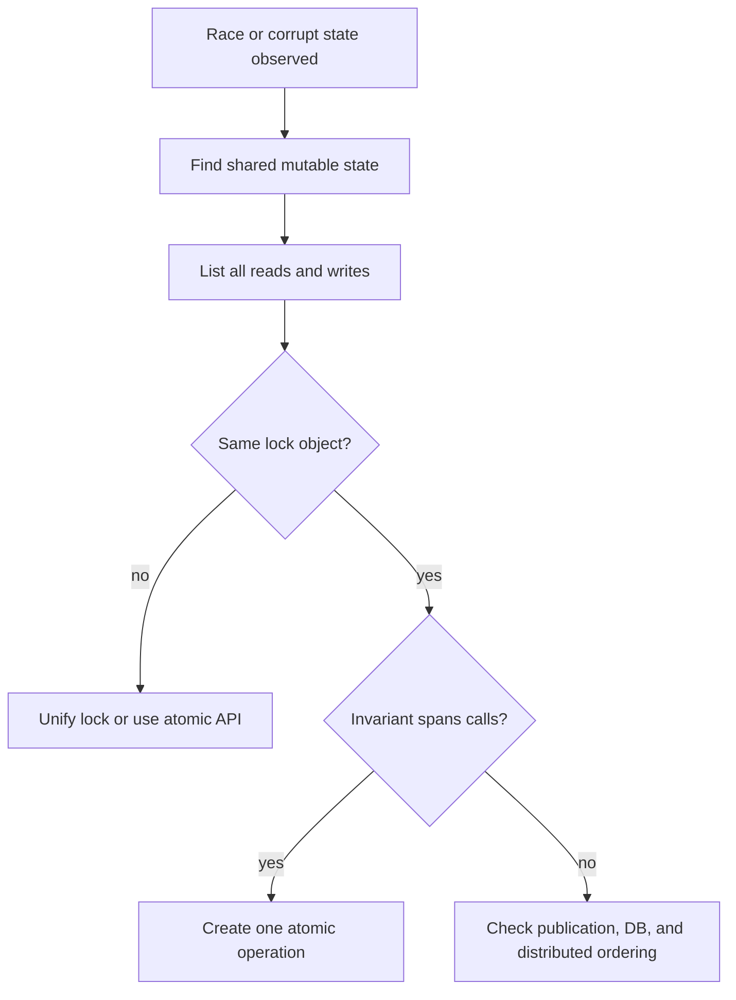

**Common mistakes:**
- Thinking `synchronized` means global locking.
- Logging no object identity while debugging.
- Locking getters/setters but not the business operation.

**Follow-ups:**
- *How prove different monitors?* → Log `System.identityHashCode(this)` and thread names.
- *Can volatile fix this?* → No, the check and update must be atomic.

### Q5. A big shared `HashMap` is used by many threads. What can go wrong?
`🟡 Intermediate` `🔥` `Must-know SDE-1`

**Why they ask:** Unsafe `HashMap` is a classic Java backend failure.

**Beginner lens:** A HashMap is like a library catalog being rewritten while readers are walking the aisles.
Concurrent resize or mutation can make readers see stale data, miss entries, trip over changed structure, or
burn CPU in corrupted traversal on old JDKs. The interviewer is testing that thread safety includes the
collection internals and the surrounding compound logic; ConcurrentHashMap fixes individual map operations,
not every multi-step invariant.

**Short answer (say this first, 20-40 sec):**
`HashMap` is not thread-safe. Concurrent mutation can lose updates, corrupt internal structure during resize, cause inconsistent reads, throw iteration exceptions, or create high CPU loops in old JDKs. Use `ConcurrentHashMap`, external locking, immutable snapshots, or a single-writer design.

**Detailed answer:**
Bug:
```java
import java.util.*; import java.util.concurrent.*;
class HashMapBug {
  static final Map<Integer,Integer> map = new HashMap<>();
  public static void main(String[] args) throws Exception {
    ExecutorService p=Executors.newFixedThreadPool(8);
    for(int t=0;t<8;t++){
      final int b=t*10000;
      p.submit(() -> { for(int i=0;i<10000;i++) map.put(b+i,i); });
    }
    p.shutdown();
    p.awaitTermination(5,TimeUnit.SECONDS);
    System.out.println(map.size());
  }
}
```
Fix:
```java
import java.util.concurrent.*;
class HashMapFix {
  private final ConcurrentHashMap<Integer,Integer> map = new ConcurrentHashMap<>();
  void put(int k,int v){
    map.put(k,v);
  }
}
```
For multi-key invariants, protect the whole operation with one lock even if the map is concurrent.

**Common mistakes:**
- Replacing the map but keeping non-atomic get-then-put logic.
- Iterating a synchronized wrapper without external synchronization.
- Treating resize as read-only.

**Follow-ups:**
- *Is `Collections.synchronizedMap` enough?* → For individual calls, yes; iteration and compound actions still need external synchronization.
- *When use immutable snapshot?* → Read-heavy config refreshed occasionally.

### Q5b. In which scenario would you use a big `HashMap`, and how do you size it?
`🟡 Intermediate` `🔥` `Must-know SDE-1`

**Why they ask:** They want to see if you understand the memory, resizing, and GC cost of large in-memory maps, and know the alternatives.

**Beginner lens:** Use the mental model of an in-memory index: great when the dataset is bounded, fits
comfortably in heap, and is read much more than it changes. Sizing is about avoiding repeated rehashing,
garbage collection pressure, and surprise memory growth. In production, ask who owns refresh, whether
multiple pods need the same view, and whether eviction, Time To Live, or a shared cache is really required.

**Short answer (say this first, 20-40 sec):**
I use a big `HashMap` for fast O(1) in-memory lookups on a bounded, fits-in-heap dataset: reference data (country/product codes), a pre-computed index built at startup, de-duplication in a batch job, or a local cache in front of a DB. I presize it with `initialCapacity = expectedSize / 0.75 + 1` to avoid repeated resizes, make it read-only (or `ConcurrentHashMap`) if threads share it, and switch to Caffeine, Redis, or a primitive map once memory, eviction, or multi-instance needs appear.

**Detailed answer:**
Good scenarios:

| Scenario | Why a big map fits | Watch out for |
|---|---|---|
| Startup-loaded reference data (e.g., 500K SKUs) | O(1) lookup, no DB round trip | Heap size, refresh strategy (swap in an immutable snapshot) |
| Batch job de-duplication / joins in memory | Much faster than per-row DB calls | Data must fit in heap; otherwise stream or use the DB |
| Frequency counting / grouping (`groupingBy`, `merge`) | Natural aggregation structure | Key cardinality explosion |
| Local L1 cache in front of Redis/DB | Microsecond reads | Needs size limit + TTL -> use Caffeine, not a raw map |

Sizing & resizing:
```java
int expected = 1_000_000;
// Default load factor 0.75: resize happens when size > capacity * 0.75.
// Presizing avoids ~20 rehash rounds (16 -> 32 -> ... -> 2^21) during loading.
Map<String, Product> bySku = new HashMap<>((int) (expected / 0.75f) + 1);

// Java 19+ convenience method that does the same math:
Map<String, Product> bySku19 = HashMap.newHashMap(expected);
```
- Capacity is always rounded up to a power of two; each resize allocates a new table and rehashes every entry (O(n) pause + garbage).
- Memory: each entry is a `Node` object (~32-48 bytes with header, hash, key, value, next references), **plus** the key and value objects themselves. 1M `String -> Long` entries can easily cost 100+ MB of heap; boxed primitives make it worse.
- GC: a huge long-lived map is promoted to the old generation; frequent rebuilds create GC pressure. Rebuild off to the side and swap one `volatile` reference.

Thread-safe read-mostly pattern:
```java
class SkuIndex {
    private volatile Map<String, Product> snapshot = Map.of();

    void reload(List<Product> products) {
        Map<String, Product> fresh = HashMap.newHashMap(products.size());
        for (Product p : products) {
            fresh.put(p.sku(), p);
        }
        snapshot = Collections.unmodifiableMap(fresh); // atomic publish
    }

    Product find(String sku) {
        return snapshot.get(sku);
    }
}
```
When NOT to use a big `HashMap`:
- Data doesn't fit comfortably in heap, or it grows without bound -> DB/Redis.
- You need eviction/TTL -> Caffeine (W-TinyLFU) or `LinkedHashMap` with `removeEldestEntry` for a simple LRU.
- Multiple app instances must see the same data -> Redis (shared cache).
- Primitive keys/values at very large scale -> primitive collections (e.g., Eclipse Collections, fastutil) to avoid boxing.
- Sorted/range queries needed -> `TreeMap`.

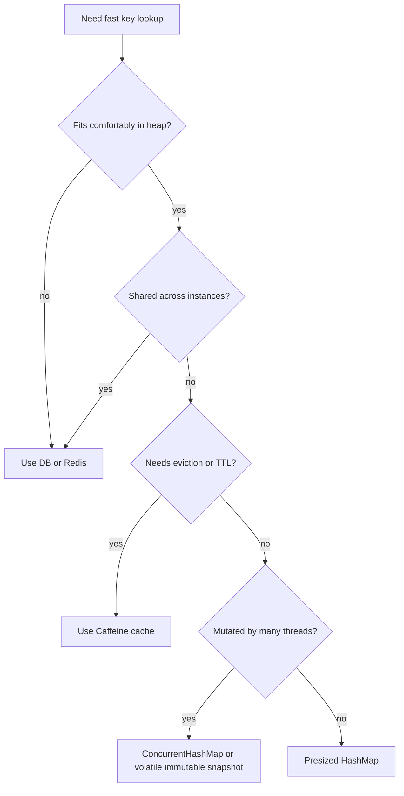

**Common mistakes:**
- Not presizing, so loading 1M entries triggers many resize + rehash cycles.
- Using a raw `HashMap` as an unbounded cache, which leads to a memory leak and eventually `OutOfMemoryError`.
- Mutable keys whose `hashCode` changes after insertion, so entries become unreachable.
- Assuming a local map is consistent across multiple pods.

**Follow-ups:**
- *What happens if many keys collide?* → Since Java 8, a bucket with more than 8 nodes (and table capacity ≥ 64) is treeified into a red-black tree, so the worst case becomes O(log n) instead of O(n).
- *Why is load factor 0.75?* → It's a time/space trade-off: lower means fewer collisions but more memory; higher saves memory but lengthens chains.
- *How would you find out that the map is the memory problem?* → `jmap -histo:live <pid>` or a heap dump in Eclipse MAT; look for `HashMap$Node` and the dominator tree.

### Q6. HashMap deadlock or infinite loop in Java 7 resize vs Java 8?
`🔴 Advanced` `🔥` `Stretch`

**Why they ask:** They check historical accuracy and version awareness.

**Beginner lens:** This is a version-awareness trap. The old failure is like two workers rewiring the same
linked list and accidentally making a circular road; a later lookup drives around forever. That is usually
an infinite loop with high Central Processing Unit usage, not a monitor deadlock. The safe conclusion
remains unchanged across versions: HashMap gives no concurrent mutation guarantee, so use a concurrent map,
a lock, or immutable snapshots.

**Short answer (say this first, 20-40 sec):**
In Java 7, concurrent `HashMap` resize could corrupt bucket linked lists because transfer reordered nodes, sometimes creating a cycle. A later `get` could loop forever and burn CPU; this is usually an infinite loop, not a monitor deadlock. Java 8 changed resize mechanics and adds tree bins, but `HashMap` is still unsafe for concurrent mutation.

**Detailed answer:**
Bug stress for Java 7, not deterministic and not a valid program:
```java
import java.util.*;
class Java7ResizeBug {
  static final Map<Integer,Integer> m = new HashMap<>(2);
  public static void main(String[] a) throws Exception {
    Runnable r=()->{
      for(int i=0;i<1_000_000;i++) m.put(i,i);
    }
    ;
    Thread t1=new Thread(r);
    Thread t2=new Thread(r);
    t1.start();
    t2.start();
    t1.join();
    t2.join();
  }
}
```
Fix:
```java
import java.util.concurrent.*;
class ResizeFix {
  private final ConcurrentHashMap<Integer,Integer> m = new ConcurrentHashMap<>();
  void put(int k,int v){
    m.put(k,v);
  }
}
```
Java 7 used linked-list transfer vulnerable to corruption under races. Java 8 is more robust internally but gives no thread-safety guarantee for `HashMap`.

**Common mistakes:**
- Saying Java 8 made `HashMap` concurrent.
- Calling every high CPU hang a deadlock.
- Depending on the reproducer to fail every time.

**Follow-ups:**
- *How detect it?* → Thread dump or profiler shows threads stuck in `HashMap.get` or traversal.
- *Correct production fix?* → Stop concurrent mutation; use CHM or locks.

### Q7. Why does `ConcurrentHashMap` reject null keys and values?
`🟡 Intermediate` `🔥` `Must-know SDE-1`

**Why they ask:** It tests API precision and concurrent ambiguity.

**Beginner lens:** In a concurrent map, null would make absence ambiguous. If get returns null, a thread
cannot tell whether the key is missing, the value is actually null, or another thread changed the mapping
between checks. ConcurrentHashMap forces a clear signal so atomic methods such as compute, merge, and
putIfAbsent can have precise meaning. Recognize this as an API design question about correctness under
racing reads and writes.

**Short answer (say this first, 20-40 sec):**
`ConcurrentHashMap` forbids null because `get(key) == null` must unambiguously mean absent. In concurrent code, allowing null would make it unclear whether the key is absent, mapped to null, removed, or not yet visible. Use `Optional`, a sentinel value, or a typed result for negative caching.

**Detailed answer:**
Bug:
```java
import java.util.concurrent.*;
class NullBug {
  public static void main(String[] a){
    new ConcurrentHashMap<String,String>().put("x", null);
  }
}
```
Fix:
```java
import java.util.*; import java.util.concurrent.*;
class NullFix {
  final ConcurrentHashMap<String, Optional<String>> cache = new ConcurrentHashMap<>();
  Optional<String> get(String k){
    return cache.computeIfAbsent(k, this::load);
  }
  Optional<String> load(String k){
    return Optional.empty();
  }
}
```
`HashMap` allows one null key and many null values, but it is not thread-safe.

**Common mistakes:**
- Using null as a negative-cache marker.
- Calling `containsKey` then `get` and assuming the pair is atomic.
- Returning null from `computeIfAbsent` and expecting a cached null.

**Follow-ups:**
- *Does CHM allow null keys?* → No.
- *Best negative-cache value?* → `Optional.empty()` or a domain-specific sentinel.

### Q8. Shared `HashMap` passes tests but fails in production. Why?
`🟡 Intermediate` `🔥` `Must-know SDE-1`

**Why they ask:** They want production debugging instincts.

**Beginner lens:** Concurrency bugs are timing bugs, so a quiet test run proves very little. A laptop may
produce only friendly interleavings, while production adds more cores, longer pauses, resizes, garbage
collection, and overlapping requests. Treat this like testing a bridge only on a windless day. The
interviewer wants you to seek stress evidence, thread dumps, suspicious shared state, and deterministic
fixes instead of relying on repeated manual tests.

**Short answer (say this first, 20-40 sec):**
Tests often have low concurrency, small data, deterministic timing, and no real CPU or GC pressure. Production adds many threads, resizes, collisions, and rare interleavings, so unsafe maps fail as missing entries, latency spikes, or high CPU. Reproduce with aligned thread starts, high key counts, repeated runs, and production-like pool sizes.

**Detailed answer:**
Bug:
```java
import java.util.*;
class TestPassesBug {
  static final Map<Integer,Integer> cache=new HashMap<>();
  static int get(int k){
    Integer v=cache.get(k);
    if(v==null){
      v=k*10;
      cache.put(k,v);
    }
    return v;
  }
}
```
Fix:
```java
import java.util.concurrent.*;
class TestPassesFix {
  final ConcurrentHashMap<Integer,Integer> cache=new ConcurrentHashMap<>();
  int get(int k){
    return cache.computeIfAbsent(k, x -> x*10);
  }
}
```
Stress tests should use `CountDownLatch` start gates, many iterations, and invariant assertions rather than only checking no exception.

**Common mistakes:**
- Treating intermittent as impossible.
- Fixing by increasing timeouts.
- Not measuring cache hit ratio and map size.

**Follow-ups:**
- *What evidence to collect?* → Thread dumps, CPU profile, cache metrics, key cardinality.
- *What tool for JMM-level tests?* → jcstress.

### Q9. Shared `HashMap` causes timeouts but no crash. How?
`🟡 Intermediate` `🔥` `Must-know SDE-2`

**Why they ask:** Many concurrency failures are latency failures.

**Beginner lens:** Many concurrency failures degrade before they throw. A corrupted or contended map can
create long traversals, duplicate cache loads, retry storms, or executor queues that slowly fill. Think of
cars circling a broken roundabout: no car explodes, but everyone is late. Recognize this when symptoms are
p99 latency, high Central Processing Unit usage, queue depth, or downstream amplification rather than a
clean exception.

**Short answer (say this first, 20-40 sec):**
Unsafe shared state can cause threads to spin, traverse corrupted structures, duplicate slow work, or create GC pressure. The JVM stays alive, but requests time out because worker threads are busy or queued. A common pattern is cache stampede from non-atomic get-load-put.

**Detailed answer:**
Bug:
```java
import java.util.*;
class StampedeBug {
  static final Map<String,String> c=new HashMap<>();
  static String get(String k){
    String v=c.get(k);
    if(v==null){
      v=slow(k);
      c.put(k,v);
    }
    return v;
  }
  static String slow(String k){
    try{
      Thread.sleep(500);
    }
    catch(InterruptedException e){
      Thread.currentThread().interrupt();
    }
    return k;
  }
}
```
Fix:
```java
import java.util.concurrent.*;
class StampedeFix {
  final ConcurrentHashMap<String,CompletableFuture<String>> c=new ConcurrentHashMap<>();
  final ExecutorService io=Executors.newFixedThreadPool(20);
  String get(String k) throws Exception {
    return c.computeIfAbsent(
            k,
            x -> CompletableFuture.supplyAsync(() -> slow(x), io))
        .get(1, TimeUnit.SECONDS);
  }
  static String slow(String k){
    return k;
  }
}
```
Investigate with thread dumps, CPU profiles, queue depth, hit ratio, load count, and downstream call count.

**Common mistakes:**
- Waiting for an exception when the symptom is p99 latency.
- Retrying aggressively and amplifying load.
- Ignoring executor saturation.

**Follow-ups:**
- *What is cache stampede?* → Many threads recompute the same missing key simultaneously.
- *Why cache futures?* → It deduplicates in-flight loads.

### Q10. Where do concurrency issues occur: JVM, DB, or distributed systems?
`🟡 Intermediate` `🔥` `Must-know SDE-2`

**Why they ask:** Backend correctness crosses process boundaries.

**Beginner lens:** First locate the actual shared resource. A Java Virtual Machine lock protects one heap
object; a database transaction protects persistent rows; a queue partition orders messages for a key;
idempotency protects retry semantics. The beginner mistake is using synchronized for a problem that lives in
the database or across pods. The interviewer is testing boundary selection: protect the narrowest resource
that can actually be shared by all contenders.

**Short answer (say this first, 20-40 sec):**
Concurrency issues happen in JVM memory, database rows, message queues, and multi-pod workflows. JVM locks protect only one process; DB transactions protect persistent state; distributed systems need idempotency, constraints, queue partitioning, or distributed locks. Use the narrowest mechanism that protects the real shared resource.

**Detailed answer:**
Bug and fix examples:
```java
// JVM bug: count++ is racy. Fix: AtomicInteger.incrementAndGet().
```
```sql
-- PostgreSQL lost update fix
BEGIN;
SELECT balance FROM account WHERE id = 1 FOR UPDATE;
UPDATE account SET balance = balance - 10 WHERE id = 1;
COMMIT;
```
```java
import java.util.concurrent.*;
class IdempotencyFix {
  final ConcurrentHashMap<String,String> done=new ConcurrentHashMap<>();
  String handle(String requestId){
    return done.computeIfAbsent(requestId, this::doOnce);
  }
  String doOnce(String id){
    return "ok";
  }
}
```
Layer mapping: JVM race -> locks/atomics; DB lost update -> transaction/version/constraint; distributed duplicate -> idempotency key, queue partition, Redis lock with token and TTL.

**Common mistakes:**
- Using `synchronized` for multi-pod correctness.
- Trusting Redis locks without DB constraints.
- Forgetting queue redelivery.

**Follow-ups:**
- *Strongest final guard?* → Usually a DB constraint or transactional update.
- *When use Redis lock?* → Short cross-node critical sections, with expiry and safe release token.
## Thread Basics and Executors

### Q11. Explain the Java thread lifecycle.
`🟢 Beginner` `🔥` `Must-know SDE-1`

**Why they ask:** Thread dumps use these states.

**Beginner lens:** Imagine a worker ticket moving through stations: created, eligible, waiting for a lock or
event, timed out, and finished. RUNNABLE means the Java thread can run, not necessarily that it is on a
Central Processing Unit at that instant. This applies whenever you read thread dumps. The key distinction is
between BLOCKED on a monitor, WAITING for a signal or join, and TIMED_WAITING for a timed sleep or wait.

**Short answer (say this first, 20-40 sec):**
A thread moves from `NEW` to `RUNNABLE` after `start()`, may enter blocked or waiting states, and finally becomes `TERMINATED`. `RUNNABLE` means eligible to run or currently running. These states help debug deadlocks, blocking, and starvation.

**Detailed answer:**
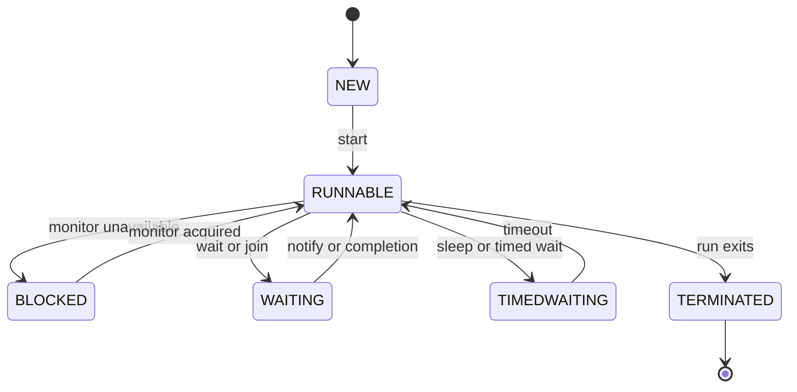
Code: `new Thread(r)` is `NEW`; `start()` schedules execution; `join()` waits for termination.

**Common mistakes:**
- Calling `run()` directly.
- Thinking `RUNNABLE` always means consuming CPU.
- Confusing `BLOCKED` with `WAITING`.

**Follow-ups:**
- *Can a thread restart?* → No, `start()` twice throws `IllegalThreadStateException`.
- *What creates BLOCKED?* → Waiting to enter a `synchronized` monitor.

### Q12. Compare `Runnable`, `Callable`, and `Future`.
`🟢 Beginner` `🔥` `Must-know SDE-1`

**Why they ask:** These are executor fundamentals.

**Beginner lens:** Think of Runnable and Callable as work orders, while Future is the claim ticket for
submitted work. Runnable says do this and no direct result is promised; Callable can return a value or throw
checked exceptions; Future lets another thread wait, time out, cancel, or observe failure. Recognize this
when executor submission and result handling appear. The production concern is blocking forever on get
without timeout or interrupt handling.

**Short answer (say this first, 20-40 sec):**
`Runnable` has no result and no checked exception in its method signature. `Callable<T>` returns a value and can throw checked exceptions. `Future<T>` is the handle returned by submitted work and supports result retrieval, timeout, cancellation, and completion checks.

**Detailed answer:**
```java
import java.util.concurrent.*;
ExecutorService pool = Executors.newSingleThreadExecutor();
Future<?> r = pool.submit(() -> System.out.println("log"));
Future<Integer> c = pool.submit(() -> 42);
r.get(); System.out.println(c.get(1, TimeUnit.SECONDS));
pool.shutdown();
```
`Future.get()` blocks and wraps task exceptions in `ExecutionException`.

**Common mistakes:**
- Forgetting that `get()` can block indefinitely.
- Swallowing `InterruptedException`.
- Using `execute` when result handling is required.

**Follow-ups:**
- *Which one returns a value?* → `Callable`.
- *Which API composes async steps better?* → `CompletableFuture`.

### Q13. Why use `ExecutorService` instead of creating threads manually?
`🟢 Beginner` `🔥` `Must-know SDE-1`

**Why they ask:** Real services need controlled concurrency.

**Beginner lens:** ExecutorService is a managed worker pool, like a restaurant keeping a fixed kitchen staff
instead of hiring a new cook for every order. It bounds concurrency, reuses expensive operating-system
threads, gives Future handles, and supports shutdown. The interviewer is testing resource control. Raw
threads hide limits, naming, rejection, lifecycle, and error handling, which become serious when request
traffic spikes or dependencies slow down.

**Short answer (say this first, 20-40 sec):**
`ExecutorService` reuses worker threads, limits concurrency, queues tasks, exposes `Future`s, and supports controlled shutdown. Creating a raw thread per request is expensive and can exhaust memory or OS thread limits.

**Detailed answer:**
```java
ExecutorService pool = Executors.newFixedThreadPool(20);
Future<String> f = pool.submit(() -> callRemote());
String result = f.get(500, TimeUnit.MILLISECONDS);
pool.shutdown();
```
Avoid unbounded factories like `newCachedThreadPool()` for uncontrolled production traffic.

**Common mistakes:**
- Not shutting down custom executors.
- Blocking forever in pool tasks.
- Sharing one pool for all workloads.

**Follow-ups:**
- *`execute` vs `submit`?* → `execute` has no result; `submit` returns `Future`.
- *What happens after shutdown?* → New tasks are rejected.

### Q14. Explain `ThreadPoolExecutor` parameters and submission flow.
`🟡 Intermediate` `🔥` `Must-know SDE-2`

**Why they ask:** Wrong pool settings cause outages.

**Beginner lens:** A ThreadPoolExecutor is a waiting room with workers, chairs, overflow workers, and a
doorman. First it creates core workers, then queues tasks, then grows toward max only when the queue cannot
accept more, then rejects. This order surprises beginners using unbounded queues because max size may never
matter. Recognize this when questions mention saturation, queue choice, keep-alive, thread names, or
rejection policy.

**Short answer (say this first, 20-40 sec):**
A `ThreadPoolExecutor` is configured with core size, max size, keep-alive, queue, thread factory, and rejection handler. It creates core workers first, then queues tasks, then grows up to max only when the queue is full, then rejects.

**Detailed answer:**
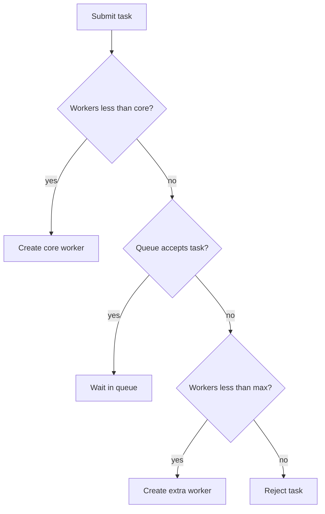
```java
ThreadPoolExecutor p = new ThreadPoolExecutor(
    10,
    50,
    60,
    TimeUnit.SECONDS,
    new ArrayBlockingQueue<>(500),
    r -> new Thread(r, "orders-worker"),
    new ThreadPoolExecutor.CallerRunsPolicy());
```

**Common mistakes:**
- Using unbounded queues and expecting max size to help.
- No thread names.
- Silent discard rejection.

**Follow-ups:**
- *What is `CallerRunsPolicy`?* → Caller executes rejected task, creating backpressure.
- *What is `SynchronousQueue`?* → Zero-capacity direct handoff queue.

### Q15. How do you size a thread pool?
`🟡 Intermediate` `🔥` `Must-know SDE-2`

**Why they ask:** Sizing affects latency and throughput.

**Beginner lens:** Use roads as the model. Central Processing Unit-bound work needs about as many lanes as
cores because extra runnable threads mostly context-switch. Input and Output-bound work can have more
threads because many are parked waiting. The formula is only a starting estimate; the real answer must
respect database pool size, downstream limits, queue depth, p99 latency, and load-test evidence. More
threads can reduce throughput when contention dominates.

**Short answer (say this first, 20-40 sec):**
CPU-bound pools start near CPU cores. I/O-bound pools can be larger because threads wait. A common estimate is `threads = cores * (1 + waitTime / computeTime)`, then validate with load tests, p99 latency, queue depth, and downstream capacity.

**Detailed answer:**
```java
int cores = Runtime.getRuntime().availableProcessors();
int cpuThreads = cores;
int ioThreads = cores * 8; // starting point, not a law
```
Watch active count, queue size, rejections, context switches, DB pool usage, and downstream rate limits.

**Common mistakes:**
- Adding threads when the DB pool has fewer connections.
- Mixing CPU and blocking I/O in one pool.
- Optimizing without load tests.

**Follow-ups:**
- *What does Little's Law say?* → Concurrency is roughly throughput times latency.
- *Can more threads reduce throughput?* → Yes, via context switching and contention.

## Locks, Memory Model, and Atomicity

### Q16. How does `synchronized` work: monitor, instance vs static?
`🟢 Beginner` `🔥` `Must-know SDE-1`

**Why they ask:** It is the base locking primitive.

**Beginner lens:** synchronized gives a thread the monitor key before it enters protected code and releases
the key on exit. Instance methods lock that object; static methods lock the Class object, so the scopes are
different rooms. The Java Memory Model also gives visibility: writes before unlock become visible to a later
lock of the same monitor. The interviewer is testing both mutual exclusion and happens-before ordering, not
only blocking behavior.

**Short answer (say this first, 20-40 sec):**
Every object can be a monitor. An instance synchronized method locks `this`, while a static synchronized method locks the class object. Unlocking a monitor happens-before a later lock on the same monitor, giving both mutual exclusion and visibility.

**Detailed answer:**
```java
class SyncDemo {
  synchronized void instanceMethod() { }
  static synchronized void staticMethod() { }
  void block(){ synchronized(this){ } }
}
```
Instance and static locks do not block each other because they are different monitors.

**Common mistakes:**
- Locking on mutable or public objects.
- Assuming static and instance locks are the same.
- Holding monitors during network calls.

**Follow-ups:**
- *Is synchronized reentrant?* → Yes.
- *Is it fair?* → No fairness guarantee.

### Q17. `synchronized` vs `ReentrantLock`, including `tryLock` and fairness?
`🟡 Intermediate` `🔥` `Must-know SDE-2`

**Why they ask:** They test lock trade-offs.

**Beginner lens:** Both are locks, but ReentrantLock is a hand-held key with extra controls: try to enter
without waiting forever, interrupt while waiting, choose fairness, and use multiple conditions. synchronized
is simpler and usually preferred until those controls matter. Recognize ReentrantLock when the scenario
needs timeout, cancellation, deadlock avoidance, or more explicit queueing. Fair locks can reduce starvation
but may lower throughput.

**Short answer (say this first, 20-40 sec):**
`synchronized` is simpler and releases automatically. `ReentrantLock` supports timed acquisition, interruptible lock acquisition, optional fairness, lock status methods, and multiple `Condition`s. Use `ReentrantLock` only when those features matter.

**Detailed answer:**
```java
import java.util.concurrent.*; import java.util.concurrent.locks.*;
class LockDemo {
  private final ReentrantLock lock = new ReentrantLock(true);
  boolean update() throws InterruptedException {
    if(!lock.tryLock(100, TimeUnit.MILLISECONDS)) return false;
    try {
      return true;
    }
    finally {
      lock.unlock();
    }
  }
}
```
Fair locks reduce starvation risk but can lower throughput.

**Common mistakes:**
- Missing `unlock()` in `finally`.
- Enabling fairness without measurement.
- Using locks for slow remote calls.

**Follow-ups:**
- *Why use `tryLock`?* → Timeout, graceful fallback, deadlock avoidance.
- *Can `synchronized` be interrupted while blocked?* → No.

### Q18. What is `ReadWriteLock`?
`🟡 Intermediate` `🔥` `Must-know SDE-2`

**Why they ask:** It is useful for read-heavy shared state.

**Beginner lens:** Picture a library room where many readers can look at books together, but a writer needs
the room alone to change a page. ReadWriteLock helps when reads are frequent, writes are short, and the
protected data structure is not safe by itself. The key distinction is shared read access versus exclusive
write access. Watch for write starvation, lock upgrade traps, and cases where contention or write frequency
erases the benefit.

**Short answer (say this first, 20-40 sec):**
`ReadWriteLock` allows many readers together but only one writer exclusively. It helps when reads dominate and read sections are not trivial. It can hurt when writes are frequent or writers starve.

**Detailed answer:**
```java
import java.util.*; import java.util.concurrent.locks.*;
class Catalog {
  private final Map<String,String> m=new HashMap<>();
  private final ReadWriteLock rw=new ReentrantReadWriteLock();
  String get(String k){
    rw.readLock().lock();
    try{
      return m.get(k);
    }
    finally{
      rw.readLock().unlock();
    }
  }
  void put(String k,String v){
    rw.writeLock().lock();
    try{
      m.put(k,v);
    }
    finally{
      rw.writeLock().unlock();
    }
  }
}
```

**Common mistakes:**
- Trying unsafe read-lock to write-lock upgrade.
- Using it for tiny operations.
- Forgetting writer starvation.

**Follow-ups:**
- *Can readers and writer run together?* → No.
- *Can multiple readers run together?* → Yes.

### Q19. What is `StampedLock`?
`🔴 Advanced` `Stretch`

**Why they ask:** It checks advanced lock awareness.

**Beginner lens:** StampedLock is like entering a museum with a dated ticket. An optimistic reader takes a
quick snapshot without blocking writers, then validates that no writer changed the room before using the
data. If validation fails, it retries with a real read lock. The interviewer is testing high-read, low-write
trade-offs and the danger of using a value read optimistically after invalidation. It is powerful but easier
to misuse than simpler locks.

**Short answer (say this first, 20-40 sec):**
`StampedLock` supports write locks, read locks, and optimistic reads. An optimistic read must be validated before using the read values. It is not reentrant and is more complex than `ReadWriteLock`.

**Detailed answer:**
```java
import java.util.concurrent.locks.*;
class Point {
  double x,y;
  final StampedLock sl=new StampedLock();
  double dist(){
    long s=sl.tryOptimisticRead();
    double a=x,b=y;
    if(!sl.validate(s)){
      s=sl.readLock();
      try{
        a=x;
        b=y;
      }
      finally{
        sl.unlockRead(s);
      }
    }
    return Math.hypot(a,b);
  }
  void move(double dx,double dy){
    long s=sl.writeLock();
    try{
      x+=dx;
      y+=dy;
    }
    finally{
      sl.unlockWrite(s);
    }
  }
}
```

**Common mistakes:**
- Not validating optimistic reads.
- Assuming reentrancy.
- Using it where maintainability matters more.

**Follow-ups:**
- *Why optimistic read?* → Avoid blocking if no writer changed state.
- *Should beginners prefer it?* → Usually no.

### Q20. Explain `volatile` and happens-before.
`🟡 Intermediate` `🔥` `Must-know SDE-2`

**Why they ask:** JMM basics are essential.

**Beginner lens:** volatile is a public notice board, not a bank transaction. A write to a volatile field is
made visible to later reads of that field and creates ordering around that access, but count++ still has
separate read and write steps. The term happens-before means the Java Memory Model promises visibility and
order between operations. Recognize volatile when a flag, published reference, or configuration value
changes, not when a compound invariant must be updated.

**Short answer (say this first, 20-40 sec):**
`volatile` gives visibility and ordering for a variable. A write to a volatile field happens-before every later read of that field. It does not make compound actions like `x++` atomic.

**Detailed answer:**
```java
class StopFlag {
  private volatile boolean running = true;
  void stop(){
    running=false;
  }
  void loop(){
    while(running){
      doWork();
    }
  }
  void doWork(){
  }
}
```
Other happens-before edges: `Thread.start`, successful `Thread.join`, monitor unlock-to-lock, volatile write-to-read, and task completion to `Future.get`.

**Common mistakes:**
- Using volatile counters.
- Making a map reference volatile and assuming map internals are safe.
- Publishing objects unsafely.

**Follow-ups:**
- *Visibility vs atomicity?* → Visibility means seeing writes; atomicity means indivisible update.
- *Does volatile block threads?* → No.

### Q21. CAS, atomic classes, and `LongAdder`?
`🟡 Intermediate` `🔥` `Must-know SDE-2`

**Why they ask:** Atomics are common in counters and lock-free code.

**Beginner lens:** Compare-And-Set is like changing a form only if the version number still matches what you
saw. Atomic classes loop around this hardware-supported check for single-variable updates. LongAdder
improves hot counters by spreading increments across cells, like multiple collection boxes counted later.
Use atomics for independent values, not multi-field invariants. The interviewer is testing lock-free
reasoning, contention, and the difference between exact linearizable reads and approximate metric-style
reads.

**Short answer (say this first, 20-40 sec):**
CAS updates a value only if it still equals an expected value. Atomic classes use CAS loops for lock-free single-variable updates. `LongAdder` spreads contention across cells and is excellent for high-contention metrics, but not ideal when every read must be exactly linearizable.

**Detailed answer:**
```java
import java.util.concurrent.atomic.*;
class Reserve {
  private final AtomicInteger stock=new AtomicInteger(10);
  boolean one(){
    while(true){
      int s=stock.get();
      if(s<=0) return false;
      if(stock.compareAndSet(s,s-1)) return true;
    }
  }
}
class Metrics {
  private final LongAdder requests=new LongAdder();
  void mark(){
    requests.increment();
  }
  long count(){
    return requests.sum();
  }
}
```

**Common mistakes:**
- CAS loops without exit paths.
- Using `LongAdder` for bank balances.
- Assuming lock-free means wait-free.

**Follow-ups:**
- *Why is LongAdder faster under contention?* → It shards updates.
- *What is linearizable?* → Operations appear atomic at one point in time.

### Q22. What is the ABA problem?
`🔴 Advanced` `Stretch`

**Why they ask:** It tests lock-free correctness.

**Beginner lens:** ABA is the parking-spot illusion: you saw car A, looked away, car B parked and left, and
car A returned, so the spot looks unchanged even though the history matters. Compare-And-Set checks the
current value only, so pointer-like algorithms can be fooled. Recognize it in lock-free stacks, queues, and
node reuse, not ordinary counters. A stamp or version adds ordering evidence to the value.

**Short answer (say this first, 20-40 sec):**
ABA occurs when a value changes from A to B and back to A, so a CAS sees A and wrongly assumes nothing changed. It matters in algorithms where identity or links matter. Use version stamps, `AtomicStampedReference`, or designs that avoid node reuse.

**Detailed answer:**
```java
import java.util.concurrent.atomic.AtomicStampedReference;
class AbaFix {
  final AtomicStampedReference<String> ref=new AtomicStampedReference<>("A",0);
  boolean set(String next){
    int[] st=new int[1];
    String cur=ref.get(st);
    return ref.compareAndSet(cur,next,st[0],st[0]+1);
  }
}
```
The stamp changes even if the value cycles back.

**Common mistakes:**
- Assuming CAS proves no intermediate changes.
- Applying ABA fear to simple counters unnecessarily.
- Writing custom lock-free stacks casually.

**Follow-ups:**
- *Where does ABA matter?* → Lock-free stacks, queues, and pointer-like references.
- *Main fix?* → Add a version/stamp.

### Q23. What is double-checked locking?
`🟡 Intermediate` `🔥` `Must-know SDE-2`

**Why they ask:** It is a classic safe-publication trap.

**Beginner lens:** Double-checked locking tries to avoid paying a lock cost after a singleton is
initialized: check outside, lock, check again, create. The dangerous part is publication ordering. Without
volatile, another thread can see the reference before construction is safely visible under the Java Memory
Model. The interviewer is really testing safe publication. In many Java applications, a holder class, enum,
or Spring bean is simpler and less error-prone.

**Short answer (say this first, 20-40 sec):**
Double-checked locking checks a singleton field before and inside a synchronized block to avoid locking after initialization. It is correct only when the field is `volatile`. Without `volatile`, another thread can observe a partially constructed object.

**Detailed answer:**
```java
class SafeSingleton {
  private static volatile SafeSingleton instance;
  private SafeSingleton(){
  }
  static SafeSingleton get(){
    SafeSingleton local=instance;
    if(local==null){
      synchronized(SafeSingleton.class){
        local=instance;
        if(local==null){
          local=new SafeSingleton();
          instance=local;
        }
      }
    }
    return local;
  }
}
```
Simpler: use enum singleton or initialization-on-demand holder.

**Common mistakes:**
- Missing `volatile`.
- Overusing singletons in Spring apps.
- Publishing `this` during construction.

**Follow-ups:**
- *Why volatile?* → Prevents unsafe publication and reordering.
- *Simpler lazy pattern?* → Static holder class.

### Q24. What is safe publication?
`🟡 Intermediate` `🔥` `Must-know SDE-2`

**Why they ask:** Visibility bugs often come from unsafe publication.

**Beginner lens:** Safe publication means handing another thread a finished object through a trusted
delivery channel. Final fields, static initialization, volatile references, locks, and concurrent containers
create the visibility edge; a plain shared field may not. Think of sealing a package before putting it on
the counter. This applies when one thread builds configuration, cache snapshots, or helper objects that many
request threads later read. Do not let this escape during construction.

**Short answer (say this first, 20-40 sec):**
Safe publication means another thread can see an object only after construction is complete and visible. Use final fields, static initialization, volatile references, locks, or thread-safe containers. Without it, stale or partially initialized state may be observed.

**Detailed answer:**
```java
class SafePub { static final Helper HELPER = new Helper(42); record Helper(int value){} }
class VolatilePub {
  private static volatile Helper helper;
  static void init(){
    helper=new Helper(42);
  }
  record Helper(int value){
  }
}
```
Do not let `this` escape constructors.

**Common mistakes:**
- Assigning to a non-volatile static from one thread and reading from another.
- Mutable fields in supposedly immutable objects.
- Assuming reference assignment alone publishes internals.

**Follow-ups:**
- *Are final fields special?* → Yes, if the object is constructed correctly.
- *Does Spring help?* → It safely publishes beans, but your mutable bean state still needs safety.

### Q25. How do you handle interruption correctly?
`🟡 Intermediate` `🔥` `Must-know SDE-1`

**Why they ask:** Clean shutdown depends on it.

**Beginner lens:** Interruption is a polite cancellation request, not a forced stop button. Blocking methods
throw InterruptedException so your code can stop promptly or restore the interrupt flag for outer code to
see. The interviewer is testing cleanup and shutdown maturity. Recognize this in loops, Future cancellation,
thread-pool shutdown, sleeps, blocking queues, and timeouts. Swallowing the signal can make deployments,
tests, and graceful shutdown hang.

**Short answer (say this first, 20-40 sec):**
Interruption is cooperative cancellation. When a blocking method throws `InterruptedException`, either stop work or restore the interrupt flag using `Thread.currentThread().interrupt()`. Never swallow interrupts silently.

**Detailed answer:**
```java
try { Thread.sleep(1000); }
catch (InterruptedException e) { Thread.currentThread().interrupt(); return; }
```
Loop pattern:
```java
while (!Thread.currentThread().isInterrupted()) { doOneUnit(); }
```

**Common mistakes:**
- Treating interrupt as forceful kill.
- Logging and continuing forever.
- Using blocking APIs without timeouts.

**Follow-ups:**
- *What does `Future.cancel(true)` do?* → Attempts to interrupt the task.
- *Can interrupt break monitor entry?* → No, not `synchronized` BLOCKED.

## Concurrent Collections and Coordination

### Q26. Java 7 vs Java 8 `ConcurrentHashMap` internals?
`🔴 Advanced` `🔥` `Must-know SDE-2`

**Why they ask:** Version precision matters.

**Beginner lens:** Use the apartment-building model. Java 7 guarded fixed segments, so each segment was like
a locked floor. Java 8 moved to finer bin-level coordination: Compare-And-Set for empty bins, synchronized
bin locks for updates, tree bins for heavy collisions, and cooperative resizing. The important interview
distinction is precision: ConcurrentHashMap is highly concurrent, but not lock-free everywhere, and values
stored inside it may still need their own safety.

**Short answer (say this first, 20-40 sec):**
Java 7 used segmented locking: multiple segment objects each guarded part of the table. Java 8 removed fixed segments and uses CAS for empty bins, synchronized bin locking for updates, tree bins under heavy collisions, and cooperative resizing. Reads are mostly non-blocking.

**Detailed answer:**
```java
import java.util.concurrent.*;
class Freq {
  final ConcurrentHashMap<String,Long> m=new ConcurrentHashMap<>();
  void inc(String w){
    m.merge(w,1L,Long::sum);
  }
}
```
Java 8 `concurrencyLevel` is mostly a sizing hint, not a fixed segment count.

**Common mistakes:**
- Saying Java 8 CHM is lock-free everywhere.
- Using `size()` as a cheap exact value under mutation.
- Mutating non-thread-safe values stored in CHM.

**Follow-ups:**
- *Are CHM iterators fail-fast?* → No, weakly consistent.
- *What are tree bins?* → Red-black trees used for long collision chains.

### Q27. When use `CopyOnWriteArrayList`?
`🟡 Intermediate` `🔥` `Must-know SDE-1`

**Why they ask:** It tests read-heavy collection selection.

**Beginner lens:** CopyOnWriteArrayList is a photocopied roster. Readers walk a stable copy without locks,
while every write creates a new array. That is excellent for listener lists, feature flags, or small
read-mostly collections. It is terrible for large or write-heavy data because each mutation copies the
backing storage. The interviewer is testing workload fit: many reads and rare writes, with snapshot
iteration semantics acceptable.

**Short answer (say this first, 20-40 sec):**
`CopyOnWriteArrayList` copies its array on every write and gives readers a stable snapshot. Use it for many reads and rare writes, such as listener lists. Avoid it for large or frequently modified lists.

**Detailed answer:**
```java
import java.util.concurrent.CopyOnWriteArrayList;
class Listeners {
  final CopyOnWriteArrayList<Runnable> list=new CopyOnWriteArrayList<>();
  void add(Runnable r){
    list.add(r);
  }
  void fire(){
    for(Runnable r:list) r.run();
  }
}
```
Iterators do not throw `ConcurrentModificationException` and do not see later writes.

**Common mistakes:**
- Using it for write-heavy workloads.
- Expecting iterator to reflect new elements.
- Assuming deep immutability of contained objects.

**Follow-ups:**
- *Best use case?* → Listener registry.
- *Why are writes costly?* → They copy the backing array.

### Q28. BlockingQueue and producer-consumer?
`🟢 Beginner` `🔥` `Must-know SDE-1`

**Why they ask:** It is core safe handoff and backpressure.

**Beginner lens:** Think of a bounded conveyor belt between cooks and packers. Producers put work on the
belt, consumers take it off, and the queue handles waiting when empty or full. This is both synchronization
and backpressure. Recognize the pattern when work rates differ or one stage should not directly call
another. The production question is capacity: unbounded queues hide overload; bounded queues force a
rejection, wait, or slowdown policy.

**Short answer (say this first, 20-40 sec):**
`BlockingQueue` is a thread-safe queue where producers block or time out when full and consumers block or time out when empty. It is the preferred producer-consumer primitive over manual wait/notify. Bounded queues provide backpressure.

**Detailed answer:**
```java
import java.util.concurrent.*;
class PC {
  public static void main(String[] a) throws Exception {
    BlockingQueue<String> q=new ArrayBlockingQueue<>(10);
    Thread p=new Thread(() -> {
      try{
        q.put("job");
        q.put("STOP");
      }catch(InterruptedException e){
        Thread.currentThread().interrupt();
      }
    });
    Thread c=new Thread(() -> {
      try{
        for(;;){
          String x=q.take();
          if("STOP".equals(x)) break;
          System.out.println(x);
        }
      }catch(InterruptedException e){
        Thread.currentThread().interrupt();
      }
    });
    p.start();
    c.start();
    p.join();
    c.join();
  }
}
```

**Common mistakes:**
- Using unbounded queues by default.
- Forgetting poison pills or shutdown protocol.
- Using `add` when `put` or `offer` is intended.

**Follow-ups:**
- *What is `SynchronousQueue`?* → Zero-capacity handoff.
- *What is backpressure?* → Slowing producers when consumers lag.

### Q29. Explain `wait`, `notify`, and `notifyAll`.
`🟡 Intermediate` `🔥` `Must-know SDE-1`

**Why they ask:** It checks monitor protocol.

**Beginner lens:** wait and notify are a condition waiting room attached to an object monitor. A thread must
hold the monitor, check the condition in a while loop, call wait to release the monitor and sleep, then
recheck after waking. notify wakes one waiter; notifyAll wakes all. The interviewer is testing the condition
protocol, especially spurious wakeups, missed signals, and choosing BlockingQueue or higher-level tools when
possible.

**Short answer (say this first, 20-40 sec):**
They are monitor methods and must be called while holding the object's monitor. `wait` releases the monitor and suspends the thread. Always wait in a `while` loop because wakeups can be spurious or the condition may no longer be true.

**Detailed answer:**
```java
import java.util.*;
class Buffer<T>{
  private final Queue<T> q=new ArrayDeque<>();
  synchronized void put(T x){
    q.add(x);
    notifyAll();
  }
  synchronized T take() throws InterruptedException {
    while(q.isEmpty()) wait();
    return q.remove();
  }
}
```
Prefer `BlockingQueue` for most producer-consumer code.

**Common mistakes:**
- Using `if` instead of `while`.
- Calling `wait` without owning the monitor.
- Using `notify` when several condition types exist.

**Follow-ups:**
- *Why does wait release lock?* → So another thread can change the condition.
- *Modern alternative?* → `BlockingQueue`, `Condition`, latches.

### Q30. CountDownLatch vs CyclicBarrier vs Semaphore?
`🟡 Intermediate` `🔥` `Must-know SDE-1`

**Why they ask:** These primitives solve different coordination problems.

**Beginner lens:** Use three everyday images: CountDownLatch is a starting gate that opens after enough
events, CyclicBarrier is a meeting point reused by a group each round, and Semaphore is a bucket of permits
limiting access to a resource. Recognize which one applies by asking whether you wait for completion,
synchronize phases, or throttle concurrency. They solve coordination and capacity problems, not arbitrary
shared-state invariants by themselves.

**Short answer (say this first, 20-40 sec):**
`CountDownLatch` is one-shot and releases waiters when count hits zero. `CyclicBarrier` waits for a fixed group repeatedly. `Semaphore` limits permits, often controlling access to a scarce resource.

**Detailed answer:**
```java
CountDownLatch start = new CountDownLatch(1); start.countDown(); start.await();
CyclicBarrier barrier = new CyclicBarrier(3, () -> System.out.println("ready"));
Semaphore dbCalls = new Semaphore(10); dbCalls.acquire(); try { callDb(); } finally { dbCalls.release(); }
```
Use latch for test start gates, barrier for phase algorithms, semaphore for rate/concurrency limiting.

**Common mistakes:**
- Trying to reset `CountDownLatch`.
- Forgetting semaphore release in `finally`.
- Not handling broken barriers.

**Follow-ups:**
- *Which limits API calls?* → `Semaphore`.
- *Which starts many threads at once?* → `CountDownLatch`.

### Q31. Atomic compound operations on `ConcurrentHashMap`?
`🟡 Intermediate` `🔥` `Must-know SDE-1`

**Why they ask:** CHM is often misused.

**Beginner lens:** ConcurrentHashMap gives you a small transaction around one key when you use compute,
merge, or computeIfAbsent. That is different from doing get, deciding in user code, and then put, where
another thread can slip between steps. Recognize this when counters, per-user state, cache loading, or
frequency maps appear. The limit is scope: one key is protected; cross-key invariants still need a larger
lock or transaction.

**Short answer (say this first, 20-40 sec):**
Use `putIfAbsent`, `remove(key,value)`, `replace`, `compute`, `computeIfAbsent`, `computeIfPresent`, and `merge` for atomic per-key read-modify-write operations. `ConcurrentHashMap` makes individual operations thread-safe, but not your multi-line sequences.

**Detailed answer:**
Bug:
```java
Integer old = counts.get("java"); counts.put("java", old == null ? 1 : old + 1);
```
Fix:
```java
counts.merge("java", 1, Integer::sum);
```
Keep compute functions short and side-effect-safe.

**Common mistakes:**
- `containsKey` then `put`.
- Long blocking calls inside mapping functions.
- Mutating unsafe values stored in the map.

**Follow-ups:**
- *Atomic for whole map?* → No, per key/bin.
- *Can mapping return null?* → Yes, but no mapping is recorded or it may remove depending on method.

### Q32. How do concurrent collections differ from synchronized wrappers?
`🟡 Intermediate` `🔥` `Must-know SDE-1`

**Why they ask:** It reveals API selection skill.

**Beginner lens:** A synchronized wrapper puts one big gate in front of an ordinary collection. A concurrent
collection is designed internally with finer-grained coordination, weakly consistent iteration, and atomic
methods for common compound actions. The beginner trap is assuming both have the same iteration and
scalability behavior. Recognize wrapper suitability for small, low-contention code; prefer purpose-built
concurrent collections when many threads mutate or iterate in production.

**Short answer (say this first, 20-40 sec):**
Synchronized wrappers serialize method calls with one lock. Concurrent collections use finer-grained locking, CAS, weakly consistent iterators, and specialized algorithms to scale better. Compound actions still need atomic APIs or external locking.

**Detailed answer:**
```java
Map<String,Integer> sync = Collections.synchronizedMap(new HashMap<>());
synchronized(sync){ for(String k: sync.keySet()) System.out.println(k); }
ConcurrentHashMap<String,Integer> chm = new ConcurrentHashMap<>(); chm.merge("x",1,Integer::sum);
```

**Common mistakes:**
- Iterating synchronized wrappers without locking the wrapper.
- Assuming CHM makes every sequence atomic.
- Expecting fail-fast CHM iterators.

**Follow-ups:**
- *What is weak consistency?* → Iterator may reflect some concurrent changes without throwing.
- *When choose wrapper?* → Small low-contention code.

### Q33. How would you design a thread-safe cache?
`🟡 Intermediate` `🔥` `Must-know SDE-2`

**Why they ask:** Caches combine concurrency, memory, and downstream protection.

**Beginner lens:** A cache is a shared pantry, so correctness needs more than a map. Decide maximum size,
expiry, loader behavior, duplicate in-flight load handling, null policy, and metrics. computeIfAbsent can
protect a single key, but production caches also need eviction and failure rules, often via Caffeine. The
interviewer is testing whether you prevent cache stampede, unbounded memory growth, and hidden downstream
overload.

**Short answer (say this first, 20-40 sec):**
Use concurrent maps or a library like Caffeine, define max size and TTL, deduplicate in-flight loads, handle loader failures, and expose metrics. Do not build an infinite `HashMap` cache with get-load-put.

**Detailed answer:**
```java
import java.util.concurrent.*;
class AsyncCache<K,V>{
  private final ConcurrentHashMap<K,CompletableFuture<V>> m=new ConcurrentHashMap<>();
  private final Executor ex;
  AsyncCache(Executor ex){
    this.ex=ex;
  }
  CompletableFuture<V> get(K k, java.util.function.Function<K,V> loader){
    return m.computeIfAbsent(k, x -> CompletableFuture.supplyAsync(() -> loader.apply(x), ex));
  }
}
```
Production needs TTL, maximum size, hit ratio, load latency, eviction count, and failure removal.

**Common mistakes:**
- Infinite maps causing heap growth.
- Cache stampede.
- Caching null ambiguously.

**Follow-ups:**
- *Common Java cache library?* → Caffeine.
- *What if load fails?* → Remove or cache failure deliberately with short TTL.

### Q34. What is backpressure?
`🟡 Intermediate` `🔥` `Must-know SDE-2`

**Why they ask:** Overload behavior matters in backend systems.

**Beginner lens:** Backpressure is the sink telling the faucet to slow down. Without it, tasks pile into
queues, memory rises, latency grows, and retries create more load. In Java, bounded queues, semaphores, rate
limits, bulkheads, and rejection responses are common pressure valves. Recognize this when the question
mentions overload, executor saturation, slow consumers, p99 latency, or message queues. A scalable answer
rejects or slows early instead of failing late.

**Short answer (say this first, 20-40 sec):**
Backpressure slows or rejects producers when consumers cannot keep up. Without it, queues grow, memory rises, p99 latency explodes, and retries amplify traffic. Use bounded queues, semaphores, rate limits, bulkheads, and clear 429/503 responses.

**Detailed answer:**
```java
import java.util.concurrent.*;
class Limited {
  private final Semaphore s=new Semaphore(100);
  String handle() throws InterruptedException {
    if(!s.tryAcquire(50, TimeUnit.MILLISECONDS)) return "429";
    try{
      return "ok";
    }
    finally{
      s.release();
    }
  }
}
```

**Common mistakes:**
- Unbounded queues.
- Immediate retry storms.
- One pool for every dependency.

**Follow-ups:**
- *What is a bulkhead?* → Separate resource pool per workload/dependency.
- *Which rejection policy gives backpressure?* → `CallerRunsPolicy`.

### Q35. What are common executor rejection policies?
`🟡 Intermediate` `🔥` `Must-know SDE-2`

**Why they ask:** Rejection decides overload safety.

**Beginner lens:** A rejection policy is the doorman decision when the worker room and queue are full.
AbortPolicy fails loudly, CallerRunsPolicy slows the producer, and discard policies drop work. The
interviewer is testing overload semantics: business-critical work should not vanish silently. Recognize this
whenever a ThreadPoolExecutor is bounded. In production, pair the chosen policy with metrics, alerts,
timeouts, and an API response such as 429 or 503.

**Short answer (say this first, 20-40 sec):**
`AbortPolicy` throws, `CallerRunsPolicy` makes the caller run the task, `DiscardPolicy` silently drops, and `DiscardOldestPolicy` drops the oldest queued task. For important work, avoid silent loss; prefer explicit backpressure or fail-fast.

**Detailed answer:**
```java
ThreadPoolExecutor p = new ThreadPoolExecutor(
    4,
    8,
    30,
    TimeUnit.SECONDS,
    new ArrayBlockingQueue<>(100),
    new ThreadPoolExecutor.CallerRunsPolicy());
```
Record rejection counts and queue depth as metrics.

**Common mistakes:**
- Silent discard for business-critical tasks.
- No rejection monitoring.
- Unbounded queues hiding overload.

**Follow-ups:**
- *HTTP response on overload?* → Usually 429 or 503.
- *Why caller-runs helps?* → It slows producers.
## Async, ForkJoin, and Virtual Threads

### Q36. How do you chain `CompletableFuture`s and handle exceptions?
`🟡 Intermediate` `🔥` `Must-know SDE-2`

**Why they ask:** Async composition is common in service code.

**Beginner lens:** A CompletableFuture pipeline is an assembly line. thenApply transforms the item on the
same line, thenCompose moves to another asynchronous line without nesting boxes, thenCombine joins
independent lines, and exceptionally or handle defines failure routing. The interviewer is testing
non-blocking composition and executor choice. Recognize danger when code calls get or join inside the same
pool, especially for blocking Input and Output.

**Short answer (say this first, 20-40 sec):**
Use `thenApply` for synchronous transformation, `thenCompose` when the next step returns a future, `thenCombine` for independent futures, and `exceptionally` or `handle` for failures. Use a custom executor for blocking I/O instead of relying on the common pool.

**Detailed answer:**
```java
import java.util.concurrent.*;
class CfDemo {
  final ExecutorService io=Executors.newFixedThreadPool(20);
  CompletableFuture<String> summary(String id){
    return CompletableFuture.supplyAsync(() -> user(id), io)
        .thenCompose(u -> CompletableFuture.supplyAsync(() -> orders(u), io))
        .thenApply(n -> "orders="+n)
        .exceptionally(ex -> "fallback");
  }
  String user(String id){
    return id;
  }
  int orders(String u){
    return 3;
  }
}
```
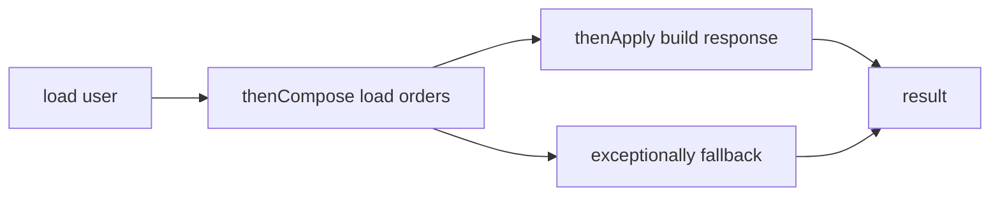

**Common mistakes:**
- Using `thenApply` and creating nested futures.
- Blocking with `join()` in the same pool.
- Running blocking I/O on the common pool.

**Follow-ups:**
- *`handle` vs `exceptionally`?* → `handle` receives success or failure; `exceptionally` only handles failure.
- *How combine independent calls?* → `thenCombine` or `allOf`.

### Q37. Explain `ForkJoinPool` and work stealing.
`🔴 Advanced` `Stretch`

**Why they ask:** Parallel streams and recursive tasks use it.

**Beginner lens:** ForkJoinPool is a team of workers splitting a big pile into smaller piles. Each worker
keeps a deque of subtasks; idle workers steal from busy workers to balance CPU work. It fits recursive,
independent, non-blocking computation. It does not fit database calls or tiny tasks that cost more to
schedule than compute. The interviewer is testing divide-and-conquer thinking plus awareness of the common
pool used by parallel streams.

**Short answer (say this first, 20-40 sec):**
`ForkJoinPool` is optimized for divide-and-conquer CPU tasks. Workers keep deques and idle workers steal tasks from busy workers. It works best for non-blocking, independent subtasks with enough work per task.

**Detailed answer:**
```java
import java.util.concurrent.*;
class SumTask extends RecursiveTask<Long>{
  final int[] a;
  final int lo,hi;
  SumTask(int[] a,int lo,int hi){
    this.a=a;
    this.lo=lo;
    this.hi=hi;
  }
  protected Long compute(){
    if(hi-lo<=1000){
      long s=0;
      for(int i=lo;i<hi;i++) s+=a[i];
      return s;
    }
    int mid=(lo+hi)>>>1;
    SumTask left=new SumTask(a,lo,mid);
    left.fork();
    return new SumTask(a,mid,hi).compute()+left.join();
  }
}
```

**Common mistakes:**
- Blocking on I/O inside ForkJoin tasks.
- Creating too many tiny tasks.
- Forking both halves instead of computing one directly.

**Follow-ups:**
- *Default pool for parallel streams?* → Common `ForkJoinPool`.
- *What is work stealing?* → Idle workers take tasks from other workers' queues.

### Q38. What are parallel stream pitfalls?
`🟡 Intermediate` `🔥` `Must-know SDE-2`

**Why they ask:** `.parallelStream()` is frequently misused.

**Beginner lens:** parallelStream is inviting several workers to process a collection, but they share the
same workshop. It helps only when work is CPU-bound, independent, large enough, and free of shared mutable
side effects. It hurts when tasks block, mutate external collections, require strict ordering, or compete
with other common-pool work. Recognize this question when someone adds parallel as a performance shortcut
without measuring or bounding resources.

**Short answer (say this first, 20-40 sec):**
Parallel streams can help CPU-bound independent work on large collections. They can hurt for small tasks, blocking I/O, shared mutable state, ordered work, or when the common pool is already busy. Measure before using them.

**Detailed answer:**
Bug:
```java
List<Integer> out = new ArrayList<>();
List.of(1,2,3,4).parallelStream().forEach(out::add); // unsafe ArrayList mutation
```
Fix:
```java
List<Integer> out = List.of(1,2,3,4).parallelStream().map(x -> x * 2).toList();
```
Avoid side effects and blocking calls.

**Common mistakes:**
- Adding `.parallel()` as a magic speed fix.
- Mutating external collections.
- Forgetting common-pool contention.

**Follow-ups:**
- *Can order change?* → Yes unless ordered operations are used, often with performance cost.
- *Best for DB calls?* → Usually no; use explicit bounded executor or reactive/async design.

### Q39. What are Java 21 virtual threads and pinning?
`🔴 Advanced` `🔥` `Stretch`

**Why they ask:** Modern Java backend interviews increasingly ask this.

**Beginner lens:** Virtual threads are lightweight task threads managed by the Java runtime and mounted on
carrier operating-system threads when running. For blocking-style Input and Output, the virtual thread can
usually park without monopolizing the carrier. Pinning is like parking while still holding the only lane,
often due to blocking inside synchronized or native code. The interviewer is testing that virtual threads
improve blocking scalability, not CPU speed or shared-state correctness.

**Short answer (say this first, 20-40 sec):**
Virtual threads are lightweight Java threads finalized in Java 21. They make blocking-style I/O scale because a blocked virtual thread usually unmounts from its carrier platform thread. Pinning happens when it cannot unmount, commonly during blocking inside a `synchronized` block or native call.

**Detailed answer:**
```java
try (ExecutorService ex = Executors.newVirtualThreadPerTaskExecutor()) {
  Future<String> f = ex.submit(() -> { Thread.sleep(100); return Thread.currentThread().toString(); });
  System.out.println(f.get());
}
```
Pinning risk:
```java
class PinRisk { synchronized void call() throws InterruptedException { Thread.sleep(1000); } }
```
Keep monitor sections short and avoid blocking I/O inside them.

**Common mistakes:**
- Using virtual threads for CPU speedups.
- Pooling virtual threads.
- Ignoring downstream limits like DB connections.

**Follow-ups:**
- *Should you create one virtual thread per task?* → Yes, that is the common model.
- *Do they remove need for timeouts?* → No.

## Production and Distributed Concurrency

### Q40. What are the four deadlock conditions and a Java fix?
`🟢 Beginner` `🔥` `Must-know SDE-1`

**Why they ask:** Deadlock theory maps to real bugs.

**Beginner lens:** Deadlock is four cars in a narrow intersection, each holding one lane and waiting for
another. The four conditions are mutual exclusion, hold-and-wait, no preemption, and circular wait. To fix
it, break at least one condition, commonly by acquiring locks in a global order or using tryLock with
timeout. Recognize deadlock when thread dumps show cycles of threads holding and waiting for locks.

**Short answer (say this first, 20-40 sec):**
Deadlock requires mutual exclusion, hold-and-wait, no preemption, and circular wait. Break any one condition to prevent it; in code, lock ordering usually breaks circular wait. Avoid holding locks during external calls.

**Detailed answer:**
```java
class Deadlock {
  static final Object A=new Object(), B=new Object();
  public static void main(String[] x){
    new Thread(() -> { synchronized(A){ sleep(); synchronized(B){} } }).start();
    new Thread(() -> { synchronized(B){ sleep(); synchronized(A){} } }).start();
  }
  static void sleep(){
    try{
      Thread.sleep(50);
    }
    catch(InterruptedException e){
      Thread.currentThread().interrupt();
    }
  }
}
```
Fix:
```java
record Account(int id){
}
static void lockBoth(Account a, Account b){
  Account first=a.id()<b.id()?a:b;
  Account second=a.id()<b.id()?b:a;
  synchronized(first){
    synchronized(second){
    }
  }
}
```
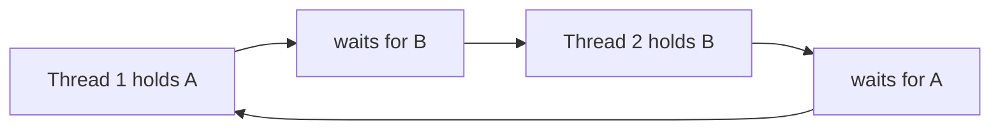

**Common mistakes:**
- Locking resources in request-dependent order.
- Holding locks during HTTP calls.
- Ignoring DB deadlocks.

**Follow-ups:**
- *Which condition does ordering break?* → Circular wait.
- *Can databases deadlock?* → Yes, row locks can deadlock too.

### Q41. How do you detect a Java deadlock with `jstack`?
`🟡 Intermediate` `🔥` `Must-know SDE-2`

**Why they ask:** Production debugging matters.

**Beginner lens:** A thread dump is an X-ray of what every thread is holding and waiting for. jstack and
jcmd can reveal monitor cycles, parked locks, and thread names, often with a deadlock section. The
interviewer is testing production debugging discipline: capture evidence before restarting, compare multiple
dumps, map threads to executors or requests, and distinguish true deadlock from starvation, long Input and
Output waits, or executor saturation.

**Short answer (say this first, 20-40 sec):**
Find the PID and run `jcmd <pid> Thread.print` or `jstack -l <pid>`. Look for `Found one Java-level deadlock`, thread states, `waiting to lock`, and `locked` monitor IDs. Take multiple dumps if it is a hang but no deadlock is reported.

**Detailed answer:**
```text
jcmd <pid> Thread.print
jstack -l <pid>
```
A deadlock report identifies owner thread, waiting thread, monitor ID, and application stack frame.

**Common mistakes:**
- Restarting before capturing evidence.
- Confusing deadlock with pool starvation.
- Not naming threads.

**Follow-ups:**
- *What if no deadlock appears?* → Check blocked I/O, DB locks, infinite loops, and executor queues.
- *How many dumps?* → Often three dumps 10-30 seconds apart.

### Q42. What is livelock?
`🟡 Intermediate` `Stretch`

**Why they ask:** It distinguishes active non-progress from blocking.

**Beginner lens:** Livelock is two polite people repeatedly stepping aside in the same direction: both are
active, but neither passes. Unlike deadlock, threads are not blocked forever on locks; they keep changing
state in response to each other. Recognize it in retry loops, conflict resolution, and coordination
protocols that react too eagerly. Fixes usually add randomness, backoff, ordering, or a single authority so
progress becomes possible.

**Short answer (say this first, 20-40 sec):**
Livelock means threads keep running and reacting to each other but no useful progress is made. Unlike deadlock, threads are active. Fix with randomized backoff, priority rules, or deterministic ownership.

**Detailed answer:**
```java
static void backoff(){
  try {
    Thread.sleep(java.util.concurrent.ThreadLocalRandom.current().nextInt(1,10));
  }
  catch(InterruptedException e){
    Thread.currentThread().interrupt();
  }
}
```
Common examples are retry loops that collide forever or two polite actors constantly yielding.

**Common mistakes:**
- Calling every hang a deadlock.
- Retrying immediately without jitter.
- Ignoring high CPU with zero throughput.

**Follow-ups:**
- *Where seen in distributed systems?* → Lock retries and conflict resolution loops.
- *Main symptom?* → Activity without progress.

### Q43. What is starvation?
`🟢 Beginner` `🔥` `Must-know SDE-1`

**Why they ask:** It explains tail latency and unfairness.

**Beginner lens:** Starvation is a cafeteria line where one group always gets served first and another
customer never reaches the counter. The system may keep working overall, so it is not necessarily
deadlocked. In Java, unfair locks, priority queues, read-heavy ReadWriteLock usage, or saturated executors
can starve work. The interviewer is testing fairness, bounded waiting, and the trade-off between throughput
and giving every request a chance.

**Short answer (say this first, 20-40 sec):**
Starvation occurs when a thread or task waits indefinitely because other work keeps taking CPU, locks, or executor capacity. The system may still process some requests. Causes include unfair locks, priority misuse, long tasks in small pools, and high-priority traffic.

**Detailed answer:**
```java
ExecutorService p = Executors.newFixedThreadPool(2);
p.submit(() -> blockForever()); p.submit(() -> blockForever()); p.submit(() -> System.out.println("starved"));
```
Separate long blocking work from latency-sensitive work.

**Common mistakes:**
- One shared executor for all task types.
- No queue-time metrics.
- Assuming fairness always improves throughput.

**Follow-ups:**
- *Metric to watch?* → Task queue wait time.
- *Can fair locks help?* → Sometimes, with possible throughput cost.

### Q44. ThreadLocal and leaks in thread pools?
`🟡 Intermediate` `🔥` `Must-know SDE-2`

**Why they ask:** Request context leaks are common in web apps.

**Beginner lens:** ThreadLocal is a locker attached to the worker thread, not to a request. In a thread
pool, the same worker handles many requests, so forgotten values can leak user context, memory, or security
data into later work. Recognize this when correlation IDs, tenants, authentication, or date formatters
appear. Always clear in finally, avoid large objects, and be careful with InheritableThreadLocal and
virtual-thread memory footprint.

**Short answer (say this first, 20-40 sec):**
`ThreadLocal` stores data per thread. In a pool, worker threads are reused, so values can leak into later requests if not removed. Always clear ThreadLocals in `finally`, and do not depend on them across async thread switches.

**Detailed answer:**
Bug:
```java
static final ThreadLocal<String> USER = new ThreadLocal<>();
void handle(String u){ USER.set(u); process(); } // leak
```
Fix:
```java
void handle(String u){ try{ USER.set(u); process(); } finally { USER.remove(); } }
```

**Common mistakes:**
- Hidden global state.
- Missing cleanup on exceptions.
- Assuming propagation to another executor thread.

**Follow-ups:**
- *Does InheritableThreadLocal solve pools?* → Usually no; it can leak stale values.
- *Virtual threads?* → ThreadLocals work but heavy use increases memory.

### Q45. What is pool starvation deadlock?
`🔴 Advanced` `🔥` `Must-know SDE-2`

**Why they ask:** Futures commonly cause this.

**Beginner lens:** Pool starvation deadlock is a one-lane workshop where every worker waits for a task that
is queued behind them. The pool is not empty, but no worker is free to run the dependency. Recognize it when
Future.get, join, or blocking calls are made inside tasks submitted to the same small executor or common
ForkJoinPool. The fix is composition, timeouts, separate executors, or avoiding blocking dependencies.

**Short answer (say this first, 20-40 sec):**
Pool starvation deadlock happens when all workers are occupied by tasks waiting for other tasks submitted to the same pool. The dependent tasks never run because no worker is free. Avoid blocking inside the same pool; compose futures or use separate executors.

**Detailed answer:**
```java
ExecutorService p = Executors.newFixedThreadPool(1);
Future<String> outer = p.submit(() -> p.submit(() -> "done").get()); // deadlock
```
Fix by using composition or a different executor for the inner work.

**Common mistakes:**
- `Future.get()` inside same small executor.
- No timeout.
- Blocking in common ForkJoinPool.

**Follow-ups:**
- *How detect?* → Thread dump shows workers waiting on futures while queue has tasks.
- *Does larger pool fix?* → It may mask; design is still fragile.

### Q46. Why does `synchronized` fail with multiple pods?
`🟡 Intermediate` `🔥` `Must-know SDE-2`

**Why they ask:** Backend services are horizontally scaled.

**Beginner lens:** synchronized is a key for one room inside one Java Virtual Machine. In Kubernetes or any
horizontally scaled deployment, each pod has its own room and its own key, so two pods can enter their local
critical sections simultaneously. Recognize this when shared state is in a database, Redis, queue, or
external service. The final guard usually needs a database constraint, transaction, idempotency key,
partitioning, or carefully designed distributed lock.

**Short answer (say this first, 20-40 sec):**
`synchronized` only protects one JVM heap. With multiple pods, each pod has its own lock object, so two pods can enter the same critical section at once. Use DB transactions, unique constraints, idempotency, queue partitioning, or distributed locks for cross-pod coordination.

**Detailed answer:**
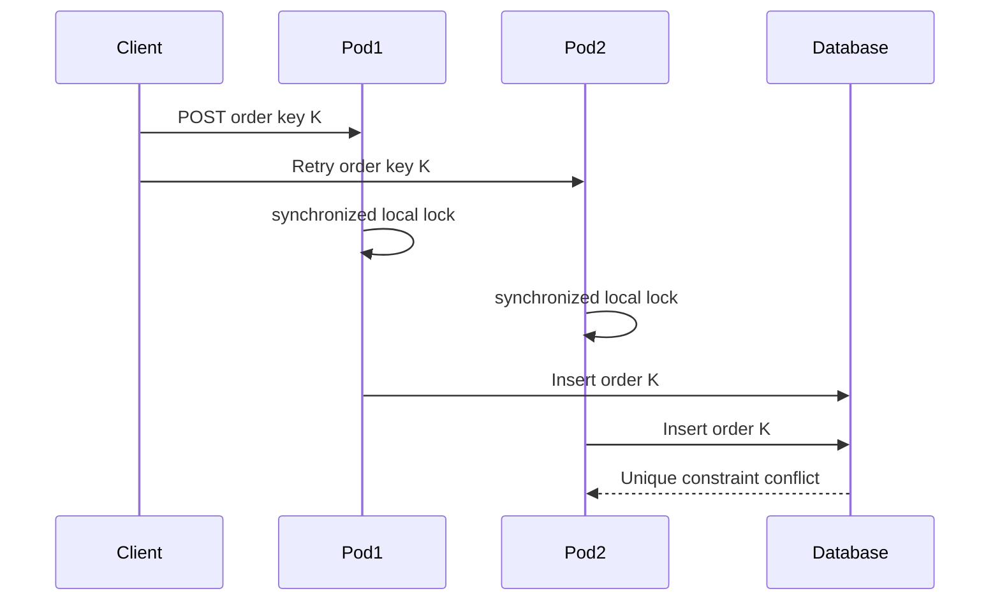
Final guard: unique key or transactional invariant in the DB.

**Common mistakes:**
- Scaling pods without revisiting locks.
- Redis lock without TTL and ownership token.
- No idempotency for retries.

**Follow-ups:**
- *Best for payments?* → Idempotency key plus transactional storage.
- *Can Redis lock expire early?* → Yes, so still use final constraints.

### Q47. DB lock vs Redis lock vs idempotency?
`🔴 Advanced` `🔥` `Must-know SDE-2`

**Why they ask:** Distributed correctness needs tool selection.

**Beginner lens:** Choose the tool by asking what must be protected. A database lock protects persistent
rows inside a transaction; a Redis lock coordinates a short cross-node section but needs expiry, ownership
token, and safe release; an idempotency key makes retries of the same logical request return the same
result. The interviewer is testing distributed correctness, especially that a Redis lock is not a
replacement for final database constraints.

**Short answer (say this first, 20-40 sec):**
DB locks protect rows inside transactions. Redis locks coordinate short cross-node sections but need TTL, unique token, and safe release. Idempotency makes retries safe by returning the same result for the same logical request.

**Detailed answer:**
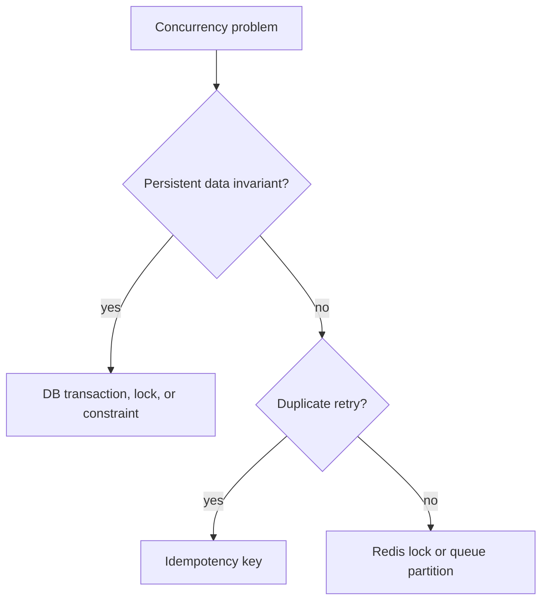
```sql
BEGIN;
SELECT * FROM inventory WHERE sku='A' FOR UPDATE;
UPDATE inventory SET qty = qty - 1 WHERE sku='A' AND qty > 0;
COMMIT;
```

**Common mistakes:**
- Holding DB locks during external API calls.
- Releasing a Redis lock you do not own.
- Treating idempotency as mutual exclusion for all cases.

**Follow-ups:**
- *What is a fencing token?* → Monotonic token used to reject stale lock holders.
- *Strongest final guard?* → DB constraint or conditional update.

### Q48. How do you avoid lost updates in the database?
`🟡 Intermediate` `🔥` `Must-know SDE-2`

**Why they ask:** Java locking cannot protect rows across pods.

**Beginner lens:** A lost update is two people editing the same spreadsheet cell and the later save
overwriting the earlier one. Java locks cannot protect this across pods, so put the guard where the row
lives: version predicates, SELECT FOR UPDATE, conditional updates, isolation, and constraints. Recognize it
in read-modify-write database code. Production answers mention retry policy, conflict reporting, and keeping
transactions short.

**Short answer (say this first, 20-40 sec):**
Use optimistic locking with a version column, pessimistic row locks like `SELECT FOR UPDATE`, atomic conditional updates, and proper isolation. Pick optimistic for low contention and retryable conflicts; pessimistic for high contention or strict serialization.

**Detailed answer:**
```sql
-- Atomic stock decrement
UPDATE inventory SET qty = qty - 1 WHERE sku = 'A' AND qty > 0;
-- Optimistic update
UPDATE product SET price = 120, version = version + 1 WHERE id = 10 AND version = 3;
```
If affected rows are zero, retry or report a conflict.

**Common mistakes:**
- Read-calculate-write without version predicate.
- Holding row locks while calling external services.
- Assuming `READ COMMITTED` prevents every lost update.

**Follow-ups:**
- *When optimistic?* → Low conflict, user can retry.
- *When pessimistic?* → High conflict or cannot tolerate overwrite.

### Q49. What is an idempotency key?
`🟡 Intermediate` `🔥` `Must-know SDE-2`

**Why they ask:** Retries are normal in distributed systems.

**Beginner lens:** An idempotency key is a receipt number for one logical operation. If the client retries
because the network timed out, the server uses the key to find or finish the original result instead of
creating a duplicate payment or order. Recognize this in POST requests, webhooks, and message redelivery.
Store request hash, status, response, and expiry, and still keep database constraints for final correctness.

**Short answer (say this first, 20-40 sec):**
An idempotency key identifies one logical operation. The server stores the key, request hash, status, and response so retries return the same result instead of doing the operation again. It is crucial for payments, order creation, and webhook handling.

**Detailed answer:**
```sql
CREATE TABLE idempotency_keys (idempotency_key text PRIMARY KEY, request_hash text NOT NULL, response_body jsonb, created_at timestamptz DEFAULT now());
```
The key insert and business operation should happen in one transaction where possible.

**Common mistakes:**
- Generating the key only on the server after duplicate work begins.
- Not storing response or request hash.
- Keeping keys for too short a retry window.

**Follow-ups:**
- *Different payload with same key?* → Reject as conflict.
- *Does it replace DB constraints?* → No, it complements them.

### Q50. What is queue partitioning for concurrency?
`🔴 Advanced` `Stretch`

**Why they ask:** Queues can replace locks at scale.

**Beginner lens:** Queue partitioning is routing all events for the same key to the same lane. Within one
lane, order is preserved, so a single consumer can update that entity without a cross-node lock; different
keys still run in parallel. Recognize it in Kafka-style order workflows, account events, and inventory
streams. The scale concern is key choice: low-cardinality or hot keys bottleneck one partition, and
consumers must remain idempotent.

**Short answer (say this first, 20-40 sec):**
Queue partitioning routes messages with the same key to the same partition, preserving order for that key while allowing parallelism across keys. It avoids cross-node locks for workflows like order events. It still needs idempotent consumers because messages may be retried.

**Detailed answer:**
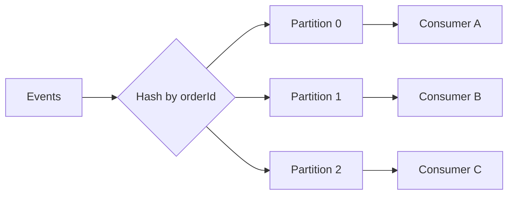
Ordering is per partition/key, not global.

**Common mistakes:**
- Low-cardinality partition keys.
- Assuming global ordering.
- Non-idempotent consumers.

**Follow-ups:**
- *Good key for order workflow?* → `orderId`.
- *Hot key issue?* → One partition can bottleneck.

### Q51. How investigate high CPU caused by concurrency?
`🟡 Intermediate` `🔥` `Must-know SDE-2`

**Why they ask:** This is a common production incident.

**Beginner lens:** High Central Processing Unit usage from concurrency is like wheels spinning without
moving the car. Do not guess first; collect thread dumps, Java Flight Recorder or profiler data, and
operating-system thread mapping. Look for busy loops, Compare-And-Set spinning, retry storms, HashMap
traversal, logging, or garbage collection. The interviewer is testing incident method: capture evidence,
correlate with deploys and traffic, then change one suspected cause.

**Short answer (say this first, 20-40 sec):**
Confirm CPU, capture thread dumps and a CPU profile, map hot OS threads to Java stacks, and look for busy loops, HashMap traversal, CAS spinning, retry storms, or GC pressure. Correlate with deploys, traffic, queue depth, and downstream errors.

**Detailed answer:**
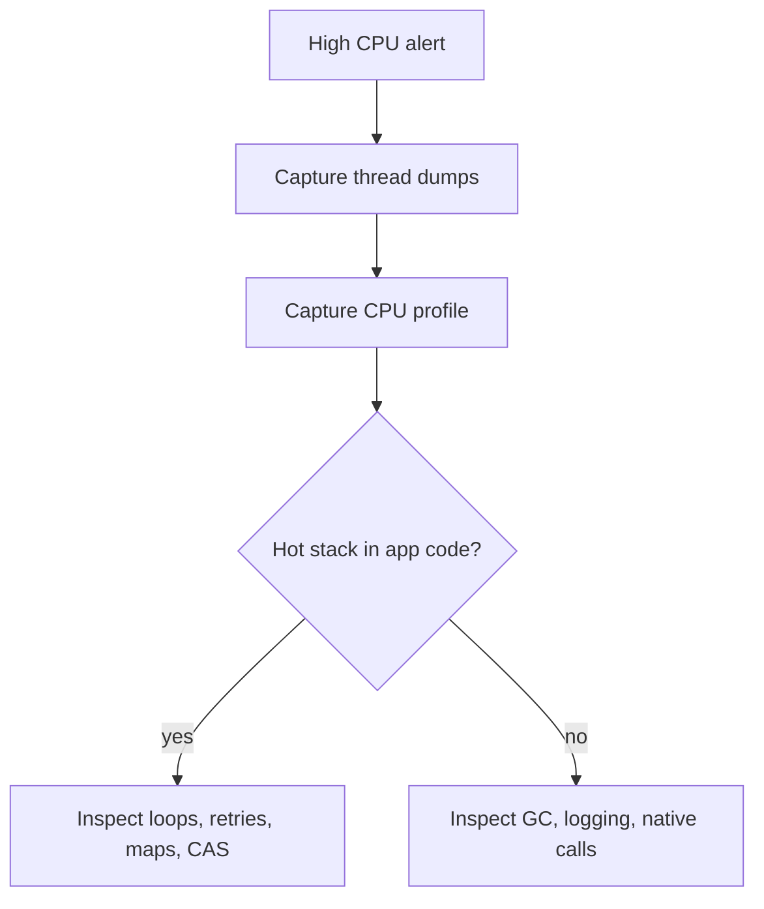
Commands: `jcmd <pid> Thread.print`, `jcmd <pid> JFR.start duration=60s filename=profile.jfr`.

**Common mistakes:**
- Restarting before evidence.
- Looking only at average latency.
- Ignoring retry amplification.

**Follow-ups:**
- *Busy spin symptom?* → RUNNABLE threads on same loop with high CPU.
- *If CPU is GC?* → Inspect allocation and heap leaks.

### Q52. How investigate request timeouts from executor saturation?
`🟡 Intermediate` `🔥` `Must-know SDE-2`

**Why they ask:** Thread pools often bottleneck APIs.

**Beginner lens:** Executor saturation is a waiting room problem: workers are all busy, chairs are full, and
new visitors wait or get rejected. Check active count, queue depth, task duration, rejection count, and
downstream waits. Thread dumps tell whether workers are computing, blocked on Input and Output, waiting for
futures, or stuck on locks. Recognize this when p99 latency rises before errors appear.

**Short answer (say this first, 20-40 sec):**
Check active threads, queue depth, rejection count, task duration, and downstream waits. Thread dumps reveal whether workers are blocked on DB, HTTP, locks, or futures. Fix by bounding queues, splitting pools, adding timeouts, and aligning pool sizes with downstream capacity.

**Detailed answer:**
```java
ThreadPoolExecutor e = new ThreadPoolExecutor(10,20,30,TimeUnit.SECONDS,new ArrayBlockingQueue<>(500));
int active = e.getActiveCount(); int queued = e.getQueue().size(); long done = e.getCompletedTaskCount();
```
Queue time is part of request latency.

**Common mistakes:**
- Increasing max threads while DB pool remains small.
- No timeout on downstream calls.
- One shared executor for unrelated dependencies.

**Follow-ups:**
- *What is bulkheading?* → Isolating pools by dependency/workload.
- *Key metrics?* → Active, queued, rejected, completed, task duration.

### Q53. What is false sharing?
`🔴 Advanced` `Stretch`

**Why they ask:** It appears in performance-heavy concurrency.

**Beginner lens:** False sharing is two workers writing different sticky notes that happen to sit on the
same clipboard; the whole clipboard keeps bouncing between them. At the CPU level, independent variables
share one cache line, so updates invalidate each other and slow down. It matters in hot counters, ring
buffers, and low-latency code, not ordinary business methods. Padding or sharding can help after measurement
proves the bottleneck.

**Short answer (say this first, 20-40 sec):**
False sharing happens when independent variables updated by different threads sit on the same CPU cache line. Threads invalidate each other's cache line even though they do not logically share data. It hurts performance, not usually correctness.

**Detailed answer:**
```java
class Counters { volatile long a; volatile long b; }
```
Mitigate with library classes like `LongAdder`, better data layout, and JMH measurement before tuning.

**Common mistakes:**
- Calling all contention false sharing.
- Hand-padding without measurement.
- Microbenchmarking without JMH.

**Follow-ups:**
- *Why LongAdder helps?* → It spreads updates across cells.
- *Is it a correctness bug?* → Usually no, performance bug.

### Q54. How can concurrency utilities cause memory leaks?
`🟡 Intermediate` `Stretch`

**Why they ask:** Leaks often come from queues and ThreadLocals.

**Beginner lens:** Concurrency utilities often hold references longer than beginners expect. Queues retain
tasks, Futures retain results or exceptions, ThreadLocals retain request state on pooled workers, scheduled
tasks repeat forever, and caches grow without limits. Think of forgotten bags left in worker lockers and
waiting rooms. Recognize this when heap dumps show executor queues, ThreadLocalMap entries,
CompletableFuture chains, or cache nodes retaining application objects.

**Short answer (say this first, 20-40 sec):**
Leaks happen when unbounded queues grow, `Future`s are retained forever, ThreadLocal values are not removed, or scheduled tasks hold references. Symptoms are rising heap, GC pressure, and latency. Use bounded queues, cleanup, cancellation, and metrics.

**Detailed answer:**
Bug:
```java
ExecutorService p = Executors.newFixedThreadPool(4); // unbounded queue internally
for(;;) p.submit(() -> slowWork());
```
Fix with bounded `ThreadPoolExecutor` and rejection policy.

**Common mistakes:**
- Keeping every `Future` in a list.
- Forgetting `ThreadLocal.remove()`.
- No queue size metrics.

**Follow-ups:**
- *How diagnose?* → Heap dump dominator tree and queue metrics.
- *Why fixed pool can leak?* → Its queue is effectively unbounded.

### Q55. How explain concurrency in a Spring Boot project?
`🟢 Beginner` `Stretch`

**Why they ask:** They connect theory to your resume.

**Beginner lens:** Frame the story around a request flow. Name where work runs: servlet thread, async
executor, scheduled job, message listener, database transaction, cache, or remote call. Then explain shared
state and the safety boundary: immutable request objects, per-key ConcurrentHashMap operations, transaction
constraints, idempotency, or queue partitioning. The interviewer is testing whether you can connect
concurrency theory to real Spring Boot code and production incidents.

**Short answer (say this first, 20-40 sec):**
Spring Boot handles multiple requests concurrently using server threads. Singleton beans are shared, so services should be stateless or protect mutable fields. For an AI email assistant, keep request data in method parameters, set HTTP timeouts, and limit external API concurrency.

**Detailed answer:**
Bug:
```java
@Service class BadEmailService {
  private String lastTone;
  String reply(String email,String tone){
    lastTone=tone;
    return call(email,lastTone);
  }
}
```
Fix:
```java
@Service class EmailService { String reply(String email,String tone){ return call(email,tone); } }
```
Do not store per-request data in singleton fields.

**Common mistakes:**
- Assuming one request at a time.
- Missing timeouts for external APIs.
- Putting request context in static fields.

**Follow-ups:**
- *Are Spring singletons thread-safe?* → Only if your code is thread-safe.
- *Where store request data?* → Parameters, local variables, or request scope.

## Testing Concurrent Code

### Q56. How do you test concurrent code?
`🟡 Intermediate` `🔥` `Must-know SDE-2`

**Why they ask:** Timing-dependent bugs require special tests.

**Beginner lens:** Testing concurrent code means creating the unlucky timing on purpose. Use latches or
barriers to line up threads, repeat many times, assert invariants, and add timeouts so tests fail instead of
hanging. Normal unit tests mostly test friendly interleavings. Recognize this when code has shared state,
check-then-act, or lock ordering. For memory-model behavior, use specialized tools such as jcstress rather
than ad hoc sleeps.

**Short answer (say this first, 20-40 sec):**
Use deterministic start gates, many iterations, timeouts, and assertions on invariants. Avoid `Thread.sleep` as synchronization. For low-level memory model code use jcstress; for backend code use integration stress with real executors and DB transactions.

**Detailed answer:**
```java
import java.util.concurrent.*; import java.util.concurrent.atomic.*;
class Stress {
  void test() throws Exception {
    AtomicInteger c=new AtomicInteger();
    ExecutorService p=Executors.newFixedThreadPool(8);
    CountDownLatch start=new CountDownLatch(1);
    for(int t=0;t<8;t++) {
      p.submit(() -> {
        start.await();
        for(int i=0;i<10000;i++) c.incrementAndGet();
        return null;
      });
    }
    start.countDown();
    p.shutdown();
    if(!p.awaitTermination(5,TimeUnit.SECONDS)) throw new AssertionError();
    if(c.get()!=80000) throw new AssertionError(c.get());
  }
}
```

**Common mistakes:**
- One lucky test run.
- Sleeping instead of coordinating.
- Testing with mocks when DB isolation is the issue.

**Follow-ups:**
- *What is a start gate?* → A latch that releases workers simultaneously.
- *What should assertions check?* → Business invariants.

### Q57. What is jcstress?
`🔴 Advanced` `Stretch`

**Why they ask:** It is the right tool for JMM-level validation.

**Beginner lens:** jcstress is a laboratory for Java Memory Model edge cases. It runs tiny concurrent actors
many times and records the outcomes so you can see whether a result is allowed, forbidden, or surprising
under real runtime optimizations. Recognize it when the question is about visibility, reordering, atomics,
volatile, or safe publication. It is not a general load-test tool; it is for proving low-level concurrency
behavior.

**Short answer (say this first, 20-40 sec):**
jcstress is an OpenJDK harness for concurrency stress tests. It runs small actor methods under many interleavings and records observed outcomes. Use it for custom atomics, safe publication, and memory-model assumptions.

**Detailed answer:**
Conceptual shape:
```java
class ReorderingShape { int x,y,r1,r2; void actor1(){ x=1; r1=y; } void actor2(){ y=1; r2=x; } }
```
Actual jcstress uses annotations from `org.openjdk.jcstress.annotations` and outcome declarations.

**Common mistakes:**
- Using JUnit alone to prove JMM behavior.
- Treating one run as proof.
- Writing lock-free code when JDK classes exist.

**Follow-ups:**
- *Use for service tests?* → Usually no; use integration/load tests.
- *Use for library concurrency?* → Yes.

### Q58. How do you review Java concurrency code?
`🟡 Intermediate` `🔥` `Must-know SDE-2`

**Why they ask:** It tests practical engineering judgment.

**Beginner lens:** Review concurrency like auditing a factory floor. Mark every shared mutable object, every
thread or executor boundary, every lock, every blocking call, and every cleanup path. Then ask whether the
same invariant is protected consistently, whether visibility is guaranteed, and whether liveness can fail
through deadlock, starvation, or saturation. The interviewer is testing systematic reasoning, not just
knowing many concurrency classes.

**Short answer (say this first, 20-40 sec):**
Identify shared mutable state, verify all access uses the same protection, ensure compound actions are atomic, and inspect executor boundaries. Then check timeouts, interruption, safe publication, DB/distributed scope, tests, and metrics.

**Detailed answer:**
Checklist: shared state, ownership, lock identity, atomic map APIs, bounded queues, named threads, rejection policy, downstream limits, ThreadLocal cleanup, transaction boundaries, idempotency, and invariant tests.

**Common mistakes:**
- Reviewing syntax instead of interleavings.
- Ignoring deployment topology.
- No observability for queues and locks.

**Follow-ups:**
- *First review question?* → What mutable state is shared?
- *Final proof?* → Test or metric for the invariant.

### Q59. How do you choose between lock, atomic, concurrent collection, and DB transaction?
`🟡 Intermediate` `🔥` `Must-know SDE-2`

**Why they ask:** Correct mechanism selection is more important than memorization.

**Beginner lens:** Choose the fence that surrounds the real shared resource. A single independent number can
use an atomic; a multi-field heap invariant often needs a lock; a per-key map update can use
ConcurrentHashMap compute or merge; a persistent row needs a database transaction or constraint. Recognize
the decision by scope: one variable, one object, one key, multiple keys, one row, or multiple pods.

**Short answer (say this first, 20-40 sec):**
Use atomics for one independent variable, locks for multi-field in-JVM invariants, concurrent collections for shared data structures, and DB transactions or constraints for persistent cross-process invariants. If multiple pods are involved, a JVM lock is insufficient.

**Detailed answer:**
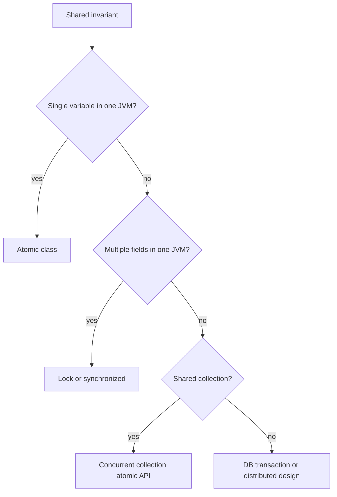

**Common mistakes:**
- Using CHM for multi-key transactions.
- Using DB lock for purely local counters.
- Using Redis lock as the only correctness guard.

**Follow-ups:**
- *Best final guard for unique order?* → DB unique constraint.
- *Best for metrics counter?* → `LongAdder`.

### Q60. What production metrics would you add for concurrency?
`🟡 Intermediate` `🔥` `Must-know SDE-2`

**Why they ask:** Reliable systems need visibility.

**Beginner lens:** Metrics are the dashboard for the kitchen. Add active threads, pool size, queue depth,
rejection count, task duration, lock wait time, blocked thread count, cache load count, hit ratio, timeout
count, retry rate, and p99 latency. The interviewer is testing observability: concurrency failures often
appear as saturation before exceptions. Tie each metric to an action, such as shed load, resize cautiously,
split pools, or inspect thread dumps.

**Short answer (say this first, 20-40 sec):**
Expose executor active count, queue depth, completed tasks, rejections, task duration, lock wait time, cache hit/load counts, retry counts, and DB lock wait/deadlock metrics. These reveal saturation before users see outages. Metrics must be tagged by pool/dependency.

**Detailed answer:**
```java
int active = executor.getActiveCount();
int queued = executor.getQueue().size();
long completed = executor.getCompletedTaskCount();
long total = executor.getTaskCount();
```
Also track p95/p99 latency, timeout count, idempotency conflicts, semaphore permits, and downstream concurrency.

**Common mistakes:**
- Only average latency.
- No per-pool names.
- No rejection or queue metrics.

**Follow-ups:**
- *Most important executor metric?* → Queue depth and rejection count.
- *Metric for cache stampede?* → Load count spikes for same key and low hit ratio.

## Revision Cheat Sheet

- Race condition: correctness depends on timing; make the full invariant atomic.
- Avoid shared mutable state first; then use locks, atomics, concurrent collections, or DB transactions.
- `volatile` is visibility and ordering, not `count++` atomicity.
- Instance `synchronized` locks `this`; static `synchronized` locks the class object.
- `ReentrantLock` adds timed/interruptible/fair locking; unlock in `finally`.
- `ReadWriteLock` helps read-heavy workloads; `StampedLock` needs validation and is not reentrant.
- CAS updates only if expected value still matches; ABA needs stamping/versioning.
- `HashMap` is unsafe for concurrent mutation; Java 7 resize could create cyclic chains.
- `ConcurrentHashMap` forbids null; use `Optional` or sentinels.
- Prefer `computeIfAbsent`, `merge`, and `remove(key,value)` over get-then-put.
- `BlockingQueue` gives safe producer-consumer handoff and backpressure.
- `CountDownLatch` one-shot; `CyclicBarrier` reusable; `Semaphore` limits permits.
- `CompletableFuture` composes async work; custom executor for blocking I/O.
- Deadlock needs four conditions; lock ordering breaks circular wait.
- ThreadLocal in pools must be removed in `finally`.
- Java 21 virtual threads scale blocking I/O; avoid pinning by blocking inside monitors.
- JVM locks do not work across pods; use DB constraints, idempotency, queues, or safe distributed locks.
- Test with start gates, repeated runs, invariant assertions, timeouts, and jcstress for JMM code.

## Flashcards

- Q → What does `volatile` not provide? A → Atomic compound updates.
- Q → `synchronized` instance method locks what? A → `this`.
- Q → Static synchronized locks what? A → The `Class` object.
- Q → Why no null in CHM? A → Null must mean absent unambiguously.
- Q → Lazy cache method in CHM? A → `computeIfAbsent`.
- Q → Counter under high contention? A → `LongAdder` for metrics, `AtomicLong` for exact linearizable value.
- Q → Four deadlock conditions? A → Mutual exclusion, hold-and-wait, no preemption, circular wait.
- Q → Start many test threads together? A → `CountDownLatch`.
- Q → Java 21 lightweight threads? A → Virtual threads.
- Q → Cross-pod duplicate protection? A → Idempotency key plus DB constraint.
- Q → Backpressure executor policy? A → `CallerRunsPolicy`.
- Q → Cache stampede fix? A → Atomic in-flight deduplication.
- Q → ThreadLocal pool rule? A → Remove in `finally`.
- Q → Detect deadlock command? A → `jcmd <pid> Thread.print` or `jstack -l`.
- Q → Best final guard for uniqueness? A → Database unique constraint.