# 04a · Spring Core, Boot & Security

This part covers Spring Core, Boot internals, MVC, validation, logging, API clients, and Security for SDE-1/SDE-2 interviews. Examples connect to the AI Email Reply Assistant Spring Boot backend that calls Gemini API.

**Legend:** 🟢 Beginner · 🟡 Intermediate · 🔴 Advanced · ⚫ FAANG · 🔥 = very frequently asked

## Table of Contents
- [Beginner guide to this file](#beginner-guide-to-this-file)
- [Spring Core](#spring-core)
- [Spring Boot](#spring-boot)
- [MVC, Validation, Logging, AOP & API Clients](#mvc-validation-logging-aop--api-clients)
- [Spring Security](#spring-security)
- [Production Scenarios](#production-scenarios)
- [Revision Cheat Sheet](#revision-cheat-sheet)
- [Flashcards](#flashcards)

## Beginner guide to this file

### What this file teaches

This file teaches how Spring turns plain Java classes into a working backend: object creation, dependency
wiring, web request handling, configuration, production health checks, and security. Interviewers ask these
topics because almost every Java service has the same flow: Hypertext Transfer Protocol (HTTP) request ->
Spring Security filters -> Model View Controller (MVC) controller -> service bean -> repository or external
Application Programming Interface (API) -> response. Strong answers show that you understand the framework
instead of only memorizing annotations.

### Mental model

Think of Spring as a restaurant kitchen manager: it hires cooks, gives each cook the right tools, checks
orders at the door, sends work to the right station, and records what happened.

- The container is the manager that creates beans and wires dependencies.
- Dependency Injection (DI) is handing each bean its collaborators instead of making it find them.
- Auto-configuration is Spring Boot preparing sensible defaults when the classpath and properties match.
- Proxies are wrappers around beans that add transactions, security, validation, or Aspect Oriented
  Programming (AOP) behavior.
- The security filter chain checks a request before MVC sees it, then authorization rules decide access.
- Configuration, validation, logging, and API clients are supporting systems around the core request flow.

### How to think through any question here

1. Identify whether the question is about container startup, one HTTP request, configuration, data access,
   or security.
2. Name the owner of the behavior: container, Spring Boot auto-configuration, MVC, AOP proxy, transaction
   proxy, or security filter.
3. Walk the concrete flow. For startup: scan -> bean definition -> instantiate -> inject -> post-process ->
   initialize -> proxy -> ready. For a request: filter -> controller -> service -> repository/client ->
   response.
4. State the key distinction, such as Inversion of Control (IoC) versus DI, filter versus interceptor,
   authentication versus authorization, or RestClient versus WebClient.
5. Add the production concern: timeouts, retries, secret handling, health endpoints, password hashing,
   Cross-Origin Resource Sharing (CORS), or Cross-Site Request Forgery (CSRF).
6. Mention the common failure mode and how you would debug it with logs, Actuator, configuration reports,
   or a small integration test.
7. Finish with the safer default used in modern Spring Boot 3 applications.

### Pattern recognition cues

| If the question mentions... | Think about... | Why it fits |
| --- | --- | --- |
| Object creation, loose coupling, or new keyword | IoC and DI | Spring owns construction and wiring. |
| Constructor, setter, or field injection | Dependency style | Constructor injection exposes required dependencies at startup. |
| Bean not found, duplicate bean, or profile | Component scan and conditional beans | The container only creates beans that match scanning and conditions. |
| Startup changed after adding a starter | Auto-configuration | Spring Boot backs off or activates defaults from classpath and properties. |
| Request reaches controller incorrectly | DispatcherServlet request flow | MVC binds input, validates, invokes handlers, and serializes output. |
| Transaction, security, cache, or logging magic | Proxy and AOP | Cross-cutting behavior wraps bean method calls. |
| 401, 403, token, login, or roles | Security filter chain | Filters authenticate first, then authorization checks permissions. |
| Browser blocked a request | CORS or CSRF | Browser rules and cookie-authenticated writes need separate controls. |
| Slow external call | API client timeouts and retries | Threads and connection pools need limits before traffic grows. |
| Health, metrics, or production readiness | Actuator and logging context | Operations teams need safe visibility without exposing secrets. |

### Abbreviations and key terms

| Short form | Expanded form | Plain meaning |
| --- | --- | --- |
| AI | Artificial Intelligence | Software behavior that uses learned models or generated output. |
| AOP | Aspect Oriented Programming | Add behavior around method calls without putting it in every method. |
| API | Application Programming Interface | A contract that defines how software components call each other. |
| BOM | Bill of Materials | A dependency version set that keeps related libraries compatible. |
| BPP | BeanPostProcessor | Spring hook that can modify beans before and after initialization. |
| CGLIB | Code Generation Library | Proxy technique that creates subclasses when no interface proxy fits. |
| CORS | Cross-Origin Resource Sharing | Browser rule controlling which origins can call an API. |
| CSRF | Cross-Site Request Forgery | Attack where a browser is tricked into sending an authenticated request. |
| DB | Database | Persistent store such as PostgreSQL or MySQL. |
| DI | Dependency Injection | Supplying required collaborators from outside a class. |
| DTO | Data Transfer Object | Shape used to carry request or response data. |
| EE | Enterprise Edition | Older Java enterprise platform term, now Jakarta Enterprise Edition. |
| FAANG | Meta, Amazon, Apple, Netflix, Google style companies | Shorthand for large product-company interviews. |
| GEMINI_API_KEY | Gemini API key | Environment secret used to call Gemini safely. |
| HTTP | Hypertext Transfer Protocol | Request and response protocol used by web APIs. |
| ID | Identifier | Value that uniquely names an object or record. |
| JDK | Java Development Kit | Tools and runtime needed to compile and run Java. |
| JPA | Java Persistence API | Java standard abstraction for object-relational persistence. |
| JSON | JavaScript Object Notation | Text format commonly used for API request and response bodies. |
| JVM | Java Virtual Machine | Runtime that executes compiled Java bytecode. |
| JWT | JSON Web Token | Signed token that carries authentication claims. |
| LLM | Large Language Model | Model that generates text from prompts. |
| MD5 | Message Digest 5 | Old hash algorithm that is not safe for passwords. |
| MDC | Mapped Diagnostic Context | Per-request logging fields such as correlation identifiers. |
| META-INF | Metadata information directory | Java archive folder used for framework metadata. |
| MVC | Model View Controller | Web pattern Spring uses for controllers, models, and responses. |
| OIDC | OpenID Connect | Identity layer built on OAuth 2.0. |
| OS | Operating System | Host software such as Windows or Linux. |
| PII | Personally Identifiable Information | User data that can identify a person and must be protected. |
| PKCE | Proof Key for Code Exchange | OAuth protection for public clients during authorization code login. |
| REST | Representational State Transfer | Resource-oriented API style using HTTP semantics. |
| SDE-1 | Software Development Engineer level 1 | Entry-level engineering interview scope. |
| SDE-2 | Software Development Engineer level 2 | Mid-level scope with more design and production judgment. |
| SHA-256 | Secure Hash Algorithm 256-bit | Cryptographic hash used in security-sensitive workflows. |
| SLA | Service Level Agreement | Promise or target for availability or latency. |
| SLF4J | Simple Logging Facade for Java | Logging API that delegates to an implementation such as Logback. |
| SPRING_PROFILES_ACTIVE | Spring profiles active environment variable | Runtime setting that chooses active Spring profiles. |
| URL | Uniform Resource Locator | Full web address for a resource. |
| UX | User Experience | How the user experiences the product. |
| YAML | YAML Ain't Markup Language | Indented configuration format often used by Spring Boot. |
| Bean | Not an abbreviation | Object managed by the Spring container. |
| Container | Not an abbreviation | Spring runtime that creates, configures, and stores beans. |
| Proxy | Not an abbreviation | Wrapper object that adds framework behavior around a target bean. |

### Common beginner traps

- Treating IoC and DI as identical. DI is one way Spring implements IoC.
- Memorizing annotations without explaining which part of the request or startup flow they affect.
- Forgetting that many Spring features are proxy based, so self-invocation can bypass them.
- Assuming auto-configuration always wins. User beans and properties can make Spring Boot back off.
- Putting business logic in filters, interceptors, controllers, or security configuration.
- Exposing Actuator, stack traces, tokens, or raw validation errors without thinking about production risk.
- Retrying external API calls without timeouts, budgets, or idempotency.

### How to study this file

1. Read each short answer first and practice saying it in under one minute.
2. Then read the detailed answer and draw the relevant flow: container startup, MVC request, API client,
   transaction, or security filter chain.
3. Use the beginner lens to identify what the interviewer is really testing before memorizing syntax.
4. Turn the flashcards into active recall: hide the answer, speak the flow aloud, then compare.
5. For every scenario, name one safe production default and one debugging signal.
6. Revisit the cheat sheet after practice so the compact bullets connect to real explanations.

### Scalability and production lens

Toy Spring examples often use one controller, one service, and one happy-path request. Production adds
traffic spikes, slow downstream APIs, secrets, multiple profiles, observability, and hostile input. A strong
answer explains the request path with limits: security filters authenticate early, validation rejects bad input,
service methods run through proxies for transactions or security, API clients use timeouts and bounded retries,
and logs carry correlation identifiers without leaking Personally Identifiable Information (PII).

## Spring Core

### Q1. What is Spring IoC?
`🟢 Beginner` `🔥` `Must-know SDE-1`

**Why they ask:** It is the foundation behind every Spring feature.

**Beginner lens:** Inversion of Control means Spring drives object creation the way a dispatcher sends tasks
to workers instead of each worker hiring its own helpers. The key distinction is control: your class
declares what it needs, and the container supplies it. Recognize this when the question uses container,
bean, wiring, or dependency. A concrete flow is startup -> scan classes -> build bean definitions -> create
beans -> inject dependencies -> application handles requests with already prepared objects.

**Short answer (say this first, 20-40 sec):**
IoC means the container controls object creation and wiring instead of application classes manually creating dependencies. Classes declare dependencies, and Spring provides configured beans. This improves loose coupling, testing, lifecycle handling, and configuration management.

**Detailed answer:**
- Without IoC, `EmailController` creates `EmailService` and Gemini clients with `new`, tightly coupling code.
- With IoC, the controller asks for `EmailReplyService` in its constructor and Spring injects it.
- The container uses component scanning, Java config, auto-configuration, and bean definitions.
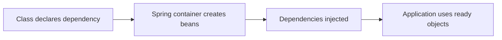

**Common mistakes:**
- Saying IoC and DI are exactly the same; DI is a way to implement IoC.
- Manually instantiating Spring services.

**Follow-ups:**
- *Why is IoC testable?* → Tests can pass mocks or fakes without changing production code.
- *Can IoC exist without Spring?* → Yes, factories or manual composition can invert control too.

### Q2. What are the dependency injection types, and why prefer constructor injection?
`🟢 Beginner` `🔥` `Must-know SDE-1`

**Why they ask:** DI style affects maintainability and startup safety.

**Beginner lens:** Dependency injection is passing a class its tools instead of making it shop for them.
Constructor injection is like putting all required tools on the checklist before the job starts, so missing
dependencies fail at startup. Field and setter injection hide requirements or allow half-built objects.
Interviewers test whether you value immutability, testability, and early failure. In production, constructor
injection also makes circular dependencies and configuration mistakes easier to catch.

**Short answer (say this first, 20-40 sec):**
Spring supports constructor, setter, and field injection. Constructor injection is preferred for required dependencies because dependencies are explicit, can be `final`, are easy to test, and fail fast at startup. Setter injection fits optional dependencies; field injection hides dependencies and makes tests harder.

**Detailed answer:**
```java
@Service
class EmailReplyService {
    private final GeminiClient geminiClient;
    EmailReplyService(GeminiClient geminiClient) { this.geminiClient = geminiClient; }
}
```
| Type | Use | Risk |
|---|---|---|
| Constructor | Required dependencies | Reveals circular dependencies |
| Setter | Optional dependencies | Partially initialized object |
| Field | Legacy/demo | Hidden, reflection-based, not `final` |

**Common mistakes:**
- Using field injection because it is shorter.
- Making mandatory collaborators optional.

**Follow-ups:**
- *Do you need `@Autowired` on one constructor?* → No, modern Spring infers it.
- *What does many constructor args suggest?* → The class may have too many responsibilities.

### Q3. How does Spring handle circular dependencies in Boot 2.6+?
`🟡 Intermediate` `🔥` `Must-know SDE-1`

**Why they ask:** Circular dependencies appear often in service-layer designs.

**Beginner lens:** A circular dependency is two beans asking for each other before either one is fully
built, like two people waiting for the other to unlock a door. Spring Boot 2.6 and later discourage these
cycles because they usually reveal mixed responsibilities. Recognize it when services depend on each other
bidirectionally. The cleaner flow is controller -> service A -> service B or a shared collaborator/event,
not service A -> service B -> service A during construction.

**Short answer (say this first, 20-40 sec):**
A circular dependency means bean A needs B and B needs A. Constructor cycles cannot be resolved safely. Since Spring Boot 2.6, circular references are disabled by default, so the app fails fast unless `spring.main.allow-circular-references=true` is set; the right fix is usually redesign.

**Detailed answer:**
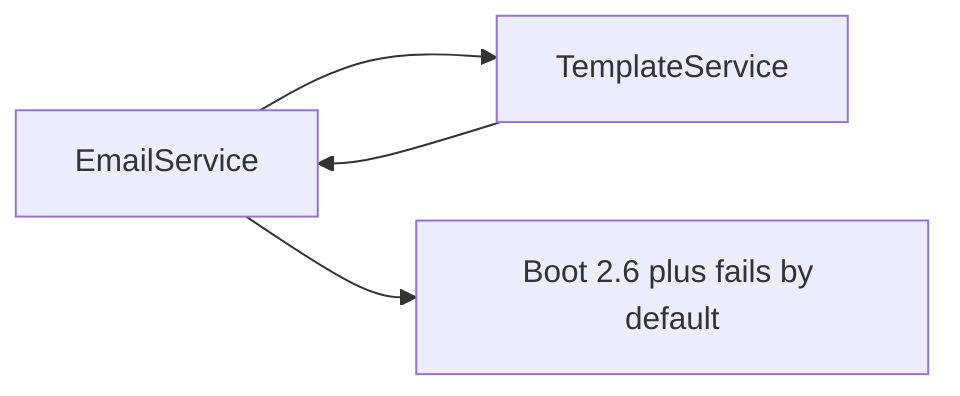
Fixes:
- Extract shared logic to a third bean.
- Publish application events instead of direct callbacks.
- Use `@Lazy` only as a temporary workaround.

**Common mistakes:**
- Enabling circular references instead of removing the cycle.
- Hiding cycles with field injection.

**Follow-ups:**
- *Why do setter cycles sometimes work?* → Spring may expose early references, but it is fragile.
- *Why constructor cycles fail?* → Neither object can be constructed first.

### Q4. What are Spring bean scopes?
`🟢 Beginner` `🔥` `Must-know SDE-1`

**Why they ask:** Scope affects thread safety, memory, and request behavior.

**Beginner lens:** Bean scope answers how long Spring keeps an object and who shares it. Singleton is one
shared instance per container, like one central configuration board; prototype creates a fresh object when
requested. Request and session scopes tie objects to web traffic. Interviewers check whether you know
default singleton behavior and thread-safety risk. In a request flow, a singleton controller can serve many
users, so per-request state must live in method variables or scoped objects.

**Short answer (say this first, 20-40 sec):**
Bean scope defines how many instances Spring creates and how long they live. Default scope is singleton: one bean per application context. Other common scopes are prototype, request, session, application, and websocket.

**Detailed answer:**
| Scope | Meaning | Typical use |
|---|---|---|
| singleton | One per context | Stateless services |
| prototype | New per lookup | Stateful helper |
| request | One per HTTP request | Request data |
| session | One per HTTP session | Web session state |
- A singleton injecting a prototype receives only one prototype instance at construction.
- Use `ObjectProvider<T>` when a singleton needs fresh prototype instances.

**Common mistakes:**
- Storing request-specific state in singleton fields.
- Assuming prototype means per HTTP request.

**Follow-ups:**
- *Is singleton thread-safe?* → Not automatically; stateless design makes it safe.
- *Who destroys prototype beans?* → The caller, after Spring initializes them.

### Q5. Explain the Spring bean lifecycle.
`🟡 Intermediate` `🔥` `Must-know SDE-1`

**Why they ask:** Lifecycle explains proxies, initialization bugs, and shutdown cleanup.

**Beginner lens:** The Spring bean lifecycle is the container assembly line. A class is discovered,
instantiated, dependencies are injected, awareness callbacks can run, BeanPostProcessor hooks run,
initialization completes, proxies may wrap it, and finally destruction callbacks run on shutdown. Recognize
lifecycle questions when setup, cleanup, proxy creation, or custom framework behavior appears. The mental
model helps debug why a field is null, why an annotation works through a proxy, or why cleanup did not
execute.

**Short answer (say this first, 20-40 sec):**
Spring instantiates a bean, populates dependencies, calls aware callbacks, applies BeanPostProcessor before initialization, runs init callbacks, applies BeanPostProcessor after initialization, then the bean is ready. On shutdown, destroy callbacks run for managed singletons.

**Detailed answer:**
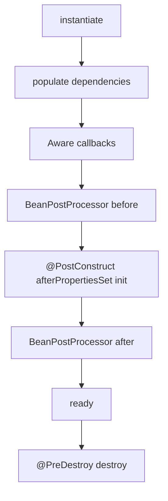
- `@PostConstruct`: validate config or initialize lightweight resources.
- BPP after initialization often creates proxies for AOP, transactions, security.
- `@PreDestroy`: close resources gracefully.

**Common mistakes:**
- Doing slow network calls during startup.
- Expecting destroy callbacks for prototype beans.

**Follow-ups:**
- *Where do proxies appear?* → Usually after initialization via post-processors.
- *What is `InitializingBean`?* → Interface alternative to `@PostConstruct`.

### Q6. `@Component` vs `@Bean`: what is the difference?
`🟢 Beginner` `🔥` `Must-know SDE-1`

**Why they ask:** Both create beans but are used differently.

**Beginner lens:** Component and Bean both create Spring-managed objects, but they enter the container
differently. Component marks your class for scanning, like putting a name tag on the class. Bean is a
factory method inside configuration, useful for third-party or carefully constructed objects. Interviewers
test whether you can choose the right registration path. In a startup flow, component scanning finds
annotated classes, while configuration methods explicitly return objects that Spring stores as beans.

**Short answer (say this first, 20-40 sec):**
`@Component` marks a class for component scanning. `@Bean` marks a method inside configuration that explicitly creates an object. Use `@Component` for your own classes and `@Bean` for third-party classes or custom construction logic.

**Detailed answer:**
```java
@Component
class PromptBuilder { }

@Configuration
class ClientConfig {
    @Bean RestClient geminiRestClient(RestClient.Builder builder) {
        return builder.baseUrl("https://generativelanguage.googleapis.com").build();
    }
}
```
- `@Service`, `@Repository`, `@Controller` are specialized components.
- `@Bean` gives full control over constructor args, builder calls, and conditions.

**Common mistakes:**
- Creating duplicate beans with both styles.
- Trying to annotate third-party library classes.

**Follow-ups:**
- *Why use `@Repository`?* → It documents persistence role and enables exception translation.
- *Can `@Bean` method take parameters?* → Yes, Spring injects dependencies into method parameters.

### Q7. How do `@Primary` and `@Qualifier` work?
`🟢 Beginner` `🔥` `Must-know SDE-1`

**Why they ask:** Ambiguous beans are common in real apps.

**Beginner lens:** Primary and Qualifier solve the problem of multiple beans matching one dependency, like
choosing one payment processor among several. Primary sets a default candidate; Qualifier names the exact
candidate at the injection point. The key distinction is default versus explicit choice. Recognize it when
an interface has several implementations. In production, prefer meaningful bean names and qualifiers for
business choices so adding another implementation does not silently change which dependency is injected.

**Short answer (say this first, 20-40 sec):**
When multiple beans match a type, Spring needs a tie-breaker. `@Primary` marks the default candidate, while `@Qualifier` selects a specific bean at injection point. Use `@Primary` for common default and qualifiers for explicit special cases.

**Detailed answer:**
```java
interface AiClient { String generate(String prompt); }
@Component @Primary class GeminiClient implements AiClient { public String generate(String p){return p;} }
@Component("mockAiClient") class MockAiClient implements AiClient { public String generate(String p){return "mock";} }
@Service class ReplyService { ReplyService(@Qualifier("mockAiClient") AiClient client) {} }
```
- Missing tie-breaker causes `NoUniqueBeanDefinitionException`.
- Qualifiers are useful for Gemini vs mock/local LLM clients.

**Common mistakes:**
- Overusing bean names instead of clear qualifiers.
- Declaring multiple primary beans of same type.

**Follow-ups:**
- *Can qualifiers be custom annotations?* → Yes, for type-safe selection.
- *What if no bean exists?* → `NoSuchBeanDefinitionException`.

### Q8. ApplicationContext vs BeanFactory?
`🟡 Intermediate` `🔥` `Must-know SDE-1`

**Why they ask:** It checks core container knowledge.

**Beginner lens:** BeanFactory is the basic bean container, while ApplicationContext is the full application
environment around it. Think of BeanFactory as storage and ApplicationContext as storage plus events,
messages, resources, configuration, and web integration. Interviewers ask to see whether you understand the
container layers. Most Spring Boot applications use ApplicationContext because the request flow needs more
than object lookup: auto-configuration, environment properties, lifecycle events, and integration with MVC
and security.

**Short answer (say this first, 20-40 sec):**
`BeanFactory` is the basic IoC container. `ApplicationContext` extends it with events, resources, i18n, environment, web integration, and automatic post-processor registration. Spring Boot applications use `ApplicationContext`.

**Detailed answer:**
| Feature | BeanFactory | ApplicationContext |
|---|---:|---:|
| Bean wiring | yes | yes |
| Events | limited | yes |
| Environment/profiles | no | yes |
| Web support | no | yes |
| Boot default | no | yes |
- `ApplicationContext` usually pre-instantiates singleton beans, giving fail-fast startup.

**Common mistakes:**
- Thinking they are unrelated.
- Using BeanFactory directly in Boot apps.

**Follow-ups:**
- *Why fail fast?* → Broken config appears during deployment, not first request.
- *What is web context?* → An ApplicationContext integrated with servlet/reactive web runtime.

### Q9. What are BeanPostProcessors?
`🔴 Advanced` `Medium` `Stretch`

**Why they ask:** Many Spring features are built through post-processing.

**Beginner lens:** BeanPostProcessor is a container hook that can inspect or change beans during startup,
like quality control on the assembly line. It runs before and after initialization and is how many framework
features attach extra behavior. Recognize this when a question asks how annotations or proxies become
active. The flow is create bean -> inject dependencies -> post-process before init -> init -> post-process
after init, often returning a proxy instead of the raw object.

**Short answer (say this first, 20-40 sec):**
A BeanPostProcessor can modify or wrap beans before and after initialization. Spring uses them for annotations, AOP proxies, transactions, validation, and injection behavior. Application code rarely needs custom BPPs unless building framework infrastructure.

**Detailed answer:**
```java
@Component
class LoggingBeanPostProcessor implements BeanPostProcessor {
    public Object postProcessAfterInitialization(Object bean, String name) {
        return bean;
    }
}
```
- Runs for many beans, so keep it fast and safe.
- Can return a proxy instead of the original bean.
- Incorrect BPPs can break container startup.

**Common mistakes:**
- Putting business logic in BPP.
- Assuming it runs for objects not managed by Spring.

**Follow-ups:**
- *How is AOP related?* → Auto-proxy creators are BeanPostProcessors.
- *Can BPP change bean instance?* → Yes, it can wrap or replace it.

## Spring Boot

### Q10. What are Spring Boot starters?
`🟢 Beginner` `🔥` `Must-know SDE-1`

**Why they ask:** Starters explain why Boot setup is fast.

**Beginner lens:** A Spring Boot starter is a curated dependency bundle, like ordering a kit instead of
buying every screw separately. It brings libraries and metadata that allow auto-configuration to create
sensible defaults. Interviewers test whether you know starters do not contain magic by themselves; they
influence classpath and configuration conditions. In production, adding a starter can create new beans,
endpoints, or behavior, so check the dependency tree and auto-configuration report when startup changes.

**Short answer (say this first, 20-40 sec):**
Starters are dependency bundles for capabilities like web, security, JPA, actuator, and validation. They bring compatible libraries through Boot dependency management. For example, web starter includes MVC, embedded Tomcat, Jackson, and related web dependencies.

**Detailed answer:**
- Email Reply Assistant likely uses `spring-boot-starter-web`, `validation`, `actuator`, `security`, and `test`.
- Starters reduce manual dependency version conflicts.
- They are mostly dependency descriptors, not magic runtime code.

**Common mistakes:**
- Adding both servlet web and reactive web starters accidentally.
- Overriding managed versions without reason.

**Follow-ups:**
- *Where are versions managed?* → In Spring Boot dependency BOM.
- *Can teams create custom starters?* → Yes, with auto-configuration and metadata.

### Q11. What does `@SpringBootApplication` include?
`🟢 Beginner` `🔥` `Must-know SDE-1`

**Why they ask:** It is the main Boot annotation.

**Beginner lens:** SpringBootApplication is a convenience annotation that combines component scanning,
auto-configuration, and configuration class behavior. Think of it as the main switch that says scan my
package, read Boot defaults, and treat this class as configuration. Interviewers want the pieces, not just
the annotation name. The startup flow begins at this class, builds the application context, scans below its
package, evaluates auto-configurations, and then starts the embedded web server if needed.

**Short answer (say this first, 20-40 sec):**
It combines `@SpringBootConfiguration`, `@EnableAutoConfiguration`, and `@ComponentScan`. It marks the main configuration class, enables auto-configuration, and scans components from its package downward.

**Detailed answer:**
```java
@SpringBootApplication
public class EmailReplyApplication {
    public static void main(String[] args) { SpringApplication.run(EmailReplyApplication.class, args); }
}
```
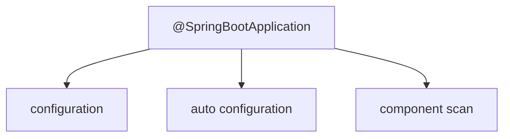
Place the main class at the root package so controllers, services, and repositories are scanned.

**Common mistakes:**
- Main class in a deep package, missing sibling packages.
- Thinking component scan covers every classpath jar.

**Follow-ups:**
- *Can scan base package be changed?* → Yes, but root package layout is cleaner.
- *Can auto-config be excluded?* → Yes with `exclude` or properties.

### Q12. How does auto-configuration work in Boot 2 vs Boot 3?
`🟡 Intermediate` `🔥` `Must-know SDE-1`

**Why they ask:** It tests Boot internals and version awareness.

**Beginner lens:** Auto-configuration is Spring Boot saying if this library and property are present, I can
create a default bean unless the application already provided one. Boot 2 and Boot 3 use different metadata
mechanisms, but the mental model is conditions plus back-off. Recognize it when adding a dependency changes
behavior. The concrete flow is classpath detected -> condition matches -> default bean registered -> your
custom bean can override by making the condition fail.

**Short answer (say this first, 20-40 sec):**
Auto-configuration imports configuration classes based on classpath, properties, existing beans, and environment. Boot 2 commonly used `META-INF/spring.factories`; Boot 3 uses `META-INF/spring/org.springframework.boot.autoconfigure.AutoConfiguration.imports`. Conditions like `@ConditionalOnClass` and `@ConditionalOnMissingBean` decide what applies.

**Detailed answer:**
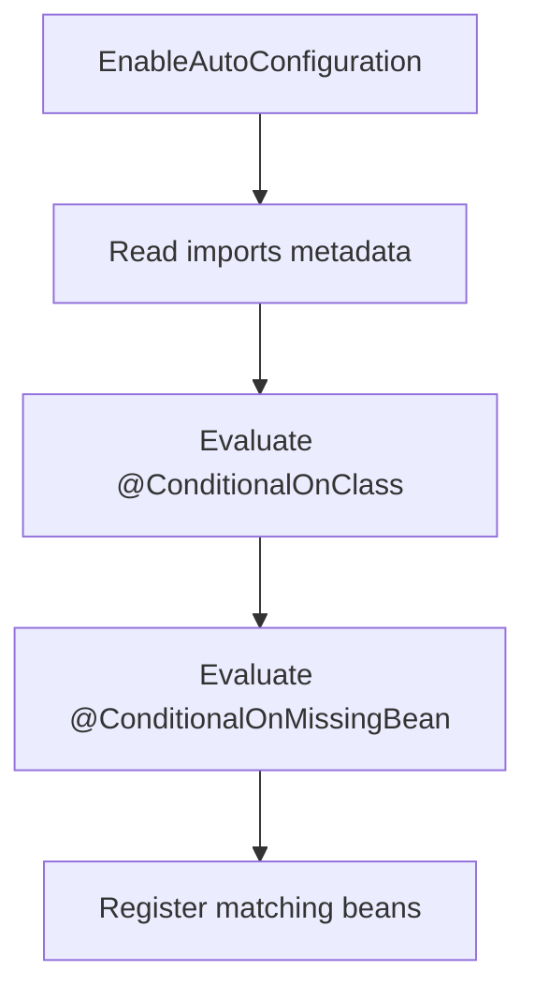
Common conditions: `@ConditionalOnProperty`, `@ConditionalOnWebApplication`, `@ConditionalOnBean`, `@ConditionalOnMissingBean`.

**Common mistakes:**
- Thinking auto-config ignores user-defined beans.
- Mixing Boot 2 and Boot 3 metadata files.

**Follow-ups:**
- *How debug decisions?* → Use `--debug` or Actuator conditions endpoint.
- *Why did adding a starter change behavior?* → It added classes that matched conditions.

### Q13. Describe Spring Boot startup flow.
`🟡 Intermediate` `🔥` `Must-know SDE-1`

**Why they ask:** Startup understanding helps debug failures.

**Beginner lens:** Spring Boot startup is a staged boot sequence, not one big annotation. The application
prepares the environment, creates the ApplicationContext, loads bean definitions, applies
auto-configuration, instantiates beans, runs lifecycle callbacks, starts the embedded server, and executes
runners. Interviewers test whether you can locate failures in that sequence. For example, bad properties
fail during binding, missing beans fail during creation, and port conflicts fail when the web server starts.

**Short answer (say this first, 20-40 sec):**
Boot creates `SpringApplication`, prepares environment and profiles, creates the application context, loads bean definitions, refreshes the context, starts the embedded server, then runs application runners and publishes ready events.

**Detailed answer:**
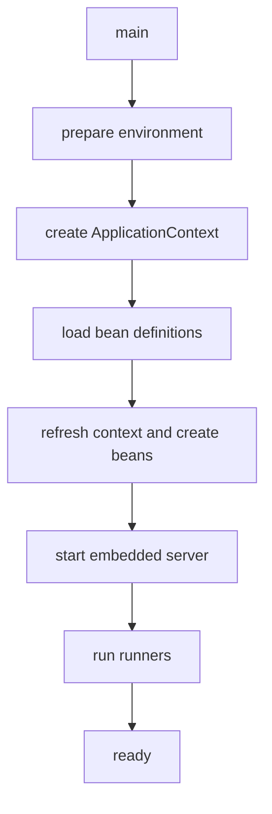
- Config errors happen early.
- Bean creation errors happen during refresh.
- Port conflicts happen when server starts.

**Common mistakes:**
- Heavy external network checks in startup.
- Ignoring active profile logs.

**Follow-ups:**
- *When do CommandLineRunner beans run?* → After context startup.
- *What is context refresh?* → Processing bean definitions, creating singletons, lifecycle callbacks.

### Q14. How do profiles work?
`🟢 Beginner` `🔥` `Must-know SDE-1`

**Why they ask:** Profiles are essential for local, Docker, test, and prod configs.

**Beginner lens:** Profiles are named runtime switches for environment-specific beans and properties, like
choosing dev, test, or prod instructions before opening the store. The distinction is that profiles select
configuration; they should not hide business logic. Recognize this when Docker, test databases, or cloud
secrets appear. In a request flow, profiles should already be resolved at startup so the controller uses the
correct DataSource, client timeout, and credentials without checking the environment manually.

**Short answer (say this first, 20-40 sec):**
Profiles activate environment-specific properties and beans. You can use `application-dev.yml`, profile documents, `@Profile`, and `SPRING_PROFILES_ACTIVE`. Multiple profiles can be active together.

**Detailed answer:**
```yaml
spring:
  config:
    activate:
      on-profile: prod
gemini:
  base-url: https://generativelanguage.googleapis.com
```
```java
@Bean @Profile("local") AiClient mockAiClient() { return p -> "mock"; }
```
- Use env vars for Docker: `SPRING_PROFILES_ACTIVE=prod`.
- Do not store secrets in profile files.

**Common mistakes:**
- Expecting inactive profile config to load.
- Committing API keys in profile YAML.

**Follow-ups:**
- *Can profiles be combined?* → Yes, e.g., `prod,azure`.
- *How inspect active profiles?* → Startup logs or secured Actuator env.

### Q15. Explain externalized config precedence.
`🟡 Intermediate` `🔥` `Must-know SDE-1`

**Why they ask:** Many production bugs are config precedence issues.

**Beginner lens:** Externalized configuration precedence decides which value wins when the same setting
appears in multiple places. Think of it as layers of sticky notes, where the top layer overrides the lower
one. Interviewers ask because production bugs often come from a property defined in the wrong place.
Recognize Docker, command-line, environment variable, application.yaml, and profile questions. A safe answer
says know the order, log effective configuration carefully, and never print secrets.

**Short answer (say this first, 20-40 sec):**
Boot reads properties from many sources; higher-precedence sources override lower ones. Command-line args, system properties, environment variables, external files, profile files, packaged defaults, and code defaults are common sources. This lets one jar run across environments.

**Detailed answer:**
Practical high-to-low order:
1. Command line `--server.port=9090`.
2. JVM system properties.
3. OS environment variables.
4. External config files.
5. Packaged profile-specific config.
6. Packaged `application.yml`.
Relaxed binding maps `GEMINI_API_KEY` to `gemini.api-key`.

**Common mistakes:**
- Debugging YAML while an env var overrides it.
- Printing secrets to confirm config.

**Follow-ups:**
- *How inspect property sources?* → Secured Actuator env endpoint.
- *Why env vars in Docker?* → Immutable image, runtime-specific config.

### Q16. Why use `@ConfigurationProperties`?
`🟢 Beginner` `🔥` `Must-know SDE-1`

**Why they ask:** Typed config is production-grade Spring Boot practice.

**Beginner lens:** ConfigurationProperties groups related settings into a typed object instead of scattering
string lookups through code. It is like using a form with field validation instead of loose sticky notes.
Interviewers test maintainability and startup safety. Recognize it when many properties configure one
feature, such as Gemini timeouts or retry limits. The flow is read environment -> bind prefix -> validate
fields -> inject typed settings into the client or service that needs them.

**Short answer (say this first, 20-40 sec):**
`@ConfigurationProperties` binds related config into a typed object and supports validation. It is cleaner and safer than scattered `@Value` fields, especially for URLs, API keys, timeouts, and limits.

**Detailed answer:**
```java
@Validated
@ConfigurationProperties(prefix = "gemini")
public record GeminiProperties(
    @NotBlank String apiKey,
    @NotBlank String baseUrl,
    @Positive int readTimeoutMs) { }
```
```java
@SpringBootApplication
@ConfigurationPropertiesScan
class EmailReplyApplication { }
```
- Keeps Gemini settings centralized.
- Validation fails fast if required config is missing.

**Common mistakes:**
- Forgetting `@ConfigurationPropertiesScan`.
- Using primitive defaults that hide missing properties.

**Follow-ups:**
- *Can records be used?* → Yes in modern Boot.
- *Which validation package in Boot 3?* → `jakarta.validation`.

### Q17. What are Actuator endpoints and how should they be secured?
`🟡 Intermediate` `🔥` `Must-know SDE-1`

**Why they ask:** Actuator is useful but can leak sensitive data.

**Beginner lens:** Actuator exposes operational information, like a dashboard for health, metrics,
environment, and readiness. The key distinction is useful visibility versus dangerous exposure. Interviewers
check whether you can support production without leaking secrets or internals. In a request flow, normal
users should not see Actuator data; health probes may call limited endpoints, while detailed metrics and
environment output should require authentication, network controls, or be disabled in public deployments.

**Short answer (say this first, 20-40 sec):**
Actuator exposes operational endpoints like health, metrics, info, env, beans, loggers, and prometheus. Expose only what is needed; allow basic health if required by load balancers, and protect sensitive endpoints with authentication and network controls.

**Detailed answer:**
```yaml
management:
  endpoints:
    web:
      exposure:
        include: health,info,metrics,prometheus
  endpoint:
    health:
      show-details: when_authorized
```
```java
@Bean SecurityFilterChain actuator(HttpSecurity http) throws Exception {
    return http.securityMatcher("/actuator/**")
        .authorizeHttpRequests(a -> a.requestMatchers("/actuator/health").permitAll().anyRequest().hasRole("OPS"))
        .httpBasic(Customizer.withDefaults()).build();
}
```

**Common mistakes:**
- Exposing `/actuator/env` publicly.
- Showing health details to anonymous users.

**Follow-ups:**
- *Readiness vs liveness?* → Ready means can receive traffic; live means should not be restarted.
- *Which endpoint debugs auto-config?* → `/actuator/conditions`.

### Q18. Spring Boot 2 vs 3 differences?
`🟡 Intermediate` `🔥` `Must-know SDE-1`

**Why they ask:** Many teams are migrating to Boot 3.

**Beginner lens:** Spring Boot 3 is not just a version bump; it moves to Jakarta namespaces, newer Java
baselines, and updated framework behavior. Think of it as renovating the building while keeping the business
purpose. Interviewers test migration awareness. Recognize this when code uses javax packages, old security
configuration, or older library versions. A practical answer mentions compile changes, dependency
compatibility, testing filters and validation, and checking generated clients or deployment images.

**Short answer (say this first, 20-40 sec):**
Boot 3 uses Spring Framework 6, requires Java 17+, and moves from `javax.*` to `jakarta.*`. It also uses new auto-configuration imports, supports `ProblemDetail`, and favors modern Spring Security `SecurityFilterChain` configuration.

**Detailed answer:**
| Area | Boot 2 | Boot 3 |
|---|---|---|
| Java | 8 or 11 depending version | 17+ |
| EE APIs | `javax.*` | `jakarta.*` |
| Auto-config metadata | `spring.factories` | `AutoConfiguration.imports` |
| Security style | adapter often seen | `SecurityFilterChain` bean |
| Errors | custom DTO common | `ProblemDetail` available |

**Common mistakes:**
- Upgrading Boot without upgrading Java runtime.
- Leaving old `javax.servlet` or `javax.validation` imports.

**Follow-ups:**
- *Why dependencies break?* → Libraries must support Jakarta namespaces.
- *Is `WebSecurityConfigurerAdapter` used in Boot 3?* → No, use component-based config.

### Q19. How do you structure packages in a Boot app?
`🟢 Beginner` `Medium` `Must-know SDE-1`

**Why they ask:** Bad package structure causes scanning and maintainability issues.

**Beginner lens:** Package structure controls what Spring can find and how humans understand ownership. Put
the main application class above feature packages so component scanning naturally includes controllers,
services, repositories, and configuration. Interviewers test whether you avoid random package sprawl. In a
request flow, package boundaries should make it obvious where the controller receives input, where business
rules live, where persistence happens, and where external API clients are isolated.

**Short answer (say this first, 20-40 sec):**
Put the main class in the root package and group code by feature or layer consistently. For small apps, layer packages are fine; for growing apps, feature packages reduce coupling and make extraction easier.

**Detailed answer:**
Example feature-oriented layout:
```text
com.azam.emailreply
  auth
  reply
    ReplyController
    ReplyService
    GeminiClient
  config
  common.error
```
- Main class at `com.azam.emailreply` scans all children.
- Keep DTOs separate from entities.

**Common mistakes:**
- Main class below service packages.
- Putting all classes in one package.

**Follow-ups:**
- *Layer vs feature package?* → Layer is simple; feature scales better for bounded contexts.
- *Where put shared exceptions?* → A small `common` or `error` package.

### Q20. What is conditional bean creation?
`🟡 Intermediate` `Medium` `Must-know SDE-1`

**Why they ask:** It is central to auto-configuration and environment-specific beans.

**Beginner lens:** Conditional bean creation means a bean exists only when a condition matches, like opening
a counter only when enough staff and demand exist. Spring Boot uses this heavily for auto-configuration.
Recognize questions with on classpath, on property, missing bean, or profile. The flow is evaluate condition
-> register bean definition if true -> inject it later. In production, conditions explain why a bean exists
locally but not in Docker or tests.

**Short answer (say this first, 20-40 sec):**
Conditional annotations create beans only when conditions match, such as a property being enabled, a class being present, or another bean missing. This powers Boot auto-configuration and is useful for optional features like mock Gemini clients.

**Detailed answer:**
```java
@Bean
@ConditionalOnProperty(name = "gemini.mock", havingValue = "true")
AiClient mockAiClient() { return p -> "mock reply"; }

@Bean
@ConditionalOnMissingBean(AiClient.class)
AiClient geminiAiClient() { return new GeminiAiClient(); }
```
- Conditions are evaluated during context startup.
- User-defined beans often override defaults with `@ConditionalOnMissingBean`.

**Common mistakes:**
- Creating overlapping beans accidentally.
- Not checking condition report when bean is missing.

**Follow-ups:**
- *Where see condition outcome?* → `--debug` or Actuator conditions.
- *Difference from profiles?* → Profiles are environment labels; conditions are arbitrary rules.

### Q21. How does `@Valid` request validation work?
`🟢 Beginner` `🔥` `Must-know SDE-1`

**Why they ask:** Every REST API needs boundary validation.

**Beginner lens:** Valid request validation is the front desk checking a form before passing it to the
service team. The controller binds JSON to a Data Transfer Object, validation annotations run, and invalid
input becomes an error response instead of business logic. Interviewers test where validation belongs and
how failures become readable. The flow is HTTP body -> DTO binding -> validation -> controller method only
if valid -> service, with global exception handling formatting the response.

**Short answer (say this first, 20-40 sec):**
`@Valid` triggers Bean Validation on request DTOs before controller logic runs. Invalid DTOs throw validation exceptions that should be mapped to 400 responses. In Boot 3, use `jakarta.validation` annotations.

**Detailed answer:**
```java
public record EmailReplyRequest(
    @NotBlank String emailBody,
    @Size(max = 40) String tone) { }

@PostMapping("/api/replies")
ResponseEntity<EmailReplyResponse> create(@Valid @RequestBody EmailReplyRequest request) {
    return ResponseEntity.ok(service.generate(request));
}
```
- Use validation groups for create vs update.
- Validate DTOs, not JPA entities, at API boundary.

**Common mistakes:**
- Forgetting `@Valid`.
- Missing `spring-boot-starter-validation`.

**Follow-ups:**
- *Status for validation failure?* → 400 Bad Request.
- *How validate nested objects?* → Put `@Valid` on nested DTO field.

### Q22. How do you create a custom validator?
`🟡 Intermediate` `🔥` `Must-know SDE-1`

**Why they ask:** Business validation often goes beyond built-in annotations.

**Beginner lens:** A custom validator handles a rule that built-in annotations cannot express, like checking
that tone and prompt length make sense together. The key distinction is field validation versus cross-field
or domain-specific validation. Recognize it when the rule needs business meaning, not just not blank or
size. The flow is annotation -> validator class -> validation context -> error message. Keep expensive
database or network checks out unless clearly required and bounded.

**Short answer (say this first, 20-40 sec):**
Create a constraint annotation and implement `ConstraintValidator`. Use it for reusable rules like allowed email reply tones. Keep slow database or network checks in the service layer unless carefully designed.

**Detailed answer:**
```java
@Target({ElementType.FIELD})
@Retention(RetentionPolicy.RUNTIME)
@Constraint(validatedBy = ToneValidator.class)
public @interface ValidTone {
    String message() default "Unsupported tone";
    Class<?>[] groups() default {};
    Class<? extends Payload>[] payload() default {};
}
public class ToneValidator implements ConstraintValidator<ValidTone, String> {
    private static final Set<String> ALLOWED = Set.of("formal", "friendly", "concise");
    public boolean isValid(String value, ConstraintValidatorContext ctx) {
        return value == null || ALLOWED.contains(value.toLowerCase());
    }
}
```

**Common mistakes:**
- Failing null values when `@NotNull` should handle null.
- Calling external APIs in validators.

**Follow-ups:**
- *Can validators inject beans?* → Yes in Spring Boot, but avoid heavy logic.
- *Where place cross-field validation?* → Class-level constraint or service layer.

## MVC, Validation, Logging, AOP & API Clients

### Q23. How do SLF4J, Logback, and MDC work together?
`🟡 Intermediate` `🔥` `Must-know SDE-1`

**Why they ask:** Production debugging depends on good logs.

**Beginner lens:** SLF4J is the logging facade, Logback is a common implementation, and Mapped Diagnostic
Context adds per-request fields. Think of SLF4J as the microphone, Logback as the recording system, and MDC
as the label on each recording. Interviewers test production debugging. In a request flow, a correlation
identifier enters at a filter, goes into MDC, appears in controller and service logs, and is cleared so
another request does not inherit it.

**Short answer (say this first, 20-40 sec):**
SLF4J is a logging facade; Logback is Boot's common logging implementation. MDC stores per-thread context such as correlation ID so every log line for one request can be traced. Always clear MDC in a `finally` block.

**Detailed answer:**
```java
@Component
class CorrelationIdFilter implements Filter {
  public void doFilter(ServletRequest req, ServletResponse res, FilterChain chain)
      throws IOException, ServletException {
    HttpServletRequest r = (HttpServletRequest) req;
    String id = Optional.ofNullable(r.getHeader("X-Correlation-Id")).orElse(UUID.randomUUID().toString());
    try { MDC.put("correlationId", id); chain.doFilter(req, res); }
    finally { MDC.clear(); }
  }
}
```
- Add `%X{correlationId}` to Logback pattern.
- Never log Gemini API keys, JWTs, or passwords.

**Common mistakes:**
- Using `System.out.println`.
- Forgetting to clear MDC on pooled threads.

**Follow-ups:**
- *Does MDC cross async threads automatically?* → Usually no; context propagation is needed.
- *Why useful for Gemini?* → It links frontend request, backend logs, and provider call.

### Q24. Explain Spring AOP, proxy types, advice, and self-invocation.
`🟡 Intermediate` `🔥` `Must-know SDE-1`

**Why they ask:** Transactions, retries, security, and caching rely on proxies.

**Beginner lens:** Spring AOP works by calling a proxy wrapper, not by changing every method body. The proxy
can add advice such as transactions, security, metrics, or logging before and after a method. Recognize it
when annotations seem to work only on external calls. The trap is self-invocation: one method calling
another on the same object bypasses the proxy. A concrete flow is controller -> proxy -> target service
method -> advice commits or rolls back.

**Short answer (say this first, 20-40 sec):**
Spring AOP wraps beans in proxies. JDK proxies implement interfaces; CGLIB creates subclass proxies. Advice can run before, after, after-returning, after-throwing, or around a method. Self-invocation bypasses the proxy, so annotations may not apply.

**Detailed answer:**
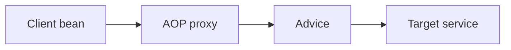
```java
@Aspect @Component
class TimingAspect {
  @Around("execution(* com.azam.email..service..*(..))")
  Object time(ProceedingJoinPoint pjp) throws Throwable { return pjp.proceed(); }
}
```
- Private/final methods are not good proxy targets.
- `@Transactional` on an internally called method can be skipped.

**Common mistakes:**
- Expecting AOP to intercept private methods.
- Forgetting to call `proceed()` in around advice.

**Follow-ups:**
- *Which proxy if interface exists?* → JDK proxy is common; CGLIB proxies classes.
- *How fix self-invocation?* → Move method to another bean or call through proxy carefully.

### Q25. Explain DispatcherServlet request flow.
`🟡 Intermediate` `🔥` `Must-know SDE-1`

**Why they ask:** It helps debug routing, validation, and serialization.

**Beginner lens:** DispatcherServlet is Spring MVC's front desk for web requests. It receives the request
after filters, finds the matching controller, binds path and body data, runs validation, invokes the method,
applies exception handling if needed, and serializes the response. Interviewers test whether you can explain
the whole request flow. Use a concrete path: browser -> security filters -> DispatcherServlet -> controller
-> service -> repository or API client -> JSON response.

**Short answer (say this first, 20-40 sec):**
`DispatcherServlet` is Spring MVC's front controller. It receives requests, finds a handler, binds and validates inputs, invokes the controller through an adapter, serializes the response, and delegates errors to exception resolvers.

**Detailed answer:**
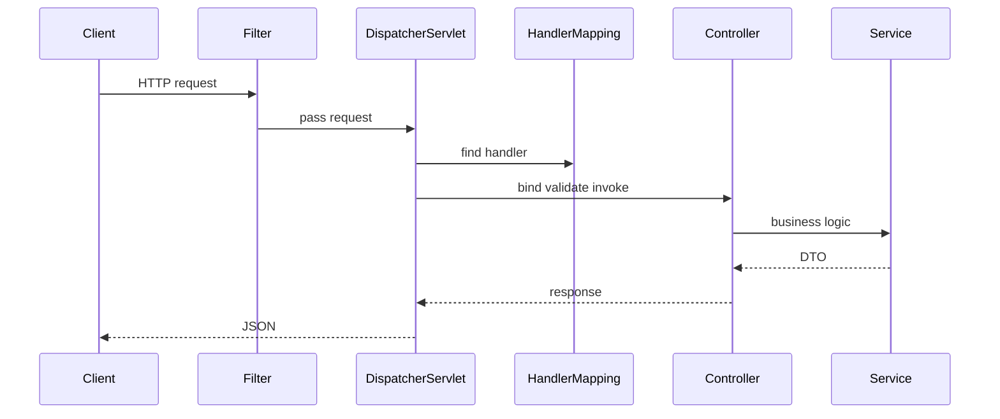
- JSON conversion uses `HttpMessageConverter`, usually Jackson.
- Validation occurs before controller body executes.

**Common mistakes:**
- Thinking Tomcat directly calls controller methods.
- Returning JPA entities directly.

**Follow-ups:**
- *Where are exceptions handled?* → HandlerExceptionResolver and `@RestControllerAdvice`.
- *What maps URL to method?* → Handler mappings.

### Q26. Filters vs interceptors vs AOP?
`🟡 Intermediate` `🔥` `Must-know SDE-1`

**Why they ask:** Cross-cutting concerns must be placed at the right layer.

**Beginner lens:** Filters, interceptors, and AOP run at different layers. A filter sees raw servlet
requests before Spring MVC, an interceptor wraps handler execution inside MVC, and AOP wraps Spring bean
method calls. Think of building security at the door, route checks at the reception desk, and method
behavior at the workstation. Recognize the choice by what information you need. Authentication is
filter-shaped; controller timing can be interceptor-shaped; service transactions are proxy-shaped.

**Short answer (say this first, 20-40 sec):**
Filters are servlet-level and run before MVC. Interceptors are Spring MVC-level and run around handler execution. AOP wraps Spring bean method calls. Use filters for security/MDC/CORS, interceptors for MVC request concerns, and AOP for service-layer concerns.

**Detailed answer:**
| Tool | Layer | Good use |
|---|---|---|
| Filter | Servlet | JWT, CORS, correlation ID |
| Interceptor | MVC | request timing, locale, audit |
| AOP | Bean methods | transactions, retries, metrics |
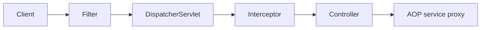

**Common mistakes:**
- Implementing authentication in controllers.
- Expecting interceptor on non-MVC calls.

**Follow-ups:**
- *Where is Spring Security?* → Mostly filters.
- *Can AOP see HTTP headers?* → Not naturally; pass context or use request APIs carefully.

### Q27. What are `@RestController` and `ResponseEntity`?
`🟢 Beginner` `🔥` `Must-know SDE-1`

**Why they ask:** REST controller basics are required.

**Beginner lens:** RestController means the controller response body is written directly, usually as JSON.
ResponseEntity lets you control status, headers, and body explicitly. Interviewers test whether you
understand the API contract, not just return objects. In a request flow, the controller receives a DTO,
calls the service, then chooses the correct HTTP status and body. Use ResponseEntity when created, accepted,
no content, headers, or error shape matter.

**Short answer (say this first, 20-40 sec):**
`@RestController` combines `@Controller` and `@ResponseBody`, so return values are written directly as response bodies. `ResponseEntity` lets you control status, headers, and body explicitly.

**Detailed answer:**
```java
@RestController
@RequestMapping("/api/replies")
class ReplyController {
  @PostMapping
  ResponseEntity<ReplyResponse> create(@Valid @RequestBody ReplyRequest req) {
    return ResponseEntity.status(HttpStatus.CREATED).body(service.generate(req));
  }
}
```
- Return DTO directly for simple 200 responses.
- Use `ResponseEntity` for 201, 202, 204, headers, cache, and Location.

**Common mistakes:**
- Returning 200 for every outcome.
- Exposing internal entities as API responses.

**Follow-ups:**
- *What writes JSON?* → Jackson message converter.
- *When use 201?* → New resource created.

### Q28. How do you implement global exception handling with ProblemDetail in Boot 3?
`🟡 Intermediate` `🔥` `Must-know SDE-1`

**Why they ask:** APIs need consistent errors.

**Beginner lens:** Global exception handling is a shared error translator for controllers. Instead of every
controller building errors differently, ControllerAdvice catches known exceptions and returns ProblemDetail
in Spring Boot 3. Interviewers test consistency and client experience. The flow is controller or validation
throws -> advice maps exception -> status, title, detail, and fields are returned. Avoid leaking stack
traces or internal class names; clients need stable errors, not implementation details.

**Short answer (say this first, 20-40 sec):**
Use `@RestControllerAdvice` and `@ExceptionHandler` to map exceptions centrally. Boot 3/Spring 6 provides `ProblemDetail` for structured errors with status, title, detail, type, and custom fields.

**Detailed answer:**
```java
@RestControllerAdvice
class ApiErrors {
  @ExceptionHandler(MethodArgumentNotValidException.class)
  ResponseEntity<ProblemDetail> validation(MethodArgumentNotValidException ex) {
    ProblemDetail pd = ProblemDetail.forStatus(HttpStatus.BAD_REQUEST);
    pd.setTitle("Validation failed");
    pd.setDetail("Invalid request fields");
    pd.setProperty("errors", ex.getFieldErrors().stream().map(e -> e.getField()+": "+e.getDefaultMessage()).toList());
    return ResponseEntity.badRequest().body(pd);
  }
  @ExceptionHandler(GeminiTimeoutException.class)
  ResponseEntity<ProblemDetail> timeout(GeminiTimeoutException ex) {
    ProblemDetail pd = ProblemDetail.forStatus(HttpStatus.GATEWAY_TIMEOUT);
    pd.setTitle("AI provider timeout");
    return ResponseEntity.status(504).body(pd);
  }
}
```

**Common mistakes:**
- Returning stack traces.
- Handling errors separately in every controller.

**Follow-ups:**
- *Status for downstream timeout?* → 504 Gateway Timeout.
- *Boot 2 equivalent?* → Use custom error DTOs.

### Q29. RestTemplate vs WebClient vs RestClient?
`🟡 Intermediate` `🔥` `Must-know SDE-1`

**Why they ask:** External API calls are common in backend systems.

**Beginner lens:** RestTemplate, WebClient, and RestClient are HTTP client choices. RestTemplate is older
blocking code, WebClient supports reactive and streaming use cases, and RestClient is the modern synchronous
option in recent Spring. Interviewers test whether you choose based on execution model. For a normal Spring
MVC request calling Gemini, RestClient with timeouts may be enough; for many concurrent streams, WebClient
can fit better if the whole stack handles it.

**Short answer (say this first, 20-40 sec):**
`RestTemplate` is older blocking client in maintenance mode. `WebClient` is reactive/non-blocking and supports streaming. `RestClient` is modern synchronous fluent client in Spring Framework 6.1 and is a good default for blocking MVC apps.

**Detailed answer:**
| Client | Style | Best use |
|---|---|---|
| RestTemplate | blocking legacy | existing apps |
| WebClient | reactive | high concurrency, streaming |
| RestClient | blocking modern | Boot 3 MVC APIs |
```java
@Bean RestClient geminiRestClient(RestClient.Builder b, GeminiProperties p) {
  return b.baseUrl(p.baseUrl()).defaultHeader("x-goog-api-key", p.apiKey()).build();
}
```

**Common mistakes:**
- No timeouts.
- Blocking heavily inside reactive pipelines.

**Follow-ups:**
- *Is RestTemplate removed?* → No, but not preferred for new code.
- *Can WebClient be used in MVC?* → Yes, but understand blocking and thread use.

### Q30. How do you set timeouts and retries for Gemini API calls?
`🔴 Advanced` `🔥` `Must-know SDE-1`

**Why they ask:** External dependency failure can take down your API.

**Beginner lens:** Timeouts and retries protect your app from waiting forever on Gemini, like setting a
maximum hold time before calling back. The mental model is timeout first, retry only safe transient
failures, and never retry without a budget. Recognize slow downstream, thread pileup, 5xx, or rate-limit
questions. A concrete flow is controller -> service -> client with connect/read timeout -> retry with
backoff and jitter -> fallback error or async status.

**Short answer (say this first, 20-40 sec):**
Set connect/read timeouts, retry only transient errors, use exponential backoff with jitter, and combine with circuit breaker and bulkhead. Do not retry 400/401/403; consider retrying 429 and 5xx if safe and within latency budget.

**Detailed answer:**
```yaml
resilience4j:
  retry:
    instances:
      gemini:
        max-attempts: 3
        wait-duration: 300ms
  circuitbreaker:
    instances:
      gemini:
        sliding-window-size: 20
        failure-rate-threshold: 50
```
```java
@Retry(name="gemini")
@CircuitBreaker(name="gemini", fallbackMethod="fallback")
String generate(String prompt) { return client.call(prompt); }
String fallback(String prompt, Throwable ex) { return "AI service temporarily unavailable"; }
```

**Common mistakes:**
- Infinite retries.
- Timeout longer than user SLA.

**Follow-ups:**
- *Why jitter?* → Prevents retry storms.
- *What status on timeout?* → 504 or a product-defined fallback.

### Q31. What is Spring Data JPA's role here?
`🟢 Beginner` `Medium` `Must-know SDE-1`

**Why they ask:** Even if deep JPA is separate, you should know integration basics.

**Beginner lens:** Spring Data JPA removes repetitive repository code while still relying on entity mapping
and transactions underneath. Think of it as a typed data-access helper, not a replacement for database
understanding. Interviewers test whether you know where persistence belongs. In a request flow, the
controller calls a service, the service starts a transaction, the repository loads or saves entities, and
the database enforces constraints. Avoid putting business rules inside repository method names.

**Short answer (say this first, 20-40 sec):**
Spring Data JPA provides repository abstractions over JPA/Hibernate for database access. In Email Reply Assistant, it could store users, reply history, idempotency keys, and feedback. Keep entities internal and expose DTOs through controllers.

**Detailed answer:**
```java
interface ReplyRepository extends JpaRepository<ReplyEntity, UUID> {
  Page<ReplyEntity> findByUserId(String userId, Pageable pageable);
}
```
- Use repositories in service layer, not controllers.
- Use transactions for write operations.
- Avoid lazy-loading surprises in API serialization.

**Common mistakes:**
- Returning entities directly.
- Putting business logic in repositories.

**Follow-ups:**
- *Where put `@Transactional`?* → Service layer.
- *Why DTOs?* → Stable API contract and less accidental data exposure.

### Q32. What are Spring transactions at a high level?
`🟡 Intermediate` `Medium` `Must-know SDE-1`

**Why they ask:** Service methods often require atomic database changes.

**Beginner lens:** A transaction groups database work so it succeeds or fails as one unit. Spring usually
adds this through a proxy around service methods. Recognize it when questions mention commit, rollback,
consistency, or multiple repository calls. The flow is controller -> transactional proxy -> service method
-> repositories -> commit if no rollback exception. The common trap is calling a transactional method from
the same class, which bypasses the proxy just like other AOP behavior.

**Short answer (say this first, 20-40 sec):**
`@Transactional` wraps a method in a database transaction through AOP proxy. If the method succeeds, it commits; if a runtime exception occurs, it rolls back by default. Use it at service boundaries for operations that must be atomic.

**Detailed answer:**
```java
@Service
class ReplyCommandService {
  @Transactional
  Reply createReply(ReplyRequest req) {
    Reply r = repository.save(map(req));
    idempotencyStore.save(req.key(), r.id());
    return r;
  }
}
```
- Self-invocation can bypass `@Transactional`.
- Checked exceptions do not roll back by default unless configured.

**Common mistakes:**
- Annotating private methods.
- Performing slow external API calls inside long DB transactions.

**Follow-ups:**
- *Rollback default?* → Runtime exceptions and errors.
- *Should Gemini call be inside transaction?* → Usually no; keep DB transaction short.

## Spring Security

### Q33. Explain the Spring Security filter chain.
`🟡 Intermediate` `🔥` `Must-know SDE-1`

**Why they ask:** Spring Security is filter-based.

**Beginner lens:** The Spring Security filter chain is a sequence of checks before MVC handles the request,
like airport security before the gate. Filters extract credentials, authenticate the user, store the
security context, check authorization, handle failures, and then continue. Interviewers test request-flow
clarity. For a JWT request: HTTP request -> bearer token filter -> validate token -> set Authentication ->
authorization rule -> DispatcherServlet -> controller, or return 401/403 early.

**Short answer (say this first, 20-40 sec):**
Security filters run before Spring MVC and handle CORS, CSRF, authentication, exception handling, session management, and authorization. A request must pass the chain before reaching `DispatcherServlet` and controllers.

**Detailed answer:**
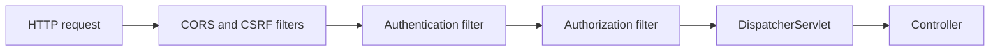
- Multiple `SecurityFilterChain` beans can match different paths.
- Custom JWT filters should be placed at the correct point.

**Common mistakes:**
- Doing auth in controllers.
- Disabling all security to fix one CORS issue.

**Follow-ups:**
- *Where is user stored?* → `SecurityContextHolder`.
- *Can actuator have separate security?* → Yes, with a separate chain/matcher.

### Q34. Authentication vs authorization?
`🟢 Beginner` `🔥` `Must-know SDE-1`

**Why they ask:** Core security terms must be precise.

**Beginner lens:** Authentication asks who are you, while authorization asks what are you allowed to do. A
badge proves identity; room permissions decide access. Interviewers use this to find vague security
thinking. In a request flow, login or token validation creates an authenticated principal, then URL rules or
method security compare roles and authorities. A 401 usually means no valid identity; a 403 usually means
identity exists but lacks permission.

**Short answer (say this first, 20-40 sec):**
Authentication verifies who the user is; authorization checks what they can access. JWT validation is authentication. Checking `email:write` scope or admin role is authorization.

**Detailed answer:**
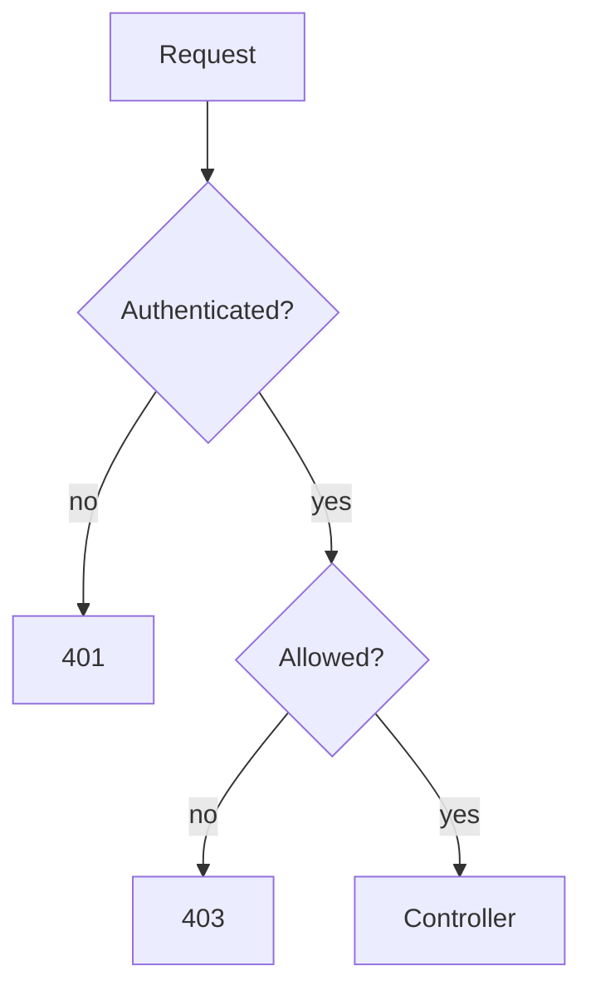
| Failure | Status |
|---|---|
| Missing/invalid credentials | 401 |
| Valid user lacks permission | 403 |

**Common mistakes:**
- Returning 403 for unauthenticated users.
- Treating token parsing as permission checking.

**Follow-ups:**
- *What is principal?* → Authenticated identity.
- *What is authority?* → Granted permission or role.

### Q35. Show Boot 3 style `SecurityFilterChain` config.
`🟡 Intermediate` `🔥` `Must-know SDE-1`

**Why they ask:** Old adapter-based examples are obsolete.

**Beginner lens:** SecurityFilterChain configuration describes which filters and authorization rules protect
requests. In Spring Boot 3, defining a bean is the normal style instead of extending older adapters.
Interviewers test modern syntax and mental model. The flow is match request paths -> configure Cross-Origin
Resource Sharing, Cross-Site Request Forgery, sessions, authentication, and authorization -> build the
chain. Keep business rules in services; security config should express access policy and authentication
mechanisms.

**Short answer (say this first, 20-40 sec):**
Define a `SecurityFilterChain` bean. For stateless APIs, disable CSRF if using bearer tokens, set stateless sessions, permit public endpoints, protect private endpoints, and configure JWT resource server or custom authentication.

**Detailed answer:**
```java
@Configuration
@EnableMethodSecurity
class SecurityConfig {
  @Bean SecurityFilterChain api(HttpSecurity http) throws Exception {
    return http.csrf(csrf -> csrf.disable())
      .sessionManagement(s -> s.sessionCreationPolicy(SessionCreationPolicy.STATELESS))
      .authorizeHttpRequests(a -> a
        .requestMatchers("/actuator/health", "/api/auth/**").permitAll()
        .requestMatchers("/api/admin/**").hasRole("ADMIN")
        .anyRequest().authenticated())
      .oauth2ResourceServer(o -> o.jwt(Customizer.withDefaults()))
      .build();
  }
}
```

**Common mistakes:**
- Extending `WebSecurityConfigurerAdapter` in Boot 3.
- Disabling CSRF blindly for cookie session apps.

**Follow-ups:**
- *Why stateless?* → JWT APIs should not use server sessions.
- *How enable method security?* → `@EnableMethodSecurity`.

### Q36. Why is password encoding required?
`🟢 Beginner` `🔥` `Must-know SDE-1`

**Why they ask:** Password handling is a baseline security requirement.

**Beginner lens:** Password encoding stores a slow, salted hash instead of the raw password, like keeping a
fingerprint template rather than the key itself. Interviewers test whether you understand breach impact.
Recognize it when login, registration, BCrypt, or hashing appears. The flow is register -> encode password
-> store hash; login -> load hash -> encoder matches raw input against hash. Never use fast hashes such as
MD5 or SHA-256 alone for passwords.

**Short answer (say this first, 20-40 sec):**
Passwords must be stored as salted slow hashes, never plain text or reversible encryption. Spring recommends a `PasswordEncoder`, commonly BCrypt via `PasswordEncoderFactories.createDelegatingPasswordEncoder()` for algorithm migration.

**Detailed answer:**
```java
@Bean PasswordEncoder passwordEncoder() {
  return PasswordEncoderFactories.createDelegatingPasswordEncoder();
}
boolean ok = passwordEncoder.matches(rawPassword, storedHash);
```
- Stored hash may look like `{bcrypt}$2a$10$...`.
- Slow hashing makes brute force expensive.

**Common mistakes:**
- Using MD5/SHA-256 directly.
- Logging raw passwords.

**Follow-ups:**
- *What is salt?* → Random data so same passwords get different hashes.
- *Can you decrypt BCrypt?* → No; you verify by matching.

### Q37. Explain JWT authentication flow.
`🟡 Intermediate` `🔥` `Must-know SDE-1`

**Why they ask:** JWT is common for stateless APIs.

**Beginner lens:** JSON Web Token authentication lets the server verify a signed token on each request
without looking up a session every time. Think of it as a tamper-evident wristband with claims and an
expiry. Interviewers test stateless security flow and pitfalls. Request flow: client sends Authorization
bearer token -> filter validates signature, expiry, and issuer -> builds Authentication -> authorization
rules run -> controller handles the request. Short lifetimes and careful revocation strategy matter.

**Short answer (say this first, 20-40 sec):**
User logs in, server validates credentials, creates a signed access token, and the client sends it as `Authorization: Bearer`. A filter validates signature, expiry, issuer, audience, and claims, then sets authentication in the security context.

**Detailed answer:**
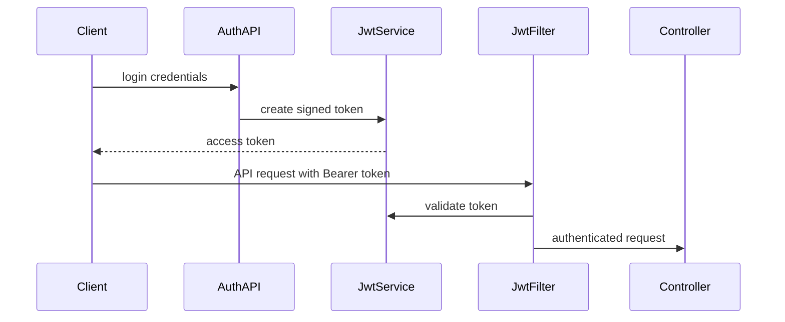
- Keep claims minimal; do not store secrets in JWT payload.
- Use short expiry and refresh-token strategy if needed.

**Common mistakes:**
- Not checking expiry/audience.
- Putting PII or secrets in token.

**Follow-ups:**
- *Can JWT be revoked?* → Hard unless short-lived, denylisted, or backed by refresh sessions.
- *Where store browser token?* → Prefer secure HttpOnly cookie or memory based on threat model.

### Q38. Show a JWT filter at a high level.
`🔴 Advanced` `🔥` `Must-know SDE-1`

**Why they ask:** It checks practical filter implementation.

**Beginner lens:** A JWT filter is a custom checkpoint in the security filter chain. It looks for a bearer
token, validates it, loads or derives authorities, and sets the SecurityContext before the request reaches
MVC. Recognize this when asked where token parsing belongs. The filter should ignore missing tokens for
public routes, fail clearly for invalid tokens when required, and never put token validation inside each
controller. It is infrastructure around the request, not business logic.

**Short answer (say this first, 20-40 sec):**
A JWT filter extends `OncePerRequestFilter`, extracts bearer token, validates it, creates an `Authentication`, and stores it in `SecurityContextHolder`. Invalid tokens should not create partial authentication.

**Detailed answer:**
```java
@Component
class JwtAuthenticationFilter extends OncePerRequestFilter {
  private final JwtService jwtService;
  protected void doFilterInternal(HttpServletRequest req, HttpServletResponse res, FilterChain chain)
      throws ServletException, IOException {
    String h = req.getHeader(HttpHeaders.AUTHORIZATION);
    if (h == null || !h.startsWith("Bearer ")) { chain.doFilter(req, res); return; }
    JwtUser u = jwtService.validate(h.substring(7));
    var auth = new UsernamePasswordAuthenticationToken(u.username(), null, u.authorities());
    SecurityContextHolder.getContext().setAuthentication(auth);
    chain.doFilter(req, res);
  }
}
```
Prefer OAuth2 resource server for standards-based JWT validation.

**Common mistakes:**
- Accepting unsigned tokens.
- Continuing with stale security context after failure.

**Follow-ups:**
- *Why OncePerRequestFilter?* → Prevents duplicate execution in one request.
- *Where register it?* → Before username/password auth filter if custom.

### Q39. How do refresh tokens work?
`🟡 Intermediate` `🔥` `Must-know SDE-1`

**Why they ask:** Access token expiry and UX require a refresh design.

**Beginner lens:** Refresh tokens are longer-lived credentials used to obtain new short-lived access tokens,
like a hotel front desk issuing a new room card after verifying your booking. Interviewers test balancing
user experience and security. The flow is access token expires -> client sends refresh token to a refresh
endpoint -> server validates storage, rotation, and revocation -> new access token issued. Store refresh
tokens carefully and rotate them to limit replay damage.

**Short answer (say this first, 20-40 sec):**
Access tokens are short-lived. Refresh tokens are longer-lived credentials used only to obtain new access tokens. Store refresh tokens securely, rotate them on use, and revoke sessions on reuse detection.

**Detailed answer:**
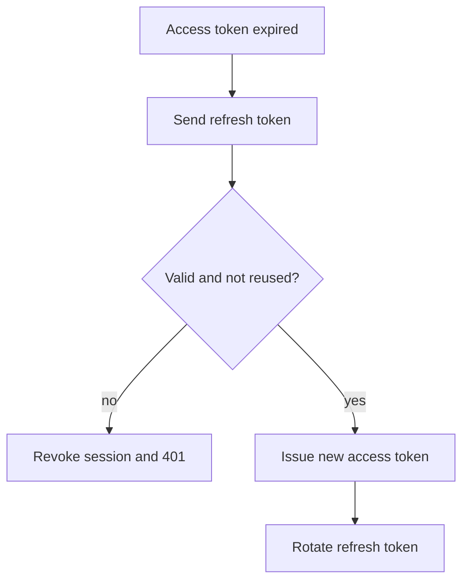
- Store refresh token server-side hashed or as secure opaque token.
- Use Secure, HttpOnly, SameSite cookies for browser flows when appropriate.

**Common mistakes:**
- Long-lived access tokens.
- No refresh-token rotation.

**Follow-ups:**
- *JWT or opaque refresh token?* → Opaque is easier to revoke.
- *What if old refresh token is reused?* → Treat as theft and revoke session.

### Q40. Explain OAuth2 Authorization Code with PKCE.
`🔴 Advanced` `🔥` `Stretch`

**Why they ask:** Modern login flows use OAuth2/OIDC.

**Beginner lens:** OAuth2 Authorization Code with Proof Key for Code Exchange protects login by using a
temporary code plus a client-generated proof. Think of it as reserving a ticket and then proving you are the
same person who reserved it. Interviewers test modern delegated login. Flow: client creates
verifier/challenge -> authorization server returns code -> client exchanges code plus verifier -> tokens
issued. It is especially important for public clients that cannot keep a secret.

**Short answer (say this first, 20-40 sec):**
Authorization Code with PKCE lets public clients obtain tokens without storing a client secret. The client sends a code challenge during authorization and later proves it has the original verifier while exchanging the authorization code.

**Detailed answer:**
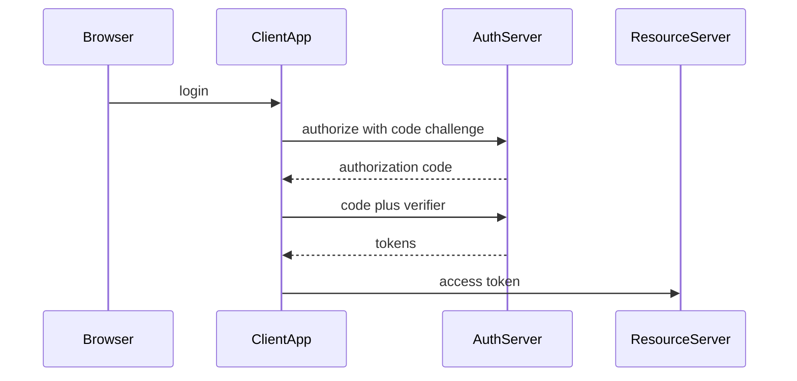
- PKCE protects intercepted codes.
- OIDC adds identity and ID token on top of OAuth2.

**Common mistakes:**
- Using implicit flow for modern SPAs.
- Confusing OAuth authorization with authentication.

**Follow-ups:**
- *Why PKCE for public clients?* → They cannot keep secrets.
- *What validates API token?* → Resource server.

### Q41. How do resource server, CORS, CSRF, and method security fit together?
`🟡 Intermediate` `🔥` `Must-know SDE-1`

**Why they ask:** Real API security combines multiple controls.

**Beginner lens:** Resource server, Cross-Origin Resource Sharing, Cross-Site Request Forgery, and method
security solve different layers of access. Resource server validates bearer tokens; CORS controls browser
origins; CSRF protects cookie-based state-changing requests; method security checks permissions inside
service methods. Interviewers test that you do not mix them up. A request may pass browser CORS, then token
authentication, then URL authorization, and finally a method-level rule before data is returned.

**Short answer (say this first, 20-40 sec):**
A resource server validates bearer tokens for protected APIs. CORS controls browser cross-origin access. CSRF protects cookie-authenticated browser apps from unwanted actions. Method security applies business authorization at service/controller methods.

**Detailed answer:**
```java
@Bean CorsConfigurationSource cors() {
  CorsConfiguration c = new CorsConfiguration();
  c.setAllowedOrigins(List.of("https://email-ui.example.com"));
  c.setAllowedMethods(List.of("GET","POST","PUT","DELETE"));
  c.setAllowedHeaders(List.of("Authorization","Content-Type"));
  UrlBasedCorsConfigurationSource s = new UrlBasedCorsConfigurationSource();
  s.registerCorsConfiguration("/**", c); return s;
}
@PreAuthorize("hasAuthority('SCOPE_email:write')")
ReplyResponse generate(ReplyRequest request) { return service.generate(request); }
```
- Disable CSRF only when appropriate, e.g., stateless bearer APIs.

**Common mistakes:**
- `*` origin with credentials.
- Thinking CORS protects server-to-server calls.

**Follow-ups:**
- *Who enforces CORS?* → Browsers.
- *401 vs 403?* → Missing auth vs insufficient permission.

## Production Scenarios

### Q42. Scenario: Gemini API is slow and threads pile up. What do you do?
`🔴 Advanced` `🔥` `Must-know SDE-1`

**Why they ask:** This directly matches the Email Reply Assistant project.

**Beginner lens:** Slow Gemini calls are a capacity problem, not just a code problem. Threads waiting on I/O
can pile up until the app rejects healthy traffic. Recognize symptoms like high latency, exhausted pools, or
many blocked requests. A safe flow is validate request -> enqueue or call with strict timeout -> retry only
safe transient failures -> return 202 or clear error -> monitor latency and saturation. Bulkheads, rate
limits, and async processing protect the service.

**Short answer (say this first, 20-40 sec):**
Protect the app with strict timeouts, bounded pools, bulkheads, limited retries with jitter, and circuit breakers. Add metrics/tracing and consider async job processing if generation can take long. Do not simply increase Tomcat threads.

**Detailed answer:**
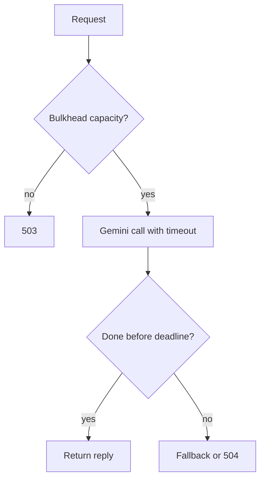
Check Tomcat busy threads, HTTP client latency, p95/p99, Gemini 429/5xx, and circuit state.

**Common mistakes:**
- Infinite retries during outage.
- No read timeout.

**Follow-ups:**
- *What is bulkhead?* → Limits resource use by one dependency.
- *When use async?* → If generation exceeds normal HTTP SLA.

### Q43. Scenario: app fails to start after adding a dependency.
`🟡 Intermediate` `🔥` `Must-know SDE-1`

**Why they ask:** Starters can trigger new auto-configuration.

**Beginner lens:** When the app fails after adding a dependency, suspect auto-configuration and bean
conditions before random code changes. A starter may add classes that make Boot create new beans or require
missing properties. Interviewers test systematic debugging. Flow: read startup exception -> find failing
bean -> check condition report and dependency tree -> inspect properties/profiles -> decide whether to
configure, exclude, or provide your own bean. Avoid deleting dependencies blindly.

**Short answer (say this first, 20-40 sec):**
Read the root cause, check dependency conflicts, new auto-config conditions, missing properties, duplicate beans, and Boot version compatibility. Use `--debug` for the condition evaluation report.

**Detailed answer:**
- Security starter may secure all endpoints until you add a filter chain.
- JPA starter may require a datasource.
- Boot 3 dependency may fail if it still uses `javax.*`.
- Use dependency tree and avoid overriding Boot BOM randomly.

**Common mistakes:**
- Reading only `Application run failed`.
- Removing dependency without understanding the condition that activated.

**Follow-ups:**
- *What tool shows auto-config?* → Actuator conditions or `--debug`.
- *What is root cause?* → The earliest meaningful caused-by in stack trace.

### Q44. Scenario: config not picked up in Docker, bean not found, or prototype leaks memory.
`🟡 Intermediate` `🔥` `Must-know SDE-1`

**Why they ask:** These are common production Spring issues.

**Beginner lens:** Docker config issues, missing beans, and prototype leaks all come from runtime context,
not just syntax. The container uses environment variables and profiles resolved at startup; beans only exist
if scanning and conditions match; prototype objects are not automatically destroyed like singletons.
Interviewers test production troubleshooting. Flow: compare local and container environment -> check
effective Spring properties -> inspect bean creation logs -> verify scopes and ownership of cleanup.

**Short answer (say this first, 20-40 sec):**
For Docker config, verify active profiles, env var names, and precedence. For missing beans, check annotations, scan package, profiles, and conditions. For prototype leaks, remember prototype is per lookup, not per request, and singleton references can retain state.

**Detailed answer:**
```yaml
environment:
  SPRING_PROFILES_ACTIVE: prod
  GEMINI_API_KEY: ${GEMINI_API_KEY}
  GEMINI_READ_TIMEOUT_MS: 3000
```
Debug checklist:
- `GEMINI_API_KEY` maps to `gemini.api-key`.
- Main class must be above packages being scanned.
- `@Profile` beans require active profile.
- Use `ObjectProvider<PrototypeBean>` for fresh prototype; never store request state in singleton fields.

**Common mistakes:**
- Using `gemini.api-key` as env var name.
- Assuming prototype beans are automatically destroyed.

**Follow-ups:**
- *How inspect beans safely?* → Secured `/actuator/beans` or tests.
- *What causes memory leak?* → Singleton collections or references retaining per-request objects.

## Revision Cheat Sheet

- IoC means Spring controls object creation and wiring; DI is the main mechanism.
- Constructor injection is preferred: explicit, immutable, testable, fail-fast.
- Boot 2.6+ disables circular references by default; fix design.
- Singleton is one per context; prototype is per lookup, not per request.
- Lifecycle: instantiate → populate → aware → BPP before → init → BPP after → ready → destroy.
- `@Component` scans your class; `@Bean` explicitly creates objects, often third-party ones.
- `@SpringBootApplication` = config + auto-config + component scan.
- Boot 3 means Java 17, Spring 6, Jakarta, `ProblemDetail`, new auto-config imports.
- Use `@ConfigurationProperties` for typed validated config.
- Secure Actuator; never expose env/beans publicly.
- DispatcherServlet handles MVC routing, binding, validation, serialization, and exception delegation.
- Filters run before MVC; interceptors around MVC handlers; AOP around bean methods.
- Use `ProblemDetail` and `@RestControllerAdvice` for clean errors.
- RestClient is modern sync, WebClient is reactive, RestTemplate is legacy.
- Security runs in filter chain; authn identifies user, authz checks permissions.
- JWTs need signature, expiry, issuer, audience, and minimal claims.
- Refresh tokens should rotate and be revocable.
- CORS is browser access control; CSRF matters mainly for cookie-authenticated state-changing requests.
- Gemini calls need timeouts, bounded retries, circuit breaker, and bulkhead.

## Flashcards

- Q → Best DI style? A → Constructor injection.
- Q → Boot 2.6 circular default? A → Fails by default.
- Q → Default bean scope? A → Singleton.
- Q → Boot 3 namespace? A → `jakarta.*`.
- Q → Boot 3 Java baseline? A → Java 17.
- Q → Auto-config file in Boot 3? A → `AutoConfiguration.imports`.
- Q → MVC front controller? A → `DispatcherServlet`.
- Q → Structured error class in Spring 6? A → `ProblemDetail`.
- Q → Modern sync HTTP client? A → `RestClient`.
- Q → Where does security run? A → Servlet filter chain.
- Q → 401 vs 403? A → Unauthenticated vs forbidden.
- Q → JWT header prefix? A → `Bearer`.
- Q → Browser cross-origin mechanism? A → CORS.
- Q → Password storage? A → Salted slow hash, e.g., BCrypt.
- Q → Main defense for slow Gemini? A → Timeout, bulkhead, circuit breaker, limited retries.
