# 04b · Microservices & API Design

This part covers microservices, resilience, distributed data patterns, observability, and API design. Examples connect to the AI Email Reply Assistant and its Spring Boot backend calling Gemini API.

**Legend:** 🟢 Beginner · 🟡 Intermediate · 🔴 Advanced · ⚫ FAANG · 🔥 = very frequently asked

## Table of Contents
- [Beginner guide to this file](#beginner-guide-to-this-file)
- [Microservices Fundamentals](#microservices-fundamentals)
- [Resilience, Consistency & Observability](#resilience-consistency--observability)
- [API Design](#api-design)
- [Email Reply Assistant API Exercise](#email-reply-assistant-api-exercise)
- [Production Scenarios](#production-scenarios)
- [Revision Cheat Sheet](#revision-cheat-sheet)
- [Flashcards](#flashcards)

## Beginner guide to this file

### What this file teaches

This file teaches how to split backend systems, define Application Programming Interface (API) contracts, and
keep distributed services reliable when requests cross process and network boundaries. Interviewers ask these
questions because real product backends must choose microservice boundaries, protect users from duplicate work,
handle partial failure, and explain consistency trade-offs without hiding behind buzzwords.

### Mental model

Think of a microservice system as a city: each department owns a clear responsibility, publishes a public
counter, keeps its own records, and coordinates with other departments by forms or messages.

- Service boundaries group business capabilities and data ownership, not just controller classes.
- API contracts are promises about paths, methods, fields, errors, status codes, and compatibility.
- Resilience patterns assume remote calls fail, so they add timeouts, retries, circuit breakers, and bulkheads.
- Idempotency makes safe retries possible by turning duplicate requests into one logical operation.
- Consistency choices decide when users need immediate truth and when eventual agreement is acceptable.
- Observability connects logs, metrics, and traces so a request can be followed across services.

### How to think through any question here

1. Start with the business operation and name the user-visible contract, such as create reply, list history,
   or stream generated text.
2. Decide the boundary by ownership: which service owns the rule, the data, and the failure budget.
3. Walk the concrete request flow. For a write: client -> gateway -> service -> database -> event/outbox ->
   response. For a read: client -> gateway -> cache or read model -> service -> response.
4. Identify the failure point: network timeout, duplicate retry, stale cache, partial workflow, slow consumer,
   or incompatible contract change.
5. Pick the pattern that matches the failure: idempotency key, retry with jitter, circuit breaker, saga, outbox,
   cursor pagination, versioning, or Problem Details error body.
6. State the consistency model and user impact: immediate confirmation, eventual update, compensation, or
   manual repair.
7. Add production proof: metrics, tracing, rate limits, authentication, authorization, backward compatibility,
   and load behavior.

### Pattern recognition cues

| If the question mentions... | Think about... | Why it fits |
| --- | --- | --- |
| Split a monolith or choose services | Domain boundaries | Services should follow business ownership and data ownership. |
| Gateway, routing, or edge security | API gateway | Cross-cutting policies belong at the edge, not in every client. |
| Duplicate create after retry | Idempotency key | The server must recognize the same logical request. |
| Slow or failing dependency | Resilience patterns | Timeouts, breakers, bulkheads, and retries prevent failure spread. |
| Multi-step distributed write | Saga or outbox | Local transactions plus messages replace one global transaction. |
| Data appears stale | Consistency model | Distributed systems often trade freshness for availability or latency. |
| API consumers break | Compatibility and versioning | Contracts must evolve without surprising existing clients. |
| Large list endpoint | Pagination, filtering, sorting | The API needs predictable result size and stable ordering. |
| Need flexible frontend query | REST, GraphQL, or gRPC choice | Each style optimizes a different client and coupling shape. |
| Debugging one slow user request | Tracing and metrics | A trace links spans across services and shows where time was spent. |

### Abbreviations and key terms

| Short form | Expanded form | Plain meaning |
| --- | --- | --- |
| ACID | Atomicity, Consistency, Isolation, Durability | Database transaction guarantees inside one data store. |
| AI | Artificial Intelligence | Software behavior that uses learned models or generated output. |
| API | Application Programming Interface | Contract used by clients and services to communicate. |
| CAP | Consistency, Availability, Partition tolerance | Distributed-systems trade-off during network partitions. |
| CDC | Change Data Capture | Capturing database changes and publishing them downstream. |
| CI | Continuous Integration | Automatically building and testing changes. |
| COMPENSATING | Compensating workflow state | State showing the system is undoing or correcting a prior step. |
| CONFIRMED | Confirmed workflow state | State showing a distributed operation has completed successfully. |
| CPU | Central Processing Unit | Processor resource consumed by code. |
| CRUD | Create, Read, Update, Delete | Basic data operations exposed by many services. |
| DB | Database | Persistent store such as PostgreSQL or MySQL. |
| DELETE | HTTP DELETE method | Request method for deleting a resource. |
| DNS | Domain Name System | System that maps names to network addresses. |
| ETL | Extract, Transform, Load | Moving and reshaping data between systems. |
| FAANG | Meta, Amazon, Apple, Netflix, Google style companies | Shorthand for large product-company interviews. |
| FAILED | Failed workflow state | State showing an operation ended unsuccessfully. |
| GENERATING | Generating workflow state | State showing the reply is currently being produced. |
| GET | HTTP GET method | Request method for reading a resource. |
| gRPC | Google Remote Procedure Call | Efficient remote-call framework often used inside service fleets. |
| GraphQL | GraphQL query language | API query language where clients ask for specific fields. |
| HATEOAS | Hypermedia as the Engine of Application State | REST idea where responses include links for next actions. |
| HEAD | HTTP HEAD method | Like GET but returns headers without a body. |
| HTTP | Hypertext Transfer Protocol | Request and response protocol used by web APIs. |
| HTTPS | Hypertext Transfer Protocol Secure | HTTP protected by Transport Layer Security. |
| ID | Identifier | Value that uniquely names an object or record. |
| IP | Internet Protocol | Network addressing protocol. |
| JPA | Java Persistence API | Java standard abstraction for object-relational persistence. |
| JSON | JavaScript Object Notation | Text format commonly used for API bodies. |
| JWT | JSON Web Token | Signed token that carries authentication claims. |
| LIMIT | Structured Query Language LIMIT clause | Caps how many rows a query returns. |
| NAT | Network Address Translation | Network function that rewrites addresses between networks. |
| OFFSET | Structured Query Language OFFSET clause | Skips rows before returning a page. |
| OK | Okay response status | Short label for a successful response such as 200 OK. |
| OIDC | OpenID Connect | Identity layer built on OAuth 2.0. |
| PACELC | Partition, Availability, Consistency, Else, Latency, Consistency | Extension of CAP for normal and partitioned operation. |
| PATCH | HTTP PATCH method | Request method for partial updates. |
| POST | HTTP POST method | Request method for create or command-style operations. |
| PUT | HTTP PUT method | Request method for full replacement and idempotent writes. |
| QUOTA_RESERVED | Quota reserved workflow state | State showing quota was reserved before generation completes. |
| RED | Rate, Errors, Duration | Service metrics for request traffic health. |
| REST | Representational State Transfer | Resource-oriented API style using HTTP semantics. |
| RPC | Remote Procedure Call | Calling a remote function as if it were local. |
| SAVED | Saved workflow state | State showing the reply has been persisted. |
| SDE-1 | Software Development Engineer level 1 | Entry-level engineering interview scope. |
| SLA | Service Level Agreement | Promise or target for availability or latency. |
| SQL | Structured Query Language | Query language for relational databases. |
| SSE | Server-Sent Events | One-way stream from server to browser over HTTP. |
| TLS | Transport Layer Security | Encryption protocol used by HTTPS. |
| UI | User Interface | Screen or client surface users interact with. |
| URI | Uniform Resource Identifier | Identifier for a resource, often used in API paths. |
| URL | Uniform Resource Locator | Full web address for a resource. |
| USE | Utilization, Saturation, Errors | Resource metrics for infrastructure health. |
| API contract | Not an abbreviation | Promise about request, response, errors, and compatibility. |
| Boundary | Not an abbreviation | Line showing which service owns a capability and data. |
| Idempotency | Not an abbreviation | Repeating the same request has the same logical effect. |
| Saga | Not an abbreviation | Distributed workflow made of local transactions and compensations. |

### Common beginner traps

- Splitting services by technical layers such as controller, service, and repository instead of business
  capability.
- Saying microservices are always better than monoliths without mentioning operational cost.
- Retrying every failed call without timeouts, jitter, idempotency, or a maximum retry budget.
- Treating eventual consistency as wrong instead of explaining the user-visible trade-off.
- Designing API paths around verbs only, such as generateNow, instead of resources and commands.
- Adding a new response field without checking strict clients, generated clients, and documentation.
- Forgetting that observability is part of the design, not something added after incidents.

### How to study this file

1. Read the short answer and identify the pattern name before reading the detailed answer.
2. Draw one request flow for every design topic: gateway, service, database, cache, event, and response.
3. Use the beginner lens to practice recognizing the trigger words that point to a pattern.
4. Convert flashcards into active practice by explaining one production failure and its mitigation.
5. For API questions, speak the contract aloud: method, path, body, response, error, auth, and compatibility.
6. Revisit the cheat sheet after solving scenarios so each compact bullet maps to a concrete flow.

### Scalability and production lens

A toy answer can say one service calls another and returns a response. A production answer explains what
happens when traffic, latency, and failures grow: the gateway authenticates and rate-limits, services own their
data, writes use idempotency keys, slow work can return 202 Accepted and continue asynchronously, outbox events
keep messages aligned with database commits, caches and read models improve reads, and traces reveal which span
or downstream call caused latency. The goal is not maximum distribution; it is clear ownership, safe retries,
observable failure, and a consistency model the user experience can tolerate.

## Microservices Fundamentals

### Q45. Monolith vs microservices: how do you decide?
`🟢 Beginner` `🔥` `Must-know SDE-1`

**Why they ask:** They want architectural judgment, not hype.

**Beginner lens:** Choosing monolith or microservices is a trade-off between simplicity and independent
ownership. A monolith is one building with shared utilities; microservices are separate shops with contracts
and delivery routes. Interviewers test whether you resist hype. Recognize this when the prompt mentions team
size, deployment independence, scale differences, or operational maturity. A strong flow starts with
requirements and change rate, then data ownership, failure isolation, deployment needs, and the cost of
networking and observability.

**Short answer (say this first, 20-40 sec):**
A monolith is one deployable application; microservices split a system into independently deployable services around business capabilities. Start with a modular monolith when the team/domain is small. Use microservices when independent scaling, deployment, ownership, and fault isolation outweigh distributed complexity.

**Detailed answer:**
| Factor | Monolith | Microservices |
|---|---|---|
| Deployment | one unit | many units |
| Complexity | lower ops | network/data/observability complexity |
| Scaling | whole app | per service |
| Team fit | small team | multiple autonomous teams |
For Email Reply Assistant, begin as modular monolith; split later if auth, generation, billing/quota, and history need independent scaling.

**Common mistakes:**
- Choosing microservices for a small CRUD app.
- Sharing one database and calling it microservices.

**Follow-ups:**
- *When not microservices?* → Small team, unclear domain, weak DevOps, strong transaction needs.
- *What is modular monolith?* → One deployable app with strongly separated modules.

### Q46. How do you choose microservice boundaries?
`🟡 Intermediate` `🔥` `Must-know SDE-1`

**Why they ask:** Bad boundaries create distributed monoliths.

**Beginner lens:** A microservice boundary is the line around a business capability and its data, not a line
around controller or repository classes. Think of it as one team owning both the rule book and the records
for a department. Interviewers test domain thinking. Recognize boundary questions when capabilities,
ownership, transactions, or frequent changes appear. A good request flow stays inside one service for most
rules and communicates through APIs or events when another capability is truly needed.

**Short answer (say this first, 20-40 sec):**
Boundaries should follow business capabilities and data ownership, not technical layers. Each service should own its data and expose behavior through APIs/events. Avoid splitting controller, service, and repository layers into separate services.

**Detailed answer:**
Potential Email Reply boundaries:
- Identity service: users and roles.
- Reply generation service: prompts and Gemini call.
- History service: generated replies and search.
- Quota/billing service: usage limits.
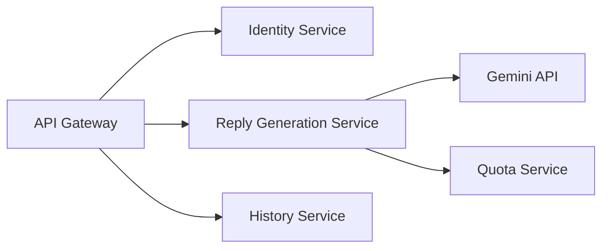

**Common mistakes:**
- Splitting by technical layers.
- Cross-service database joins.

**Follow-ups:**
- *What is bounded context?* → A domain boundary where terms/rules have clear meaning.
- *Can code be shared?* → Small utility libraries yes; shared domain models should be avoided.

### Q47. What is an API gateway?
`🟢 Beginner` `🔥` `Must-know SDE-1`

**Why they ask:** Gateways are common in microservice architectures.

**Beginner lens:** An API gateway is the front door for clients, not the place to hide business logic. It
routes requests, applies edge concerns like authentication checks, rate limits, request size limits, and
sometimes response shaping. Interviewers test separation of concerns. Flow: client -> gateway -> route based
on path or host -> service -> response. Keep domain decisions in services because putting too much in the
gateway creates a new monolith at the edge.

**Short answer (say this first, 20-40 sec):**
An API gateway is the single external entry point that routes requests to internal services. It can handle authentication, rate limiting, TLS termination, routing, and correlation IDs, but business logic should remain in services.

**Detailed answer:**
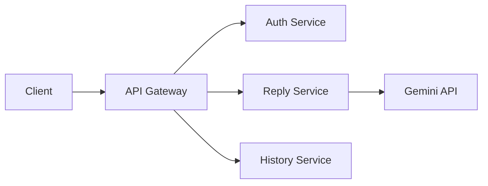
Gateway concerns: route `/api/replies`, validate token, apply quotas, add `X-Correlation-Id`, hide internal topology.

**Common mistakes:**
- Putting domain logic in the gateway.
- Letting clients call internal services directly.

**Follow-ups:**
- *Gateway vs load balancer?* → Gateway understands API policies; load balancer mainly distributes traffic.
- *Can gateway aggregate?* → Yes, but avoid making it a mini-monolith.

### Q48. What is service discovery?
`🟡 Intermediate` `🔥` `Must-know SDE-1`

**Why they ask:** Service locations change dynamically in cloud systems.

**Beginner lens:** Service discovery solves the problem that service instances move, scale, and restart, so
clients should not hard-code addresses. It is like looking up which checkout counters are currently open.
Interviewers test dynamic infrastructure awareness. Flow: service instance registers or is discovered by the
platform -> client or load balancer resolves a healthy endpoint -> request is sent. In Kubernetes this often
happens through service names and DNS rather than custom registry code.

**Short answer (say this first, 20-40 sec):**
Service discovery lets callers find healthy service instances without hardcoded hostnames/ports. It can be client-side, server-side, or platform-native through Kubernetes Services and DNS.

**Detailed answer:**
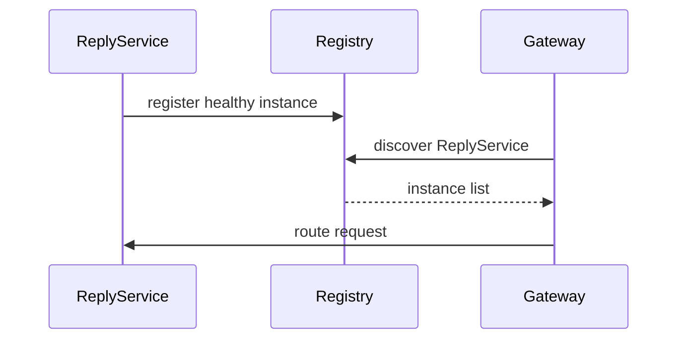
Examples: Eureka, Consul, Kubernetes DNS/Service, cloud load balancers.

**Common mistakes:**
- Hardcoding IP addresses.
- Sending traffic to unhealthy instances.

**Follow-ups:**
- *Need Eureka on Kubernetes?* → Usually not; Kubernetes has service discovery.
- *Discovery vs config?* → Discovery finds instances; config stores settings.

### Q49. What is a config server?
`🟡 Intermediate` `Medium` `Must-know SDE-1`

**Why they ask:** Distributed config must be consistent and secure.

**Beginner lens:** A config server centralizes environment-specific settings so services do not each carry
hidden copies. Think of it as a shared instruction board with access control and versioning. Interviewers
test operational consistency and secret handling. Recognize it when many services need the same flags,
endpoints, or limits. Production flow: service starts -> fetches config securely -> validates required
settings -> exposes effective behavior. Secrets still need a proper secret store and rotation plan.

**Short answer (say this first, 20-40 sec):**
A config server centralizes external config for many services and environments. It helps with versioning, audit, dynamic refresh, and consistency, but secrets should integrate with a secure secret store. For small apps, environment variables may be enough.

**Detailed answer:**
- Useful for feature flags, service URLs, and resilience thresholds.
- Risks: config server outage, accidental global changes, secret leakage.
- Use Vault/Azure Key Vault/Kubernetes Secrets for sensitive values.
- Email Reply Assistant can start with env vars; add central config when services multiply.

**Common mistakes:**
- Storing secrets as plain Git config.
- Adding config server for one simple service.

**Follow-ups:**
- *Can config refresh live?* → Yes with Spring Cloud patterns, but test carefully.
- *What config should be packaged?* → Safe defaults only.

### Q50. Sync vs async inter-service communication?
`🟡 Intermediate` `🔥` `Must-know SDE-1`

**Why they ask:** Communication style affects coupling and resilience.

**Beginner lens:** Synchronous communication waits for an answer now, while asynchronous communication sends
work and continues. A phone call is sync; leaving a tracked message is async. Interviewers test latency and
coupling judgment. Use sync when the user needs an immediate answer and failure should be visible. Use async
for slow or retryable work, such as generating a reply after returning 202 Accepted. The request flow
changes from direct response to status polling, callback, or event.

**Short answer (say this first, 20-40 sec):**
Synchronous communication waits for a response, such as REST or gRPC. Asynchronous communication uses messages/events, decouples services, and absorbs spikes but introduces eventual consistency and duplicate handling.

**Detailed answer:**
| Style | Pros | Cons | Example |
|---|---|---|---|
| Sync | simple, immediate | cascading failure, latency coupling | `Reply -> Quota` check |
| Async | decoupled, resilient | eventual consistency, duplicates | `ReplyCreated` event |
For AI replies: synchronous for short generation; async job for long Gemini calls.

**Common mistakes:**
- Long synchronous chains across many services.
- Assuming async removes failures.

**Follow-ups:**
- *What is backpressure?* → Slowing intake to protect downstream systems.
- *What do async consumers need?* → Idempotency and retry/dead-letter strategy.

### Q51. How should services own data?
`🟡 Intermediate` `🔥` `Must-know SDE-1`

**Why they ask:** Data ownership distinguishes real microservices from distributed monoliths.

**Beginner lens:** Service data ownership means each service controls its own database tables and rules.
Other services ask through an API or subscribe to events instead of joining across databases. Interviewers
test whether your microservice design is truly independent. Recognize it when the prompt suggests shared
database joins. Flow: Reply service owns replies, Quota service owns quota, and coordination happens through
calls or messages. This avoids hidden coupling but introduces consistency and duplication decisions.

**Short answer (say this first, 20-40 sec):**
Each service should own its data and expose it through APIs or events. Other services should not directly read/write its tables. This preserves independent deployment and domain ownership.

**Detailed answer:**
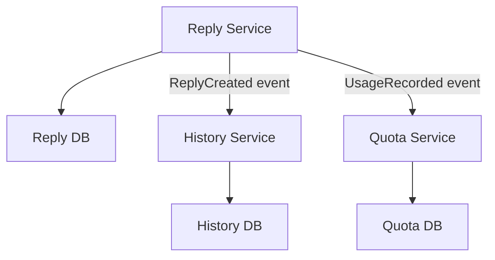
- Reporting can use event-built read models.
- Strong consistency may mean keeping data in one service boundary.

**Common mistakes:**
- Cross-service database joins.
- Sharing JPA entities across services.

**Follow-ups:**
- *Can same DB server host multiple schemas?* → Physically yes, but ownership/access must be separate.
- *How build analytics?* → Events/ETL into read or warehouse models.

## Resilience, Consistency & Observability

### Q52. Explain Resilience4j circuit breaker states.
`🟡 Intermediate` `🔥` `Must-know SDE-1`

**Why they ask:** Circuit breakers prevent cascading failures.

**Beginner lens:** A circuit breaker is like an electrical breaker for remote calls. Closed means calls
flow, open means stop calling a failing dependency, and half-open means test a few calls to see whether it
recovered. Interviewers test resilience thinking. Recognize it with repeated failures, slow dependencies, or
cascading outages. Flow: call succeeds -> record healthy; failures exceed threshold -> open -> fail fast or
fallback -> after wait, try limited calls -> close if healthy.

**Short answer (say this first, 20-40 sec):**
Circuit breaker is closed when calls are allowed. If failures exceed threshold, it opens and fails fast. After a wait duration it becomes half-open, allows trial calls, then closes on success or reopens on failure.

**Detailed answer:**
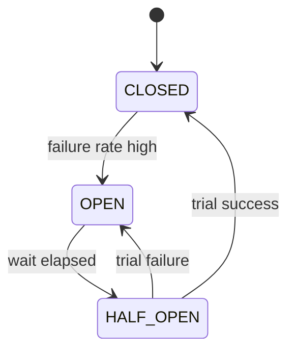
```java
@CircuitBreaker(name="gemini", fallbackMethod="fallback")
Reply generate(ReplyRequest req) { return geminiClient.generate(req); }
Reply fallback(ReplyRequest req, Throwable ex) { return Reply.unavailable(); }
```

**Common mistakes:**
- Circuit breaker without timeouts.
- Returning misleading fallback data.

**Follow-ups:**
- *What is fail fast?* → Do not call known-unhealthy dependency.
- *What threshold matters?* → Failure rate, slow-call rate, and window size.

### Q53. How do retries with backoff and jitter work?
`🟡 Intermediate` `🔥` `Must-know SDE-1`

**Why they ask:** Bad retries can amplify outages.

**Beginner lens:** Retry with backoff and jitter means try again after increasing delays plus randomness,
like people rejoining a queue at different times instead of stampeding the counter. Interviewers test safe
retry design. Recognize transient network errors, 429, or 5xx responses. The key is retry only operations
that are safe or idempotent, cap attempts, and honor timeouts. Flow: first call fails -> wait -> retry ->
stop on success, non-retryable error, or budget exhaustion.

**Short answer (say this first, 20-40 sec):**
Retries repeat transient failures. Exponential backoff increases wait after each failure, and jitter randomizes waits to avoid retry storms. Retry only safe operations and only for retryable errors.

**Detailed answer:**
```java
IntervalFunction f = IntervalFunction.ofExponentialRandomBackoff(Duration.ofMillis(200), 2.0, 0.5);
RetryConfig cfg = RetryConfig.custom().maxAttempts(3).intervalFunction(f)
    .retryOnException(ex -> ex instanceof SocketTimeoutException).build();
```
- Retry 429/502/503/504 when safe.
- Do not retry 400/401/403.
- Keep total retry time inside user SLA.

**Common mistakes:**
- Retrying at every layer.
- No jitter.

**Follow-ups:**
- *What is retry amplification?* → Multiple layers multiply requests.
- *Where retry?* → At the boundary to the unreliable dependency.

### Q54. What are bulkheads and timeouts?
`🟡 Intermediate` `🔥` `Must-know SDE-1`

**Why they ask:** They show whether you can isolate failures.

**Beginner lens:** Timeouts decide how long you wait; bulkheads decide how much capacity one dependency can
consume. Think of bulkheads as watertight compartments in a ship. Interviewers test failure isolation.
Recognize this when one slow downstream service blocks unrelated requests. Flow: route call through a
limited pool or semaphore -> apply timeout -> release capacity -> return fallback or error. Without these
limits, slow calls consume all threads and make healthy parts look broken.

**Short answer (say this first, 20-40 sec):**
A timeout bounds waiting time. A bulkhead limits concurrent calls or threads for a dependency. Together they prevent a slow Gemini API from consuming every servlet thread.

**Detailed answer:**
```yaml
resilience4j:
  bulkhead:
    instances:
      gemini:
        max-concurrent-calls: 25
        max-wait-duration: 0
  timelimiter:
    instances:
      gemini:
        timeout-duration: 3s
```
- Semaphore bulkhead limits concurrency.
- Thread-pool bulkhead isolates execution threads.

**Common mistakes:**
- Timeout greater than gateway/client timeout.
- Unbounded queues.

**Follow-ups:**
- *Status when bulkhead full?* → Often 503.
- *Why not just add threads?* → It increases memory and queueing, not dependency health.

### Q55. What are idempotency keys?
`🟡 Intermediate` `🔥` `Must-know SDE-1`

**Why they ask:** Retries can create duplicate writes.

**Beginner lens:** An idempotency key is a client-supplied or generated request identifier that turns
duplicate creates into one logical operation. It is like a receipt number: showing it twice should not buy
two items. Interviewers test retry safety. Flow: client sends POST with key -> server checks stored key and
request fingerprint -> returns existing result if seen -> otherwise processes and stores the result. It
matters whenever clients retry after timeouts or network drops.

**Short answer (say this first, 20-40 sec):**
An idempotency key is a unique client-provided key for a write operation. The server stores the key with request hash and result, then returns the same result for duplicate retries. It is useful for costly or chargeable AI generation.

**Detailed answer:**
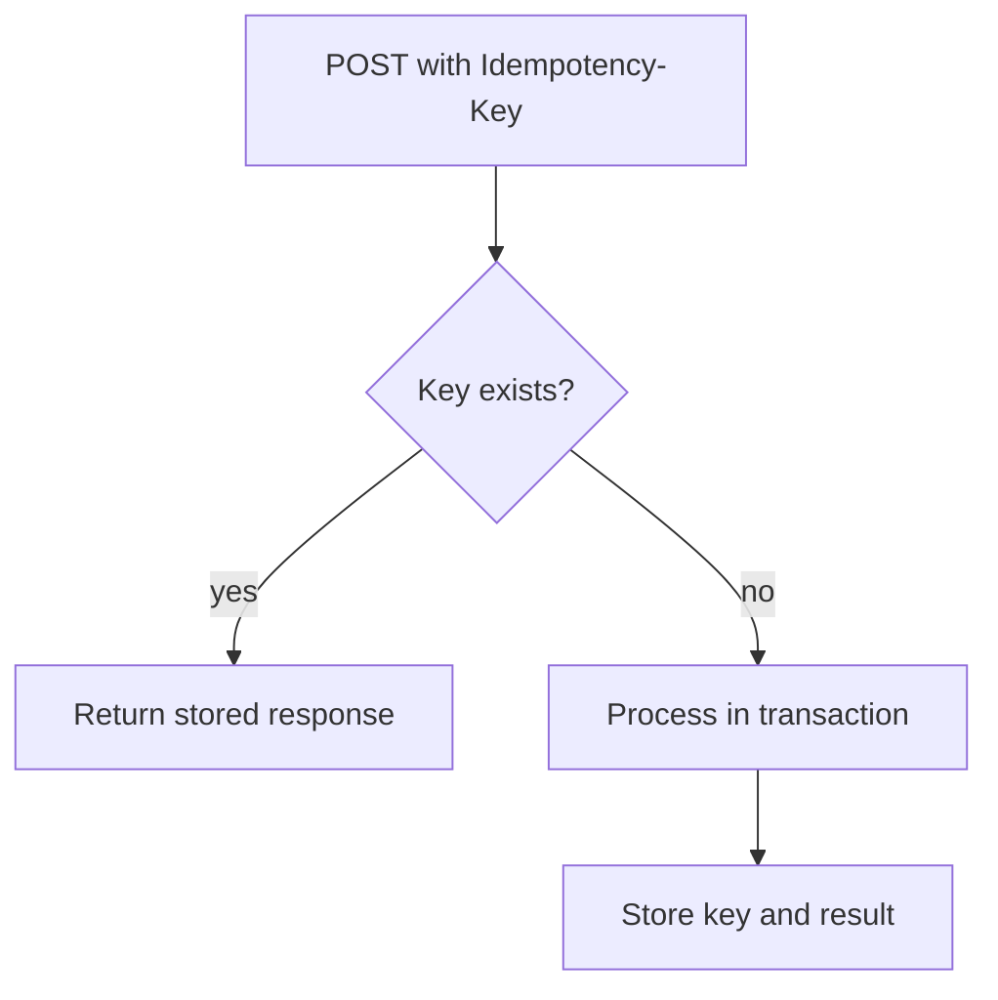
```sql
CREATE TABLE idempotency_keys (
  key TEXT PRIMARY KEY,
  request_hash TEXT NOT NULL,
  response_body JSONB NOT NULL,
  status_code INT NOT NULL
);
```

**Common mistakes:**
- Not comparing request hash.
- In-memory dedupe only.

**Follow-ups:**
- *Who generates key?* → Client for one user intent.
- *Same key different body?* → 409 Conflict.

### Q56. Saga choreography vs orchestration?
`🔴 Advanced` `🔥` `Stretch`

**Why they ask:** Distributed transactions need business-level handling.

**Beginner lens:** A saga coordinates a multi-service workflow through local transactions instead of one
global database transaction. Choreography lets services react to events like dancers following cues;
orchestration uses a conductor service to call each step. Interviewers test distributed consistency.
Recognize it when quota, payment, inventory, or reply generation spans services. Flow: reserve -> generate
-> save -> confirm, with compensation if a later step fails. Choose based on visibility, coupling, and
workflow complexity.

**Short answer (say this first, 20-40 sec):**
A saga splits a distributed business process into local transactions with compensating actions. Choreography uses events between services. Orchestration uses a central coordinator to command steps and handle compensation.

**Detailed answer:**
Choreography:
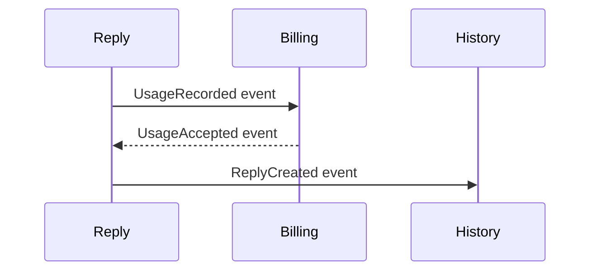
Orchestration:
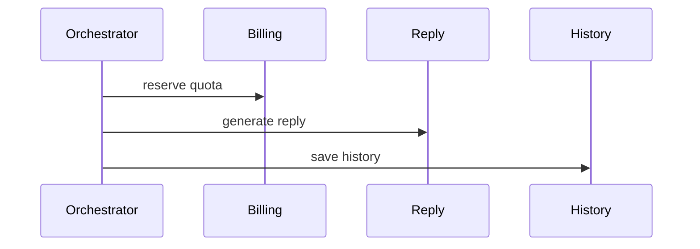

**Common mistakes:**
- No compensation path.
- Non-idempotent saga steps.

**Follow-ups:**
- *Which is easier to debug?* → Orchestration often is.
- *What is compensation?* → Business undo like release quota.

### Q57. What is the Outbox pattern?
`🔴 Advanced` `🔥` `Stretch`

**Why they ask:** It solves reliable event publishing.

**Beginner lens:** The outbox pattern solves the gap between saving data and publishing a message. Without
it, a service can commit the database row and crash before sending the event. Think of the outbox as a
mailbox table written in the same transaction. Interviewers test reliability. Flow: service updates business
table plus outbox row -> commit -> relay reads outbox -> publishes event -> marks sent. This keeps events
aligned with database state.

**Short answer (say this first, 20-40 sec):**
Outbox writes business data and an event record in the same database transaction. A publisher later reads the outbox and sends events to the broker. This avoids losing events when DB commit succeeds but message publish fails.

**Detailed answer:**
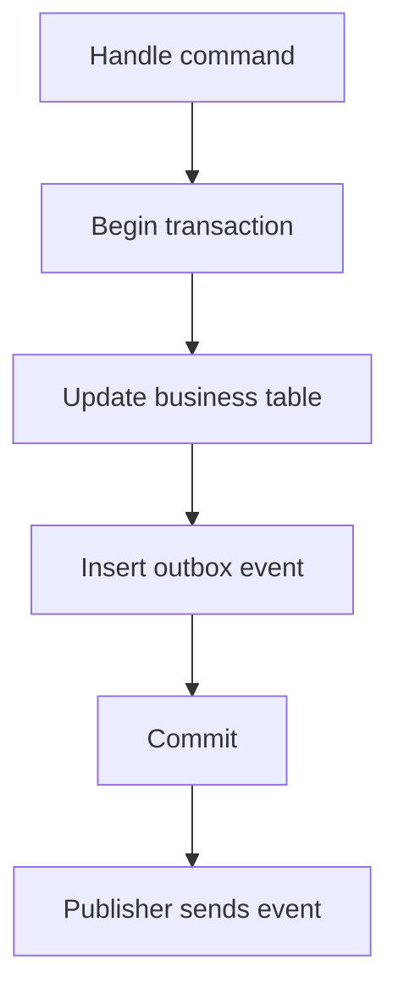
```sql
CREATE TABLE outbox_events (
  id UUID PRIMARY KEY,
  event_type TEXT NOT NULL,
  payload JSONB NOT NULL,
  sent_at TIMESTAMPTZ
);
```

**Common mistakes:**
- Publishing event before transaction commits.
- Consumers not idempotent.

**Follow-ups:**
- *What is CDC?* → Streaming DB changes, often used to publish outbox rows.
- *Can duplicates happen?* → Yes, consumers must handle them.

### Q58. What is 2PC and why avoid it in microservices?
`🔴 Advanced` `Medium` `Stretch`

**Why they ask:** They compare classic distributed transactions with sagas.

**Beginner lens:** Two-phase commit tries to make multiple resources agree on one atomic transaction, like
asking every department to prepare and then commit together. Microservices often avoid it because it is
slow, blocks on failures, and couples services tightly. Interviewers test practical distributed-systems
judgment. Recognize it when someone wants one transaction across databases. The usual alternative is local
transactions plus saga, outbox, idempotent consumers, and repair workflows with clear consistency
expectations.

**Short answer (say this first, 20-40 sec):**
Two-phase commit coordinates multiple resources using prepare and commit phases. It gives atomicity but can block, reduce availability, and tightly couple services. Microservices often prefer local transactions plus saga/outbox patterns.

**Detailed answer:**
- Prepare: coordinator asks every participant if it can commit.
- Commit/rollback: all commit if everyone voted yes.
- Problems: coordinator failure, locks held over network, poor autonomy.
- If strong consistency is mandatory, keep data inside one service/database boundary.

**Common mistakes:**
- Saying 2PC is always impossible.
- Using sagas without compensation.

**Follow-ups:**
- *2PC vs saga?* → Technical atomicity vs business eventual consistency.
- *When use 2PC?* → Controlled environments with compatible resources and strict atomicity.

### Q59. What is distributed tracing?
`🟡 Intermediate` `🔥` `Must-know SDE-1`

**Why they ask:** Microservice debugging needs request-level visibility.

**Beginner lens:** Distributed tracing follows one user request across services using a trace identifier and
spans, like a package tracking number with checkpoints. Interviewers test production debugging. Recognize it
when latency or errors cross service boundaries. Flow: gateway receives request and creates or forwards
trace context -> each service records a span for work and downstream calls -> tracing backend shows the
path. Logs and metrics tell what happened; traces show where time went.

**Short answer (say this first, 20-40 sec):**
Distributed tracing follows one request across services using trace IDs and span IDs. Each service creates spans for operations and propagates context downstream. Tools include Zipkin, Jaeger, Grafana Tempo, and cloud tracing systems.

**Detailed answer:**
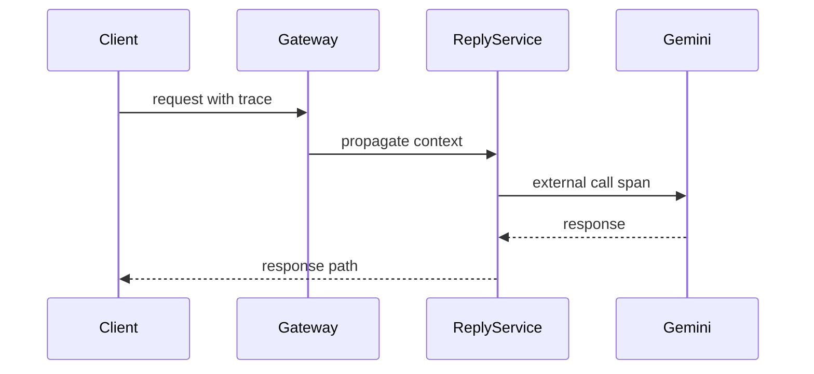
- Boot 3 uses Micrometer observation/tracing ecosystem.
- Include trace/correlation IDs in logs.

**Common mistakes:**
- Not propagating trace headers.
- No spans around external calls.

**Follow-ups:**
- *Trace vs span?* → Trace is whole request; span is one operation.
- *Why for Gemini?* → It shows provider latency separately from app latency.

### Q60. What is Strangler Fig migration?
`🟡 Intermediate` `🔥` `Must-know SDE-1`

**Why they ask:** It is practical monolith-to-microservices migration.

**Beginner lens:** Strangler Fig migration means replacing a monolith gradually by routing selected features
to new services while the old system keeps running. Think of a new plant growing around an old tree.
Interviewers test low-risk migration strategy. Flow: put a gateway or facade in front -> move one capability
-> sync or migrate data carefully -> monitor -> repeat. It avoids a big-bang rewrite but needs
compatibility, rollback, and clear ownership during the transition.

**Short answer (say this first, 20-40 sec):**
Strangler Fig gradually replaces parts of a monolith by routing selected features to new services through a gateway/facade. It avoids big-bang rewrites and allows rollback.

**Detailed answer:**
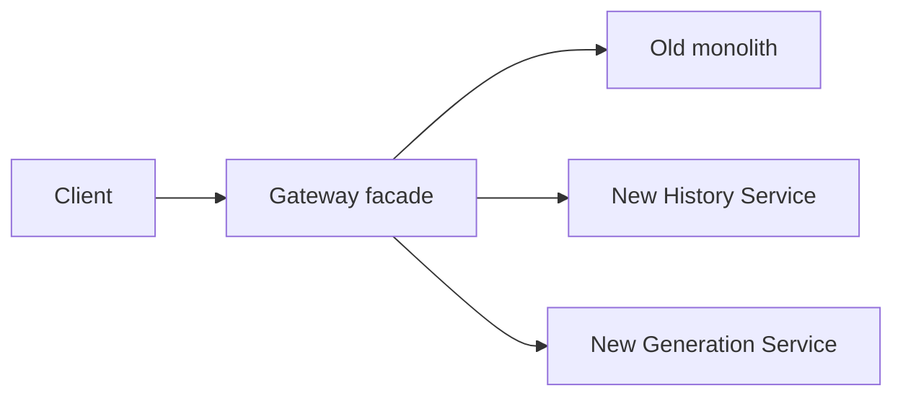
Steps: add facade, extract low-risk feature, route traffic, migrate data ownership, repeat.

**Common mistakes:**
- Big-bang rewrite.
- No rollback path.

**Follow-ups:**
- *First feature to extract?* → Low-coupling, well-tested capability.
- *How avoid dual-write bugs?* → Clear ownership or outbox/events.

### Q61. CAP and PACELC in simple terms?
`⚫ FAANG` `Medium` `Stretch`

**Why they ask:** Distributed system tradeoffs matter at top companies.

**Beginner lens:** CAP says that during a network partition you must choose between consistent answers and
available responses. PACELC adds that even when no partition exists, you trade latency against consistency.
Interviewers test whether you can explain trade-offs in plain terms. Recognize it when distributed data,
stale reads, or regional failure appears. A practical answer ties the model to user impact: can this feature
show slightly old data, or must it block until confirmed?

**Short answer (say this first, 20-40 sec):**
CAP says during a network partition, a distributed system must choose between consistency and availability. PACELC adds that else, during normal operation, systems still trade latency and consistency.

**Detailed answer:**
- Consistency: reads see latest write.
- Availability: every request gets non-error response.
- Partition tolerance: system handles network splits.
- Email history can be eventual; billing/quota should be stronger.

**Common mistakes:**
- Confusing CAP consistency with ACID consistency.
- Applying CAP to a single-node app.

**Follow-ups:**
- *What is eventual consistency?* → Replicas converge if writes stop.
- *Quota consistency?* → Prefer strong per-user consistency.

### Q62. What consistency model fits Email Reply Assistant features?
`⚫ FAANG` `Medium` `Stretch`

**Why they ask:** They want applied tradeoff reasoning.

**Beginner lens:** Consistency for the Email Reply Assistant should match user expectations for each action.
Creating a reply or reserving quota may need strong local consistency, while analytics, history refresh, or
email status can often be eventually consistent. Interviewers test product judgment. Flow: user submits
prompt -> service saves request and idempotency record -> generation completes later -> history updates. Say
which state the user sees while work is pending and how failures are corrected.

**Short answer (say this first, 20-40 sec):**
Reply generation response needs immediate consistency for the user. History/search can be eventually consistent. Quota, billing, and idempotency records need strong consistency to avoid overuse, duplicate charges, or duplicate generation.

**Detailed answer:**
| Feature | Consistency | Why |
|---|---|---|
| Generated reply response | immediate | user waits for result |
| Reply history | eventual acceptable | can appear seconds later |
| Quota/idempotency | strong | avoid duplicate cost |
| Analytics | eventual | aggregate delay OK |

**Common mistakes:**
- Making everything strongly consistent.
- Making billing eventually consistent without safeguards.

**Follow-ups:**
- *How get read-your-write?* → Return written data or read from primary.
- *How show stale history?* → Use pending state or refresh.

## API Design

### Q63. What are REST principles?
`🟢 Beginner` `🔥` `Must-know SDE-1`

**Why they ask:** REST is a backend interview baseline.

**Beginner lens:** REST is an API style where resources are named with nouns and manipulated with HTTP
methods. Think of resources as documents in a filing cabinet: GET reads, POST creates or commands, PUT
replaces, PATCH changes part, DELETE removes. Interviewers test contract thinking. Recognize it when
designing endpoints. A strong answer includes stateless requests, meaningful status codes, cacheability
where safe, and stable representations rather than action-heavy URLs for every operation.

**Short answer (say this first, 20-40 sec):**
REST models APIs as resources identified by URLs and manipulated using standard HTTP methods. It should be stateless, use proper status codes, expose representations like JSON, and respect HTTP semantics such as caching and idempotency.

**Detailed answer:**
- Use nouns: `/api/replies`, not `/generateReply`.
- Use methods: GET, POST, PUT, PATCH, DELETE.
- Each request carries auth/context; do not depend on server conversational state.
- Return DTOs, not database entities.

**Common mistakes:**
- Verb-based endpoints everywhere.
- Always returning 200.

**Follow-ups:**
- *Is REST always best?* → No; gRPC/GraphQL can fit specific needs.
- *What is safe method?* → GET/HEAD should not change state.

### Q64. How should REST resources be named?
`🟢 Beginner` `🔥` `Must-know SDE-1`

**Why they ask:** Good naming reveals API maturity.

**Beginner lens:** REST resource naming should make the domain visible and predictable. Use plural nouns for
collections, nested paths only when ownership is real, and query parameters for filtering rather than
inventing many verbs. Interviewers test whether clients can understand your API without reading code. Flow:
client POSTs to a collection to create, GETs a resource by identifier, and lists with filters or cursors.
Good names become part of the long-lived contract.

**Short answer (say this first, 20-40 sec):**
Use plural nouns for collections, path parameters for identity, and query parameters for filtering/sorting. Keep paths lowercase and stable; nest only when ownership is real.

**Detailed answer:**
Good:
- `GET /api/v1/replies/{replyId}`
- `POST /api/v1/replies`
- `GET /api/v1/users/{userId}/replies?tone=formal`
Avoid:
- `/getAllReplies`
- `/createNewReply`
- deep nesting like `/users/{u}/mailboxes/{m}/threads/{t}/replies/{r}` unless necessary.

**Common mistakes:**
- Filters in path segments.
- Exposing table names directly.

**Follow-ups:**
- *Where put search?* → Query params or `/search` resource for complex search.
- *When nest?* → When child belongs to parent.

### Q65. Give a practical HTTP status code table.
`🟢 Beginner` `🔥` `Must-know SDE-1`

**Why they ask:** Status code choices affect clients.

**Beginner lens:** HTTP status codes are a compact contract about what happened before the body is read.
Think of them as traffic signals for clients. Interviewers test whether you distinguish client errors,
server errors, creation, async acceptance, and missing resources. Flow: validate request -> choose 400 for
bad input, 401 or 403 for security, 404 for missing resource, 409 for conflict, 201 for created, 202 for
accepted async work, and 5xx for server failure.

**Short answer (say this first, 20-40 sec):**
Use 2xx for success, 4xx for client errors, and 5xx for server/upstream failures. Be consistent and specific enough for clients to react.

**Detailed answer:**
| Status | Use |
|---:|---|
| 200 | successful GET/sync operation |
| 201 | resource created |
| 202 | async job accepted |
| 204 | success with no body |
| 400 | validation/malformed request |
| 401 | missing/invalid auth |
| 403 | authenticated but forbidden |
| 404 | not found |
| 409 | conflict/idempotency mismatch |
| 429 | rate limited |
| 500 | unexpected bug |
| 503 | overloaded/circuit open |
| 504 | upstream timeout |

**Common mistakes:**
- 500 for validation errors.
- 200 with error body.

**Follow-ups:**
- *Duplicate create?* → 409 or same response with idempotency key.
- *Long AI job?* → 202 Accepted.

### Q66. PUT vs PATCH vs POST idempotency?
`🟡 Intermediate` `🔥` `Must-know SDE-1`

**Why they ask:** Idempotency is core API design.

**Beginner lens:** PUT, PATCH, and POST differ by intent and idempotency. PUT replaces a known resource and
should be repeat-safe; PATCH partially updates; POST usually creates a new resource or triggers an action
unless an idempotency key makes retries safe. Interviewers test retry and contract design. Flow: if the
client knows the final resource URI, PUT can fit; if the server creates an identifier, POST plus idempotency
is safer for unreliable networks.

**Short answer (say this first, 20-40 sec):**
POST usually creates/processes and is not idempotent by default. PUT replaces or creates a resource at a known URI and is idempotent. PATCH partially updates; it can be idempotent depending on patch semantics.

**Detailed answer:**
| Method | Semantics | Idempotent |
|---|---|---|
| POST | create/action under collection | no by default |
| PUT | replace at URI | yes |
| PATCH | partial update | depends |
| DELETE | delete | yes effect |
Example: `PATCH` setting tone is idempotent; incrementing usage is not.

**Common mistakes:**
- Using POST for every update.
- Thinking idempotent means same response status every time.

**Follow-ups:**
- *Can POST be idempotent?* → Yes with an idempotency key.
- *Is DELETE idempotent?* → Effect is idempotent even if second response is 404.

### Q67. What API versioning strategies exist?
`🟡 Intermediate` `🔥` `Must-know SDE-1`

**Why they ask:** APIs evolve while clients remain deployed.

**Beginner lens:** API versioning is how you evolve a contract without surprising existing clients. It is
like publishing a new form while still accepting the old one for a while. Interviewers test compatibility
judgment. Recognize it when fields, validation, paths, or behavior change. Options include URL version,
header version, media type version, and additive evolution. The safer flow is add optional fields ->
document -> support both -> deprecate with notice -> remove only after migration.

**Short answer (say this first, 20-40 sec):**
Strategies include URI versioning, header versioning, media type versioning, and query parameter versioning. URI versioning is simple and visible; header/media type versioning is cleaner but less obvious. Prefer backward-compatible changes first.

**Detailed answer:**
| Strategy | Example | Tradeoff |
|---|---|---|
| URI | `/api/v1/replies` | simple, visible |
| Header | `API-Version: 1` | clean URL, harder manual testing |
| Media type | `application/vnd.app.v1+json` | precise, complex |
| Query | `?version=1` | easy, less preferred |
Breaking changes: remove/rename fields, change type, make optional field required.

**Common mistakes:**
- Versioning every small addition.
- Removing v1 without usage monitoring.

**Follow-ups:**
- *Backward compatible addition?* → Optional response/request field.
- *How deprecate?* → Announce timeline, monitor, add deprecation headers.

### Q68. Offset vs cursor pagination with SQL?
`🟡 Intermediate` `🔥` `Must-know SDE-1`

**Why they ask:** Pagination affects performance and correctness.

**Beginner lens:** Offset pagination says skip N rows, while cursor pagination says continue after this
stable position. Offset is simple but can get slow and inconsistent as rows are inserted or deleted. Cursor
is better for large changing lists. Interviewers test scaling and correctness. Flow: client requests first
page with limit -> server returns items plus next cursor -> client sends cursor for the next page. Stable
ordering and tie-breakers prevent duplicates or missed records.

**Short answer (say this first, 20-40 sec):**
Offset pagination uses `LIMIT/OFFSET`, simple but slow and unstable for deep pages. Cursor pagination uses the last seen sort key, is stable and efficient for feeds/history, but cannot jump to arbitrary pages easily.

**Detailed answer:**
PostgreSQL offset:
```sql
SELECT id, subject, created_at FROM replies
WHERE user_id = $1 ORDER BY created_at DESC, id DESC
LIMIT 20 OFFSET 1000;
```
PostgreSQL cursor:
```sql
SELECT id, subject, created_at FROM replies
WHERE user_id = $1 AND (created_at, id) < ($2, $3)
ORDER BY created_at DESC, id DESC LIMIT 20;
```
Use deterministic order and opaque cursor tokens.

**Common mistakes:**
- Cursor on non-unique column only.
- No max page size.

**Follow-ups:**
- *Which for history feed?* → Cursor.
- *Which for small admin pages?* → Offset is acceptable.

### Q69. How should filtering and sorting work?
`🟢 Beginner` `🔥` `Must-know SDE-1`

**Why they ask:** Listing APIs almost always need filters and sort.

**Beginner lens:** Filtering and sorting define which rows qualify and in what order they appear. Treat them
as part of the API contract, not string concatenation. Interviewers test safety and predictability.
Recognize it when endpoints list resources. Flow: parse allowed filter fields -> validate operators -> use
indexes where possible -> apply stable sort -> paginate. Avoid exposing arbitrary database fields or unsafe
dynamic SQL; document defaults and behavior for nulls and ties.

**Short answer (say this first, 20-40 sec):**
Use query parameters for filters and sorting, validate allowed fields, and map them safely to repository or SQL queries. Never concatenate raw client input into SQL.

**Detailed answer:**
Example: `GET /api/v1/replies?tone=formal&status=completed&sort=-createdAt&limit=20`.
- Whitelist fields: `createdAt`, `tone`, `status`.
- Cap `limit` to prevent abuse.
- Add indexes for common filter/sort combinations.

**Common mistakes:**
- Allowing arbitrary SQL in query params.
- Sorting huge tables by unindexed fields.

**Follow-ups:**
- *Invalid sort field status?* → 400 Bad Request.
- *Where document filters?* → OpenAPI spec.

### Q70. What are rate limiting headers?
`🟡 Intermediate` `🔥` `Must-know SDE-1`

**Why they ask:** Public APIs need quotas and client feedback.

**Beginner lens:** Rate limiting headers tell a client how much request budget remains and when to slow
down. Think of them as a speedometer and fuel gauge. Interviewers test fairness and client behavior. Flow:
gateway or service identifies the caller -> checks a token bucket or quota -> allows or rejects -> returns
headers such as limit, remaining, reset, and maybe Retry-After. Limits should protect expensive endpoints
like reply generation more strictly than cheap reads.

**Short answer (say this first, 20-40 sec):**
Rate limiting restricts requests per user, token, tenant, or IP. When exceeded, return 429 and headers that show limit, remaining quota, reset time, and retry guidance.

**Detailed answer:**
| Header | Meaning |
|---|---|
| `RateLimit-Limit` | max in window |
| `RateLimit-Remaining` | remaining requests |
| `RateLimit-Reset` | reset time/seconds |
| `Retry-After` | when to retry after 429 |
Algorithms: fixed window, sliding window, token bucket, leaky bucket. Redis is common for distributed counters.

**Common mistakes:**
- Limiting only by IP behind NAT.
- Returning 429 without retry guidance.

**Follow-ups:**
- *Where enforce?* → Gateway plus service for business quotas.
- *Which endpoint stricter?* → Gemini generation, because it costs money/latency.

### Q71. REST vs GraphQL vs gRPC?
`🟡 Intermediate` `🔥` `Must-know SDE-1`

**Why they ask:** API style should fit the use case.

**Beginner lens:** REST, GraphQL, and gRPC are different contract shapes. REST is resource-oriented and
broadly compatible, GraphQL lets clients ask for specific fields, and gRPC is efficient remote procedure
calls for internal systems. Interviewers test choosing by client needs and coupling. Flow: public product
API often starts with REST; frontend aggregation may use GraphQL; high-throughput service-to-service calls
may use gRPC. Each choice affects tooling, caching, versioning, and debugging.

**Short answer (say this first, 20-40 sec):**
REST is resource-oriented and simple for public CRUD APIs. GraphQL lets clients request exact fields and aggregate data flexibly. gRPC is schema-first, binary, and efficient for internal service-to-service calls.

**Detailed answer:**
| Style | Best for | Tradeoff |
|---|---|---|
| REST | public resource APIs | simple, cacheable, possible over-fetch |
| GraphQL | frontend aggregation | flexible, harder caching/auth/N+1 |
| gRPC | internal low-latency RPC | efficient, browser/public friction |
Email Reply Assistant public frontend fits REST; internal quota/generation calls could later use gRPC.

**Common mistakes:**
- Picking GraphQL to avoid API design.
- Exposing gRPC directly to browsers without tooling plan.

**Follow-ups:**
- *Does GraphQL replace auth?* → No, field/object authorization still required.
- *Is gRPC always faster?* → Often efficient, but design and payloads matter.

### Q72. WebSockets vs Server-Sent Events?
`🟡 Intermediate` `🔥` `Must-know SDE-1`

**Why they ask:** Realtime updates need the right transport.

**Beginner lens:** WebSocket is a two-way persistent channel; Server-Sent Events is a one-way
server-to-client stream over HTTP. Think of WebSocket as a phone call and Server-Sent Events as a live
scoreboard. Interviewers test fit, not novelty. For AI text streaming, Server-Sent Events often fits because
the server pushes tokens while the client listens. Use WebSocket when the client also needs to send frequent
real-time messages on the same connection.

**Short answer (say this first, 20-40 sec):**
WebSockets are bidirectional long-lived connections. Server-Sent Events are one-way server-to-client streams over HTTP. Use SSE for AI generation progress if the client only receives updates; use WebSockets for interactive bidirectional sessions.

**Detailed answer:**
| Feature | WebSocket | SSE |
|---|---|---|
| Direction | bidirectional | server to client |
| Protocol | WebSocket | HTTP stream |
| Browser retry | app-managed | built-in EventSource retry |
| Use | chat/collab | progress/notifications |

**Common mistakes:**
- Using WebSockets for simple notifications.
- No auth/heartbeat for long-lived connections.

**Follow-ups:**
- *Can SSE stream binary?* → Not directly; it is text/event-stream.
- *Simpler for token streaming?* → SSE is often simpler.

### Q73. How do you maintain backward compatibility?
`🟡 Intermediate` `🔥` `Must-know SDE-1`

**Why they ask:** APIs must evolve without breaking deployed clients.

**Beginner lens:** Backward compatibility means old clients keep working after the API changes. It is like
changing a form without making old apps unable to submit it. Interviewers test product safety. Recognize it
when adding fields, tightening validation, renaming values, or changing errors. Flow: add optional response
fields, keep old fields, avoid changing meaning, version breaking changes, update OpenAPI, run contract
tests, and monitor client errors before deprecating anything.

**Short answer (say this first, 20-40 sec):**
Prefer additive changes, preserve old fields/semantics, deprecate before removal, and use contract tests. Create a new version for breaking changes. Monitor client usage before sunsetting old versions.

**Detailed answer:**
Compatible: add optional field, add endpoint, add optional request parameter.
Breaking: rename field, change type, remove enum behavior, make optional field required.
Useful headers:
```http
Deprecation: true
Sunset: Wed, 31 Dec 2026 23:59:59 GMT
```

**Common mistakes:**
- Assuming mobile clients update immediately.
- Reusing an old field with new meaning.

**Follow-ups:**
- *Consumer-driven contracts?* → Consumers define expectations providers must satisfy.
- *Can adding enum break?* → Yes, strict clients may reject unknown values.

### Q74. What should an API error response include?
`🟢 Beginner` `🔥` `Must-know SDE-1`

**Why they ask:** Good errors reduce support and client bugs.

**Beginner lens:** A good API error response helps clients decide what to do next. It should include a
stable type or code, human-readable title, status, detail, trace identifier, and field errors when
validation fails. Interviewers test client empathy and observability. Flow: request fails validation or
business rule -> server maps it to a consistent Problem Details shape -> client displays or handles it.
Avoid leaking stack traces, SQL, secrets, or internal class names.

**Short answer (say this first, 20-40 sec):**
Include status, stable error type/code, message/detail, correlation ID, and field errors when relevant. Never expose stack traces, secrets, or internal class names.

**Detailed answer:**
```json
{
  "type": "https://api.emailreply.com/problems/validation",
  "title": "Validation failed",
  "status": 400,
  "detail": "Invalid request fields",
  "correlationId": "abc-123",
  "errors": [{ "field": "emailBody", "message": "must not be blank" }]
}
```
Use one error shape across endpoints, ideally ProblemDetail-compatible.

**Common mistakes:**
- Different error formats per controller.
- Leaking Java exception names.

**Follow-ups:**
- *Downstream timeout error?* → 504 with provider-timeout type.
- *Human message vs machine code?* → Keep both: stable code/type and readable detail.

### Q75. How do you design API authentication and authorization?
`🟡 Intermediate` `🔥` `Must-know SDE-1`

**Why they ask:** API security is broader than adding JWT.

**Beginner lens:** API authentication proves the caller identity, and authorization checks what that caller
may do. Treat them as separate gates. Interviewers test security flow. Flow: client sends token -> gateway
or service validates issuer, signature, expiry, and audience -> service maps claims to roles or scopes ->
endpoint and method rules check permissions -> request proceeds or returns 401/403. Rate limits, audit logs,
and least privilege complete the production answer.

**Short answer (say this first, 20-40 sec):**
Use HTTPS, OAuth2/OIDC for user login, JWT resource server for stateless APIs, API keys for simple server integrations, and mTLS for high-trust service-to-service. Authorization should use scopes/roles plus resource ownership checks.

**Detailed answer:**
Example scopes: `email:generate`, `reply:read`, `admin:metrics`.
Controls:
- Short-lived access tokens.
- Method security for ownership.
- Audit sensitive actions.
- Rate limit by user/client.
- Do not expose Gemini API key to frontend.

**Common mistakes:**
- Treating API key as user identity.
- Tokens with no expiry.

**Follow-ups:**
- *API key vs JWT?* → API key identifies app/client; JWT often carries user claims.
- *Zero trust idea?* → Verify identity and authorization across boundaries.

### Q76. What is HATEOAS and do you need it?
`⚫ FAANG` `Medium` `Stretch`

**Why they ask:** It checks deeper REST theory and pragmatic judgment.

**Beginner lens:** HATEOAS means responses include links that tell clients possible next actions. It is like
a form that includes the next counters you can visit. Interviewers test REST depth and pragmatism. Recognize
it when discoverability or hypermedia comes up. Many product APIs do not fully use it because clients and
documentation already know workflows. A balanced answer says links can help state-driven workflows but add
complexity and are not mandatory for every REST API.

**Short answer (say this first, 20-40 sec):**
HATEOAS means responses include links to valid next actions. It improves discoverability but many practical JSON APIs do not fully implement it. Use it when workflow navigation matters; otherwise documented endpoints may be enough.

**Detailed answer:**
```json
{
  "id": "rpl_123",
  "status": "completed",
  "links": [
    { "rel": "self", "href": "/api/v1/replies/rpl_123" },
    { "rel": "feedback", "href": "/api/v1/replies/rpl_123/feedback" }
  ]
}
```

**Common mistakes:**
- Adding links inconsistently.
- Exposing unauthorized actions as links.

**Follow-ups:**
- *Richardson maturity?* → Resources, verbs, hypermedia levels.
- *Use here?* → Useful for async job status/next actions, not mandatory everywhere.

### Q77. How should OpenAPI documentation be used?
`🟢 Beginner` `🔥` `Must-know SDE-1`

**Why they ask:** API docs are part of production delivery.

**Beginner lens:** OpenAPI is the written contract for REST APIs: paths, methods, schemas, parameters,
responses, errors, and security. Think of it as a blueprint clients and servers can both test against.
Interviewers test whether documentation stays executable. Flow: design or generate spec -> review
compatibility -> generate clients or server stubs if useful -> run contract tests -> publish docs. Keep
examples, error models, and versioning accurate, not just happy-path fields.

**Short answer (say this first, 20-40 sec):**
OpenAPI documents endpoints, schemas, auth, status codes, errors, pagination, rate limits, and examples. Keep it generated or validated in CI so docs do not drift from implementation.

**Detailed answer:**
Document:
- `Authorization` and idempotency headers.
- Request/response examples.
- ProblemDetail error schema.
- 400/401/403/429/5xx responses.
- Cursor pagination and rate-limit headers.
Springdoc can generate Swagger UI, but secure/disable it in production if needed.

**Common mistakes:**
- Only documenting happy path.
- Missing error and rate-limit responses.

**Follow-ups:**
- *Contract-first?* → Define OpenAPI first, then implement/validate.
- *Can clients be generated?* → Yes, SDKs can be generated from spec.

### Q78. How do you design caching for APIs?
`🟡 Intermediate` `Medium` `Must-know SDE-1`

**Why they ask:** Caching improves performance but can create stale/unsafe data.

**Beginner lens:** API caching stores safe responses so clients or servers do not recompute or reload them
every time. Think of it as keeping a recent menu at the counter. Interviewers test correctness and
invalidation. Recognize it with repeated reads, expensive generation, or list endpoints. Flow: determine if
data is user-specific and safe to cache -> set cache keys and headers -> invalidate or expire after writes.
Never cache private authenticated data without strict controls.

**Short answer (say this first, 20-40 sec):**
Cache safe, repeatable reads; avoid caching user-private or rapidly changing data unless keys and invalidation are correct. Use HTTP cache headers for clients/CDNs and server caches like Redis for expensive backend reads.

**Detailed answer:**
- Templates/config can be cached.
- Generated reply history per user needs user-scoped cache keys.
- Never cache responses containing another user's data.
- Use `ETag`, `Cache-Control`, and invalidation rules.

**Common mistakes:**
- Cache key missing user/tenant.
- Caching errors too long.

**Follow-ups:**
- *What is ETag?* → Version identifier for conditional GET.
- *Should Gemini output be cached?* → Only if product accepts same prompt/tone returning same result and privacy is handled.

### Q79. How do you handle partial failures in API responses?
`🔴 Advanced` `Medium` `Stretch`

**Why they ask:** Aggregating APIs often have partial dependency failures.

**Beginner lens:** Partial failure means part of a composed API response failed while other parts succeeded.
It is like receiving two packages and one is delayed. Interviewers test honest contracts. Recognize it with
aggregator endpoints or downstream calls. Flow: call independent dependencies with timeouts -> return
available data plus per-section errors or a 207-style/modeled partial response if the contract allows ->
emit metrics and traces. Do not hide missing critical data as success.

**Short answer (say this first, 20-40 sec):**
Define whether the endpoint is all-or-nothing or can return partial data. If partial is allowed, include clear status per component and avoid hiding critical failures. For writes, prefer clear failure over partial success unless workflow state is persisted.

**Detailed answer:**
Example aggregation: reply details plus analytics.
- Reply missing: 404.
- Analytics unavailable: return reply with `analyticsStatus: unavailable` if non-critical.
- Generation write failed after quota reserve: saga compensation needed.

**Common mistakes:**
- Returning 200 while critical operation failed.
- No machine-readable partial status.

**Follow-ups:**
- *HTTP 207?* → Possible for multi-status, but not common in JSON APIs.
- *Better for writes?* → Persist job state and expose status endpoint.

### Q80. How do you design API observability?
`🟡 Intermediate` `🔥` `Must-know SDE-1`

**Why they ask:** Production APIs need measurable behavior.

**Beginner lens:** API observability means designing signals before incidents: logs for facts, metrics for
trends, and traces for request paths. Interviewers test production ownership. Flow: gateway receives request
and correlation identifier -> service logs key events without secrets -> metrics count rate, errors, and
duration -> spans wrap database, cache, and downstream calls -> dashboards and alerts detect abnormal
latency or failures. Good observability explains both what users saw and where time was spent.

**Short answer (say this first, 20-40 sec):**
Add structured logs, metrics, traces, correlation IDs, and meaningful dashboards. Track request rate, error rate, latency percentiles, dependency latency, saturation, and business metrics like generated replies and Gemini failures.

**Detailed answer:**
Golden signals:
- Latency p50/p95/p99.
- Traffic by route/status.
- Errors by type.
- Saturation: Tomcat threads, DB pool, bulkheads.
- Dependency metrics: Gemini timeout/429/5xx.

**Common mistakes:**
- Only average latency.
- Logs without request IDs.

**Follow-ups:**
- *RED metrics?* → Rate, Errors, Duration.
- *USE metrics?* → Utilization, Saturation, Errors.

## Email Reply Assistant API Exercise

### Q81. Design the REST API for the Email Reply Assistant.
`🟡 Intermediate` `🔥` `Must-know SDE-1`

**Why they ask:** This ties API design to your resume project.

**Beginner lens:** Designing the Email Reply Assistant REST API starts with the user action, not the
database table. The core contract is submit a prompt and get a reply or job status. Interviewers test
resource modeling, validation, and production concerns. Flow: client POSTs to /api/v1/replies with tone and
prompt -> service validates and authorizes -> generation runs or queues -> response returns reply, status,
or job link -> history endpoint lists prior replies with pagination.

**Short answer (say this first, 20-40 sec):**
Expose versioned endpoints for generating replies, checking reply status/history, managing templates, and submitting feedback. Validate request length and tone, use idempotency for generation, and return consistent ProblemDetail errors.

**Detailed answer:**
| Method | Path | Purpose |
|---|---|---|
| POST | `/api/v1/replies` | generate or create generation job |
| GET | `/api/v1/replies/{id}` | fetch reply |
| GET | `/api/v1/replies` | list history |
| POST | `/api/v1/replies/{id}/feedback` | capture feedback |
| GET | `/api/v1/templates` | list prompt templates |
Request:
```json
{ "emailBody": "Can we reschedule?", "tone": "formal", "maxWords": 120 }
```

**Common mistakes:**
- `/generateEmailReply` verb endpoint.
- No idempotency or validation.

**Follow-ups:**
- *Sync or async?* → Sync for short SLA; async 202 for long generation.
- *Where store Gemini key?* → Server-side secret/env, never frontend.

### Q82. Design async generation for slow Gemini responses.
`🔴 Advanced` `🔥` `Must-know SDE-1`

**Why they ask:** It tests latency-aware API design.

**Beginner lens:** Async generation handles slow Gemini responses by decoupling request acceptance from
completion. Think of it as taking an order number instead of making the customer block the counter.
Interviewers test latency and reliability. Flow: client POSTs request -> server validates, stores job,
returns 202 Accepted with status URI -> worker generates reply -> job state updates -> client polls,
subscribes to Server-Sent Events, or receives callback. Idempotency keeps retries from creating duplicate
jobs.

**Short answer (say this first, 20-40 sec):**
Return `202 Accepted` with a job/reply ID and `Location` header, enqueue work, process it in a worker, and let the client poll `GET /replies/{id}` or subscribe through SSE. This avoids holding HTTP threads for long AI calls.

**Detailed answer:**
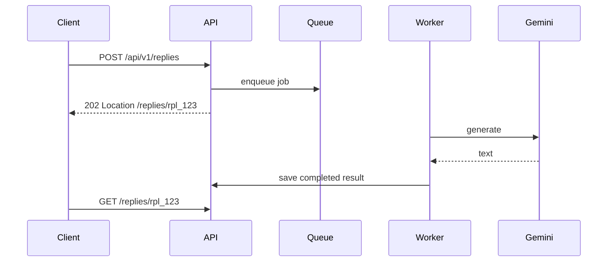
Statuses: `queued`, `processing`, `completed`, `failed`, `expired`.

**Common mistakes:**
- Holding request open for minutes.
- No cleanup for old jobs.

**Follow-ups:**
- *How notify without polling?* → SSE or WebSocket.
- *What about retries?* → Worker retries with backoff and dead-letter on repeated failure.

### Q83. How would you add idempotency to `POST /api/v1/replies`?
`🟡 Intermediate` `🔥` `Must-know SDE-1`

**Why they ask:** AI generation can be retried and may cost money.

**Beginner lens:** Adding idempotency to POST /api/v1/replies protects the create path when the browser
retries after a timeout. The server must remember the key and the request meaning. Flow: client sends
Idempotency-Key -> service checks existing record for that user and endpoint -> if completed, return same
result; if in progress, return current status; if new, reserve key and process. Store request fingerprint,
expiry, and final response or resource identifier.

**Short answer (say this first, 20-40 sec):**
Accept `Idempotency-Key` per user intent. Store user ID, key, request hash, status, and response/job ID with a unique constraint. Duplicate same request returns same result; same key with different body returns 409.

**Detailed answer:**
```sql
ALTER TABLE reply_requests
ADD CONSTRAINT uq_user_idempotency UNIQUE (user_id, idempotency_key);
```
Behavior:
- New key: process.
- Same key + same hash: return stored response/job.
- Same key + different hash: 409 Conflict.
- In-progress: return same 202 Location.

**Common mistakes:**
- Dedupe only by body text.
- No database unique constraint.

**Follow-ups:**
- *How long store keys?* → At least retry window, e.g., 24 hours or business-defined.
- *Who generates key?* → Client per button click/user intent.

### Q84. How do you secure and rate-limit this API?
`🟡 Intermediate` `🔥` `Must-know SDE-1`

**Why they ask:** The API uses a paid external AI dependency.

**Beginner lens:** Securing and rate-limiting this API means protecting both user data and expensive Gemini
calls. Interviewers test layered defense. Flow: gateway or service validates token -> authorizes user to
access only their replies -> validates input size and content -> applies per-user and per-IP limits -> calls
Gemini with bounded timeout -> logs audit and metrics. Strong answers mention least privilege, secret
storage, CORS, abuse prevention, and safe error messages.

**Short answer (say this first, 20-40 sec):**
Use HTTPS, JWT/OAuth2 for users, server-side Gemini secrets, scope-based authorization, and rate limits by user/tenant. Generation endpoints should have stricter quotas than read endpoints. Return 429 with retry headers.

**Detailed answer:**
- Scope: `email:generate` for POST replies.
- Limit: e.g., per minute and per day per user plan.
- Protect actuator/admin endpoints separately.
- Audit generation and failed auth attempts.
- Never expose Gemini API key to browser.

**Common mistakes:**
- Frontend calls Gemini directly with API key.
- One global IP-only limit.

**Follow-ups:**
- *Where implement quota?* → Gateway for coarse limits, service for business quota.
- *What status over quota?* → 429 Too Many Requests or 402/403 for plan restrictions depending product policy.

## Production Scenarios

### Q85. Scenario: duplicate replies are created after frontend retries.
`🟡 Intermediate` `🔥` `Must-know SDE-1`

**Why they ask:** This tests idempotency and transaction thinking.

**Beginner lens:** Duplicate replies after frontend retries are the classic idempotency failure. The client
did not know whether the first POST succeeded, so it tried again and the server treated it as new work.
Interviewers test whether you fix the contract, not just the UI. Flow: require an idempotency key -> create
a unique record per user/key -> process once -> return the original reply or job state for later retries.
Database uniqueness is the final guard.

**Short answer (say this first, 20-40 sec):**
Add idempotency keys, store them with a unique constraint, and return the previous result for duplicate retries. Fix frontend retry logic so one user action reuses one key.

**Detailed answer:**
Investigation: compare timestamps, request bodies, user ID, frontend timeout, and network errors. Fix with `(user_id, idempotency_key)` uniqueness and atomic transaction around key/result creation.

**Common mistakes:**
- In-memory dedupe only, failing across replicas.
- New idempotency key on every retry.

**Follow-ups:**
- *Same key different request?* → 409 Conflict.
- *Async duplicate?* → Return same job URL.

### Q86. Scenario: gateway returns 502 or 504.
`🟡 Intermediate` `🔥` `Must-know SDE-1`

**Why they ask:** Gateway failures require layered debugging.

**Beginner lens:** Gateway 502 and 504 usually mean the edge could not get a healthy response from the
upstream service. A 502 is a bad upstream response; a 504 is a timeout waiting. Interviewers test layered
debugging. Flow: check gateway logs and target health -> trace to service -> inspect timeouts, connection
pools, DNS, and deployment readiness -> compare error timing with service metrics. Fix may be health probes,
timeout alignment, capacity, or downstream resilience.

**Short answer (say this first, 20-40 sec):**
502 means bad upstream response or connection failure; 504 means upstream timeout. Check route config, service health, discovery/DNS, readiness, TLS, gateway timeout, and traces from gateway to service.

**Detailed answer:**
- If Gemini generation is long, use async API rather than increasing timeout blindly.
- Check whether service receives request via logs/traces.
- Confirm no circuit breaker/bulkhead rejection.
- Validate readiness probes during deployment.

**Common mistakes:**
- Only increasing gateway timeout.
- No correlation ID across gateway and service.

**Follow-ups:**
- *502 vs 503?* → 502 bad upstream; 503 unavailable/no healthy capacity.
- *What is readiness?* → Instance is ready to receive traffic.

### Q87. Scenario: distributed workflow fails after quota reserved but before reply saved.
`🔴 Advanced` `🔥` `Stretch`

**Why they ask:** They test saga and compensation design.

**Beginner lens:** Failing after quota is reserved but before reply is saved is a distributed consistency
problem. One local transaction succeeded and the next step did not. Interviewers test saga thinking. Flow:
reserve quota -> mark workflow QUOTA_RESERVED -> generate -> save reply -> confirm quota. If generation or
save fails, compensation releases or adjusts quota, and a retry or repair job uses idempotent state
transitions. Do not pretend one database transaction can cover every service.

**Short answer (say this first, 20-40 sec):**
Model it as a saga with persisted state. Reserve quota, generate reply, save reply, then confirm usage. If generation or save fails, run compensation to release quota. Make every step idempotent and retryable.

**Detailed answer:**
```sql
CREATE TABLE generation_saga (
  id UUID PRIMARY KEY,
  user_id TEXT NOT NULL,
  state TEXT NOT NULL,
  retry_count INT NOT NULL DEFAULT 0
);
```
States: `QUOTA_RESERVED`, `GENERATING`, `SAVED`, `CONFIRMED`, `COMPENSATING`, `FAILED`.

**Common mistakes:**
- Assuming remote calls roll back like DB writes.
- No persisted workflow state.

**Follow-ups:**
- *When avoid saga?* → Keep strongly consistent data inside one service transaction.
- *How handle repeated compensation?* → Make compensation idempotent.

### Q88. Scenario: traces show high latency but CPU is low.
`🔴 Advanced` `🔥` `Stretch`

**Why they ask:** Latency often comes from waiting, not CPU.

**Beginner lens:** High latency with low CPU means the service may be waiting, not computing. It could be
blocked on Gemini, database locks, connection pools, DNS, network, or queue saturation. Interviewers test
observability interpretation. Flow: inspect trace spans to find the slow hop -> compare service duration,
downstream duration, and pool metrics -> check p95 or p99 latency and error rates -> add timeout, bulkhead,
cache, or capacity where the wait occurs.

**Short answer (say this first, 20-40 sec):**
Low CPU with high latency usually means waiting on network, database locks, connection pools, thread pools, queues, or downstream APIs. Use traces to find slow spans and metrics to check saturation.

**Detailed answer:**
Check p95/p99, Gemini span duration, Hikari pool pending threads, Tomcat busy threads, queue lag, DNS/TLS overhead, and circuit breaker slow-call metrics.

**Common mistakes:**
- Scaling CPU without finding wait source.
- Looking only at average latency.

**Follow-ups:**
- *DB pool starvation metric?* → Active connections near max and pending threads high.
- *Tail latency?* → p95/p99, not average.

### Q89. Scenario: message consumer processes duplicate events.
`🔴 Advanced` `Medium` `Stretch`

**Why they ask:** At-least-once delivery is common.

**Beginner lens:** Duplicate event processing is normal in distributed messaging because brokers and
consumers often provide at-least-once delivery. The consumer must be idempotent. Interviewers test whether
you design for reality. Flow: consumer receives event -> checks event identifier or business key in a
processed table -> applies change in a transaction -> records processed marker -> acknowledges message. If
it crashes before ack, replay happens, but the marker prevents duplicate side effects.

**Short answer (say this first, 20-40 sec):**
Assume duplicate events happen. Make consumers idempotent by storing processed event IDs, using unique constraints, and making business updates safe to repeat.

**Detailed answer:**
```sql
CREATE TABLE processed_events (
  event_id UUID PRIMARY KEY,
  processed_at TIMESTAMPTZ NOT NULL DEFAULT now()
);
```
Consumer transaction: insert event ID; if conflict, skip; apply update; commit; then acknowledge.

**Common mistakes:**
- Assuming exactly-once business effects automatically.
- Acknowledging before durable processing.

**Follow-ups:**
- *At-least-once means?* → Delivered one or more times until acked.
- *Does ordering remove duplicates?* → No.

### Q90. Scenario: OpenAPI clients break after adding a response field.
`🟡 Intermediate` `Medium` `Must-know SDE-1`

**Why they ask:** Even additive changes can break strict clients.

**Beginner lens:** Additive response fields can still break strict clients, generated models, or tests that
reject unknown properties. Interviewers test contract evolution beyond the happy path. Flow: check OpenAPI
and client settings -> add fields as optional -> keep old fields stable -> run contract tests -> communicate
change -> monitor client errors. If clients are strict, use versioning or feature flags rather than assuming
JSON additions are always harmless.

**Short answer (say this first, 20-40 sec):**
Adding a field is compatible only if clients ignore unknown fields. Some generated or strict clients fail. Communicate schema evolution rules, add consumer contract tests, and version if the contract forbids extra fields.

**Detailed answer:**
- Check client JSON settings such as ignoring unknown properties.
- Update OpenAPI and SDKs.
- Avoid changing field meaning.
- Add staging validation for important consumers.

**Common mistakes:**
- Assuming every client is tolerant.
- No changelog or deprecation policy.

**Follow-ups:**
- *Jackson tolerant client?* → `@JsonIgnoreProperties(ignoreUnknown = true)`.
- *Can enum addition break?* → Yes for strict switches.

### Q91. Scenario: migrating Email Reply Assistant from monolith to microservices.
`⚫ FAANG` `🔥` `Stretch`

**Why they ask:** Migration requires strategy, not big-bang rewriting.

**Beginner lens:** Migrating the Email Reply Assistant from monolith to microservices should be gradual.
Interviewers test strategy and risk control. Flow: identify bounded capabilities such as generation, reply
history, quota, and notification -> put a gateway or facade in front -> extract one capability with its data
ownership -> sync events or migrate data -> run in parallel -> cut traffic gradually -> monitor and roll
back. Avoid splitting everything before the domain and operations are ready.

**Short answer (say this first, 20-40 sec):**
First modularize the monolith, add tests and observability, identify bounded contexts, then use Strangler Fig through a gateway. Extract low-risk capabilities like templates/history before high-risk generation/quota.

**Detailed answer:**
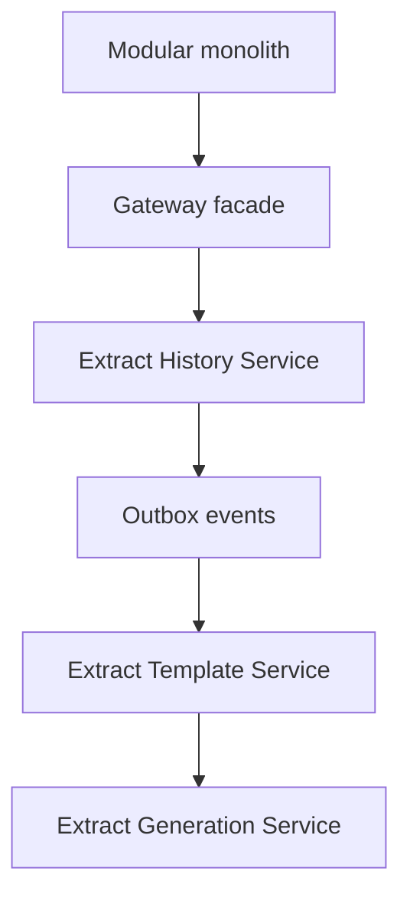
Success metrics: independent deployment, stable latency/error rate, clear data ownership, and no data drift.

**Common mistakes:**
- Big-bang rewrite.
- Extracting before tests and tracing.

**Follow-ups:**
- *What first service?* → Low-coupling history/templates.
- *How avoid dual writes?* → Outbox/events and clear ownership transitions.

### Q92. Scenario: memory and cost spike after enabling AI streaming.
`🔴 Advanced` `Medium` `Stretch`

**Why they ask:** Streaming changes resource and cost profiles.

**Beginner lens:** AI streaming changes resource usage because each open stream holds memory, connection
capacity, and sometimes model or token budget longer than a normal request. Interviewers test scalability
and cost awareness. Flow: client opens stream -> server calls Gemini -> tokens are forwarded -> disconnect
or timeout must close resources -> metrics track active streams, duration, tokens, and errors. Use limits,
backpressure, timeouts, and cheaper async modes when real-time streaming is not required.

**Short answer (say this first, 20-40 sec):**
Limit concurrent streams, enforce per-user quotas, use backpressure, timeouts, and cancellation when clients disconnect. Track token usage/cost and ensure streaming responses do not buffer entire outputs in memory.

**Detailed answer:**
- Use SSE for one-way streaming and close resources on disconnect.
- Apply rate limits and max generation length.
- Monitor active streams, bytes sent, Gemini token usage, and error rate.
- Prefer bounded buffers; avoid storing every token unless needed.

**Common mistakes:**
- No cancellation propagation to Gemini call.
- Unlimited streams per user.

**Follow-ups:**
- *Why backpressure?* → Prevent producer from overwhelming consumers/resources.
- *What if client disconnects?* → Cancel downstream call and release resources.

## Revision Cheat Sheet

- Prefer modular monolith until microservices are justified by scale, teams, deployment independence, or fault isolation.
- Boundaries follow business capabilities and data ownership, not technical layers.
- API gateway routes and enforces cross-cutting policies; keep business logic in services.
- Service discovery avoids hardcoded instance locations.
- Sync is simple but latency-coupled; async decouples but adds duplicates and eventual consistency.
- Each service owns its data; avoid cross-service DB joins.
- Circuit breaker states: closed, open, half-open.
- Retry only transient safe failures with backoff and jitter.
- Bulkheads and timeouts stop one dependency from consuming all resources.
- Idempotency keys make write retries safe.
- Saga uses local transactions plus compensation; outbox reliably publishes events after DB commit.
- 2PC gives atomicity but often hurts autonomy and availability.
- Distributed tracing uses trace IDs and spans across services.
- REST uses nouns/resources, HTTP methods, statelessness, and meaningful status codes.
- PUT is idempotent replace; PATCH partial update; POST create/action unless idempotency key is used.
- Cursor pagination is best for deep/changing feeds; offset is simpler for small pages.
- Rate limiting should return 429 plus `Retry-After` and rate-limit headers.
- REST suits public APIs; GraphQL suits flexible frontend aggregation; gRPC suits internal efficient RPC.
- Email Reply Assistant API should use `/api/v1/replies`, validation, idempotency, async 202 option, and ProblemDetail errors.

## Flashcards

- Q → When not microservices? A → Small team, unclear domain, weak ops, strong transaction needs.
- Q → Gateway role? A → External routing plus auth/rate-limit/correlation policies.
- Q → Service discovery? A → Dynamic lookup of healthy service instances.
- Q → Circuit states? A → Closed, open, half-open.
- Q → Why jitter? A → Avoid synchronized retry storms.
- Q → Bulkhead? A → Resource isolation per dependency/operation.
- Q → Idempotency key? A → Client intent key for safe write retries.
- Q → Saga? A → Local transactions with compensating actions.
- Q → Outbox solves? A → Atomic DB write plus reliable event publishing.
- Q → 2PC downside? A → Blocking, coupling, lower availability.
- Q → Cursor pagination condition? A → Fetch after last stable sort key.
- Q → Rate limit status? A → 429 Too Many Requests.
- Q → SSE vs WebSocket? A → One-way server stream vs bidirectional channel.
- Q → Async creation status? A → 202 Accepted with Location.
- Q → Best API shape for generation? A → `POST /api/v1/replies` with validation and idempotency.
