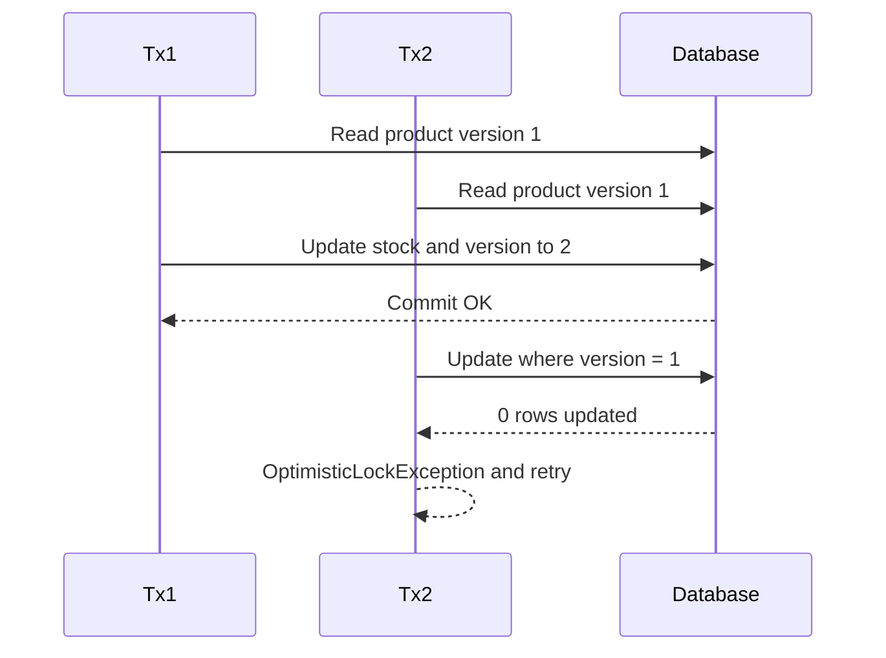
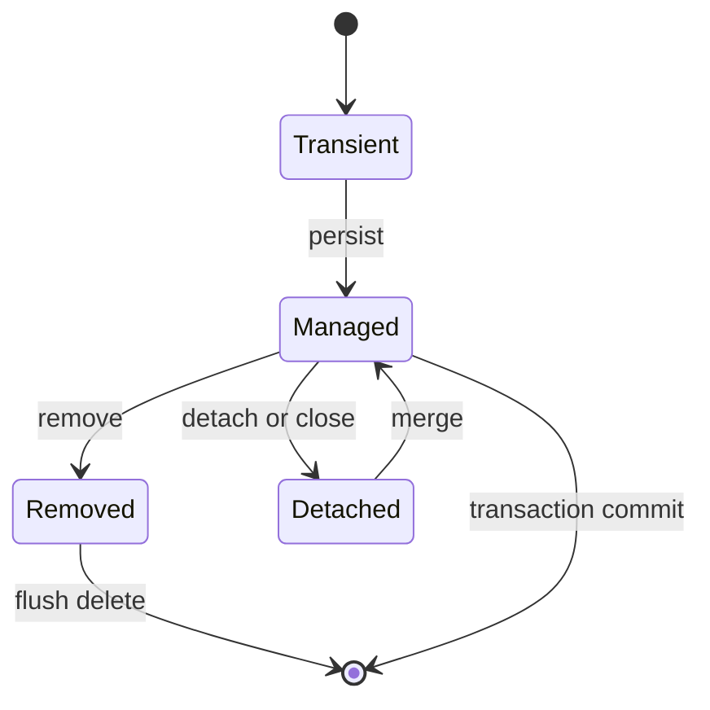
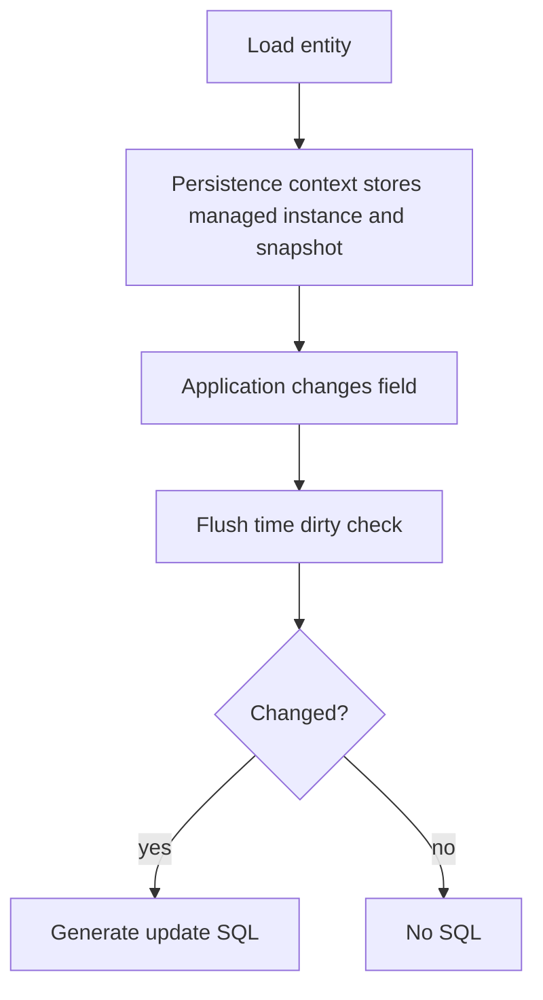
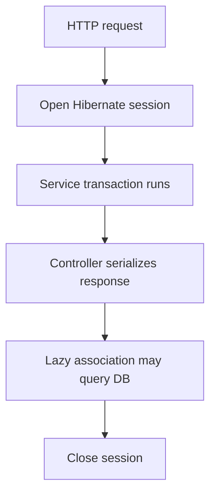
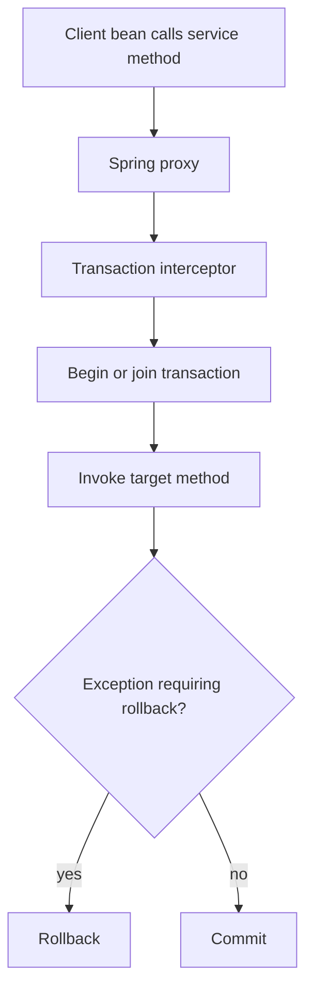
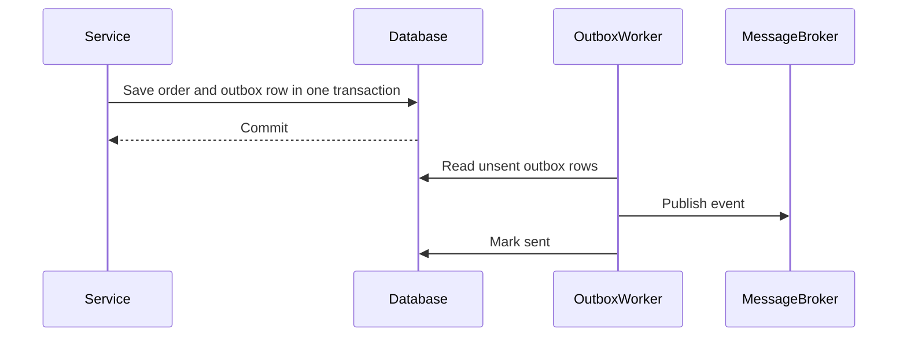
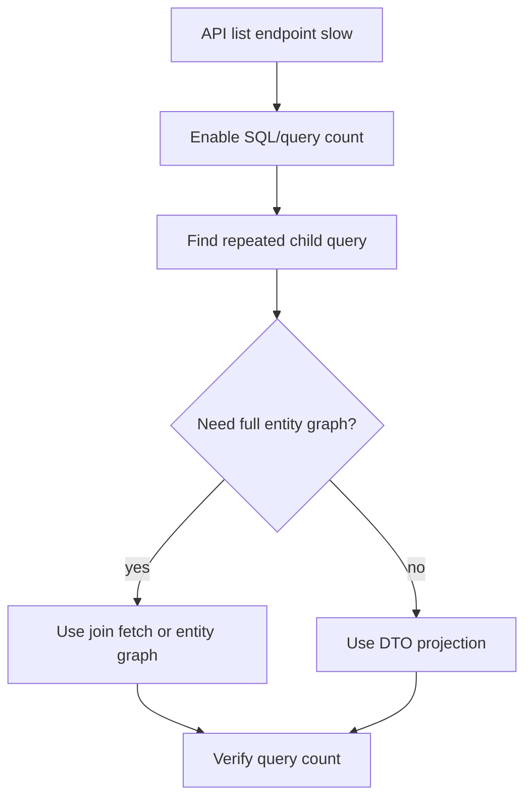

# 05 · JPA, Hibernate, and Transactions

A complete interview study guide for JPA, Hibernate, Spring Data JPA, entity lifecycle, persistence context, fetching, locking, transactions, isolation, and production failure debugging. Answers emphasize precise behavior, generated SQL, and Spring proxy realities.

🟢 Beginner · 🟡 Intermediate · 🔴 Advanced · ⚫ FAANG · 🔥 = very frequently asked

## Table of Contents
- [Beginner guide to this file](#beginner-guide-to-this-file)
- [Real Interview Questions](#real-interview-questions)
- [JPA, Hibernate, and Entity Lifecycle](#jpa-hibernate-and-entity-lifecycle)
- [Fetching, Relationships, and Query Performance](#fetching-relationships-and-query-performance)
- [Spring Transactions](#spring-transactions)
- [Locking, Isolation, and Production Scenarios](#locking-isolation-and-production-scenarios)
- [Revision Cheat Sheet](#revision-cheat-sheet)
- [Flashcards](#flashcards)

## Beginner guide to this file

### What this file teaches
This file teaches how Java Persistence API (JPA), Hibernate, and Spring transactions turn ordinary Java
objects into database rows safely. Interviewers ask these questions because production backend bugs often come
from hidden database work: extra queries, stale objects, locks, partial writes, or transactions that start and end
in the wrong place. The goal is to recognize what Hibernate is tracking, when Structured Query Language (SQL)
will run, and which layer should own the transaction boundary.

### Mental model
Think of Hibernate as a careful warehouse clerk. Your Java objects are boxes, the persistence context is the
clerk's clipboard, and the database is the warehouse. The clerk records what boxes entered, what changed, and
what must be written back before the shift ends.

- Entity lifecycle: an object moves from new, to tracked, to detached, or to deleted.
- Persistence context: the clipboard that holds one managed copy of each loaded row.
- Dirty checking: the clerk compares the current box with the earlier snapshot and writes only changes.
- Flushing: pending inserts, updates, and deletes are sent to the database before commit or certain queries.
- Fetching: choosing whether related boxes are loaded now, later, or in one planned trip.
- Transaction boundary: the start and end of the safe work unit where all related changes succeed or roll back.

### How to think through any question here
1. Identify the object state: transient, managed, detached, or removed.
2. Ask whether a persistence context is open and which transaction owns it.
3. Predict the SQL: select, insert, update, delete, lock, or no database call yet.
4. Check fetching: will a relationship load lazily, eagerly, through a join fetch, or as a projection?
5. Decide whether the issue is correctness, performance, or transaction visibility.
6. If concurrency appears, choose optimistic locking, pessimistic locking, atomic SQL, or a queue pattern.
7. For production scenarios, mention logs, metrics, retries, timeouts, indexes, and shorter transactions.

### Pattern recognition cues
| If the question mentions... | Think about... | Why it fits |
|---|---|---|
| Object changes without calling save | Persistence context and dirty checking | Managed entities are tracked and flushed automatically. |
| `persist`, `merge`, or detached object | Entity lifecycle | The correct operation depends on whether Hibernate is already tracking the instance. |
| SQL appears earlier than commit | Flushing | Hibernate may flush before commit or before a query needing consistent results. |
| 101 queries for 100 rows | N+1 fetching problem | Lazy relationships can trigger one extra select per parent row. |
| `LazyInitializationException` | Closed persistence context | A lazy proxy is being accessed after the session that could load it is gone. |
| `@Transactional` ignored | Spring proxy boundary | Calls must pass through the proxy; private and self-invoked methods bypass it. |
| Lost updates or concurrent edits | Locking and isolation | Multiple transactions can read the same old value unless versioning or locks protect it. |
| Deadlock or lock wait timeout | Lock order and transaction length | Two transactions may hold different locks while waiting for each other. |
| Bulk update or bulk delete | Persistence context bypass | Bulk SQL changes rows directly and can leave managed objects stale. |
| Pagination with fetch join | Row multiplication | Joining collections can duplicate parent rows and break page boundaries. |
| External call in a transaction | Transaction boundary design | Slow network work keeps locks and connections open too long. |

### Abbreviations and key terms
| Short form | Expanded form | Plain meaning |
|---|---|---|
| ACID | Atomicity, Consistency, Isolation, Durability | The classic safety properties of a database transaction. |
| AOP | Aspect-Oriented Programming | Spring technique that wraps method calls with cross-cutting behavior such as transactions. |
| API | Application Programming Interface | A contract used by code or services to call other code. |
| CDC | Change Data Capture | Recording database changes so another process can publish or consume them. |
| CGLIB | Code Generation Library | A bytecode library Spring can use to create class-based proxies. |
| CPU | Central Processing Unit | The processor resource that can become a bottleneck during heavy mapping or queries. |
| CRUD | Create, Read, Update, Delete | The four basic data operations. |
| DB | Database | The durable store behind the application. |
| DTO | Data Transfer Object | A small object shaped for an API response or query result instead of a full entity. |
| FAANG | Facebook, Amazon, Apple, Netflix, and Google | A shorthand for large product-company interview style. |
| FK | Foreign Key | A database column that points to a row in another table. |
| HTTP | Hypertext Transfer Protocol | The request-response protocol used by web APIs. |
| ID | Identifier | The value that uniquely identifies an entity or row. |
| JDBC | Java Database Connectivity | The low-level Java API Hibernate uses to talk to relational databases. |
| JDK | Java Development Kit | Tools and libraries used to compile and run Java applications. |
| JPA | Java Persistence API | The standard Java specification for mapping objects to relational data. |
| JPQL | Java Persistence Query Language | Object-oriented query language written against entities instead of tables. |
| JSON | JavaScript Object Notation | Text format commonly used for API request and response bodies. |
| L2 | Level-two cache | A cache shared beyond one persistence context, usually across sessions. |
| MQ | Message Queue | Middleware used to pass messages between services asynchronously. |
| MVCC | Multi-Version Concurrency Control | Database approach where readers and writers can see different row versions safely. |
| N+1 | N plus one query problem | One query loads parents, then one additional query runs for each parent. |
| ORM | Object-Relational Mapping | Mapping Java objects to relational tables and rows. |
| OSIV | Open Session In View | Keeping the Hibernate session open through web rendering, often hiding lazy loading. |
| REST | Representational State Transfer | A common HTTP API style using resources and standard methods. |
| SDE-1 | Software Development Engineer level 1 | Entry-level software engineering interview expectation. |
| SDE-2 | Software Development Engineer level 2 | Mid-level expectation with more design and ownership depth. |
| SQL | Structured Query Language | The language used to query and modify relational database data. |
| UUID | Universally Unique Identifier | A 128-bit identifier often generated outside the database. |
| `AUTO`, `COMMIT` | Flush mode constants | Options controlling when pending SQL is synchronized. |
| `LAZY`, `EAGER` | Fetch mode constants | Options controlling whether related data loads later or immediately. |
| `IDENTITY`, `SEQUENCE` | Identifier generation strategies | Ways the database supplies primary-key values. |
| `READ_COMMITTED`, `REPEATABLE_READ`, `SERIALIZABLE`, `READ_UNCOMMITTED` | Isolation constants | Database visibility choices for concurrent transactions. |
| `REQUIRED`, `REQUIRES_NEW`, `SUPPORTS`, `MANDATORY`, `NEVER`, `NOT_SUPPORTED`, `NESTED` | Spring propagation constants | Options controlling whether a method joins, starts, rejects, suspends, or nests a transaction. |
| `PESSIMISTIC_READ`, `PESSIMISTIC_WRITE` | JPA lock mode constants | Options for database-backed read or write row locks. |
| `ALL`, `PERSIST`, `REMOVE` | JPA cascade constants | Operation names that tell Hibernate what parent actions propagate to children. |
| `SELECT`, `UPDATE`, `DELETE`, `SKIP LOCKED` | SQL statement and locking terms | Common SQL operations and a row-claiming clause. |
| `ORDINAL`, `STRING` | Enum mapping choices | Store enum position or enum name in the database. |

### Common beginner traps
- Treating `save` as the only way changes reach the database, instead of understanding managed entities.
- Forgetting that flush sends SQL but commit decides durability and rollback.
- Opening lazy relationships in controllers and accidentally creating hidden database calls.
- Putting `@Transactional` on private methods or methods called from the same class.
- Using pessimistic locks as a default instead of first judging contention and transaction length.
- Ignoring database indexes and then blaming JPA for slow queries.
- Running bulk updates while managed entities in memory still contain old values.

### How to study this file
1. Read each short answer first and say it aloud in under 40 seconds.
2. For every detailed answer, draw the object state, persistence context, transaction, and SQL timeline.
3. Use the beginner lens paragraphs to name the interviewer pattern before reading the full solution.
4. Turn common mistakes into active recall prompts, such as why flush is not commit.
5. Practice with a tiny Spring Boot project: one entity, one relationship, one transaction, and SQL logging on.
6. Use the flashcards last, after you can already explain the mental model without memorizing wording.

### Scalability and production lens
In a toy app, one request, one entity, and one database call feel simple. In production, every hidden select, long
transaction, missing index, or lock wait competes with many concurrent requests. Prefer short service-level
transactions, explicit fetch plans, projections for read-heavy endpoints, bounded retries for optimistic conflicts,
and observable SQL logs plus metrics. When consistency crosses service boundaries, consider an outbox or message
queue instead of holding a database transaction open across network calls.

## Real Interview Questions

### Q1. Explain `CascadeType` and `orphanRemoval`. How is `orphanRemoval` different from `CascadeType.REMOVE`?
`🟡 Intermediate` `🔥` `Must-know SDE-1`

**Why they ask:** Parent-child entity mapping is a very common Hibernate interview area.

**Beginner lens:** Think of cascade as instructions attached to a parent folder: when the folder is saved or
deleted, certain child files may be handled too. `orphanRemoval` is stricter; it says a child removed from
the parent collection has no valid home and should be deleted. Interviewers test whether you understand
ownership, not just annotations. Use it for true aggregate children, and avoid broad remove cascades on
shared relationships like many-to-many.

**Short answer (say this first, 20-40 sec):**
Cascade controls which entity operations propagate from parent to child, such as persist, merge, or remove. `CascadeType.REMOVE` deletes children when the parent is removed. `orphanRemoval=true` deletes a child when it is removed from the parent's collection, even if the parent itself is not deleted.

**Detailed answer:**
Entity code:
```java
import jakarta.persistence.*;
import java.util.*;

@Entity
class OrderEntity {
  @Id @GeneratedValue Long id;
  @OneToMany(mappedBy = "order", cascade = CascadeType.ALL, orphanRemoval = true)
  private final List<OrderLine> lines = new ArrayList<>();
  void addLine(OrderLine line){ lines.add(line); line.order = this; }
  void removeLine(OrderLine line){ lines.remove(line); line.order = null; }
}
@Entity
class OrderLine {
  @Id @GeneratedValue Long id;
  @ManyToOne(fetch = FetchType.LAZY) OrderEntity order;
  String sku;
}
```
Resulting SQL examples:
```sql
-- parent persist with CascadeType.PERSIST or ALL
insert into order_entity (id) values (?);
insert into order_line (order_id, sku, id) values (?, ?, ?);

-- remove one line from collection with orphanRemoval=true
delete from order_line where id = ?;

-- delete parent with CascadeType.REMOVE or ALL
delete from order_line where id = ?;
delete from order_entity where id = ?;
```
Difference table:
| Feature | `CascadeType.REMOVE` | `orphanRemoval=true` |
|---|---|---|
| Trigger | Parent is removed | Child is removed from parent association |
| Use case | Delete aggregate with parent | Child cannot exist without parent |
| SQL | Child deletes during parent delete | Child delete during collection change |

**Common mistakes:**
- Using `CascadeType.ALL` on `@ManyToMany`, accidentally deleting shared entities.
- Removing child from collection but not maintaining both sides of a bidirectional relationship.
- Expecting cascade to run for JPQL bulk deletes.

**Follow-ups:**
- *Should `orphanRemoval` be used for shared children?* → No, only for true aggregate children owned by one parent.
- *Does `CascadeType.REMOVE` remove orphans when parent stays?* → No, that is `orphanRemoval`.

### Q2. Have you used locking? Explain optimistic, pessimistic, `SELECT FOR UPDATE`, and `SKIP LOCKED`.
`🔴 Advanced` `🔥` `Must-know SDE-2`

**Why they ask:** They want real DB-level concurrency understanding.

**Beginner lens:** Locking is traffic control for rows. Optimistic locking lets cars enter freely but checks
the ticket version at exit; pessimistic locking closes the lane before work starts. `SELECT FOR UPDATE` is
the database-level closed lane, while `SKIP LOCKED` lets other workers choose a different lane instead of
waiting. Use these when concurrent updates, inventory, queues, or lost-update risks appear, and mention
short transactions plus bounded retries.

**Short answer (say this first, 20-40 sec):**
Optimistic locking uses a `@Version` column and fails on commit if another transaction changed the row. Pessimistic locking acquires a DB row lock, commonly translated to `SELECT ... FOR UPDATE`. `SKIP LOCKED` lets workers skip already locked rows, useful for job queues.

**Detailed answer:**
Optimistic entity and retry:
```java
import jakarta.persistence.*;
import org.springframework.orm.ObjectOptimisticLockingFailureException;

@Entity
class Product {
  @Id Long id;
  @Version long version;
  int stock;
}

class ProductService {
  String reserveWithRetry(Long id) {
    for (int attempt = 1; attempt <= 3; attempt++) {
      try { reserveOnce(id); return "reserved"; }
      catch (ObjectOptimisticLockingFailureException ex) { if (attempt == 3) throw ex; }
    }
    throw new IllegalStateException();
  }
  @org.springframework.transaction.annotation.Transactional
  void reserveOnce(Long id) { /* load Product, decrement stock, commit checks version */ }
}
```
Pessimistic repository:
```java
import jakarta.persistence.LockModeType;
import org.springframework.data.jpa.repository.*;
import org.springframework.data.repository.query.Param;

interface ProductRepository extends JpaRepository<Product, Long> {
  @Lock(LockModeType.PESSIMISTIC_WRITE)
  @Query("select p from Product p where p.id = :id")
  Product lockById(@Param("id") Long id);

  @Query(value = "select * from job where status='READY' order by id for update skip locked limit 10", nativeQuery = true)
  java.util.List<Job> claimJobs();
}
```
Concurrent update flow:


**Common mistakes:**
- Using Java `synchronized` instead of DB lock for multi-pod row updates.
- Holding pessimistic locks while calling external APIs.
- Retrying optimistic conflicts without a retry limit.

**Follow-ups:**
- *When optimistic locking?* → Low contention, user can retry or merge.
- *When `SKIP LOCKED`?* → Multiple workers claim queue rows without waiting on each other.

## JPA, Hibernate, and Entity Lifecycle

### Q3. JPA vs Hibernate vs Spring Data JPA?
`🟢 Beginner` `🔥` `Must-know SDE-1`

**Why they ask:** Candidates often mix these names.

**Beginner lens:** Separate the contract, the engine, and the convenience layer. Java Persistence API (JPA)
defines the rules, Hibernate is the engine that implements them, and Spring Data JPA writes repository
plumbing for you. The interviewer is checking whether you can debug below the repository abstraction. If
behavior is about mapping or flush timing, think Hibernate; if it is about generated methods, think Spring
Data.

**Short answer (say this first, 20-40 sec):**
JPA is the specification for ORM APIs and annotations. Hibernate is a JPA implementation with extra features. Spring Data JPA sits on top and generates repository implementations, query methods, and integration with Spring transactions.

**Detailed answer:**
| Term | Meaning |
|---|---|
| JPA | Specification: `EntityManager`, annotations, JPQL |
| Hibernate | ORM provider implementing JPA |
| Spring Data JPA | Repository abstraction over JPA provider |

Example:
```java
interface UserRepository extends JpaRepository<User, Long> {
  java.util.Optional<User> findByEmail(String email);
}
```

**Common mistakes:**
- Saying Spring Data JPA is the ORM provider.
- Using Hibernate-specific annotations without realizing portability trade-off.
- Assuming repository `save` always means SQL insert immediately.

**Follow-ups:**
- *Can JPA work without Hibernate?* → Yes, with another provider like EclipseLink.
- *Does Spring Data replace transactions?* → No, it integrates with Spring transaction management.

### Q4. What is an entity and what rules should it follow?
`🟢 Beginner` `🔥` `Must-know SDE-1`

**Why they ask:** Entity basics affect every Hibernate issue.

**Beginner lens:** An entity is a Java object with a database identity, like a library card tied to one
catalog record. The key distinction is that entity design affects both Java behavior and Hibernate proxying.
Questions about constructors, final classes, collections, or equality are really asking whether Hibernate
can create, track, and compare the object safely. Keep entities valid but avoid Lombok shortcuts that
accidentally traverse relationships.

**Short answer (say this first, 20-40 sec):**
An entity is a persistent domain object mapped to a database table. It needs an identifier, a no-arg constructor, and should avoid final classes/methods that prevent proxying. Business logic can exist in entities, but relationships and equality must be designed carefully.

**Detailed answer:**
```java
import jakarta.persistence.*;
@Entity
class Customer {
  @Id @GeneratedValue private Long id;
  private String email;
  protected Customer() { }
  Customer(String email){ this.email = email; }
}
```
Use `jakarta.persistence` with Spring Boot 3 and `javax.persistence` with older Spring Boot 2 apps.

**Common mistakes:**
- No no-arg constructor.
- Public mutable collections without helper methods.
- Lombok `@Data` generating risky `toString`, equals, and hashCode.

**Follow-ups:**
- *Can an entity be immutable?* → Mostly, but JPA still needs construction/proxy support.
- *Why protected constructor?* → JPA can use it, but application code avoids invalid construction.

### Q5. Explain the JPA entity lifecycle.
`🟢 Beginner` `🔥` `Must-know SDE-1`

**Why they ask:** Lifecycle explains persist, merge, dirty checking, and detach behavior.

**Beginner lens:** The entity lifecycle is a passport stamp model. A new object has no stamp, a managed
object is inside Hibernate control, a detached object left the office, and a removed object is scheduled for
deletion. Recognize lifecycle questions when you hear `persist`, `merge`, `detach`, or missing updates. The
practical flow is create, manage, change, flush, then commit; detached changes need merging or reloading.

**Short answer (say this first, 20-40 sec):**
Entities move through transient, managed, detached, and removed states. Managed entities are tracked by the persistence context and dirty-checked. Detached entities are no longer tracked; changes are not flushed unless merged.

**Detailed answer:**

```java
entityManager.persist(user);      // transient to managed
entityManager.detach(user);       // managed to detached
User managedCopy = entityManager.merge(user); // detached to managed copy
```

**Common mistakes:**
- Editing detached entity and expecting automatic SQL.
- Thinking `merge` reattaches the same object; it returns a managed copy.
- Calling `remove` on detached entities.

**Follow-ups:**
- *Which state gets dirty checked?* → Managed.
- *What is transient?* → New object not associated with persistence context.

### Q6. What is the persistence context and dirty checking?
`🟡 Intermediate` `🔥` `Must-know SDE-1`

**Why they ask:** This is core Hibernate behavior.

**Beginner lens:** The persistence context is Hibernate's workbench for one unit of work, and dirty checking
is the end-of-shift inspection. Hibernate keeps the managed object and an earlier snapshot; at flush time it
compares them and writes differences. This applies only while the entity is managed. Interviewers want you
to predict why an update happened without `save`, or why a detached object changed nothing.

**Short answer (say this first, 20-40 sec):**
The persistence context is the first-level cache and unit of work for managed entities. Hibernate stores snapshots of managed entities and compares them at flush time. If a managed entity changed, Hibernate generates SQL automatically; no explicit save is needed inside the transaction.

**Detailed answer:**

```java
@Transactional
void changeName(Long id){ User u = em.find(User.class, id); u.setName("Azam"); } // update at flush
```

**Common mistakes:**
- Calling repository `save` unnecessarily for managed entities.
- Expecting dirty checking outside a transaction/persistence context.
- Mutating detached objects.

**Follow-ups:**
- *What is first-level cache scope?* → Persistence context, usually one transaction.
- *When does SQL run?* → On flush, often before commit or before queries.

### Q7. What are flush modes?
`🟡 Intermediate` `🔥` `Must-know SDE-2`

**Why they ask:** Flush timing explains surprising SQL execution.

**Beginner lens:** Flushing is like sending drafted emails to the mail server, while commit is the final
delivery decision. Hibernate may flush before commit or before a query so the database sees pending changes
in the right order. Recognize this when SQL appears earlier than expected or constraints fail before commit.
The production caution is to avoid forcing `saveAndFlush` everywhere because it can reduce batching and hide
design issues.

**Short answer (say this first, 20-40 sec):**
Flush synchronizes persistence context changes to the database without committing the transaction. `AUTO` flushes before commit and before queries that need consistent results. `COMMIT` delays flush until commit when possible.

**Detailed answer:**
```java
entityManager.setFlushMode(FlushModeType.COMMIT);
entityManager.persist(order);
entityManager.flush(); // forces insert now, transaction still open
```
Flush can reveal constraint violations before commit.

**Common mistakes:**
- Thinking flush commits.
- Assuming no SQL before transaction end.
- Using `saveAndFlush` everywhere.

**Follow-ups:**
- *Flush vs commit?* → Flush sends SQL; commit makes it durable and visible per isolation.
- *Why flush before query?* → Query should see pending changes when needed.

### Q8. `persist` vs `merge`?
`🟡 Intermediate` `🔥` `Must-know SDE-1`

**Why they ask:** This prevents detached entity bugs.

**Beginner lens:** `persist` is for a brand-new object entering Hibernate tracking; `merge` is for copying a
detached object's state into a managed copy. Picture `merge` as photocopying notes into the official file,
not making your old paper official again. The interviewer is testing detached-entity reasoning. Always use
the returned managed instance after `merge`, and prefer loading plus changing managed entities in normal
service code.

**Short answer (say this first, 20-40 sec):**
`persist` makes a new transient entity managed and schedules insert. `merge` copies state from a detached entity into a managed instance and returns that managed instance. The object passed to `merge` remains detached.

**Detailed answer:**
```java
User u = new User("a@x.com");
em.persist(u); // u becomes managed

User detached = getDetachedUser();
User managed = em.merge(detached); // use managed from now on
```

**Common mistakes:**
- Ignoring the return value of `merge`.
- Using `merge` for every save and overwriting fields with stale detached data.
- Passing detached children accidentally.

**Follow-ups:**
- *Which one for new entity?* → `persist`.
- *Can merge insert?* → Yes, if no existing row is found depending on identifier state.

### Q9. `save` vs `saveAndFlush` in Spring Data JPA?
`🟡 Intermediate` `🔥` `Must-know SDE-1`

**Why they ask:** Many candidates misunderstand repository methods.

**Beginner lens:** `save` asks the repository to make an entity persistent, while `saveAndFlush` also tells
Hibernate to send pending SQL now. The mental model is queue versus immediate dispatch. This matters when
generated identifiers, constraint checks, or database triggers must be visible before transaction end. Use
normal `save` for most work; reach for `saveAndFlush` only when early database synchronization is truly part
of the flow.

**Short answer (say this first, 20-40 sec):**
`save` persists or merges the entity and SQL may be delayed until flush/commit. `saveAndFlush` saves and immediately flushes pending changes to the database within the same transaction. Use `saveAndFlush` only when you need early constraint detection or generated DB effects before continuing.

**Detailed answer:**
```java
repo.save(order);          // may flush later
repo.saveAndFlush(order);  // forces flush now, not commit
```
Immediate flush can hurt batching and performance.

**Common mistakes:**
- Thinking `saveAndFlush` commits.
- Using it to fix visibility issues caused by wrong transaction design.
- Overusing it and disabling batch efficiency.

**Follow-ups:**
- *Does `save` always insert?* → No, it may merge/update depending on entity state.
- *When useful?* → Need generated DB constraint error before making next decision.

### Q10. `findById` vs `getReference`?
`🟡 Intermediate` `🔥` `Must-know SDE-1`

**Why they ask:** Lazy proxies are common in associations.

**Beginner lens:** `findById` goes to the database and gives you data if the row exists; `getReference`
gives a lightweight placeholder that loads later. Think of `getReference` as a claim ticket, not the
package. It fits when you only need to set a foreign key reference, but it can fail later if the row is
missing. Interviewers test lazy proxies and transaction awareness here.

**Short answer (say this first, 20-40 sec):**
`findById` hits the database immediately and returns the entity if present. `getReference` returns a lazy proxy without querying immediately, useful when you only need a reference for a foreign key. Accessing non-id fields triggers loading and can throw if the row does not exist.

**Detailed answer:**
```java
Order order = new Order();
Customer customerRef = entityManager.getReference(Customer.class, customerId);
order.setCustomer(customerRef); // can set FK without loading customer now
```
Spring Data's `getReferenceById` maps to this behavior.

**Common mistakes:**
- Accessing proxy outside transaction and getting `LazyInitializationException`.
- Using getReference when existence must be validated immediately.
- Serializing proxies directly.

**Follow-ups:**
- *When prefer find?* → When you need data or existence validation now.
- *Can getReference throw?* → Yes, when proxy initializes and row is absent.

### Q11. Explain owning side and `mappedBy`.
`🟡 Intermediate` `🔥` `Must-know SDE-1`

**Why they ask:** Relationship bugs often come from wrong ownership.

**Beginner lens:** The owning side is the side Hibernate trusts to write the foreign key, like the person
holding the pen on a form. `mappedBy` says the other side is just a mirror. Recognize this when relationship
changes do not update the database or when both sides of a bidirectional association disagree. The safe flow
is to update both Java sides through helper methods while knowing only one side owns SQL.

**Short answer (say this first, 20-40 sec):**
The owning side is the side with the foreign key and controls database updates. In a bidirectional association, `mappedBy` marks the inverse side and points to the field on the owning side. You must keep both Java sides consistent for correct in-memory behavior.

**Detailed answer:**
```java
@Entity class Post { @OneToMany(mappedBy="post") List<Comment> comments = new ArrayList<>(); void add(Comment c){ comments.add(c); c.post=this; } }
@Entity class Comment { @ManyToOne(fetch=FetchType.LAZY) Post post; }
```
`Comment.post` owns the FK column.

**Common mistakes:**
- Updating only inverse side and expecting FK update.
- Wrong `mappedBy` name.
- Missing helper methods.

**Follow-ups:**
- *Which side has FK in many-to-one?* → The many side.
- *Does mappedBy create a column?* → No, it references the owning field.

## Fetching, Relationships, and Query Performance

### Q12. What are default fetch types and LAZY vs EAGER?
`🟡 Intermediate` `🔥` `Must-know SDE-1`

**Why they ask:** Fetch defaults cause performance and serialization issues.

**Beginner lens:** Fetching controls when related data is loaded: lazy is a just-in-time pickup, eager is
loading the whole cart immediately. The key distinction is default mapping versus query-specific fetch plan.
Interviewers want you to avoid both hidden lazy queries and always-eager graphs. When you hear performance,
serialization, or closed session, think about fetch joins, entity graphs, projections, and where the
transaction ends.

**Short answer (say this first, 20-40 sec):**
`@ManyToOne` and `@OneToOne` default to EAGER. `@OneToMany` and `@ManyToMany` default to LAZY. Prefer LAZY by default and fetch explicitly per use case with join fetch, entity graph, or DTO projection.

**Detailed answer:**
```java
@ManyToOne(fetch = FetchType.LAZY)
private Customer customer;
@OneToMany(mappedBy = "order", fetch = FetchType.LAZY)
private List<OrderLine> lines;
```
EAGER can load huge object graphs and cause N+1 surprises.

**Common mistakes:**
- Leaving to-one associations EAGER by default.
- Returning entities directly from REST controllers.
- Using EAGER to hide LazyInitializationException.

**Follow-ups:**
- *Best default?* → Usually LAZY.
- *How fetch for one query?* → `JOIN FETCH`, `@EntityGraph`, or DTO.

### Q13. What is the N+1 problem? Show SQL and fixes.
`🟡 Intermediate` `🔥` `Must-know SDE-1`

**Why they ask:** This is among the most common Hibernate performance bugs.

**Beginner lens:** The N+1 problem is a grocery trip mistake: one trip for the list, then one separate trip
for each item detail. It appears when a collection or many-to-one relationship is lazily accessed in a loop.
The interviewer wants you to predict SQL count, not just name the bug. Fixes include join fetch, entity
graph, batch fetching, or projections, chosen according to page size and response shape.

**Short answer (say this first, 20-40 sec):**
N+1 means one query loads parent rows and then one additional query runs per parent to load a relationship. For 100 orders, you may get 101 queries. Fix it with `JOIN FETCH`, `@EntityGraph`, `@BatchSize`, or DTO projection depending on pagination and payload needs.

**Detailed answer:**
SQL log:
```sql
select o.id, o.customer_id from orders o;
select c.id, c.name from customer c where c.id = ?;
select c.id, c.name from customer c where c.id = ?;
-- repeated N times
```
Fix with join fetch:
```java
@Query("select o from Order o join fetch o.customer")
List<Order> findAllWithCustomer();
```
Entity graph:
```java
@EntityGraph(attributePaths = "customer")
List<Order> findByStatus(OrderStatus status);
```
Batch size:
```java
@org.hibernate.annotations.BatchSize(size = 50)
@ManyToOne(fetch = FetchType.LAZY) Customer customer;
```
DTO projection:
```java
@Query("select new com.acme.OrderDto(o.id, c.name) from Order o join o.customer c")
List<OrderDto> listDtos();
```

**Common mistakes:**
- Fixing by making everything EAGER.
- Combining collection fetch join with pagination blindly.
- Not enabling SQL logs in investigation.

**Follow-ups:**
- *Best fix for API list?* → Often DTO projection.
- *When use `@BatchSize`?* → When lazy loading many proxies in batches is acceptable.

### Q14. What is `LazyInitializationException`?
`🟡 Intermediate` `🔥` `Must-know SDE-1`

**Why they ask:** Every Hibernate user hits it.

**Beginner lens:** `LazyInitializationException` means you tried to open a locked cabinet after the clerk
went home. A lazy proxy needs an active persistence context to load data. This usually appears in
controllers, serializers, or logs after the transaction ended. The better design is to fetch required data
inside the service boundary and return a Data Transfer Object, not to keep sessions open accidentally.

**Short answer (say this first, 20-40 sec):**
It occurs when code accesses a lazy association after the persistence context/session is closed. Hibernate needs the session to load the proxy, but it is gone. Fix by fetching required data inside the transaction and returning DTOs, not by making everything EAGER.

**Detailed answer:**
Bug:
```java
Order o = repo.findById(id).orElseThrow();
return o.getLines().size(); // outside transaction may throw
```
Fix:
```java
@Query("select o from Order o left join fetch o.lines where o.id = :id")
Optional<Order> findWithLines(Long id);
```
Or map to DTO inside a transactional service.

**Common mistakes:**
- Serializing entities in controllers.
- Enabling Open Session In View as a hidden fix.
- Changing all relationships to EAGER.

**Follow-ups:**
- *Best API pattern?* → Fetch and map DTO in service transaction.
- *Can OSIV hide it?* → Yes, but may cause queries during view rendering.

### Q15. What is Open Session In View?
`🟡 Intermediate` `🔥` `Must-know SDE-2`

**Why they ask:** It is a common Spring Boot production setting.

**Beginner lens:** Open Session In View keeps the Hibernate session open through web response rendering,
like leaving the warehouse door open for last-minute lookups. It can make demos work but hides database
calls in controllers and JSON serialization. Interviewers test whether you prefer explicit service-layer
fetching. In production, disable or avoid relying on it, then use DTOs, projections, and fetch plans to make
query cost visible.

**Short answer (say this first, 20-40 sec):**
Open Session In View keeps the Hibernate session open through web view/controller rendering, allowing lazy loading after the service transaction. It avoids LazyInitializationException but can cause hidden queries, N+1 in controllers, and DB work outside clear service boundaries. Many teams disable it and use DTOs.

**Detailed answer:**

Spring Boot property:
```properties
spring.jpa.open-in-view=false
```

**Common mistakes:**
- Letting JSON serialization trigger lazy queries.
- Treating OSIV as performance-neutral.
- Disabling OSIV without adding fetch plans.

**Follow-ups:**
- *Why disable it?* → Clear transaction boundaries and predictable SQL.
- *What replaces it?* → DTO projections or explicit fetch joins/entity graphs.

### Q16. First-level vs second-level cache?
`🟡 Intermediate` `🔥` `Must-know SDE-2`

**Why they ask:** Cache scope matters for correctness and performance.

**Beginner lens:** First-level cache is the small notebook every persistence context owns; second-level
cache is a shared shelf across sessions. First-level cache guarantees one managed instance per row inside
the unit of work. Second-level cache can reduce repeated reads but adds invalidation and staleness concerns.
Recognize this when questions mention repeated finds, shared reads, or caching entities versus query
results.

**Short answer (say this first, 20-40 sec):**
First-level cache is the persistence context and is always enabled; it guarantees one managed instance per entity identity in that context. Second-level cache is optional, shared across sessions, and must be configured with a provider. Query cache is separate and caches query results/IDs.

**Detailed answer:**
```java
User a = em.find(User.class, 1L);
User b = em.find(User.class, 1L);
System.out.println(a == b); // true in same persistence context
```
Second-level cache needs careful invalidation and is best for mostly-read reference data.

**Common mistakes:**
- Expecting first-level cache across transactions.
- Enabling second-level cache for highly mutable data.
- Confusing query cache with entity cache.

**Follow-ups:**
- *Is first-level optional?* → No, it is core JPA behavior.
- *When use L2 cache?* → Read-mostly data with clear invalidation tolerance.

### Q17. ID generation strategies and batch inserts?
`🟡 Intermediate` `🔥` `Must-know SDE-2`

**Why they ask:** ID choice affects insert performance.

**Beginner lens:** Identifier generation is the ticket-number system for new rows. Some strategies let
Hibernate collect many inserts and batch them; others require the database to answer after each insert.
Interviewers ask because a simple `@GeneratedValue` choice can affect throughput. If the topic is batch
inserts, mention sequences, allocation size, identity limitations, and measuring with SQL logs for the
actual database.

**Short answer (say this first, 20-40 sec):**
`IDENTITY` uses database auto-increment and usually requires immediate insert to get the ID, which can reduce batching. `SEQUENCE` can allocate IDs before insert and works better with batching, especially with allocation size. UUIDs avoid coordination but can hurt index locality if random.

**Detailed answer:**
```java
@Id @GeneratedValue(strategy = GenerationType.SEQUENCE, generator = "product_seq")
@SequenceGenerator(name = "product_seq", sequenceName = "product_seq", allocationSize = 50)
private Long id;
```
Batch config:
```properties
spring.jpa.properties.hibernate.jdbc.batch_size=50
spring.jpa.properties.hibernate.order_inserts=true
```

**Common mistakes:**
- Using `IDENTITY` and expecting efficient batching.
- Allocation size mismatch with DB sequence increment.
- Random UUID primary keys on write-heavy tables without considering index cost.

**Follow-ups:**
- *Best for PostgreSQL batching?* → Sequence with allocation size.
- *Does batching work with flush per row?* → No, frequent flush reduces batching.

### Q18. JPQL vs Criteria vs native SQL?
`🟢 Beginner` `🔥` `Must-know SDE-1`

**Why they ask:** Query choice is everyday backend work.

**Beginner lens:** JPQL talks in entity names, Criteria builds queries with Java objects, and native SQL
talks directly to tables. Use the right tool like choosing a map language: portable object map, programmatic
dynamic map, or exact street map. Interviewers test whether you balance portability, readability, and
database-specific power. For complex reporting or vendor features, native SQL may be honest; for domain
queries, JPQL is usually clearer.

**Short answer (say this first, 20-40 sec):**
JPQL queries entities and relationships using object names. Criteria builds type-safe dynamic queries in Java but is verbose. Native SQL uses database-specific SQL and is best for vendor features, complex queries, or performance-critical cases.

**Detailed answer:**
```java
@Query("select u from User u where u.email = :email")
Optional<User> findByEmail(String email);

@Query(value = "select * from users where email = :email", nativeQuery = true)
Optional<User> findNative(String email);
```

**Common mistakes:**
- Writing table names in JPQL instead of entity names.
- Using native SQL and expecting automatic portability.
- Building query strings by concatenating user input.

**Follow-ups:**
- *When Criteria?* → Many optional filters and dynamic predicates.
- *When native?* → Window functions, CTEs, database-specific locking.

### Q19. What are pagination pitfalls with fetch joins?
`🔴 Advanced` `🔥` `Must-know SDE-2`

**Why they ask:** This causes memory and correctness issues.

**Beginner lens:** Pagination with collection fetch joins is like counting people after duplicating each
person once per bag they carry. The database returns multiplied rows, so page boundaries can become wrong or
inefficient. Recognize this when a query fetches a to-many relationship and also uses limit or pageable.
Safer flows are two-step ID pagination, batch fetching, projections, or fetching to-one relationships only.

**Short answer (say this first, 20-40 sec):**
Paginating with a collection fetch join can duplicate parent rows and force Hibernate to paginate in memory or produce wrong results. Use two-step pagination: page parent IDs first, then fetch associations by IDs, or use DTO projections. To-one fetch joins are usually safer.

**Detailed answer:**
Risky:
```java
@Query("select p from Post p join fetch p.comments")
Page<Post> findPage(Pageable pageable);
```
Safer:
```java
@Query("select p.id from Post p where p.status=:s order by p.id")
Page<Long> pageIds(Status s, Pageable pageable);
@Query("select distinct p from Post p left join fetch p.comments where p.id in :ids")
List<Post> fetchByIds(List<Long> ids);
```

**Common mistakes:**
- Collection fetch join plus `Pageable` without checking logs.
- Ignoring duplicate parent rows.
- Missing deterministic ordering.

**Follow-ups:**
- *To-one fetch join with pagination?* → Usually okay.
- *Best API list approach?* → DTO projection with exact fields.

### Q20. Bulk updates bypass persistence context. Why does it matter?
`🔴 Advanced` `🔥` `Must-know SDE-2`

**Why they ask:** Bulk JPQL surprises many developers.

**Beginner lens:** Bulk updates bypass Hibernate's clipboard and write straight to the warehouse shelves.
Managed objects already in the persistence context may now disagree with the database. Interviewers test
whether you know bulk JPQL is not dirty checking. After a bulk update or delete, clear or synchronize the
persistence context, and avoid mixing bulk operations with later decisions based on stale managed entities.

**Short answer (say this first, 20-40 sec):**
JPQL bulk update/delete executes directly in the database and bypasses managed entities, dirty checking, cascades, and entity callbacks. The persistence context may now contain stale entities. Clear or synchronize the persistence context after bulk operations.

**Detailed answer:**
```java
@Modifying(clearAutomatically = true, flushAutomatically = true)
@Query("update User u set u.active = false where u.lastLogin < :cutoff")
int deactivateOldUsers(Instant cutoff);
```
Without clearing, a previously loaded `User` may still show old `active` value.

**Common mistakes:**
- Expecting `@PreUpdate` callbacks.
- Keeping stale managed entities.
- Forgetting version columns may not be incremented unless explicitly updated.

**Follow-ups:**
- *Does bulk delete cascade?* → Not like entity remove cascades.
- *How fix stale context?* → Flush then clear or use `clearAutomatically`.
## Spring Transactions

### Q21. How does `@Transactional` work internally?
`🟡 Intermediate` `🔥` `Must-know SDE-2`

**Why they ask:** Transaction bugs often come from proxy misunderstanding.

**Beginner lens:** `@Transactional` is a doorway wrapped by a Spring proxy. When a public method is called
through that doorway, Spring opens a transaction, lets the method run, then commits or rolls back. Recognize
proxy questions when annotations seem ignored or behavior changes with internal calls. The interviewer wants
boundaries: put transactions at service methods that represent one business use case, not random repository
calls.

**Short answer (say this first, 20-40 sec):**
Spring usually applies transactions using AOP proxies. A call enters the proxy, the transaction interceptor opens or joins a transaction, invokes the target method, then commits or rolls back based on the outcome. Calls that bypass the proxy, such as self-invocation, do not trigger transaction advice.

**Detailed answer:**

`@Transactional` is effective on public methods called through the Spring proxy.

**Common mistakes:**
- Calling transactional method from another method in the same class.
- Expecting private methods to be transactional.
- Catching exceptions and hiding rollback conditions.

**Follow-ups:**
- *Proxy type?* → JDK dynamic proxy for interfaces or CGLIB subclass proxy for classes.
- *When transaction starts?* → When proxy intercepts the method call.

### Q22. What is the self-invocation pitfall?
`🟡 Intermediate` `🔥` `Must-know SDE-2`

**Why they ask:** It is a very common Spring transaction bug.

**Beginner lens:** Self-invocation is calling a room inside the same house without walking through the
transaction doorway. Because the call does not pass through the Spring proxy, the inner method's annotation
is skipped. This appears when `REQUIRES_NEW`, rollback rules, or read-only settings do not apply. Fix by
moving the method to another bean, calling through the proxy intentionally, or redesigning the service
boundary.

**Short answer (say this first, 20-40 sec):**
Self-invocation means one method in a class calls another method in the same class. The call uses `this`, bypassing the Spring proxy, so `@Transactional` on the called method is not applied. Move the method to another bean or call through a proxied collaborator.

**Detailed answer:**
Bug:
```java
@Service
class OrderService {
  void outer(){ inner(); }
  @Transactional void inner(){ }
}
```
Fix:
```java
@Service class OrderWriter { @Transactional void inner(){ } }
@Service class OrderService { private final OrderWriter writer; OrderService(OrderWriter writer){this.writer=writer;} void outer(){ writer.inner(); } }
```

**Common mistakes:**
- Adding `@Transactional` and not checking call path.
- Making the method private.
- Assuming annotations work like language keywords.

**Follow-ups:**
- *Does AspectJ mode help?* → It can, but proxy mode is the common default.
- *Best fix?* → Refactor transactional boundary to another Spring bean.

### Q23. Do `@Transactional` private methods work?
`🟢 Beginner` `🔥` `Must-know SDE-1`

**Why they ask:** It checks proxy basics.

**Beginner lens:** Private methods cannot be transaction entry doors because Spring proxies intercept
external method calls, not private internal steps. Think of private methods as notes inside the same room;
no guard sees them. Interviewers ask this to check proxy mechanics, not syntax memory. Put `@Transactional`
on public service methods reached from another bean, and keep private helpers as implementation details
inside that already-open transaction.

**Short answer (say this first, 20-40 sec):**
In standard Spring proxy-based AOP, private methods are not transactional because proxies cannot intercept private method calls. Put `@Transactional` on public service methods that are called from outside the bean through the proxy.

**Detailed answer:**
```java
@Service
class PaymentService {
  public void pay(){ savePayment(); }
  @Transactional private void savePayment(){ }
}
```
Make the transactional boundary public on a proxied bean.

**Common mistakes:**
- Annotating private helper methods.
- Calling transactional method from constructor.
- Testing with no assertion on transaction activity.

**Follow-ups:**
- *Protected/package methods?* → Proxy limitations still matter; public service methods are safest.
- *How verify?* → Enable transaction logs or check transaction active in a test.

### Q24. What are Spring rollback rules for checked exceptions?
`🟡 Intermediate` `🔥` `Must-know SDE-1`

**Why they ask:** Many candidates expect all exceptions to roll back.

**Beginner lens:** Rollback rules are the transaction's emergency policy. By default, unchecked exceptions
trigger rollback, while checked exceptions may commit unless configured otherwise. Recognize this when a
method throws a checked business exception but data still persists. The interviewer wants you to state the
default and the fix: declare `rollbackFor`, translate exceptions, or choose exception types that match the
failure semantics.

**Short answer (say this first, 20-40 sec):**
By default, Spring rolls back on unchecked exceptions (`RuntimeException`) and `Error`, but not checked exceptions. For checked exceptions, configure `rollbackFor`. If you catch an exception and do not rethrow or mark rollback-only, Spring may commit.

**Detailed answer:**
```java
@Transactional(rollbackFor = IOException.class)
void importFile() throws IOException {
  repository.save(row);
  throw new IOException("bad file");
}
```
If catching, rethrow or call `TransactionAspectSupport.currentTransactionStatus().setRollbackOnly()`.

**Common mistakes:**
- Expecting checked exceptions to roll back by default.
- Catching and swallowing runtime exceptions.
- Returning error objects while transaction commits.

**Follow-ups:**
- *Does `RuntimeException` roll back?* → Yes by default.
- *Does no exception mean commit?* → Usually yes, unless rollback-only is set.

### Q25. Explain transaction propagation levels with scenarios.
`🔴 Advanced` `🔥` `Must-know SDE-2`

**Why they ask:** Propagation affects nested service behavior.

**Beginner lens:** Propagation answers, should this method join the current transaction, start a new one, or
refuse one. It is like deciding whether a task belongs on the same receipt or a separate receipt.
Interviewers test scenarios: audit logs, independent retries, nested units, and validation reads. Start with
`REQUIRED` as the default, and use `REQUIRES_NEW` carefully because it consumes another connection and
commits independently.

**Short answer (say this first, 20-40 sec):**
Propagation defines how a method behaves when a transaction already exists. `REQUIRED` joins or creates, `REQUIRES_NEW` suspends the current and starts a new one, and `NESTED` uses a savepoint when supported. Choose based on whether work must commit independently or roll back together.

**Detailed answer:**
| Propagation | Behavior | Scenario |
|---|---|---|
| REQUIRED | Join existing or create | Normal service method |
| REQUIRES_NEW | Suspend existing, new transaction | Audit log commits independently |
| NESTED | Savepoint inside existing transaction | Partial rollback in batch |
| SUPPORTS | Join if exists, else none | Read helper |
| NOT_SUPPORTED | Suspend transaction | Long non-DB operation |
| MANDATORY | Fail if no transaction | Must be inside workflow |
| NEVER | Fail if transaction exists | Must not run in transaction |

```java
@Transactional(propagation = Propagation.REQUIRES_NEW)
void writeAudit(String msg){ auditRepo.save(new Audit(msg)); }
```

**Common mistakes:**
- Using `REQUIRES_NEW` everywhere.
- Assuming `NESTED` always works.
- Forgetting self-invocation bypasses propagation.

**Follow-ups:**
- *Audit log propagation?* → Often `REQUIRES_NEW`.
- *Batch item rollback?* → `NESTED` if savepoints are supported.

### Q26. Explain database isolation levels.
`🟡 Intermediate` `🔥` `Must-know SDE-2`

**Why they ask:** Isolation controls read phenomena and performance.

**Beginner lens:** Isolation controls how much one transaction can see another transaction's unfinished or
newly committed work. Picture reading a shared whiteboard while others edit it. Questions mentioning dirty
reads, non-repeatable reads, phantom rows, or lost updates point here. Explain the anomaly first, then the
isolation level or locking pattern. Also mention that database defaults vary and stronger isolation can
reduce concurrency.

**Short answer (say this first, 20-40 sec):**
Isolation defines how transactions see each other's changes. Read Uncommitted allows dirty reads, Read Committed prevents dirty reads, Repeatable Read prevents non-repeatable reads, and Serializable gives strongest isolation but can reduce concurrency. Actual behavior differs by database MVCC implementation.

**Detailed answer:**
| Isolation | Prevents | Notes |
|---|---|---|
| READ_UNCOMMITTED | Almost nothing | Dirty reads possible |
| READ_COMMITTED | Dirty reads | PostgreSQL default |
| REPEATABLE_READ | Dirty and non-repeatable reads | MySQL InnoDB default |
| SERIALIZABLE | Strongest anomalies | May abort and require retry |

```java
@Transactional(isolation = Isolation.SERIALIZABLE)
void criticalWorkflow(){ }
```

**Common mistakes:**
- Assuming all databases implement levels identically.
- Raising isolation instead of adding correct locks/constraints.
- Ignoring retry requirement under Serializable.

**Follow-ups:**
- *PostgreSQL default?* → Read Committed.
- *MySQL InnoDB default?* → Repeatable Read.

### Q27. What does `@Transactional(readOnly = true)` do?
`🟡 Intermediate` `🔥` `Must-know SDE-1`

**Why they ask:** It is common but often overstated.

**Beginner lens:** `readOnly = true` is a hint and guardrail, not a magic performance switch. Think of it as
telling the team this transaction should only inspect shelves, not rearrange them. It can help Hibernate
skip some dirty-checking work and can set database read-only behavior depending on setup. Interviewers want
nuance: use it for query methods, but still design indexes and fetch plans for performance.

**Short answer (say this first, 20-40 sec):**
`readOnly=true` is a hint to Spring, Hibernate, and sometimes the database that the transaction is read-only. Hibernate may optimize dirty checking/flush behavior. It is not a universal security guarantee; some databases may still allow writes.

**Detailed answer:**
```java
@Transactional(readOnly = true)
public List<UserDto> listUsers(){ return userRepo.findDtos(); }
```
Use for query service methods. Do not mutate managed entities inside read-only transactions.

**Common mistakes:**
- Thinking it always prevents writes.
- Marking write methods read-only accidentally.
- Expecting huge performance gains for every query.

**Follow-ups:**
- *Should reads be transactional?* → Often yes for consistent session/fetch behavior.
- *Does it change isolation?* → No, isolation is separate.

### Q28. Why is calling an external API inside a transaction an anti-pattern?
`🟡 Intermediate` `🔥` `Must-know SDE-2`

**Why they ask:** It causes lock waits and inconsistent side effects.

**Beginner lens:** Calling an external API inside a transaction is like holding a store checkout line while
phoning a supplier. The database connection and locks stay occupied during unpredictable network time.
Recognize this when code mixes payment, email, model calls, or HTTP with database updates. Prefer commit
first plus outbox or state-machine workflow, or make the external call before opening the transaction when
correctness allows.

**Short answer (say this first, 20-40 sec):**
External calls inside DB transactions keep locks and connections open while waiting on an unreliable network. If the transaction rolls back after the external call succeeds, side effects are inconsistent. Prefer commit first then publish an event/outbox, or use idempotency and compensation.

**Detailed answer:**
Bad:
```java
@Transactional
void placeOrder(){ orderRepo.save(order); paymentClient.charge(); inventoryRepo.decrement(); }
```
Better: persist order and outbox event in one transaction, commit, then async worker calls payment API idempotently.

**Common mistakes:**
- Holding row locks during HTTP calls.
- No timeout or idempotency key for external API.
- Assuming rollback undoes external side effects.

**Follow-ups:**
- *Pattern to use?* → Transactional outbox.
- *Payment API requirement?* → Idempotency key.

### Q29. What are transaction timeouts?
`🟡 Intermediate` `Stretch`

**Why they ask:** Long transactions hurt DB health.

**Beginner lens:** A transaction timeout is a fuse for a unit of work. If database work, locks, or code
inside the transaction runs too long, the system should stop rather than hold resources forever.
Interviewers connect this to production incidents: blocked pools, lock waits, and slow queries. Pair
transaction timeouts with query, HTTP, and connection-pool timeouts so one layer does not wait much longer
than another.

**Short answer (say this first, 20-40 sec):**
A transaction timeout limits how long a transaction may run before Spring marks it rollback-only or the database cancels work. It protects connections and locks from being held indefinitely. It should be paired with query and HTTP timeouts.

**Detailed answer:**
```java
@Transactional(timeout = 5)
void updateInventory(){ }
```
Timeout behavior depends on transaction manager and database driver support.

**Common mistakes:**
- Relying only on transaction timeout while queries have no timeout.
- Setting very high timeouts to hide slowness.
- Ignoring lock wait timeout at DB level.

**Follow-ups:**
- *Does timeout commit partial work?* → No, transaction should roll back.
- *Where else set timeout?* → JDBC query, connection pool, HTTP clients.

### Q30. What is `TransactionRequiredException`?
`🟢 Beginner` `Stretch`

**Why they ask:** It exposes missing transaction boundaries.

**Beginner lens:** `TransactionRequiredException` means an operation that must be inside a transaction found
no active transaction. It is like trying to withdraw cash without an open bank session. This often appears
with `EntityManager` writes, bulk updates, or lazy assumptions outside service boundaries. The fix is not
random annotations everywhere; define a clear service method transaction that encloses the required
persistence work.

**Short answer (say this first, 20-40 sec):**
`TransactionRequiredException` occurs when an operation requiring a transaction runs without one, such as modifying queries or pessimistic locks. Add a transactional service boundary and call it through the Spring proxy.

**Detailed answer:**
```java
@Modifying
@Query("update User u set u.active=false where u.id=:id")
int deactivate(Long id);
```
Service:
```java
@Transactional
void deactivateUser(Long id){ repo.deactivate(id); }
```

**Common mistakes:**
- Putting transaction boundary in the wrong place.
- Self-invocation bypass.
- Running write query in a read-only transaction.

**Follow-ups:**
- *Where should transaction boundary be?* → Service layer.
- *Do all repository methods need explicit transaction?* → Some CRUD methods have defaults, but service boundaries are clearer.

## Locking, Isolation, and Production Scenarios

### Q31. What is optimistic locking with `@Version`?
`🟡 Intermediate` `🔥` `Must-know SDE-2`

**Why they ask:** It prevents lost updates without blocking reads.

**Beginner lens:** Optimistic locking is a version stamp on a document. Two people may edit copies, but only
the first commit with the old stamp succeeds; the second must retry or report a conflict. Recognize it in
stock updates, profile edits, and low-contention writes. Interviewers expect the SQL shape: update with
`where version = oldVersion`, then handle zero updated rows with bounded retry or user feedback.

**Short answer (say this first, 20-40 sec):**
Optimistic locking adds a version column to the update predicate. If another transaction changed the row, the version no longer matches and Hibernate throws an optimistic lock exception. The application can retry or show a conflict.

**Detailed answer:**
```java
@Entity class Document { @Id Long id; @Version long version; String content; }
```
SQL shape:
```sql
update document set content=?, version=? where id=? and version=?;
```
Affected rows zero means conflict.

**Common mistakes:**
- Missing version on concurrently edited rows.
- Infinite retries.
- Retrying non-idempotent side effects.

**Follow-ups:**
- *Does it block?* → No, conflict is detected at update/flush.
- *Best for high contention?* → Pessimistic lock or atomic SQL may be better.

### Q32. What is pessimistic locking in JPA?
`🟡 Intermediate` `🔥` `Must-know SDE-2`

**Why they ask:** Some workflows need row-level serialization.

**Beginner lens:** Pessimistic locking reserves the row before changing it, like taking the only key to a
cabinet. It fits high-contention or must-not-overlap operations, but it can block others and deadlock if
held too long. Recognize it when correctness needs exclusive access now, not conflict detection later.
Mention `PESSIMISTIC_WRITE`, transaction scope, lock timeout, consistent lock ordering, and avoiding
external calls while locked.

**Short answer (say this first, 20-40 sec):**
Pessimistic locking asks the database to lock rows, preventing other transactions from updating them until commit or rollback. In JPA use `LockModeType.PESSIMISTIC_WRITE` or lock query methods. It is useful for high-contention critical rows but can cause lock waits and deadlocks.

**Detailed answer:**
```java
@Lock(LockModeType.PESSIMISTIC_WRITE)
@Query("select a from Account a where a.id = :id")
Account lockAccount(Long id);
```
SQL often becomes `select ... for update` depending on database.

**Common mistakes:**
- Holding lock during external API call.
- No lock timeout.
- Locking rows in inconsistent order.

**Follow-ups:**
- *What exception on timeout?* → Provider-specific wrapped in a Spring data access exception.
- *Read lock?* → `PESSIMISTIC_READ`, database behavior varies.

### Q33. What is `SKIP LOCKED` and a job queue use case?
`🔴 Advanced` `🔥` `Stretch`

**Why they ask:** It is a practical DB concurrency pattern.

**Beginner lens:** `SKIP LOCKED` turns a table into a cooperative work queue. Each worker locks ready rows;
other workers skip those rows and claim different work instead of waiting. This fits background jobs, outbox
processing, and batch workers, not normal user reads. The production mental model is lease short, update
status in the same transaction, retry failed jobs safely, and monitor stuck or starving rows.

**Short answer (say this first, 20-40 sec):**
`SKIP LOCKED` makes a transaction skip rows already locked by another transaction instead of waiting. Multiple workers can claim different jobs concurrently. It is useful for DB-backed queues but must be paired with status updates and retry handling.

**Detailed answer:**
```sql
-- PostgreSQL
BEGIN;
SELECT id FROM job WHERE status = 'READY' ORDER BY id FOR UPDATE SKIP LOCKED LIMIT 10;
UPDATE job SET status = 'RUNNING' WHERE id IN (...);
COMMIT;
```

**Common mistakes:**
- Not marking claimed rows in the same transaction.
- No retry for stuck RUNNING jobs.
- Assuming global fairness.

**Follow-ups:**
- *What problem does it avoid?* → Workers waiting on locked rows.
- *Can rows starve?* → Yes, design retry and ordering carefully.

### Q34. How should entities implement equals and hashCode?
`🟡 Intermediate` `🔥` `Must-know SDE-2`

**Why they ask:** Bad equality breaks sets and Hibernate proxies.

**Beginner lens:** Entity equality is tricky because database identity may appear only after persistence and
proxies may wrap the class. It is like comparing passports that might not be issued yet. Interviewers ask
because bad `equals` and `hashCode` break sets, maps, and collections. Prefer stable business keys when
truly immutable, or cautious identifier-based equality after assignment; avoid comparing lazy relationships
or using Lombok `@Data` blindly.

**Short answer (say this first, 20-40 sec):**
Use stable business keys when available. If using generated IDs, be careful because ID is null before persist; changing hashCode after adding to a `HashSet` breaks lookup. Avoid Lombok `@Data` on entities because it includes relationships and can trigger lazy loading or recursion.

**Detailed answer:**
```java
@Entity
class User {
  @Id @GeneratedValue Long id;
  @Column(nullable=false, unique=true) String email;
  public boolean equals(Object o){ return o instanceof User other && email.equals(other.email); }
  public int hashCode(){ return email.hashCode(); }
}
```

**Common mistakes:**
- Including lazy collections in equals/hashCode.
- HashCode changes after ID assignment.
- `@Data` causing recursive `toString`.

**Follow-ups:**
- *Can proxies affect equals?* → Yes, class checks must account for proxy behavior.
- *Best unique business key?* → Immutable natural key like email if guaranteed.

### Q35. What Hibernate performance tuning knobs do you know?
`🟡 Intermediate` `🔥` `Must-know SDE-2`

**Why they ask:** They want production tuning awareness.

**Beginner lens:** Hibernate tuning is not one switch; it is a dashboard of query count, fetch plan,
batching, cache, and JDBC settings. Recognize tuning questions when the symptom is slow endpoints, too many
statements, or high memory. Start by measuring SQL and execution plans, then change one bottleneck at a
time. Good answers mention projections, batching, indexes, connection pools, and avoiding huge persistence
contexts.

**Short answer (say this first, 20-40 sec):**
Tune fetch plans, use DTO projections, batch inserts/updates, batch lazy loading, proper indexes, pagination, and avoid unnecessary flushes. Measure SQL count, query plans, p95 latency, and DB CPU. Do not tune blindly.

**Detailed answer:**
```properties
spring.jpa.properties.hibernate.jdbc.batch_size=50
spring.jpa.properties.hibernate.order_inserts=true
spring.jpa.properties.hibernate.default_batch_fetch_size=50
spring.jpa.properties.hibernate.generate_statistics=true
```
Techniques: `JOIN FETCH`, `@EntityGraph`, `@BatchSize`, DTO projections, database indexes, and connection pool sizing.

**Common mistakes:**
- Fixing N+1 with EAGER everywhere.
- Missing DB indexes.
- Overusing second-level cache for mutable data.

**Follow-ups:**
- *First thing to inspect?* → SQL logs and execution plan.
- *Best for read-only list API?* → DTO projection.
### Q36. What is connection pool sizing with JPA?
`🟡 Intermediate` `Stretch`

**Why they ask:** Thread pools and DB pools must align.

**Beginner lens:** A connection pool is a limited set of checkout counters to the database. Too few counters
make requests wait; too many overload the database. JPA code can hide this until traffic rises. Interviewers
test capacity thinking: size pools from database limits, request concurrency, transaction duration, and
number of application instances. Short transactions often improve throughput more safely than simply
increasing the pool.

**Short answer (say this first, 20-40 sec):**
The DB connection pool limits concurrent database work. If app threads greatly exceed DB connections, many threads wait and latency rises. Size based on database capacity, query time, throughput goals, and load tests, not just CPU count.

**Detailed answer:**
```properties
spring.datasource.hikari.maximum-pool-size=20
spring.datasource.hikari.connection-timeout=30000
```
Watch active connections, pending threads, acquisition time, query latency, and DB CPU.

**Common mistakes:**
- Setting pool to hundreds without DB capacity.
- One transaction per slow external call holding a connection.
- No metric for connection acquisition time.

**Follow-ups:**
- *Symptom of small pool?* → Threads waiting for connections.
- *Symptom of huge pool?* → DB saturation and context overhead.

### Q37. How do indexes relate to JPA performance?
`🟢 Beginner` `🔥` `Must-know SDE-1`

**Why they ask:** ORM does not remove database fundamentals.

**Beginner lens:** An index is the database's lookup table, not a JPA feature, but JPA query shape decides
whether the index can help. Recognize index questions when filters, joins, ordering, or slow scans appear.
The interviewer wants you to connect entity fields to SQL predicates and execution plans. Add indexes for
common selective access paths, but remember writes become costlier and unused indexes waste space.

**Short answer (say this first, 20-40 sec):**
JPA generates SQL, and the database still needs indexes for filters, joins, ordering, and unique constraints. Add indexes based on query patterns and verify with execution plans. Too many indexes slow writes.

**Detailed answer:**
```java
@Table(name="orders", indexes = @Index(name="idx_orders_customer_status", columnList="customer_id,status"))
@Entity class Order { @Id Long id; }
```
For performance stories, mention execution plan, scans, join columns, and measured before/after numbers only when real.

**Common mistakes:**
- Indexing every column.
- Missing FK indexes used in joins.
- Ignoring composite index order.

**Follow-ups:**
- *How verify index use?* → `EXPLAIN` / execution plan.
- *Can index hurt?* → Yes, extra write cost and storage.

### Q38. How do DTO projections improve performance?
`🟢 Beginner` `🔥` `Must-know SDE-1`

**Why they ask:** APIs rarely need full entity graphs.

**Beginner lens:** A Data Transfer Object projection is ordering only the columns you need instead of
loading the whole grocery store. It avoids unnecessary entity hydration, lazy relationships, and
serialization surprises. Recognize it for read-heavy endpoints, list pages, and API responses that do not
need updates. The trade-off is losing automatic dirty checking, which is fine because projections are for
reading, not modifying aggregates.

**Short answer (say this first, 20-40 sec):**
DTO projections fetch only required columns and avoid loading managed entity graphs. They reduce memory, SQL result size, serialization risk, and LazyInitializationException. They are ideal for read-only API list screens.

**Detailed answer:**
```java
record OrderSummary(Long id, String customerName) {}
@Query("select new com.acme.OrderSummary(o.id, c.name) from Order o join o.customer c")
List<OrderSummary> summaries();
```

**Common mistakes:**
- Returning entities from controllers.
- Fetching full aggregates for list pages.
- Updating DTOs expecting dirty checking.

**Follow-ups:**
- *Are DTOs managed?* → No.
- *Best for write operations?* → Load managed entity and apply changes.

### Q39. Entity graph vs join fetch?
`🟡 Intermediate` `🔥` `Must-know SDE-2`

**Why they ask:** Both solve fetch planning but differently.

**Beginner lens:** Join fetch is a query-level instruction to load relationships now; an entity graph is a
reusable fetch plan attached to a query. Think of both as shopping lists, one written inline and one saved
as a template. Interviewers test how you avoid N+1 without making mappings eager globally. Choose based on
readability, reuse, and whether the relationship shape is specific to one query.

**Short answer (say this first, 20-40 sec):**
`JOIN FETCH` is written directly in JPQL for a specific query. `@EntityGraph` declares fetch paths separately and can be attached to repository methods. Both reduce lazy queries; DTO projections may still be better for read-only APIs.

**Detailed answer:**
```java
@Query("select o from Order o join fetch o.customer where o.id=:id")
Optional<Order> findWithCustomer(Long id);

@EntityGraph(attributePaths = {"customer", "lines"})
Optional<Order> findById(Long id);
```

**Common mistakes:**
- Fetching too many collections at once.
- Expecting entity graph to change every query automatically.
- Using collection fetch joins with pagination carelessly.

**Follow-ups:**
- *Which is more explicit?* → JPQL join fetch.
- *Which is declarative?* → Entity graph.

### Q40. How do you handle `@ManyToMany` safely?
`🟡 Intermediate` `Stretch`

**Why they ask:** Cascading deletes with many-to-many can be dangerous.

**Beginner lens:** Many-to-many looks simple but often hides a real relationship with its own data, such as
role assignment time or quantity. The safer mental model is to create a join entity instead of letting both
sides freely delete shared rows. Recognize this when cascade remove, audit fields, or extra columns appear.
Avoid `CascadeType.REMOVE` because deleting one parent must not delete shared child entities.

**Short answer (say this first, 20-40 sec):**
Avoid `CascadeType.REMOVE` on many-to-many because the other side may be shared. Often model the join table as an entity if it has attributes or lifecycle. Use explicit add/remove helper methods and delete join rows, not shared target rows.

**Detailed answer:**
```java
@Entity class Student { @ManyToMany Set<Course> courses = new HashSet<>(); }
@Entity class Course { @ManyToMany(mappedBy="courses") Set<Student> students = new HashSet<>(); }
```
If enrollment has grade/date, create `Enrollment` with two many-to-one relationships.

**Common mistakes:**
- `cascade = CascadeType.ALL` on many-to-many.
- No unique constraint on join table.
- Returning many-to-many graphs directly.

**Follow-ups:**
- *When join entity?* → When relationship has attributes or lifecycle.
- *Should deleting student delete course?* → Usually no.

### Q41. `remove` vs JPQL bulk delete?
`🔴 Advanced` `Stretch`

**Why they ask:** Cascades and callbacks differ.

**Beginner lens:** `remove` works through Hibernate's lifecycle and cascades for managed entities; bulk
delete is direct SQL against matching rows. It is like removing items through the clerk versus clearing a
shelf with a forklift. Interviewers test side effects: cascades, callbacks, persistence context staleness,
and performance. Use entity removal for aggregate rules, bulk delete for large direct cleanup with clear
context handling.

**Short answer (say this first, 20-40 sec):**
`entityManager.remove(entity)` operates on managed entities and triggers cascades, orphan removal, and callbacks. JPQL bulk delete executes directly in the database, bypassing the persistence context and entity lifecycle callbacks. Bulk delete is faster but less object-aware.

**Detailed answer:**
```java
em.remove(order); // cascades according to mapping
```
```java
@Modifying(clearAutomatically = true)
@Query("delete from Order o where o.createdAt < :cutoff")
int deleteOld(Instant cutoff);
```

**Common mistakes:**
- Expecting orphan removal in bulk delete.
- Not clearing stale persistence context.
- Bulk deleting parent rows before child constraints.

**Follow-ups:**
- *Which is faster for many rows?* → Bulk delete.
- *Which respects callbacks?* → `remove`.

### Q42. What is a transactional outbox?
`🔴 Advanced` `🔥` `Stretch`

**Why they ask:** It solves DB plus message/API consistency.

**Beginner lens:** A transactional outbox is a mailbox table written in the same transaction as your
business change. A separate worker later publishes the message. It solves the problem of updating a database
and notifying another system without a distributed transaction. Recognize it when the question mentions
Kafka, email, payment, or event publishing after commit. Production concerns are idempotent consumers,
retries, ordering, and cleanup.

**Short answer (say this first, 20-40 sec):**
Transactional outbox stores a business change and an event record in the same DB transaction. A separate worker publishes the event and marks it sent. This avoids losing events when the app crashes after commit or publishing events for rolled-back transactions.

**Detailed answer:**


**Common mistakes:**
- Publishing message before DB commit.
- No idempotent consumer.
- No retry or dead-letter strategy.

**Follow-ups:**
- *Does outbox need polling?* → Polling or CDC are common.
- *Do consumers need idempotency?* → Yes.

### Q43. How do you structure service and repository layers for transactions?
`🟢 Beginner` `🔥` `Must-know SDE-1`

**Why they ask:** Correct boundaries prevent many bugs.

**Beginner lens:** Service and repository layers split business transaction boundaries from data access
details. The service says what one use case must do atomically; the repository knows how to load and store
rows. Interviewers ask this to catch transaction leakage and anemic design. Put `@Transactional` on service
methods, keep repositories small and query-focused, and return DTOs or domain results that do not need lazy
loading later.

**Short answer (say this first, 20-40 sec):**
Put transaction boundaries at the service layer, where a business use case starts and ends. Repositories should focus on data access. This lets one transaction cover multiple repository calls and keeps controllers thin.

**Detailed answer:**
```java
@Service
class OrderService {
  @Transactional
  void placeOrder(CreateOrderCommand cmd){ orderRepo.save(order); inventoryRepo.decrement(cmd.sku()); }
}
```
The controller calls the service; repository methods are implementation details.

**Common mistakes:**
- Transaction per repository call for one workflow.
- Business logic in controllers.
- Self-invocation in service methods.

**Follow-ups:**
- *Read-only query boundary?* → Service method with `@Transactional(readOnly=true)`.
- *Multiple DBs?* → Requires careful transaction manager design.

### Q44. What SQL logs should you enable while debugging Hibernate?
`🟢 Beginner` `🔥` `Must-know SDE-1`

**Why they ask:** SQL visibility is essential.

**Beginner lens:** SQL logging is turning on the lights in Hibernate's workshop. It lets you see query
count, parameters, flush timing, batching, and unexpected lazy loads. Interviewers want a practical
debugging workflow, not only theory. Use logs in lower environments, add datasource proxies or metrics for
counts, inspect execution plans for slow SQL, and avoid logging sensitive values in production unless
sanitized.

**Short answer (say this first, 20-40 sec):**
Enable SQL statements, bind parameter logs, and Hibernate statistics in lower environments. Count queries per request and inspect slow SQL with execution plans. Avoid verbose bind logs in production if they may expose sensitive data.

**Detailed answer:**
```properties
spring.jpa.show-sql=false
logging.level.org.hibernate.SQL=DEBUG
logging.level.org.hibernate.orm.jdbc.bind=TRACE
spring.jpa.properties.hibernate.generate_statistics=true
```
Use datasource proxy or p6spy for request-level query counting.

**Common mistakes:**
- Debugging N+1 without SQL logs.
- Logging secrets in production.
- Looking at ORM code but not DB execution plan.

**Follow-ups:**
- *What confirms N+1?* → One parent query plus repeated child queries.
- *What confirms index issue?* → Execution plan with scan/high cost.

### Q45. How do you map enums?
`🟢 Beginner` `Stretch`

**Why they ask:** Enum persistence mistakes cause data corruption.

**Beginner lens:** Enum mapping decides whether the database stores a position number or a readable name.
`ORDINAL` is compact but fragile because reordering enum constants changes meaning; `STRING` is clearer but
needs stable names. Recognize this when schema evolution and backward compatibility matter. Production-safe
answers mention explicit database values, migrations for renames, and avoiding silent data corruption from
enum order changes.

**Short answer (say this first, 20-40 sec):**
Use `@Enumerated(EnumType.STRING)` for readability and safety against enum reordering. Avoid `ORDINAL` unless you fully control ordering forever. For custom database values, use an `AttributeConverter`.

**Detailed answer:**
```java
@Enumerated(EnumType.STRING)
private OrderStatus status;
```
Custom converter:
```java
@Converter(autoApply = true)
class StatusConverter implements AttributeConverter<OrderStatus,String> {
  public String convertToDatabaseColumn(OrderStatus s){ return s.name(); }
  public OrderStatus convertToEntityAttribute(String v){ return OrderStatus.valueOf(v); }
}
```

**Common mistakes:**
- Using ordinal and then reordering enum constants.
- Renaming enum without data migration.
- Missing DB check constraints for allowed values.

**Follow-ups:**
- *Why string?* → Stable against reordering and readable.
- *Downside?* → More storage and rename migrations.

### Q46. Production scenario: 101 queries for 100 rows. What do you do?
`🟡 Intermediate` `🔥` `Must-know SDE-1`

**Why they ask:** This is the classic N+1 production scenario.

**Beginner lens:** 101 queries for 100 rows is the N+1 pattern in production clothing. The mental model is
one list query followed by one hidden lazy query per row. The interviewer wants a diagnosis flow: reproduce
with SQL logs, identify the relationship access, choose join fetch, batch fetch, entity graph, or
projection, and verify query count. Also check pagination and payload size before fetching everything.

**Short answer (say this first, 20-40 sec):**
First confirm with SQL logs or query count metrics. Identify the lazy association causing one query per row. Fix with DTO projection, join fetch, entity graph, or batch fetching, then verify query count and response time.

**Detailed answer:**

For 100 rows, target one query or a small fixed number, not 101.

**Common mistakes:**
- Making association EAGER globally.
- Breaking pagination with collection fetch join.
- Not adding regression query-count tests.

**Follow-ups:**
- *Best for list pages?* → DTO projection.
- *When batch size?* → Multiple lazy proxies where fetch join is unsuitable.

### Q47. Production scenario: `@Transactional` did not roll back. Why?
`🟡 Intermediate` `🔥` `Must-know SDE-2`

**Why they ask:** Rollback surprises are common.

**Beginner lens:** When rollback fails, first ask whether a transaction actually existed, whether the method
was called through the proxy, and what exception type was thrown. It is a detective flow, not a single
annotation trick. Common causes are checked exceptions, caught exceptions, self-invocation, private methods,
or independent `REQUIRES_NEW` work. Interviewers test Spring transaction mechanics plus disciplined
debugging.

**Short answer (say this first, 20-40 sec):**
Common causes are checked exception without `rollbackFor`, exception caught and swallowed, self-invocation bypassing proxy, private method annotation, method not called from Spring bean, or wrong transaction manager. Check logs for transaction creation and whether rollback-only was set.

**Detailed answer:**
Bug:
```java
@Transactional
void importData() throws IOException { repo.save(row); throw new IOException(); }
```
Fix:
```java
@Transactional(rollbackFor = IOException.class)
void importData() throws IOException { repo.save(row); throw new IOException(); }
```

**Common mistakes:**
- Catching exception and returning error response.
- Same-class method calls.
- Assuming checked exceptions roll back.

**Follow-ups:**
- *How debug?* → Enable `org.springframework.transaction` DEBUG logs.
- *How force rollback after catch?* → Rethrow or mark rollback-only.

### Q48. Production scenario: `LazyInitializationException` in controller.
`🟡 Intermediate` `🔥` `Must-know SDE-1`

**Why they ask:** It reveals poor API boundaries.

**Beginner lens:** Lazy initialization in a controller means the web layer is asking Hibernate for data
after the service transaction closed. Think of the controller as a cashier trying to fetch warehouse stock
without a warehouse clerk. The fix is to decide response shape inside the service: fetch join, entity graph,
projection, or DTO mapping. Avoid solving it by making every relationship eager.

**Short answer (say this first, 20-40 sec):**
The controller is accessing a lazy association after the transaction/session ended. Fetch required data in the service transaction and return a DTO. Do not solve it by returning entities, enabling OSIV blindly, or making all associations EAGER.

**Detailed answer:**
```java
@Transactional(readOnly = true)
OrderDto getOrder(Long id){ Order o = repo.findWithLines(id).orElseThrow(); return mapper.toDto(o); }
```
Controller returns `OrderDto`, not `Order`.

**Common mistakes:**
- JSON serialization of entity graphs.
- EAGER fetch everywhere.
- Ignoring transaction boundary.

**Follow-ups:**
- *Can OSIV fix symptom?* → Yes, but may hide N+1 and DB work in web layer.
- *Best long-term fix?* → DTO and explicit fetch plan.

### Q49. Production scenario: deadlock under load.
`🔴 Advanced` `🔥` `Must-know SDE-2`

**Why they ask:** DB deadlocks happen in high-concurrency apps.

**Beginner lens:** A deadlock is two transactions holding different locks and each waiting for the other to
release. Picture two cars blocking each other in a narrow alley. Recognize deadlocks when load rises, stack
traces mention deadlock, or retries sometimes succeed. Fixes include consistent lock ordering, shorter
transactions, proper indexes, smaller batches, and bounded retry because databases may abort one
participant.

**Short answer (say this first, 20-40 sec):**
Collect DB deadlock logs and application stack traces, identify transactions and lock order, then make all code update rows in a consistent order. Keep transactions short, add proper indexes, and retry deadlock victims because databases may abort one transaction.

**Detailed answer:**
Bad pattern: transaction A updates account 1 then 2; transaction B updates 2 then 1. Fix by sorting IDs and locking in ascending order.
```java
List<Long> ids = Stream.of(fromId, toId).sorted().toList();
List<Account> locked = repo.lockAllByIdInOrder(ids);
```
```sql
select * from account where id in (?, ?) order by id for update;
```

**Common mistakes:**
- Long transactions with external calls.
- Missing indexes causing broad lock scans.
- No retry for deadlock loser.

**Follow-ups:**
- *Can isolation increase deadlocks?* → Broader locks can increase risk.
- *Should you retry?* → Yes, bounded retry if operation is idempotent.

### Q50. Production scenario: lost update.
`🟡 Intermediate` `🔥` `Must-know SDE-2`

**Why they ask:** It is a core transaction correctness bug.

**Beginner lens:** A lost update is two people reading the same value, making separate changes, and the
later write overwriting the earlier one. It is the classic shared-document problem. Recognize it in
counters, inventory, balances, and profile edits. Solutions include optimistic version columns, pessimistic
locks, atomic SQL updates, or stronger isolation depending on contention and user experience. Always explain
how the conflict is detected or prevented.

**Short answer (say this first, 20-40 sec):**
Lost update happens when two transactions read the same row, compute new values, and one overwrites the other's update. Fix with optimistic `@Version`, pessimistic locks, or atomic SQL updates. Validate by running two concurrent transactions in a test.

**Detailed answer:**
Bug SQL shape:
```sql
-- both read stock = 10
update product set stock = 9 where id = 1;
update product set stock = 9 where id = 1;
```
Fixes:
```sql
update product set stock = 9, version = version + 1 where id = 1 and version = 5;
update product set stock = stock - 1 where id = 1 and stock > 0;
```

**Common mistakes:**
- Calculating new value in Java without version/lock.
- No check on affected row count.
- Assuming local synchronization protects DB rows across pods.

**Follow-ups:**
- *Best for inventory decrement?* → Atomic conditional update or pessimistic lock under high contention.
- *Best for profile edit?* → Optimistic version conflict.

## Revision Cheat Sheet

- JPA is a spec; Hibernate is an implementation; Spring Data JPA is repository abstraction.
- Managed entities are dirty-checked; detached entities are not.
- Flush sends SQL but does not commit.
- `persist` makes new entity managed; `merge` returns a managed copy.
- `saveAndFlush` forces flush, not commit.
- Owning side controls FK updates; `mappedBy` marks inverse side.
- Defaults: to-one EAGER, to-many LAZY; prefer explicit LAZY and fetch plans.
- N+1 is one parent query plus N child queries; fix with DTO, join fetch, entity graph, or batch size.
- LazyInitializationException means lazy proxy accessed after session close.
- OSIV hides lazy errors but can cause controller-level queries.
- First-level cache is persistence context; second-level cache is optional and shared.
- `IDENTITY` can reduce insert batching; sequences with allocation size are batch-friendly.
- Bulk JPQL bypasses persistence context, cascades, and callbacks.
- `@Transactional` works through proxies; self-invocation/private methods do not apply in proxy mode.
- Default rollback: runtime exceptions and errors; checked exceptions need `rollbackFor`.
- `REQUIRED` joins/creates; `REQUIRES_NEW` suspends and starts new; `NESTED` uses savepoints.
- Optimistic locking uses `@Version`; pessimistic locking uses DB row locks.
- Do not call external APIs while holding DB transactions; use outbox/idempotency.
- Entity equals/hashCode should avoid lazy relationships and unstable generated IDs.
- Production debugging starts with SQL logs, query counts, execution plans, transaction logs, and DB lock diagnostics.

## Flashcards

- Q → JPA vs Hibernate? A → JPA is spec; Hibernate implements it.
- Q → Spring Data JPA? A → Repository abstraction over JPA.
- Q → Managed entity update needs save? A → No, dirty checking flushes changes.
- Q → Flush vs commit? A → Flush sends SQL; commit finalizes transaction.
- Q → `merge` return value? A → Managed copy; original remains detached.
- Q → Default to-one fetch? A → EAGER.
- Q → Default to-many fetch? A → LAZY.
- Q → N+1 fix for list API? A → DTO projection or explicit fetch plan.
- Q → LazyInitializationException cause? A → Lazy association accessed after session closed.
- Q → Default Spring rollback? A → RuntimeException and Error.
- Q → Checked exception rollback? A → Add `rollbackFor` or rethrow runtime exception.
- Q → Self-invocation issue? A → It bypasses transactional proxy.
- Q → Optimistic lock annotation? A → `@Version`.
- Q → Pessimistic write SQL usually? A → `SELECT ... FOR UPDATE`.
- Q → Orphan removal trigger? A → Removing child from parent collection.