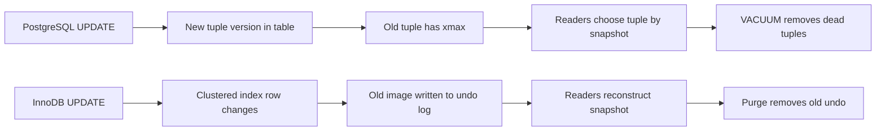
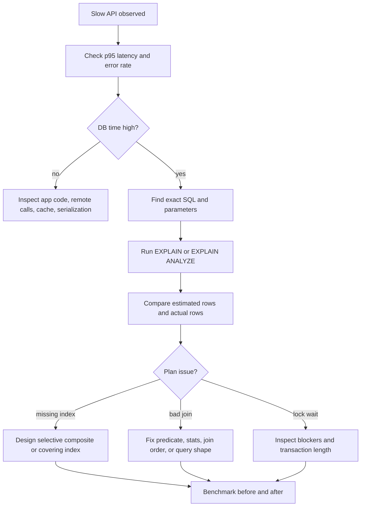
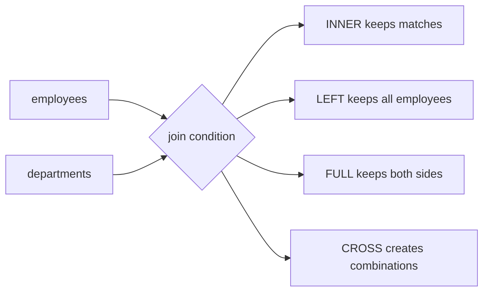
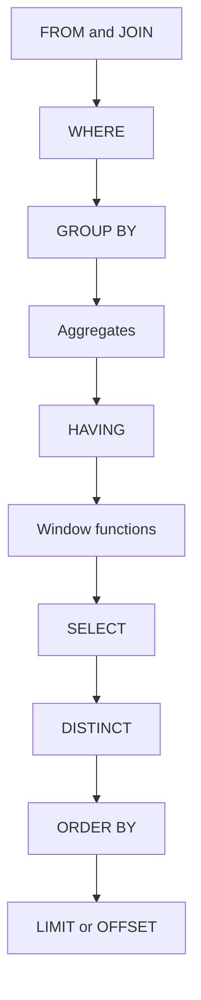
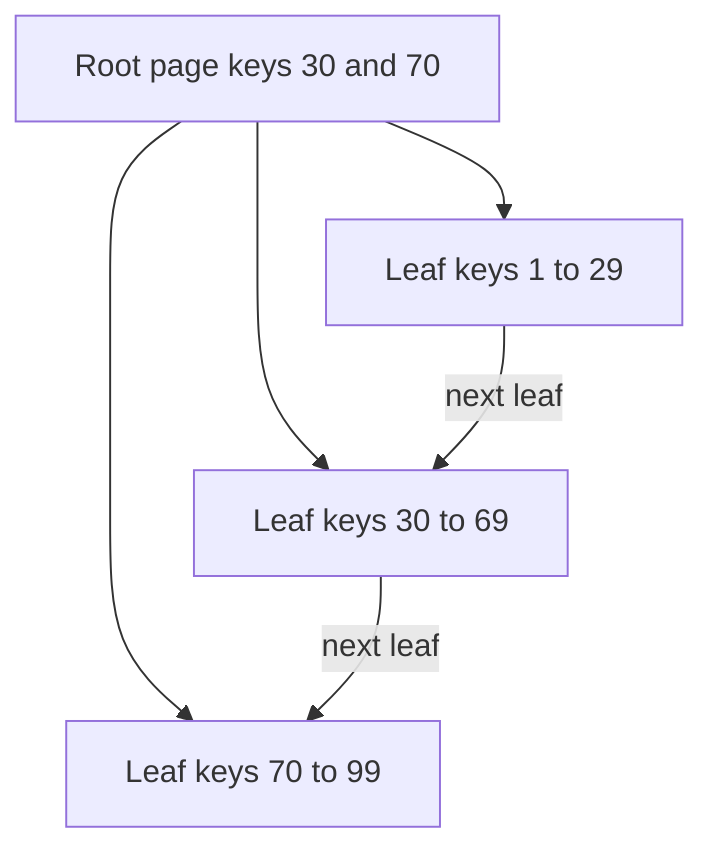
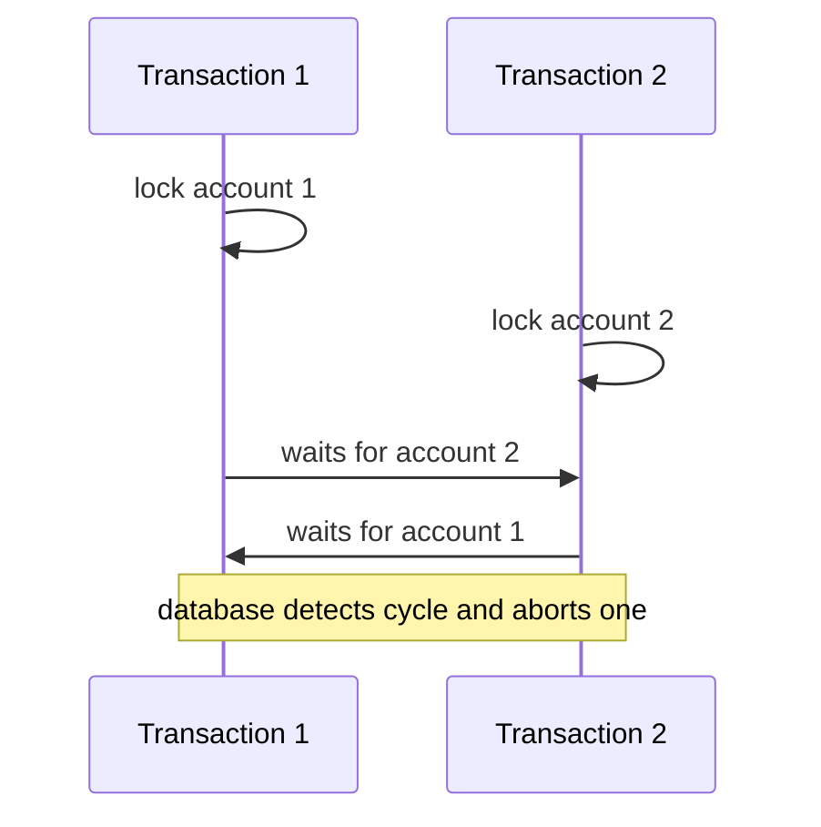
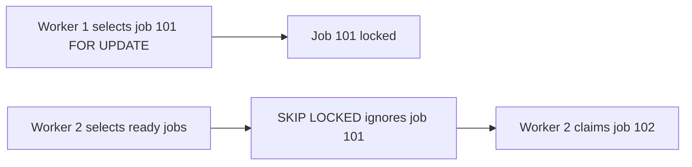
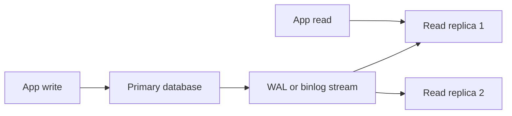

# 06a · SQL Concepts and Database Internals

A complete SDE-1/SDE-2 interview guide for SQL, query performance, transactions, and database internals. It is tuned to Mohd Azam Ansari's Java backend profile, PostgreSQL/MySQL experience, pgvector project, and 70% query optimization resume bullet.

**Legend:** 🟢 Beginner · 🟡 Intermediate · 🔴 Advanced · ⚫ FAANG · 🔥 = very frequently asked

## Table of Contents
- [Section 1 · Real Interview Questions](#section-1--real-interview-questions)
- [Section 2 · SQL Core Concepts](#section-2--sql-core-concepts)
- [Section 3 · Indexes and Query Optimization](#section-3--indexes-and-query-optimization)
- [Section 4 · Transactions, Isolation, Locks, and Deadlocks](#section-4--transactions-isolation-locks-and-deadlocks)
- [Section 5 · Schema Design, Scaling, and Operations](#section-5--schema-design-scaling-and-operations)
- [Section 6 · Backend Interview Edge Cases](#section-6--backend-interview-edge-cases)
- [Revision Cheat Sheet](#revision-cheat-sheet)
- [Flashcards](#flashcards)

## Section 1 · Real Interview Questions

### Q1. What databases have you worked with, and how does PostgreSQL MVCC differ from MySQL InnoDB MVCC?
`🟡 Intermediate` `🔥` `Must-know SDE-1`

**Why they ask:** They want to know whether your resume's PostgreSQL/MySQL claims go beyond CRUD.

**Short answer (say this first, 20-40 sec):**
I have worked with PostgreSQL, MySQL, and pgvector on backend/RAG-style projects. PostgreSQL keeps old row versions directly in table tuples using `xmin` and `xmax`, so dead tuples must be cleaned by VACUUM and can cause table bloat. InnoDB stores the current row in clustered indexes and reconstructs older snapshots using undo logs; old undo versions are removed by purge. InnoDB also has gap and next-key locks under repeatable read to prevent phantom ranges.

**Detailed answer:**
| Area | PostgreSQL MVCC | MySQL InnoDB MVCC |
|---|---|---|
| Version storage | Multiple tuple versions in heap table | Current record plus undo log chain |
| Visibility metadata | `xmin`, `xmax`, command id, transaction snapshot | transaction id and rollback pointer to undo |
| Cleanup | `VACUUM` removes dead tuples; autovacuum is critical | purge thread removes obsolete undo records |
| Space issue | table and index bloat if vacuum lags | long transactions grow undo and history list |
| Default isolation | READ COMMITTED | REPEATABLE READ |
| Phantom handling | Serializable Snapshot Isolation for serializable | gap and next-key locks in locking reads |
| Range locks | no general gap locks in normal reads | gap locks and next-key locks are common |



Use this in your answer: *In Lafz, I used PostgreSQL with pgvector, so I care about MVCC because long-running reads and slow VACUUM can affect table/index bloat and retrieval latency.*

**Common mistakes:**
- Saying MVCC means no locks; writes still lock rows.
- Ignoring VACUUM in PostgreSQL or purge in InnoDB.
- Claiming MySQL repeatable read behaves exactly like PostgreSQL repeatable read.

**Follow-ups:**
- *Why can PostgreSQL bloat happen?* → UPDATE/DELETE create dead tuples; if VACUUM cannot remove them, table and index pages grow.
- *Why does InnoDB use next-key locks?* → To lock both existing index records and gaps so range predicates do not get phantoms in locking operations.

### Q2. How do you investigate a slow API, including database checks and indexes?
`🟡 Intermediate` `🔥` `Must-know SDE-1`

**Why they ask:** This tests production debugging, not just SQL syntax.

**Short answer (say this first, 20-40 sec):**
I first isolate whether time is spent in network, application, cache, or database. On the DB side I identify the exact SQL, measure with `EXPLAIN ANALYZE`, check cardinality, indexes, lock waits, and slow-query statistics. I compare expected versus actual rows, look for sequential scans, bad joins, missing or unused indexes, and confirm with before/after metrics. For my resume, I would explain the 70% improvement as a measured query/index tuning outcome, not just adding indexes blindly.

**Detailed answer:**


PostgreSQL checks:
```sql
EXPLAIN (ANALYZE, BUFFERS)
SELECT * FROM orders WHERE customer_id = 42 AND status = 'PAID' ORDER BY created_at DESC LIMIT 20;

SELECT query, calls, mean_exec_time, rows
FROM pg_stat_statements
ORDER BY mean_exec_time DESC
LIMIT 10;
```

Sample plan:
```text
Limit  (actual time=0.120..0.180 rows=20)
  -> Index Scan using idx_orders_customer_status_created
     Index Cond: ((customer_id = 42) AND (status = 'PAID'))
     Buffers: shared hit=8
```
Good signs: index scan, low actual time, few buffers. Bad signs: huge `Seq Scan`, bad row estimates, sort spilling to disk, nested loop over many rows.

MySQL checks:
```sql
EXPLAIN ANALYZE SELECT * FROM orders WHERE customer_id = 42 AND status = 'PAID';
SHOW VARIABLES LIKE 'slow_query_log';
SHOW ENGINE INNODB STATUS;
```

70% improvement STAR template:
- **Situation:** `[API/report/query name]` had high p95 latency because `[large table scan / bad join / no composite index]`.
- **Task:** Reduce latency without changing business output.
- **Action:** Captured baseline, read plan, found `[problem]`, added `[index/query rewrite]`, verified with `EXPLAIN ANALYZE`, and checked no regression on writes.
- **Result:** Query latency improved by about 70%, from `[before]` to `[after]`, with monitored CPU/IO stable.

**Common mistakes:**
- Starting by adding random indexes.
- Reading estimated cost only and ignoring actual rows/time.
- Forgetting lock waits and connection pool exhaustion.

**Follow-ups:**
- *How do you find unused indexes?* → PostgreSQL `pg_stat_user_indexes`; MySQL `performance_schema` and `sys.schema_unused_indexes` where available.
- *What if EXPLAIN uses the wrong index?* → Check stats freshness, selectivity, casts, functions, parameter values, and composite column order.

### Q3. Have you used database-level locking in code?
`🟡 Intermediate` `🔥` `Must-know SDE-1`

**Why they ask:** Backend systems fail when concurrent requests update the same row incorrectly.

**Short answer (say this first, 20-40 sec):**
Yes, I would use pessimistic locking when only one worker must update a row now, for example `SELECT ... FOR UPDATE` inside a transaction. I would use optimistic locking with a version column when conflicts are rare, such as editing user settings. For job queues, `FOR UPDATE SKIP LOCKED` lets multiple workers safely claim different rows.

**Detailed answer:**
PostgreSQL job claim pattern:
```sql
BEGIN;
WITH job AS (
  SELECT id
  FROM jobs
  WHERE status = 'READY'
  ORDER BY created_at
  FOR UPDATE SKIP LOCKED
  LIMIT 1
)
UPDATE jobs j
SET status = 'RUNNING', started_at = now()
FROM job
WHERE j.id = job.id
RETURNING j.*;
COMMIT;
```

JPA optimistic locking:
```java
import jakarta.persistence.Entity;
import jakarta.persistence.Id;
import jakarta.persistence.Version;

@Entity
class Account {
    @Id Long id;
    long balance;
    @Version long version;
}
```

**Common mistakes:**
- Using locks outside an explicit transaction.
- Holding locks while calling external APIs.
- Using pessimistic locks for all updates even when optimistic locking is cheaper.

**Follow-ups:**
- *What does SKIP LOCKED do?* → It skips rows currently locked by another transaction, useful for work queues.
- *Can SELECT FOR UPDATE block?* → Yes, unless you use `NOWAIT`, `SKIP LOCKED`, or a lock timeout.

## Section 2 · SQL Core Concepts

### Q4. Explain INNER, LEFT, RIGHT, FULL, CROSS, and SELF joins.
`🟢 Beginner` `🔥` `Must-know SDE-1`

**Why they ask:** Joins appear in almost every SQL interview problem.

**Short answer (say this first, 20-40 sec):**
An inner join returns matching rows from both tables. A left join returns all left rows plus matching right rows, with NULLs when unmatched. Right join is symmetric, full join keeps unmatched rows from both sides, cross join returns a Cartesian product, and self join joins a table to itself.

**Detailed answer:**

```sql
SELECT e.name, d.name AS department
FROM employees e
LEFT JOIN departments d ON d.id = e.department_id;

SELECT e.name AS employee, m.name AS manager
FROM employees e
LEFT JOIN employees m ON m.id = e.manager_id;
```

**Common mistakes:**
- Putting right-table filters in `WHERE` after a `LEFT JOIN`, accidentally turning it into an inner join.
- Forgetting join predicates and creating a Cartesian product.

**Follow-ups:**
- *When use FULL OUTER JOIN?* → Reconciliation between source and target systems.
- *Does MySQL support FULL OUTER JOIN?* → Not directly; emulate with `LEFT JOIN UNION RIGHT JOIN`.

### Q5. What is the difference between WHERE and HAVING?
`🟢 Beginner` `🔥` `Must-know SDE-1`

**Why they ask:** It checks whether you understand filtering before versus after aggregation.

**Short answer (say this first, 20-40 sec):**
`WHERE` filters rows before grouping. `HAVING` filters groups after `GROUP BY` and aggregate calculation. Use `WHERE` for base columns and `HAVING` for aggregate conditions like `COUNT(*) > 5`.

**Detailed answer:**
```sql
SELECT department_id, COUNT(*) AS employee_count
FROM employees
WHERE active = true
GROUP BY department_id
HAVING COUNT(*) >= 5;
```
`WHERE active = true` reduces rows first; `HAVING COUNT(*) >= 5` keeps only departments with at least five active employees.

**Common mistakes:**
- Using `HAVING` for non-aggregate filters, making the query do more work.
- Trying to use aggregate functions in `WHERE`.

**Follow-ups:**
- *Can HAVING be used without GROUP BY?* → Yes, the whole result can be treated as one group in many databases.
- *Can WHERE use SELECT aliases?* → Usually no because `WHERE` runs before SELECT logically.

### Q6. What is the logical execution order of a SQL query?
`🟢 Beginner` `🔥` `Must-know SDE-1`

**Why they ask:** It explains many alias, filter, and aggregate mistakes.

**Short answer (say this first, 20-40 sec):**
The logical order is `FROM/JOIN`, `WHERE`, `GROUP BY`, aggregates, `HAVING`, window functions, `SELECT`, `DISTINCT`, `ORDER BY`, then `LIMIT/OFFSET`. The optimizer can physically execute differently, but the logical semantics follow this order.

**Detailed answer:**

This is why a `WHERE` clause cannot reference a window function directly; wrap it in a subquery or CTE.

**Common mistakes:**
- Thinking `SELECT` happens first because it is written first.
- Filtering window-function output in `WHERE` instead of an outer query.

**Follow-ups:**
- *Can ORDER BY use SELECT aliases?* → Usually yes because it is logically after SELECT.
- *Is physical execution always this order?* → No, optimizers reorder operations if semantics are preserved.

### Q7. How does GROUP BY work, and what columns can appear in SELECT?
`🟢 Beginner` `🔥` `Must-know SDE-1`

**Why they ask:** Many candidates write nondeterministic aggregate queries.

**Short answer (say this first, 20-40 sec):**
`GROUP BY` collapses rows into groups. The SELECT list can contain grouped columns and aggregates over each group. PostgreSQL enforces this strictly; MySQL may allow non-grouped columns depending on `ONLY_FULL_GROUP_BY`, but relying on that is unsafe.

**Detailed answer:**
```sql
SELECT department_id, AVG(salary) AS avg_salary
FROM employees
GROUP BY department_id;
```
Invalid in standard SQL:
```sql
SELECT department_id, name, AVG(salary)
FROM employees
GROUP BY department_id;
```
`name` is ambiguous because a department has many employees.

**Common mistakes:**
- Selecting non-grouped, non-aggregated columns.
- Grouping by too many columns and changing the intended granularity.

**Follow-ups:**
- *How to get employee with max salary per department?* → Use `ROW_NUMBER()` or join to grouped max result.
- *What is aggregation granularity?* → The level at which one output row is produced.

### Q8. Explain SQL NULL semantics.
`🟢 Beginner` `🔥` `Must-know SDE-1`

**Why they ask:** NULL bugs cause subtle production filtering errors.

**Short answer (say this first, 20-40 sec):**
NULL means unknown or missing, not zero or empty string. Comparisons with NULL return UNKNOWN, so use `IS NULL` or `IS NOT NULL`. Aggregates usually ignore NULL except `COUNT(*)`, which counts rows.

**Detailed answer:**
```sql
SELECT * FROM users WHERE email IS NULL;       -- correct
SELECT * FROM users WHERE email = NULL;        -- wrong
SELECT COUNT(*), COUNT(email) FROM users;      -- rows vs non-null emails
```
`NOT IN` is dangerous if the subquery returns NULL; prefer `NOT EXISTS`.

**Common mistakes:**
- Comparing with `= NULL`.
- Assuming `NULL <> 5` is true; it is UNKNOWN.
- Using `NOT IN` against nullable columns.

**Follow-ups:**
- *How do you replace NULL?* → `COALESCE(value, fallback)`.
- *Can unique indexes contain NULLs?* → Behavior differs; PostgreSQL allows multiple NULLs in a normal unique index.

### Q9. What is the difference between UNION and UNION ALL?
`🟢 Beginner` `🔥` `Must-know SDE-1`

**Why they ask:** It checks correctness and performance awareness.

**Short answer (say this first, 20-40 sec):**
`UNION ALL` concatenates results and keeps duplicates. `UNION` removes duplicates, usually requiring sort or hash distinct. Prefer `UNION ALL` when duplicates are acceptable or impossible.

**Detailed answer:**
```sql
SELECT email FROM customers
UNION ALL
SELECT email FROM newsletter_signups;
```
Use `UNION` only when you need set semantics.

**Common mistakes:**
- Using `UNION` by default and paying unnecessary distinct cost.
- Forgetting both queries must return compatible column counts and types.

**Follow-ups:**
- *Which is faster?* → Usually `UNION ALL` because it avoids duplicate elimination.
- *Does UNION sort final output?* → Do not rely on it; use `ORDER BY` explicitly.

### Q10. Compare DELETE, TRUNCATE, and DROP.
`🟢 Beginner` `🔥` `Must-know SDE-1`

**Why they ask:** They test operational safety.

**Short answer (say this first, 20-40 sec):**
`DELETE` removes selected rows and can use `WHERE`. `TRUNCATE` quickly removes all rows from a table and may reset identity depending on DB/options. `DROP` removes the table definition itself.

**Detailed answer:**
| Command | Removes | WHERE? | Object remains? |
|---|---:|---:|---:|
| DELETE | rows | yes | yes |
| TRUNCATE | all rows | no | yes |
| DROP | table object | no | no |
```sql
DELETE FROM orders WHERE created_at < CURRENT_DATE - INTERVAL '2 years';
TRUNCATE TABLE staging_orders;
DROP TABLE old_staging_orders;
```

**Common mistakes:**
- Running DELETE without WHERE.
- Using TRUNCATE where foreign keys or audit triggers matter.

**Follow-ups:**
- *Can DELETE be rolled back?* → Yes inside a transaction in transactional engines.
- *Is TRUNCATE always rollback-safe?* → Depends on database; PostgreSQL supports transactional TRUNCATE.

### Q11. What are window functions?
`🟡 Intermediate` `🔥` `Must-know SDE-1`

**Why they ask:** Window functions solve ranking, running totals, and analytics problems cleanly.

**Short answer (say this first, 20-40 sec):**
A window function calculates a value across related rows while keeping each original row. It uses `OVER`, optional `PARTITION BY`, optional `ORDER BY`, and optional frame clauses. Unlike `GROUP BY`, it does not collapse rows.

**Detailed answer:**
```sql
SELECT employee_id, department_id, salary,
       AVG(salary) OVER (PARTITION BY department_id) AS dept_avg
FROM employees;
```
Each employee row remains visible, with the department average attached.

**Common mistakes:**
- Expecting window functions to reduce rows.
- Forgetting deterministic `ORDER BY` in ranking functions.

**Follow-ups:**
- *Can window functions be used in WHERE?* → Not directly; use a subquery or CTE.
- *What is PARTITION BY?* → It splits the result into independent windows.

### Q12. Compare ROW_NUMBER, RANK, and DENSE_RANK.
`🟡 Intermediate` `🔥` `Must-know SDE-1`

**Why they ask:** Top-N-per-group questions depend on choosing the correct ranking function.

**Short answer (say this first, 20-40 sec):**
`ROW_NUMBER` gives a unique sequence even for ties. `RANK` gives same rank to ties and leaves gaps. `DENSE_RANK` gives same rank to ties without gaps.

**Detailed answer:**
```sql
SELECT name, salary,
       ROW_NUMBER() OVER (ORDER BY salary DESC) AS rn,
       RANK()       OVER (ORDER BY salary DESC) AS rnk,
       DENSE_RANK() OVER (ORDER BY salary DESC) AS drnk
FROM employees;
```
For salaries `100, 100, 90`, row numbers are `1,2,3`, rank is `1,1,3`, dense rank is `1,1,2`.

**Common mistakes:**
- Using `ROW_NUMBER` when ties should be included.
- Not adding a secondary sort for deterministic results.

**Follow-ups:**
- *Top 3 salaries with ties?* → Use `DENSE_RANK() <= 3`.
- *Exactly 3 rows per department?* → Use `ROW_NUMBER() <= 3`.

### Q13. What are LAG and LEAD used for?
`🟡 Intermediate` `🔥` `Must-know SDE-1`

**Why they ask:** They appear in trend, retention, and consecutive-day problems.

**Short answer (say this first, 20-40 sec):**
`LAG` reads a previous row's value and `LEAD` reads a following row's value within a window. They are useful for comparing current versus previous values, detecting gaps, and calculating changes over time.

**Detailed answer:**
```sql
SELECT user_id, login_date,
       LAG(login_date) OVER (PARTITION BY user_id ORDER BY login_date) AS prev_login
FROM logins;
```
For month-over-month growth:
```sql
SELECT month, revenue,
       revenue - LAG(revenue) OVER (ORDER BY month) AS delta
FROM monthly_revenue;
```

**Common mistakes:**
- Omitting `ORDER BY`, making previous row undefined.
- Assuming `LAG` skips NULL automatically; it does not in most DBs.

**Follow-ups:**
- *How to supply a default?* → `LAG(value, 1, 0)`.
- *Can it cross users?* → Not if you use `PARTITION BY user_id`.

### Q14. Explain running totals and window frames.
`🟡 Intermediate` `🔥` `Must-know SDE-1`

**Why they ask:** Running totals are common in analytics interviews.

**Short answer (say this first, 20-40 sec):**
A running total uses an ordered window and a frame from the beginning to the current row. Frames control which rows participate in the calculation. Use `ROWS` for physical row counts and `RANGE` for peer groups with equal sort values.

**Detailed answer:**
```sql
SELECT order_date, amount,
       SUM(amount) OVER (
         ORDER BY order_date
         ROWS BETWEEN UNBOUNDED PRECEDING AND CURRENT ROW
       ) AS running_total
FROM orders;
```
Moving average: `AVG(amount) OVER (ORDER BY order_date ROWS BETWEEN 6 PRECEDING AND CURRENT ROW)`.

**Common mistakes:**
- Forgetting frame behavior differs by DB and function.
- Using `RANGE` when duplicate dates should not be grouped together.

**Follow-ups:**
- *What is a frame?* → The subset of rows inside a partition used by the current window calculation.
- *Why add a tiebreaker to ORDER BY?* → To make running totals deterministic.

### Q15. What are CTEs and recursive CTEs?
`🟡 Intermediate` `🔥` `Must-know SDE-1`

**Why they ask:** CTEs improve readability and recursive CTEs solve hierarchy questions.

**Short answer (say this first, 20-40 sec):**
A CTE is a named temporary result inside one query, defined with `WITH`. A recursive CTE has an anchor query and a recursive query, useful for trees like employee-manager hierarchies.

**Detailed answer:**
```sql
WITH RECURSIVE org AS (
  SELECT id, name, manager_id, 1 AS level
  FROM employees
  WHERE manager_id IS NULL
  UNION ALL
  SELECT e.id, e.name, e.manager_id, org.level + 1
  FROM employees e
  JOIN org ON e.manager_id = org.id
)
SELECT * FROM org ORDER BY level, id;
```

**Common mistakes:**
- Creating infinite recursion by missing termination conditions.
- Assuming CTEs are always materialized; PostgreSQL 12+ can inline non-recursive CTEs unless forced.

**Follow-ups:**
- *CTE vs subquery?* → CTE is often more readable; optimizer behavior differs by DB/version.
- *How prevent cycles?* → Track visited ids or enforce acyclic constraints.

## Section 3 · Indexes and Query Optimization

### Q16. How does a B+Tree index work?
`🟡 Intermediate` `🔥` `Must-know SDE-1`

**Why they ask:** Most OLTP indexes are B+Trees, so internals explain performance.

**Short answer (say this first, 20-40 sec):**
A B+Tree stores sorted keys in a balanced tree. Internal pages guide search, and leaf pages contain key entries pointing to rows or clustered records. It supports equality, range scans, ordering, and prefix lookups efficiently.

**Detailed answer:**

Search is roughly `O(log n)` page reads; range scan finds the first key then walks linked leaves.

**Common mistakes:**
- Saying B+Tree is only for equality.
- Forgetting it can avoid sorting when `ORDER BY` matches index order.

**Follow-ups:**
- *Why are leaves linked?* → Efficient range scans.
- *Why not hash for ranges?* → Hash indexes do equality only.

### Q17. What is the difference between clustered and non-clustered indexes?
`🟡 Intermediate` `🔥` `Must-know SDE-1`

**Why they ask:** MySQL InnoDB performance depends heavily on clustered primary keys.

**Short answer (say this first, 20-40 sec):**
A clustered index defines table row storage order; InnoDB clusters data by primary key. A non-clustered secondary index stores key values plus a row locator. PostgreSQL does not maintain permanent clustered order, though `CLUSTER` can rewrite a table once.

**Detailed answer:**
In InnoDB, primary key leaf pages contain full rows; secondary index leaf pages contain secondary key plus primary key, so a secondary lookup may require another primary-key lookup. PostgreSQL indexes point to heap tuple locations.

**Common mistakes:**
- Assuming every database has one clustered index like SQL Server/InnoDB.
- Choosing random UUID primary keys without considering locality and page splits.

**Follow-ups:**
- *What is a covering index?* → An index containing all columns needed by a query.
- *Is PostgreSQL primary key clustered?* → No, not automatically.

### Q18. Explain composite indexes and the leftmost-prefix rule.
`🟡 Intermediate` `🔥` `Must-know SDE-1`

**Why they ask:** Composite index order is a frequent real-world tuning topic.

**Short answer (say this first, 20-40 sec):**
A composite index stores multiple columns in sorted order. It is most useful when predicates use the leftmost columns. Equality columns usually come first, then range/order columns, but selectivity and query patterns matter.

**Detailed answer:**
For index `(customer_id, status, created_at)`:
```sql
WHERE customer_id = 1
WHERE customer_id = 1 AND status = 'PAID'
WHERE status = 'PAID' -- usually not left-prefix usable
WHERE customer_id = 1 ORDER BY status, created_at
```

**Common mistakes:**
- Creating separate single-column indexes instead of one useful composite index.
- Putting a column first without checking workload.

**Follow-ups:**
- *Where should range columns go?* → Usually after equality columns because range limits use of later keys.
- *Can optimizers combine indexes?* → Sometimes, but a good composite index is often better.

### Q19. What is a covering index and an index-only scan?
`🟡 Intermediate` `🔥` `Must-know SDE-1`

**Why they ask:** It connects index design to fewer table reads.

**Short answer (say this first, 20-40 sec):**
A covering index contains all columns needed by a query, so the engine can answer from the index. PostgreSQL can do an index-only scan only when the visibility map says heap rows are visible enough; otherwise it still checks heap tuples.

**Detailed answer:**
```sql
CREATE INDEX idx_orders_cover
ON orders(customer_id, status, created_at DESC)
INCLUDE (total_amount);
```
This can serve:
```sql
SELECT created_at, total_amount
FROM orders
WHERE customer_id = 42 AND status = 'PAID'
ORDER BY created_at DESC
LIMIT 10;
```

**Common mistakes:**
- Adding too many columns and hurting write performance.
- Expecting PostgreSQL index-only scans before VACUUM updates visibility information.

**Follow-ups:**
- *What is INCLUDE?* → Non-key columns stored for coverage, not search order.
- *Why help APIs?* → Fewer random table reads and less IO.

### Q20. When will a database not use an index?
`🟡 Intermediate` `🔥` `Must-know SDE-1`

**Why they ask:** This is a core query-tuning interview trap.

**Short answer (say this first, 20-40 sec):**
An index may not be used when the predicate is not sargable, selectivity is low, types are implicitly cast, a leading wildcard is used, OR conditions are poorly structured, stats are stale, or the optimizer estimates a scan is cheaper.

**Detailed answer:**
```sql
WHERE LOWER(email) = 'a@x.com'   -- needs expression index or normalized column
WHERE name LIKE '%sam%'          -- leading wildcard blocks B+Tree seek
WHERE numeric_col = '42'         -- implicit cast may hurt
WHERE status = 'ACTIVE'          -- low selectivity may prefer scan
WHERE a = 1 OR b = 2             -- may need rewrite or separate indexes
```

**Common mistakes:**
- Thinking index existence guarantees usage.
- Ignoring selectivity and table size.

**Follow-ups:**
- *What is sargable?* → Search-argument-able; the engine can use an index seek/range scan.
- *How handle `LOWER(email)`?* → Store normalized email or create an expression index.

### Q21. Compare B-Tree, hash, GIN, and GiST indexes.
`🔴 Advanced` `Stretch`

**Why they ask:** PostgreSQL-heavy roles may ask index-type tradeoffs.

**Short answer (say this first, 20-40 sec):**
B-Tree is the default for equality, range, and ordering. Hash is mainly equality-only. GIN indexes composite values like arrays, JSONB, and full-text tokens. GiST is a framework for geometry, range, nearest-neighbor, and custom operator classes.

**Detailed answer:**
| Index | Best for | Example |
|---|---|---|
| B-Tree | `=`, ranges, `ORDER BY` | `email`, `created_at` |
| Hash | equality only | exact lookup |
| GIN | contains/search inside values | `jsonb`, arrays, full text |
| GiST | ranges, geometry, KNN | PostGIS, range overlap |
For pgvector, index choice depends on extension version and metric, commonly HNSW/IVFFlat rather than ordinary B-Tree.

**Common mistakes:**
- Creating B-Tree on JSONB and expecting containment queries to be fast.
- Treating all indexes as equivalent.

**Follow-ups:**
- *What index for `jsonb @>`?* → Usually GIN.
- *What index for text contains search?* → Full-text GIN or trigram GIN/GiST depending query.

### Q22. How do you read EXPLAIN and EXPLAIN ANALYZE?
`🟡 Intermediate` `🔥` `Must-know SDE-1`

**Why they ask:** This validates your 70% optimization story.

**Short answer (say this first, 20-40 sec):**
`EXPLAIN` shows the planned execution; `EXPLAIN ANALYZE` actually runs the query and shows real time and rows. I compare estimated rows to actual rows, scan type, join type, sort/hash memory, buffers, and whether expensive nodes process too many rows.

**Detailed answer:**
Checklist: scan type, join type, estimated vs actual rows, loops, buffer reads/hits, sort spill, and where the most time is spent.
```sql
EXPLAIN (ANALYZE, BUFFERS)
SELECT c.id, SUM(o.total_amount)
FROM customers c
JOIN orders o ON o.customer_id = c.id
WHERE o.created_at >= CURRENT_DATE - INTERVAL '30 days'
GROUP BY c.id;
```

**Common mistakes:**
- Running `EXPLAIN ANALYZE` on dangerous writes without wrapping safely.
- Looking only at the top cost and not child nodes.

**Follow-ups:**
- *What does row misestimate mean?* → Stats/correlation may be wrong, leading to bad plans.
- *What is a bitmap scan?* → Build bitmap of matching heap pages, then fetch them efficiently.

### Q23. How do you find missing and unused indexes?
`🟡 Intermediate` `🔥` `Must-know SDE-1`

**Why they ask:** They want practical tuning, not just syntax.

**Short answer (say this first, 20-40 sec):**
For missing indexes, start from slow queries and execution plans. For unused indexes, check index usage stats over a meaningful time window. Remove unused indexes carefully because indexes help reads but slow writes and consume space.

**Detailed answer:**
```sql
-- PostgreSQL
SELECT relname, seq_scan, idx_scan FROM pg_stat_user_tables ORDER BY seq_scan DESC;
SELECT indexrelname, idx_scan FROM pg_stat_user_indexes ORDER BY idx_scan ASC;

-- MySQL
SELECT * FROM sys.schema_unused_indexes;
```

**Common mistakes:**
- Dropping an index after observing a quiet period.
- Ignoring indexes used for constraints.

**Follow-ups:**
- *How validate a new index?* → Compare plans and latency before/after in staging or safe rollout.
- *Can too many indexes hurt?* → Yes, every insert/update/delete maintains them.

### Q24. What is table partitioning and when is it useful?
`🔴 Advanced` `Stretch`

**Why they ask:** Large-table design appears in backend and data roles.

**Short answer (say this first, 20-40 sec):**
Partitioning splits one logical table into physical partitions by range, list, or hash. It helps pruning, maintenance, archiving, and sometimes write/read scalability. It is not a substitute for good indexes.

**Detailed answer:**
```sql
CREATE TABLE events (
  id bigint,
  event_time timestamp not null,
  payload jsonb
) PARTITION BY RANGE (event_time);
CREATE TABLE events_2026_09 PARTITION OF events
FOR VALUES FROM ('2026-09-01') TO ('2026-10-01');
```
Use for time-series logs, monthly orders, or tenant splits when queries include partition key.

**Common mistakes:**
- Partitioning small tables.
- Querying without partition key and scanning all partitions.

**Follow-ups:**
- *Partitioning vs sharding?* → Partitioning is usually within one DB; sharding distributes across nodes.
- *What is pruning?* → Optimizer skips impossible partitions.

### Q25. Give a query optimization checklist.
`🟡 Intermediate` `🔥` `Must-know SDE-1`

**Why they ask:** They want a structured debugging approach.

**Short answer (say this first, 20-40 sec):**
Measure first, inspect the plan, reduce rows early, use correct indexes, avoid non-sargable predicates, fetch only needed columns, fix N+1 queries, check locks, and verify with before/after metrics.

**Detailed answer:**
1. Capture SQL, params, frequency, and p95.
2. Run `EXPLAIN ANALYZE`.
3. Check row estimates and scan/join types.
4. Add/reorder composite indexes based on predicates and ordering.
5. Avoid `SELECT *`, functions/casts on indexed columns, and accidental cross joins.
6. Check connection pool, lock waits, transaction time, stats, and vacuum/analyze.
7. Benchmark before/after and monitor write overhead.

**Common mistakes:**
- Optimizing rare queries while ignoring high-frequency medium queries.
- Measuring locally on tiny data.

**Follow-ups:**
- *What is selectivity?* → Fraction of rows matching a predicate; high selectivity usually benefits indexes.
- *How can an index hurt?* → More write cost, memory, storage, and optimizer complexity.

### Q26. How would you tune `WHERE customer_id = ? AND status = ? ORDER BY created_at DESC LIMIT 20`?
`🟡 Intermediate` `🔥` `Must-know SDE-1`

**Why they ask:** It tests composite index design with filtering and ordering.

**Short answer (say this first, 20-40 sec):**
I would consider a composite index on `(customer_id, status, created_at DESC)`. Equality predicates come first, then the ordering column, allowing the database to seek to a customer/status range and return latest rows without sorting.

**Detailed answer:**
```sql
CREATE INDEX idx_orders_customer_status_created
ON orders(customer_id, status, created_at DESC);
```
If the API selects only a few columns, use a covering index. If many queries omit status, evaluate `(customer_id, created_at DESC)` too.

**Common mistakes:**
- Indexing only `created_at`.
- Creating three separate indexes and expecting them to behave like one ordered composite index.

**Follow-ups:**
- *Should status be first?* → Usually no if every query filters customer first; index order follows workload.
- *What if the API pages deeply?* → Prefer keyset pagination using last `(created_at, id)`.

## Section 4 · Transactions, Isolation, Locks, and Deadlocks

### Q27. Explain ACID properties.
`🟢 Beginner` `🔥` `Must-know SDE-1`

**Why they ask:** ACID is foundational for backend consistency.

**Short answer (say this first, 20-40 sec):**
Atomicity means all-or-nothing. Consistency means constraints and invariants remain valid. Isolation means concurrent transactions behave according to an isolation level. Durability means committed data survives crashes.

**Detailed answer:**
| Property | Meaning | Example |
|---|---|---|
| Atomicity | rollback if any step fails | transfer debit and credit together |
| Consistency | rules remain valid | balance cannot go below allowed limit |
| Isolation | concurrent transactions controlled | two purchases do not oversell stock |
| Durability | commit persists | WAL/redo log replay after crash |

**Common mistakes:**
- Defining consistency as eventual consistency.
- Assuming isolation always means serial execution.

**Follow-ups:**
- *Which property uses WAL?* → Durability and crash recovery.
- *What breaks atomicity?* → DB update plus external API call without compensation/outbox.

### Q28. Explain isolation levels and anomalies.
`🟡 Intermediate` `🔥` `Must-know SDE-1`

**Why they ask:** Isolation appears in payment, inventory, and booking systems.

**Short answer (say this first, 20-40 sec):**
Isolation levels trade correctness for concurrency. Read Committed avoids dirty reads, Repeatable Read avoids non-repeatable reads in many databases, and Serializable aims to behave as if transactions ran one at a time. Snapshot-based systems can still have write skew unless serializable isolation detects it.

**Detailed answer:**
| Anomaly | Meaning | Read Uncommitted | Read Committed | Repeatable Read | Serializable |
|---|---|---:|---:|---:|---:|
| Dirty read | read uncommitted data | possible | prevented | prevented | prevented |
| Non-repeatable read | same row changes between reads | possible | possible | prevented in snapshot/RR | prevented |
| Phantom | new matching row appears | possible | possible | DB-specific | prevented |
| Write skew | different rows break invariant | possible | possible | possible in snapshot | prevented/detected |
PostgreSQL default is READ COMMITTED. MySQL InnoDB default is REPEATABLE READ.

**Common mistakes:**
- Assuming names mean identical behavior across databases.
- Ignoring write skew under snapshot isolation.

**Follow-ups:**
- *What is a dirty read?* → Reading data another transaction has not committed.
- *What is write skew?* → Transactions read same invariant then update different rows, violating it together.

### Q29. Compare MySQL default REPEATABLE READ and PostgreSQL default READ COMMITTED.
`🔴 Advanced` `Stretch`

**Why they ask:** This tests database-specific accuracy.

**Short answer (say this first, 20-40 sec):**
PostgreSQL defaults to READ COMMITTED, where each statement gets a new snapshot. MySQL InnoDB defaults to REPEATABLE READ, where a consistent-read transaction sees a stable snapshot. InnoDB also uses next-key locks for locking reads to prevent phantoms in ranges.

**Detailed answer:**
PostgreSQL READ COMMITTED: each `SELECT` sees rows committed before that statement starts, so two SELECTs in one transaction can see different committed versions. MySQL InnoDB REPEATABLE READ: consistent reads see a transaction-level snapshot, while locking reads such as `SELECT ... FOR UPDATE` can take record/gap/next-key locks.

**Common mistakes:**
- Saying PostgreSQL READ COMMITTED allows dirty reads; it does not.
- Ignoring InnoDB gap locks when explaining blocked inserts.

**Follow-ups:**
- *How to get stable snapshot in PostgreSQL?* → Use REPEATABLE READ transaction.
- *Can MySQL READ COMMITTED reduce gap locks?* → Often for some cases, but behavior is nuanced.

### Q30. What lock types should a backend engineer know?
`🟡 Intermediate` `🔥` `Must-know SDE-1`

**Why they ask:** Locks explain blocking, deadlocks, and correctness.

**Short answer (say this first, 20-40 sec):**
Know row locks, table locks, shared locks, exclusive locks, gap locks, and next-key locks. Shared locks allow reads but block conflicting writes. Exclusive locks protect updates. Gap/next-key locks are important in InnoDB range locking.

**Detailed answer:**
| Lock | Meaning | Example |
|---|---|---|
| Row lock | lock specific row | `UPDATE account SET ... WHERE id=1` |
| Table lock | lock table-level operation | DDL, bulk ops |
| Shared | read lock | `SELECT ... FOR SHARE` |
| Exclusive | write lock | `SELECT ... FOR UPDATE` |
| Gap | lock space between records | InnoDB range protection |
| Next-key | record plus gap | InnoDB phantom prevention |

**Common mistakes:**
- Thinking normal SELECT always blocks writers under MVCC.
- Holding locks during slow network calls.

**Follow-ups:**
- *What lock does UPDATE take?* → Row-level exclusive lock on modified rows, plus DB-specific index/range locks.
- *What is lock escalation?* → Some DBs convert many fine locks to coarser locks; behavior varies.

### Q31. Explain gap locks and next-key locks.
`🔴 Advanced` `Stretch`

**Why they ask:** InnoDB deadlocks and blocked inserts often involve range locks.

**Short answer (say this first, 20-40 sec):**
A gap lock locks the gap between index records, not a specific row. A next-key lock locks an index record plus the gap before it. InnoDB uses these in locking reads under repeatable read to prevent phantom rows in searched ranges.

**Detailed answer:**
If index values are `10, 20, 30`, `WHERE value BETWEEN 10 AND 20 FOR UPDATE` can lock records `10`, `20`, and gaps around them, blocking another transaction from inserting `15`.
```sql
-- MySQL InnoDB
START TRANSACTION;
SELECT * FROM coupons WHERE code BETWEEN 'A' AND 'M' FOR UPDATE;
```

**Common mistakes:**
- Expecting only existing rows to be locked.
- Running range locking queries without an index, causing broader locks.

**Follow-ups:**
- *Are gap locks in PostgreSQL normal reads?* → No; PostgreSQL uses different MVCC/SSI mechanisms.
- *How reduce gap-lock contention?* → Precise indexed predicates, shorter transactions, or lower isolation if safe.

### Q32. Show a deadlock example and how to prevent it.
`🟡 Intermediate` `🔥` `Must-know SDE-1`

**Why they ask:** Deadlocks are common in concurrent services.

**Short answer (say this first, 20-40 sec):**
A deadlock happens when transactions wait on each other in a cycle. Databases detect it and abort one transaction. Prevent it by locking resources in a consistent order, keeping transactions short, using proper indexes, and retrying aborted transactions.

**Detailed answer:**

```sql
-- Session 1
BEGIN;
UPDATE accounts SET balance = balance - 100 WHERE id = 1;
UPDATE accounts SET balance = balance + 100 WHERE id = 2;
-- Session 2 does ids in reverse order and deadlocks
```
Prevent by always locking lower account id first.

**Common mistakes:**
- Treating deadlocks as impossible bugs instead of retryable conflicts.
- Ignoring missing indexes that make updates scan and lock many rows.

**Follow-ups:**
- *What should application do on deadlock?* → Roll back and retry the whole transaction with backoff.
- *Where see deadlocks?* → MySQL `SHOW ENGINE INNODB STATUS`; PostgreSQL logs deadlock details.

### Q33. Compare optimistic and pessimistic locking.
`🟡 Intermediate` `🔥` `Must-know SDE-1`

**Why they ask:** This is central to designing concurrent writes.

**Short answer (say this first, 20-40 sec):**
Optimistic locking assumes conflicts are rare and checks a version at update time. Pessimistic locking assumes conflicts are likely and locks rows before changes. Optimistic gives higher concurrency; pessimistic gives immediate exclusion.

**Detailed answer:**
| Approach | Use when | Mechanism |
|---|---|---|
| Optimistic | rare conflicts, user edits | version column, compare-and-swap |
| Pessimistic | inventory/job claims/money | `SELECT ... FOR UPDATE` |
```sql
UPDATE products
SET stock = stock - 1, version = version + 1
WHERE id = 10 AND version = 7 AND stock > 0;
```
If affected rows = 0, retry or report conflict.

**Common mistakes:**
- Using optimistic locking without checking affected rows.
- Holding pessimistic locks while doing slow work.

**Follow-ups:**
- *What does JPA `@Version` do?* → Adds version check to updates and throws on conflict.
- *Which for seat booking?* → Pessimistic or carefully designed atomic update, depending contention.

### Q34. How does SELECT FOR UPDATE SKIP LOCKED help job queues?
`🟡 Intermediate` `🔥` `Must-know SDE-1`

**Why they ask:** It is a practical concurrency pattern.

**Short answer (say this first, 20-40 sec):**
`FOR UPDATE` locks selected job rows so another worker cannot claim them. `SKIP LOCKED` makes other workers skip locked jobs instead of blocking. Together they allow parallel workers to claim distinct jobs safely.

**Detailed answer:**

```sql
WITH claimed AS (
  SELECT id FROM jobs
  WHERE status = 'READY'
  ORDER BY priority DESC, created_at
  FOR UPDATE SKIP LOCKED
  LIMIT 10
)
UPDATE jobs SET status = 'RUNNING'
WHERE id IN (SELECT id FROM claimed)
RETURNING *;
```

**Common mistakes:**
- Forgetting this must run inside a transaction.
- Not handling crashed workers with timeout/retry logic.

**Follow-ups:**
- *What if no rows returned?* → No available unlocked jobs; sleep/backoff.
- *Does SKIP LOCKED guarantee fairness?* → Not fully; design ordering and retries carefully.

### Q35. What are advisory locks?
`🔴 Advanced` `Stretch`

**Why they ask:** Advisory locks are useful for coarse application-level coordination.

**Short answer (say this first, 20-40 sec):**
Advisory locks are application-defined locks managed by the database but not tied to a row automatically. PostgreSQL supports session-level and transaction-level advisory locks. They are useful for single-flight jobs, migrations, and tenant-level coordination.

**Detailed answer:**
```sql
BEGIN;
SELECT pg_advisory_xact_lock(12345);
-- do one-at-a-time work for resource 12345
COMMIT;
```
They require discipline because the database does not know what data the key represents.

**Common mistakes:**
- Using session locks and leaking them through pooled connections.
- Replacing proper constraints with informal locks.

**Follow-ups:**
- *Transaction vs session advisory lock?* → Transaction lock releases on commit/rollback; session lock releases when session ends.
- *Use advisory locks for inventory?* → Usually row locks or atomic updates are clearer.

### Q36. How do you investigate lock waits?
`🟡 Intermediate` `🔥` `Must-know SDE-1`

**Why they ask:** Slow APIs are often blocked, not CPU-bound.

**Short answer (say this first, 20-40 sec):**
I check active sessions, wait events, blocking PIDs, query text, transaction age, and locks held. Then I identify the blocker and fix the code path, index, or transaction boundary.

**Detailed answer:**
PostgreSQL: inspect `pg_stat_activity`, `pg_locks`, `wait_event`, and blocking PIDs. MySQL: inspect `performance_schema.data_locks`, `data_lock_waits`, and `SHOW ENGINE INNODB STATUS`.
```sql
SELECT pid, wait_event_type, wait_event, state, query
FROM pg_stat_activity
WHERE wait_event_type IS NOT NULL;
```

**Common mistakes:**
- Killing sessions before understanding root cause.
- Ignoring long idle-in-transaction connections.

**Follow-ups:**
- *What is idle in transaction?* → A session opened a transaction and stopped, holding locks/snapshot.
- *How prevent lock waits?* → Short transactions, proper indexes, deterministic lock order, timeouts.

### Q37. What Spring transaction pitfalls affect databases?
`🟡 Intermediate` `🔥` `Must-know SDE-1`

**Why they ask:** Java backend interviews connect SQL to Spring behavior.

**Short answer (say this first, 20-40 sec):**
`@Transactional` applies through Spring proxies, so self-invocation can bypass it. Long transactions hold locks and connections. By default, Spring rolls back on unchecked exceptions, not checked exceptions unless configured.

**Detailed answer:**
```java
import org.springframework.stereotype.Service;
import org.springframework.transaction.annotation.Transactional;

@Service
class TransferService {
    @Transactional
    public void transfer(long from, long to, long amount) {
        debit(from, amount);
        credit(to, amount);
    }
}
```
Keep transactions around database work, not remote API calls.

**Common mistakes:**
- Calling a transactional method from another method in the same class.
- Doing network calls while holding DB locks.
- Assuming checked exceptions roll back automatically.

**Follow-ups:**
- *How set isolation?* → `@Transactional(isolation = Isolation.REPEATABLE_READ)` when justified.
- *What is propagation?* → How transactions nest or join existing transactions, such as `REQUIRED` or `REQUIRES_NEW`.

### Q38. What is write skew, and how do you prevent it?
`🔴 Advanced` `Stretch`

**Why they ask:** It separates basic isolation knowledge from real concurrency correctness.

**Short answer (say this first, 20-40 sec):**
Write skew occurs when two transactions read the same invariant and update different rows, so neither conflicts directly but together they violate the rule. Prevent it with serializable isolation, explicit locks on the invariant set, constraints, or redesign as a single row/counter update.

**Detailed answer:**
Example: at least one doctor must be on call. T1 sees A and B on call and sets A off. T2 sees the same snapshot and sets B off. Both commit under snapshot isolation; invariant breaks.
```sql
SELECT * FROM doctor_on_call WHERE shift_id = 7 FOR UPDATE;
```
Or use SERIALIZABLE and retry serialization failures.

**Common mistakes:**
- Believing row-level locks on updated rows solve cross-row invariants.
- Not retrying serialization failures.

**Follow-ups:**
- *Is write skew a phantom?* → Related but distinct; it is an invariant violation from concurrent writes after shared reads.
- *Best fix?* → Prefer constraints when expressible; otherwise serializable or explicit locking.

## Section 5 · Schema Design, Scaling, and Operations

### Q39. Explain normalization from 1NF to BCNF with examples.
`🟡 Intermediate` `🔥` `Must-know SDE-1`

**Why they ask:** Schema quality affects correctness and query complexity.

**Short answer (say this first, 20-40 sec):**
Normalization reduces redundancy and update anomalies. 1NF requires atomic values, 2NF removes partial dependency on composite keys, 3NF removes transitive dependencies, and BCNF requires every determinant to be a candidate key.

**Detailed answer:**
Bad table: `order_id, customer_name, customer_phone, product_ids, product_names`. Normalized design:
```sql
customers(id, name, phone)
orders(id, customer_id, order_date)
products(id, name, price)
order_items(order_id, product_id, quantity)
```

**Common mistakes:**
- Over-normalizing read-heavy reporting schemas.
- Treating normalization as only academic.

**Follow-ups:**
- *What anomaly does normalization prevent?* → Insert, update, and delete anomalies.
- *When denormalize?* → When measured read performance justifies controlled duplication.

### Q40. What are denormalization tradeoffs?
`🟡 Intermediate` `🔥` `Must-know SDE-1`

**Why they ask:** Real systems often denormalize carefully.

**Short answer (say this first, 20-40 sec):**
Denormalization duplicates data to reduce joins or precompute results. It can improve read latency but increases write complexity, storage, and inconsistency risk. Use it when reads dominate and you have a reliable sync/update strategy.

**Detailed answer:**
Examples: store `order_total`, maintain `customer_order_count`, or use materialized views for dashboards. Guardrails include transactions, triggers, outbox/event updates, reconciliation jobs, and tests.

**Common mistakes:**
- Denormalizing before measuring.
- Not documenting the source of truth.

**Follow-ups:**
- *How detect inconsistency?* → Periodic reconciliation queries and constraints where possible.
- *Is caching denormalization?* → It is related duplication, but usually outside the DB.

### Q41. How do you model many-to-many relationships?
`🟢 Beginner` `🔥` `Must-know SDE-1`

**Why they ask:** Backend schema design requires relationship modeling.

**Short answer (say this first, 20-40 sec):**
Use a junction table with foreign keys to both entities. Put a composite primary key or unique constraint on the pair. Store relationship attributes on the junction table.

**Detailed answer:**
```sql
CREATE TABLE enrollments (
  student_id bigint REFERENCES students(id),
  course_id bigint REFERENCES courses(id),
  enrolled_at timestamp NOT NULL,
  PRIMARY KEY (student_id, course_id)
);
```

**Common mistakes:**
- Storing comma-separated ids in one column.
- Forgetting uniqueness and allowing duplicate relationships.

**Follow-ups:**
- *Where store grade?* → In `enrollments`, because grade belongs to the relationship.
- *How index reverse lookup?* → Add `(course_id, student_id)` if querying course students.

### Q42. Why are constraints important?
`🟢 Beginner` `🔥` `Must-know SDE-1`

**Why they ask:** Constraints are the database's last line of defense.

**Short answer (say this first, 20-40 sec):**
Constraints enforce correctness even if multiple services or scripts write data. Primary keys, foreign keys, unique constraints, check constraints, and not-null constraints prevent invalid states. Application validation is useful but not enough.

**Detailed answer:**
```sql
CREATE TABLE users (
  id bigint PRIMARY KEY,
  email text NOT NULL UNIQUE,
  age int CHECK (age >= 0)
);
```
Unique constraints can also support idempotency, such as one payment per idempotency key.

**Common mistakes:**
- Relying only on application checks.
- Avoiding foreign keys without a real reason.

**Follow-ups:**
- *Can constraints hurt performance?* → They add write checks but prevent expensive corruption.
- *What is deferred constraint?* → Checked at transaction commit instead of statement end, where supported.

### Q43. Stored procedures vs application logic: how do you choose?
`🟡 Intermediate` `🔥` `Must-know SDE-1`

**Why they ask:** Teams differ on where business logic should live.

**Short answer (say this first, 20-40 sec):**
Stored procedures are good for data-heavy operations close to the DB, batch jobs, and controlled access. Application logic is better for domain behavior, version control, testing, observability, and service integration. I prefer Java for business logic unless DB locality strongly wins.

**Detailed answer:**
| Stored procedure | Application logic |
|---|---|
| fewer round trips | easier unit testing |
| close to data | normal code review/CI |
| centralized DB permissions | easier service integration |
| DB-specific | portable and observable |

**Common mistakes:**
- Putting all logic in stored procedures and losing testability.
- Pulling millions of rows into app memory instead of aggregating in SQL.

**Follow-ups:**
- *When definitely use SQL?* → Filtering, joining, aggregation, set-based updates.
- *When avoid stored procs?* → Logic that calls many external services or changes frequently.

### Q44. What are views and materialized views?
`🟡 Intermediate` `🔥` `Must-know SDE-1`

**Why they ask:** Views appear in reporting and API read models.

**Short answer (say this first, 20-40 sec):**
A view is a saved query definition; data is computed when queried. A materialized view stores query results physically and must be refreshed. Views simplify access; materialized views speed repeated expensive reads at the cost of freshness.

**Detailed answer:**
```sql
CREATE VIEW active_customers AS SELECT * FROM customers WHERE active = true;
CREATE MATERIALIZED VIEW monthly_sales AS
SELECT date_trunc('month', order_date) AS month, SUM(total_amount) AS revenue
FROM orders GROUP BY 1;
REFRESH MATERIALIZED VIEW CONCURRENTLY monthly_sales;
```

**Common mistakes:**
- Expecting normal views to automatically improve performance.
- Forgetting refresh strategy for materialized views.

**Follow-ups:**
- *Can you index a materialized view?* → In PostgreSQL, yes.
- *What is staleness?* → Difference between materialized view data and base tables.

### Q45. Explain replication, read replicas, and replication lag.
`🟡 Intermediate` `🔥` `Must-know SDE-1`

**Why they ask:** Backend systems often scale reads with replicas.

**Short answer (say this first, 20-40 sec):**
Replication copies changes from a primary to replicas. Read replicas scale read traffic and improve availability. Replication lag means replicas may be behind the primary, so read-after-write consistency can break.

**Detailed answer:**

Mitigations: read your writes from primary, session stickiness, lag-aware routing, retry after commit, or expose eventual consistency.

**Common mistakes:**
- Sending all reads to replicas after writes.
- Ignoring lag during incidents or heavy writes.

**Follow-ups:**
- *Sync vs async replication?* → Sync waits for replica acknowledgment; async is faster but can lose recent commits on failover.
- *How measure lag?* → DB-specific replay/binlog metrics or seconds-behind-source.

### Q46. What is sharding, and when should you use it?
`🔴 Advanced` `Stretch`

**Why they ask:** Sharding tests distributed data design.

**Short answer (say this first, 20-40 sec):**
Sharding splits data across multiple database nodes, usually by a shard key like tenant or user id. It increases capacity but makes joins, transactions, rebalancing, and operations harder. Use it only after indexing, replicas, partitioning, and caching are not enough.

**Detailed answer:**
Good shard key qualities: high cardinality, even distribution, matches access patterns, and minimizes cross-shard transactions. Example: `orders` sharded by `customer_id` keeps a customer's orders colocated.

**Common mistakes:**
- Sharding too early.
- Choosing a hot key like country or status.

**Follow-ups:**
- *How handle global unique ids?* → UUID/ULID/Snowflake-style ids or central allocator.
- *What is resharding?* → Moving data when shard count or key distribution changes.

### Q47. How do you size a HikariCP connection pool?
`🟡 Intermediate` `🔥` `Must-know SDE-1`

**Why they ask:** Pool misconfiguration can create slow APIs even with good SQL.

**Short answer (say this first, 20-40 sec):**
Do not set huge pools blindly. Size based on DB capacity, CPU cores, query latency, and number of app instances. A pool should keep the DB busy without causing connection thrashing or lock contention.

**Detailed answer:**
```properties
spring.datasource.hikari.maximum-pool-size=10
spring.datasource.hikari.minimum-idle=2
spring.datasource.hikari.connection-timeout=30000
spring.datasource.hikari.max-lifetime=1800000
```
If 10 pods each have pool 30, the DB may see 300 connections. Start modest, load test, and tune active/idle/pending metrics.

**Common mistakes:**
- Increasing pool size to hide slow queries.
- Forgetting total connections across pods.

**Follow-ups:**
- *Symptom of too-small pool?* → Threads wait for connections; Hikari timeouts.
- *Symptom of too-large pool?* → DB CPU/context switching rises and latency worsens.

### Q48. SQL vs NoSQL: how do you choose?
`🟡 Intermediate` `🔥` `Must-know SDE-1`

**Why they ask:** Backend engineers must justify storage choices.

**Short answer (say this first, 20-40 sec):**
Choose SQL when you need strong consistency, joins, constraints, transactions, and flexible querying. Choose NoSQL when access patterns are known and you need horizontal scale, flexible documents, high write throughput, or key-value latency.

**Detailed answer:**
| Need | Better fit |
|---|---|
| payments/orders with constraints | SQL |
| flexible profile document | document DB |
| huge write key-value access | Cassandra/DynamoDB style |
| graph traversals | graph DB |
| semantic vector search | pgvector or vector DB depending scale |

**Common mistakes:**
- Saying NoSQL means no schema; schemas move to application/query design.
- Using MongoDB to avoid learning joins when data is relational.

**Follow-ups:**
- *Can SQL scale?* → Yes, with indexing, replicas, partitioning, sharding, and caching.
- *Can NoSQL be consistent?* → Some offer tunable/transactional consistency, but tradeoffs differ.

### Q49. What is the role of pgvector in a PostgreSQL-backed RAG system?
`🟡 Intermediate` `Must-know SDE-1`

**Why they ask:** It connects your Lafz project to database internals.

**Short answer (say this first, 20-40 sec):**
pgvector stores embedding vectors in PostgreSQL and supports similarity search using distance operators. In RAG, the app embeds a query, retrieves top-K nearest chunks, and sends them to the LLM as context. Index choice and filtering affect latency and recall.

**Detailed answer:**
```sql
SELECT id, content
FROM poem_chunks
ORDER BY embedding <-> $1
LIMIT 5;
```
Benchmark HNSW/IVFFlat settings, recall, and latency; keep embedding dimensions consistent.

**Common mistakes:**
- Claiming approximate vector indexes always return exact nearest neighbors.
- Ignoring metadata filters and tenant isolation.

**Follow-ups:**
- *What is top-K retrieval?* → Return the K nearest vectors by chosen distance metric.
- *Why store metadata in PostgreSQL?* → Transactional filters and joins with relational data.

### Q50. Compare OLTP and OLAP workloads.
`🟢 Beginner` `🔥` `Must-know SDE-1`

**Why they ask:** It clarifies why API databases and analytics systems are tuned differently.

**Short answer (say this first, 20-40 sec):**
OLTP handles many small transactional reads/writes with low latency. OLAP handles large analytical scans, aggregations, and reports. OLTP favors normalized schemas and indexes; OLAP often uses columnar storage, star schemas, and pre-aggregations.

**Detailed answer:**
| Area | OLTP | OLAP |
|---|---|---|
| Example | checkout API | sales dashboard |
| Query | point lookup/update | large scan/aggregate |
| Schema | normalized | dimensional/star |
| Latency | milliseconds | seconds/minutes acceptable |
| Writes | frequent | batch/stream loads |
Your Power BI/semantic model optimization is closer to OLAP; Spring Boot APIs are OLTP.

**Common mistakes:**
- Running heavy analytics on primary OLTP during peak traffic.
- Over-indexing OLTP tables for every report.

**Follow-ups:**
- *How separate workloads?* → Replicas, ETL/ELT, warehouse/lakehouse, materialized views.
- *Why columnar for OLAP?* → Reads needed columns and compresses well.

## Section 6 · Backend Interview Edge Cases

### Q51. How do you perform safe schema migrations?
`🟡 Intermediate` `🔥` `Must-know SDE-1`

**Why they ask:** Production migrations can break deployments.

**Short answer (say this first, 20-40 sec):**
Use backward-compatible, incremental migrations. Add nullable columns first, backfill in batches, deploy code that writes both old and new fields if needed, validate, then enforce constraints and remove old columns later. Avoid long locks on large tables.

**Detailed answer:**
Safe add-not-null: add nullable column → backfill in small batches → add default for new writes → validate no NULLs → add NOT NULL during a safe window or online method.

**Common mistakes:**
- Adding a blocking constraint or index on a huge table during peak traffic.
- Deploying code that requires a column before migration reaches all environments.

**Follow-ups:**
- *PostgreSQL online index?* → `CREATE INDEX CONCURRENTLY` reduces blocking but cannot run inside a normal transaction block.
- *How rollback?* → Prefer expand-contract so old and new code coexist.

### Q52. Offset vs keyset pagination: which is better?
`🟡 Intermediate` `🔥` `Must-know SDE-1`

**Why they ask:** Pagination affects API latency and correctness.

**Short answer (say this first, 20-40 sec):**
Offset pagination is simple but gets slower for deep pages and can skip/duplicate rows under concurrent changes. Keyset pagination uses the last seen sort key, making deep pagination efficient and stable. Use keyset for infinite scroll and large ordered datasets.

**Detailed answer:**
```sql
-- Offset
SELECT * FROM orders ORDER BY created_at DESC LIMIT 20 OFFSET 100000;
-- Keyset
SELECT * FROM orders
WHERE (created_at, id) < (:lastCreatedAt, :lastId)
ORDER BY created_at DESC, id DESC
LIMIT 20;
```

**Common mistakes:**
- Using offset for very deep pages.
- Missing unique tie-breaker in keyset ordering.

**Follow-ups:**
- *Can keyset jump to page 50?* → Not easily; it is cursor-based.
- *What cursor expose?* → Encode last sort key values, not raw SQL state.

### Q53. What is the N+1 query problem in Hibernate/JPA?
`🟡 Intermediate` `🔥` `Must-know SDE-1`

**Why they ask:** Java backend performance often fails at ORM boundaries.

**Short answer (say this first, 20-40 sec):**
N+1 occurs when one query loads parent rows and then one extra query loads children for each parent. It causes many round trips and slow APIs. Fix it with fetch joins, entity graphs, batch fetching, DTO queries, or explicit joins.

**Detailed answer:**
```java
@Query("select o from Order o join fetch o.customer where o.status = :status")
List<Order> findWithCustomer(String status);
```
Use DTO projections for API responses when full entities are unnecessary.

**Common mistakes:**
- Solving N+1 by making everything EAGER.
- Not enabling SQL logging/metrics in development.

**Follow-ups:**
- *How detect N+1?* → Query logs, Hibernate statistics, APM traces.
- *Fetch join pagination issue?* → Joining collections can duplicate parent rows and break pagination.

### Q54. What are prepared statements and plan caching?
`🟢 Beginner` `🔥` `Must-know SDE-1`

**Why they ask:** Prepared statements affect security and performance.

**Short answer (say this first, 20-40 sec):**
Prepared statements separate SQL structure from parameter values, preventing SQL injection and allowing statement/plan reuse. Databases may cache generic or custom plans. Parameterized queries are the default expectation in Java backends.

**Detailed answer:**
```java
var ps = connection.prepareStatement("SELECT * FROM users WHERE email = ?");
ps.setString(1, email);
```
Benefits: safer escaping, less parse overhead, possible plan cache reuse. Watch for parameter-sensitive plans where one generic plan is bad for skewed values.

**Common mistakes:**
- Building SQL with string concatenation from user input.
- Assuming cached plans are always optimal.

**Follow-ups:**
- *Do prepared statements eliminate all injection?* → Only for values, not dynamic identifiers like table names.
- *What is bind peeking?* → Optimizer behavior that considers parameter values in some DBs.

### Q55. What data type and time-zone choices matter in database design?
`🟢 Beginner` `🔥` `Must-know SDE-1`

**Why they ask:** Production bugs often come from wrong types, money, and time zones.

**Short answer (say this first, 20-40 sec):**
Use precise types: `decimal/numeric` for money, not floating point; `timestamp with time zone` or a clear UTC convention for instants; proper text collation for case/accent behavior; and matching application types. Avoid storing dates, numbers, or JSON as strings unless justified.

**Detailed answer:**
```sql
amount numeric(12,2) NOT NULL,
created_at timestamptz NOT NULL DEFAULT now(),
email text NOT NULL
```
Java mapping: use `BigDecimal` for money and `Instant`/`OffsetDateTime` for instants.

**Common mistakes:**
- Using float/double for currency.
- Storing local time without zone for global events.
- Comparing text without understanding collation/case sensitivity.

**Follow-ups:**
- *What is `timestamptz` in PostgreSQL?* → It stores an instant normalized internally and displays in session time zone.
- *When use JSONB?* → Flexible attributes, but keep core queryable fields as columns.

## Revision Cheat Sheet

- PostgreSQL MVCC stores row versions in heap tuples using `xmin/xmax`; VACUUM cleans dead tuples and controls bloat.
- InnoDB uses undo logs for old versions and purge cleanup; default isolation is REPEATABLE READ with next-key/gap locks for locking ranges.
- Slow API flow: isolate DB time, find SQL, run `EXPLAIN ANALYZE`, check rows/scans/joins/sorts/locks, add targeted index or rewrite, benchmark.
- Joins: INNER keeps matches; LEFT keeps all left rows; FULL keeps both; SELF joins a table to itself.
- Logical SQL order: FROM/JOIN → WHERE → GROUP BY → aggregates → HAVING → windows → SELECT → DISTINCT → ORDER BY → LIMIT.
- Window functions keep rows; `ROW_NUMBER`, `RANK`, `DENSE_RANK`, `LAG`, `LEAD`, running totals are staples.
- Composite indexes follow workload; equality predicates first, range/order next; leftmost prefix matters.
- Index may not be used because of functions, leading wildcard, implicit casts, low selectivity, OR, stale stats, or small table scans.
- Isolation levels prevent different anomalies; database-specific behavior matters.
- Deadlocks are detected by DB; prevent with consistent lock order, short transactions, good indexes, and retry logic.
- Optimistic locking uses version checks; pessimistic locking uses row locks like `FOR UPDATE`.
- `SKIP LOCKED` is useful for parallel job queues.
- Normalize for correctness; denormalize only with measured read benefit and consistency strategy.
- Read replicas scale reads but can be stale because of replication lag.
- HikariCP pool size must consider total app instances and DB capacity, not just one JVM.

## Flashcards

- Q → PostgreSQL MVCC cleanup mechanism? A → VACUUM/autovacuum removes dead tuples and updates visibility information.
- Q → InnoDB old row versions live where? A → Undo logs, later removed by purge.
- Q → Best first step for slow SQL? A → Capture exact query and run `EXPLAIN ANALYZE` with real parameters.
- Q → WHERE vs HAVING? A → WHERE filters rows before grouping; HAVING filters groups after aggregation.
- Q → `ROW_NUMBER` vs `DENSE_RANK`? A → ROW_NUMBER is unique per row; DENSE_RANK ties share rank without gaps.
- Q → Leftmost prefix rule? A → Composite index is most usable from its leading columns onward.
- Q → Covering index? A → Index containing all columns needed by a query.
- Q → Dirty read? A → Reading uncommitted data from another transaction.
- Q → Write skew? A → Concurrent transactions update different rows after reading same invariant and break it.
- Q → Deadlock prevention? A → Consistent lock order, short transactions, good indexes, and retries.
- Q → `FOR UPDATE SKIP LOCKED` use case? A → Multiple workers claiming jobs without blocking each other.
- Q → Normalization goal? A → Reduce redundancy and update anomalies.
- Q → Replication lag risk? A → Read-after-write may return stale data from replicas.
- Q → HikariCP too large symptom? A → DB overload, context switching, higher latency.
- Q → Money data type? A → `numeric/decimal` in SQL and `BigDecimal` in Java.
