# 07 · Redis & Caching

Redis is an in-memory data structure server used for caches, counters, locks, rate limits, queues, streams, and leaderboards. This guide is interview-ready for SDE-1/SDE-2 Java backend rounds and includes Spring Boot project usage.

🟢 Beginner · 🟡 Intermediate · 🔴 Advanced · ⚫ FAANG · 🔥 = very frequently asked

## Table of Contents
- [Redis fundamentals](#redis-fundamentals)
- [Data structures, commands, and complexity](#data-structures-commands-and-complexity)
- [Caching patterns](#caching-patterns)
- [TTL, expiry, eviction, and persistence](#ttl-expiry-eviction-and-persistence)
- [Spring Boot Redis](#spring-boot-redis)
- [Consistency and cache failure patterns](#consistency-and-cache-failure-patterns)
- [Locks, rate limits, streams, and clustering](#locks-rate-limits-streams-and-clustering)
- [Production scenarios](#production-scenarios)
- [How to add Redis to my projects](#how-to-add-redis-to-my-projects)
- [Revision Cheat Sheet](#revision-cheat-sheet)
- [Flashcards](#flashcards)

## Redis fundamentals

### Q1. Why is Redis fast?
`🟢 Beginner` `🔥` `Must-know SDE-1`

**Why they ask:** Checks whether you know internals, not just buzzwords.

**Short answer (say this first, 20-40 sec):**
Redis is fast because data is mostly in RAM, commands use optimized data structures, and command execution is primarily single-threaded through an event loop. The single command thread avoids lock contention. Redis 6+ can use I/O threads for network reads/writes, but command execution is still mostly serialized.

**Detailed answer:**
- Fast path: RAM access, simple RESP protocol, epoll/kqueue, compact encodings, pipelining, and no SQL query planner.
- Single-threaded command execution makes individual commands atomic but means one slow command blocks others.
- Use Cluster or multiple instances to use multiple CPU cores.

**Common mistakes:**
- Saying Redis is fast only because it is in-memory.
- Saying Redis 6+ executes all commands in parallel.

**Follow-ups:**
- *What causes Redis latency spikes?* → Big keys, slow Lua, fork persistence, network, eviction, or blocking commands.
- *How do you monitor it?* → `SLOWLOG`, `LATENCY DOCTOR`, p99 latency, CPU, memory, evictions.

### Q2. Explain the Redis event loop.
`🟡 Intermediate` `🔥` `Must-know SDE-1`

**Why they ask:** Event-loop knowledge explains Redis latency behavior.

**Short answer (say this first, 20-40 sec):**
Redis waits for socket events, reads a command, executes it on the in-memory structure, writes the response, and repeats. Since execution is serialized, avoid expensive commands on hot instances.

**Detailed answer:**
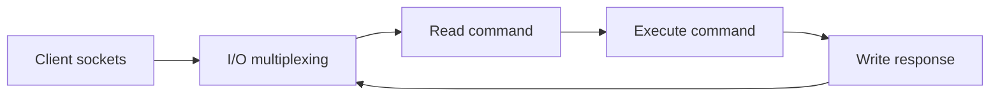
- Atomicity comes from serialized command execution.
- `KEYS *`, huge `HGETALL`, and long Lua scripts create head-of-line blocking.

**Common mistakes:**
- Confusing I/O multiplexing with parallel command execution.
- Debugging only the database when cache commands are slow.

**Follow-ups:**
- *Is a Lua script atomic?* → Yes, but it blocks Redis while running.
- *How avoid `KEYS`?* → Use `SCAN` with bounded count and off-peak jobs.

### Q3. Where should Redis fit in a system design?
`🟢 Beginner` `🔥` `Must-know SDE-1`

**Why they ask:** Tests practical backend judgment.

**Short answer (say this first, 20-40 sec):**
Use Redis for low-latency derived data, counters, locks, rate limits, sessions, and short-lived queues. Keep the database as source of truth unless you have deliberately designed Redis persistence and recovery.

**Detailed answer:**
- Good: product cache, OTP/session TTLs, idempotency keys, leaderboard, Gemini API rate limit.
- Bad fit: ad-hoc relational querying, unbounded historical records, large documents, strong multi-row transactions.
- Always define ownership, TTL, invalidation, and fallback behavior.

**Common mistakes:**
- Caching everything without measuring hit ratio.
- Treating cache outage as impossible.

**Follow-ups:**
- *Can Redis be primary storage?* → Possible but needs persistence, backups, failover, and data-model discipline.
- *What is cache hit ratio?* → Cache hits divided by total cache lookups.

## Data structures, commands, and complexity

### Q4. Give a Redis data structures, commands, and time complexity table.
`🟢 Beginner` `🔥` `Must-know SDE-1`

**Why they ask:** Redis interviews heavily test structure-to-use-case mapping.

**Short answer (say this first, 20-40 sec):**
Redis supports specialized data structures, not just strings. Pick the structure that matches access pattern and complexity.

**Detailed answer:**
| Structure | Use case | Commands | Time complexity |
|---|---|---|---|
| String | cache, counter, lock | `GET`, `SET`, `INCR`, `MGET` | `O(1)` per key |
| Hash | object fields | `HGET`, `HSET`, `HGETALL` | `O(1)` field, `O(N)` all |
| List | queue, recent items | `LPUSH`, `BRPOP`, `LRANGE` | `O(1)` ends, `O(N)` range |
| Set | uniqueness | `SADD`, `SISMEMBER`, `SINTER` | `O(1)` member, `O(N)` set ops |
| Sorted Set | leaderboard | `ZADD`, `ZINCRBY`, `ZRANGE` | `O(log N)` update |
| Bitmap | boolean flags | `SETBIT`, `GETBIT`, `BITCOUNT` | `O(1)` bit, count scans bytes |
| HyperLogLog | approximate uniques | `PFADD`, `PFCOUNT` | `O(1)` typical |
| Geo | nearby search | `GEOADD`, `GEOSEARCH` | `O(log N)` add, search varies |
| Stream | event log | `XADD`, `XREADGROUP`, `XACK` | append `O(1)`, read by count |

**Common mistakes:**
- Storing every object as huge JSON string.
- Ignoring `O(N)` commands on large keys.

**Follow-ups:**
- *Best for rank?* → Sorted Set.
- *Best for exact membership?* → Set.

### Q5. When do you use Redis Strings?
`🟢 Beginner` `🔥` `Must-know SDE-1`

**Why they ask:** Strings are the most common Redis value type.

**Short answer (say this first, 20-40 sec):**
Use Strings for cached JSON, counters, feature flags, tokens, idempotency keys, and locks. They are binary-safe values with atomic commands.

**Detailed answer:**
```text
SET user:42:profile "json" EX 300
GET user:42:profile
INCR rl:user:42:minute:202609232207
SET lock:job:7 token NX PX 30000
```
- Use `SET key value EX seconds` instead of separate `SET` and `EXPIRE`.
- Keep values small enough to avoid big-key latency.

**Common mistakes:**
- Forgetting TTL on temporary keys.
- Storing one giant string for frequently updated fields.

**Follow-ups:**
- *What is `MGET`?* → Multi-key read in one round trip.
- *Max String size?* → 512 MB, but production values should be far smaller.

### Q6. When do you use Redis Hashes?
`🟢 Beginner` `🔥` `Must-know SDE-1`

**Why they ask:** Hashes are ideal for object-like data.

**Short answer (say this first, 20-40 sec):**
Use Hashes when a key represents an object and you need field-level reads or updates, such as user settings or inventory fields.

**Detailed answer:**
```text
HSET user:42 name Azam city Lucknow plan pro
HGET user:42 city
HINCRBY product:9 stock -1
```
- `HGET`/`HSET` are average `O(1)`.
- `HGETALL` is `O(N)`, so avoid it on huge hashes.

**Common mistakes:**
- Putting unrelated users into one huge hash.
- Expecting separate TTL per field in older Redis designs.

**Follow-ups:**
- *Hash vs JSON string?* → Hash gives atomic field operations; JSON is simpler for whole-object cache.
- *Can a hash key expire?* → Yes, TTL applies to the whole key.

### Q7. When do you use Lists?
`🟢 Beginner` `Must-know SDE-1`

**Why they ask:** Lists are simple but often overused as queues.

**Short answer (say this first, 20-40 sec):**
Use Lists for simple ordered sequences, recent items, or transient queues with push/pop from ends.

**Detailed answer:**
```text
LPUSH jobs email:1
BRPOP jobs 5
LRANGE feed:user:42 0 19
LTRIM feed:user:42 0 99
```
- `LPUSH`/`RPOP` are `O(1)`.
- For reliable delivery and replay, prefer Streams or Kafka.

**Common mistakes:**
- Letting lists grow without trimming.
- Expecting replay after items are popped.

**Follow-ups:**
- *Blocking pop command?* → `BLPOP` or `BRPOP`.
- *List vs Stream?* → Stream has IDs, groups, pending list, and ack.

### Q8. When do you use Sets?
`🟢 Beginner` `🔥` `Must-know SDE-1`

**Why they ask:** Sets solve uniqueness and membership cleanly.

**Short answer (say this first, 20-40 sec):**
Use Sets for unique members and quick membership checks, such as likes, tags, processed IDs, and common followers.

**Detailed answer:**
```text
SADD post:9:likes user:1 user:2
SISMEMBER post:9:likes user:1
SCARD post:9:likes
SINTER followers:1 followers:2
```
- `SISMEMBER` is average `O(1)`.
- Large intersections can be expensive.

**Common mistakes:**
- Using Sets when ordering/ranking is required.
- Running huge set algebra on the main Redis during peak traffic.

**Follow-ups:**
- *Set vs Sorted Set?* → Sorted Set includes score ordering.
- *Dedup use case?* → Store processed message IDs with TTL.

### Q9. How do Sorted Sets implement leaderboards?
`🟡 Intermediate` `🔥` `Must-know SDE-1`

**Why they ask:** Leaderboard is the classic ZSET use case.

**Short answer (say this first, 20-40 sec):**
Store user ID as member and score as sorted-set score. Use `ZINCRBY` to update, `ZREVRANGE` for top N, and `ZREVRANK` for a user rank.

**Detailed answer:**
```text
ZINCRBY game:leaderboard 10 user:42
ZREVRANGE game:leaderboard 0 9 WITHSCORES
ZREVRANK game:leaderboard user:42
```
- Update is `O(log N)`.
- Use separate keys for weekly/monthly boards with TTL.

**Common mistakes:**
- Not defining tie behavior.
- Keeping unlimited old leaderboards.

**Follow-ups:**
- *Nearby rank?* → `ZREVRANK` then range around that rank.
- *Merge boards?* → `ZUNIONSTORE`.

### Q10. What are Bitmaps, HyperLogLog, and Geo?
`🟡 Intermediate` `Must-know SDE-1`

**Why they ask:** Tests breadth beyond common cache keys.

**Short answer (say this first, 20-40 sec):**
Bitmaps store compact boolean flags, HyperLogLog estimates unique counts, and Geo stores coordinates for nearby search.

**Detailed answer:**
```text
SETBIT active:2026-09-23 42 1
BITCOUNT active:2026-09-23
PFADD uv:home user:1 user:2
PFCOUNT uv:home
GEOADD stores 80.9462 26.8467 lucknow-store
GEOSEARCH stores FROMLONLAT 80.95 26.85 BYRADIUS 5 km
```
- HyperLogLog is approximate, so not for billing.
- Geo uses sorted-set-like indexing internally.

**Common mistakes:**
- Using HyperLogLog when exact user IDs are later required.
- Creating sparse bitmap offsets that allocate too much memory.

**Follow-ups:**
- *Lafz use case?* → Approximate unique prompt users or daily active users.
- *Geo use case?* → Nearby store/driver search.

### Q11. What are Redis Streams and consumer groups?
`🟡 Intermediate` `🔥` `Must-know SDE-1`

**Why they ask:** Streams are Redis messaging primitives.

**Short answer (say this first, 20-40 sec):**
Streams are append-only logs with message IDs. Consumer groups allow multiple consumers to share work and track pending unacknowledged messages.

**Detailed answer:**
```text
XADD email-events * userId 42 type GENERATED
XGROUP CREATE email-events workers $ MKSTREAM
XREADGROUP GROUP workers c1 COUNT 10 BLOCK 5000 STREAMS email-events >
XACK email-events workers 1690000000000-0
```
- Use `XPENDING` and `XAUTOCLAIM` for crash recovery.
- Trim streams with `XTRIM` or `MAXLEN`.

**Common mistakes:**
- Forgetting `XACK`.
- Using Pub/Sub when replay is needed.

**Follow-ups:**
- *What does `>` mean?* → Read new messages for the group.
- *Stream vs Kafka?* → Kafka scales and retains logs much further.

### Q12. What key naming conventions should you use?
`🟢 Beginner` `🔥` `Must-know SDE-1`

**Why they ask:** Key design affects debugging, clustering, and invalidation.

**Short answer (say this first, 20-40 sec):**
Use namespaced, predictable, versioned keys such as `app:entity:id:v1`. Include tenant, locale, model version, or request parameters if they affect output.

**Detailed answer:**
- Examples: `lafz:llm:v1:promptHash`, `email:rl:user:42:minute:202609232207`.
- Use hash tags in Cluster when related keys must share a slot: `cart:{user42}:items`.
- Hash or truncate untrusted long input.

**Common mistakes:**
- Raw prompt text as key.
- Missing tenant/user dimension in personalized caches.

**Follow-ups:**
- *Why version keys?* → Avoid stale incompatible serialized values after deployments.
- *Why avoid long keys?* → They waste memory and hurt readability.

## Caching patterns

### Q13. Explain cache-aside.
`🟢 Beginner` `🔥` `Must-know SDE-1`

**Why they ask:** It is the most common application caching pattern.

**Short answer (say this first, 20-40 sec):**
The app checks Redis first. On miss, it reads the database, stores the result in Redis with TTL, and returns the response.

**Detailed answer:**
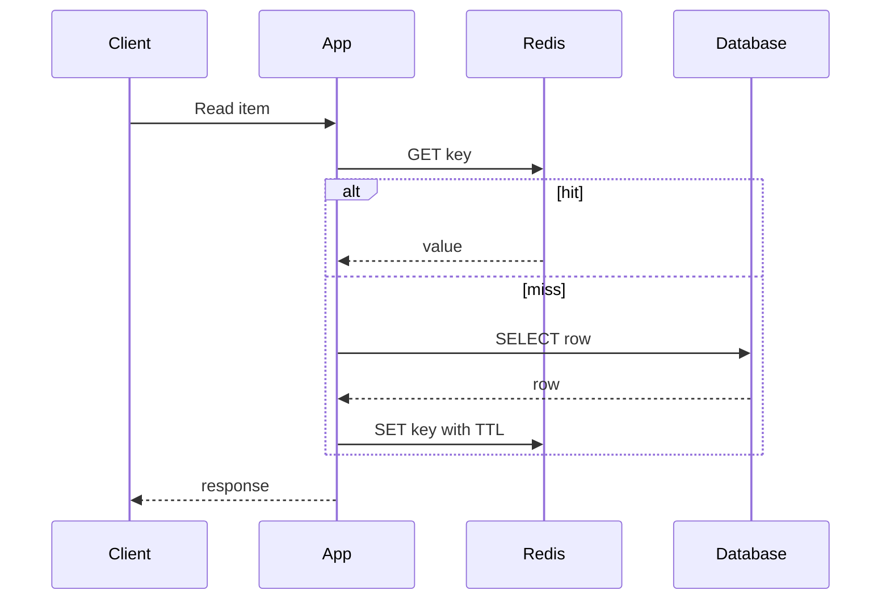
- DB remains source of truth.
- Add mutex or stale-while-revalidate for hot keys.

**Common mistakes:**
- No TTL.
- Many concurrent misses stampeding DB.

**Follow-ups:**
- *Who loads cache?* → Application code.
- *Best invalidation?* → Delete after DB write plus retry.

### Q14. Explain read-through caching.
`🟡 Intermediate` `Must-know SDE-1`

**Why they ask:** Contrasts app-managed and cache-managed loading.

**Short answer (say this first, 20-40 sec):**
In read-through, the cache abstraction loads missing data from the backing store, so the app asks only the cache layer.

**Detailed answer:**
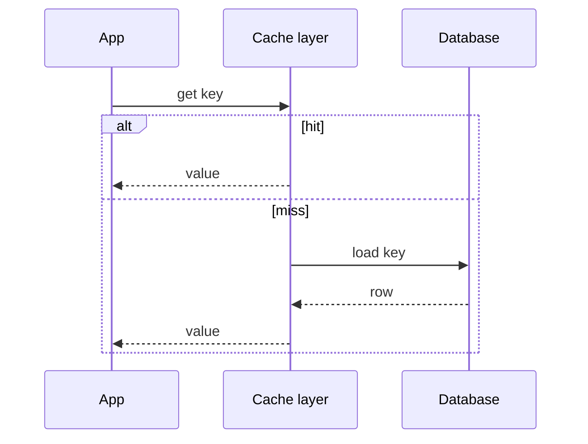
- Spring Cache around repository/service methods acts like app-level read-through.
- Redis alone does not know how to query your DB.

**Common mistakes:**
- Hiding slow DB calls with no metrics.
- Thinking read-through automatically solves invalidation.

**Follow-ups:**
- *Read-through vs cache-aside?* → Loading logic is inside cache layer vs app code.
- *Where useful?* → Shared and consistent loading logic.

### Q15. Explain write-through caching.
`🟡 Intermediate` `🔥` `Must-know SDE-1`

**Why they ask:** Write path consistency is important.

**Short answer (say this first, 20-40 sec):**
Write-through updates the database and cache synchronously in the write path, making reads fresher but writes slower.

**Detailed answer:**
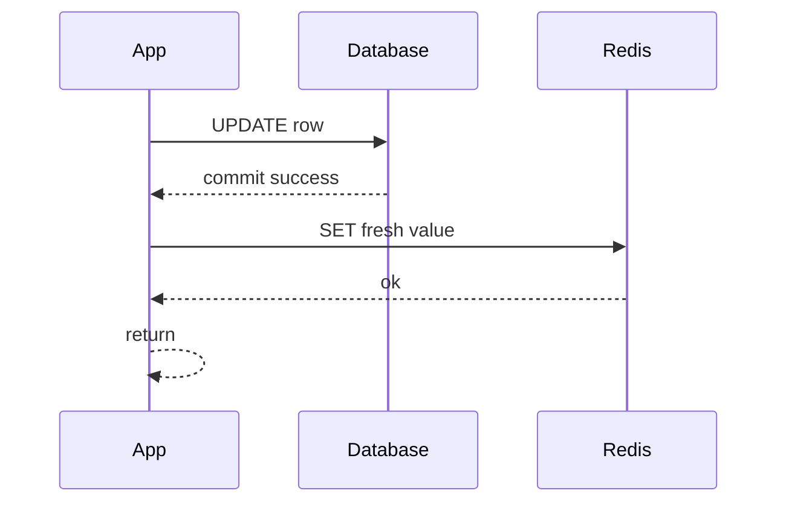
- DB-first then cache update/delete is safer than cache-first.
- If cache write fails, retry or delete later.

**Common mistakes:**
- Updating cache before DB commit.
- Ignoring partial failures.

**Follow-ups:**
- *Set or delete?* → Delete is often safer; next read reloads.
- *Downside?* → Higher write latency and cache pollution.

### Q16. Explain write-back caching.
`🔴 Advanced` `Stretch`

**Why they ask:** It exposes durability trade-offs.

**Short answer (say this first, 20-40 sec):**
Write-back writes to cache first and flushes to DB asynchronously. It is fast but risks data loss or inconsistency unless the flush path is durable and idempotent.

**Detailed answer:**
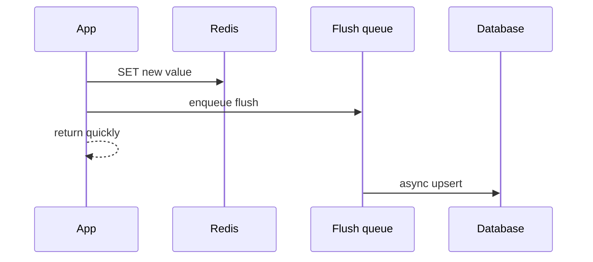
- Works for analytics counters or buffered writes.
- Risky for money, inventory, or critical user updates.

**Common mistakes:**
- Using volatile cache as the only durable store.
- No replay/reconciliation job.

**Follow-ups:**
- *How reduce risk?* → AOF, durable queue, idempotent DB upserts, reconciliation.
- *Write-through difference?* → Write-through writes DB synchronously.

### Q17. Explain write-around caching.
`🟡 Intermediate` `Must-know SDE-1`

**Why they ask:** Prevents cache pollution.

**Short answer (say this first, 20-40 sec):**
Write-around writes directly to DB and does not populate cache. Later reads populate cache only if needed.

**Detailed answer:**
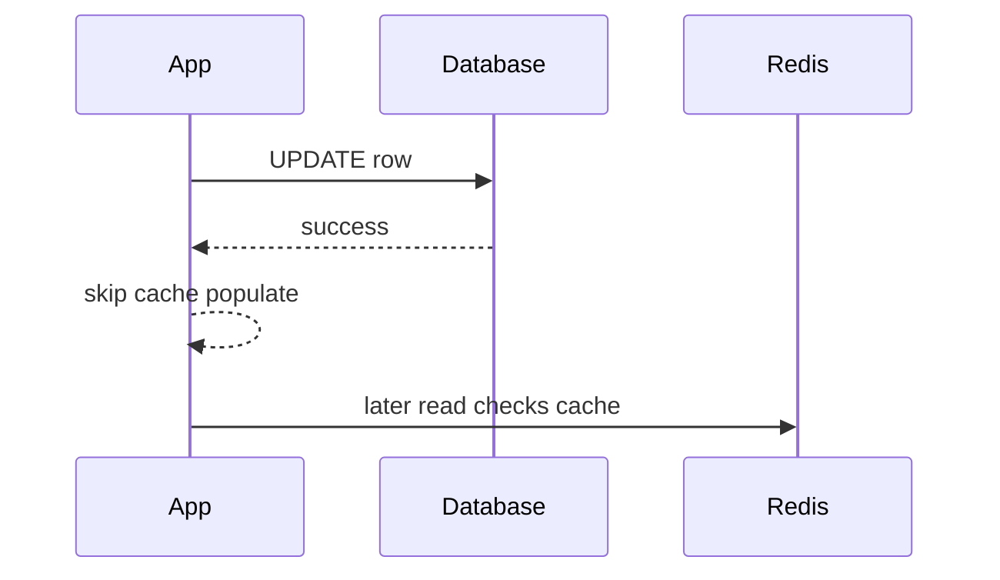
- Useful for bulk writes or rarely-read data.
- If old cache may exist, delete it after DB write.

**Common mistakes:**
- Forgetting to invalidate existing cache.
- Using it where read-after-write freshness is required.

**Follow-ups:**
- *Main benefit?* → Avoid storing data that may never be read.
- *Main risk?* → First read after write may miss or see stale value if not evicted.

## TTL, expiry, eviction, and persistence

### Q18. How does TTL and expiry work in Redis?
`🟡 Intermediate` `🔥` `Must-know SDE-1`

**Why they ask:** TTL controls freshness and memory.

**Short answer (say this first, 20-40 sec):**
Redis expires keys lazily on access and actively by periodically sampling keys with TTL. Expiry is not guaranteed at the exact millisecond the TTL ends.

**Detailed answer:**
- Lazy expiry: key is checked and deleted when accessed.
- Active expiry: Redis samples volatile keys and deletes expired ones in cycles.
- Commands: `EXPIRE`, `PEXPIRE`, `TTL`, `PTTL`, `SET key value EX 60`.

**Common mistakes:**
- Treating TTL as an exact scheduler.
- Overwriting keys and unintentionally losing TTL.

**Follow-ups:**
- *TTL -1?* → Key exists with no expiry.
- *TTL -2?* → Key does not exist.

### Q19. What eviction policies should you know?
`🟡 Intermediate` `🔥` `Must-know SDE-1`

**Why they ask:** Memory pressure is a common Redis outage cause.

**Short answer (say this first, 20-40 sec):**
When `maxmemory` is reached, Redis evicts keys based on `maxmemory-policy`: LRU, LFU, random, TTL-based, or no eviction.

**Detailed answer:**
| Policy | Evicts from | Selection | Use case |
|---|---|---|---|
| `noeviction` | none | writes fail | critical data, queues |
| `allkeys-lru` | all keys | approximate LRU | general cache |
| `volatile-lru` | TTL keys | approximate LRU | mixed persistent and cache |
| `allkeys-lfu` | all keys | least frequently used | skewed hot data |
| `volatile-lfu` | TTL keys | LFU | mixed workloads |
| `allkeys-random` | all keys | random | simple cache |
| `volatile-random` | TTL keys | random | mixed workloads |
| `volatile-ttl` | TTL keys | nearest expiry | TTL-first cache |

**Common mistakes:**
- Using `volatile-*` while many cache keys have no TTL.
- Surprised by `noeviction` write errors.

**Follow-ups:**
- *Is LRU exact?* → No, Redis uses approximations for speed.
- *Good default for cache?* → Often `allkeys-lru` or `allkeys-lfu`.

### Q20. Compare RDB and AOF.
`🟡 Intermediate` `🔥` `Must-know SDE-1`

**Why they ask:** Persistence affects recovery guarantees.

**Short answer (say this first, 20-40 sec):**
RDB stores point-in-time snapshots. AOF appends write commands and can lose less data depending on fsync policy. Many production setups use both.

**Detailed answer:**
| Feature | RDB | AOF |
|---|---|---|
| Mechanism | snapshot | append write log |
| File size | compact | larger until rewrite |
| Data loss | since last snapshot | depends on `appendfsync` |
| Restart | usually faster | can be slower |
| Best for | backups, replicas | stronger durability |

**Common mistakes:**
- Assuming cache never needs persistence even for sessions, streams, or locks.
- Setting `fsync always` without latency testing.

**Follow-ups:**
- *What is AOF rewrite?* → Compacts the log into a minimal representation.
- *Does AOF make Redis a database?* → It improves durability, but model and consistency still matter.

## Spring Boot Redis

### Q21. How do you configure `RedisTemplate` serializers?
`🟡 Intermediate` `🔥` `Must-know SDE-1`

**Why they ask:** Wrong serializers cause unreadable keys and deployment bugs.

**Short answer (say this first, 20-40 sec):**
Use String serializers for keys and JSON serializers for values. Avoid default Java serialization for cache values.

**Detailed answer:**
```java
import com.fasterxml.jackson.databind.ObjectMapper;
import org.springframework.context.annotation.Bean;
import org.springframework.context.annotation.Configuration;
import org.springframework.data.redis.connection.RedisConnectionFactory;
import org.springframework.data.redis.core.RedisTemplate;
import org.springframework.data.redis.serializer.GenericJackson2JsonRedisSerializer;
import org.springframework.data.redis.serializer.StringRedisSerializer;

@Configuration
class RedisConfig {
    @Bean
    RedisTemplate<String, Object> redisTemplate(RedisConnectionFactory factory,
                                                ObjectMapper mapper) {
        RedisTemplate<String, Object> template = new RedisTemplate<>();
        template.setConnectionFactory(factory);
        var string = new StringRedisSerializer();
        var json = new GenericJackson2JsonRedisSerializer(mapper);
        template.setKeySerializer(string);
        template.setHashKeySerializer(string);
        template.setValueSerializer(json);
        template.setHashValueSerializer(json);
        template.afterPropertiesSet();
        return template;
    }
}
```

**Common mistakes:**
- Mixing serializers across services.
- Caching Hibernate entities instead of DTOs.

**Follow-ups:**
- *Why String keys?* → Easy `redis-cli` debugging and predictable hashing.
- *Why not Java serialization?* → Brittle, unreadable, and risky.

### Q22. Show Spring Cache annotations.
`🟡 Intermediate` `🔥` `Must-know SDE-1`

**Why they ask:** Spring Cache is common in Java interviews.

**Short answer (say this first, 20-40 sec):**
`@Cacheable` skips method execution on hit, `@CachePut` always executes and updates cache, and `@CacheEvict` removes cached entries.

**Detailed answer:**
```java
import org.springframework.cache.annotation.CacheEvict;
import org.springframework.cache.annotation.CachePut;
import org.springframework.cache.annotation.Cacheable;
import org.springframework.stereotype.Service;

@Service
class PoemService {
    private final PoemRepository repository;

    PoemService(PoemRepository repository) {
        this.repository = repository;
    }

    @Cacheable(cacheNames = "poems", key = "#id", unless = "#result == null")
    public PoemDto getPoem(long id) {
        return repository.findDtoById(id).orElse(null);
    }

    @CachePut(cacheNames = "poems", key = "#result.id")
    public PoemDto updatePoem(long id, UpdatePoemRequest request) {
        Poem poem = repository.findById(id).orElseThrow();
        poem.setText(request.text());
        return PoemDto.from(repository.save(poem));
    }

    @CacheEvict(cacheNames = "poems", key = "#id")
    public void deletePoem(long id) {
        repository.deleteById(id);
    }
}
```
- Add `@EnableCaching` in configuration.
- Configure TTL in `RedisCacheManager`.

**Common mistakes:**
- Self-invocation bypasses Spring proxy.
- Key does not include all inputs affecting output.

**Follow-ups:**
- *When use `@CachePut`?* → On writes where the result should refresh cache.
- *How avoid null caching?* → `unless = "#result == null"` or cache config.

### Q23. How do you configure Redis CacheManager TTLs?
`🟡 Intermediate` `Must-know SDE-1`

**Why they ask:** TTL policy is not automatic.

**Short answer (say this first, 20-40 sec):**
Define a `RedisCacheManager` with default and cache-specific TTLs plus value serializers.

**Detailed answer:**
```java
import java.time.Duration;
import java.util.Map;
import org.springframework.cache.CacheManager;
import org.springframework.context.annotation.Bean;
import org.springframework.data.redis.cache.RedisCacheConfiguration;
import org.springframework.data.redis.cache.RedisCacheManager;
import org.springframework.data.redis.connection.RedisConnectionFactory;
import org.springframework.data.redis.serializer.GenericJackson2JsonRedisSerializer;
import org.springframework.data.redis.serializer.RedisSerializationContext;

@Bean
CacheManager cacheManager(RedisConnectionFactory factory) {
    RedisCacheConfiguration defaults = RedisCacheConfiguration.defaultCacheConfig()
            .entryTtl(Duration.ofMinutes(10))
            .disableCachingNullValues()
            .serializeValuesWith(RedisSerializationContext.SerializationPair
                    .fromSerializer(new GenericJackson2JsonRedisSerializer()));
    return RedisCacheManager.builder(factory)
            .cacheDefaults(defaults)
            .withInitialCacheConfigurations(Map.of(
                    "embeddings", defaults.entryTtl(Duration.ofHours(12)),
                    "llmResponses", defaults.entryTtl(Duration.ofMinutes(30))))
            .build();
}
```

**Common mistakes:**
- Thinking `@Cacheable` itself sets TTL.
- One TTL for all data.

**Follow-ups:**
- *How add jitter?* → Manual RedisTemplate writes or custom cache writer.
- *Should nulls be cached?* → Only deliberately, with short TTL.

### Q24. What are key Spring Cache pitfalls?
`🟡 Intermediate` `🔥` `Must-know SDE-1`

**Why they ask:** Annotation demos often break in production.

**Short answer (say this first, 20-40 sec):**
Pitfalls are self-invocation, null caching, missing TTL, caching entities, bad key design, and inconsistent invalidation.

**Detailed answer:**
- Self-invocation: `this.cachedMethod()` bypasses the proxy.
- Key design: include tenant, user role, locale, model version, and all request parameters affecting response.
- Cache DTOs, not lazy JPA entities.
- Define null caching intentionally to prevent penetration, not accidentally.

**Common mistakes:**
- Caching personalized response by `id` only.
- Using `allEntries = true` on hot large caches.

**Follow-ups:**
- *Fix self-invocation?* → Move method to another bean or use AspectJ.
- *Why version keys?* → Safe invalidation after schema/model changes.

## Consistency and cache failure patterns

### Q25. How do you keep cache and database consistent?
`🟡 Intermediate` `🔥` `Must-know SDE-1`

**Why they ask:** Cache invalidation is a core production problem.

**Short answer (say this first, 20-40 sec):**
Keep the database as source of truth. On writes, commit DB first, then delete or refresh cache after commit, and retry invalidation if it fails.

**Detailed answer:**
- Safer default: DB update → after-commit event → `DEL cacheKey` → next read reloads.
- Add short TTL as a safety net.
- Use outbox/CDC for reliable async invalidation in larger systems.

**Common mistakes:**
- Updating cache before DB commit.
- No retry path when cache deletion fails.

**Follow-ups:**
- *Why delete instead of set?* → Avoid writing stale value during write races.
- *Is it strongly consistent?* → Usually no; it is eventual consistency.

### Q26. What is delayed double delete?
`🔴 Advanced` `Stretch`

**Why they ask:** It is a known technique for cache-DB race windows.

**Short answer (say this first, 20-40 sec):**
Delete cache, write DB, wait briefly, then delete cache again. The second delete removes stale values that concurrent readers may have repopulated during the write race.

**Detailed answer:**
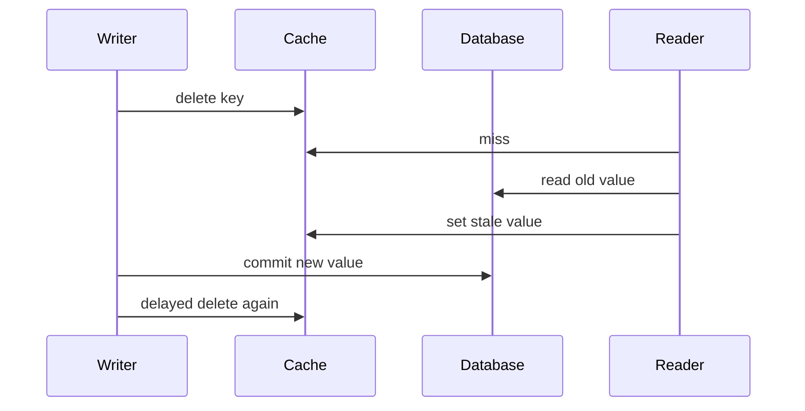
- Do the delayed delete asynchronously, not by sleeping request threads.
- Delay should match read plus cache-set race time.

**Common mistakes:**
- Thinking it guarantees strong consistency.
- Using a random long sleep in the API thread.

**Follow-ups:**
- *Better alternative?* → Outbox events, CDC invalidation, or versioned cache values.
- *When useful?* → High-read systems with cache-aside races.

### Q27. How do you prevent cache stampede or thundering herd?
`🟡 Intermediate` `🔥` `Must-know SDE-1`

**Why they ask:** Hot key expiry can overload DB.

**Short answer (say this first, 20-40 sec):**
Use a mutex/request coalescing so only one request rebuilds a key. Others wait briefly, serve stale data, or fail fast. Add TTL jitter and early refresh.

**Detailed answer:**
```java
String key = "poem:" + id;
PoemDto cached = redis.opsForValue().get(key);
if (cached != null) return cached;
String lockKey = key + ":lock";
Boolean locked = redis.opsForValue().setIfAbsent(lockKey, "1", Duration.ofSeconds(5));
if (Boolean.TRUE.equals(locked)) {
    try {
        PoemDto fresh = repository.findDtoById(id).orElseThrow();
        redis.opsForValue().set(key, fresh, Duration.ofMinutes(10));
        return fresh;
    } finally {
        redis.delete(lockKey);
    }
}
Thread.sleep(50);
PoemDto retry = redis.opsForValue().get(key);
return retry != null ? retry : repository.findDtoById(id).orElseThrow();
```
- Production version should use token-based safe unlock and bounded waits.

**Common mistakes:**
- Lock without expiry.
- All waiters hitting DB when lock times out.

**Follow-ups:**
- *Stale-while-revalidate?* → Serve old value while one worker refreshes.
- *TTL jitter?* → Add random offset so many keys do not expire together.

### Q28. What is probabilistic early expiry?
`🔴 Advanced` `Stretch`

**Why they ask:** It shows advanced stampede prevention.

**Short answer (say this first, 20-40 sec):**
Refresh a key before expiry with probability increasing as expiry approaches. This spreads rebuilds over time instead of waiting for a hard expiry.

**Detailed answer:**
- Store value plus logical expiry timestamp.
- If within a refresh window, one request tries to refresh under a lock.
- Good for hot keys with expensive recomputation.

**Common mistakes:**
- Every request refreshes early.
- No lock around refresh.

**Follow-ups:**
- *Jitter vs early expiry?* → Jitter randomizes TTL; early expiry randomizes refresh.
- *Low traffic keys?* → They may still expire cold.

### Q29. What is cache penetration and how do you stop it?
`🟡 Intermediate` `🔥` `Must-know SDE-1`

**Why they ask:** Invalid IDs can bypass cache and hammer DB.

**Short answer (say this first, 20-40 sec):**
Cache penetration is repeated requests for nonexistent data. Stop it with input validation, Bloom filters, and short TTL null caching.

**Detailed answer:**
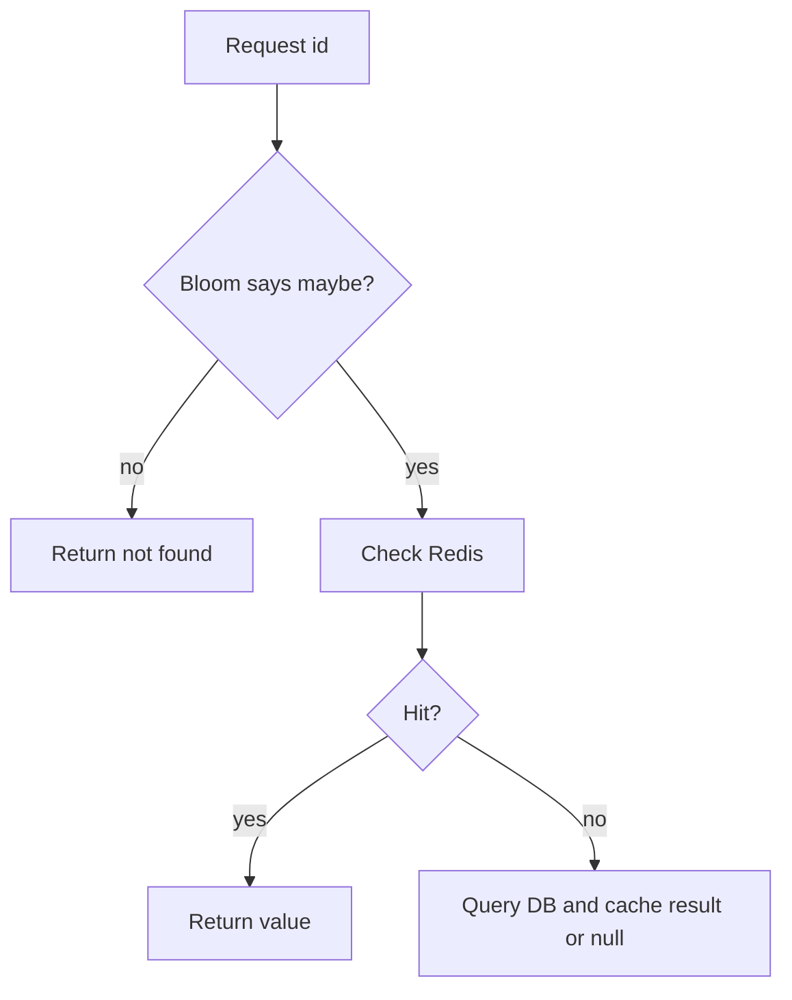
- Bloom filters can have false positives but no false negatives.
- Null cache TTL should be short.

**Common mistakes:**
- Caching null forever.
- Not updating Bloom filter after inserts.

**Follow-ups:**
- *Can Bloom filters delete?* → Standard ones cannot; counting Bloom filters can.
- *When skip Bloom filter?* → Low QPS or naturally validated IDs.

### Q30. What are avalanche, hot keys, and big keys?
`🟡 Intermediate` `🔥` `Must-know SDE-1`

**Why they ask:** These are classic Redis incidents.

**Short answer (say this first, 20-40 sec):**
Avalanche is many keys expiring together. Hot keys receive extreme traffic. Big keys contain too much data and block memory/network operations.

**Detailed answer:**
| Problem | Symptom | Fix |
|---|---|---|
| Avalanche | DB spike after mass expiry | TTL jitter, warmup, circuit breaker |
| Hot key | one key or shard overloaded | local cache, split key, read replicas |
| Big key | p99 latency, blocked deletes | split value, trim, `UNLINK`, size alerts |
- Detect with command stats, slowlog, memory sampling, and keyspace scans off-peak.

**Common mistakes:**
- Same TTL for all warmed keys.
- Running `HGETALL` on a huge hash.

**Follow-ups:**
- *How add jitter?* → `baseTtl + random(0, spread)`.
- *How split hot counter?* → Multiple counter keys plus periodic aggregation.

## Locks, rate limits, streams, and clustering

### Q31. How do you implement a Redis distributed lock?
`🔴 Advanced` `🔥` `Must-know SDE-1`

**Why they ask:** `SETNX` alone is not enough.

**Short answer (say this first, 20-40 sec):**
Acquire with `SET lockKey uniqueToken NX PX ttl`. Release with Lua that deletes only if the stored token matches your token.

**Detailed answer:**
```java
String token = UUID.randomUUID().toString();
Boolean ok = redis.opsForValue()
        .setIfAbsent("lock:job:7", token, Duration.ofSeconds(30));
```
```lua
if redis.call('GET', KEYS[1]) == ARGV[1] then
  return redis.call('DEL', KEYS[1])
end
return 0
```
- Token prevents one client deleting another client's lock.
- TTL prevents permanent deadlock if owner dies.

**Common mistakes:**
- `DEL lockKey` without token check.
- TTL shorter than critical section.

**Follow-ups:**
- *Why Lua?* → Compare and delete must be atomic.
- *Does lock replace DB constraints?* → No.

### Q32. What is the lock expiry problem and Redisson watchdog?
`🔴 Advanced` `Stretch`

**Why they ask:** Locks fail under pauses and long tasks.

**Short answer (say this first, 20-40 sec):**
If work exceeds lock TTL, another client may acquire the lock while the first still runs. Redisson watchdog renews the lease while the owner is alive.

**Detailed answer:**
- Watchdog helps unknown-duration critical sections.
- GC pauses, network partitions, and process stalls still require idempotency or fencing tokens.
- Keep critical sections short.

**Common mistakes:**
- Very long TTL as the only fix.
- Using locks for correctness without database safeguards.

**Follow-ups:**
- *What is a fencing token?* → Monotonic token checked by the resource to reject stale owners.
- *When use Redisson?* → When you need a robust Java lock abstraction with renewal.

### Q33. What is the Redlock debate?
`⚫ FAANG` `Stretch`

**Why they ask:** Distributed locks have hard correctness limits.

**Short answer (say this first, 20-40 sec):**
Redlock acquires locks on multiple independent Redis masters and succeeds with quorum. The debate is whether its clock and timing assumptions are safe enough under partitions and pauses.

**Detailed answer:**
- Fine for best-effort duplicate-work prevention.
- For correctness-critical resources, prefer DB constraints, consensus systems, or fencing tokens.
- Do not claim Redlock is universally safe or useless.

**Common mistakes:**
- Ignoring process pauses and clock drift.
- Using Redis lock as a financial transaction guarantee.

**Follow-ups:**
- *Single Redis lock use case?* → Cache rebuild mutex or scheduled-job de-duplication.
- *Strict correctness use case?* → Use DB uniqueness or a consensus-backed lock.

### Q34. How does fixed-window rate limiting work?
`🟡 Intermediate` `🔥` `Must-know SDE-1`

**Why they ask:** It is the simplest Redis rate limiter.

**Short answer (say this first, 20-40 sec):**
Increment a key for a user and time window, set expiry on first increment, and reject after the limit.

**Detailed answer:**
```java
String key = "rl:gemini:" + userId + ":" + Instant.now().getEpochSecond() / 60;
Long count = redis.opsForValue().increment(key);
if (count != null && count == 1L) redis.expire(key, Duration.ofMinutes(1));
if (count != null && count > 20) throw new TooManyRequestsException();
```
- Simple but allows boundary bursts.
- Lua makes increment-plus-expire atomic.

**Common mistakes:**
- Limiting by IP only for logged-in users.
- Missing expiry and leaking keys.

**Follow-ups:**
- *Pros?* → Cheap and easy.
- *Cons?* → Window-boundary unfairness.

### Q35. How does sliding-window log with ZSET work?
`🔴 Advanced` `🔥` `Must-know SDE-1`

**Why they ask:** It tests Redis sorted-set design.

**Short answer (say this first, 20-40 sec):**
Store request timestamps in a ZSET. Remove old timestamps, count current-window entries, and allow only if below limit.

**Detailed answer:**
```java
long now = System.currentTimeMillis();
String key = "rl:slide:" + userId;
redis.opsForZSet().removeRangeByScore(key, 0, now - 60_000);
Long used = redis.opsForZSet().zCard(key);
if (used != null && used >= 20) throw new TooManyRequestsException();
redis.opsForZSet().add(key, UUID.randomUUID().toString(), now);
redis.expire(key, Duration.ofMinutes(2));
```
- Use Lua in production for atomic remove/count/add.
- Cost grows with requests per window.

**Common mistakes:**
- Timestamp as member, losing duplicates in same millisecond.
- No expiry on the ZSET.

**Follow-ups:**
- *Accuracy?* → Exact for retained window.
- *When use token bucket instead?* → When controlled burstiness is acceptable.

### Q36. Show a token bucket rate limiter in Lua.
`🔴 Advanced` `Stretch`

**Why they ask:** Lua is used for atomic multi-key logic.

**Short answer (say this first, 20-40 sec):**
Token bucket refills tokens over time up to capacity. Each request consumes tokens atomically; if insufficient tokens exist, reject.

**Detailed answer:**
```lua
local tokensKey = KEYS[1]
local timeKey = KEYS[2]
local capacity = tonumber(ARGV[1])
local refillRate = tonumber(ARGV[2])
local now = tonumber(ARGV[3])
local requested = tonumber(ARGV[4])
local tokens = tonumber(redis.call('GET', tokensKey) or capacity)
local last = tonumber(redis.call('GET', timeKey) or now)
local delta = math.max(0, now - last)
tokens = math.min(capacity, tokens + delta * refillRate)
if tokens < requested then
  redis.call('SET', tokensKey, tokens, 'EX', 120)
  redis.call('SET', timeKey, now, 'EX', 120)
  return {0, tokens}
end
tokens = tokens - requested
redis.call('SET', tokensKey, tokens, 'EX', 120)
redis.call('SET', timeKey, now, 'EX', 120)
return {1, tokens}
```

**Common mistakes:**
- Mixing seconds and milliseconds.
- No expiry for idle users.

**Follow-ups:**
- *Token vs leaky bucket?* → Token bucket permits bursts up to capacity.
- *Why Lua?* → Atomic read-modify-write.

### Q37. Compare Pub/Sub, Streams, and Kafka.
`🟡 Intermediate` `🔥` `Must-know SDE-1`

**Why they ask:** Prevents picking the wrong messaging tool.

**Short answer (say this first, 20-40 sec):**
Redis Pub/Sub is fire-and-forget. Streams are Redis-persistent logs with consumer groups. Kafka is a distributed durable log for high-throughput event streaming.

**Detailed answer:**
| Feature | Pub/Sub | Redis Streams | Kafka |
|---|---|---|---|
| Persistence | no | yes | yes |
| Replay | no | yes | yes |
| Consumer groups | no | yes | yes |
| Scale | simple | moderate | very high |
| Use | live notifications | lightweight queues | event backbone |

**Common mistakes:**
- Pub/Sub for tasks that must survive downtime.
- Kafka for a tiny app where Streams is enough.

**Follow-ups:**
- *Cache invalidation event?* → Pub/Sub if loss is acceptable, Streams if replay is needed.
- *Streams replacement for Kafka?* → Sometimes at smaller scale, not for huge ecosystems.

### Q38. How do Streams consumer groups work?
`🟡 Intermediate` `Must-know SDE-1`

**Why they ask:** Consumer groups make Streams reliable enough for lightweight jobs.

**Short answer (say this first, 20-40 sec):**
A consumer group tracks last delivered entries and pending entries. Each message is delivered to one consumer in the group until acknowledged.

**Detailed answer:**
- `XREADGROUP` reads new or pending messages.
- `XACK` removes message from pending list.
- `XPENDING` shows stuck messages; `XAUTOCLAIM` moves old pending messages to another consumer.

**Common mistakes:**
- Not trimming streams.
- Multiple services using the same group name unintentionally.

**Follow-ups:**
- *Message replay?* → Read old IDs or use pending entries.
- *Poison message?* → Count retries and move to dead-letter stream manually.

### Q39. Explain Sentinel vs Cluster.
`🟡 Intermediate` `🔥` `Must-know SDE-1`

**Why they ask:** HA and sharding are commonly confused.

**Short answer (say this first, 20-40 sec):**
Sentinel monitors primary-replica Redis and performs failover. Cluster shards data across masters using hash slots and also supports replica failover.

**Detailed answer:**
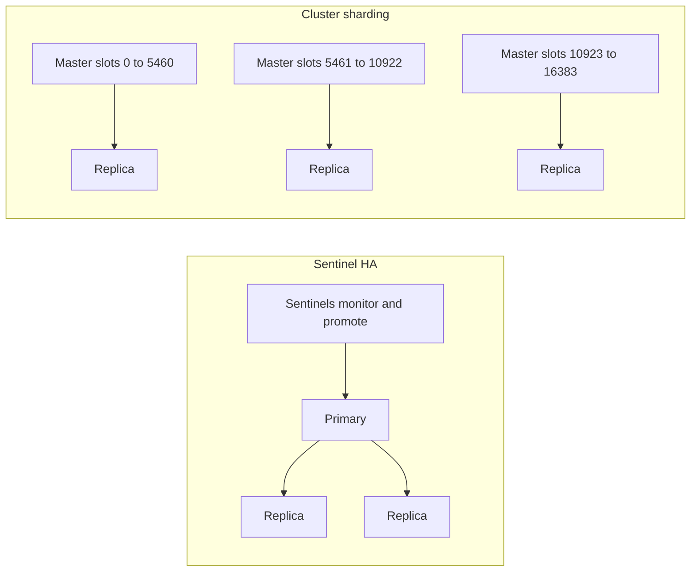

**Common mistakes:**
- Expecting Sentinel to shard data.
- Using non-cluster-aware clients with Cluster.

**Follow-ups:**
- *Simple HA?* → Sentinel.
- *Large dataset/write scaling?* → Cluster.

### Q40. What are hash slots and resharding?
`🔴 Advanced` `🔥` `Must-know SDE-1`

**Why they ask:** Redis Cluster design depends on slots.

**Short answer (say this first, 20-40 sec):**
Redis Cluster maps keys to 16,384 hash slots. Masters own slot ranges, and resharding moves slots between masters.

**Detailed answer:**
- Slot = CRC16(key) mod 16384; with `{tag}`, only tag is hashed.
- Clients handle `MOVED` and `ASK` redirects.
- Multi-key operations require keys in the same slot.

**Common mistakes:**
- `MGET` across slots.
- Overusing hash tags and creating hot slots.

**Follow-ups:**
- *Why 16,384?* → Fixed manageable slot space for ownership/migration.
- *What is resharding?* → Moving slots to balance memory or traffic.

### Q41. How does Redis replication work?
`🟡 Intermediate` `Must-know SDE-1`

**Why they ask:** Replication affects consistency and failover.

**Short answer (say this first, 20-40 sec):**
Replicas copy data from a primary. Initial sync may use an RDB snapshot, then replicas receive an ongoing replication stream.

**Detailed answer:**
- Replication is asynchronous by default.
- Replica reads can be stale.
- Failover can lose acknowledged writes not yet replicated.

**Common mistakes:**
- Assuming replicas are strongly consistent.
- Writing to replicas.

**Follow-ups:**
- *Partial resync?* → Replica catches up from backlog if possible.
- *What is `WAIT`?* → Blocks until writes reach a requested number of replicas or timeout.

### Q42. How do you optimize Redis memory?
`🟡 Intermediate` `Must-know SDE-1`

**Why they ask:** Redis memory is expensive and finite.

**Short answer (say this first, 20-40 sec):**
Use right data structures, TTLs, compact values, trimming, maxmemory policy, and monitoring. Avoid big keys and unbounded streams/lists.

**Detailed answer:**
- Monitor `used_memory`, RSS, fragmentation, evictions, and key count.
- Use hashes for small objects, short keys at huge scale, and compression only after measuring CPU cost.
- Delete huge keys with `UNLINK` where safe.

**Common mistakes:**
- No TTL on derived cache data.
- Billions of verbose keys.

**Follow-ups:**
- *Fragmentation?* → RSS significantly exceeds logical used memory.
- *Stream memory control?* → `XTRIM MAXLEN`.

### Q43. Explain pipelining, transactions, WATCH, and Lua.
`🟡 Intermediate` `🔥` `Must-know SDE-1`

**Why they ask:** Candidates confuse latency batching with atomicity.

**Short answer (say this first, 20-40 sec):**
Pipelining reduces round trips but is not atomic. `MULTI/EXEC` executes queued commands atomically. `WATCH` provides optimistic locking. Lua runs conditional multi-command logic atomically.

**Detailed answer:**
```text
WATCH stock:9
GET stock:9
MULTI
DECR stock:9
EXEC
```
- Pipeline: performance optimization.
- Transaction: queued atomic execution but no full rollback.
- Lua: best for rate limiter, safe unlock, compare-and-set.

**Common mistakes:**
- Thinking pipeline is a transaction.
- Long business logic between `WATCH` and `EXEC`.

**Follow-ups:**
- *Does Redis transaction roll back?* → No rollback of already executed commands.
- *Lua in Cluster?* → Keys must generally be in the same slot.

## Production scenarios

### Q44. Scenario: cache outage makes API latency jump from 100 ms to 5 s. What do you do?
`🟡 Intermediate` `🔥` `Must-know SDE-1`

**Why they ask:** Tests incident response and cache fallback design.

**Short answer (say this first, 20-40 sec):**
Stabilize by protecting DB with rate limits, circuit breakers, and selective stale responses. Then inspect Redis health, cache hit ratio, connection pools, DB QPS, slow queries, and recent deployments.

**Detailed answer:**
- Check Redis errors, p99 latency, evictions, CPU, memory, failover events.
- Check app cache misses, DB connections, DB CPU, and slow SQL.
- Mitigate by warming hot keys, increasing TTL temporarily, and limiting expensive endpoints.

**Common mistakes:**
- Restarting Redis repeatedly while DB melts.
- Infinite retries from app threads.

**Follow-ups:**
- *Prevention?* → TTL jitter, stale fallback, DB circuit breaker, and cache warmup.
- *Key metric?* → Hit ratio plus p95/p99 latency and DB load.

### Q45. Scenario: users see stale profile data after update. How do you debug?
`🟡 Intermediate` `🔥` `Must-know SDE-1`

**Why they ask:** Cache consistency appears in many backend systems.

**Short answer (say this first, 20-40 sec):**
Check key design, update transaction boundary, cache eviction timing, Spring proxy invocation, and whether reads use replicas. Delete cache after DB commit and retry deletion failures.

**Detailed answer:**
- Verify all endpoints use the same key builder.
- Ensure `@CacheEvict` is not bypassed by self-invocation.
- Add updatedAt/version in DTO to detect stale cache.

**Common mistakes:**
- Evicting before commit and then rolling back.
- Updating one cache while reading another.

**Follow-ups:**
- *Quick mitigation?* → Delete affected key pattern carefully with scan/batch.
- *Long term?* → After-commit invalidation plus tests.

### Q46. Scenario: Redis memory keeps increasing. How do you debug?
`🟡 Intermediate` `Must-know SDE-1`

**Why they ask:** Memory leaks in Redis are common.

**Short answer (say this first, 20-40 sec):**
Check key growth, TTL coverage, big keys, stream/list trimming, eviction policy, and recent code creating high-cardinality keys.

**Detailed answer:**
- Use `INFO memory`, `INFO keyspace`, `MEMORY USAGE`, sampling `SCAN`, and dashboards.
- Look for per-request keys, raw prompt keys, untrimmed streams, and endless leaderboards.
- Fix with TTL, trimming, key version cleanup, and maxmemory policy.

**Common mistakes:**
- Running `KEYS *` in production.
- Deleting huge keys synchronously during peak time.

**Follow-ups:**
- *If fragmentation high?* → Active defrag or replica restart/failover after measuring.
- *If evictions high?* → Increase memory or reduce working set.

### Q47. Scenario: one Redis Cluster shard has much higher CPU. What happened?
`🔴 Advanced` `Stretch`

**Why they ask:** Tests sharding and hot-key diagnosis.

**Short answer (say this first, 20-40 sec):**
It may be uneven slots, a hot key, a big key, expensive commands, or hash tags forcing traffic to one slot. Identify hot commands and keys before resharding.

**Detailed answer:**
- Inspect per-node ops/sec, CPU, slowlog, command stats, and slot ownership.
- If hot key: local cache, split key, read replicas, or app-level sharding.
- If slot imbalance: reshard/rebalance slots.

**Common mistakes:**
- Resharding when one key is hot.
- Using the same hash tag for unrelated keys.

**Follow-ups:**
- *Hot counter fix?* → Sharded counters plus aggregation.
- *Can replicas help?* → For read-heavy hot keys if stale reads are acceptable.

### Q48. Scenario: rate limiter blocks valid users. What do you check?
`🟡 Intermediate` `Must-know SDE-1`

**Why they ask:** Real rate limits fail due to key and algorithm mistakes.

**Short answer (say this first, 20-40 sec):**
Check key dimensions, algorithm, window boundaries, user identity, NAT/shared IP, clock source, and plan-specific limits. Return `429` with useful headers.

**Detailed answer:**
- Authenticated users should usually be limited by user/API key, not IP only.
- Token bucket or sliding window is fairer than fixed window.
- Log allowed/denied counts and remaining quota.

**Common mistakes:**
- One global key for all users.
- No observability for denied requests.

**Follow-ups:**
- *What headers?* → `Retry-After`, remaining quota, reset time if safe.
- *Fail-open or fail-closed?* → Depends on cost/security risk.

### Q49. Scenario: Redis failover caused brief errors. How should clients behave?
`🔴 Advanced` `Stretch`

**Why they ask:** HA includes client configuration.

**Short answer (say this first, 20-40 sec):**
Use Sentinel or Cluster-aware clients, topology refresh, short timeouts, bounded retries with jitter, and idempotent operations. Cache reads should degrade gracefully where possible.

**Detailed answer:**
- Lettuce/Jedis should discover new primary or cluster slot owner.
- Avoid infinite retries and thread-pool exhaustion.
- Decide fail-open vs fail-closed per feature: cache can fail open; locks/rate limits may fail closed.

**Common mistakes:**
- Hardcoding one node IP.
- Retrying non-idempotent scripts blindly.

**Follow-ups:**
- *What about replica lag?* → Avoid replica reads when read-after-write is required.
- *What alert?* → Failover duration and command error rate.

### Q50. Scenario: `MOVED` errors appear after enabling Cluster. What does it mean?
`🟡 Intermediate` `Must-know SDE-1`

**Why they ask:** Cluster routing issues are common.

**Short answer (say this first, 20-40 sec):**
`MOVED` means the key's hash slot belongs to another node. Use a Cluster-aware client and configure topology refresh.

**Detailed answer:**
- Raw single-node clients receive redirects instead of routing automatically.
- Multi-key operations across slots fail.
- Use hash tags for related keys that must be co-located.

**Common mistakes:**
- Treating `MOVED` as data loss.
- Using standalone Redis config for a cluster.

**Follow-ups:**
- *What is `ASK`?* → Temporary redirect during slot migration.
- *Spring fix?* → Configure cluster nodes, not one host.

### Q51. Scenario: a big key delete freezes Redis. What is the fix?
`🟡 Intermediate` `Must-know SDE-1`

**Why they ask:** Big-key operations create latency incidents.

**Short answer (say this first, 20-40 sec):**
Avoid big keys by splitting or trimming data. For deletion, prefer `UNLINK` over `DEL` where safe because it frees memory asynchronously.

**Detailed answer:**
- Detect with `MEMORY USAGE`, slowlog, and big key scans off-peak.
- Split huge hash/list/set by bucket, date, or tenant.
- Use incremental cleanup jobs.

**Common mistakes:**
- `DEL hugeKey` during peak traffic.
- `LRANGE 0 -1` on an unbounded list.

**Follow-ups:**
- *What is a big key?* → No single universal size; define thresholds by latency and memory impact.
- *Can compression help?* → Sometimes for large cold values, but costs CPU.

### Q52. Scenario: cache hit ratio is high but latency is still bad. Why?
`🟡 Intermediate` `Must-know SDE-1`

**Why they ask:** Hit ratio alone can be misleading.

**Short answer (say this first, 20-40 sec):**
Large values, network latency, serialization cost, connection pool waits, hot keys, or slow commands can make cache hits slow. Measure p95/p99 latency by operation.

**Detailed answer:**
- Check value sizes, serializer CPU, Redis command latency, app pool metrics, and cross-region calls.
- Pipelining can reduce round trips for bulk reads.
- Local in-process cache may help ultra-hot small data.

**Common mistakes:**
- Optimizing hit ratio while ignoring p99.
- Caching huge responses that are slower to deserialize.

**Follow-ups:**
- *Metric to add?* → Cache hit latency separate from miss latency.
- *Fix for many small gets?* → `MGET` or pipeline.

## How to add Redis to my projects

### Q53. How can I add Redis to Lafz for embeddings and LLM response caching?
`🟡 Intermediate` `🔥` `Must-know SDE-1`

**Why they ask:** It creates an honest resume Redis story.

**Short answer (say this first, 20-40 sec):**
Cache deterministic expensive results: normalized prompt embeddings and final LLM responses for repeated prompts. PostgreSQL plus pgvector remains source of truth for stored poems and vectors.

**Detailed answer:**
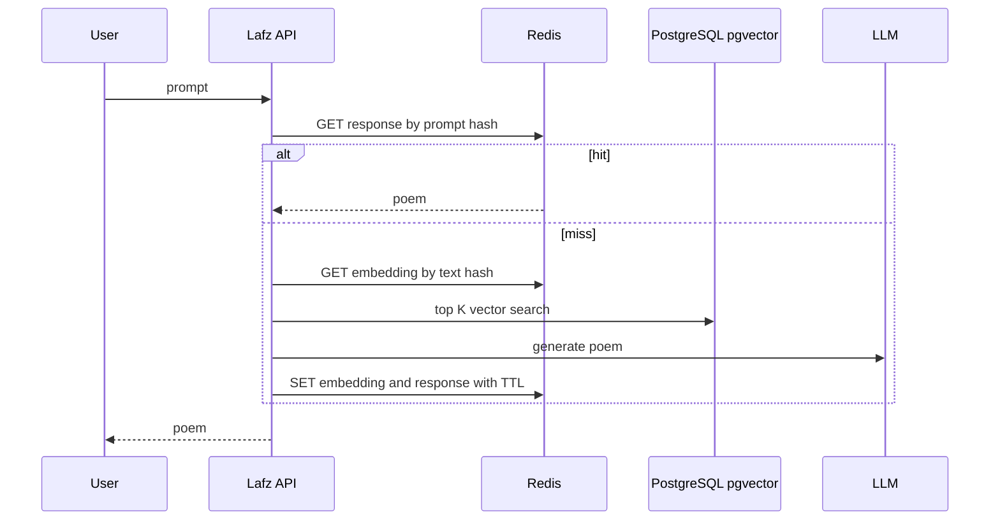
```java
String normalized = prompt.trim().toLowerCase(Locale.ROOT);
String key = "lafz:llm:v1:" + DigestUtils.sha256Hex(normalized);
String cached = stringRedisTemplate.opsForValue().get(key);
if (cached != null) return cached;
String poem = llmClient.generate(prompt, retrievedContext);
Duration ttl = Duration.ofMinutes(30 + ThreadLocalRandom.current().nextInt(10));
stringRedisTemplate.opsForValue().set(key, poem, ttl);
return poem;
```
Resume bullet: `Added Redis caching for normalized Lafz prompts, embeddings, and LLM responses, reducing repeated vector search and generation latency by [your measured number]%.`

**Common mistakes:**
- Caching private prompts globally.
- Not including model/template version in key.

**Follow-ups:**
- *Key fields?* → model version, prompt hash, retrieval config, and user scope if personalized.
- *Invalidation?* → Version the key when model/prompt template changes.

### Q54. How can I add Redis rate limiting to AI Email Reply Assistant Gemini calls?
`🟡 Intermediate` `🔥` `Must-know SDE-1`

**Why they ask:** It is a practical Spring Boot cost-protection design.

**Short answer (say this first, 20-40 sec):**
Use Redis token-bucket or sliding-window rate limiting before Gemini API calls, keyed by user or API key. Return `429` when quota is exceeded.

**Detailed answer:**
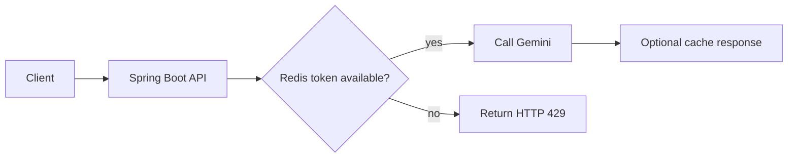
```java
@PostMapping("/api/email/reply")
public ResponseEntity<ReplyResponse> reply(@AuthenticationPrincipal UserPrincipal user,
                                           @RequestBody ReplyRequest request) {
    RateLimitResult result = rateLimiter.tryConsume("gemini:" + user.id(), 1);
    if (!result.allowed()) {
        return ResponseEntity.status(429)
                .header("Retry-After", String.valueOf(result.retryAfterSeconds()))
                .build();
    }
    return ResponseEntity.ok(geminiService.generateReply(request));
}
```
Resume bullet: `Protected Gemini integration with Redis rate limiting and HTTP 429 handling, preventing quota spikes and enabling per-user controls.`

**Common mistakes:**
- Limiting by IP only for authenticated users.
- No behavior defined for Redis outage.

**Follow-ups:**
- *Fail-open or fail-closed?* → Cost-sensitive Gemini calls often fail closed or use small fallback quota.
- *Metrics?* → allowed, denied, Redis errors, Gemini latency, and quota usage.

### Q55. How would you use Redis for idempotency in these projects?
`🟡 Intermediate` `Must-know SDE-1`

**Why they ask:** Idempotency is common in APIs and messaging.

**Short answer (say this first, 20-40 sec):**
Store an idempotency key with request hash and response status using `SET NX EX`. Duplicate requests return the stored response or wait for the first request to complete.

**Detailed answer:**
```text
SET idem:reply:user42:req123 PROCESSING NX EX 600
GET idem:reply:user42:req123
SET idem:reply:user42:req123 DONE:responseId EX 86400
```
- Include user ID to prevent cross-user replay.
- Store request hash to reject same key with different payload.

**Common mistakes:**
- No TTL, causing permanent key growth.
- Trusting client-provided key without user scoping.

**Follow-ups:**
- *Where useful?* → Retry-safe email reply generation and payment-like POST APIs.
- *Redis vs DB?* → Redis is fast; DB is stronger if idempotency must survive cache loss.

### Q56. How would you describe Redis honestly in an interview?
`🟢 Beginner` `🔥` `Must-know SDE-1`

**Why they ask:** Resume alignment matters.

**Short answer (say this first, 20-40 sec):**
Say you used or planned Redis for targeted backend concerns: caching expensive LLM/vector results, rate limiting Gemini calls, and idempotency. Explain design, key strategy, TTL, invalidation, and metrics rather than claiming broad production ownership.

**Detailed answer:**
- Strong answer: `In Lafz, Redis fits as a derived cache over PostgreSQL plus pgvector. I would key by normalized prompt hash and model version, add TTL jitter, and measure p95 latency and hit ratio.`
- Strong answer: `In Email Reply Assistant, Redis protects Gemini calls using per-user token bucket limits and 429 responses.`
- Replace placeholders with measured numbers after implementation.

**Common mistakes:**
- Claiming unmeasured latency improvements.
- Saying Redis was source of truth when it was only a cache.

**Follow-ups:**
- *What would you measure?* → hit ratio, p95/p99 latency, DB/API call reduction, denied rate.
- *What failure mode did you consider?* → Redis outage fallback and stale cache behavior.

## Revision Cheat Sheet

- Redis is fast due to RAM, event loop, compact structures, and low protocol overhead; Redis 6+ I/O threads mainly help networking.
- Strings: cache, counter, locks. Hashes: object fields. Sets: uniqueness. ZSETs: rank. Streams: durable lightweight log.
- Cache-aside is most common: app reads cache, loads DB on miss, writes cache with TTL.
- Read-through hides loading in cache layer; write-through writes DB plus cache synchronously; write-back flushes asynchronously; write-around skips cache on write.
- Expiry is lazy plus active; TTL is not an exact scheduler.
- Eviction requires `maxmemory`; common cache policies are `allkeys-lru` and `allkeys-lfu`.
- RDB is snapshot persistence; AOF is write-log persistence.
- Spring pitfalls: self-invocation, null caching, missing TTL, bad keys, caching JPA entities.
- Consistency default: DB source of truth, delete cache after DB commit, retry invalidation.
- Stampede: mutex, stale-while-revalidate, early expiry, TTL jitter.
- Penetration: Bloom filter and short null cache. Avalanche: TTL jitter. Hot key: split/local cache. Big key: split/trim/UNLINK.
- Safe lock: `SET NX PX` with token plus Lua unlock; long tasks need watchdog or fencing.
- Rate limits: fixed window simple, ZSET sliding window exact, token bucket supports bursts.
- Pub/Sub has no replay; Streams have replay and groups; Kafka is a distributed event log.
- Sentinel is HA; Cluster is sharding with 16,384 hash slots.
- Pipeline reduces RTT; `MULTI/EXEC` gives atomic queued execution; Lua gives atomic logic.

## Flashcards

- Q → Why is Redis fast? A → RAM, event loop, efficient structures, low protocol overhead.
- Q → Redis 6 I/O threads do what? A → Network I/O, not general command parallelism.
- Q → Best type for leaderboard? A → Sorted Set.
- Q → Best type for approximate uniques? A → HyperLogLog.
- Q → Cache-aside miss flow? A → Miss, DB read, set cache with TTL, return.
- Q → Lazy expiry? A → Delete expired key when it is accessed.
- Q → `allkeys-lfu` means? A → Evict least frequently used among all keys.
- Q → RDB vs AOF? A → Snapshot vs append-only write log.
- Q → Safe distributed unlock? A → Lua compare token then delete.
- Q → Stampede fixes? A → Mutex, stale response, early refresh, TTL jitter.
- Q → Penetration fixes? A → Bloom filter, validation, short null cache.
- Q → Sentinel vs Cluster? A → Sentinel failover; Cluster sharding plus failover.
- Q → Pipeline vs transaction? A → Pipeline reduces round trips; transaction gives atomic execution.
- Q → Pub/Sub vs Streams? A → Pub/Sub is fire-and-forget; Streams persist and replay.
- Q → Redis project bullet? A → Cache Lafz LLM/embedding results and rate-limit Gemini calls.
