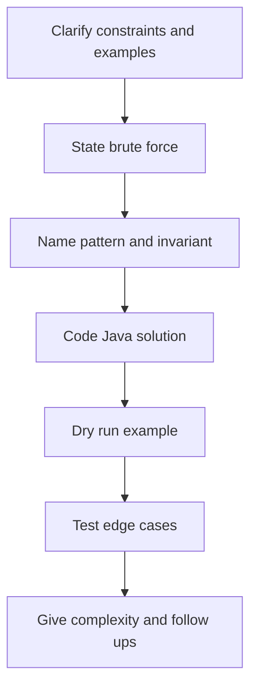
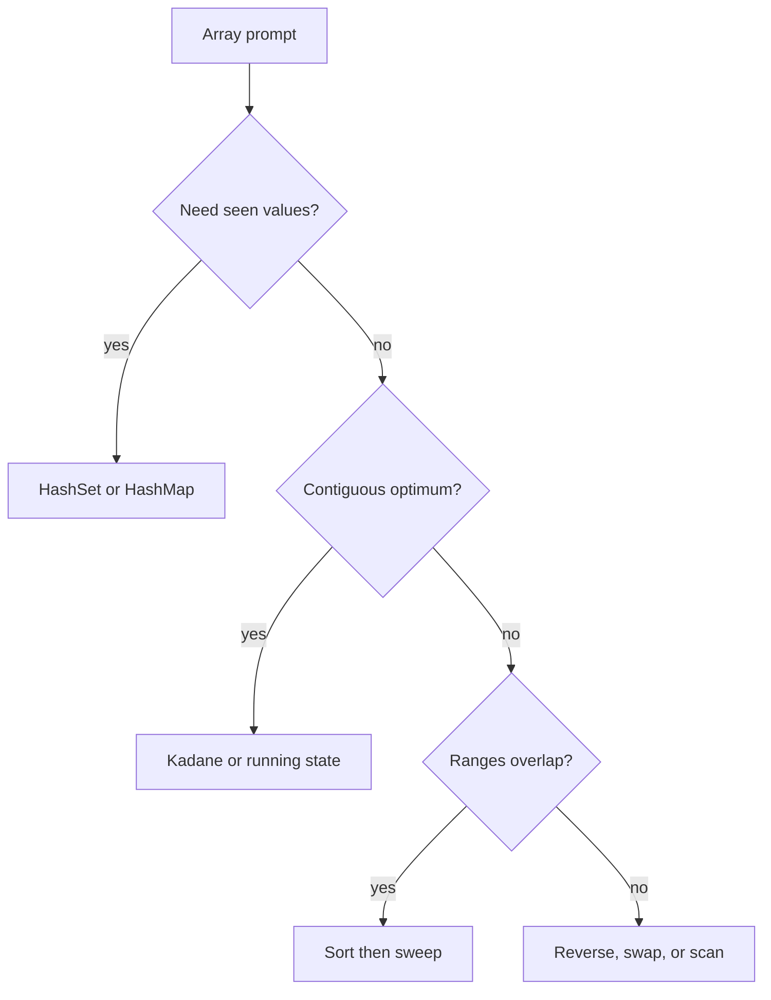
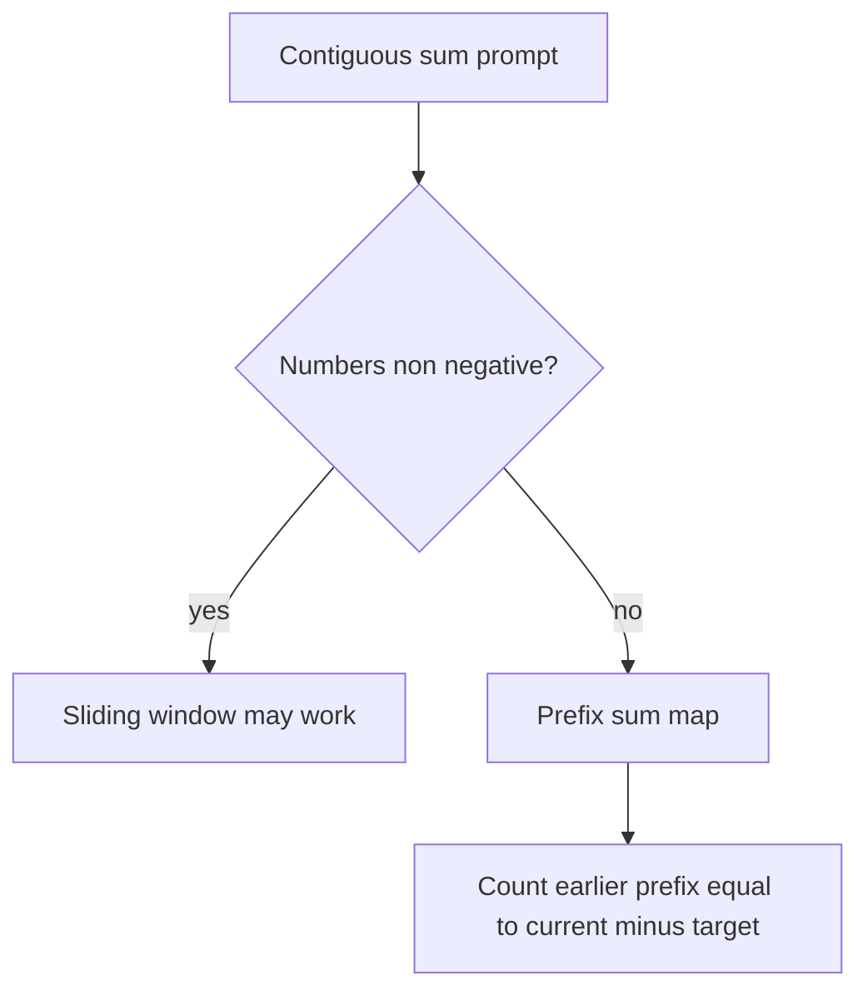
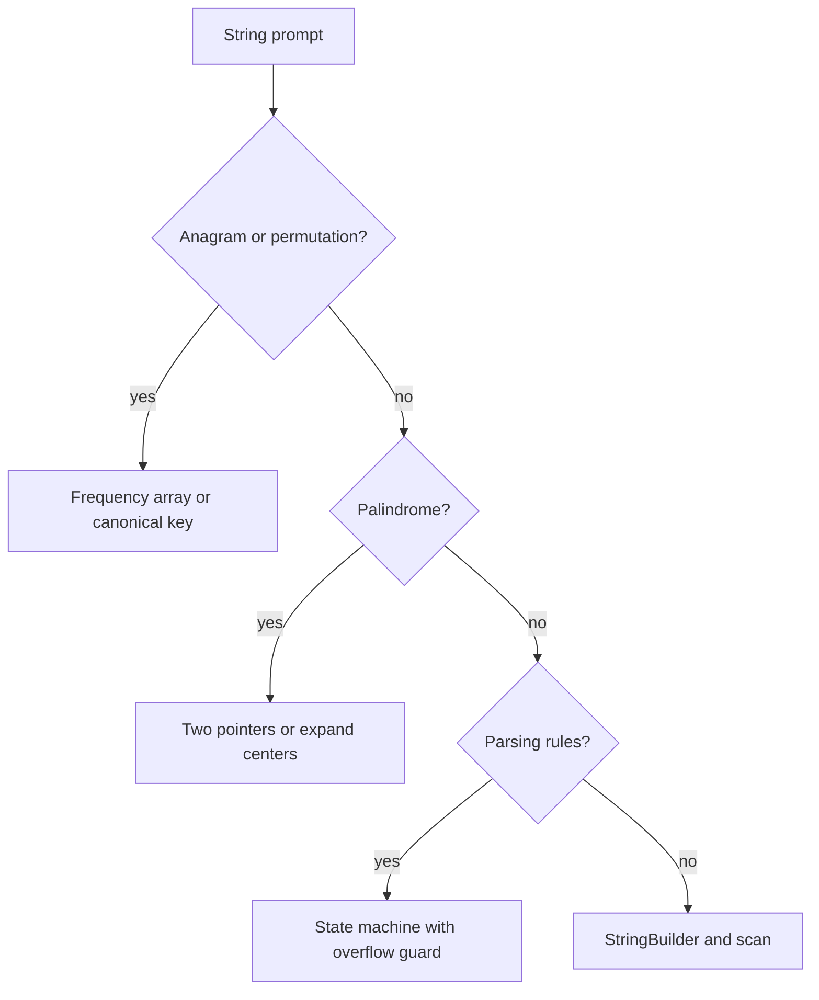
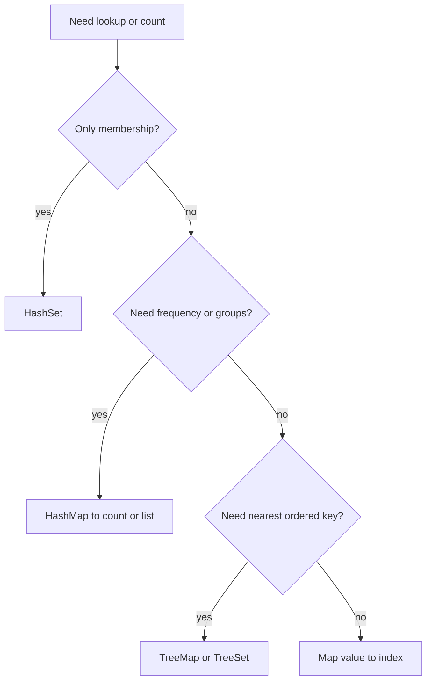

# 08a · DSA Foundations: Arrays, Strings, Hashing

Study-guide for the first SDE-1 coding layer: communicate clearly, choose the right pattern, code Java 17 cleanly, and test edge cases.

**Legend:** 🟢 Beginner · 🟡 Intermediate · 🔴 Advanced · ⚫ FAANG · 🔥 = very frequently asked

## Table of Contents
- [Beginner guide to this file](#beginner-guide-to-this-file)
- [Interview solving flow](#interview-solving-flow)
- [Big-O cheat sheet](#big-o-cheat-sheet)
- [Java toolkit for coding rounds](#java-toolkit-for-coding-rounds)
- [Arrays and intervals](#arrays-and-intervals)
- [Prefix Sum](#prefix-sum)
- [Strings](#strings)
- [Hashing](#hashing)
- [Flashcards](#flashcards)
- [Revision Cheat Sheet](#revision-cheat-sheet)

## Beginner guide to this file

### What this file teaches

This file teaches the first layer of Data Structures and Algorithms (DSA): arrays, strings, hashing,
prefix sums, intervals, and matrix scans. Interviewers ask these because they reveal whether a beginner can
translate a plain problem into stored state, a loop invariant, and clean Java code. The same ideas show up in
backend work when you deduplicate request identifiers, group log events, merge time ranges, parse input, or
process rows from a database result.

### Mental model

Think of the input as a workbench: arrays are numbered slots, strings are arrays of characters, hash tables
are labeled drawers, and prefix sums are running totals written in the margin.

- Arrays keep order, so ask what each index means before moving it.
- Hashing trades extra memory for fast membership, counting, or grouping.
- Prefix sums turn many range-sum questions into subtraction of earlier totals.
- Sorting intervals creates a left-to-right sweep where only the last merged range matters.
- String problems usually reduce to character counts, parser states, or centers.
- Matrix problems need a clear boundary or marker plan before mutating cells.

### How to think through any question here

1. Restate the output: one index pair, one count, a transformed array, groups, or a traversal order.
2. Say the brute force first and identify the repeated work: all pairs, all substrings, or repeated scans.
3. Look for the information you wish you had already seen, such as a complement, count, prefix, or boundary.
4. Choose the state: set, map, running minimum, current best, sorted last interval, or matrix marker.
5. State the invariant in simple words, for example, processed items are already correct or the map contains
   all prefixes before the current index.
6. Code the Java loop so updates happen in the same order as the invariant.
7. Dry run one normal example and then say edge cases: empty input, duplicates, negatives, zeros, overflow,
   and one-element input.

### Pattern recognition cues

| If the question mentions... | Think about... | Why it fits |
|---|---|---|
| Pair, target sum, or complement | Hash map of value to index | Each new value can ask whether its partner was seen. |
| Duplicate, seen before, or membership | HashSet or HashMap | Constant-time lookup avoids comparing every pair. |
| Contiguous subarray sum with negatives | Prefix sum plus map | Negative numbers break simple expanding and shrinking. |
| Maximum contiguous sum | Kadane running state | The best subarray ending here either extends or restarts. |
| Except self or all other elements | Prefix and suffix passes | Left and right contributions meet at each index. |
| Overlapping ranges or calendars | Sort and sweep intervals | Sorted starts make overlap a local decision. |
| Anagram or same letters | Frequency count key | Character order is irrelevant, counts are the identity. |
| Longest palindrome substring | Expand around centers | Every palindrome has an odd or even center. |
| Mutate matrix using original zeros | First-row and first-column markers | Extra marker arrays can be compressed into the matrix. |
| Top k frequent values | Frequency buckets or heap | You need frequency order, not full numeric order. |
| Next lexicographic arrangement | Decreasing suffix | The rightmost improvable pivot gives the next permutation. |

### Abbreviations and key terms

| Short form | Expanded form | Plain meaning |
|---|---|---|
| 2D | Two-dimensional | A grid or matrix with rows and columns. |
| ASCII | American Standard Code for Information Interchange | A basic character set often modeled with 128 slots. |
| Big-O or O(...) | Order of growth | A rough measure of how time or memory grows with input size. |
| DP | Dynamic Programming | Reusing stored answers to overlapping subproblems. |
| DSA | Data Structures and Algorithms | Ways to store data and steps to solve problems efficiently. |
| FAANG | Facebook/Meta, Amazon, Apple, Netflix, Google | Shorthand for large technology-company interview style. |
| k or K | Problem-specific count or target | Often a target sum, rank, number of groups, or window size. |
| m | Secondary input size | Often the length of a second string, list, or dimension. |
| n | Primary input size | Usually the number of elements in the main input. |
| Pn | Problem number | The file's numbered practice problem label, such as P1. |
| Q | Question | Used in flashcards for the prompt side. |
| SDE-1 | Software Development Engineer level 1 | Entry-level software engineering interview scope. |

### Common beginner traps

- Using a sliding window when negative numbers mean the sum is not monotonic.
- Sorting away original indices in Two Sum without preserving where values came from.
- Updating a hash map before checking the current element when the solution needs two different indices.
- Forgetting zeros in product problems and overflow in parser or sum problems.
- Merging intervals without sorting by start time first.
- Mutating a matrix immediately before all original zero positions have been recorded.
- Treating strings as only lowercase American Standard Code for Information Interchange (ASCII) when the
  prompt might allow Unicode.

### How to study this file

1. For each problem, read the short problem statement and predict the pattern before reading the solution.
2. Say the brute force out loud, including why it is too slow for the expected input size.
3. Read the detailed approach and write the invariant in your own words.
4. Type the Java solution from memory, then compare against the provided code for update order and edge cases.
5. Use the flashcards for spaced recall, but always pair each card with one active dry run.
6. Revisit the revision cheat sheet after solving five problems and group mistakes by pattern.

### Scalability and production lens

In production, these same patterns appear on larger and messier data. Hash maps improve latency but consume
memory, sort-and-sweep can be expensive unless data is already indexed, and parsers must be explicit about
invalid input and overflow. For backend systems, also ask whether the data arrives as a stream, whether it fits
in memory, and whether ordering, duplicates, or Unicode rules change the toy interview assumptions.

## Interview solving flow


## Big-O cheat sheet
| Big-O | Coding-round signal | Example |
|---|---|---|
| O(1) | fixed variables | swap, running min |
| O(log n) | halve sorted space | binary search |
| O(n) | one pass | Kadane, hash lookup |
| O(n log n) | sorting dominates | intervals |
| O(n^2) | all pairs or centers | 3Sum inner scan, palindrome expand |
| O(2^n) | choose or skip | subsets |

## Java toolkit for coding rounds
```java
import java.io.*;
import java.util.*;
class Toolkit {
    void use() {
        List<Integer> a = new ArrayList<>();
        Map<String, Integer> m = new HashMap<>();
        m.put("x", m.getOrDefault("x", 0) + 1);
        m.merge("y", 1, Integer::sum);
        TreeMap<Integer, String> tm = new TreeMap<>();
        Integer lo = tm.floorKey(7), hi = tm.ceilingKey(7);
        ArrayDeque<Integer> dq = new ArrayDeque<>();
        dq.push(1);
        dq.pop();
        dq.offer(2);
        dq.poll();
        PriorityQueue<int[]> pq = new PriorityQueue<>((p, q) -> Integer.compare(p[1], q[1]));
        int[] nums = {3, 1, 2};
        Arrays.sort(nums);
        Arrays.fill(nums, 0);
        StringBuilder sb = new StringBuilder().append('a').append(10);
    }
}

class FastScanner {
    BufferedReader br = new BufferedReader(new InputStreamReader(System.in));
    StringTokenizer st;
    String next() throws IOException {
        while (st == null || !st.hasMoreTokens()) st = new StringTokenizer(br.readLine());
        return st.nextToken();
    }

    int nextInt() throws IOException {
        return Integer.parseInt(next());
    }
}
```
Prefer `ArrayDeque` over legacy `Stack`; use `long` for risky sums/products; compare boxed `Integer` with `.equals`; avoid deep recursion when `n` can be large.

## Arrays and intervals
Arrays need a clear invariant: processed prefix, current best ending here, or sorted intervals already merged.

Reusable Java template:
```java
class Solution {
    public int kadane(int[] a) {
        int cur = a[0], best = a[0];
        for (int i = 1; i < a.length; i++) {
            cur = Math.max(a[i], cur + a[i]);
            best = Math.max(best, cur);
        }

        return best;
    }
}
```

### P1. Two Sum (LeetCode 1)
`🟢 Easy` `🔥` `Must-know SDE-1` · Pattern: Hash map complement · Commonly reported at: Amazon, Google, Microsoft, Meta
**Problem:** Return indices of two numbers adding to target. Example `nums=[2,7,11,15], target=9 -> [0,1]`.

**How to recognize and think:** In plain words, find the earlier number that completes the current one to the
target and return both indices. Cues such as "two numbers", "target", and "return indices" point to
complements, not sorting, because the original positions matter. The double loop keeps asking the same
question for many pairs: has any previous value already matched this number? Store previous values in a hash
map from value to index. Before processing index i, the map represents exactly the left side, so a found
complement cannot reuse the current element. Picture a checklist: after seeing 2, the checklist lets 7
immediately find 2. Say duplicates, negative values, and no-solution variants aloud.

**How to recognize the pattern:** Pair sum plus indices means remember previous values.
**Brute force:** Try all pairs — O(n^2) time, O(1) space
**Better:** Sort and two-pointer if indices are irrelevant.
**Optimal:** For each `x`, check whether `target-x` was seen.
```java
import java.util.*;
class Solution {
    public int[] twoSum(int[] nums, int target) {
        Map<Integer, Integer> seen = new HashMap<>();
        for (int i = 0; i < nums.length; i++) {
            int need = target - nums[i];
            if (seen.containsKey(need)) return new int[] {seen.get(need), i};
            seen.put(nums[i], i);
        }

        return new int[] {-1, -1};
    }
}
```
**Complexity:** Time O(n), Space O(n)
**Dry run:** Store `2`; at `7`, need `2`, return `[0,1]`.
**Edge cases:** duplicates, negatives, no-solution variant.
**Follow-ups:** all pairs → count map; sorted input → two pointers; 3Sum → sort and fix one value.

### P2. Best Time to Buy and Sell Stock (LeetCode 121)
`🟢 Easy` `🔥` `Must-know SDE-1` · Pattern: Running minimum · Commonly reported at: Amazon, Microsoft, Google
**Problem:** Max profit from one buy before one sell. Example `[7,1,5,3,6,4] -> 5`.

**How to recognize and think:** Treat the task as choosing one earlier buy day and one later sell day. Phrases
like "one transaction", "buy before sell", and "maximum profit" reveal a chronological running-state problem.
The nested version tests every sell against every earlier buy, repeatedly rediscovering the cheapest prior
price. The aha is that a sell day only needs the minimum price seen before it, not every buy day. While
scanning, min is the cheapest processed price and best is the greatest profit already achievable, so each new
price has one honest comparison. Mentally watch 7, then 1 reset the floor; 6 sells from that floor for 5.
Mention decreasing prices, equal prices, and one-element arrays.

**How to recognize the pattern:** Chronological max difference with one transaction.
**Brute force:** Every buy-sell pair — O(n^2) time, O(1) space
**Optimal:** Track minimum price so far and best `price-min`.
```java
class Solution {
    public int maxProfit(int[] prices) {
        int min = Integer.MAX_VALUE, best = 0;
        for (int p : prices) {
            min = Math.min(min, p);
            best = Math.max(best, p - min);
        }

        return best;
    }
}
```
**Complexity:** Time O(n), Space O(1)
**Dry run:** min becomes `1`; sell at `6` gives `5`.
**Edge cases:** decreasing prices, one item, equal prices.
**Follow-ups:** unlimited trades → sum positive deltas; fee/cooldown → DP states; return days → store min index.

### P3. Contains Duplicate (LeetCode 217)
`🟢 Easy` `🔥` `Must-know SDE-1` · Pattern: Hash set · Commonly reported at: Amazon, Microsoft, Apple
**Problem:** Return true if any value repeats. Example `[1,2,3,1] -> true`.

**How to recognize and think:** This asks whether any value appears twice; order, distance, and the
duplicate's positions do not matter. Words such as "contains duplicate", "any value repeats", and "return
true" point to membership memory. Comparing all pairs rechecks the same earlier values against each later
value, so one repeated number may be discovered only after many wasted comparisons. Keep a hash set of values
already processed. The set is an exact snapshot of the prefix; if adding x fails, x has appeared before and
the answer is settled. Imagine stamping each number on a card wall: the second 1 hits an existing stamp. Call
out empty input, all-unique input, and negative numbers.

**How to recognize the pattern:** Need existence of duplicate, not order.
**Brute force:** Compare all pairs — O(n^2), O(1)
**Better:** Sort and compare neighbors — O(n log n), O(1) or O(n)
**Optimal:** Insert into set; duplicate if insertion fails.
```java
import java.util.*;
class Solution {
    public boolean containsDuplicate(int[] nums) {
        Set<Integer> seen = new HashSet<>();
        for (int x : nums) if (!seen.add(x)) return true;
        return false;
    }
}
```
**Complexity:** Time O(n), Space O(n)
**Dry run:** second `1` already exists.
**Edge cases:** empty, all unique, negative values.
**Follow-ups:** nearby duplicate → last-index map; almost duplicate → TreeSet window; memory tight → sort.

### P4. Product of Array Except Self (LeetCode 238)
`🟡 Medium` `🔥` `Must-know SDE-1` · Pattern: Prefix and suffix products · Commonly reported at: Meta, Amazon, Microsoft, Google
**Problem:** Product of all elements except current without division. Example `[1,2,3,4] -> [24,12,8,6]`.

**How to recognize and think:** The plain task is to multiply everything except the current slot, with no
division. Cues are "except self", "without division", and an associative operation, which suggest separating
left-side and right-side contributions. The brute force multiplies nearly the whole array again for each
index; most factors are recomputed many times. The trick is to store the product before i in the output during
a left pass, then multiply by the product after i during a right pass. At every index, answer[i] becomes left
product times right product, exactly excluding nums[i]. Visualize two waves crossing the array from opposite
ends. Discuss one zero, multiple zeros, and sign changes from negatives.

**How to recognize the pattern:** “Except self” and associative operation hint left/right passes.
**Brute force:** Multiply all others per index — O(n^2), O(1)
**Better:** Division if allowed, but zeros complicate it.
**Optimal:** Output stores left product, then multiply by running right product.
```java
class Solution {
    public int[] productExceptSelf(int[] nums) {
        int n = nums.length;
        int[] ans = new int[n];
        int left = 1;
        for (int i = 0; i < n; i++) {
            ans[i] = left;
            left *= nums[i];
        }

        int right = 1;
        for (int i = n - 1; i >= 0; i--) {
            ans[i] *= right;
            right *= nums[i];
        }

        return ans;
    }
}
```
**Complexity:** Time O(n), Space O(1) excluding output
**Dry run:** left `[1,1,2,6]`; right pass produces `[24,12,8,6]`.
**Edge cases:** one zero, many zeros, negatives.
**Follow-ups:** modulo product → modular inverse only under conditions; 2D → row/column prefixes; division variant → count zeros.

### P5. Maximum Subarray (Kadane) (LeetCode 53)
`🟡 Medium` `🔥` `Must-know SDE-1` · Pattern: Kadane DP · Commonly reported at: Amazon, Microsoft, Google, Apple
**Problem:** Maximum sum contiguous subarray. Example `[-2,1,-3,4,-1,2,1,-5,4] -> 6`.

**How to recognize and think:** This is about the best sum over one contiguous slice. The words "maximum",
"sum", and "contiguous subarray" signal an extend-or-restart decision at each element. Trying every start with
a running sum still rebuilds many overlapping suffixes and carries bad negative prefixes too long. The aha is
local: the best subarray ending at x is either x alone or the previous ending subarray plus x. Keep cur for
that ending-here answer and best for anything seen so far; those two facts fully summarize the processed
prefix. Picture cur as a backpack you drop when it becomes heavier than helpful. Say all-negative arrays, a
single element, and zeros.

**How to recognize the pattern:** “Maximum contiguous” asks extend or restart.
**Brute force:** All starts with running sum — O(n^2), O(1)
**Optimal:** `cur=max(x,cur+x)` and update global best.
```java
class Solution {
    public int maxSubArray(int[] nums) {
        int cur = nums[0], best = nums[0];
        for (int i = 1; i < nums.length; i++) {
            cur = Math.max(nums[i], cur + nums[i]);
            best = Math.max(best, cur);
        }

        return best;
    }
}
```
**Complexity:** Time O(n), Space O(1)
**Dry run:** `[4,-1,2,1]` reaches `6`.
**Edge cases:** all negative, one element, zeros.
**Follow-ups:** indices → track restart; circular → total minus min subarray; max product → track min and max.

### P6. Majority Element (LeetCode 169)
`🟢 Easy` `🔥` `Must-know SDE-1` · Pattern: Boyer-Moore voting · Commonly reported at: Amazon, Adobe, Microsoft
**Problem:** Element appearing more than `n/2` times. Example `[2,2,1,1,1,2,2] -> 2`.

**How to recognize and think:** The promise is stronger than "most common": one value appears more than half
the array. Cues include "> n/2", "majority", and a guaranteed answer. Counting every candidate repeats scans,
and a hash table spends memory on values that cannot survive the strict majority rule. Boyer-Moore voting
pairs one occurrence of the current candidate with a different value and cancels both. After processing a
prefix, candidate and count represent the uncanceled residue of that prefix; a true majority cannot be
completely canceled by all other values combined. Trace votes as a scoreboard: 2 gains, 1 spends, 2 remains.
Mention one item, a majority that appears late, and the variant where verification is required.

**How to recognize the pattern:** Strict majority can cancel every non-majority element.
**Brute force:** Count each candidate — O(n^2), O(1)
**Better:** Hash counts — O(n), O(n)
**Optimal:** Maintain candidate and vote balance.
```java
class Solution {
    public int majorityElement(int[] nums) {
        int cand = 0, count = 0;
        for (int x : nums) {
            if (count == 0) {
                cand = x;
            }
            count += x == cand ? 1 : -1;
        }

        return cand;
    }
}
```
**Complexity:** Time O(n), Space O(1)
**Dry run:** votes cancel; `2` survives.
**Edge cases:** one item, majority late, no-majority variant needs verification.
**Follow-ups:** `n/3` → two candidates; streaming → same idea; proof → cancellation.

### P7. Rotate Array (LeetCode 189)
`🟡 Medium` `🔥` `Must-know SDE-1` · Pattern: Reversal · Commonly reported at: Amazon, Microsoft, Google
**Problem:** Rotate right by `k`. Example `[1,2,3,4,5,6,7], k=3 -> [5,6,7,1,2,3,4]`.

**How to recognize and think:** The array must move right by k positions in place, and k may exceed the
length. Those words point to rearranging segments rather than comparing values. Repeated one-step shifts move
the same elements k times, while a copy array solves placement but violates the space goal. The observation is
that the last k elements become the front segment, and the old prefix follows them. Reversing the whole array
brings the suffix forward; reversing the two parts restores each part's internal order. The state picture is
"flip the necklace, then untwist each half." Normalize k with modulo n, and say k equals 0, k bigger than n,
and length 1.

**How to recognize the pattern:** In-place cyclic shift with `k` possibly larger than `n`.
**Brute force:** Shift one step `k` times — O(nk), O(1)
**Better:** Copy into target indices — O(n), O(n)
**Optimal:** Reverse all, reverse first `k`, reverse rest.
```java
class Solution {
    public void rotate(int[] nums, int k) {
        int n = nums.length;
        k %= n;
        rev(nums, 0, n - 1);
        rev(nums, 0, k - 1);
        rev(nums, k, n - 1);
    }

    void rev(int[] a, int l, int r) {
        while (l < r) {
            int t = a[l];
            a[l++] = a[r];
            a[r--] = t;
        }
    }
}
```
**Complexity:** Time O(n), Space O(1)
**Dry run:** `[7,6,5,4,3,2,1]` then `[5,6,7,1,2,3,4]`.
**Edge cases:** `k=0`, `k>n`, length 1.
**Follow-ups:** left rotate → `n-k`; linked list rotate → make cycle and cut; stream → ring buffer.

### P8. Merge Intervals (LeetCode 56)
`🟡 Medium` `🔥` `Must-know SDE-1` · Pattern: Sort and sweep · Commonly reported at: Google, Amazon, Microsoft, Meta
**Problem:** Merge overlapping intervals. Example `[[1,3],[2,6],[8,10]] -> [[1,6],[8,10]]`.

**How to recognize and think:** You are combining ranges that overlap into the smallest set of covered ranges.
Cues such as "intervals", "overlap", and "merge" suggest sorting by start time before sweeping. A pairwise
merge loop keeps changing the list, then has to compare newly formed ranges again with many others. Once
sorted, any interval that can overlap the current merged range must appear next, not hidden later. The
maintained result contains finalized non-overlapping ranges for the processed prefix; the last range is the
only one still expandable. Imagine painting a number line from left to right, extending wet paint when the
next stroke touches it. Say touching endpoints, nested intervals, and empty-input variants.

**How to recognize the pattern:** Ranges overlap; sorting by start creates local decisions.
**Brute force:** Repeatedly merge pairs — O(n^2), O(n)
**Optimal:** Sort; extend last interval if next start <= last end.
```java
import java.util.*;
class Solution {
    public int[][] merge(int[][] intervals) {
        Arrays.sort(intervals, (a, b)->Integer.compare(a[0], b[0]));
        List<int[]> res = new ArrayList<>();
        for (int[] in : intervals) {
            if (res.isEmpty() || res.get(res.size() - 1)[1] < in[0]) res.add(new int[] {in[0], in[1]});
            else res.get(res.size() - 1)[1] = Math.max(res.get(res.size() - 1)[1], in[1]);
        }

        return res.toArray(new int[res.size()][]);
    }
}
```
**Complexity:** Time O(n log n), Space O(n)
**Dry run:** `[1,3]` absorbs `[2,6]`; `[8,10]` starts new.
**Edge cases:** touching intervals, nested intervals, empty variant.
**Follow-ups:** meeting rooms → min-heap ends; insert interval → three-phase scan; free time → merge schedules.

### P9. Insert Interval (LeetCode 57)
`🟡 Medium` `🔥` `Must-know SDE-1` · Pattern: Three-phase interval scan · Commonly reported at: Google, Meta, Amazon
**Problem:** Insert and merge into sorted disjoint intervals. Example `[[1,3],[6,9]], [2,5] -> [[1,5],[6,9]]`.

**How to recognize and think:** Here the existing intervals are already sorted and disjoint, and only one new
interval enters. The phrases "insert", "sorted", and "non-overlapping intervals" are the giveaways. Adding the
interval and sorting throws away information the input has already paid for. The better mental split is three
zones: intervals ending before the new one, intervals overlapping it, and intervals starting after it.
Before-zone intervals are final; during the overlap zone, the new interval expands to the union; after-zone
intervals are final again. Trace [2,5] swallowing [1,3] into [1,5], then leaving [6,9] untouched. Say insert
before all, after all, and a new interval covering everything.

**How to recognize the pattern:** Input already sorted and non-overlapping.
**Brute force:** Add, sort, merge — O(n log n), O(n)
**Optimal:** Add intervals before new, merge overlaps into new, append after.
```java
import java.util.*;
class Solution {
    public int[][] insert(int[][] intervals, int[] ni) {
        List<int[]> res = new ArrayList<>();
        int i = 0, n = intervals.length;
        while (i < n && intervals[i][1] < ni[0]) res.add(intervals[i++]);
        while (i < n && intervals[i][0] <= ni[1]) {
            ni[0] = Math.min(ni[0], intervals[i][0]);
            ni[1] = Math.max(ni[1], intervals[i][1]);
            i++;
        }

        res.add(ni);
        while (i < n) res.add(intervals[i++]);
        return res.toArray(new int[res.size()][]);
    }
}
```
**Complexity:** Time O(n), Space O(n)
**Dry run:** `[1,3]` overlaps `[2,5]` -> `[1,5]`; append `[6,9]`.
**Edge cases:** before all, after all, covers all.
**Follow-ups:** unsorted → sort first; many inserts → TreeMap intervals; delete interval → split ranges.

## Prefix Sum
Prefix sum answers contiguous-range sums by subtracting earlier cumulative sums; with negatives, prefer prefix maps over sliding windows.

Reusable Java template:
```java
import java.util.*;
class Solution {
    int count(int[] a, int k) {
        Map<Integer, Integer> f = new HashMap<>();
        f.put(0, 1);
        int sum = 0, ans = 0;
        for (int x : a) {
            sum += x;
            ans += f.getOrDefault(sum - k, 0);
            f.put(sum, f.getOrDefault(sum, 0) + 1);
        }

        return ans;
    }
}
```

### P10. Subarray Sum Equals K (LeetCode 560)
`🟡 Medium` `🔥` `Must-know SDE-1` · Pattern: Prefix sum plus hash map · Commonly reported at: Meta, Amazon, Google, Microsoft
**Problem:** Count contiguous subarrays summing to `k`. Example `[1,1,1], k=2 -> 2`.

**How to recognize and think:** The task counts contiguous subarrays, and numbers may be negative. Cues are
"subarray", "sum equals k", and "count", while negative values warn against a normal sliding window. Trying
every start repeats the same prefix additions, and a window can fail because expanding may decrease the sum or
shrinking may increase it. Convert each subarray sum into a difference of prefix sums: ending at the current
index works when an earlier prefix equals currentSum - k. The map stores how often each earlier prefix has
appeared, so every ending position counts all valid starts at once. Picture mile markers on a road; equal
spacing marks a segment of length k. Say k equals 0, many zeros, and negative numbers.

**How to recognize the pattern:** Count subarrays and values may be negative, so window monotonicity fails.
**Brute force:** All starts with running sum — O(n^2), O(1)
**Optimal:** Count earlier prefix sums equal to `current-k`.
```java
import java.util.*;
class Solution {
    public int subarraySum(int[] nums, int k) {
        Map<Integer, Integer> f = new HashMap<>();
        f.put(0, 1);
        int sum = 0, ans = 0;
        for (int x : nums) {
            sum += x;
            ans += f.getOrDefault(sum - k, 0);
            f.put(sum, f.getOrDefault(sum, 0) + 1);
        }

        return ans;
    }
}
```
**Complexity:** Time O(n), Space O(n)
**Dry run:** prefixes `1,2,3`; matches for `0` and `1`, total `2`.
**Edge cases:** negative numbers, `k=0`, many zeros.
**Follow-ups:** longest sum K → earliest prefix index; sum divisible by K → prefix remainders; 2D target → compress rows.

## Strings
String questions usually become frequency counting, two pointers, center expansion, or careful parsing. Clarify ASCII, lowercase, and Unicode.

Reusable Java template:
```java
class Solution {
    int expand(String s, int l, int r) {
        while (l >= 0 && r < s.length() && s.charAt(l) == s.charAt(r)) {
            l--;
            r++;
        }

        return r - l - 1;
    }
}
```

### P11. Group Anagrams (LeetCode 49)
`🟡 Medium` `🔥` `Must-know SDE-1` · Pattern: Canonical key hashing · Commonly reported at: Amazon, Meta, Google, Microsoft
**Problem:** Group anagrams. Example `["eat","tea","tan","ate"] -> [[eat,tea,ate],[tan]]`.

**How to recognize and think:** In plain terms, words belong together when they contain the same letters with
the same counts. Cues like "group anagrams", "same letters", and "order does not matter" point to a canonical
key. Pairwise comparison scans words repeatedly and asks the same multiset question for many pairs. Build one
signature per word instead: for lowercase letters, a 26-count key uniquely represents the multiset. The map
invariant is that every key's list contains exactly the words with that signature. Imagine sorting mail into
boxes labeled by letter inventory rather than by spelling. Say empty strings, duplicate words, and inputs
outside lowercase English letters, where a character map or Unicode-aware key is safer.

**How to recognize the pattern:** Order in word does not matter; character multiset does.
**Brute force:** Pairwise count comparison — O(n^2*m)
**Better:** Sort each word key — O(n*m log m)
**Optimal:** Use 26-count key for lowercase words.
```java
import java.util.*;
class Solution {
    public List<List<String>> groupAnagrams(String[] strs) {
        Map<String, List<String>> map = new HashMap<>();
        for (String s : strs) {
            int[] c = new int[26];
            for (char ch : s.toCharArray()) c[ch - 'a']++;
            StringBuilder key = new StringBuilder();
            for (int x : c) key.append('#').append(x);
            map.computeIfAbsent(key.toString(), z->new ArrayList<>()).add(s);
        }

        return new ArrayList<>(map.values());
    }
}
```
**Complexity:** Time O(total characters), Space O(total characters)
**Dry run:** `eat`, `tea`, `ate` share the same count key.
**Edge cases:** empty strings, duplicates, non-lowercase variant.
**Follow-ups:** Unicode → map chars; streaming → maintain groups; sorted key → simpler but slower.

### P12. Valid Anagram (LeetCode 242)
`🟢 Easy` `🔥` `Must-know SDE-1` · Pattern: Frequency counting · Commonly reported at: Amazon, Microsoft, Bloomberg
**Problem:** Check whether `t` is an anagram of `s`. Example `anagram/nagaram -> true`.

**How to recognize and think:** This asks whether two strings use the same characters the same number of
times. Cues are "anagram", "same length", and "same character counts". Sorting both strings works but pays for
ordering even though order is irrelevant; comparing unsorted positions is simply the wrong question. Use one
count array as a difference ledger: add for the first string and subtract for the second. After processing
paired positions, each slot records the remaining imbalance for that letter; all zeros means the multisets
match. Picture two piles of letter tiles canceling tile by tile. Say different lengths first, repeated letters
such as aab versus aba, and Unicode inputs that do not fit 26 lowercase slots.

**How to recognize the pattern:** Same length and same character counts.
**Brute force:** Sort both strings — O(n log n), O(n)
**Optimal:** Increment for `s`, decrement for `t`, verify zeros.
```java
class Solution {
    public boolean isAnagram(String s, String t) {
        if (s.length() != t.length()) return false;
        int[] c = new int[26];
        for (int i = 0; i < s.length(); i++) {
            c[s.charAt(i) - 'a']++;
            c[t.charAt(i) - 'a']--;
        }

        for (int x : c) if (x != 0) return false;
        return true;
    }
}
```
**Complexity:** Time O(n), Space O(1) for fixed alphabet
**Dry run:** counts cancel for matching letters.
**Edge cases:** different lengths, repeated chars, Unicode.
**Follow-ups:** many queries → signatures; group anagrams → key map; Unicode → HashMap.

### P13. Longest Palindromic Substring (LeetCode 5)
`🟡 Medium` `🔥` `Must-know SDE-1` · Pattern: Expand around center · Commonly reported at: Amazon, Microsoft, Google, Meta
**Problem:** Return longest palindromic substring. Example `babad -> bab` or `aba`.

**How to recognize and think:** The answer must be a contiguous substring that reads the same backward and
forward. Cues are "longest", "palindromic", and "substring", not subsequence. Checking every substring repeats
comparisons around the same centers, and a dynamic programming table saves results but uses much more space.
The center insight is that every palindrome grows from either one middle character or the gap between two
characters. During an expansion, the last successful left-right pair defines the largest palindrome for that
center; updating global best across centers covers all possibilities. Picture ripples expanding from each
center until mismatched letters stop them. Say even-length palindromes, all same characters, and the
empty-string variant.

**How to recognize the pattern:** Contiguous palindrome, and each palindrome has an odd or even center.
**Brute force:** Check all substrings — O(n^3)
**Better:** DP table — O(n^2) time, O(n^2) space
**Optimal:** Expand from every center — O(n^2), O(1).
```java
class Solution {
    public String longestPalindrome(String s) {
        int start = 0, end = 0;
        for (int i = 0; i < s.length(); i++) {
            int len = Math.max(exp(s, i, i), exp(s, i, i + 1));
            if (len > end - start + 1) {
                start = i - (len - 1) / 2;
                end = i + len / 2;
            }
        }

        return s.substring(start, end + 1);
    }

    int exp(String s, int l, int r) {
        while (l >= 0 && r < s.length() && s.charAt(l) == s.charAt(r)) {
            l--;
            r++;
        }

        return r - l - 1;
    }
}
```
**Complexity:** Time O(n^2), Space O(1)
**Dry run:** center around `a` expands to `bab` or `aba`.
**Edge cases:** even palindrome, all same chars, empty variant.
**Follow-ups:** count palindromes → count each expansion; subsequence → DP; Manacher → O(n) stretch.

### P14. String to Integer atoi (LeetCode 8)
`🟡 Medium` `🔥` `Must-know SDE-1` · Pattern: Controlled parser · Commonly reported at: Amazon, Microsoft, Bloomberg
**Problem:** Parse spaces, optional sign, digits, clamp to 32-bit int. Example `"   -42" -> -42`.

**How to recognize and think:** This is a small parser, not just a conversion call. Cues include "leading
spaces", "optional sign", "digits", and "clamp to 32-bit integer". Library parsing after slicing is incorrect
for cases like trailing words, missing digits, or overflow; it may throw instead of returning the required
boundary. The robust approach is a one-way state machine: skip spaces, read at most one sign, then consume
digits while checking overflow before multiplying by 10. The invariant is that ans always fits inside the
positive range before the next digit is appended. Trace spaces, '-', then 4 and 2. Say no digits, '+-12',
overflow, and trailing text.

**How to recognize the pattern:** Edge-heavy parsing with overflow rules.
**Brute force:** Library parse after substring — concise but wrong for overflow/rules.
**Optimal:** Skip spaces, read sign, accumulate with pre-overflow check.
```java
class Solution {
    public int myAtoi(String s) {
        int i = 0, n = s.length();
        while (i < n && s.charAt(i) == ' ') i++;
        int sign = 1;
        if (i < n && (s.charAt(i) == '+' || s.charAt(i) == '-')) {
            sign = s.charAt(i++) == '-' ? -1 : 1;
        }

        int ans = 0;
        while (i < n && Character.isDigit(s.charAt(i))) {
            int d = s.charAt(i++) - '0';
            if (ans > (Integer.MAX_VALUE - d) / 10) {
                return sign == 1 ? Integer.MAX_VALUE : Integer.MIN_VALUE;
            }
            ans = ans * 10 + d;
        }

        return sign * ans;
    }
}
```
**Complexity:** Time O(n), Space O(1)
**Dry run:** skip spaces, sign `-`, parse `42`.
**Edge cases:** no digits, overflow, `+-12`, trailing words.
**Follow-ups:** parse long → bounds change; decimal → handle dot; tokenizer → return next index.

### P15. Encode and Decode Strings (LeetCode 271)
`🟡 Medium` `🔥` `Must-know SDE-1` · Pattern: Length-prefixed serialization · Commonly reported at: Google, Meta, Amazon
**Problem:** Encode list of strings into one string and decode. Example `["lint","code",""] -> "4#lint4#code0#"`.

**How to recognize and think:** The goal is reversible serialization of a list of arbitrary strings. Cues are
"encode", "decode", and data strings that may themselves contain separators or be empty. Joining with a
delimiter loses information when a string contains that delimiter, and escaping rules quickly become tricky.
Prefix each string with its length and a separator: the length tells the decoder exactly how many characters
to copy next. While decoding, the pointer first reads digits up to '#', then takes that many characters, so
embedded '#' characters are ordinary data. Picture labeled boxes: "4#" means the next four characters belong
together. Say empty strings, strings containing '#', and very large strings.

**How to recognize the pattern:** Delimiters may appear in data, so use length prefix.
**Brute force:** Join with delimiter — O(total chars) but incorrect for delimiter-containing strings.
**Optimal:** Write `length#string`; decoder reads length then exact characters.
```java
import java.util.*;
public class Codec {
    public String encode(List<String> strs) {
        StringBuilder sb = new StringBuilder();
        for (String s : strs) sb.append(s.length()).append('#').append(s);
        return sb.toString();
    }

    public List<String> decode(String s) {
        List<String> res = new ArrayList<>();
        int i = 0;
        while (i < s.length()) {
            int j = i;
            while (s.charAt(j) != '#') j++;
            int len = Integer.parseInt(s.substring(i, j));
            j++;
            res.add(s.substring(j, j + len));
            i = j + len;
        }

        return res;
    }
}
```
**Complexity:** Time O(total chars), Space O(total chars)
**Dry run:** read `4`, take `lint`; repeat.
**Edge cases:** empty strings, strings containing `#`, large strings.
**Follow-ups:** binary protocol → byte length; streaming → read length first; escape delimiter → possible but more complex.

## Hashing
Hashing gives average O(1) membership and counting. If the prompt needs order or nearest key, switch to `TreeMap` or sorting.

Reusable Java template:
```java
import java.util.*;
class Solution {
    Map<Integer, Integer> freq(int[] a) {
        Map<Integer, Integer> m = new HashMap<>();
        for (int x : a) m.merge(x, 1, Integer::sum);
        return m;
    }
}
```

### P16. Longest Consecutive Sequence (LeetCode 128)
`🟡 Medium` `🔥` `Must-know SDE-1` · Pattern: Hash set sequence starts · Commonly reported at: Google, Amazon, Meta, Microsoft
**Problem:** Longest consecutive integer run. Example `[100,4,200,1,3,2] -> 4`.

**How to recognize and think:** The array order is irrelevant; the answer is the longest run of integer
neighbors. Cues such as "consecutive", "sequence", and "O(n)" suggest membership checks, not sorting.
Searching linearly for x+1 from every value repeats whole runs many times; sorting is simpler but costs n log
n. Put all values in a hash set, but only begin counting at numbers with no predecessor. That start condition
means each run is walked once, from its first value to the first missing value. Imagine each run as a train:
board only at the engine, never at a middle car. Say duplicates, empty arrays, negative values, and possible
integer-boundary variants.

**How to recognize the pattern:** Consecutive values independent of original order.
**Brute force:** Search each next value linearly — O(n^2)
**Better:** Sort and scan — O(n log n)
**Optimal:** Put values in set; count only from numbers whose predecessor is absent.
```java
import java.util.*;
class Solution {
    public int longestConsecutive(int[] nums) {
        Set<Integer> set = new HashSet<>();
        for (int x : nums) set.add(x);
        int best = 0;
        for (int x : set) if (!set.contains(x - 1)) {
            int y = x;
            while (set.contains(y)) y++;
            best = Math.max(best, y - x);
        }

        return best;
    }
}
```
**Complexity:** Time O(n) average, Space O(n)
**Dry run:** `1` starts; count `1,2,3,4`.
**Edge cases:** duplicates, empty array, negative values.
**Follow-ups:** streaming intervals → TreeMap; return actual run → keep start; memory tight → sort.

### P17. Top K Frequent Elements (LeetCode 347)
`🟡 Medium` `🔥` `Must-know SDE-1` · Pattern: Frequency map plus bucket · Commonly reported at: Amazon, Meta, Google, Microsoft
**Problem:** Return `k` most frequent elements. Example `[1,1,1,2,2,3], k=2 -> [1,2]`.

**How to recognize and think:** You need the values with the largest occurrence counts, not a fully sorted
report. Cues are "top k", "frequent", and "elements". Counting then sorting every unique value does extra
ordering work below the cutoff; a heap reduces that but still pays logarithmic cost. After counting, frequency
can only range from 1 to n, so bucket values by their counts and scan buckets from high to low until k items
are collected. The bucket invariant is exact: bucket c contains only values seen c times. Picture vote totals
placed into labeled bins, then read the fullest bins first. Mention ties, k equal to the number of unique
values, and negative numbers.

**How to recognize the pattern:** Need highest frequencies, not full sorted list.
**Brute force:** Count then sort unique keys — O(m log m)
**Better:** Min-heap size K — O(m log k)
**Optimal:** Bucket keys by frequency from `1..n`.
```java
import java.util.*;
class Solution {
    public int[] topKFrequent(int[] nums, int k) {
        Map<Integer, Integer> f = new HashMap<>();
        for (int x : nums) {
            f.put(x, f.getOrDefault(x, 0) + 1);
        }

        List<Integer>[] b = new List[nums.length + 1];
        for (var e : f.entrySet()) {
            int c = e.getValue();
            if (b[c] == null) {
                b[c] = new ArrayList<>();
            }
            b[c].add(e.getKey());
        }

        int[] ans = new int[k];
        int idx = 0;
        for (int c = b.length - 1; c >= 0 && idx < k; c--) {
            if (b[c] == null) {
                continue;
            }
            for (int x : b[c]) {
                if (idx < k) {
                    ans[idx++] = x;
                }
            }
        }
        return ans;
    }
}
```
**Complexity:** Time O(n), Space O(n)
**Dry run:** buckets at freq `3` and `2` give `1,2`.
**Edge cases:** ties, `k` equals unique count, negative values.
**Follow-ups:** streaming → heap; words → lexicographic tie comparator; sorted output → sort result.

### P18. Set Matrix Zeroes (LeetCode 73)
`🟡 Medium` `🔥` `Must-know SDE-1` · Pattern: In-place matrix markers · Commonly reported at: Amazon, Microsoft, Google
**Problem:** If a cell is zero, set its row and column to zero. Example middle zero in 3x3 zeroes middle row and column.

**How to recognize and think:** The matrix must be changed according to the zeroes that existed before any
changes. Cues are "if a cell is zero", "set row and column", and "in place". A naive immediate write is
incorrect because newly written zeroes would falsely trigger more rows or columns. Extra marker arrays are
safe but spend additional memory. The in-place idea borrows the first row and first column as marker storage,
with separate flags for whether those marker lines originally contained zero. After the marking pass, inner
cells read only those markers; finally the flags handle the marker row and column. Picture sticky notes on row
and column headers. Say first-row zeroes, first-column zeroes, 1x1, and all zeroes.

**How to recognize the pattern:** Mutation must be based on original zero positions.
**Brute force:** Extra row and column marker arrays — O(mn), O(m+n)
**Optimal:** Use first row/column as markers plus two flags.
```java
class Solution {
    public void setZeroes(int[][] a) {
        int m = a.length, n = a[0].length;
        boolean fr = false, fc = false;
        for (int j = 0; j < n; j++) if (a[0][j] == 0) fr = true;
        for (int i = 0; i < m; i++) if (a[i][0] == 0) fc = true;
        for (int i = 1; i < m; i++) for (int j = 1; j < n; j++) if (a[i][j] == 0) {
            a[i][0] = 0;
            a[0][j] = 0;
        }

        for (int i = 1; i < m; i++) for (int j = 1; j < n; j++) if (a[i][0] == 0 || a[0][j] == 0) a[i][j] = 0;
        if (fr) for (int j = 0; j < n; j++) a[0][j] = 0;
        if (fc) for (int i = 0; i < m; i++) a[i][0] = 0;
    }
}
```
**Complexity:** Time O(mn), Space O(1)
**Dry run:** zero at `(1,1)` marks row `1` and col `1`; second pass fills.
**Edge cases:** zero in first row/column, 1x1, all zeros.
**Follow-ups:** immutable input → return copy; sparse matrix → sets; parallel → two phases.

### P19. Spiral Matrix (LeetCode 54)
`🟡 Medium` `🔥` `Must-know SDE-1` · Pattern: Boundary simulation · Commonly reported at: Microsoft, Amazon, Google
**Problem:** Return matrix in spiral order. Example 3x3 -> `[1,2,3,6,9,8,7,4,5]`.

**How to recognize and think:** This is a traversal order problem: output the outside ring, then the next
inner ring. Cues include "spiral", "matrix", and "order". A visited-grid simulation works but spends memory
and risks direction bugs at corners. Four boundaries give a cleaner picture: top, bottom, left, and right
describe the rectangle not yet printed. After traversing a side, shrink the matching boundary; everything
outside the boundaries has already been emitted exactly once. Think of peeling an onion layer clockwise. The
extra checks before bottom-row and left-column passes prevent duplicating a single remaining row or column.
Say one row, one column, and rectangular matrices, not only squares.

**How to recognize the pattern:** Layer-by-layer matrix traversal with shrinking bounds.
**Brute force:** Visited matrix and directions — O(mn), O(mn)
**Optimal:** Maintain top, bottom, left, right boundaries.
```java
import java.util.*;
class Solution {
    public List<Integer> spiralOrder(int[][] a) {
        List<Integer> res = new ArrayList<>();
        int top = 0, bot = a.length - 1, left = 0, right = a[0].length - 1;
        while (top <= bot && left <= right) {
            for (int j = left; j <= right; j++) res.add(a[top][j]);
            top++;
            for (int i = top; i <= bot; i++) res.add(a[i][right]);
            right--;
            if (top <= bot) for (int j = right; j >= left; j--) res.add(a[bot][j]);
            bot--;
            if (left <= right) for (int i = bot; i >= top; i--) res.add(a[i][left]);
            left++;
        }

        return res;
    }
}
```
**Complexity:** Time O(mn), Space O(1) extra excluding output
**Dry run:** top row, right col, bottom row, left col, then center.
**Edge cases:** one row, one column, rectangular matrix.
**Follow-ups:** fill spiral → write values; rotate image → transpose and reverse; anti-spiral → reverse output.

### P20. Next Permutation (LeetCode 31)
`🟡 Medium` `🔥` `Must-know SDE-1` · Pattern: Lexicographic suffix · Commonly reported at: Google, Amazon, Microsoft
**Problem:** Rearrange into next lexicographically greater permutation, or lowest if none. Example `[1,2,3] -> [1,3,2]`.

**How to recognize and think:** The phrase "next lexicographically greater permutation" means make the
smallest possible increase to the array order. Generating permutations is not merely expensive; it ignores the
structure of lexicographic order. Scan from the right to find the first place where a[i] < a[i+1]; everything
after it is non-increasing, already the largest arrangement for that suffix. Swap the pivot with the smallest
larger value to its right, then reverse the suffix to make it as small as possible. The prefix before the
pivot stays unchanged, so the increase is minimal. Trace [1,2,3]: pivot 2 swaps with 3, suffix reverses. Say
descending arrays, duplicates, and length 1.

**How to recognize the pattern:** “Next permutation” means find decreasing suffix.
**Brute force:** Generate all permutations — O(n!*n)
**Optimal:** Find pivot `i` with `a[i] < a[i+1]`, swap with next larger from right, reverse suffix.
```java
class Solution {
    public void nextPermutation(int[] a) {
        int i = a.length - 2;
        while (i >= 0 && a[i] >= a[i + 1]) i--;
        if (i >= 0) {
            int j = a.length - 1;
            while (a[j] <= a[i]) j--;
            swap(a, i, j);
        }

        rev(a, i + 1, a.length - 1);
    }

    void rev(int[] a, int l, int r) {
        while (l < r) swap(a, l++, r--);
    }

    void swap(int[] a, int i, int j) {
        int t = a[i];
        a[i] = a[j];
        a[j] = t;
    }
}
```
**Complexity:** Time O(n), Space O(1)
**Dry run:** `[1,2,3]`: pivot `2`, swap `3`, reverse suffix.
**Edge cases:** descending array, duplicates, length 1.
**Follow-ups:** previous permutation → reverse inequalities; kth permutation → factorial number system; next greater digits → same plus overflow.

## Flashcards
- Q: Kadane invariant? → A: `cur` is best subarray ending at current index.
- Q: Prefix-map seed for subarray sum? → A: `freq.put(0,1)` counts ranges starting at index 0.
- Q: Why not sliding window with negatives? → A: Sum changes are not monotonic.
- Q: Product except self trick? → A: Left pass then right pass using output array.
- Q: Merge intervals first step? → A: Sort by start.
- Q: Length-prefixed encoding benefit? → A: Delimiters can appear in data safely.
- Q: Longest consecutive start? → A: A number with no predecessor.
- Q: Matrix zeroes O(1) storage? → A: First row and column as markers plus flags.
- Q: Next permutation pivot? → A: First from right where `a[i] < a[i+1]`.
- Q: Boyer-Moore needs what? → A: Strict majority guarantee or final verification.

## Revision Cheat Sheet
- Arrays -> signals: one pass, current best, in-place shift -> templates: running min, Kadane, reverse.
- Intervals -> signals: overlaps, calendars, ranges -> sort by start and sweep.
- Prefix Sum -> signals: contiguous sums, negative values, count ranges -> map prefix frequencies.
- Strings -> signals: anagram, palindrome, parser -> frequency array, expand centers, overflow guard.
- Hashing -> signals: complement, duplicate, grouping, frequency -> `HashSet`, `HashMap`, buckets.
- Matrix -> signals: row/column effects or traversal order -> marker flags or shrinking boundaries.
- Interview flow -> clarify, brute force, optimize, code, dry run, edge cases, complexity.
