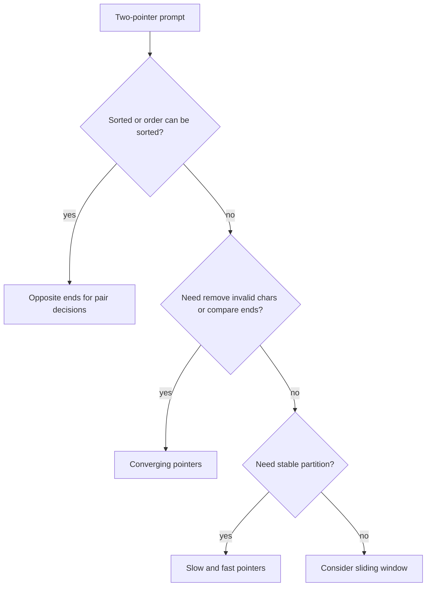
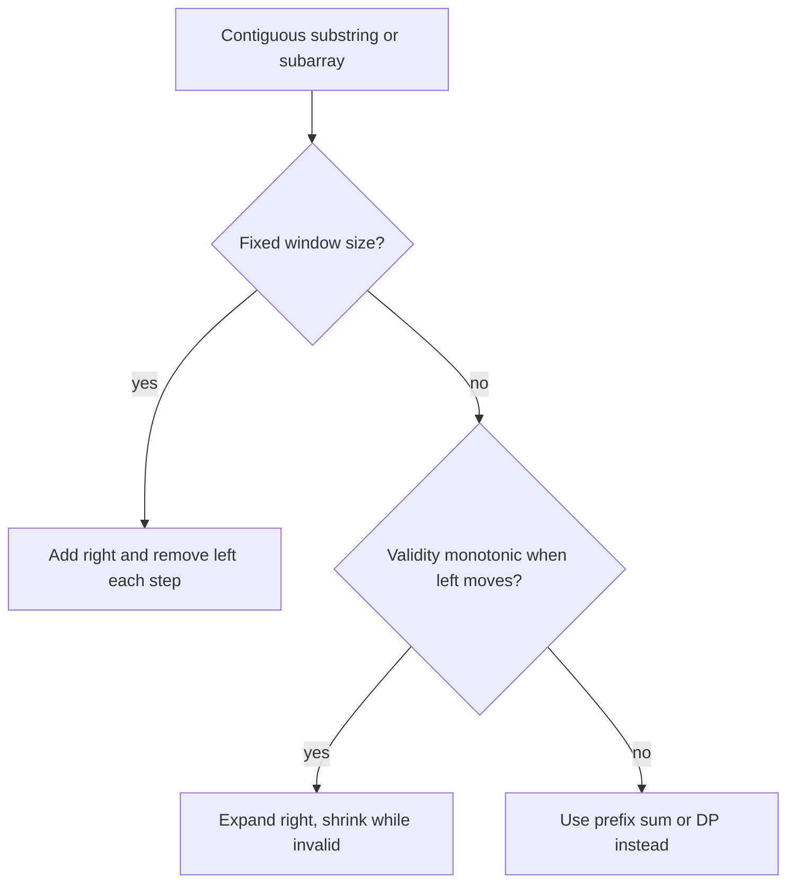
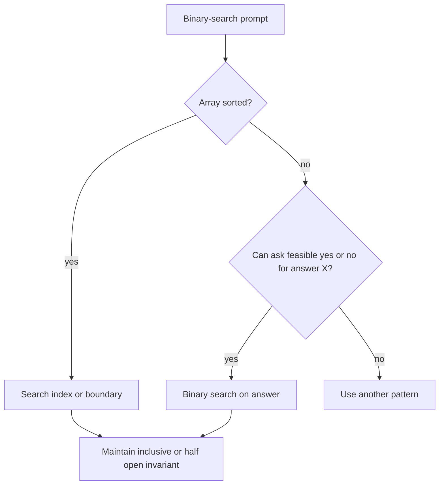

# 08b · DSA Two Pointers, Sliding Window, Binary Search

This part covers movement-based patterns: two pointers for sorted or converging decisions, sliding windows for contiguous ranges, and binary search for monotonic answer spaces.

**Legend:** 🟢 Beginner · 🟡 Intermediate · 🔴 Advanced · ⚫ FAANG · 🔥 = very frequently asked

## Table of Contents
- [Two Pointers](#two-pointers)
- [Sliding Window](#sliding-window)
- [Binary Search](#binary-search)
- [Flashcards](#flashcards)
- [Revision Cheat Sheet](#revision-cheat-sheet)

## Two Pointers
Use two pointers when a decision can discard one side: sorted arrays, palindromes, partitioning, or left/right boundaries.

Reusable Java template:
```java
class Solution {
    boolean converge(char[] a) {
        int l = 0, r = a.length - 1;
        while (l < r) {
            if (a[l++] != a[r--]) return false;
        }

        return true;
    }
}
```

### P1. Valid Palindrome (LeetCode 125)
`🟢 Easy` `🔥` `Must-know SDE-1` · Pattern: Converging two pointers · Commonly reported at: Meta, Amazon, Microsoft
**Problem:** Ignore non-alphanumeric and case; check palindrome. Example `"A man, a plan, a canal: Panama" -> true`.
**How to recognize the pattern:** Compare symmetric characters while skipping noise.
**Brute force:** Clean string then reverse — O(n) time, O(n) space
**Optimal:** Two pointers skip invalid chars in-place.
```java
class Solution {
    public boolean isPalindrome(String s) {
        int l = 0, r = s.length() - 1;
        while (l < r) {
            while (l < r && !Character.isLetterOrDigit(s.charAt(l))) l++;
            while (l < r && !Character.isLetterOrDigit(s.charAt(r))) r--;
            if (Character.toLowerCase(s.charAt(l++)) != Character.toLowerCase(s.charAt(r--))) return false;
        }

        return true;
    }
}
```
**Complexity:** Time O(n), Space O(1)
**Dry run:** Compare `a` with `a`, `m` with `m`, skipping punctuation.
**Edge cases:** empty after filtering, one char, mixed case.
**Follow-ups:** allow one deletion → try skipping left or right; Unicode → normalize; return cleaned palindrome → StringBuilder.

### P2. 3Sum (LeetCode 15)
`🟡 Medium` `🔥` `Must-know SDE-1` · Pattern: Sort plus fixed index two pointers · Commonly reported at: Amazon, Meta, Google, Microsoft
**Problem:** Unique triplets summing to zero. Example `[-1,0,1,2,-1,-4] -> [[-1,-1,2],[-1,0,1]]`.
**How to recognize the pattern:** Need unique triplets and pair sum after fixing one value.
**Brute force:** All triples plus set — O(n^3), O(n)
**Better:** Hash set pair for each fixed index — O(n^2), more duplicate handling.
**Optimal:** Sort; for each `i`, two-pointer target `-nums[i]`, skip duplicates.
```java
import java.util.*;
class Solution {
    public List<List<Integer>> threeSum(int[] nums) {
        Arrays.sort(nums);
        List<List<Integer>> res = new ArrayList<>();
        for (int i = 0; i < nums.length - 2; i++) {
            if (i > 0 && nums[i] == nums[i - 1]) continue;
            int l = i + 1, r = nums.length - 1;
            while (l < r) {
                int sum = nums[i] + nums[l] + nums[r];
                if (sum == 0) {
                    res.add(Arrays.asList(nums[i], nums[l], nums[r]));
                    l++;
                    r--;
                    while (l < r && nums[l] == nums[l - 1]) l++;
                    while (l < r && nums[r] == nums[r + 1]) r--;
                } else if (sum < 0) {
                    l++;
                } else {
                    r--;
                }
            }
        }

        return res;
    }
}
```
**Complexity:** Time O(n^2), Space O(1) excluding output
**Dry run:** fix `-1`; `0+1` completes one triplet; duplicates skipped.
**Edge cases:** all zeros, duplicates, fewer than 3 elements.
**Follow-ups:** 4Sum → nested fixes; closest sum → track min diff; target KSum → recursion.

### P3. Container With Most Water (LeetCode 11)
`🟡 Medium` `🔥` `Must-know SDE-1` · Pattern: Greedy two pointers · Commonly reported at: Amazon, Google, Meta
**Problem:** Max water area between two lines. Example `[1,8,6,2,5,4,8,3,7] -> 49`.
**How to recognize the pattern:** Area uses two ends; moving taller line cannot help if shorter remains.
**Brute force:** All pairs — O(n^2), O(1)
**Optimal:** Start ends; compute area; move shorter pointer inward.
```java
class Solution {
    public int maxArea(int[] h) {
        int l = 0, r = h.length - 1, best = 0;
        while (l < r) {
            best = Math.max(best, Math.min(h[l], h[r]) * (r - l));
            if (h[l] < h[r]) l++;
            else r--;
        }

        return best;
    }
}
```
**Complexity:** Time O(n), Space O(1)
**Dry run:** start area `8`; at heights `8` and `7`, width `7`, area `49`.
**Edge cases:** two lines, equal heights, zeros.
**Follow-ups:** prove pointer move → bounded by shorter; max rectangle histogram → monotonic stack; return indices → store best pair.

### P4. Trapping Rain Water (LeetCode 42)
`🔴 Hard` `🔥` `Must-know SDE-1` · Pattern: Two pointers with boundary maxima · Commonly reported at: Amazon, Google, Meta, Microsoft
**Problem:** Compute trapped water. Example `[0,1,0,2,1,0,1,3,2,1,2,1] -> 6`.
**How to recognize the pattern:** Water at index depends on min left max and right max.
**Brute force:** Scan left/right max per index — O(n^2), O(1)
**Better:** Prefix/suffix max arrays — O(n), O(n)
**Optimal:** Move side with smaller max; it determines water there.
```java
class Solution {
    public int trap(int[] h) {
        int l = 0, r = h.length - 1, lm = 0, rm = 0, ans = 0;
        while (l < r) {
            if (h[l] < h[r]) {
                lm = Math.max(lm, h[l]);
                ans += lm - h[l++];
            } else {
                rm = Math.max(rm, h[r]);
                ans += rm - h[r--];
            }
        }

        return ans;
    }
}
```
**Complexity:** Time O(n), Space O(1)
**Dry run:** left max fills dips before right boundary `3`; total `6`.
**Edge cases:** monotonic bars, small length, flat bars.
**Follow-ups:** 2D trapping → priority queue BFS; return per-index water → prefix arrays; histogram area → stack.

### P5. Sort Colors (LeetCode 75)
`🟡 Medium` `🔥` `Must-know SDE-1` · Pattern: Dutch national flag · Commonly reported at: Microsoft, Amazon, Meta
**Problem:** Sort array containing only `0,1,2` in-place. Example `[2,0,2,1,1,0] -> [0,0,1,1,2,2]`.
**How to recognize the pattern:** Three categories, in-place, one pass.
**Brute force:** Sort — O(n log n)
**Better:** Count 0/1/2 then overwrite — O(n), two passes.
**Optimal:** Maintain `[0..low-1]=0`, `[low..mid-1]=1`, `[high+1..]=2`.
```java
class Solution {
    public void sortColors(int[] a) {
        int low = 0, mid = 0, high = a.length - 1;
        while (mid <= high) {
            if (a[mid] == 0) swap(a, low++, mid++);
            else if (a[mid] == 1) mid++;
            else swap(a, mid, high--);
        }
    }

    void swap(int[] a, int i, int j) {
        int t = a[i];
        a[i] = a[j];
        a[j] = t;
    }
}
```
**Complexity:** Time O(n), Space O(1)
**Dry run:** `2` swaps to end; `0` swaps to front; ones remain middle.
**Edge cases:** all same, empty, only two colors.
**Follow-ups:** k colors → counting or rainbow sort; partition around pivot → quicksort partition; stable partition → extra space.

### P6. Remove Duplicates from Sorted Array (LeetCode 26)
`🟢 Easy` `🔥` `Must-know SDE-1` · Pattern: Slow-fast pointers · Commonly reported at: Amazon, Microsoft, Adobe
**Problem:** Remove duplicates in-place and return unique length. Example `[1,1,2] -> length 2, prefix [1,2]`.
**How to recognize the pattern:** Sorted array allows comparing with last written value.
**Brute force:** Use set/list — O(n), O(n)
**Optimal:** Slow pointer writes next unique element.
```java
class Solution {
    public int removeDuplicates(int[] nums) {
        if (nums.length == 0) return 0;
        int w = 1;
        for (int r = 1; r < nums.length; r++) if (nums[r] != nums[w - 1]) nums[w++] = nums[r];
        return w;
    }
}
```
**Complexity:** Time O(n), Space O(1)
**Dry run:** skip second `1`, write `2` at index `1`.
**Edge cases:** empty, all duplicates, all unique.
**Follow-ups:** allow at most twice → compare with `nums[w-2]`; unsorted → set; remove target value → overwrite non-targets.

## Sliding Window
Sliding window works when the answer is a contiguous range and the validity condition can be updated as the right boundary expands and left boundary shrinks.

Reusable Java template:
```java
class Solution {
    int longestAtMostKDistinct(String s, int k) {
        int[] cnt = new int[128];
        int left = 0, distinct = 0, best = 0;
        for (int right = 0; right < s.length(); right++) {
            if (cnt[s.charAt(right)]++ == 0) {
                distinct++;
            }

            while (distinct > k) {
                if (--cnt[s.charAt(left++)] == 0) {
                    distinct--;
                }
            }

            best = Math.max(best, right - left + 1);
        }

        return best;
    }
}
```

### P7. Longest Substring Without Repeating Characters (LeetCode 3)
`🟡 Medium` `🔥` `Must-know SDE-1` · Pattern: Sliding window with last seen · Commonly reported at: Amazon, Meta, Google, Microsoft
**Problem:** Longest substring with all unique chars. Example `abcabcbb -> 3`.
**How to recognize the pattern:** Longest contiguous substring with no duplicate.
**Brute force:** Check every substring with set — O(n^2), O(min(n,charset))
**Optimal:** Store last index; jump left past duplicate.
```java
import java.util.*;
class Solution {
    public int lengthOfLongestSubstring(String s) {
        Map<Character, Integer> last = new HashMap<>();
        int l = 0, best = 0;
        for (int r = 0; r < s.length(); r++) {
            char c = s.charAt(r);
            if (last.containsKey(c) && last.get(c) >= l) l = last.get(c) + 1;
            last.put(c, r);
            best = Math.max(best, r - l + 1);
        }

        return best;
    }
}
```
**Complexity:** Time O(n), Space O(min(n,charset))
**Dry run:** second `a` moves left from `0` to `1`.
**Edge cases:** empty, all same, Unicode.
**Follow-ups:** at most K distinct → count map; exactly K → atMost(K)-atMost(K-1); return substring → store best bounds.

### P8. Minimum Window Substring (LeetCode 76)
`🔴 Hard` `🔥` `Must-know SDE-1` · Pattern: Sliding window with required counts · Commonly reported at: Google, Amazon, Meta, Microsoft
**Problem:** Smallest substring of `s` containing all chars of `t`. Example `ADOBECODEBANC`, `ABC` -> `BANC`.
**How to recognize the pattern:** Minimum contiguous window covering a multiset.
**Brute force:** Check all substrings — O(n^2 * charset)
**Optimal:** Expand right to satisfy required counts; shrink left while valid.
```java
class Solution {
    public String minWindow(String s, String t) {
        int[] need = new int[128];
        for (char c : t.toCharArray()) need[c]++;
        int missing = t.length(), l = 0, bestLen = Integer.MAX_VALUE, best = 0;
        for (int r = 0; r < s.length(); r++) {
            if (need[s.charAt(r)]-- > 0) missing--;
            while (missing == 0) {
                if (r - l + 1 < bestLen) {
                    bestLen = r - l + 1;
                    best = l;
                }

                if (++need[s.charAt(l++)] > 0) missing++;
            }
        }

        return bestLen == Integer.MAX_VALUE ? "" : s.substring(best, best + bestLen);
    }
}
```
**Complexity:** Time O(n+m), Space O(1) for ASCII
**Dry run:** first valid `ADOBEC`; shrinking eventually finds `BANC`.
**Edge cases:** no window, repeated required chars, `t` longer than `s`.
**Follow-ups:** minimum window subsequence → DP/two scans; Unicode → HashMap; all words → fixed word window.

### P9. Longest Repeating Character Replacement (LeetCode 424)
`🟡 Medium` `🔥` `Must-know SDE-1` · Pattern: Window with max frequency · Commonly reported at: Amazon, Microsoft, Meta
**Problem:** Longest substring transformable to same char with at most `k` replacements. Example `AABABBA`, `k=1 -> 4`.
**How to recognize the pattern:** Window valid when `length - maxFreq <= k`.
**Brute force:** Try each substring and count max char — O(n^2)
**Optimal:** Expand window, track max frequency, shrink invalid windows.
```java
class Solution {
    public int characterReplacement(String s, int k) {
        int[] cnt = new int[26];
        int l = 0, max = 0, best = 0;
        for (int r = 0; r < s.length(); r++) {
            max = Math.max(max, ++cnt[s.charAt(r) - 'A']);
            while (r - l + 1 - max > k) cnt[s.charAt(l++) - 'A']--;
            best = Math.max(best, r - l + 1);
        }

        return best;
    }
}
```
**Complexity:** Time O(n), Space O(1)
**Dry run:** `AABA` has max `A=3`, one replacement, length `4`.
**Edge cases:** `k=0`, all same, `k>=n`.
**Follow-ups:** lowercase → size 26; at most K distinct → count distinct; exact replacements → validate length-max equals k.

### P10. Permutation in String (LeetCode 567)
`🟡 Medium` `🔥` `Must-know SDE-1` · Pattern: Fixed-size sliding window counts · Commonly reported at: Amazon, Microsoft, Meta
**Problem:** Check if `s2` contains a permutation of `s1`. Example `ab`, `eidbaooo -> true`.
**How to recognize the pattern:** Any anagram of fixed length `s1.length()` inside another string.
**Brute force:** Sort/check every window — O(n*m log m)
**Optimal:** Maintain count difference and matches for fixed window.
```java
class Solution {
    public boolean checkInclusion(String s1, String s2) {
        if (s1.length() > s2.length()) return false;
        int[] c = new int[26];
        for (int i = 0; i < s1.length(); i++) {
            c[s1.charAt(i) - 'a']++;
            c[s2.charAt(i) - 'a']--;
        }

        if (allZero(c)) return true;
        for (int r = s1.length(); r < s2.length(); r++) {
            c[s2.charAt(r) - 'a']--;
            c[s2.charAt(r - s1.length()) - 'a']++;
            if (allZero(c)) return true;
        }

        return false;
    }

    boolean allZero(int[] c) {
        for (int x : c) if (x != 0) return false;
        return true;
    }
}
```
**Complexity:** Time O(26*n), Space O(1)
**Dry run:** window `ba` balances counts for `ab`.
**Edge cases:** `s1` longer, repeated chars, exact equality.
**Follow-ups:** find all anagrams → collect starts; Unicode → map; optimize allZero → maintain mismatch count.

### P11. Sliding Window Maximum (LeetCode 239)
`🔴 Hard` `🔥` `Must-know SDE-1` · Pattern: Monotonic deque · Commonly reported at: Amazon, Google, Microsoft
**Problem:** Max of every window size `k`. Example `[1,3,-1,-3,5,3,6,7], k=3 -> [3,3,5,5,6,7]`.
**How to recognize the pattern:** Fixed windows need max while old elements expire.
**Brute force:** Scan each window — O(nk)
**Better:** Heap with lazy deletion — O(n log n)
**Optimal:** Deque stores indices in decreasing value order.
```java
import java.util.*;
class Solution {
    public int[] maxSlidingWindow(int[] nums, int k) {
        int n = nums.length;
        int[] ans = new int[n - k + 1];
        ArrayDeque<Integer> dq = new ArrayDeque<>();
        for (int i = 0; i < n; i++) {
            while (!dq.isEmpty() && dq.peekFirst() <= i - k) dq.pollFirst();
            while (!dq.isEmpty() && nums[dq.peekLast()] <= nums[i]) dq.pollLast();
            dq.offerLast(i);
            if (i >= k - 1) ans[i - k + 1] = nums[dq.peekFirst()];
        }

        return ans;
    }
}
```
**Complexity:** Time O(n), Space O(k)
**Dry run:** deque front indexes `3`, then `5`, then `6`, `7` as maxima.
**Edge cases:** `k=1`, `k=n`, duplicates.
**Follow-ups:** sliding minimum → reverse comparator; median window → two heaps; circular window → process doubled indices.

### P12. Max Consecutive Ones III (LeetCode 1004)
`🟡 Medium` `🔥` `Must-know SDE-1` · Pattern: Longest window with at most K bad items · Commonly reported at: Amazon, Google, Meta
**Problem:** Longest subarray of 1s after flipping at most `k` zeros. Example `[1,1,1,0,0,0,1,1,1,1,0], k=2 -> 6`.
**How to recognize the pattern:** Longest contiguous window with at most K violations.
**Brute force:** Try every start and count zeros — O(n^2)
**Optimal:** Expand right, count zeros, shrink while zeros exceed k.
```java
class Solution {
    public int longestOnes(int[] nums, int k) {
        int l = 0, zeros = 0, best = 0;
        for (int r = 0; r < nums.length; r++) {
            if (nums[r] == 0) zeros++;
            while (zeros > k) if (nums[l++] == 0) zeros--;
            best = Math.max(best, r - l + 1);
        }

        return best;
    }
}
```
**Complexity:** Time O(n), Space O(1)
**Dry run:** best window covers `0,0,1,1,1,1` length `6`.
**Edge cases:** `k=0`, all zeros, all ones.
**Follow-ups:** replace at most K chars → same violation count; shortest with at least K ones → different shrink rule; return indices → store best bounds.

## Binary Search
Binary search applies to sorted arrays and to “minimum feasible answer” problems where the predicate is monotonic.

Reusable Java template:
```java
class Solution {
    int lowerBound(int[] a, int target) {
        int l = 0, r = a.length;
        while (l < r) {
            int m = l + (r - l) / 2;
            if (a[m] < target) l = m + 1;
            else r = m;
        }

        return l;
    }
}
```

### P13. Binary Search (LeetCode 704)
`🟢 Easy` `🔥` `Must-know SDE-1` · Pattern: Classic binary search · Commonly reported at: all product companies
**Problem:** Return index of target in sorted array or `-1`. Example `[-1,0,3,5,9,12], target=9 -> 4`.
**How to recognize the pattern:** Sorted array and exact lookup.
**Brute force:** Linear scan — O(n)
**Optimal:** Halve search interval each step.
```java
class Solution {
    public int search(int[] nums, int target) {
        int l = 0, r = nums.length - 1;
        while (l <= r) {
            int m = l + (r - l) / 2;
            if (nums[m] == target) return m;
            if (nums[m] < target) l = m + 1;
            else r = m - 1;
        }

        return -1;
    }
}
```
**Complexity:** Time O(log n), Space O(1)
**Dry run:** mid `3` value `5`, then right mid value `9`.
**Edge cases:** empty, target outside range, duplicates variant.
**Follow-ups:** lower bound → first `>=`; rotated array → detect sorted half; answer search → predicate.

### P14. Search in Rotated Sorted Array (LeetCode 33)
`🟡 Medium` `🔥` `Must-know SDE-1` · Pattern: Binary search sorted half · Commonly reported at: Amazon, Microsoft, Google
**Problem:** Search target in rotated sorted distinct array. Example `[4,5,6,7,0,1,2], target=0 -> 4`.
**How to recognize the pattern:** Sorted array rotated once; one half remains sorted at every mid.
**Brute force:** Linear scan — O(n)
**Optimal:** Identify sorted half; decide whether target lies inside it.
```java
class Solution {
    public int search(int[] a, int target) {
        int l = 0, r = a.length - 1;
        while (l <= r) {
            int m = l + (r - l) / 2;
            if (a[m] == target) return m;
            if (a[l] <= a[m]) {
                if (a[l] <= target && target < a[m]) r = m - 1;
                else l = m + 1;
            } else {
                if (a[m] < target && target <= a[r]) l = m + 1;
                else r = m - 1;
            }
        }

        return -1;
    }
}
```
**Complexity:** Time O(log n), Space O(1)
**Dry run:** mid `7`; target not in left sorted `[4..7]`, search right.
**Edge cases:** length 1, no rotation, target absent.
**Follow-ups:** duplicates → ambiguous halves may degrade; find min → compare mid with right; count rotations → min index.

### P15. Find Minimum in Rotated Sorted Array (LeetCode 153)
`🟡 Medium` `🔥` `Must-know SDE-1` · Pattern: Binary search pivot · Commonly reported at: Amazon, Microsoft, Google
**Problem:** Find minimum in rotated sorted distinct array. Example `[3,4,5,1,2] -> 1`.
**How to recognize the pattern:** Rotation pivot is the minimum.
**Brute force:** Scan all — O(n)
**Optimal:** If `a[mid] > a[right]`, min is right of mid; else at mid or left.
```java
class Solution {
    public int findMin(int[] a) {
        int l = 0, r = a.length - 1;
        while (l < r) {
            int m = l + (r - l) / 2;
            if (a[m] > a[r]) l = m + 1;
            else r = m;
        }

        return a[l];
    }
}
```
**Complexity:** Time O(log n), Space O(1)
**Dry run:** `[3,4,5,1,2]`: mid `5 > 2`, move right to `1`.
**Edge cases:** no rotation, length 1, duplicates variant.
**Follow-ups:** duplicates → if equal, decrement right; search target → sorted-half logic; rotation count → return index.

### P16. Find First and Last Position (LeetCode 34)
`🟡 Medium` `🔥` `Must-know SDE-1` · Pattern: Lower bound twice · Commonly reported at: Amazon, Microsoft, Google
**Problem:** Return first and last index of target. Example `[5,7,7,8,8,10], target=8 -> [3,4]`.
**How to recognize the pattern:** Sorted array with duplicates and boundary indices.
**Brute force:** Linear scan — O(n)
**Optimal:** First target is lower bound; last is upper bound minus one.
```java
class Solution {
    public int[] searchRange(int[] nums, int target) {
        int first = lower(nums, target);
        if (first == nums.length || nums[first] != target) return new int[] {-1, -1};
        return new int[] {first, upper(nums, target) - 1};
    }

    int lower(int[] a, int t) {
        int l = 0, r = a.length;
        while (l < r) {
            int m = l + (r - l) / 2;
            if (a[m] < t) l = m + 1;
            else r = m;
        }

        return l;
    }

    int upper(int[] a, int t) {
        int l = 0, r = a.length;
        while (l < r) {
            int m = l + (r - l) / 2;
            if (a[m] <= t) l = m + 1;
            else r = m;
        }

        return l;
    }
}
```
**Complexity:** Time O(log n), Space O(1)
**Dry run:** lowerBound `8` is `3`; lowerBound `9` is `5`, last `4`.
**Edge cases:** absent, all target, target at edges.
**Follow-ups:** count occurrences → last-first+1; first greater → upper bound; Java overflow risk → avoid `target+1`.

### P17. Koko Eating Bananas (LeetCode 875)
`🟡 Medium` `🔥` `Must-know SDE-1` · Pattern: Binary search on answer · Commonly reported at: Amazon, Google, Microsoft
**Problem:** Minimum eating speed to finish piles within `h` hours. Example `[3,6,7,11], h=8 -> 4`.
**How to recognize the pattern:** Minimum feasible speed; higher speed remains feasible.
**Brute force:** Try every speed — O(maxPile*n)
**Optimal:** Binary search speed; feasibility sums ceil divisions.
```java
class Solution {
    public int minEatingSpeed(int[] piles, int h) {
        int l = 1, r = 0;
        for (int p : piles) r = Math.max(r, p);
        while (l < r) {
            int m = l + (r - l) / 2;
            long hours = 0;
            for (int p : piles) {
                hours += (p + m - 1) / m;
            }
            if (hours <= h) r = m;
            else l = m + 1;
        }

        return l;
    }
}
```
**Complexity:** Time O(n log maxPile), Space O(1)
**Dry run:** speed `4` needs `1+2+2+3=8`, feasible.
**Edge cases:** huge piles need `long` hours, `h==piles.length`, one pile.
**Follow-ups:** ship capacity → same predicate; split array largest sum → same; exact hours not monotonic answer ask? still min feasible.

### P18. Median of Two Sorted Arrays (LeetCode 4)
`⚫ FAANG` `🔥` `Stretch` · Pattern: Binary search partition · Commonly reported at: Google, Meta, Amazon
**Problem:** Median of two sorted arrays in O(log(m+n)). Example `[1,3]` and `[2] -> 2.0`.
**How to recognize the pattern:** Need median across two sorted arrays without merging.
**Brute force:** Merge arrays — O(m+n), O(m+n)
**Better:** Two pointers to median — O(m+n), O(1)
**Optimal:** Binary search cut in smaller array so left partition <= right partition.
```java
class Solution {
    public double findMedianSortedArrays(int[] A, int[] B) {
        if (A.length > B.length) return findMedianSortedArrays(B, A);
        int m = A.length, n = B.length, total = m + n, half = (total + 1) / 2;
        int l = 0, r = m;
        while (l <= r) {
            int i = (l + r) / 2, j = half - i;
            int Al = i == 0 ? Integer.MIN_VALUE : A[i - 1];
            int Ar = i == m ? Integer.MAX_VALUE : A[i];
            int Bl = j == 0 ? Integer.MIN_VALUE : B[j - 1];
            int Br = j == n ? Integer.MAX_VALUE : B[j];
            if (Al <= Br && Bl <= Ar) {
                if (total % 2 == 1) return Math.max(Al, Bl);
                return ((long)Math.max(Al, Bl) + (long)Math.min(Ar, Br)) / 2.0;
            }

            if (Al > Br) r = i - 1;
            else l = i + 1;
        }

        return 0.0;
    }
}
```
**Complexity:** Time O(log min(m,n)), Space O(1)
**Dry run:** partition `[1] | [3]` and `[2] | []`; left max `2`, odd median.
**Edge cases:** one empty array, even total, unequal sizes.
**Follow-ups:** kth element → generalized partition; unsorted arrays → sort first; streams → two heaps.

### P19. Search a 2D Matrix (LeetCode 74)
`🟡 Medium` `🔥` `Must-know SDE-1` · Pattern: Flattened binary search · Commonly reported at: Amazon, Microsoft, Google
**Problem:** Search matrix where rows and row transitions are sorted. Example target `3` in `[[1,3,5],[7,9,11]] -> true`.
**How to recognize the pattern:** Matrix can be treated as one sorted array.
**Brute force:** Scan all cells — O(mn)
**Optimal:** Binary search `0..m*n-1`, map index to row and column.
```java
class Solution {
    public boolean searchMatrix(int[][] a, int target) {
        int m = a.length, n = a[0].length, l = 0, r = m * n - 1;
        while (l <= r) {
            int mid = l + (r - l) / 2;
            int v = a[mid / n][mid % n];
            if (v == target) return true;
            if (v < target) l = mid + 1;
            else r = mid - 1;
        }

        return false;
    }
}
```
**Complexity:** Time O(log(mn)), Space O(1)
**Dry run:** mid maps to `(0,2)`, then adjust like array.
**Edge cases:** one row, one column, absent target.
**Follow-ups:** rows and columns sorted only → start top-right; count negatives → staircase; duplicates → still works for existence.

### P20. Capacity to Ship Packages Within D Days (LeetCode 1011)
`🟡 Medium` `🔥` `Must-know SDE-1` · Pattern: Binary search on answer · Commonly reported at: Amazon, Google, Bloomberg
**Problem:** Minimum ship capacity to deliver weights in order within `days`. Example `[1,2,3,4,5,6,7,8,9,10], days=5 -> 15`.
**How to recognize the pattern:** Minimum feasible capacity; larger capacity stays feasible.
**Brute force:** Try capacity from max weight to total — O(n*sum)
**Optimal:** Binary search capacity and greedily count days needed.
```java
class Solution {
    public int shipWithinDays(int[] w, int days) {
        int l = 0, r = 0;
        for (int x : w) {
            l = Math.max(l, x);
            r += x;
        }

        while (l < r) {
            int m = l + (r - l) / 2;
            int need = 1, load = 0;
            for (int x : w) {
                if (load + x > m) {
                    need++;
                    load = 0;
                }

                load += x;
            }

            if (need <= days) r = m;
            else l = m + 1;
        }

        return l;
    }
}
```
**Complexity:** Time O(n log sum), Space O(1)
**Dry run:** capacity `15` packs into 5 days, smaller fails.
**Edge cases:** days=1, days=n, single package.
**Follow-ups:** split array largest sum → identical; painters partition → identical; reorder allowed → different greedy.

## Flashcards
- Q: Sliding window requires what? → A: A contiguous range and maintainable validity condition.
- Q: Why move shorter line in container? → A: Area is limited by shorter height, so keeping it cannot improve with smaller width.
- Q: 3Sum duplicate rule? → A: Skip same fixed value and skip duplicate left/right after recording a triplet.
- Q: Min window validity? → A: All required characters are covered with counts.
- Q: Monotonic deque stores what for max window? → A: Indices with decreasing values.
- Q: Binary search midpoint? → A: `l + (r-l)/2` avoids overflow.
- Q: Answer-space binary search signal? → A: Minimum or maximum value with monotonic feasible predicate.
- Q: Rotated search key idea? → A: At least one half is sorted.
- Q: Median of two arrays partition condition? → A: Left max of both arrays <= right min of both arrays.
- Q: Ship capacity lower bound? → A: Maximum single package weight.

## Revision Cheat Sheet
- Two Pointers -> signals: sorted pair, palindrome, partition -> template: move side that cannot improve or slow-fast overwrite.
- Sliding Window -> signals: longest or shortest contiguous substring/subarray with at most or covering constraints -> expand right, shrink left.
- Monotonic Deque -> signals: fixed-window maximum/minimum -> remove expired indices and dominated values.
- Binary Search Array -> signals: sorted lookup or boundary -> maintain inclusive or half-open invariant.
- Binary Search Answer -> signals: “minimum capacity/speed/largest sum” -> choose bounds, write monotonic `feasible(x)`.
- Rotated Sorted -> signals: sorted then rotated -> identify sorted half or compare mid with right.
- Interview warning -> if negatives break monotonicity, prefer prefix sums over sliding window.
