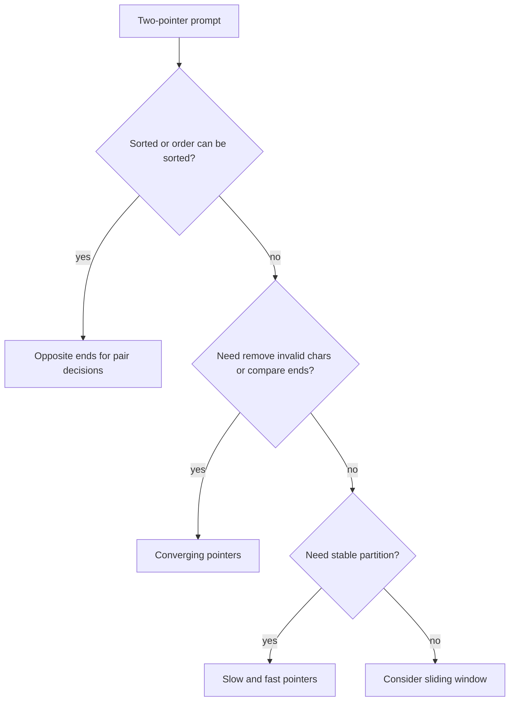
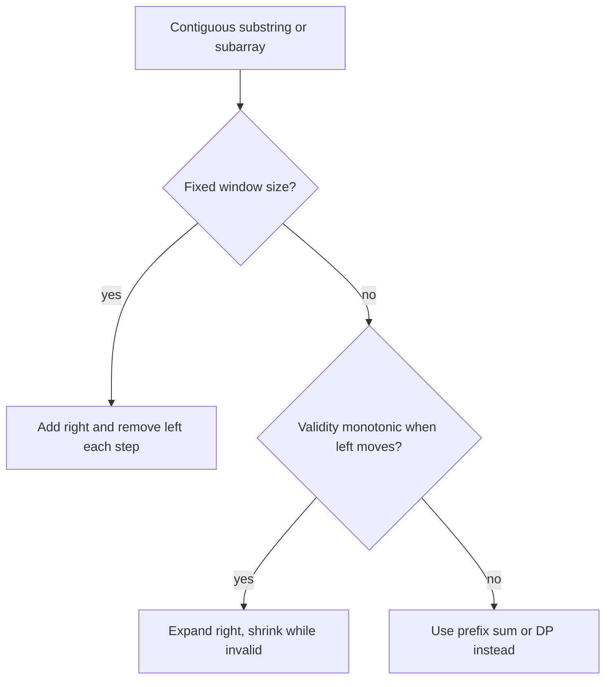
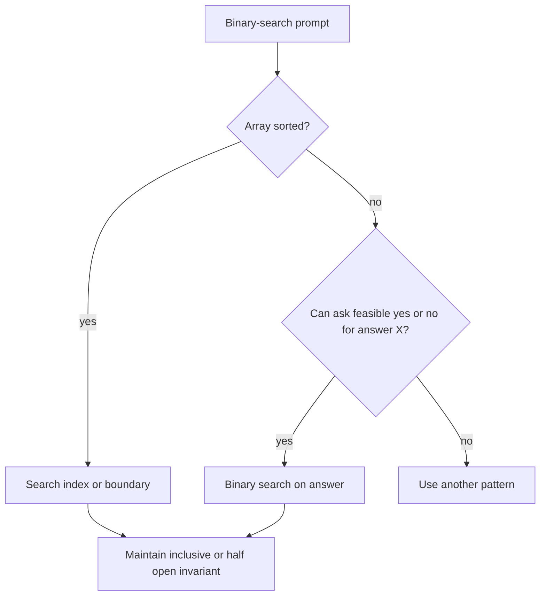

# 08b · DSA Two Pointers, Sliding Window, Binary Search

This part covers movement-based patterns: two pointers for sorted or converging decisions, sliding windows for contiguous ranges, and binary search for monotonic answer spaces.

**Legend:** 🟢 Beginner · 🟡 Intermediate · 🔴 Advanced · ⚫ FAANG · 🔥 = very frequently asked

## Table of Contents
- [Beginner guide to this file](#beginner-guide-to-this-file)
- [Two Pointers](#two-pointers)
- [Sliding Window](#sliding-window)
- [Binary Search](#binary-search)
- [Flashcards](#flashcards)
- [Revision Cheat Sheet](#revision-cheat-sheet)

## Beginner guide to this file

### What this file teaches

This file teaches movement-based Data Structures and Algorithms (DSA) patterns: two pointers, sliding windows,
monotonic deques, and binary search. Interviewers ask these because they test whether you can move boundaries
for a reason instead of trying every possibility. Backend engineers use the same thinking for stream windows,
rate-limit counters, sorted database pages, partitioned logs, and capacity planning.

### Mental model

Imagine a camera frame over the input: sometimes the left and right edges converge, sometimes the frame slides,
and sometimes binary search jumps the frame to the half that can still contain the answer.

- Two pointers discard impossible choices from the left, right, or write position.
- Sliding windows maintain a valid contiguous region and repair it when a rule is broken.
- Monotonic deques keep only candidates that can still become a window maximum or minimum.
- Binary search needs a sorted array or a monotonic yes-or-no predicate.
- Rotated arrays still have one sorted half; answer search still has one feasible side.
- The loop condition must match the promise: exact index, lower bound, or minimum feasible answer.

### How to think through any question here

1. Ask whether the input is sorted, can be sorted, or has a monotonic condition.
2. Identify whether the answer is a pair, a longest or shortest contiguous window, a boundary, or a minimum
   feasible value.
3. State the brute force and name the repeated work, such as rescanning windows or trying every capacity.
4. Choose the moving boundary rule: move shorter side, shrink invalid window, pop worse deque candidates, or
   keep the feasible binary-search half.
5. State the invariant: what the current window contains, what the deque front represents, or what low and high
   still mean.
6. Code update order carefully; most bugs come from moving a pointer before updating counts or answers.
7. Dry run a normal example, then test empty, one item, duplicates, equal boundaries, and absent targets.

### Pattern recognition cues

| If the question mentions... | Think about... | Why it fits |
|---|---|---|
| Sorted pair decision or target sum | Opposite-end two pointers | Moving one side can discard many impossible pairs. |
| Palindrome with ignored characters | Converging pointers | Only mirrored characters matter after skipping noise. |
| Longest contiguous substring or subarray | Sliding window | The answer is a window whose borders move through the input. |
| Minimum window containing required items | Expand until valid, then shrink | The smallest valid answer appears after removing extras. |
| Fixed-length anagram or permutation | Fixed-size window counts | Every candidate has the same length. |
| Maximum for every window | Monotonic deque | The deque front is the best unexpired candidate. |
| At most K bad items or replacements | Window with violation count | Shrink only when the allowed budget is exceeded. |
| Sorted exact lookup | Classic binary search | Comparisons halve the remaining search space. |
| Rotated sorted array | Binary search sorted half | At least one half is still ordered around the midpoint. |
| Minimum feasible speed or capacity | Binary search on answer | Larger values stay feasible after the first feasible value. |
| Median of two sorted arrays | Binary search partition | Correct left and right partitions define the median. |
| Matrix sorted like one list | Flattened binary search | A virtual index maps to row and column. |

### Abbreviations and key terms

| Short form | Expanded form | Plain meaning |
|---|---|---|
| 2D | Two-dimensional | A grid or matrix with rows and columns. |
| ASCII | American Standard Code for Information Interchange | A basic fixed character set often used for count arrays. |
| BFS | Breadth-First Search | Exploring neighbors level by level; appears in 2D water follow-ups. |
| Big-O or O(...) | Order of growth | How runtime or memory scales as input grows. |
| DP | Dynamic Programming | Reusing stored answers to overlapping subproblems. |
| DSA | Data Structures and Algorithms | Efficient data organization and problem-solving steps. |
| FAANG | Facebook/Meta, Amazon, Apple, Netflix, Google | Shorthand for large technology-company interview style. |
| III | Three | The third LeetCode variant in a problem family. |
| k or K | Problem-specific limit | Often window size, allowed changes, speed, capacity, or rank. |
| m | Secondary input size | Often rows, columns, or a second array length. |
| n | Primary input size | Usually the main array or string length. |
| Pn | Problem number | The numbered practice problem label. |
| Q | Question | Used in flashcards for the prompt side. |
| s1 and s2 | String one and string two | Conventional names for the two input strings. |
| SDE-1 | Software Development Engineer level 1 | Entry-level software engineering interview scope. |

### Common beginner traps

- Moving both two pointers when only one side is justified by the invariant.
- Forgetting to remove counts when the left side of a sliding window moves.
- Treating a stale maximum frequency or deque entry as wrong before understanding why it is still safe.
- Using binary search when the predicate is not monotonic.
- Mixing inclusive and exclusive boundaries in lower-bound style searches.
- Failing duplicate handling after sorting 3Sum.
- Using integer division or midpoint formulas without considering overflow in larger variants.

### How to study this file

1. Before each solution, classify the problem as converging pointers, slow-fast/write pointer, sliding window,
   monotonic deque, classic binary search, or binary search on answer.
2. Read the short answer and underline the boundary movement rule.
3. Rephrase the detailed invariant in one sentence before looking at Java code.
4. Dry run with a pointer table: left, right, counts, deque, or low and high.
5. Use flashcards to recall the cue words, then solve the same pattern with changed edge cases.
6. During active practice, always explain why the discarded side cannot contain a better answer.

### Scalability and production lens

Window and search patterns scale because they avoid rescanning. In production, the same ideas support rolling
metrics, throttling windows, ordered pagination, and capacity estimates. The trade-off is state: count arrays are
fast for American Standard Code for Information Interchange (ASCII), maps are safer for Unicode, deques keep only
useful candidates, and binary search on answer depends on a cheap feasibility check.

## Two Pointers
Use two pointers when a decision can discard one side: sorted arrays, palindromes, partitioning, or left/right boundaries.

Reusable Java template:
```java
class Solution {
    boolean converge(char[] a) {
        int l = 0, r = a.length - 1;
        while (l < r) {
            if (a[l++] != a[r--]) return false;
        }

        return true;
    }
}
```

### P1. Valid Palindrome (LeetCode 125)
`🟢 Easy` `🔥` `Must-know SDE-1` · Pattern: Converging two pointers · Commonly reported at: Meta, Amazon, Microsoft
**Problem:** Ignore non-alphanumeric and case; check palindrome. Example `"A man, a plan, a canal: Panama" -> true`.

**How to recognize and think:** The question asks whether the meaningful characters read the same from both
ends. Cues are "ignore non-alphanumeric", "case-insensitive", and "palindrome". Cleaning into a new string and
reversing works, but it copies data and scans characters again just to compare mirrored positions. Two
pointers let you compare the original string directly: skip noise on each side, normalize case, then compare.
The maintained fact is that every character outside the current left-right window has already found its
matching partner. Picture two fingers walking inward over only letters and digits. Say an input that becomes
empty, a single valid character, mixed case, and punctuation-only strings.

**How to recognize the pattern:** Compare symmetric characters while skipping noise.
**Brute force:** Clean string then reverse — O(n) time, O(n) space
**Optimal:** Two pointers skip invalid chars in-place.
```java
class Solution {
    public boolean isPalindrome(String s) {
        int l = 0, r = s.length() - 1;
        while (l < r) {
            while (l < r && !Character.isLetterOrDigit(s.charAt(l))) l++;
            while (l < r && !Character.isLetterOrDigit(s.charAt(r))) r--;
            if (Character.toLowerCase(s.charAt(l++)) != Character.toLowerCase(s.charAt(r--))) return false;
        }

        return true;
    }
}
```
**Complexity:** Time O(n), Space O(1)
**Dry run:** Compare `a` with `a`, `m` with `m`, skipping punctuation.
**Edge cases:** empty after filtering, one char, mixed case.
**Follow-ups:** allow one deletion → try skipping left or right; Unicode → normalize; return cleaned palindrome → StringBuilder.

### P2. 3Sum (LeetCode 15)
`🟡 Medium` `🔥` `Must-know SDE-1` · Pattern: Sort plus fixed index two pointers · Commonly reported at: Amazon, Meta, Google, Microsoft
**Problem:** Unique triplets summing to zero. Example `[-1,0,1,2,-1,-4] -> [[-1,-1,2],[-1,0,1]]`.

**How to recognize and think:** You need unique triples whose values add to zero. Cues include "triplets",
"sum to zero", and "unique", which means duplicate handling matters as much as finding sums. Enumerating
triples repeats pair-sum work for each fixed value, then a set must clean up duplicate answers. Sorting
creates order: fix one value, then find the remaining target with two pointers. For that fixed index, moving
left rightward increases the pair sum and moving right leftward decreases it, so no valid pair is skipped.
Imagine a balance scale adjusted from both ends. Say all zeroes, repeated values around a found triple, and
arrays with fewer than three elements.

**How to recognize the pattern:** Need unique triplets and pair sum after fixing one value.
**Brute force:** All triples plus set — O(n^3), O(n)
**Better:** Hash set pair for each fixed index — O(n^2), more duplicate handling.
**Optimal:** Sort; for each `i`, two-pointer target `-nums[i]`, skip duplicates.
```java
import java.util.*;
class Solution {
    public List<List<Integer>> threeSum(int[] nums) {
        Arrays.sort(nums);
        List<List<Integer>> res = new ArrayList<>();
        for (int i = 0; i < nums.length - 2; i++) {
            if (i > 0 && nums[i] == nums[i - 1]) continue;
            int l = i + 1, r = nums.length - 1;
            while (l < r) {
                int sum = nums[i] + nums[l] + nums[r];
                if (sum == 0) {
                    res.add(Arrays.asList(nums[i], nums[l], nums[r]));
                    l++;
                    r--;
                    while (l < r && nums[l] == nums[l - 1]) l++;
                    while (l < r && nums[r] == nums[r + 1]) r--;
                } else if (sum < 0) {
                    l++;
                } else {
                    r--;
                }
            }
        }

        return res;
    }
}
```
**Complexity:** Time O(n^2), Space O(1) excluding output
**Dry run:** fix `-1`; `0+1` completes one triplet; duplicates skipped.
**Edge cases:** all zeros, duplicates, fewer than 3 elements.
**Follow-ups:** 4Sum → nested fixes; closest sum → track min diff; target KSum → recursion.

### P3. Container With Most Water (LeetCode 11)
`🟡 Medium` `🔥` `Must-know SDE-1` · Pattern: Greedy two pointers · Commonly reported at: Amazon, Google, Meta
**Problem:** Max water area between two lines. Example `[1,8,6,2,5,4,8,3,7] -> 49`.

**How to recognize and think:** The area is width times the shorter of two chosen walls. Cues are "two lines",
"most water", and "area", which point to paired endpoints. Checking every pair repeats many widths without
using the fact that the widest pair is available first. Start at both ends. If the left wall is shorter,
keeping it while moving the right wall inward only shrinks width and cannot raise the limiting height; discard
that shorter side. The same reasoning applies on the right. The invariant is that best records every discarded
boundary's best possible container. Picture sliding the weaker wall inward looking for a taller replacement.
Say exactly two lines, equal heights, and zero-height walls.

**How to recognize the pattern:** Area uses two ends; moving taller line cannot help if shorter remains.
**Brute force:** All pairs — O(n^2), O(1)
**Optimal:** Start ends; compute area; move shorter pointer inward.
```java
class Solution {
    public int maxArea(int[] h) {
        int l = 0, r = h.length - 1, best = 0;
        while (l < r) {
            best = Math.max(best, Math.min(h[l], h[r]) * (r - l));
            if (h[l] < h[r]) l++;
            else r--;
        }

        return best;
    }
}
```
**Complexity:** Time O(n), Space O(1)
**Dry run:** start area `8`; at heights `8` and `7`, width `7`, area `49`.
**Edge cases:** two lines, equal heights, zeros.
**Follow-ups:** prove pointer move → bounded by shorter; max rectangle histogram → monotonic stack; return indices → store best pair.

### P4. Trapping Rain Water (LeetCode 42)
`🔴 Hard` `🔥` `Must-know SDE-1` · Pattern: Two pointers with boundary maxima · Commonly reported at: Amazon, Google, Meta, Microsoft
**Problem:** Compute trapped water. Example `[0,1,0,2,1,0,1,3,2,1,2,1] -> 6`.

**How to recognize and think:** Water above a bar is limited by the smaller wall to its left and right. Cues
are "trapped water", "left max", and "right max". The brute force rescans both sides for each index; prefix
and suffix arrays save time but store all those walls. With two pointers, the side whose current maximum is
smaller can be finalized, because the opposite side already has a wall at least that high. Keep leftMax and
rightMax as the best walls outside the remaining window, and add water only for the finalized side. Visualize
filling bowls from the lower rim first. Say monotonic bars, arrays shorter than three, and flat bars.

**How to recognize the pattern:** Water at index depends on min left max and right max.
**Brute force:** Scan left/right max per index — O(n^2), O(1)
**Better:** Prefix/suffix max arrays — O(n), O(n)
**Optimal:** Move side with smaller max; it determines water there.
```java
class Solution {
    public int trap(int[] h) {
        int l = 0, r = h.length - 1, lm = 0, rm = 0, ans = 0;
        while (l < r) {
            if (h[l] < h[r]) {
                lm = Math.max(lm, h[l]);
                ans += lm - h[l++];
            } else {
                rm = Math.max(rm, h[r]);
                ans += rm - h[r--];
            }
        }

        return ans;
    }
}
```
**Complexity:** Time O(n), Space O(1)
**Dry run:** left max fills dips before right boundary `3`; total `6`.
**Edge cases:** monotonic bars, small length, flat bars.
**Follow-ups:** 2D trapping → priority queue BFS; return per-index water → prefix arrays; histogram area → stack.

### P5. Sort Colors (LeetCode 75)
`🟡 Medium` `🔥` `Must-know SDE-1` · Pattern: Dutch national flag · Commonly reported at: Microsoft, Amazon, Meta
**Problem:** Sort array containing only `0,1,2` in-place. Example `[2,0,2,1,1,0] -> [0,0,1,1,2,2]`.

**How to recognize and think:** The array contains only three labels, 0, 1, and 2, and must be rearranged in
place. Cues are "three colors", "one pass", and "in-place". General sorting compares values even though there
are only three categories; counting uses two passes. The Dutch national flag partition keeps four zones:
zeroes before low, ones between low and mid, twos after high, and unknown values from mid through high. When
mid sees 0, send it left; when it sees 2, send it right without advancing because the swapped-in value is
unknown. Picture sorting colored balls into three shelves. Say all same values, empty input, and arrays
missing one color.

**How to recognize the pattern:** Three categories, in-place, one pass.
**Brute force:** Sort — O(n log n)
**Better:** Count 0/1/2 then overwrite — O(n), two passes.
**Optimal:** Maintain `[0..low-1]=0`, `[low..mid-1]=1`, `[high+1..]=2`.
```java
class Solution {
    public void sortColors(int[] a) {
        int low = 0, mid = 0, high = a.length - 1;
        while (mid <= high) {
            if (a[mid] == 0) swap(a, low++, mid++);
            else if (a[mid] == 1) mid++;
            else swap(a, mid, high--);
        }
    }

    void swap(int[] a, int i, int j) {
        int t = a[i];
        a[i] = a[j];
        a[j] = t;
    }
}
```
**Complexity:** Time O(n), Space O(1)
**Dry run:** `2` swaps to end; `0` swaps to front; ones remain middle.
**Edge cases:** all same, empty, only two colors.
**Follow-ups:** k colors → counting or rainbow sort; partition around pivot → quicksort partition; stable partition → extra space.

### P6. Remove Duplicates from Sorted Array (LeetCode 26)
`🟢 Easy` `🔥` `Must-know SDE-1` · Pattern: Slow-fast pointers · Commonly reported at: Amazon, Microsoft, Adobe
**Problem:** Remove duplicates in-place and return unique length. Example `[1,1,2] -> length 2, prefix [1,2]`.

**How to recognize and think:** The input is sorted, and the required answer is the length of the unique
prefix after overwriting in place. Cues are "sorted array", "remove duplicates", and "return length". A set or
new list remembers uniqueness but misses the main constraint: write the answer into the front of the same
array. Use a reader to scan every element and a writer to mark the next output slot. The prefix before writer
always contains the unique values from the processed portion, in order; compare the reader value with the last
written value. Trace [1,1,2]: skip the second 1, write 2 at index 1. Say empty arrays, all duplicates, and all
unique values.

**How to recognize the pattern:** Sorted array allows comparing with last written value.
**Brute force:** Use set/list — O(n), O(n)
**Optimal:** Slow pointer writes next unique element.
```java
class Solution {
    public int removeDuplicates(int[] nums) {
        if (nums.length == 0) return 0;
        int w = 1;
        for (int r = 1; r < nums.length; r++) if (nums[r] != nums[w - 1]) nums[w++] = nums[r];
        return w;
    }
}
```
**Complexity:** Time O(n), Space O(1)
**Dry run:** skip second `1`, write `2` at index `1`.
**Edge cases:** empty, all duplicates, all unique.
**Follow-ups:** allow at most twice → compare with `nums[w-2]`; unsorted → set; remove target value → overwrite non-targets.

## Sliding Window
Sliding window works when the answer is a contiguous range and the validity condition can be updated as the right boundary expands and left boundary shrinks.

Reusable Java template:
```java
class Solution {
    int longestAtMostKDistinct(String s, int k) {
        int[] cnt = new int[128];
        int left = 0, distinct = 0, best = 0;
        for (int right = 0; right < s.length(); right++) {
            if (cnt[s.charAt(right)]++ == 0) {
                distinct++;
            }

            while (distinct > k) {
                if (--cnt[s.charAt(left++)] == 0) {
                    distinct--;
                }
            }

            best = Math.max(best, right - left + 1);
        }

        return best;
    }
}
```

### P7. Longest Substring Without Repeating Characters (LeetCode 3)
`🟡 Medium` `🔥` `Must-know SDE-1` · Pattern: Sliding window with last seen · Commonly reported at: Amazon, Meta, Google, Microsoft
**Problem:** Longest substring with all unique chars. Example `abcabcbb -> 3`.

**How to recognize and think:** This asks for the longest contiguous stretch with no repeated character. Cues
include "longest substring", "without repeating", and "characters". Brute force rebuilds a set for many
overlapping substrings and rediscovers the same duplicate positions. Keep a sliding window plus a last-seen
index map. When a character reappears inside the current window, jump the left boundary just past its previous
position; older occurrences outside the window are harmless. After the adjustment, the current window has
unique characters, so its length is a valid candidate. Picture a rubber band snapping past the duplicate. Say
empty strings, all one character, and Unicode or larger character sets.

**How to recognize the pattern:** Longest contiguous substring with no duplicate.
**Brute force:** Check every substring with set — O(n^2), O(min(n,charset))
**Optimal:** Store last index; jump left past duplicate.
```java
import java.util.*;
class Solution {
    public int lengthOfLongestSubstring(String s) {
        Map<Character, Integer> last = new HashMap<>();
        int l = 0, best = 0;
        for (int r = 0; r < s.length(); r++) {
            char c = s.charAt(r);
            if (last.containsKey(c) && last.get(c) >= l) l = last.get(c) + 1;
            last.put(c, r);
            best = Math.max(best, r - l + 1);
        }

        return best;
    }
}
```
**Complexity:** Time O(n), Space O(min(n,charset))
**Dry run:** second `a` moves left from `0` to `1`.
**Edge cases:** empty, all same, Unicode.
**Follow-ups:** at most K distinct → count map; exactly K → atMost(K)-atMost(K-1); return substring → store best bounds.

### P8. Minimum Window Substring (LeetCode 76)
`🔴 Hard` `🔥` `Must-know SDE-1` · Pattern: Sliding window with required counts · Commonly reported at: Google, Amazon, Meta, Microsoft
**Problem:** Smallest substring of `s` containing all chars of `t`. Example `ADOBECODEBANC`, `ABC` -> `BANC`.

**How to recognize and think:** The goal is the shortest contiguous part of s containing every character of t,
including repeats. Cues are "minimum window", "contains all", and a multiset target. Checking every substring
recounts characters over and over. Expand the right edge until the window satisfies the target, then shrink
the left edge to remove waste while it remains valid. The need array tracks deficits and surplus, and missing
equals zero exactly when all required characters are covered. Imagine gathering required coupons in a bag,
then dropping extras from the front. Say no possible window, repeated required characters such as two A's, and
t longer than s.

**How to recognize the pattern:** Minimum contiguous window covering a multiset.
**Brute force:** Check all substrings — O(n^2 * charset)
**Optimal:** Expand right to satisfy required counts; shrink left while valid.
```java
class Solution {
    public String minWindow(String s, String t) {
        int[] need = new int[128];
        for (char c : t.toCharArray()) need[c]++;
        int missing = t.length(), l = 0, bestLen = Integer.MAX_VALUE, best = 0;
        for (int r = 0; r < s.length(); r++) {
            if (need[s.charAt(r)]-- > 0) missing--;
            while (missing == 0) {
                if (r - l + 1 < bestLen) {
                    bestLen = r - l + 1;
                    best = l;
                }

                if (++need[s.charAt(l++)] > 0) missing++;
            }
        }

        return bestLen == Integer.MAX_VALUE ? "" : s.substring(best, best + bestLen);
    }
}
```
**Complexity:** Time O(n+m), Space O(1) for ASCII
**Dry run:** first valid `ADOBEC`; shrinking eventually finds `BANC`.
**Edge cases:** no window, repeated required chars, `t` longer than `s`.
**Follow-ups:** minimum window subsequence → DP/two scans; Unicode → HashMap; all words → fixed word window.

### P9. Longest Repeating Character Replacement (LeetCode 424)
`🟡 Medium` `🔥` `Must-know SDE-1` · Pattern: Window with max frequency · Commonly reported at: Amazon, Microsoft, Meta
**Problem:** Longest substring transformable to same char with at most `k` replacements. Example `AABABBA`, `k=1 -> 4`.

**How to recognize and think:** You want the longest window that can become one repeated letter after at most
k edits. Cues are "replace", "same character", and "longest substring". Brute force counts every substring's
most common character from scratch. For any window, only the non-dominant characters need replacement, so the
test is window length minus dominant count <= k. The scan keeps counts and a nondecreasing dominant count; if
even that optimistic count needs too many edits, move the left edge. This never loses a better answer because
window length grows only when a sufficient dominant group has existed. Picture repainting all minority tiles
to match the majority tile. Say k equals 0, all same letters, and k at least the string length.

**How to recognize the pattern:** Window valid when `length - maxFreq <= k`.
**Brute force:** Try each substring and count max char — O(n^2)
**Optimal:** Expand window, track max frequency, shrink invalid windows.
```java
class Solution {
    public int characterReplacement(String s, int k) {
        int[] cnt = new int[26];
        int l = 0, max = 0, best = 0;
        for (int r = 0; r < s.length(); r++) {
            max = Math.max(max, ++cnt[s.charAt(r) - 'A']);
            while (r - l + 1 - max > k) cnt[s.charAt(l++) - 'A']--;
            best = Math.max(best, r - l + 1);
        }

        return best;
    }
}
```
**Complexity:** Time O(n), Space O(1)
**Dry run:** `AABA` has max `A=3`, one replacement, length `4`.
**Edge cases:** `k=0`, all same, `k>=n`.
**Follow-ups:** lowercase → size 26; at most K distinct → count distinct; exact replacements → validate length-max equals k.

### P10. Permutation in String (LeetCode 567)
`🟡 Medium` `🔥` `Must-know SDE-1` · Pattern: Fixed-size sliding window counts · Commonly reported at: Amazon, Microsoft, Meta
**Problem:** Check if `s2` contains a permutation of `s1`. Example `ab`, `eidbaooo -> true`.

**How to recognize and think:** The task asks whether any fixed-length window in s2 has the same letter
multiset as s1. Cues are "permutation", "in string", and "anagram of length s1". Sorting each candidate window
repeats work and ignores that adjacent windows differ by only two characters. Maintain a difference count: add
letters needed from s1, subtract letters currently in the window. When the window slides, undo the leaving
character and apply the entering one. The array being all zeros means the current window is exactly a
permutation. Imagine a balance scale with 26 buckets; a match is perfectly level. Say s1 longer than s2,
repeated letters, and exact equality.

**How to recognize the pattern:** Any anagram of fixed length `s1.length()` inside another string.
**Brute force:** Sort/check every window — O(n*m log m)
**Optimal:** Maintain count difference and matches for fixed window.
```java
class Solution {
    public boolean checkInclusion(String s1, String s2) {
        if (s1.length() > s2.length()) return false;
        int[] c = new int[26];
        for (int i = 0; i < s1.length(); i++) {
            c[s1.charAt(i) - 'a']++;
            c[s2.charAt(i) - 'a']--;
        }

        if (allZero(c)) return true;
        for (int r = s1.length(); r < s2.length(); r++) {
            c[s2.charAt(r) - 'a']--;
            c[s2.charAt(r - s1.length()) - 'a']++;
            if (allZero(c)) return true;
        }

        return false;
    }

    boolean allZero(int[] c) {
        for (int x : c) if (x != 0) return false;
        return true;
    }
}
```
**Complexity:** Time O(26*n), Space O(1)
**Dry run:** window `ba` balances counts for `ab`.
**Edge cases:** `s1` longer, repeated chars, exact equality.
**Follow-ups:** find all anagrams → collect starts; Unicode → map; optimize allZero → maintain mismatch count.

### P11. Sliding Window Maximum (LeetCode 239)
`🔴 Hard` `🔥` `Must-know SDE-1` · Pattern: Monotonic deque · Commonly reported at: Amazon, Google, Microsoft
**Problem:** Max of every window size `k`. Example `[1,3,-1,-3,5,3,6,7], k=3 -> [3,3,5,5,6,7]`.

**How to recognize and think:** Each window has a maximum, and windows overlap heavily. Cues are "sliding
window", "maximum", and a fixed k. Scanning every window repeats comparisons for elements that remain in the
next window; a heap needs lazy deletion to remove expired values. A monotonic deque stores indices whose
values are decreasing. Smaller values behind the current value can never become maximum before the current
value expires, so remove them. The front is always inside the window and holds the largest value; expired
indices leave from the front. Picture a VIP line where taller candidates behind evict shorter ones ahead of
them. Say k equals 1, k equals n, and duplicate values.

**How to recognize the pattern:** Fixed windows need max while old elements expire.
**Brute force:** Scan each window — O(nk)
**Better:** Heap with lazy deletion — O(n log n)
**Optimal:** Deque stores indices in decreasing value order.
```java
import java.util.*;
class Solution {
    public int[] maxSlidingWindow(int[] nums, int k) {
        int n = nums.length;
        int[] ans = new int[n - k + 1];
        ArrayDeque<Integer> dq = new ArrayDeque<>();
        for (int i = 0; i < n; i++) {
            while (!dq.isEmpty() && dq.peekFirst() <= i - k) dq.pollFirst();
            while (!dq.isEmpty() && nums[dq.peekLast()] <= nums[i]) dq.pollLast();
            dq.offerLast(i);
            if (i >= k - 1) ans[i - k + 1] = nums[dq.peekFirst()];
        }

        return ans;
    }
}
```
**Complexity:** Time O(n), Space O(k)
**Dry run:** deque front indexes `3`, then `5`, then `6`, `7` as maxima.
**Edge cases:** `k=1`, `k=n`, duplicates.
**Follow-ups:** sliding minimum → reverse comparator; median window → two heaps; circular window → process doubled indices.

### P12. Max Consecutive Ones III (LeetCode 1004)
`🟡 Medium` `🔥` `Must-know SDE-1` · Pattern: Longest window with at most K bad items · Commonly reported at: Amazon, Google, Meta
**Problem:** Longest subarray of 1s after flipping at most `k` zeros. Example `[1,1,1,0,0,0,1,1,1,1,0], k=2 -> 6`.

**How to recognize and think:** The problem asks for the longest contiguous block that can be made all ones by
flipping at most k zeroes. Cues are "consecutive", "flip at most k", and "longest subarray". Trying every
start recounts zeroes for many overlapping windows. Treat zeroes as violations: expand right, count them, and
shrink left only while the violation count is greater than k. After shrinking, the window is feasible, and any
earlier left boundary would require too many flips for this right edge. Picture a budget of k coupons spent on
zeroes inside the window. Say k equals 0, all zeroes, all ones, and returning the actual bounds if requested.

**How to recognize the pattern:** Longest contiguous window with at most K violations.
**Brute force:** Try every start and count zeros — O(n^2)
**Optimal:** Expand right, count zeros, shrink while zeros exceed k.
```java
class Solution {
    public int longestOnes(int[] nums, int k) {
        int l = 0, zeros = 0, best = 0;
        for (int r = 0; r < nums.length; r++) {
            if (nums[r] == 0) zeros++;
            while (zeros > k) if (nums[l++] == 0) zeros--;
            best = Math.max(best, r - l + 1);
        }

        return best;
    }
}
```
**Complexity:** Time O(n), Space O(1)
**Dry run:** best window covers `0,0,1,1,1,1` length `6`.
**Edge cases:** `k=0`, all zeros, all ones.
**Follow-ups:** replace at most K chars → same violation count; shortest with at least K ones → different shrink rule; return indices → store best bounds.

## Binary Search
Binary search applies to sorted arrays and to “minimum feasible answer” problems where the predicate is monotonic.

Reusable Java template:
```java
class Solution {
    int lowerBound(int[] a, int target) {
        int l = 0, r = a.length;
        while (l < r) {
            int m = l + (r - l) / 2;
            if (a[m] < target) l = m + 1;
            else r = m;
        }

        return l;
    }
}
```

### P13. Binary Search (LeetCode 704)
`🟢 Easy` `🔥` `Must-know SDE-1` · Pattern: Classic binary search · Commonly reported at: all product companies
**Problem:** Return index of target in sorted array or `-1`. Example `[-1,0,3,5,9,12], target=9 -> 4`.

**How to recognize and think:** This is exact lookup in a sorted array. Cues are "sorted", "target", and
"return index". A linear scan ignores the ordering and may inspect every value. Binary search asks one middle
question: if nums[mid] is too small, every index to its left is also too small; if too large, every index to
its right is also too large. The search interval keeps the promise that the target, if present, is still
inside it. Use l + (r - l) / 2 to avoid overflow habits. Trace target 9 by discarding the left half after
seeing 5. Say empty arrays, targets outside the range, and duplicate-boundary variants.

**How to recognize the pattern:** Sorted array and exact lookup.
**Brute force:** Linear scan — O(n)
**Optimal:** Halve search interval each step.
```java
class Solution {
    public int search(int[] nums, int target) {
        int l = 0, r = nums.length - 1;
        while (l <= r) {
            int m = l + (r - l) / 2;
            if (nums[m] == target) return m;
            if (nums[m] < target) l = m + 1;
            else r = m - 1;
        }

        return -1;
    }
}
```
**Complexity:** Time O(log n), Space O(1)
**Dry run:** mid `3` value `5`, then right mid value `9`.
**Edge cases:** empty, target outside range, duplicates variant.
**Follow-ups:** lower bound → first `>=`; rotated array → detect sorted half; answer search → predicate.

### P14. Search in Rotated Sorted Array (LeetCode 33)
`🟡 Medium` `🔥` `Must-know SDE-1` · Pattern: Binary search sorted half · Commonly reported at: Amazon, Microsoft, Google
**Problem:** Search target in rotated sorted distinct array. Example `[4,5,6,7,0,1,2], target=0 -> 4`.

**How to recognize and think:** The array was sorted, then rotated once, and values are distinct. Cues include
"rotated sorted", "search target", and "distinct". A scan works but wastes the fact that one side of mid is
still sorted. Compare nums[left] with nums[mid] to identify the sorted half, then use that half's endpoints to
decide whether the target belongs there. The invariant is that the target, if it exists, remains inside the
retained half after each cut. Picture a sorted ruler broken and reattached; one side of any midpoint is still
a normal ruler segment. Say length 1, no rotation, absent targets, and duplicates making the half test
ambiguous.

**How to recognize the pattern:** Sorted array rotated once; one half remains sorted at every mid.
**Brute force:** Linear scan — O(n)
**Optimal:** Identify sorted half; decide whether target lies inside it.
```java
class Solution {
    public int search(int[] a, int target) {
        int l = 0, r = a.length - 1;
        while (l <= r) {
            int m = l + (r - l) / 2;
            if (a[m] == target) return m;
            if (a[l] <= a[m]) {
                if (a[l] <= target && target < a[m]) r = m - 1;
                else l = m + 1;
            } else {
                if (a[m] < target && target <= a[r]) l = m + 1;
                else r = m - 1;
            }
        }

        return -1;
    }
}
```
**Complexity:** Time O(log n), Space O(1)
**Dry run:** mid `7`; target not in left sorted `[4..7]`, search right.
**Edge cases:** length 1, no rotation, target absent.
**Follow-ups:** duplicates → ambiguous halves may degrade; find min → compare mid with right; count rotations → min index.

### P15. Find Minimum in Rotated Sorted Array (LeetCode 153)
`🟡 Medium` `🔥` `Must-know SDE-1` · Pattern: Binary search pivot · Commonly reported at: Amazon, Microsoft, Google
**Problem:** Find minimum in rotated sorted distinct array. Example `[3,4,5,1,2] -> 1`.

**How to recognize and think:** Here the minimum is the rotation pivot of a distinct sorted array. Cues are
"find minimum", "rotated sorted", and "distinct". Scanning all values ignores the shape: one side is ordered
normally, while the drop contains the answer. Compare mid with right. If nums[mid] is greater, the drop must
be to the right of mid; otherwise mid could be the minimum, so keep the left side including mid. The interval
always contains the true minimum and shrinks until one index remains. Trace [3,4,5,1,2]: 5 > 2 sends the
search right. Say no rotation, length 1, and duplicate variants where equality needs special handling.

**How to recognize the pattern:** Rotation pivot is the minimum.
**Brute force:** Scan all — O(n)
**Optimal:** If `a[mid] > a[right]`, min is right of mid; else at mid or left.
```java
class Solution {
    public int findMin(int[] a) {
        int l = 0, r = a.length - 1;
        while (l < r) {
            int m = l + (r - l) / 2;
            if (a[m] > a[r]) l = m + 1;
            else r = m;
        }

        return a[l];
    }
}
```
**Complexity:** Time O(log n), Space O(1)
**Dry run:** `[3,4,5,1,2]`: mid `5 > 2`, move right to `1`.
**Edge cases:** no rotation, length 1, duplicates variant.
**Follow-ups:** duplicates → if equal, decrement right; search target → sorted-half logic; rotation count → return index.

### P16. Find First and Last Position (LeetCode 34)
`🟡 Medium` `🔥` `Must-know SDE-1` · Pattern: Lower bound twice · Commonly reported at: Amazon, Microsoft, Google
**Problem:** Return first and last index of target. Example `[5,7,7,8,8,10], target=8 -> [3,4]`.

**How to recognize and think:** The target may occur many times, and the answer is its boundary range. Cues
are "sorted array", "first and last", and "target". Linear scanning finds the range but gives up logarithmic
time. Use two boundary searches: lower bound returns the first index whose value is at least target, and upper
bound returns the first index whose value is greater than target. The half-open interval search keeps the
boundary inside [l, r) until l is the answer. Then last is upper minus one. Picture placing two bookends
around the block of target values. Say absent target, all values equal target, target at edges, and avoid
target + 1 overflow tricks.

**How to recognize the pattern:** Sorted array with duplicates and boundary indices.
**Brute force:** Linear scan — O(n)
**Optimal:** First target is lower bound; last is upper bound minus one.
```java
class Solution {
    public int[] searchRange(int[] nums, int target) {
        int first = lower(nums, target);
        if (first == nums.length || nums[first] != target) return new int[] {-1, -1};
        return new int[] {first, upper(nums, target) - 1};
    }

    int lower(int[] a, int t) {
        int l = 0, r = a.length;
        while (l < r) {
            int m = l + (r - l) / 2;
            if (a[m] < t) l = m + 1;
            else r = m;
        }

        return l;
    }

    int upper(int[] a, int t) {
        int l = 0, r = a.length;
        while (l < r) {
            int m = l + (r - l) / 2;
            if (a[m] <= t) l = m + 1;
            else r = m;
        }

        return l;
    }
}
```
**Complexity:** Time O(log n), Space O(1)
**Dry run:** lowerBound `8` is `3`; lowerBound `9` is `5`, last `4`.
**Edge cases:** absent, all target, target at edges.
**Follow-ups:** count occurrences → last-first+1; first greater → upper bound; Java overflow risk → avoid `target+1`.

### P17. Koko Eating Bananas (LeetCode 875)
`🟡 Medium` `🔥` `Must-know SDE-1` · Pattern: Binary search on answer · Commonly reported at: Amazon, Google, Microsoft
**Problem:** Minimum eating speed to finish piles within `h` hours. Example `[3,6,7,11], h=8 -> 4`.

**How to recognize and think:** You are choosing the smallest eating speed that finishes within h hours. Cues
are "minimum speed", "within h", and the monotonic fact that faster speeds remain feasible. Trying each speed
repeats the same feasibility simulation. Binary search the speed range from 1 to the largest pile. For a
proposed speed, the hours are the sum of ceiling divisions for each pile; if hours <= h, keep that speed as a
possible answer and try smaller, otherwise discard it and all slower speeds. The interval always contains the
smallest feasible speed. Trace speed 4 giving 1+2+2+3 hours. Say huge piles needing long arithmetic, h equal
to pile count, and one pile.

**How to recognize the pattern:** Minimum feasible speed; higher speed remains feasible.
**Brute force:** Try every speed — O(maxPile*n)
**Optimal:** Binary search speed; feasibility sums ceil divisions.
```java
class Solution {
    public int minEatingSpeed(int[] piles, int h) {
        int l = 1, r = 0;
        for (int p : piles) r = Math.max(r, p);
        while (l < r) {
            int m = l + (r - l) / 2;
            long hours = 0;
            for (int p : piles) {
                hours += (p + m - 1) / m;
            }
            if (hours <= h) r = m;
            else l = m + 1;
        }

        return l;
    }
}
```
**Complexity:** Time O(n log maxPile), Space O(1)
**Dry run:** speed `4` needs `1+2+2+3=8`, feasible.
**Edge cases:** huge piles need `long` hours, `h==piles.length`, one pile.
**Follow-ups:** ship capacity → same predicate; split array largest sum → same; exact hours not monotonic answer ask? still min feasible.

### P18. Median of Two Sorted Arrays (LeetCode 4)
`⚫ FAANG` `🔥` `Stretch` · Pattern: Binary search partition · Commonly reported at: Google, Meta, Amazon
**Problem:** Median of two sorted arrays in O(log(m+n)). Example `[1,3]` and `[2] -> 2.0`.

**How to recognize and think:** The median splits the combined sorted data into equal left and right halves
without fully merging. Cues are "two sorted arrays", "median", and "O(log(m+n))". Merging repeats work beyond
the center and uses more time than requested. Binary search a cut in the smaller array, deriving the matching
cut in the other array so the left side has half the elements. The correct partition has both left maximums <=
both right minimums; if A's left is too large, move the cut left, otherwise move it right. Picture two sorted
decks cut so every left card is <= every right card. Say one empty array, even total length, and very unequal
sizes.

**How to recognize the pattern:** Need median across two sorted arrays without merging.
**Brute force:** Merge arrays — O(m+n), O(m+n)
**Better:** Two pointers to median — O(m+n), O(1)
**Optimal:** Binary search cut in smaller array so left partition <= right partition.
```java
class Solution {
    public double findMedianSortedArrays(int[] A, int[] B) {
        if (A.length > B.length) return findMedianSortedArrays(B, A);
        int m = A.length, n = B.length, total = m + n, half = (total + 1) / 2;
        int l = 0, r = m;
        while (l <= r) {
            int i = (l + r) / 2, j = half - i;
            int Al = i == 0 ? Integer.MIN_VALUE : A[i - 1];
            int Ar = i == m ? Integer.MAX_VALUE : A[i];
            int Bl = j == 0 ? Integer.MIN_VALUE : B[j - 1];
            int Br = j == n ? Integer.MAX_VALUE : B[j];
            if (Al <= Br && Bl <= Ar) {
                if (total % 2 == 1) return Math.max(Al, Bl);
                return ((long)Math.max(Al, Bl) + (long)Math.min(Ar, Br)) / 2.0;
            }

            if (Al > Br) r = i - 1;
            else l = i + 1;
        }

        return 0.0;
    }
}
```
**Complexity:** Time O(log min(m,n)), Space O(1)
**Dry run:** partition `[1] | [3]` and `[2] | []`; left max `2`, odd median.
**Edge cases:** one empty array, even total, unequal sizes.
**Follow-ups:** kth element → generalized partition; unsorted arrays → sort first; streams → two heaps.

### P19. Search a 2D Matrix (LeetCode 74)
`🟡 Medium` `🔥` `Must-know SDE-1` · Pattern: Flattened binary search · Commonly reported at: Amazon, Microsoft, Google
**Problem:** Search matrix where rows and row transitions are sorted. Example target `3` in `[[1,3,5],[7,9,11]] -> true`.

**How to recognize and think:** Rows are sorted, and each row starts after the previous row ends, so the
matrix behaves like one sorted list. Cues are "matrix", "sorted rows", and row-transition ordering. Scanning
every cell ignores that global order. Binary search over virtual indices from 0 to rows * columns - 1; convert
an index with row = mid / columns and column = mid % columns. The interval invariant is the same as a
one-dimensional search: if the target exists, its virtual position remains inside [left, right]. Picture
flattening the matrix into a ribbon without copying it. Say one row, one column, absent targets, and the
different problem where only rows and columns are individually sorted.

**How to recognize the pattern:** Matrix can be treated as one sorted array.
**Brute force:** Scan all cells — O(mn)
**Optimal:** Binary search `0..m*n-1`, map index to row and column.
```java
class Solution {
    public boolean searchMatrix(int[][] a, int target) {
        int m = a.length, n = a[0].length, l = 0, r = m * n - 1;
        while (l <= r) {
            int mid = l + (r - l) / 2;
            int v = a[mid / n][mid % n];
            if (v == target) return true;
            if (v < target) l = mid + 1;
            else r = mid - 1;
        }

        return false;
    }
}
```
**Complexity:** Time O(log(mn)), Space O(1)
**Dry run:** mid maps to `(0,2)`, then adjust like array.
**Edge cases:** one row, one column, absent target.
**Follow-ups:** rows and columns sorted only → start top-right; count negatives → staircase; duplicates → still works for existence.

### P20. Capacity to Ship Packages Within D Days (LeetCode 1011)
`🟡 Medium` `🔥` `Must-know SDE-1` · Pattern: Binary search on answer · Commonly reported at: Amazon, Google, Bloomberg
**Problem:** Minimum ship capacity to deliver weights in order within `days`. Example `[1,2,3,4,5,6,7,8,9,10], days=5 -> 15`.

**How to recognize and think:** The order of packages is fixed, and you need the smallest ship capacity that
finishes within the given days. Cues are "minimum capacity", "within D days", and larger capacities staying
feasible. Trying every capacity repeats a full packing simulation. Binary search between the heaviest package
and the total weight. For a guessed capacity, greedily fill the current day until the next package would
overflow, then start a new day; delaying a package cannot reduce the number of days for that capacity. Thus
the feasibility test is correct, and the search interval keeps the smallest feasible capacity. Trace capacity
15 packing the sample in five days. Say days equals 1, days equals n, and a single package.

**How to recognize the pattern:** Minimum feasible capacity; larger capacity stays feasible.
**Brute force:** Try capacity from max weight to total — O(n*sum)
**Optimal:** Binary search capacity and greedily count days needed.
```java
class Solution {
    public int shipWithinDays(int[] w, int days) {
        int l = 0, r = 0;
        for (int x : w) {
            l = Math.max(l, x);
            r += x;
        }

        while (l < r) {
            int m = l + (r - l) / 2;
            int need = 1, load = 0;
            for (int x : w) {
                if (load + x > m) {
                    need++;
                    load = 0;
                }

                load += x;
            }

            if (need <= days) r = m;
            else l = m + 1;
        }

        return l;
    }
}
```
**Complexity:** Time O(n log sum), Space O(1)
**Dry run:** capacity `15` packs into 5 days, smaller fails.
**Edge cases:** days=1, days=n, single package.
**Follow-ups:** split array largest sum → identical; painters partition → identical; reorder allowed → different greedy.

## Flashcards
- Q: Sliding window requires what? → A: A contiguous range and maintainable validity condition.
- Q: Why move shorter line in container? → A: Area is limited by shorter height, so keeping it cannot improve with smaller width.
- Q: 3Sum duplicate rule? → A: Skip same fixed value and skip duplicate left/right after recording a triplet.
- Q: Min window validity? → A: All required characters are covered with counts.
- Q: Monotonic deque stores what for max window? → A: Indices with decreasing values.
- Q: Binary search midpoint? → A: `l + (r-l)/2` avoids overflow.
- Q: Answer-space binary search signal? → A: Minimum or maximum value with monotonic feasible predicate.
- Q: Rotated search key idea? → A: At least one half is sorted.
- Q: Median of two arrays partition condition? → A: Left max of both arrays <= right min of both arrays.
- Q: Ship capacity lower bound? → A: Maximum single package weight.

## Revision Cheat Sheet
- Two Pointers -> signals: sorted pair, palindrome, partition -> template: move side that cannot improve or slow-fast overwrite.
- Sliding Window -> signals: longest or shortest contiguous substring/subarray with at most or covering constraints -> expand right, shrink left.
- Monotonic Deque -> signals: fixed-window maximum/minimum -> remove expired indices and dominated values.
- Binary Search Array -> signals: sorted lookup or boundary -> maintain inclusive or half-open invariant.
- Binary Search Answer -> signals: “minimum capacity/speed/largest sum” -> choose bounds, write monotonic `feasible(x)`.
- Rotated Sorted -> signals: sorted then rotated -> identify sorted half or compare mid with right.
- Interview warning -> if negatives break monotonicity, prefer prefix sums over sliding window.
