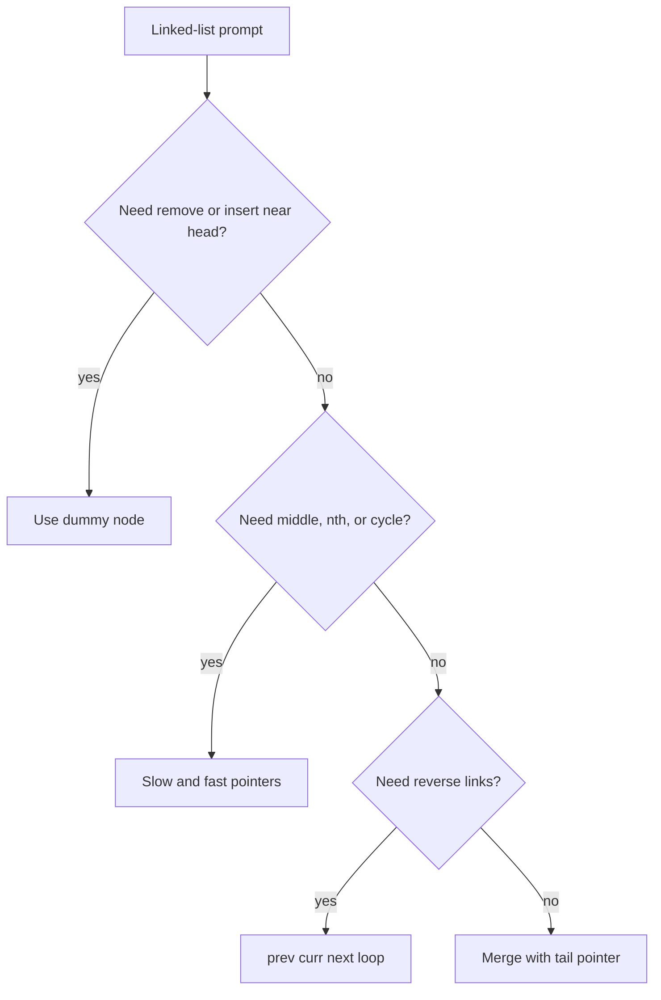
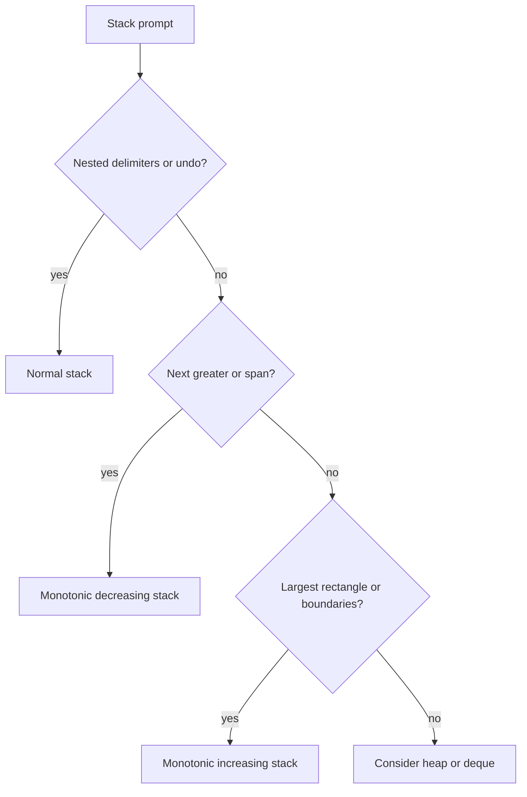
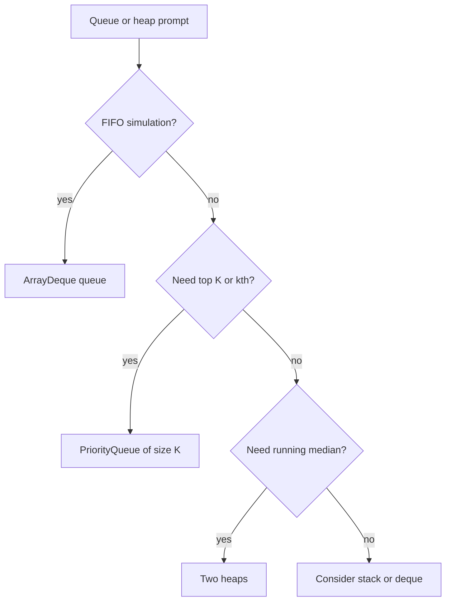

# 08c · DSA Linked List, Stack, Queue, Heap

This part covers pointer-heavy and data-structure-heavy interview problems. Focus on invariants: what each pointer means, what the stack stores, and which heap side owns which elements.

**Legend:** 🟢 Beginner · 🟡 Intermediate · 🔴 Advanced · ⚫ FAANG · 🔥 = very frequently asked

## Table of Contents
- [Beginner guide to this file](#beginner-guide-to-this-file)
- [Linked List](#linked-list)
- [Stack and Monotonic Stack](#stack-and-monotonic-stack)
- [Queue and Heap](#queue-and-heap)
- [Flashcards](#flashcards)
- [Revision Cheat Sheet](#revision-cheat-sheet)

## Beginner guide to this file

### What this file teaches

This file teaches pointer and container Data Structures and Algorithms (DSA): linked lists, stacks, queues,
heaps, and cache structures. Interviewers ask these because they expose whether you can maintain object identity,
rewire references safely, and choose the right container for ordering. Backend work uses the same ideas in task
queues, priority scheduling, least-recently-used caches, parsers, and stream statistics.

### Mental model

Think of linked lists as train cars, stacks as plates, queues as checkout lines, and heaps as a small control
tower that always points to the next most important item.

- Linked-list pointers must be saved before rewiring, or the rest of the train is lost.
- Dummy nodes make head changes look like ordinary middle changes.
- Slow-fast pointers measure distance, middle, or cycles without extra memory.
- Stacks remember the most recent unresolved item.
- Queues preserve arrival order; two stacks can create that order with amortized work.
- Heaps keep only the current best candidate instead of sorting everything.

### How to think through any question here

1. Identify the operation: rewire nodes, detect a cycle, match nested symbols, keep a running minimum, or pick
   the next smallest or largest item.
2. Say the brute force and why it repeats work: array copies, scans, sorting all items, or searching old nodes.
3. Decide what identity matters: node object, value, index, recency, priority, or half of a stream.
4. Choose the container: dummy pointer, slow-fast pointers, stack, deque, hash map, doubly linked list, or heap.
5. State the invariant before coding: what prev, cur, tail, stack top, heap top, or cache head means.
6. Save next pointers before mutation and update both sides of a doubly linked list together.
7. Dry run empty, one-element, duplicate, boundary, and capacity-one cases.

### Pattern recognition cues

| If the question mentions... | Think about... | Why it fits |
|---|---|---|
| Remove or insert near linked-list head | Dummy node | It avoids special-case head rewiring. |
| Reverse links in-place | prev, cur, next loop | You must save the next node before changing cur.next. |
| Middle, nth from end, or cycle | Slow-fast or gap pointers | Pointer speed or distance encodes position. |
| Merge sorted linked lists | Dummy tail or min-heap | Sorted stream heads are enough to choose the next node. |
| Deep copy with random references | Old-to-new map | Object identity, not value, defines the copied edges. |
| O(1) cache get and put | HashMap plus doubly linked list | Lookup and recency update need different structures. |
| Matching brackets or postfix operators | Stack | The most recent unresolved item is needed first. |
| Next greater or nearest smaller | Monotonic stack | Worse candidates can be removed permanently. |
| Queue using stacks | Amortized transfer | One reversal exposes the oldest item for many pops. |
| Kth largest or streaming median | Heap or two heaps | You need a boundary item without fully sorting. |
| Cooldown scheduling | Frequency counting or max-heap | The most frequent task controls idle slots. |

### Abbreviations and key terms

| Short form | Expanded form | Plain meaning |
|---|---|---|
| BFS | Breadth-First Search | Explore nodes level by level; appears in graph-copy follow-ups. |
| DFS | Depth-First Search | Explore one path deeply before backing up. |
| DLL | Doubly Linked List | A list where each node has previous and next links. |
| DSA | Data Structures and Algorithms | Efficient data organization and problem-solving steps. |
| FAANG | Facebook/Meta, Amazon, Apple, Netflix, Google | Shorthand for large technology-company interview style. |
| FIFO | First In, First Out | Queue order: earliest inserted item leaves first. |
| I | One | Roman numeral used in Next Greater Element I. |
| k or K | Problem-specific count or rank | Group size, number of lists, or kth statistic. |
| L0, L1, Ln | List positions zero, one, and n | Notation for nodes in reorder-list prompts. |
| LFU | Least Frequently Used | Cache policy evicting the lowest-use item. |
| LRU | Least Recently Used | Cache policy evicting the oldest recently used item. |
| N | Total node count | Often the sum of nodes across lists. |
| n and m | Input sizes | Common names for list, array, or string lengths. |
| O(...) | Order of growth | Big-O runtime or memory estimate. |
| Pn | Problem number | The numbered practice problem label. |
| Q | Question | Used in flashcards for the prompt side. |
| SDE-1 | Software Development Engineer level 1 | Entry-level software engineering interview scope. |
| TTL | Time To Live | Expiration duration for cache entries. |

### Common beginner traps

- Reassigning cur.next before saving the original next pointer.
- Forgetting that changing the head needs either a dummy node or a returned new head.
- Comparing linked-list node values when the problem needs node identity.
- Popping stack operands in the wrong order for subtraction or division.
- Leaving expired or stale heap entries in problems that need lazy deletion.
- Treating amortized O(1) queue operations as if every individual transfer is a bug.
- Updating only one side of a doubly linked list in cache code.

### How to study this file

1. Draw nodes and arrows before reading the Java solution; mark what each pointer means.
2. Read the short answer and identify the container that owns the invariant.
3. Step through the detailed answer with a tiny input of zero, one, two, or three nodes/items.
4. Re-type the Java code only after you can say the update order without looking.
5. Use flashcards to recall patterns, then actively practice by changing one edge case.
6. Review the cheat sheet after solving to connect each problem to dummy nodes, stacks, queues, or heaps.

### Scalability and production lens

In production, these structures need extra engineering around concurrency, memory pressure, and observability.
A cache may require locks, expiration, metrics, and back-pressure; a priority queue may need stable tie-breaking;
and linked structures can create garbage-collection pressure. In interviews, mention the simple single-threaded
structure first, then discuss what changes when operations are concurrent or data no longer fits in memory.

## Linked List
Linked list problems test pointer safety. Use dummy nodes for head changes, slow-fast pointers for distance/cycles, and always save `next` before rewiring.

Reusable Java template:
```java
class ListNode {
    int val;
    ListNode next;
    ListNode() {
    }

    ListNode(int v) {
        val = v;
    }

    ListNode(int v, ListNode n) {
        val = v;
        next = n;
    }
}

class Solution {
    ListNode reverse(ListNode head) {
        ListNode prev = null, cur = head;
        while (cur != null) {
            ListNode nxt = cur.next;
            cur.next = prev;
            prev = cur;
            cur = nxt;
        }

        return prev;
    }
}
```

### P1. Reverse Linked List (LeetCode 206)
`🟢 Easy` `🔥` `Must-know SDE-1` · Pattern: Pointer reversal · Commonly reported at: Amazon, Microsoft, Meta, Google
**Problem:** Reverse singly linked list. Example `1->2->3 -> 3->2->1`.

**How to recognize and think:** This asks for the same nodes in reverse order, so terms like `reverse`,
`singly linked`, and `in-place` point to pointer reversal. A stack solution first saves every node and then
walks them back out, spending memory just to remember an order the links can encode. The improvement is to
carry a three-node window: `prev` is already reversed, `cur` is the first untouched node, and `nxt` protects
the remaining list before `cur.next` changes. Picture a zipper moving right: after `2`, you have `2->1` and
`3` still safe. Call out empty head, one node, and two nodes.

**How to recognize the pattern:** Need flip `next` pointers in-place.
**Brute force:** Push values/nodes to stack — O(n), O(n)
**Optimal:** Maintain `prev`, `cur`, `next` and rewire.
```java
class ListNode {
    int val;
    ListNode next;
    ListNode(int v) {
        val = v;
    }
}

class Solution {
    public ListNode reverseList(ListNode head) {
        ListNode prev = null, cur = head;
        while (cur != null) {
            ListNode nxt = cur.next;
            cur.next = prev;
            prev = cur;
            cur = nxt;
        }

        return prev;
    }
}
```
**Complexity:** Time O(n), Space O(1)
**Dry run:** `1.next=null`, then `2.next=1`, then `3.next=2`.
**Edge cases:** empty, one node, two nodes.
**Follow-ups:** recursive reverse → call stack O(n); reverse sublist → dummy plus local reverse; k-group → repeated bounded reverse.

### P2. Merge Two Sorted Lists (LeetCode 21)
`🟢 Easy` `🔥` `Must-know SDE-1` · Pattern: Dummy node merge · Commonly reported at: Amazon, Microsoft, Google
**Problem:** Merge two sorted linked lists. Example `1->2->4` and `1->3->4 -> 1->1->2->3->4->4`.

**How to recognize and think:** The plain task is to interleave two already sorted linked streams into one
sorted stream. Words such as `merge`, `sorted`, and `lists` tell you not to sort from scratch.
Collect-and-sort throws away the fact that each input head is already the smallest remaining item in its own
list. The dummy node is the small trick: `tail` always marks the finished answer, while `a` and `b` are the
only candidates that can come next. On `1->2->4` and `1->3->4`, compare heads, append one, advance that list,
and repeat. Mention one empty list, equal values, negative values, and stable handling of duplicates.

**How to recognize the pattern:** Two sorted streams need stable smallest-first merge.
**Brute force:** Collect values and sort — O(n log n), O(n)
**Optimal:** Dummy head and tail pointer choose smaller node.
```java
class ListNode {
    int val;
    ListNode next;
    ListNode(int v) {
        val = v;
    }
}

class Solution {
    public ListNode mergeTwoLists(ListNode a, ListNode b) {
        ListNode dummy = new ListNode(0), tail = dummy;
        while (a != null && b != null) {
            if (a.val <= b.val) {
                tail.next = a;
                a = a.next;
            } else {
                tail.next = b;
                b = b.next;
            }

            tail = tail.next;
        }

        tail.next = a != null ? a : b;
        return dummy.next;
    }
}
```
**Complexity:** Time O(n+m), Space O(1)
**Dry run:** compare `1/1`, then `2/3`, append remainder.
**Edge cases:** one list empty, duplicates, negative values.
**Follow-ups:** merge k lists → heap or divide-conquer; arrays → two pointers; descending lists → comparator changes.

### P3. Linked List Cycle and Cycle Start (LeetCode 142)
`🟡 Medium` `🔥` `Must-know SDE-1` · Pattern: Floyd slow-fast · Commonly reported at: Amazon, Microsoft, Google, Meta
**Problem:** Detect cycle and return entry node; if none, return null. Example tail connects to node at index 1 -> return that node.

**How to recognize and think:** This is about pointer motion on a list that may never hit `null`. Phrases like
`cycle`, `entry`, and `O(1) space` rule out a visited set, even though storing node identities is the simplest
safe brute force. A naive walk until the end is not slow; it is incorrect because it can run forever. The fast
pointer gains one step per round on the slow pointer, so inside a loop it must eventually lap it. After the
meeting, moving one pointer from head and one from the meeting point aligns both distances to the entry.
Imagine two runners on a track. Test no cycle, a self-loop, and a two-node loop.

**How to recognize the pattern:** Need cycle detection with O(1) space.
**Brute force:** Store visited nodes — O(n), O(n)
**Optimal:** Slow/fast meet if cycle exists; reset one pointer to head, move both one step to entry.
```java
class ListNode {
    int val;
    ListNode next;
    ListNode(int v) {
        val = v;
    }
}

class Solution {
    public ListNode detectCycle(ListNode head) {
        ListNode slow = head, fast = head;
        while (fast != null && fast.next != null) {
            slow = slow.next;
            fast = fast.next.next;
            if (slow == fast) {
                ListNode p = head;
                while (p != slow) {
                    p = p.next;
                    slow = slow.next;
                }

                return p;
            }
        }

        return null;
    }
}
```
**Complexity:** Time O(n), Space O(1)
**Dry run:** slow/fast meet inside loop; head pointer and meeting pointer converge at entry.
**Edge cases:** no cycle, self-cycle, two-node cycle.
**Follow-ups:** only boolean cycle → return on meet; cycle length → count after meet; duplicate number array → Floyd on indices.

### P4. Remove Nth Node From End (LeetCode 19)
`🟡 Medium` `🔥` `Must-know SDE-1` · Pattern: Gap two pointers with dummy · Commonly reported at: Amazon, Microsoft, Meta
**Problem:** Remove nth node from end. Example `1->2->3->4->5, n=2 -> 1->2->3->5`.

**How to recognize and think:** The wording `nth from end` means the node is easier to locate by a fixed gap
than by its value. Counting length first works but spends a separate pass just to learn where the second pass
should stop. The dummy node handles deleting the head uniformly. Move `fast` `n+1` hops ahead from dummy; from
then on, `slow` is always exactly one node before the future deletion target when `fast` reaches `null`. For
`1->2->3->4->5`, `n=2`, the gap leaves `slow` before `4`, then `slow.next` is bypassed. Say head removal, a
single-node list, tail removal, and invalid `n` if the platform does not guarantee it.

**How to recognize the pattern:** Need node relative to end in one pass.
**Brute force:** Count length, remove length-n — O(n), O(1)
**Optimal:** Dummy; move fast `n+1` steps, then move both until fast null.
```java
class ListNode {
    int val;
    ListNode next;
    ListNode(int v) {
        val = v;
    }
}

class Solution {
    public ListNode removeNthFromEnd(ListNode head, int n) {
        ListNode dummy = new ListNode(0);
        dummy.next = head;
        ListNode fast = dummy, slow = dummy;
        for (int i = 0; i <= n; i++) fast = fast.next;
        while (fast != null) {
            fast = fast.next;
            slow = slow.next;
        }

        slow.next = slow.next.next;
        return dummy.next;
    }
}
```
**Complexity:** Time O(n), Space O(1)
**Dry run:** fast gap places slow before node `4`, then bypass it.
**Edge cases:** remove head, one node, remove tail.
**Follow-ups:** kth from end → stop at target; doubly list → adjust prev; invalid n → validate fast before advancing.

### P5. Reorder List (LeetCode 143)
`🟡 Medium` `🔥` `Must-know SDE-1` · Pattern: Middle, reverse, merge · Commonly reported at: Meta, Amazon, Microsoft
**Problem:** Reorder `L0->L1->...->Ln` to `L0->Ln->L1->Ln-1...`. Example `1->2->3->4 -> 1->4->2->3`.

**How to recognize and think:** The target order alternates front, back, next front, next back, so words like
`L0`, `Ln`, and `reorder in-place` hint at splitting the list. An array solution stores every node so it can
index from both ends, but the back half can be reached by reversing links instead. The turning point is `find
middle -> reverse second half -> weave`. After splitting `1->2` from `3->4`, reverse the second side to `4->3`
and splice one node from each side. The invariant is that the first half tail never points into the old second
half, preventing cycles. Check odd length, even length, and two nodes.

**How to recognize the pattern:** Alternating first half with reversed second half.
**Brute force:** Store nodes in array and connect ends — O(n), O(n)
**Optimal:** Find middle, reverse second half, weave two lists.
```java
class ListNode {
    int val;
    ListNode next;
    ListNode(int v) {
        val = v;
    }
}

class Solution {
    public void reorderList(ListNode head) {
        if (head == null) return;
        ListNode slow = head, fast = head;
        while (fast.next != null && fast.next.next != null) {
            slow = slow.next;
            fast = fast.next.next;
        }

        ListNode second = reverse(slow.next);
        slow.next = null;
        ListNode first = head;
        while (second != null) {
            ListNode f = first.next, s = second.next;
            first.next = second;
            second.next = f;
            first = f;
            second = s;
        }
    }

    ListNode reverse(ListNode h) {
        ListNode p = null, c = h;
        while (c != null) {
            ListNode n = c.next;
            c.next = p;
            p = c;
            c = n;
        }

        return p;
    }
}
```
**Complexity:** Time O(n), Space O(1)
**Dry run:** split `1->2` and `3->4`, reverse to `4->3`, weave.
**Edge cases:** odd length, even length, two nodes.
**Follow-ups:** return new list without mutation → copy nodes; palindrome list → same split/reverse; undo reorder → harder pointer separation.

### P6. Add Two Numbers (LeetCode 2)
`🟡 Medium` `🔥` `Must-know SDE-1` · Pattern: Digit-by-digit with carry · Commonly reported at: Amazon, Microsoft, Google
**Problem:** Add two numbers stored reverse-order in linked lists. Example `2->4->3 + 5->6->4 -> 7->0->8`.

**How to recognize and think:** Read the lists as digits written least-significant first. The clues are `add`,
`reverse order`, and `carry`; converting to an integer can overflow and ignores the digit-by-digit
representation the input already gives. Column addition is the useful model. At every loop, the output list
contains exactly the processed lower digits, and `carry` is the only information needed from them. If one list
ends, treat its digit as zero. In the sample, `4+6` writes `0` and carries `1`, so the next sum becomes
`3+4+1`. Bring up different lengths, a leftover final carry, and all-zero inputs.

**How to recognize the pattern:** Linked-list arithmetic with carry.
**Brute force:** Convert to number — overflow risk, O(n)
**Optimal:** Traverse both lists, create result digit `sum%10`, carry `sum/10`.
```java
class ListNode {
    int val;
    ListNode next;
    ListNode(int v) {
        val = v;
    }
}

class Solution {
    public ListNode addTwoNumbers(ListNode a, ListNode b) {
        ListNode dummy = new ListNode(0), tail = dummy;
        int carry = 0;
        while (a != null || b != null || carry != 0) {
            int sum = carry;
            if (a != null) {
                sum += a.val;
                a = a.next;
            }

            if (b != null) {
                sum += b.val;
                b = b.next;
            }

            tail.next = new ListNode(sum % 10);
            tail = tail.next;
            carry = sum / 10;
        }

        return dummy.next;
    }
}
```
**Complexity:** Time O(max(n,m)), Space O(max(n,m)) for output
**Dry run:** `2+5=7`, `4+6=10` write `0` carry `1`, `3+4+1=8`.
**Edge cases:** different lengths, final carry, zeros.
**Follow-ups:** forward-order digits → stacks or reverse; add one → carry pass; huge base → use base chunks.

### P7. Copy List with Random Pointer (LeetCode 138)
`🟡 Medium` `🔥` `Must-know SDE-1` · Pattern: Hash map old-to-new · Commonly reported at: Amazon, Meta, Microsoft
**Problem:** Deep-copy list where each node has `next` and `random`. Example random pointers must point to copied nodes, not originals.

**How to recognize and think:** A `random` pointer makes the list more like a small graph than a plain chain,
and the word `deep-copy` means copied pointers must target copied nodes. Searching the copied list for each
random target repeats identity lookups and breaks when values duplicate. The Java code uses a map from
original object to clone: pass one creates every clone, pass two wires `next` and `random` through that map.
The invariant before wiring is that every real target, including a future random target, already has a clone;
`null` maps back to `null`. Picture `A.random = C` becoming `copyA.random = copyC`. Check null randoms,
self-randoms, and an empty list.

**How to recognize the pattern:** Graph-like references require identity mapping.
**Brute force:** For each random pointer, search copied target — O(n^2)
**Better:** HashMap original node to clone — O(n), O(n)
**Optimal:** Interweave clones for O(1) extra, but map is safest in interviews.
```java
import java.util.*;
class Node {
    int val;
    Node next, random;
    Node(int v) {
        val = v;
    }
}

class Solution {
    public Node copyRandomList(Node head) {
        if (head == null) return null;
        Map<Node, Node> map = new HashMap<>();
        for (Node c = head; c != null; c = c.next) map.put(c, new Node(c.val));
        for (Node c = head; c != null; c = c.next) {
            map.get(c).next = map.get(c.next);
            map.get(c).random = map.get(c.random);
        }

        return map.get(head);
    }
}
```
**Complexity:** Time O(n), Space O(n)
**Dry run:** first pass creates clones; second pass wires `next` and `random` through map.
**Edge cases:** null random, random to self, empty list.
**Follow-ups:** O(1) extra → interleave clone nodes; graph clone → BFS/DFS map; immutable nodes → constructor wiring.

### P8. LRU Cache (LeetCode 146)
`🔴 Hard` `🔥` `Must-know SDE-1` · Pattern: HashMap plus doubly linked list · Commonly reported at: Amazon, Microsoft, Google, Meta
**Problem:** Implement `get` and `put` in O(1), evict least recently used. Example capacity 2 evicts older key.

**How to recognize and think:** A least recently used (LRU) cache combines two promises: find by key quickly
and evict by recency quickly. A plain list can remember order, but every `get` scans for the key and every
update must hunt for the node. The map supplies direct node access; the doubly linked list supplies
constant-time removal and insertion. Keep sentinels as bookends: `head.next` is most recent, `tail.prev` is
least recent, and the map contains exactly the real nodes between them. A `get` pulls its node to the front; a
full `put` drops `tail.prev`. Speak through updates to an existing key, capacity one, and repeated reads.

**How to recognize the pattern:** Need fast key lookup and fast recency updates.
**Brute force:** List scan for keys — O(n)
**Optimal:** Map key to node; doubly linked list keeps most recent after head and LRU before tail.
```java
import java.util.*;
class LRUCache {
    class Node {
        int k, v;
        Node prev, next;
        Node(int k, int v) {
            this.k = k;
            this.v = v;
        }
    }

    int cap;
    Map<Integer, Node> map = new HashMap<>();
    Node head = new Node(0, 0), tail = new Node(0, 0);
    public LRUCache(int capacity) {
        cap = capacity;
        head.next = tail;
        tail.prev = head;
    }

    public int get(int key) {
        Node n = map.get(key);
        if (n == null) return -1;
        move(n);
        return n.v;
    }

    public void put(int key, int value) {
        Node n = map.get(key);
        if (n != null) {
            n.v = value;
            move(n);
            return;
        }

        if (map.size() == cap) {
            Node old = tail.prev;
            remove(old);
            map.remove(old.k);
        }

        Node add = new Node(key, value);
        map.put(key, add);
        insert(add);
    }

    void move(Node n) {
        remove(n);
        insert(n);
    }

    void remove(Node n) {
        n.prev.next = n.next;
        n.next.prev = n.prev;
    }

    void insert(Node n) {
        n.next = head.next;
        n.prev = head;
        head.next.prev = n;
        head.next = n;
    }
}
```
**Complexity:** Time O(1) per op, Space O(capacity)
**Dry run:** `get` moves node to front; `put` evicts `tail.prev` when full.
**Edge cases:** update existing key, capacity 1, repeated gets.
**Follow-ups:** TTL cache → expiry heap; LFU → freq lists; thread-safe → locks or concurrent structures.

### P9. Merge K Sorted Lists (LeetCode 23)
`🔴 Hard` `🔥` `Must-know SDE-1` · Pattern: Min-heap k-way merge · Commonly reported at: Amazon, Google, Meta, Microsoft
**Problem:** Merge `k` sorted linked lists. Example `[[1,4,5],[1,3,4],[2,6]] -> 1->1->2->3->4->4->5->6`.

**How to recognize and think:** Here there are many sorted linked streams, not just two. The phrases `k sorted
lists` and `global minimum` point at repeatedly choosing the smallest current head. Flattening all nodes and
sorting ignores that each list is already ordered and stores the whole input. A min-heap keeps only one
frontier node per nonempty list. The heap invariant is simple: it contains the smallest unused node from each
active list, so polling gives the next overall node; pushing the successor of the polled node restores the
frontier. With starts `1,1,2`, poll a `1` and offer its `4` or `3`. Cover no lists, null lists, and duplicate
values.

**How to recognize the pattern:** K sorted streams; repeatedly need global minimum head.
**Brute force:** Collect all nodes and sort — O(N log N), O(N)
**Better:** Divide and conquer merge pairs — O(N log k), O(log k) recursion
**Optimal:** Min-heap of current heads — O(N log k), O(k).
```java
import java.util.*;
class ListNode {
    int val;
    ListNode next;
    ListNode(int v) {
        val = v;
    }
}

class Solution {
    public ListNode mergeKLists(ListNode[] lists) {
        PriorityQueue<ListNode> pq = new PriorityQueue<>((a, b)->Integer.compare(a.val, b.val));
        for (ListNode n : lists) if (n != null) pq.offer(n);
        ListNode dummy = new ListNode(0), tail = dummy;
        while (!pq.isEmpty()) {
            ListNode n = pq.poll();
            tail.next = n;
            tail = tail.next;
            if (n.next != null) pq.offer(n.next);
        }

        return dummy.next;
    }
}
```
**Complexity:** Time O(N log k), Space O(k)
**Dry run:** heap starts with `1,1,2`; poll smallest and push its next.
**Edge cases:** empty list array, null lists, duplicates.
**Follow-ups:** merge arrays → heap of indices; external files → streaming heap; divide-conquer variant → no heap.

### P10. Reverse Nodes in k-Group (LeetCode 25)
`🔴 Hard` `🔥` `Stretch` · Pattern: Bounded linked-list reversal · Commonly reported at: Amazon, Microsoft, Google
**Problem:** Reverse nodes in groups of `k`; leave incomplete group unchanged. Example `1->2->3->4->5, k=2 -> 2->1->4->3->5`.

**How to recognize and think:** The important words are `groups of k` and `leave incomplete group unchanged`.
Using an array per group is safe, but it spends extra storage and still must reconnect boundaries carefully.
The safer in-place idea is to find the kth node before reversing anything; if it is missing, stop without
touching the partial group. During reversal, set `prev` to `groupNext`, so the new tail already points to the
rest of the list. After `1,2` becomes `2,1`, `groupPrev` moves to old start `1`. This avoids losing the suffix
or looping. Mention `k=1`, a final short group, and an empty list.

**How to recognize the pattern:** Repeated local reversal with exact group size.
**Brute force:** Use array per group — O(n), O(k)
**Optimal:** Dummy node; find kth node; reverse links until group end.
```java
class ListNode {
    int val;
    ListNode next;
    ListNode(int v) {
        val = v;
    }
}

class Solution {
    public ListNode reverseKGroup(ListNode head, int k) {
        ListNode dummy = new ListNode(0);
        dummy.next = head;
        ListNode groupPrev = dummy;
        while (true) {
            ListNode kth = getKth(groupPrev, k);
            if (kth == null) break;
            ListNode groupNext = kth.next, prev = groupNext, cur = groupPrev.next;
            while (cur != groupNext) {
                ListNode nxt = cur.next;
                cur.next = prev;
                prev = cur;
                cur = nxt;
            }

            ListNode oldStart = groupPrev.next;
            groupPrev.next = kth;
            groupPrev = oldStart;
        }

        return dummy.next;
    }

    ListNode getKth(ListNode cur, int k) {
        while (cur != null && k > 0) {
            cur = cur.next;
            k--;
        }

        return cur;
    }
}
```
**Complexity:** Time O(n), Space O(1)
**Dry run:** group `1,2` reverses to `2,1`, then group `3,4`.
**Edge cases:** `k=1`, length not multiple of k, empty list.
**Follow-ups:** reverse alternate k groups → skip groups; reverse between positions → single bounded group; recursive solution → O(n/k) stack.

## Stack and Monotonic Stack
Stacks model nested structure and “previous unresolved item”. Monotonic stacks keep values increasing or decreasing so each item is pushed and popped once.

Reusable Java template:
```java
import java.util.*;
class Solution {
    int[] nextGreater(int[] a) {
        int[] ans = new int[a.length];
        Arrays.fill(ans, -1);
        ArrayDeque<Integer> st = new ArrayDeque<>();
        for (int i = 0; i < a.length; i++) {
            while (!st.isEmpty() && a[i] > a[st.peek()]) ans[st.pop()] = a[i];
            st.push(i);
        }

        return ans;
    }
}
```

### P11. Valid Parentheses (LeetCode 20)
`🟢 Easy` `🔥` `Must-know SDE-1` · Pattern: Stack matching · Commonly reported at: Amazon, Microsoft, Google
**Problem:** Validate bracket string. Example `"()[]{}" -> true`, `"(]" -> false`.

**How to recognize and think:** Bracket validation is about nesting, not counts. Clues are matching pairs such
as `()`, `[]`, `{}` and the fact that the most recently opened bracket must close first. Repeatedly deleting
adjacent pairs can rescan the same string many times. The stack version records expectations instead of
openings: pushing `)` for `(` means the top always says which closer must arrive next. If a closer appears
while the stack is empty, or differs from the top, the string is invalid immediately. A tiny trace is `(`
pushes `)`, then `)` pops it. Say starting with a closer, leftover openings, and the empty string.

**How to recognize the pattern:** Last opened bracket must close first.
**Brute force:** Repeatedly remove matched pairs — O(n^2)
**Optimal:** Push opening brackets; each closing bracket must match stack top.
```java
import java.util.*;
class Solution {
    public boolean isValid(String s) {
        ArrayDeque<Character> st = new ArrayDeque<>();
        for (char c : s.toCharArray()) {
            if (c == '(') st.push(')');
            else if (c == '[') st.push(']');
            else if (c == '{') st.push('}');
            else if (st.isEmpty() || st.pop() != c) return false;
        }

        return st.isEmpty();
    }
}
```
**Complexity:** Time O(n), Space O(n)
**Dry run:** push expected `)`, closing `)` pops it.
**Edge cases:** starts with closing, leftover openings, empty string.
**Follow-ups:** longest valid parentheses → stack indices; generate parentheses → backtracking; add minimum parentheses → counters.

### P12. Min Stack (LeetCode 155)
`🟡 Medium` `🔥` `Must-know SDE-1` · Pattern: Auxiliary min stack · Commonly reported at: Amazon, Microsoft, Bloomberg
**Problem:** Stack with push/pop/top/getMin in O(1). Example push `-2,0,-3`; min is `-3`.

**How to recognize and think:** The stack must answer the current minimum after arbitrary pops. Scanning the
whole stack for every `getMin` repeats the same comparison history. Store that history beside each value: a
pushed pair is `(value, minimum up to this node)`. Then the second field in the top pair is correct because
everything below it was present when it was created. When the top is popped, the previous pair automatically
exposes the previous minimum, so duplicate minima work without special counters. Trace `-2` stores `-2`, `0`
still stores `-2`, `-3` stores `-3`. Check duplicate lows, negative numbers, and whether the caller guarantees
valid operations.

**How to recognize the pattern:** Need current aggregate min under pop operations.
**Brute force:** Scan stack for min — O(n) getMin
**Optimal:** Store pair `(value,currentMin)` per push.
```java
import java.util.*;
class MinStack {
    ArrayDeque<int[]> st = new ArrayDeque<>();
    public void push(int val) {
        int min = st.isEmpty() ? val : Math.min(val, st.peek()[1]);
        st.push(new int[] {val, min});
    }

    public void pop() {
        st.pop();
    }

    public int top() {
        return st.peek()[0];
    }

    public int getMin() {
        return st.peek()[1];
    }
}
```
**Complexity:** Time O(1) per op, Space O(n)
**Dry run:** pushing `-3` stores pair `[-3,-3]`; pop restores previous min.
**Edge cases:** duplicate minima, negative values, operations validity.
**Follow-ups:** min queue → two min stacks; save memory → encoded differences; max stack → TreeMap plus DLL.

### P13. Evaluate Reverse Polish Notation (LeetCode 150)
`🟡 Medium` `🔥` `Must-know SDE-1` · Pattern: Operand stack · Commonly reported at: Amazon, LinkedIn, Microsoft
**Problem:** Evaluate postfix expression. Example `["2","1","+","3","*"] -> 9`.

**How to recognize and think:** Reverse Polish Notation (RPN) puts the operator after the operands, so there
is no precedence parsing to do. Building an expression tree is heavier than needed because every operator can
be evaluated as soon as it appears. The stack holds results of completed subexpressions. On an operator, pop
the right operand first (`b`), then the left (`a`), and push `a op b`; that order matters for subtraction and
division. For `2 1 + 3 *`, `+` collapses to `3`, then `*` collapses to `9`. Call out negative number tokens,
Java division truncating toward zero, and a single-token expression.

**How to recognize the pattern:** Operator follows its operands; last two values are needed.
**Brute force:** Build expression tree — overkill O(n)
**Optimal:** Push numbers; on operator pop b then a, push `a op b`.
```java
import java.util.*;
class Solution {
    public int evalRPN(String[] tokens) {
        ArrayDeque<Integer> st = new ArrayDeque<>();
        for (String t : tokens) {
            switch (t) {
                case "+":
                    st.push(st.pop() + st.pop());
                    break;
                case "-":
                    int rightMinus = st.pop();
                    int leftMinus = st.pop();
                    st.push(leftMinus - rightMinus);
                    break;
                case "*":
                    st.push(st.pop() * st.pop());
                    break;
                case "/":
                    int rightDivide = st.pop();
                    int leftDivide = st.pop();
                    st.push(leftDivide / rightDivide);
                    break;
                default:
                    st.push(Integer.parseInt(t));
            }
        }

        return st.pop();
    }
}
```
**Complexity:** Time O(n), Space O(n)
**Dry run:** push `2,1`, `+` -> `3`, push `3`, `*` -> `9`.
**Edge cases:** negative numbers, division truncates toward zero in Java, single token.
**Follow-ups:** infix expression → operator stack; variables → symbol table; overflow → use long.

### P14. Daily Temperatures (LeetCode 739)
`🟡 Medium` `🔥` `Must-know SDE-1` · Pattern: Monotonic decreasing stack · Commonly reported at: Amazon, Google, Microsoft
**Problem:** Days until warmer temperature. Example `[73,74,75,71,69,72,76,73] -> [1,1,4,2,1,1,0,0]`.

**How to recognize and think:** The question asks, for each day, how far to the next strictly warmer day.
Brute force scans right from every day, revisiting the same cold stretches. A decreasing stack of indices
keeps only unresolved days. When a warmer temperature arrives, it resolves every cooler index on top; the
distance is current index minus popped index. Equal temperatures stay unresolved because they are not warmer.
Picture `76` as a hot day that clears several earlier cooler cards from the stack. The stack invariant is
decreasing temperatures from bottom to top among waiting days. Test a fully decreasing array, equal adjacent
temperatures, and one day.

**How to recognize the pattern:** Need next greater element distance.
**Brute force:** For each day scan right — O(n^2)
**Optimal:** Stack unresolved indices with decreasing temperatures.
```java
import java.util.*;
class Solution {
    public int[] dailyTemperatures(int[] t) {
        int[] ans = new int[t.length];
        ArrayDeque<Integer> st = new ArrayDeque<>();
        for (int i = 0; i < t.length; i++) {
            while (!st.isEmpty() && t[i] > t[st.peek()]) {
                int j = st.pop();
                ans[j] = i - j;
            }

            st.push(i);
        }

        return ans;
    }
}
```
**Complexity:** Time O(n), Space O(n)
**Dry run:** `74` resolves `73`; `76` resolves many previous cooler days.
**Edge cases:** decreasing temps, equal temps, one day.
**Follow-ups:** next greater circular → loop 2n; stock span → previous greater; wait for lower temp → reverse inequality.

### P15. Next Greater Element I (LeetCode 496)
`🟢 Easy` `🔥` `Must-know SDE-1` · Pattern: Monotonic stack plus map · Commonly reported at: Amazon, Adobe, Microsoft
**Problem:** For each value in `nums1`, find next greater in `nums2`. Example `nums1=[4,1,2], nums2=[1,3,4,2] -> [-1,3,-1]`.

**How to recognize and think:** Many queries in `nums1` ask for information from the same reference array
`nums2`. Scanning from each queried value repeats the same right-side search. Process `nums2` once with a
monotonic decreasing stack: values on the stack have not yet met a greater value. When `3` appears after `1`,
it resolves `1`; when `4` appears, it resolves `3`. Store those answers in a map, then each `nums1` value is
just a lookup. The invariant is that anything left in the stack has no greater element seen so far. Mention
the `-1` case, a descending array, and the unique-value assumption of this problem.

**How to recognize the pattern:** Next greater for many queries on a reference array.
**Brute force:** For each query scan right in `nums2` — O(n*m)
**Optimal:** Precompute value -> next greater using stack.
```java
import java.util.*;
class Solution {
    public int[] nextGreaterElement(int[] nums1, int[] nums2) {
        Map<Integer, Integer> next = new HashMap<>();
        ArrayDeque<Integer> st = new ArrayDeque<>();
        for (int x : nums2) {
            while (!st.isEmpty() && x > st.peek()) next.put(st.pop(), x);
            st.push(x);
        }

        int[] ans = new int[nums1.length];
        for (int i = 0; i < nums1.length; i++) ans[i] = next.getOrDefault(nums1[i], -1);
        return ans;
    }
}
```
**Complexity:** Time O(n+m), Space O(n)
**Dry run:** `3` resolves `1`; `4` resolves `3`; `2` resolves none.
**Edge cases:** absent greater, descending array, unique-value assumption.
**Follow-ups:** duplicates → stack indices; circular → two passes; previous greater → scan left to right with changed query.

### P16. Largest Rectangle in Histogram (LeetCode 84)
`🔴 Hard` `🔥` `Must-know SDE-1` · Pattern: Monotonic increasing stack · Commonly reported at: Google, Amazon, Microsoft
**Problem:** Max rectangle area in histogram. Example `[2,1,5,6,2,3] -> 10`.

**How to recognize and think:** A rectangle using a bar can extend only until a shorter bar blocks it, so the
useful clue is nearest smaller height on both sides. Expanding left and right for every bar repeats boundary
searches. The increasing stack keeps indices whose right boundary is still unknown. When the current height is
smaller, the popped bar has just found its right boundary; the new stack top is the nearest smaller bar to its
left. At height `2` in `[2,1,5,6,2,3]`, popping `6` then `5` reveals area `5*2=10`. Remember the
sentinel-style final flush, increasing input, decreasing input, and zero heights.

**How to recognize the pattern:** For each bar, need nearest smaller on both sides.
**Brute force:** Expand each bar left/right — O(n^2)
**Optimal:** Increasing stack; when current is smaller, popped bar gets right boundary.
```java
import java.util.*;
class Solution {
    public int largestRectangleArea(int[] h) {
        ArrayDeque<Integer> st = new ArrayDeque<>();
        int best = 0;
        for (int i = 0; i <= h.length; i++) {
            int cur = i == h.length ? 0 : h[i];
            while (!st.isEmpty() && cur < h[st.peek()]) {
                int height = h[st.pop()];
                int left = st.isEmpty() ? -1 : st.peek();
                best = Math.max(best, height * (i - left - 1));
            }

            st.push(i);
        }

        return best;
    }
}
```
**Complexity:** Time O(n), Space O(n)
**Dry run:** at height `2`, bars `6` and `5` pop; area `5*2=10`.
**Edge cases:** increasing, decreasing, zeros.
**Follow-ups:** maximal rectangle in matrix → histogram per row; stock span → similar boundaries; return rectangle bounds → store left/right.

## Queue and Heap
Queues process FIFO work; heaps return the current smallest/largest priority. Use two heaps when you need a dynamic median or balanced lower/upper halves.

Reusable Java template:
```java
import java.util.*;
class Kth {
    PriorityQueue<Integer> min = new PriorityQueue<>();
    int k;
    Kth(int k) {
        this.k = k;
    }

    void add(int x) {
        min.offer(x);
        if (min.size() > k) min.poll();
    }

    int kth() {
        return min.peek();
    }
}
```

### P17. Implement Queue using Stacks (LeetCode 232)
`🟢 Easy` `🔥` `Must-know SDE-1` · Pattern: Amortized transfer stacks · Commonly reported at: Amazon, Microsoft, Bloomberg
**Problem:** Implement FIFO queue using two stacks. Example push `1,2`, pop returns `1`.

**How to recognize and think:** A queue is first-in, first-out (FIFO), but each stack is last-in, first-out.
Moving every element back and forth on each pop repeats the reversal work. The improvement is to reverse only
when necessary: pushes go to `in`; pops and peeks use `out`; if `out` is empty, pour all of `in` into it once.
Then the oldest item sits on top of `out`, and everything still in `in` is newer than everything in `out`.
With pushes `1,2`, the transfer makes `out` top `1`. Discuss alternating operations, empty checks, and the
one-element case.

**How to recognize the pattern:** Need reverse stack order once to expose oldest item.
**Brute force:** On each pop, move all items twice — O(n) per pop
**Optimal:** `in` stack for pushes, `out` stack for pops; transfer only when `out` empty.
```java
import java.util.*;
class MyQueue {
    ArrayDeque<Integer> in = new ArrayDeque<>(), out = new ArrayDeque<>();
    public void push(int x) {
        in.push(x);
    }

    public int pop() {
        move();
        return out.pop();
    }

    public int peek() {
        move();
        return out.peek();
    }

    public boolean empty() {
        return in.isEmpty() && out.isEmpty();
    }

    void move() {
        if (out.isEmpty()) while (!in.isEmpty()) out.push(in.pop());
    }
}
```
**Complexity:** Amortized O(1) per op, Space O(n)
**Dry run:** push `1,2` into `in`; transfer makes `out` top `1`.
**Edge cases:** alternating operations, empty checks, one element.
**Follow-ups:** stack using queues → rotate queue; min queue → two min stacks; thread-safe queue → synchronization.

### P18. Kth Largest Element in an Array (LeetCode 215)
`🟡 Medium` `🔥` `Must-know SDE-1` · Pattern: Min-heap of size K · Commonly reported at: Amazon, Microsoft, Meta
**Problem:** Return kth largest element. Example `[3,2,1,5,6,4], k=2 -> 5`.

**How to recognize and think:** The words `kth largest` ask for an order statistic, not a completely sorted
array. Sorting ranks every element even though only the top `k` can affect the answer. The heap approach keeps
a small leaderboard: a min-heap of size `k` contains the largest `k` values seen so far, and its root is the
current kth largest. After inserting a new value, if the heap grows to `k+1`, discard the smallest because it
cannot be in the top `k`. For `[3,2,1,5,6,4]`, the final heap holds `5,6`. Include duplicates, `k=1`, and
`k=n`.

**How to recognize the pattern:** Need kth statistic, not full sorted order.
**Brute force:** Sort — O(n log n), O(1) or O(n)
**Better:** Quickselect average O(n), worst O(n^2)
**Optimal for interview simplicity:** Maintain min-heap of top k elements.
```java
import java.util.*;
class Solution {
    public int findKthLargest(int[] nums, int k) {
        PriorityQueue<Integer> pq = new PriorityQueue<>();
        for (int x : nums) {
            pq.offer(x);
            if (pq.size() > k) pq.poll();
        }

        return pq.peek();
    }
}
```
**Complexity:** Time O(n log k), Space O(k)
**Dry run:** heap keeps `[5,6]`; top is kth largest `5`.
**Edge cases:** duplicates, k=1, k=n.
**Follow-ups:** quickselect → expected O(n); streaming kth → same heap; kth smallest → max-heap or invert comparator.

### P19. Find Median from Data Stream (LeetCode 295)
`🔴 Hard` `🔥` `Must-know SDE-1` · Pattern: Two heaps · Commonly reported at: Amazon, Google, Microsoft, Meta
**Problem:** Support `addNum` and `findMedian`. Example add `1,2` -> `1.5`, add `3` -> `2`.

**How to recognize and think:** A data stream median changes after each insertion, so repeatedly sorting the
full history redoes old work. The two-heap picture splits numbers into a lower half and an upper half. The
max-heap `lo` owns smaller values, the min-heap `hi` owns larger values, and balancing keeps their sizes equal
or lets `lo` have one extra. The Java insert pushes through `lo` then `hi` to preserve ordering before
rebalancing. Median is either `lo.peek()` or the average of both tops. Trace `1,2`: lower has `1`, upper has
`2`, median `1.5`. Mention negatives, even versus odd counts, and long casts for sums.

**How to recognize the pattern:** Need dynamic median after inserts.
**Brute force:** Sort list after every insert — O(n log n) per query
**Better:** Insert into sorted list — O(n) insert
**Optimal:** Max-heap for lower half, min-heap for upper half; balance sizes.
```java
import java.util.*;
class MedianFinder {
    PriorityQueue<Integer> lo = new PriorityQueue<>(Collections.reverseOrder());
    PriorityQueue<Integer> hi = new PriorityQueue<>();
    public void addNum(int num) {
        lo.offer(num);
        hi.offer(lo.poll());
        if (hi.size() > lo.size()) lo.offer(hi.poll());
    }

    public double findMedian() {
        if (lo.size() > hi.size()) return lo.peek();
        return ((long)lo.peek() + (long)hi.peek()) / 2.0;
    }
}
```
**Complexity:** Add O(log n), median O(1), Space O(n)
**Dry run:** add `1` in `lo`; add `2` balances `lo=[1]`, `hi=[2]` median `1.5`.
**Edge cases:** negative numbers, even/odd count, integer sum overflow variant use long cast.
**Follow-ups:** sliding median → two heaps with lazy deletion; percentile → order statistic tree; distributed median → merge summaries.

### P20. Task Scheduler (LeetCode 621)
`🟡 Medium` `🔥` `Must-know SDE-1` · Pattern: Greedy counting or max-heap cooldown · Commonly reported at: Amazon, Microsoft, Google
**Problem:** Minimum intervals to execute tasks with cooldown `n`. Example `AAABBB`, `n=2 -> 8`.

**How to recognize and think:** Cooldown scheduling is driven by frequency, not by task order in the input.
Simulating one interval at a time keeps choosing among the same 26 task counts and can obscure the lower
bound. The busiest tasks create frames: with max frequency `f`, there are `f-1` full gaps of length `n+1`,
plus every task tied at that max in the last column. Other tasks can fill idle holes, but they cannot shrink
that skeleton. For `AAABBB`, `n=2`, picture `A _ _ A _ _ A` and place `B` in the same columns, giving `8`.
Check `n=0`, all unique tasks, and multiple max-frequency tasks.

**How to recognize the pattern:** Most frequent task creates idle slots unless filled by others.
**Brute force:** Simulate each interval choosing valid task — O(time * 26)
**Better:** Max-heap with cooldown queue simulates correctly.
**Optimal:** Formula using max frequency: `max(total, (maxFreq-1)*(n+1)+numMax)`.
```java
class Solution {
    public int leastInterval(char[] tasks, int n) {
        int[] c = new int[26];
        int max = 0, numMax = 0;
        for (char t : tasks) {
            int v = ++c[t - 'A'];
            if (v > max) {
                max = v;
                numMax = 1;
            } else if (v == max) {
                numMax++;
            }
        }

        return Math.max(tasks.length, (max - 1) * (n + 1) + numMax);
    }
}
```
**Complexity:** Time O(tasks + 26), Space O(1)
**Dry run:** `A` and `B` have max `3`; `(3-1)*(2+1)+2=8`.
**Edge cases:** `n=0`, all unique, several tasks tied for max.
**Follow-ups:** produce actual schedule → heap + cooldown queue; variable cooldowns → priority queue by next time; multiple processors → scheduling variant.

## Flashcards
- Q: Linked-list reversal must save what first? → A: `next`, before changing `cur.next`.
- Q: Why dummy nodes? → A: They simplify head deletion/insertion cases.
- Q: Cycle entry after meeting? → A: Move one pointer to head; both advance one step.
- Q: LRU needs which two structures? → A: HashMap plus doubly linked list.
- Q: Monotonic stack total complexity? → A: O(n), each index pushes and pops once.
- Q: Daily temperatures stack order? → A: Decreasing temperatures by index.
- Q: Histogram stack order? → A: Increasing heights by index.
- Q: Queue using stacks amortized cost? → A: O(1) because each item moves stacks once.
- Q: Running median structures? → A: Max-heap lower half and min-heap upper half.
- Q: Task scheduler formula key? → A: Most frequent tasks define frame count.

## Revision Cheat Sheet
- Linked List -> signals: head changes, nth from end, cycle, reverse -> templates: dummy, slow-fast, `prev-cur-next`.
- Merge Lists -> signals: sorted linked streams -> dummy tail or min-heap for k streams.
- Cache Design -> signals: O(1) get/put with recency -> HashMap plus doubly linked list.
- Stack -> signals: nested delimiters, postfix, undo -> push expected state and pop on close/operator.
- Monotonic Stack -> signals: next greater, warmer day, nearest smaller boundary -> stack unresolved indices.
- Queue -> signals: FIFO or BFS simulation -> `ArrayDeque`, two stacks for queue interview trick.
- Heap -> signals: top K, kth, merge K, median -> size-K heap, k-way heap, or two heaps.
