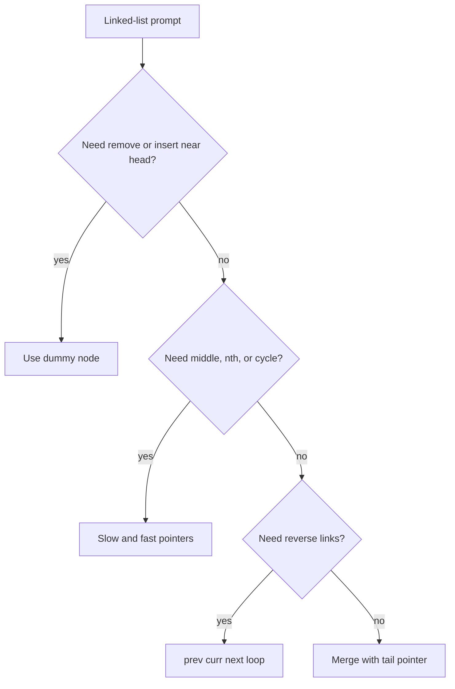
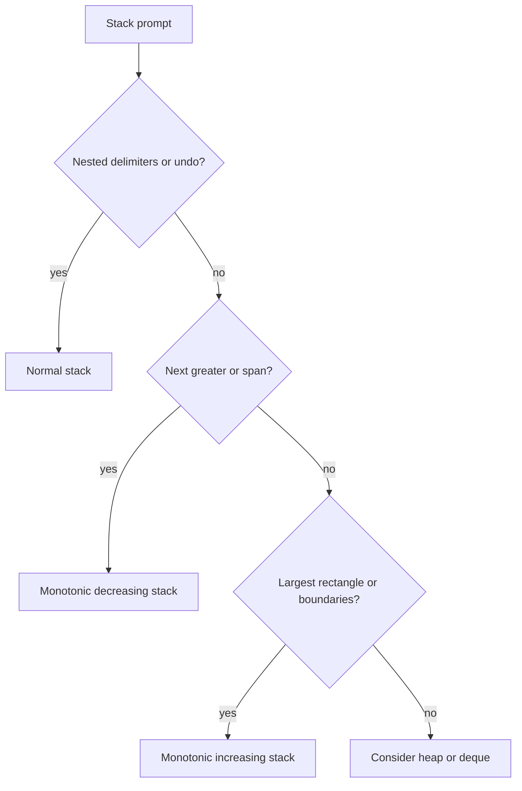
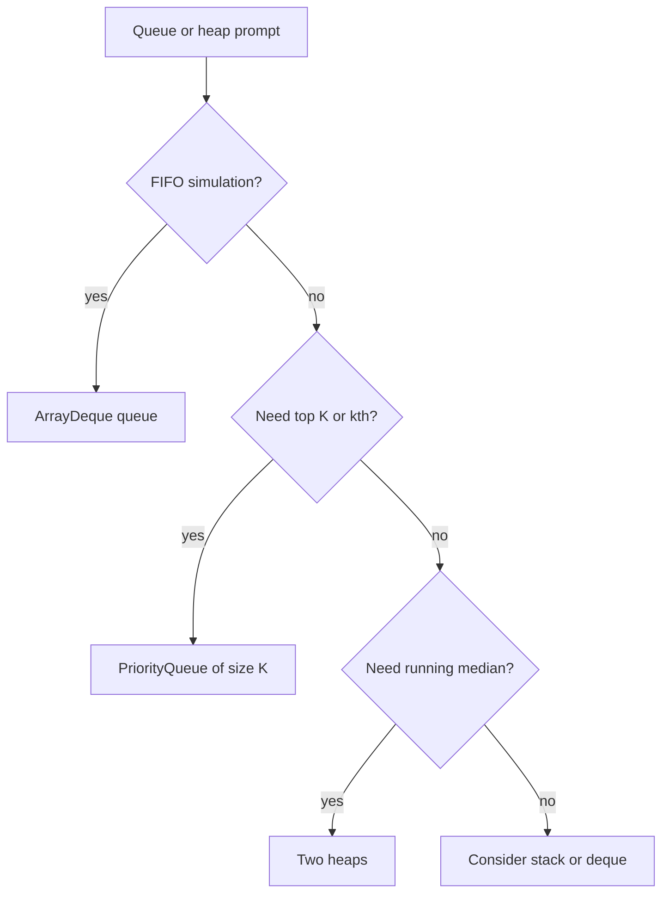

# 08c · DSA Linked List, Stack, Queue, Heap

This part covers pointer-heavy and data-structure-heavy interview problems. Focus on invariants: what each pointer means, what the stack stores, and which heap side owns which elements.

**Legend:** 🟢 Beginner · 🟡 Intermediate · 🔴 Advanced · ⚫ FAANG · 🔥 = very frequently asked

## Table of Contents
- [Linked List](#linked-list)
- [Stack and Monotonic Stack](#stack-and-monotonic-stack)
- [Queue and Heap](#queue-and-heap)
- [Flashcards](#flashcards)
- [Revision Cheat Sheet](#revision-cheat-sheet)

## Linked List
Linked list problems test pointer safety. Use dummy nodes for head changes, slow-fast pointers for distance/cycles, and always save `next` before rewiring.

Reusable Java template:
```java
class ListNode {
    int val;
    ListNode next;
    ListNode() {
    }

    ListNode(int v) {
        val = v;
    }

    ListNode(int v, ListNode n) {
        val = v;
        next = n;
    }
}

class Solution {
    ListNode reverse(ListNode head) {
        ListNode prev = null, cur = head;
        while (cur != null) {
            ListNode nxt = cur.next;
            cur.next = prev;
            prev = cur;
            cur = nxt;
        }

        return prev;
    }
}
```

### P1. Reverse Linked List (LeetCode 206)
`🟢 Easy` `🔥` `Must-know SDE-1` · Pattern: Pointer reversal · Commonly reported at: Amazon, Microsoft, Meta, Google
**Problem:** Reverse singly linked list. Example `1->2->3 -> 3->2->1`.
**How to recognize the pattern:** Need flip `next` pointers in-place.
**Brute force:** Push values/nodes to stack — O(n), O(n)
**Optimal:** Maintain `prev`, `cur`, `next` and rewire.
```java
class ListNode {
    int val;
    ListNode next;
    ListNode(int v) {
        val = v;
    }
}

class Solution {
    public ListNode reverseList(ListNode head) {
        ListNode prev = null, cur = head;
        while (cur != null) {
            ListNode nxt = cur.next;
            cur.next = prev;
            prev = cur;
            cur = nxt;
        }

        return prev;
    }
}
```
**Complexity:** Time O(n), Space O(1)
**Dry run:** `1.next=null`, then `2.next=1`, then `3.next=2`.
**Edge cases:** empty, one node, two nodes.
**Follow-ups:** recursive reverse → call stack O(n); reverse sublist → dummy plus local reverse; k-group → repeated bounded reverse.

### P2. Merge Two Sorted Lists (LeetCode 21)
`🟢 Easy` `🔥` `Must-know SDE-1` · Pattern: Dummy node merge · Commonly reported at: Amazon, Microsoft, Google
**Problem:** Merge two sorted linked lists. Example `1->2->4` and `1->3->4 -> 1->1->2->3->4->4`.
**How to recognize the pattern:** Two sorted streams need stable smallest-first merge.
**Brute force:** Collect values and sort — O(n log n), O(n)
**Optimal:** Dummy head and tail pointer choose smaller node.
```java
class ListNode {
    int val;
    ListNode next;
    ListNode(int v) {
        val = v;
    }
}

class Solution {
    public ListNode mergeTwoLists(ListNode a, ListNode b) {
        ListNode dummy = new ListNode(0), tail = dummy;
        while (a != null && b != null) {
            if (a.val <= b.val) {
                tail.next = a;
                a = a.next;
            } else {
                tail.next = b;
                b = b.next;
            }

            tail = tail.next;
        }

        tail.next = a != null ? a : b;
        return dummy.next;
    }
}
```
**Complexity:** Time O(n+m), Space O(1)
**Dry run:** compare `1/1`, then `2/3`, append remainder.
**Edge cases:** one list empty, duplicates, negative values.
**Follow-ups:** merge k lists → heap or divide-conquer; arrays → two pointers; descending lists → comparator changes.

### P3. Linked List Cycle and Cycle Start (LeetCode 142)
`🟡 Medium` `🔥` `Must-know SDE-1` · Pattern: Floyd slow-fast · Commonly reported at: Amazon, Microsoft, Google, Meta
**Problem:** Detect cycle and return entry node; if none, return null. Example tail connects to node at index 1 -> return that node.
**How to recognize the pattern:** Need cycle detection with O(1) space.
**Brute force:** Store visited nodes — O(n), O(n)
**Optimal:** Slow/fast meet if cycle exists; reset one pointer to head, move both one step to entry.
```java
class ListNode {
    int val;
    ListNode next;
    ListNode(int v) {
        val = v;
    }
}

class Solution {
    public ListNode detectCycle(ListNode head) {
        ListNode slow = head, fast = head;
        while (fast != null && fast.next != null) {
            slow = slow.next;
            fast = fast.next.next;
            if (slow == fast) {
                ListNode p = head;
                while (p != slow) {
                    p = p.next;
                    slow = slow.next;
                }

                return p;
            }
        }

        return null;
    }
}
```
**Complexity:** Time O(n), Space O(1)
**Dry run:** slow/fast meet inside loop; head pointer and meeting pointer converge at entry.
**Edge cases:** no cycle, self-cycle, two-node cycle.
**Follow-ups:** only boolean cycle → return on meet; cycle length → count after meet; duplicate number array → Floyd on indices.

### P4. Remove Nth Node From End (LeetCode 19)
`🟡 Medium` `🔥` `Must-know SDE-1` · Pattern: Gap two pointers with dummy · Commonly reported at: Amazon, Microsoft, Meta
**Problem:** Remove nth node from end. Example `1->2->3->4->5, n=2 -> 1->2->3->5`.
**How to recognize the pattern:** Need node relative to end in one pass.
**Brute force:** Count length, remove length-n — O(n), O(1)
**Optimal:** Dummy; move fast `n+1` steps, then move both until fast null.
```java
class ListNode {
    int val;
    ListNode next;
    ListNode(int v) {
        val = v;
    }
}

class Solution {
    public ListNode removeNthFromEnd(ListNode head, int n) {
        ListNode dummy = new ListNode(0);
        dummy.next = head;
        ListNode fast = dummy, slow = dummy;
        for (int i = 0; i <= n; i++) fast = fast.next;
        while (fast != null) {
            fast = fast.next;
            slow = slow.next;
        }

        slow.next = slow.next.next;
        return dummy.next;
    }
}
```
**Complexity:** Time O(n), Space O(1)
**Dry run:** fast gap places slow before node `4`, then bypass it.
**Edge cases:** remove head, one node, remove tail.
**Follow-ups:** kth from end → stop at target; doubly list → adjust prev; invalid n → validate fast before advancing.

### P5. Reorder List (LeetCode 143)
`🟡 Medium` `🔥` `Must-know SDE-1` · Pattern: Middle, reverse, merge · Commonly reported at: Meta, Amazon, Microsoft
**Problem:** Reorder `L0->L1->...->Ln` to `L0->Ln->L1->Ln-1...`. Example `1->2->3->4 -> 1->4->2->3`.
**How to recognize the pattern:** Alternating first half with reversed second half.
**Brute force:** Store nodes in array and connect ends — O(n), O(n)
**Optimal:** Find middle, reverse second half, weave two lists.
```java
class ListNode {
    int val;
    ListNode next;
    ListNode(int v) {
        val = v;
    }
}

class Solution {
    public void reorderList(ListNode head) {
        if (head == null) return;
        ListNode slow = head, fast = head;
        while (fast.next != null && fast.next.next != null) {
            slow = slow.next;
            fast = fast.next.next;
        }

        ListNode second = reverse(slow.next);
        slow.next = null;
        ListNode first = head;
        while (second != null) {
            ListNode f = first.next, s = second.next;
            first.next = second;
            second.next = f;
            first = f;
            second = s;
        }
    }

    ListNode reverse(ListNode h) {
        ListNode p = null, c = h;
        while (c != null) {
            ListNode n = c.next;
            c.next = p;
            p = c;
            c = n;
        }

        return p;
    }
}
```
**Complexity:** Time O(n), Space O(1)
**Dry run:** split `1->2` and `3->4`, reverse to `4->3`, weave.
**Edge cases:** odd length, even length, two nodes.
**Follow-ups:** return new list without mutation → copy nodes; palindrome list → same split/reverse; undo reorder → harder pointer separation.

### P6. Add Two Numbers (LeetCode 2)
`🟡 Medium` `🔥` `Must-know SDE-1` · Pattern: Digit-by-digit with carry · Commonly reported at: Amazon, Microsoft, Google
**Problem:** Add two numbers stored reverse-order in linked lists. Example `2->4->3 + 5->6->4 -> 7->0->8`.
**How to recognize the pattern:** Linked-list arithmetic with carry.
**Brute force:** Convert to number — overflow risk, O(n)
**Optimal:** Traverse both lists, create result digit `sum%10`, carry `sum/10`.
```java
class ListNode {
    int val;
    ListNode next;
    ListNode(int v) {
        val = v;
    }
}

class Solution {
    public ListNode addTwoNumbers(ListNode a, ListNode b) {
        ListNode dummy = new ListNode(0), tail = dummy;
        int carry = 0;
        while (a != null || b != null || carry != 0) {
            int sum = carry;
            if (a != null) {
                sum += a.val;
                a = a.next;
            }

            if (b != null) {
                sum += b.val;
                b = b.next;
            }

            tail.next = new ListNode(sum % 10);
            tail = tail.next;
            carry = sum / 10;
        }

        return dummy.next;
    }
}
```
**Complexity:** Time O(max(n,m)), Space O(max(n,m)) for output
**Dry run:** `2+5=7`, `4+6=10` write `0` carry `1`, `3+4+1=8`.
**Edge cases:** different lengths, final carry, zeros.
**Follow-ups:** forward-order digits → stacks or reverse; add one → carry pass; huge base → use base chunks.

### P7. Copy List with Random Pointer (LeetCode 138)
`🟡 Medium` `🔥` `Must-know SDE-1` · Pattern: Hash map old-to-new · Commonly reported at: Amazon, Meta, Microsoft
**Problem:** Deep-copy list where each node has `next` and `random`. Example random pointers must point to copied nodes, not originals.
**How to recognize the pattern:** Graph-like references require identity mapping.
**Brute force:** For each random pointer, search copied target — O(n^2)
**Better:** HashMap original node to clone — O(n), O(n)
**Optimal:** Interweave clones for O(1) extra, but map is safest in interviews.
```java
import java.util.*;
class Node {
    int val;
    Node next, random;
    Node(int v) {
        val = v;
    }
}

class Solution {
    public Node copyRandomList(Node head) {
        if (head == null) return null;
        Map<Node, Node> map = new HashMap<>();
        for (Node c = head; c != null; c = c.next) map.put(c, new Node(c.val));
        for (Node c = head; c != null; c = c.next) {
            map.get(c).next = map.get(c.next);
            map.get(c).random = map.get(c.random);
        }

        return map.get(head);
    }
}
```
**Complexity:** Time O(n), Space O(n)
**Dry run:** first pass creates clones; second pass wires `next` and `random` through map.
**Edge cases:** null random, random to self, empty list.
**Follow-ups:** O(1) extra → interleave clone nodes; graph clone → BFS/DFS map; immutable nodes → constructor wiring.

### P8. LRU Cache (LeetCode 146)
`🔴 Hard` `🔥` `Must-know SDE-1` · Pattern: HashMap plus doubly linked list · Commonly reported at: Amazon, Microsoft, Google, Meta
**Problem:** Implement `get` and `put` in O(1), evict least recently used. Example capacity 2 evicts older key.
**How to recognize the pattern:** Need fast key lookup and fast recency updates.
**Brute force:** List scan for keys — O(n)
**Optimal:** Map key to node; doubly linked list keeps most recent after head and LRU before tail.
```java
import java.util.*;
class LRUCache {
    class Node {
        int k, v;
        Node prev, next;
        Node(int k, int v) {
            this.k = k;
            this.v = v;
        }
    }

    int cap;
    Map<Integer, Node> map = new HashMap<>();
    Node head = new Node(0, 0), tail = new Node(0, 0);
    public LRUCache(int capacity) {
        cap = capacity;
        head.next = tail;
        tail.prev = head;
    }

    public int get(int key) {
        Node n = map.get(key);
        if (n == null) return -1;
        move(n);
        return n.v;
    }

    public void put(int key, int value) {
        Node n = map.get(key);
        if (n != null) {
            n.v = value;
            move(n);
            return;
        }

        if (map.size() == cap) {
            Node old = tail.prev;
            remove(old);
            map.remove(old.k);
        }

        Node add = new Node(key, value);
        map.put(key, add);
        insert(add);
    }

    void move(Node n) {
        remove(n);
        insert(n);
    }

    void remove(Node n) {
        n.prev.next = n.next;
        n.next.prev = n.prev;
    }

    void insert(Node n) {
        n.next = head.next;
        n.prev = head;
        head.next.prev = n;
        head.next = n;
    }
}
```
**Complexity:** Time O(1) per op, Space O(capacity)
**Dry run:** `get` moves node to front; `put` evicts `tail.prev` when full.
**Edge cases:** update existing key, capacity 1, repeated gets.
**Follow-ups:** TTL cache → expiry heap; LFU → freq lists; thread-safe → locks or concurrent structures.

### P9. Merge K Sorted Lists (LeetCode 23)
`🔴 Hard` `🔥` `Must-know SDE-1` · Pattern: Min-heap k-way merge · Commonly reported at: Amazon, Google, Meta, Microsoft
**Problem:** Merge `k` sorted linked lists. Example `[[1,4,5],[1,3,4],[2,6]] -> 1->1->2->3->4->4->5->6`.
**How to recognize the pattern:** K sorted streams; repeatedly need global minimum head.
**Brute force:** Collect all nodes and sort — O(N log N), O(N)
**Better:** Divide and conquer merge pairs — O(N log k), O(log k) recursion
**Optimal:** Min-heap of current heads — O(N log k), O(k).
```java
import java.util.*;
class ListNode {
    int val;
    ListNode next;
    ListNode(int v) {
        val = v;
    }
}

class Solution {
    public ListNode mergeKLists(ListNode[] lists) {
        PriorityQueue<ListNode> pq = new PriorityQueue<>((a, b)->Integer.compare(a.val, b.val));
        for (ListNode n : lists) if (n != null) pq.offer(n);
        ListNode dummy = new ListNode(0), tail = dummy;
        while (!pq.isEmpty()) {
            ListNode n = pq.poll();
            tail.next = n;
            tail = tail.next;
            if (n.next != null) pq.offer(n.next);
        }

        return dummy.next;
    }
}
```
**Complexity:** Time O(N log k), Space O(k)
**Dry run:** heap starts with `1,1,2`; poll smallest and push its next.
**Edge cases:** empty list array, null lists, duplicates.
**Follow-ups:** merge arrays → heap of indices; external files → streaming heap; divide-conquer variant → no heap.

### P10. Reverse Nodes in k-Group (LeetCode 25)
`🔴 Hard` `🔥` `Stretch` · Pattern: Bounded linked-list reversal · Commonly reported at: Amazon, Microsoft, Google
**Problem:** Reverse nodes in groups of `k`; leave incomplete group unchanged. Example `1->2->3->4->5, k=2 -> 2->1->4->3->5`.
**How to recognize the pattern:** Repeated local reversal with exact group size.
**Brute force:** Use array per group — O(n), O(k)
**Optimal:** Dummy node; find kth node; reverse links until group end.
```java
class ListNode {
    int val;
    ListNode next;
    ListNode(int v) {
        val = v;
    }
}

class Solution {
    public ListNode reverseKGroup(ListNode head, int k) {
        ListNode dummy = new ListNode(0);
        dummy.next = head;
        ListNode groupPrev = dummy;
        while (true) {
            ListNode kth = getKth(groupPrev, k);
            if (kth == null) break;
            ListNode groupNext = kth.next, prev = groupNext, cur = groupPrev.next;
            while (cur != groupNext) {
                ListNode nxt = cur.next;
                cur.next = prev;
                prev = cur;
                cur = nxt;
            }

            ListNode oldStart = groupPrev.next;
            groupPrev.next = kth;
            groupPrev = oldStart;
        }

        return dummy.next;
    }

    ListNode getKth(ListNode cur, int k) {
        while (cur != null && k > 0) {
            cur = cur.next;
            k--;
        }

        return cur;
    }
}
```
**Complexity:** Time O(n), Space O(1)
**Dry run:** group `1,2` reverses to `2,1`, then group `3,4`.
**Edge cases:** `k=1`, length not multiple of k, empty list.
**Follow-ups:** reverse alternate k groups → skip groups; reverse between positions → single bounded group; recursive solution → O(n/k) stack.

## Stack and Monotonic Stack
Stacks model nested structure and “previous unresolved item”. Monotonic stacks keep values increasing or decreasing so each item is pushed and popped once.

Reusable Java template:
```java
import java.util.*;
class Solution {
    int[] nextGreater(int[] a) {
        int[] ans = new int[a.length];
        Arrays.fill(ans, -1);
        ArrayDeque<Integer> st = new ArrayDeque<>();
        for (int i = 0; i < a.length; i++) {
            while (!st.isEmpty() && a[i] > a[st.peek()]) ans[st.pop()] = a[i];
            st.push(i);
        }

        return ans;
    }
}
```

### P11. Valid Parentheses (LeetCode 20)
`🟢 Easy` `🔥` `Must-know SDE-1` · Pattern: Stack matching · Commonly reported at: Amazon, Microsoft, Google
**Problem:** Validate bracket string. Example `"()[]{}" -> true`, `"(]" -> false`.
**How to recognize the pattern:** Last opened bracket must close first.
**Brute force:** Repeatedly remove matched pairs — O(n^2)
**Optimal:** Push opening brackets; each closing bracket must match stack top.
```java
import java.util.*;
class Solution {
    public boolean isValid(String s) {
        ArrayDeque<Character> st = new ArrayDeque<>();
        for (char c : s.toCharArray()) {
            if (c == '(') st.push(')');
            else if (c == '[') st.push(']');
            else if (c == '{') st.push('}');
            else if (st.isEmpty() || st.pop() != c) return false;
        }

        return st.isEmpty();
    }
}
```
**Complexity:** Time O(n), Space O(n)
**Dry run:** push expected `)`, closing `)` pops it.
**Edge cases:** starts with closing, leftover openings, empty string.
**Follow-ups:** longest valid parentheses → stack indices; generate parentheses → backtracking; add minimum parentheses → counters.

### P12. Min Stack (LeetCode 155)
`🟡 Medium` `🔥` `Must-know SDE-1` · Pattern: Auxiliary min stack · Commonly reported at: Amazon, Microsoft, Bloomberg
**Problem:** Stack with push/pop/top/getMin in O(1). Example push `-2,0,-3`; min is `-3`.
**How to recognize the pattern:** Need current aggregate min under pop operations.
**Brute force:** Scan stack for min — O(n) getMin
**Optimal:** Store pair `(value,currentMin)` per push.
```java
import java.util.*;
class MinStack {
    ArrayDeque<int[]> st = new ArrayDeque<>();
    public void push(int val) {
        int min = st.isEmpty() ? val : Math.min(val, st.peek()[1]);
        st.push(new int[] {val, min});
    }

    public void pop() {
        st.pop();
    }

    public int top() {
        return st.peek()[0];
    }

    public int getMin() {
        return st.peek()[1];
    }
}
```
**Complexity:** Time O(1) per op, Space O(n)
**Dry run:** pushing `-3` stores pair `[-3,-3]`; pop restores previous min.
**Edge cases:** duplicate minima, negative values, operations validity.
**Follow-ups:** min queue → two min stacks; save memory → encoded differences; max stack → TreeMap plus DLL.

### P13. Evaluate Reverse Polish Notation (LeetCode 150)
`🟡 Medium` `🔥` `Must-know SDE-1` · Pattern: Operand stack · Commonly reported at: Amazon, LinkedIn, Microsoft
**Problem:** Evaluate postfix expression. Example `["2","1","+","3","*"] -> 9`.
**How to recognize the pattern:** Operator follows its operands; last two values are needed.
**Brute force:** Build expression tree — overkill O(n)
**Optimal:** Push numbers; on operator pop b then a, push `a op b`.
```java
import java.util.*;
class Solution {
    public int evalRPN(String[] tokens) {
        ArrayDeque<Integer> st = new ArrayDeque<>();
        for (String t : tokens) {
            switch (t) {
                case "+":
                    st.push(st.pop() + st.pop());
                    break;
                case "-":
                    int rightMinus = st.pop();
                    int leftMinus = st.pop();
                    st.push(leftMinus - rightMinus);
                    break;
                case "*":
                    st.push(st.pop() * st.pop());
                    break;
                case "/":
                    int rightDivide = st.pop();
                    int leftDivide = st.pop();
                    st.push(leftDivide / rightDivide);
                    break;
                default:
                    st.push(Integer.parseInt(t));
            }
        }

        return st.pop();
    }
}
```
**Complexity:** Time O(n), Space O(n)
**Dry run:** push `2,1`, `+` -> `3`, push `3`, `*` -> `9`.
**Edge cases:** negative numbers, division truncates toward zero in Java, single token.
**Follow-ups:** infix expression → operator stack; variables → symbol table; overflow → use long.

### P14. Daily Temperatures (LeetCode 739)
`🟡 Medium` `🔥` `Must-know SDE-1` · Pattern: Monotonic decreasing stack · Commonly reported at: Amazon, Google, Microsoft
**Problem:** Days until warmer temperature. Example `[73,74,75,71,69,72,76,73] -> [1,1,4,2,1,1,0,0]`.
**How to recognize the pattern:** Need next greater element distance.
**Brute force:** For each day scan right — O(n^2)
**Optimal:** Stack unresolved indices with decreasing temperatures.
```java
import java.util.*;
class Solution {
    public int[] dailyTemperatures(int[] t) {
        int[] ans = new int[t.length];
        ArrayDeque<Integer> st = new ArrayDeque<>();
        for (int i = 0; i < t.length; i++) {
            while (!st.isEmpty() && t[i] > t[st.peek()]) {
                int j = st.pop();
                ans[j] = i - j;
            }

            st.push(i);
        }

        return ans;
    }
}
```
**Complexity:** Time O(n), Space O(n)
**Dry run:** `74` resolves `73`; `76` resolves many previous cooler days.
**Edge cases:** decreasing temps, equal temps, one day.
**Follow-ups:** next greater circular → loop 2n; stock span → previous greater; wait for lower temp → reverse inequality.

### P15. Next Greater Element I (LeetCode 496)
`🟢 Easy` `🔥` `Must-know SDE-1` · Pattern: Monotonic stack plus map · Commonly reported at: Amazon, Adobe, Microsoft
**Problem:** For each value in `nums1`, find next greater in `nums2`. Example `nums1=[4,1,2], nums2=[1,3,4,2] -> [-1,3,-1]`.
**How to recognize the pattern:** Next greater for many queries on a reference array.
**Brute force:** For each query scan right in `nums2` — O(n*m)
**Optimal:** Precompute value -> next greater using stack.
```java
import java.util.*;
class Solution {
    public int[] nextGreaterElement(int[] nums1, int[] nums2) {
        Map<Integer, Integer> next = new HashMap<>();
        ArrayDeque<Integer> st = new ArrayDeque<>();
        for (int x : nums2) {
            while (!st.isEmpty() && x > st.peek()) next.put(st.pop(), x);
            st.push(x);
        }

        int[] ans = new int[nums1.length];
        for (int i = 0; i < nums1.length; i++) ans[i] = next.getOrDefault(nums1[i], -1);
        return ans;
    }
}
```
**Complexity:** Time O(n+m), Space O(n)
**Dry run:** `3` resolves `1`; `4` resolves `3`; `2` resolves none.
**Edge cases:** absent greater, descending array, unique-value assumption.
**Follow-ups:** duplicates → stack indices; circular → two passes; previous greater → scan left to right with changed query.

### P16. Largest Rectangle in Histogram (LeetCode 84)
`🔴 Hard` `🔥` `Must-know SDE-1` · Pattern: Monotonic increasing stack · Commonly reported at: Google, Amazon, Microsoft
**Problem:** Max rectangle area in histogram. Example `[2,1,5,6,2,3] -> 10`.
**How to recognize the pattern:** For each bar, need nearest smaller on both sides.
**Brute force:** Expand each bar left/right — O(n^2)
**Optimal:** Increasing stack; when current is smaller, popped bar gets right boundary.
```java
import java.util.*;
class Solution {
    public int largestRectangleArea(int[] h) {
        ArrayDeque<Integer> st = new ArrayDeque<>();
        int best = 0;
        for (int i = 0; i <= h.length; i++) {
            int cur = i == h.length ? 0 : h[i];
            while (!st.isEmpty() && cur < h[st.peek()]) {
                int height = h[st.pop()];
                int left = st.isEmpty() ? -1 : st.peek();
                best = Math.max(best, height * (i - left - 1));
            }

            st.push(i);
        }

        return best;
    }
}
```
**Complexity:** Time O(n), Space O(n)
**Dry run:** at height `2`, bars `6` and `5` pop; area `5*2=10`.
**Edge cases:** increasing, decreasing, zeros.
**Follow-ups:** maximal rectangle in matrix → histogram per row; stock span → similar boundaries; return rectangle bounds → store left/right.

## Queue and Heap
Queues process FIFO work; heaps return the current smallest/largest priority. Use two heaps when you need a dynamic median or balanced lower/upper halves.

Reusable Java template:
```java
import java.util.*;
class Kth {
    PriorityQueue<Integer> min = new PriorityQueue<>();
    int k;
    Kth(int k) {
        this.k = k;
    }

    void add(int x) {
        min.offer(x);
        if (min.size() > k) min.poll();
    }

    int kth() {
        return min.peek();
    }
}
```

### P17. Implement Queue using Stacks (LeetCode 232)
`🟢 Easy` `🔥` `Must-know SDE-1` · Pattern: Amortized transfer stacks · Commonly reported at: Amazon, Microsoft, Bloomberg
**Problem:** Implement FIFO queue using two stacks. Example push `1,2`, pop returns `1`.
**How to recognize the pattern:** Need reverse stack order once to expose oldest item.
**Brute force:** On each pop, move all items twice — O(n) per pop
**Optimal:** `in` stack for pushes, `out` stack for pops; transfer only when `out` empty.
```java
import java.util.*;
class MyQueue {
    ArrayDeque<Integer> in = new ArrayDeque<>(), out = new ArrayDeque<>();
    public void push(int x) {
        in.push(x);
    }

    public int pop() {
        move();
        return out.pop();
    }

    public int peek() {
        move();
        return out.peek();
    }

    public boolean empty() {
        return in.isEmpty() && out.isEmpty();
    }

    void move() {
        if (out.isEmpty()) while (!in.isEmpty()) out.push(in.pop());
    }
}
```
**Complexity:** Amortized O(1) per op, Space O(n)
**Dry run:** push `1,2` into `in`; transfer makes `out` top `1`.
**Edge cases:** alternating operations, empty checks, one element.
**Follow-ups:** stack using queues → rotate queue; min queue → two min stacks; thread-safe queue → synchronization.

### P18. Kth Largest Element in an Array (LeetCode 215)
`🟡 Medium` `🔥` `Must-know SDE-1` · Pattern: Min-heap of size K · Commonly reported at: Amazon, Microsoft, Meta
**Problem:** Return kth largest element. Example `[3,2,1,5,6,4], k=2 -> 5`.
**How to recognize the pattern:** Need kth statistic, not full sorted order.
**Brute force:** Sort — O(n log n), O(1) or O(n)
**Better:** Quickselect average O(n), worst O(n^2)
**Optimal for interview simplicity:** Maintain min-heap of top k elements.
```java
import java.util.*;
class Solution {
    public int findKthLargest(int[] nums, int k) {
        PriorityQueue<Integer> pq = new PriorityQueue<>();
        for (int x : nums) {
            pq.offer(x);
            if (pq.size() > k) pq.poll();
        }

        return pq.peek();
    }
}
```
**Complexity:** Time O(n log k), Space O(k)
**Dry run:** heap keeps `[5,6]`; top is kth largest `5`.
**Edge cases:** duplicates, k=1, k=n.
**Follow-ups:** quickselect → expected O(n); streaming kth → same heap; kth smallest → max-heap or invert comparator.

### P19. Find Median from Data Stream (LeetCode 295)
`🔴 Hard` `🔥` `Must-know SDE-1` · Pattern: Two heaps · Commonly reported at: Amazon, Google, Microsoft, Meta
**Problem:** Support `addNum` and `findMedian`. Example add `1,2` -> `1.5`, add `3` -> `2`.
**How to recognize the pattern:** Need dynamic median after inserts.
**Brute force:** Sort list after every insert — O(n log n) per query
**Better:** Insert into sorted list — O(n) insert
**Optimal:** Max-heap for lower half, min-heap for upper half; balance sizes.
```java
import java.util.*;
class MedianFinder {
    PriorityQueue<Integer> lo = new PriorityQueue<>(Collections.reverseOrder());
    PriorityQueue<Integer> hi = new PriorityQueue<>();
    public void addNum(int num) {
        lo.offer(num);
        hi.offer(lo.poll());
        if (hi.size() > lo.size()) lo.offer(hi.poll());
    }

    public double findMedian() {
        if (lo.size() > hi.size()) return lo.peek();
        return ((long)lo.peek() + (long)hi.peek()) / 2.0;
    }
}
```
**Complexity:** Add O(log n), median O(1), Space O(n)
**Dry run:** add `1` in `lo`; add `2` balances `lo=[1]`, `hi=[2]` median `1.5`.
**Edge cases:** negative numbers, even/odd count, integer sum overflow variant use long cast.
**Follow-ups:** sliding median → two heaps with lazy deletion; percentile → order statistic tree; distributed median → merge summaries.

### P20. Task Scheduler (LeetCode 621)
`🟡 Medium` `🔥` `Must-know SDE-1` · Pattern: Greedy counting or max-heap cooldown · Commonly reported at: Amazon, Microsoft, Google
**Problem:** Minimum intervals to execute tasks with cooldown `n`. Example `AAABBB`, `n=2 -> 8`.
**How to recognize the pattern:** Most frequent task creates idle slots unless filled by others.
**Brute force:** Simulate each interval choosing valid task — O(time * 26)
**Better:** Max-heap with cooldown queue simulates correctly.
**Optimal:** Formula using max frequency: `max(total, (maxFreq-1)*(n+1)+numMax)`.
```java
class Solution {
    public int leastInterval(char[] tasks, int n) {
        int[] c = new int[26];
        int max = 0, numMax = 0;
        for (char t : tasks) {
            int v = ++c[t - 'A'];
            if (v > max) {
                max = v;
                numMax = 1;
            } else if (v == max) {
                numMax++;
            }
        }

        return Math.max(tasks.length, (max - 1) * (n + 1) + numMax);
    }
}
```
**Complexity:** Time O(tasks + 26), Space O(1)
**Dry run:** `A` and `B` have max `3`; `(3-1)*(2+1)+2=8`.
**Edge cases:** `n=0`, all unique, several tasks tied for max.
**Follow-ups:** produce actual schedule → heap + cooldown queue; variable cooldowns → priority queue by next time; multiple processors → scheduling variant.

## Flashcards
- Q: Linked-list reversal must save what first? → A: `next`, before changing `cur.next`.
- Q: Why dummy nodes? → A: They simplify head deletion/insertion cases.
- Q: Cycle entry after meeting? → A: Move one pointer to head; both advance one step.
- Q: LRU needs which two structures? → A: HashMap plus doubly linked list.
- Q: Monotonic stack total complexity? → A: O(n), each index pushes and pops once.
- Q: Daily temperatures stack order? → A: Decreasing temperatures by index.
- Q: Histogram stack order? → A: Increasing heights by index.
- Q: Queue using stacks amortized cost? → A: O(1) because each item moves stacks once.
- Q: Running median structures? → A: Max-heap lower half and min-heap upper half.
- Q: Task scheduler formula key? → A: Most frequent tasks define frame count.

## Revision Cheat Sheet
- Linked List -> signals: head changes, nth from end, cycle, reverse -> templates: dummy, slow-fast, `prev-cur-next`.
- Merge Lists -> signals: sorted linked streams -> dummy tail or min-heap for k streams.
- Cache Design -> signals: O(1) get/put with recency -> HashMap plus doubly linked list.
- Stack -> signals: nested delimiters, postfix, undo -> push expected state and pop on close/operator.
- Monotonic Stack -> signals: next greater, warmer day, nearest smaller boundary -> stack unresolved indices.
- Queue -> signals: FIFO or BFS simulation -> `ArrayDeque`, two stacks for queue interview trick.
- Heap -> signals: top K, kth, merge K, median -> size-K heap, k-way heap, or two heaps.
