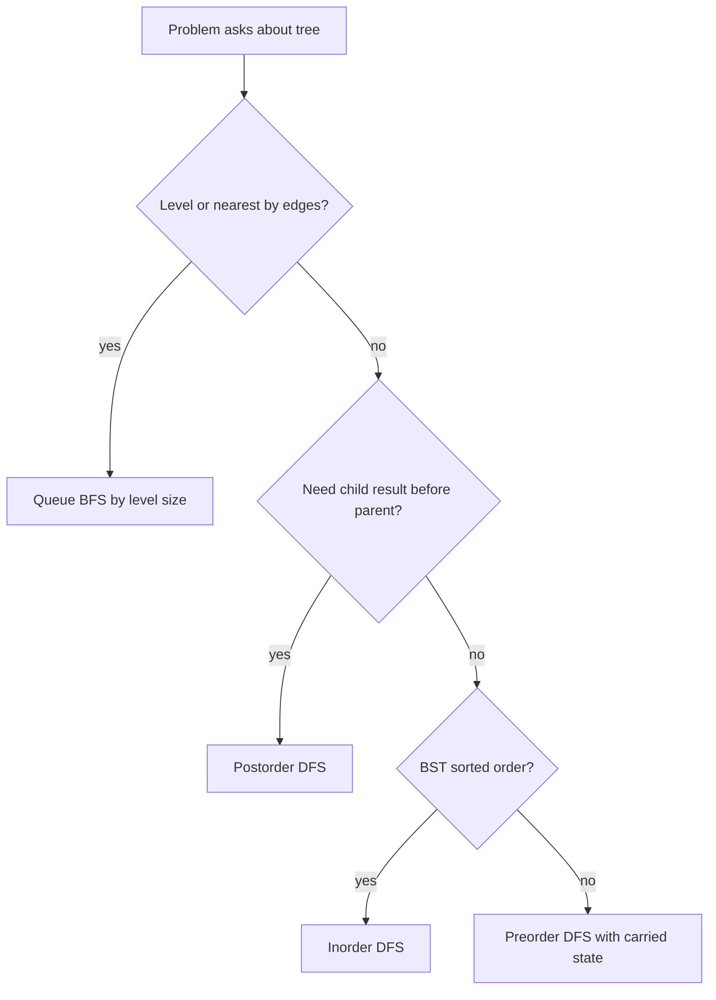
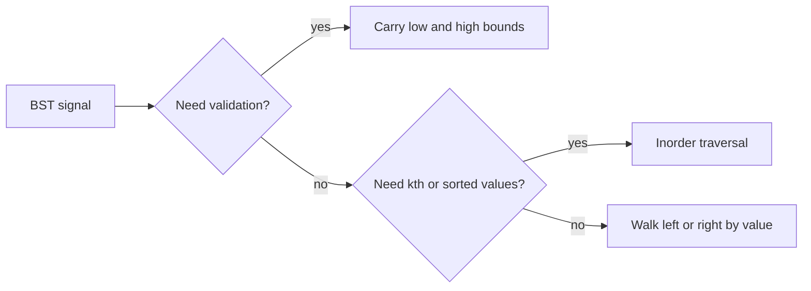
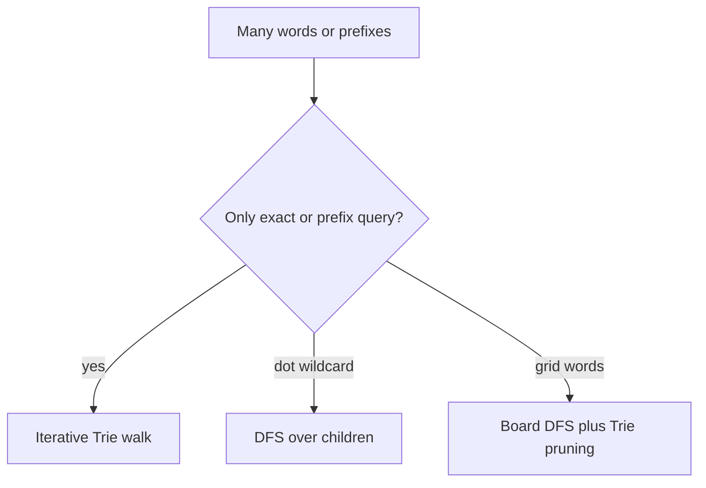

# 08d · DSA Trees, BST, and Trie

Interview-ready Java guide for tree traversals, BST invariants, and Trie prefix search. Focus on explaining the invariant first, then code the compact recursive or iterative template.

**Legend:** 🟢 Beginner · 🟡 Intermediate · 🔴 Advanced · ⚫ FAANG · 🔥 = very frequently asked

**Table of Contents**
- [Beginner guide to this file](#beginner-guide-to-this-file)
- [Binary Tree Traversal Patterns](#binary-tree-traversal-patterns)
- [BST Patterns](#bst-patterns)
- [Trie and Prefix Search Patterns](#trie-and-prefix-search-patterns)
- [Problems](#problems)
- [Revision Cheat Sheet](#revision-cheat-sheet)
- [Flashcards](#flashcards)

> Java note: binary-tree solutions assume LeetCode's standard `TreeNode` class.

## Beginner guide to this file

### What this file teaches

This file teaches tree-shaped Data Structures and Algorithms (DSA) thinking: how a node depends on its
children, how Binary Search Tree (BST) ordering narrows decisions, and how Trie prefix trees make word lookup
fast. Interviewers ask these problems because backend systems often traverse hierarchies, validate ordered data,
serialize nested objects, and search dictionaries or prefixes.

### Mental model

Think of a tree as a family chart where each person asks children for answers before reporting upward.

- Depth-First Search (DFS) is a deep branch conversation before returning.
- Breadth-First Search (BFS) is a floor-by-floor elevator ride through levels.
- A BST is a sorted decision tree with ancestor bounds.
- A Trie is a shared-prefix map for words.
- Backtracking keeps one path, then undoes a choice before trying another.

### How to think through any question here

1. Decide whether the answer is about a path, every node, levels, sorted order, or prefixes.
2. Say what one node returns: height, validity, gain, a found target, or nothing.
3. Use preorder for carried state, postorder for child answers, and inorder for BST sorted order.
4. For BFS, process exactly the current queue size per level.
5. For BSTs, write the low/high ancestor bounds before coding.
6. For Tries, define character edges and the complete-word marker.
7. State null, duplicate, skewed-tree, and recursion-depth edge cases.

### Pattern recognition cues

| If the question mentions... | Think about... | Why it fits |
|---|---|---|
| Height, depth, balance, diameter | Postorder DFS | Parent answers depend on child heights. |
| Level order, zigzag, right side | BFS by level size | Output groups nodes by distance from root. |
| BST validity or kth smallest | Bounds or inorder | BST order is global, not only parent-child. |
| Lowest common ancestor | Split point or bubbling targets | The answer is where two searches meet. |
| Preorder and inorder arrays | Root plus subtree ranges | Traversal order splits left and right subtrees. |
| Path sum or max path | Backtracking or one-side gain | Path rules decide what can return upward. |
| Serialize and deserialize | Null markers | Values alone do not preserve shape. |
| Prefix or wildcard word search | Trie | Shared prefixes avoid repeated scans. |

### Abbreviations and key terms

| Short form | Expanded form | Plain meaning |
|---|---|---|
| AVL | Adelson-Velsky and Landis tree | A self-balancing BST follow-up. |
| BFS | Breadth-First Search | Visit nearest nodes first using a queue. |
| BST | Binary Search Tree | Left values are smaller and right values are larger. |
| DFS | Depth-First Search | Explore one branch deeply before backtracking. |
| DP | Dynamic Programming | Reuse overlapping subproblem answers. |
| DSA | Data Structures and Algorithms | Coding-interview problem-solving topics. |
| FAANG | Facebook, Apple, Amazon, Netflix, and Google | Shorthand for large product-company interviews. |
| KMP | Knuth-Morris-Pratt | String matching that can compare serialized trees. |
| LCA | Lowest Common Ancestor | Deepest node with both targets below it. |
| O(...) | Big O notation | How time or space grows with input size. |
| RMQ | Range Minimum Query | Preprocessing for fast range minimum answers. |
| SDE | Software Development Engineer | Interview role level used in this guide. |
| Trie | Trie | A prefix tree for strings. |

### Common beginner traps

- Validating a BST only against each direct parent instead of all ancestor bounds.
- Returning both branches upward for diameter or max path sum when only one branch can extend.
- Forgetting to freeze BFS queue size for each level.
- Treating duplicate values as node identity in ancestor problems.
- Serializing without null markers and losing tree shape.
- Forgetting to undo path or board mutations during backtracking.

### How to study this file

1. Read the pattern section and say the invariant before looking at code.
2. For each problem, cover the code and explain the short answer aloud.
3. Use the detailed dry run to trace one small example by hand.
4. Convert each edge-case line into a test idea.
5. Revisit flashcards after coding to check pattern recognition.

## Binary Tree Traversal Patterns

Use DFS when a node must return information to its parent: height, validity, gain, serialized token, or a path. Use BFS when the question is level-based.



Reusable Java template:

```java
import java.util.*;
class TraversalTemplates {
    void preorder(TreeNode node, List<Integer> out) {
        if (node == null) return;
        out.add(node.val);
        preorder(node.left, out);
        preorder(node.right, out);
    }
    List<Integer> inorderIterative(TreeNode root) {
        List<Integer> ans = new ArrayList<>();
        Deque<TreeNode> st = new ArrayDeque<>();
        while (root != null || !st.isEmpty()) {
            while (root != null) { st.push(root); root = root.left; }
            root = st.pop();
            ans.add(root.val);
            root = root.right;
        }
        return ans;
    }
    List<List<Integer>> levelOrder(TreeNode root) {
        List<List<Integer>> ans = new ArrayList<>();
        if (root == null) return ans;
        Queue<TreeNode> q = new ArrayDeque<>();
        q.offer(root);
        while (!q.isEmpty()) {
            int size = q.size();
            List<Integer> level = new ArrayList<>();
            for (int i = 0; i < size; i++) {
                TreeNode cur = q.poll();
                level.add(cur.val);
                if (cur.left != null) q.offer(cur.left);
                if (cur.right != null) q.offer(cur.right);
            }
            ans.add(level);
        }
        return ans;
    }
}
```

## BST Patterns

A BST node inherits an open value range from all ancestors. Inorder traversal visits values in ascending order.



Reusable Java template:

```java
class BSTTemplates {
    boolean valid(TreeNode node, long low, long high) {
        if (node == null) return true;
        if (node.val <= low || node.val >= high) return false;
        return valid(node.left, low, node.val) && valid(node.right, node.val, high);
    }
    TreeNode search(TreeNode root, int target) {
        while (root != null && root.val != target) {
            root = target < root.val ? root.left : root.right;
        }
        return root;
    }
}
```

## Trie and Prefix Search Patterns

Trie is the right default when many operations share prefixes: autocomplete, dictionary lookup, wildcard search, and board-word pruning.



Reusable Java template:

```java
class TrieTemplate {
    static class Node { Node[] next = new Node[26]; boolean word; }
    private final Node root = new Node();
    void insert(String s) {
        Node cur = root;
        for (char ch : s.toCharArray()) {
            int i = ch - 'a';
            if (cur.next[i] == null) cur.next[i] = new Node();
            cur = cur.next[i];
        }
        cur.word = true;
    }
    boolean startsWith(String p) {
        Node cur = root;
        for (char ch : p.toCharArray()) {
            cur = cur.next[ch - 'a'];
            if (cur == null) return false;
        }
        return true;
    }
}
```

## Problems

### P1. Maximum Depth of Binary Tree (LeetCode 104)
`🟢 Easy` `🔥` `Must-know SDE-1` · Pattern: Tree DFS · Commonly reported at: Amazon, Microsoft, Google; verify tags
**Problem:** Return max root-to-leaf depth. Example `[3,9,20,null,null,15,7]` → `3`.

**How to recognize and think:** The task is simply tree height: the number of nodes on the longest
root-to-leaf route. Phrases like `maximum depth`, `root-to-leaf`, and `height` point to a depth-first answer.
Enumerating every full path records far more than the final integer needs. Postorder is the small leap: a node
cannot know its own depth until both children report theirs. The invariant is that `maxDepth(node)` returns
the exact height of that subtree; `null` returns `0`, and a real node returns `1 + max(left, right)`. Picture
`20` returning `2`, then root `3`. Say empty tree, single node, and a skewed chain.

**How to recognize the pattern:** Answer is `1 + best child answer`.
**Brute force:** Enumerate all paths — O(n) time, O(h) space.
**Optimal:** Postorder DFS returns subtree height.
```java
class Solution {
    public int maxDepth(TreeNode root) {
        if (root == null) return 0;
        return 1 + Math.max(maxDepth(root.left), maxDepth(root.right));
    }
}
```
**Complexity:** Time O(n), Space O(h)
**Dry run:** `20` returns `2`; root returns `1 + max(1,2) = 3`.
**Edge cases:** Empty tree; single node; skewed tree.
**Follow-ups:** Iterative BFS count levels; minimum depth uses BFS first leaf.

### P2. Invert Binary Tree (LeetCode 226)
`🟢 Easy` `🔥` `Must-know SDE-1` · Pattern: Tree DFS mutation · Commonly reported at: Google, Amazon; verify tags
**Problem:** Mirror a binary tree. Example `[4,2,7,1,3,6,9]` → `[4,7,2,9,6,3,1]`.

**How to recognize and think:** Mirroring asks every node to trade its left and right subtrees. Words such as
`invert`, `mirror`, and `swap children` identify local tree mutation. A copy-based solution builds a second
tree and stores all nodes again, even though each existing node can be fixed in place. The recursive move is
to save one child, assign the mirrored opposite child, then assign the saved side after it is mirrored. After
the call returns, the subtree rooted at that node is already a mirror of its original shape. Visualize node
`4` receiving mirrored `7` on the left and mirrored `2` on the right. Check empty input, one-child nodes, and
repeated values.

**How to recognize the pattern:** Same local child swap at every node.
**Brute force:** Build a new mirrored tree — O(n) time, O(n) space.
**Optimal:** Swap children in place and recurse.
```java
class Solution {
    public TreeNode invertTree(TreeNode root) {
        if (root == null) return null;
        TreeNode left = root.left;
        root.left = invertTree(root.right);
        root.right = invertTree(left);
        return root;
    }
}
```
**Complexity:** Time O(n), Space O(h)
**Dry run:** Root `4` receives mirrored `7` as left and mirrored `2` as right.
**Edge cases:** Empty; one child; repeated values.
**Follow-ups:** Iterative queue; immutable tree creates new nodes.

### P3. Same Tree (LeetCode 100)
`🟢 Easy` `🔥` `Must-know SDE-1` · Pattern: Dual-tree DFS · Commonly reported at: Amazon, Microsoft; verify tags
**Problem:** Check structural and value equality. Example `[1,2,3]` and `[1,2,3]` → `true`.

**How to recognize and think:** This asks whether two trees match at every corresponding position. The
giveaway terms are `same`, `structure`, and `value equality`. Serializing both trees can work only with null
markers, and it stores an entire representation before comparing. Direct recursion compares the two current
nodes as a pair. If both are null, that position matches; if only one is null, the shape differs; otherwise
values must match and both child pairs must match. The invariant is that each call represents one identical
position in both trees. Trace equal roots, then left-left and right-right pairs. Call out both null, one null,
and same values arranged in different shapes.

**How to recognize the pattern:** Compare two nodes in lockstep.
**Brute force:** Serialize both with null markers — O(n) time, O(n) space.
**Optimal:** Recursive pair comparison.
```java
class Solution {
    public boolean isSameTree(TreeNode p, TreeNode q) {
        if (p == null || q == null) return p == q;
        return p.val == q.val && isSameTree(p.left, q.left) && isSameTree(p.right, q.right);
    }
}
```
**Complexity:** Time O(n), Space O(h)
**Dry run:** Equal roots recurse to both child pairs.
**Edge cases:** Both null; one null; same values different shape.
**Follow-ups:** Iterative stack of pairs; use as subtree helper.

### P4. Subtree of Another Tree (LeetCode 572)
`🟢 Easy` `🔥` `Must-know SDE-1` · Pattern: Tree matching · Commonly reported at: Amazon, Meta, Microsoft; verify tags
**Problem:** Check whether `subRoot` appears as an identical subtree. Example root `[3,4,5,1,2]`, sub `[4,1,2]` → `true`.

**How to recognize and think:** The phrase `subtree` means a candidate root in the big tree must match
`subRoot` completely, not just start with the same value. Trying the exact-tree helper at every node can
repeat comparisons on duplicate or skewed data, but the separation of jobs is clear: scan for possible roots,
then demand full structural equality. The Java solution is acceptable for typical interview constraints;
null-marked serialization is the follow-up when repeated matching dominates. Its correctness comes from not
skipping any root candidate, and from the helper refusing partial matches. Picture arriving at value `4`, then
checking children `1` and `2`. Mention duplicate values, empty `subRoot`, and long repeated chains.

**How to recognize the pattern:** Need candidate root search plus exact-tree comparison.
**Brute force:** Compare `subRoot` at each `root` node — O(n*m) time.
**Optimal:** Same DFS is accepted; serialization with null markers is an advanced alternative.
```java
class Solution {
    public boolean isSubtree(TreeNode root, TreeNode subRoot) {
        if (root == null) return subRoot == null;
        return same(root, subRoot) || isSubtree(root.left, subRoot) || isSubtree(root.right, subRoot);
    }
    private boolean same(TreeNode a, TreeNode b) {
        if (a == null || b == null) return a == b;
        return a.val == b.val && same(a.left, b.left) && same(a.right, b.right);
    }
}
```
**Complexity:** Time O(n*m) worst case, Space O(h)
**Dry run:** At value `4`, helper confirms children `1` and `2`.
**Edge cases:** Duplicate values; empty `subRoot`; repeated skewed chains.
**Follow-ups:** Serialize and KMP; Merkle hashes need collision handling.

### P5. Diameter of Binary Tree (LeetCode 543)
`🟢 Easy` `🔥` `Must-know SDE-1` · Pattern: Postorder with global best · Commonly reported at: Amazon, Google, Microsoft; verify tags
**Problem:** Return longest path length in edges. Example `[1,2,3,4,5]` → `3`.

**How to recognize and think:** Diameter is the longest path measured in edges, and it may bend through any
node rather than through the root. The clue is that a parent needs child heights, while the answer might be
`left height + right height` at the current node. Recomputing height for every possible center revisits the
same subtrees. One postorder traversal returns the single-branch height usable by the parent and updates a
shared best with the two-branch candidate. That division is the invariant: return one side upward, record both
sides locally. At node `2`, the candidate is `2`; at root it becomes `3`. Check one-node diameter `0`, empty
tree, and skewed trees.

**How to recognize the pattern:** Parent needs height, but answer may pass through current node.
**Brute force:** Recompute heights at every node — O(n²) worst-case.
**Optimal:** One DFS returns height and updates `left + right`.
```java
class Solution {
    private int best;
    public int diameterOfBinaryTree(TreeNode root) {
        best = 0;
        height(root);
        return best;
    }
    private int height(TreeNode node) {
        if (node == null) return 0;
        int left = height(node.left), right = height(node.right);
        best = Math.max(best, left + right);
        return 1 + Math.max(left, right);
    }
}
```
**Complexity:** Time O(n), Space O(h)
**Dry run:** Node `2` candidate is `2`; root candidate becomes `3`.
**Edge cases:** One node returns `0`; empty; skewed tree.
**Follow-ups:** Diameter in nodes adds one; weighted tree returns weighted downward gain.

### P6. Balanced Binary Tree (LeetCode 110)
`🟢 Easy` `🔥` `Must-know SDE-1` · Pattern: DFS sentinel · Commonly reported at: Amazon, Bloomberg, Microsoft; verify tags
**Problem:** Every node's subtree heights differ by at most 1. Example `[3,9,20,null,null,15,7]` → `true`.

**How to recognize and think:** A balanced tree needs the height difference rule to hold at every node.
Calculating height separately for each node repeats the same child-height work on long chains. Combine the
questions: return a height when the subtree is balanced, and return `-1` the moment it is not. The invariant
is that a nonnegative result is a trustworthy height, while `-1` means no ancestor needs more detail. This
short-circuits after the first bad subtree instead of continuing to measure it. Imagine a deep left chain
sending `-1` upward like a red flag. Say empty tree, single node, and a long linked-list-shaped tree.

**How to recognize the pattern:** Need height and validity together.
**Brute force:** Recompute height for each node — O(n²) time.
**Optimal:** Return `-1` when a subtree is already unbalanced.
```java
class Solution {
    public boolean isBalanced(TreeNode root) {
        return height(root) != -1;
    }
    private int height(TreeNode node) {
        if (node == null) return 0;
        int left = height(node.left);
        if (left == -1) return -1;
        int right = height(node.right);
        if (right == -1 || Math.abs(left - right) > 1) return -1;
        return 1 + Math.max(left, right);
    }
}
```
**Complexity:** Time O(n), Space O(h)
**Dry run:** First unbalanced child returns `-1` and ancestors stop.
**Edge cases:** Empty; single node; long chain.
**Follow-ups:** Iterative postorder; AVL tree maintains this after updates.

### P7. Binary Tree Level Order Traversal (LeetCode 102)
`🟡 Medium` `🔥` `Must-know SDE-1` · Pattern: BFS by level · Commonly reported at: Amazon, Microsoft, Meta; verify tags
**Problem:** Return values level by level. Example `[3,9,20,null,null,15,7]` → `[[3],[9,20],[15,7]]`.

**How to recognize and think:** The output is grouped by distance from the root, so `level order`, `by level`,
and nested lists point to breadth-first search. A depth-first bucket solution works, but it manually tracks
levels and can grow recursion depth on a skewed tree. A queue already stores nodes in increasing distance.
Capturing the queue size before a level starts freezes the boundary; children enqueued during the loop belong
to the next group, not the current one. Trace the queue as `[3]`, then `[9,20]`, then `[15,7]`. Mention empty
tree, a single node, and very wide levels that stress queue space.

**How to recognize the pattern:** Output grouped by distance from root.
**Brute force:** DFS with depth buckets — O(n) time, O(n) space.
**Optimal:** Queue BFS and process current `size`.
```java
import java.util.*;
class Solution {
    public List<List<Integer>> levelOrder(TreeNode root) {
        List<List<Integer>> ans = new ArrayList<>();
        if (root == null) return ans;
        Queue<TreeNode> q = new ArrayDeque<>();
        q.offer(root);
        while (!q.isEmpty()) {
            int size = q.size();
            List<Integer> level = new ArrayList<>();
            for (int i = 0; i < size; i++) {
                TreeNode node = q.poll();
                level.add(node.val);
                if (node.left != null) q.offer(node.left);
                if (node.right != null) q.offer(node.right);
            }
            ans.add(level);
        }
        return ans;
    }
}
```
**Complexity:** Time O(n), Space O(w)
**Dry run:** Queue levels are `[3]`, `[9,20]`, `[15,7]`.
**Edge cases:** Empty; one node; wide tree.
**Follow-ups:** Bottom-up order reverses answer; averages store sum per level.

### P8. Binary Tree Right Side View (LeetCode 199)
`🟡 Medium` `🔥` `Must-know SDE-1` · Pattern: BFS last per level · Commonly reported at: Amazon, Meta, Microsoft; verify tags
**Problem:** Return visible values from the right. Example `[1,2,3,null,5,null,4]` → `[1,3,4]`.

**How to recognize and think:** Right side view asks for the last visible node at each depth, not for all
nodes. The words `right side` and `per level` reveal a level traversal with one chosen representative. Storing
every level and taking the last value is correct but keeps more output than needed. During breadth-first
search, process exactly one level at a time; with left-to-right enqueue order, the final node removed in that
level is the rightmost visible one. On `[5,4]`, `4` wins that level even if values repeat elsewhere. Bring up
a left-only tree, empty input, and duplicate values, because visibility depends on position rather than value.

**How to recognize the pattern:** Need one representative per level.
**Brute force:** Level-order all values then take last — O(n) time.
**Optimal:** Record the last node polled at each level.
```java
import java.util.*;
class Solution {
    public List<Integer> rightSideView(TreeNode root) {
        List<Integer> ans = new ArrayList<>();
        if (root == null) return ans;
        Queue<TreeNode> q = new ArrayDeque<>();
        q.offer(root);
        while (!q.isEmpty()) {
            int size = q.size();
            for (int i = 0; i < size; i++) {
                TreeNode node = q.poll();
                if (i == size - 1) ans.add(node.val);
                if (node.left != null) q.offer(node.left);
                if (node.right != null) q.offer(node.right);
            }
        }
        return ans;
    }
}
```
**Complexity:** Time O(n), Space O(w)
**Dry run:** Levels `[1]`, `[2,3]`, `[5,4]` contribute `1,3,4`.
**Edge cases:** Left-only tree; empty; duplicate values.
**Follow-ups:** DFS root-right-left; left side view flips direction.

### P9. Binary Tree Zigzag Level Order Traversal (LeetCode 103)
`🟡 Medium` `🔥` `Must-know SDE-1` · Pattern: BFS alternating order · Commonly reported at: Amazon, Microsoft; verify tags
**Problem:** Alternate level order direction. Example `[3,9,20,null,null,15,7]` → `[[3],[20,9],[15,7]]`.

**How to recognize and think:** Zigzag traversal is ordinary level order with the displayed direction
alternating each row. Doing a normal breadth-first traversal and reversing every odd list adds an extra pass
over those values. Keep the queue behavior unchanged, and change only where you place each value in the level
list: append on left-to-right rows, add to the front on right-to-left rows. The invariant is that children are
still discovered in normal order, while the per-level container handles presentation. On the second level,
visit `9` then `20`, but front-insertion yields `[20,9]`. Check a single node, sparse trees, and odd versus
even depths.

**How to recognize the pattern:** Same BFS levels with alternating insertion direction.
**Brute force:** Normal BFS then reverse odd levels — O(n) time.
**Optimal:** Add values to front or back of a `LinkedList`.
```java
import java.util.*;
class Solution {
    public List<List<Integer>> zigzagLevelOrder(TreeNode root) {
        List<List<Integer>> ans = new ArrayList<>();
        if (root == null) return ans;
        Queue<TreeNode> q = new ArrayDeque<>();
        q.offer(root);
        boolean leftToRight = true;
        while (!q.isEmpty()) {
            int size = q.size();
            LinkedList<Integer> level = new LinkedList<>();
            for (int i = 0; i < size; i++) {
                TreeNode node = q.poll();
                if (leftToRight) level.addLast(node.val); else level.addFirst(node.val);
                if (node.left != null) q.offer(node.left);
                if (node.right != null) q.offer(node.right);
            }
            ans.add(level);
            leftToRight = !leftToRight;
        }
        return ans;
    }
}
```
**Complexity:** Time O(n), Space O(w)
**Dry run:** Second level inserts `9`, then `20` at front → `[20,9]`.
**Edge cases:** Single node; sparse tree; odd/even heights.
**Follow-ups:** Use deque traversal; vertical traversal also needs column ordering.

### P10. Lowest Common Ancestor of a BST (LeetCode 235)
`🟢 Easy` `🔥` `Must-know SDE-1` · Pattern: BST guided walk · Commonly reported at: Amazon, Microsoft; verify tags
**Problem:** Return LCA in a BST. Example root `[6,2,8,0,4,7,9,3,5]`, `p=2`, `q=8` → `6`.

**How to recognize and think:** Lowest Common Ancestor (LCA) in a Binary Search Tree (BST) is about the first
split in ordered search paths. The words `BST` and `ancestor of p and q` mean values tell you which branch can
contain both targets. Building two root-to-node paths stores ancestors you can avoid. At each node, if both
target values are smaller, move left; if both are larger, move right. Otherwise the current node is either
between them or equal to one target, so it is their lowest shared ancestor. For `p=2`, `q=8`, `6` is the
split. Cover one node being the ancestor, identical targets, and a skewed BST.

**How to recognize the pattern:** BST ordering shows whether both targets are left, right, or split.
**Brute force:** Build root-to-node paths — O(h) time, O(h) space.
**Optimal:** Walk until current value is between `p` and `q`.
```java
class Solution {
    public TreeNode lowestCommonAncestor(TreeNode root, TreeNode p, TreeNode q) {
        int a = p.val, b = q.val;
        while (root != null) {
            if (a < root.val && b < root.val) root = root.left;
            else if (a > root.val && b > root.val) root = root.right;
            else return root;
        }
        return null;
    }
}
```
**Complexity:** Time O(h), Space O(1)
**Dry run:** `2 < 6 < 8`, so `6` is the split.
**Edge cases:** One node is ancestor; same target; skewed BST.
**Follow-ups:** If nodes may be absent, validate existence; normal tree cannot use ordering.

### P11. Lowest Common Ancestor of a Binary Tree (LeetCode 236)
`🟡 Medium` `🔥` `Must-know SDE-1` · Pattern: Recursive ancestor bubbling · Commonly reported at: Amazon, Google, Meta; verify tags
**Problem:** Return LCA in a general tree. Example root `[3,5,1,6,2,0,8,null,null,7,4]`, `p=5`, `q=1` → `3`.

**How to recognize and think:** Lowest Common Ancestor (LCA) in a general binary tree has no ordering
shortcut. A parent map plus ancestor set works, but it stores upward links for the whole tree. Recursion can
answer bottom-up: a subtree returns `null` if it has neither target, returns the target or resolved ancestor
if it has one side, and the current node becomes the LCA when both children return non-null. The invariant is
that a non-null return means this subtree contains useful target information. In the sample, `5` comes from
the left and `1` from the right, so `3` joins them. Mention ancestor-as-target, reference identity, and the
guarantee that both nodes exist.

**How to recognize the pattern:** No ordering; search both subtrees.
**Brute force:** Parent map plus ancestor set — O(n) time, O(n) space.
**Optimal:** Return found node from child; two non-null children mean current is LCA.
```java
class Solution {
    public TreeNode lowestCommonAncestor(TreeNode root, TreeNode p, TreeNode q) {
        if (root == null || root == p || root == q) return root;
        TreeNode left = lowestCommonAncestor(root.left, p, q);
        TreeNode right = lowestCommonAncestor(root.right, p, q);
        if (left != null && right != null) return root;
        return left != null ? left : right;
    }
}
```
**Complexity:** Time O(n), Space O(h)
**Dry run:** One target found left and one right, so root returns.
**Edge cases:** One target ancestor; nodes are references; LeetCode guarantees both exist.
**Follow-ups:** Missing nodes → return count and candidate; many queries → Euler tour plus RMQ.

### P12. Validate Binary Search Tree (LeetCode 98)
`🟡 Medium` `🔥` `Must-know SDE-1` · Pattern: BST bounds · Commonly reported at: Amazon, Microsoft, Bloomberg; verify tags
**Problem:** Check strict BST validity. Example `[5,1,4,null,null,3,6]` → `false`.

**How to recognize and think:** Validating a Binary Search Tree (BST) is stricter than checking each
parent-child pair. Signal words include `valid BST`, `strict`, and `descendants`, because a deep node can
violate an ancestor bound. Recomputing subtree minima and maxima at every node repeats scans; checking only
immediate children is incorrect. Carry open lower and upper bounds down the recursion. The invariant is that
every node must fit all ancestor constraints, and each step narrows one side of the interval. In
`[5,1,4,null,null,3,6]`, `3` is in the right subtree of `5` but falls below its lower bound. Say duplicates
are invalid, integer extremes need `long`, and empty trees are valid.

**How to recognize the pattern:** Descendants must respect ancestor bounds.
**Brute force:** Scan min/max of each subtree — O(n²) time.
**Optimal:** Carry `(low, high)` as `long` open bounds.
```java
class Solution {
    public boolean isValidBST(TreeNode root) {
        return valid(root, Long.MIN_VALUE, Long.MAX_VALUE);
    }
    private boolean valid(TreeNode node, long low, long high) {
        if (node == null) return true;
        if (node.val <= low || node.val >= high) return false;
        return valid(node.left, low, node.val) && valid(node.right, node.val, high);
    }
}
```
**Complexity:** Time O(n), Space O(h)
**Dry run:** Node `3` in right subtree of `5` violates low bound `5`.
**Edge cases:** Duplicates invalid; integer min/max; empty tree.
**Follow-ups:** Inorder previous value; duplicate policy must be specified.

### P13. Kth Smallest Element in a BST (LeetCode 230)
`🟡 Medium` `🔥` `Must-know SDE-1` · Pattern: BST inorder · Commonly reported at: Amazon, Google, Microsoft; verify tags
**Problem:** Return kth smallest BST value. Example root `[3,1,4,null,2]`, `k=1` → `1`.

**How to recognize and think:** In a Binary Search Tree (BST), inorder traversal lists values in ascending
order, so `kth smallest` is a traversal-stop problem. Building the entire inorder list ranks every node even
when `k` is small. The iterative stack simulates the left-recursive walk and lets you stop on the kth pop. The
invariant is that a popped node is the next unseen value in sorted order: all nodes in its left subtree are
done, and its right subtree waits for later. For root `[3,1,4,null,2]`, the first pop is `1`. Discuss `k=1`,
`k=n`, and a skewed tree where the stack may grow to height `n`.

**How to recognize the pattern:** BST inorder is sorted ascending.
**Brute force:** Store full inorder list — O(n) time, O(n) space.
**Optimal:** Iterative inorder stops after kth pop.
```java
import java.util.*;
class Solution {
    public int kthSmallest(TreeNode root, int k) {
        Deque<TreeNode> st = new ArrayDeque<>();
        while (root != null || !st.isEmpty()) {
            while (root != null) { st.push(root); root = root.left; }
            root = st.pop();
            if (--k == 0) return root.val;
            root = root.right;
        }
        throw new IllegalArgumentException();
    }
}
```
**Complexity:** Time O(h + k), Space O(h)
**Dry run:** First pop is minimum `1`, so `k=1` returns.
**Edge cases:** `k=1`; `k=n`; skewed BST.
**Follow-ups:** Frequent queries → subtree sizes; kth largest → reverse inorder.

### P14. Construct Binary Tree from Preorder and Inorder Traversal (LeetCode 105)
`🟡 Medium` `🔥` `Must-know SDE-1` · Pattern: Divide and conquer · Commonly reported at: Amazon, Microsoft, Google; verify tags
**Problem:** Build tree from preorder and inorder arrays. Example preorder `[3,9,20,15,7]`, inorder `[9,3,15,20,7]`.

**How to recognize and think:** Preorder plus inorder reconstruction works because the two arrays answer
different questions. `preorder` gives the next root; `inorder` tells which values belong to the left and right
subtrees of that root. Searching the inorder array during every recursive call repeats linear scans. A hashmap
makes root-position lookup constant time, and range boundaries define each subtree. The invariant is that
`build(left, right)` consumes exactly the preorder values for that inorder slice and returns the tree for that
slice. Root `3` splits inorder into `[9]` and `[15,20,7]`. Say empty arrays, a one-node tree, and the
unique-values requirement; duplicates make the split ambiguous.

**How to recognize the pattern:** Preorder gives root; inorder splits left/right.
**Brute force:** Linear-search root in inorder each call — O(n²) time.
**Optimal:** Hash value to inorder index and recurse on ranges.
```java
import java.util.*;
class Solution {
    private int preIdx;
    private int[] preorder;
    private Map<Integer, Integer> pos;
    public TreeNode buildTree(int[] preorder, int[] inorder) {
        this.preorder = preorder;
        pos = new HashMap<>();
        for (int i = 0; i < inorder.length; i++) pos.put(inorder[i], i);
        return build(0, inorder.length - 1);
    }
    private TreeNode build(int left, int right) {
        if (left > right) return null;
        TreeNode root = new TreeNode(preorder[preIdx++]);
        int mid = pos.get(root.val);
        root.left = build(left, mid - 1);
        root.right = build(mid + 1, right);
        return root;
    }
}
```
**Complexity:** Time O(n), Space O(n)
**Dry run:** Root `3` splits inorder into `[9]` and `[15,20,7]`.
**Edge cases:** Empty; one node; unique values required.
**Follow-ups:** Inorder plus postorder; duplicates need extra occurrence tracking.

### P15. Binary Tree Maximum Path Sum (LeetCode 124)
`🔴 Hard` `🔥` `Stretch` · Pattern: DFS with global maximum · Commonly reported at: Amazon, Google, Meta; verify tags
**Problem:** Max sum of any non-empty path. Example `[-10,9,20,null,null,15,7]` → `42`.

**How to recognize and think:** The path may start and end anywhere, so it can pass through a node and use
both children, but only one side can be extended to the parent. Trying endpoint pairs recomputes many path
sums and gets tricky with negatives. The recursive gain function returns the best one-sided contribution
upward, while a global answer checks the local two-sided candidate `node + left + right`. Clamping child gains
at zero means a harmful negative branch is simply not used. The invariant is: return a path that can still be
extended; record a path that may stop here. At `20`, `15 + 20 + 7` gives `42`. Mention all-negative trees,
single node, and skewed shape.

**How to recognize the pattern:** Path may start/end anywhere and pass through a node.
**Brute force:** Try many endpoint pairs — O(n²) or worse.
**Optimal:** Return one-side gain; update global with both child gains.
```java
class Solution {
    private int best;
    public int maxPathSum(TreeNode root) {
        best = Integer.MIN_VALUE;
        gain(root);
        return best;
    }
    private int gain(TreeNode node) {
        if (node == null) return 0;
        int left = Math.max(0, gain(node.left));
        int right = Math.max(0, gain(node.right));
        best = Math.max(best, node.val + left + right);
        return node.val + Math.max(left, right);
    }
}
```
**Complexity:** Time O(n), Space O(h)
**Dry run:** At `20`, candidate `20+15+7=42`.
**Edge cases:** All negative; single node; skewed tree.
**Follow-ups:** Return actual path; root-to-leaf max sum is a different constraint.

### P16. Serialize and Deserialize Binary Tree (LeetCode 297)
`🔴 Hard` `🔥` `Stretch` · Pattern: Tree encoding · Commonly reported at: Amazon, Google, Microsoft; verify tags
**Problem:** Convert tree to string and back. Example `[1,2,3,null,null,4,5]` round-trips.

**How to recognize and think:** Serialization must preserve shape, not only values. The key clues are
`serialize`, `deserialize`, and `round-trip`; without null markers, different trees can share the same
preorder values. Breadth-first strings with nulls work but often carry many trailing placeholders. Preorder
with `#` markers is compact and recursive: each token either creates `null` or creates a node followed by its
left and right encodings. The invariant during decoding is that reading one token plus its required subtrees
consumes exactly one serialized subtree. Trace `1,2,#,#,3,4,#,#,5,#,#` rebuilding in preorder. Check empty
tree, negative numbers, and missing markers that break the shape.

**How to recognize the pattern:** Must preserve null structure, not just values.
**Brute force:** BFS with nulls — O(n) time, possible long trailing nulls.
**Optimal:** Preorder with `#` null markers.
```java
import java.util.*;
public class Codec {
    public String serialize(TreeNode root) {
        StringBuilder sb = new StringBuilder();
        write(root, sb);
        return sb.toString();
    }
    private void write(TreeNode node, StringBuilder sb) {
        if (node == null) { sb.append("#,"); return; }
        sb.append(node.val).append(',');
        write(node.left, sb);
        write(node.right, sb);
    }
    public TreeNode deserialize(String data) {
        Queue<String> q = new ArrayDeque<>(Arrays.asList(data.split(",")));
        return read(q);
    }
    private TreeNode read(Queue<String> q) {
        String token = q.poll();
        if (token.equals("#")) return null;
        TreeNode node = new TreeNode(Integer.parseInt(token));
        node.left = read(q);
        node.right = read(q);
        return node;
    }
}
```
**Complexity:** Time O(n), Space O(n)
**Dry run:** `1,2,#,#,3,4,#,#,5,#,#` rebuilds preorder.
**Edge cases:** Empty tree; negative values; missing null markers break shape.
**Follow-ups:** BFS codec; production parser should validate malformed input.

### P17. Path Sum II (LeetCode 113)
`🟡 Medium` `🔥` `Must-know SDE-1` · Pattern: Tree backtracking · Commonly reported at: Amazon, Microsoft; verify tags
**Problem:** Return root-to-leaf paths summing to target. Example target `22` → `[[5,4,11,2],[5,8,4,5]]`.

**How to recognize and think:** This asks for every root-to-leaf path whose sum equals the target, so `all
paths`, `root-to-leaf`, and `target sum` point to backtracking. Storing all paths first copies many lists that
will be discarded. Keep one mutable path while descending: add the node, subtract its value from the remaining
sum, and only copy the path when you are at a leaf with remaining zero. The invariant is that the list exactly
matches the current recursion route; removing the last value restores it for siblings. Trace `5,4,11,2`
reaching zero. Say negative values, empty tree, and that target zero with no nodes is not a path.

**How to recognize the pattern:** Need enumerate paths and undo after recursion.
**Brute force:** Store all paths then filter — O(n*h) extra copying.
**Optimal:** Maintain one path, copy only at valid leaf.
```java
import java.util.*;
class Solution {
    public List<List<Integer>> pathSum(TreeNode root, int targetSum) {
        List<List<Integer>> ans = new ArrayList<>();
        dfs(root, targetSum, new ArrayList<>(), ans);
        return ans;
    }
    private void dfs(TreeNode node, int remain, List<Integer> path, List<List<Integer>> ans) {
        if (node == null) return;
        path.add(node.val);
        remain -= node.val;
        if (node.left == null && node.right == null && remain == 0) ans.add(new ArrayList<>(path));
        dfs(node.left, remain, path, ans);
        dfs(node.right, remain, path, ans);
        path.remove(path.size() - 1);
    }
}
```
**Complexity:** Time O(n*h) including answer copies, Space O(h)
**Dry run:** Path `5,4,11,2` reaches leaf with remaining `0`.
**Edge cases:** Negative values; empty tree; target zero without nodes is no path.
**Follow-ups:** Count paths anywhere → prefix sums; existence only → boolean short-circuit.

### P18. Count Good Nodes in Binary Tree (LeetCode 1448)
`🟡 Medium` `🔥` `Must-know SDE-1` · Pattern: DFS carrying state · Commonly reported at: Amazon, Google; verify tags
**Problem:** Count nodes at least as large as every previous node on their root path. Example `[3,1,4,3,null,1,5]` → `4`.

**How to recognize and think:** A good node is judged against earlier nodes on its own root path. The giveaway
wording is `at least as large as every previous node`, which means each recursive branch needs a running
maximum. Rescanning ancestors for every node repeats path work, especially in a chain. Pass `maxSoFar`
downward instead. The invariant is that `maxSoFar` equals the maximum value from the root to the parent; the
current node is good exactly when `node.val >= maxSoFar`, then the carried maximum updates for children.
Picture `3 -> 4 -> 5` all counting, while `1` under `4` fails. Include negative values, equal values counting,
and the single root case.

**How to recognize the pattern:** Need running max along each path.
**Brute force:** Rescan ancestors for every node — O(n*h) time.
**Optimal:** DFS carries `maxSoFar`.
```java
class Solution {
    public int goodNodes(TreeNode root) {
        return dfs(root, Integer.MIN_VALUE);
    }
    private int dfs(TreeNode node, int maxSoFar) {
        if (node == null) return 0;
        int good = node.val >= maxSoFar ? 1 : 0;
        int next = Math.max(maxSoFar, node.val);
        return good + dfs(node.left, next) + dfs(node.right, next);
    }
}
```
**Complexity:** Time O(n), Space O(h)
**Dry run:** On path `3→4→5`, all three are good.
**Edge cases:** Negative values; equal value counts; single node.
**Follow-ups:** Carry min for decreasing property; return list of good nodes.

### P19. Implement Trie Prefix Tree (LeetCode 208)
`🟡 Medium` `🔥` `Must-know SDE-1` · Pattern: Trie · Commonly reported at: Amazon, Google, Microsoft; verify tags
**Problem:** Implement `insert`, `search`, `startsWith`. Example insert `apple`; search `app` → false; startsWith `app` → true.

**How to recognize and think:** Trie questions announce themselves with `insert`, `search`, `startsWith`, and
many prefix lookups. A set of whole words answers exact search, but prefix checks may scan many stored words
or substrings. A trie shares common prefixes as nodes. The invariant is that walking from the root to a node
spells exactly one prefix; the `word` flag says whether that prefix is also a complete inserted word. After
inserting `apple`, the node for `app` exists but is not terminal, so `search("app")` is false and
`startsWith("app")` is true. Mention duplicate inserts, prefix-not-word cases, and the lowercase `a` to `z`
assumption.

**How to recognize the pattern:** Many prefix queries over a dictionary.
**Brute force:** Store words in set and scan all prefixes — O(number of words * L).
**Optimal:** Store one node per character edge.
```java
class Trie {
    static class Node { Node[] next = new Node[26]; boolean word; }
    private final Node root = new Node();
    public Trie() {}
    public void insert(String word) {
        Node cur = root;
        for (char ch : word.toCharArray()) {
            int i = ch - 'a';
            if (cur.next[i] == null) cur.next[i] = new Node();
            cur = cur.next[i];
        }
        cur.word = true;
    }
    public boolean search(String word) {
        Node node = walk(word);
        return node != null && node.word;
    }
    public boolean startsWith(String prefix) {
        return walk(prefix) != null;
    }
    private Node walk(String s) {
        Node cur = root;
        for (char ch : s.toCharArray()) {
            cur = cur.next[ch - 'a'];
            if (cur == null) return null;
        }
        return cur;
    }
}
```
**Complexity:** Time O(L) per operation, Space O(total characters)
**Dry run:** `apple` marks terminal only at `e`; `app` is prefix but not word.
**Edge cases:** Duplicate insert; prefix not full word; lowercase assumption.
**Follow-ups:** Unicode with `Map<Character, Node>`; delete and prune unused nodes.

### P20. Word Search II (LeetCode 212)
`🔴 Hard` `🔥` `Stretch` · Pattern: Trie plus backtracking · Commonly reported at: Amazon, Google, Meta; verify tags
**Problem:** Return dictionary words found in a board by adjacent cells. Example board with words `[oath,pea,eat,rain]` → `[oath,eat]`.

**How to recognize and think:** Word Search II combines board backtracking with a dictionary. Clues are many
candidate words, adjacent cells, and shared prefixes. Running a separate depth-first search for each word
repeats the same board prefixes from the same cells. Build a trie once, then a board path can stop immediately
when the next character edge is missing. The invariant during search is that the trie node matches the exact
letters currently marked on the board path, and `#` prevents reusing a cell. When `o -> a -> t -> h` reaches a
terminal node, add `oath` and clear that terminal to avoid duplicates. Check duplicate words, no cell reuse,
and a one-cell board.

**How to recognize the pattern:** Many word searches share prefixes on one board.
**Brute force:** DFS separately for each word — O(words*m*n*4^L).
**Optimal:** Build Trie once and prune board DFS by missing prefix edge.
```java
import java.util.*;
class Solution {
    static class Node { Node[] next = new Node[26]; String word; }
    private final int[][] dirs = {{1,0},{-1,0},{0,1},{0,-1}};
    public List<String> findWords(char[][] board, String[] words) {
        Node root = new Node();
        for (String w : words) insert(root, w);
        List<String> ans = new ArrayList<>();
        for (int r = 0; r < board.length; r++)
            for (int c = 0; c < board[0].length; c++)
                dfs(board, r, c, root, ans);
        return ans;
    }
    private void insert(Node root, String word) {
        Node cur = root;
        for (char ch : word.toCharArray()) {
            int i = ch - 'a';
            if (cur.next[i] == null) cur.next[i] = new Node();
            cur = cur.next[i];
        }
        cur.word = word;
    }
    private void dfs(char[][] b, int r, int c, Node node, List<String> ans) {
        if (r < 0 || c < 0 || r == b.length || c == b[0].length || b[r][c] == '#') return;
        char ch = b[r][c];
        Node next = node.next[ch - 'a'];
        if (next == null) return;
        if (next.word != null) { ans.add(next.word); next.word = null; }
        b[r][c] = '#';
        for (int[] d : dirs) dfs(b, r + d[0], c + d[1], next, ans);
        b[r][c] = ch;
    }
}
```
**Complexity:** Time O(m*n*4^L) worst-case, Space O(total word characters)
**Dry run:** Path `o→a→t→h` reaches terminal `oath` and is added once.
**Edge cases:** Duplicate words; cannot reuse cell; one-cell board.
**Follow-ups:** Add diagonal directions; huge dictionary → compressed Trie.

### P21. Design Add and Search Words Data Structure (LeetCode 211)
`🟡 Medium` `🔥` `Must-know SDE-1` · Pattern: Trie wildcard DFS · Commonly reported at: Amazon, Google; verify tags
**Problem:** Support `addWord` and `search` where `.` matches one character. Example add `bad`, `dad`; search `.ad` → true.

**How to recognize and think:** The dot wildcard means exactly one unknown character, not any-length matching.
Words like `addWord`, `search`, and `.` point to trie traversal with branching. Bucketing words by length and
comparing each candidate repeats character checks for every wildcard search. In the trie, a normal letter
follows one child; a dot tries all existing children at that depth. The invariant is that the recursion index
equals the number of characters consumed, and the current node represents all prefixes matching the pattern so
far. For `.ad`, branch over first letters, then require `a` and `d`. Call out all-dot patterns, length
mismatch, and repeated adds.

**How to recognize the pattern:** Dot wildcard causes branching over children.
**Brute force:** Store words by length and compare — O(words of same length * L).
**Optimal:** Trie DFS: normal char takes one edge, dot tries all edges.
```java
class WordDictionary {
    static class Node { Node[] next = new Node[26]; boolean word; }
    private final Node root = new Node();
    public WordDictionary() {}
    public void addWord(String word) {
        Node cur = root;
        for (char ch : word.toCharArray()) {
            int i = ch - 'a';
            if (cur.next[i] == null) cur.next[i] = new Node();
            cur = cur.next[i];
        }
        cur.word = true;
    }
    public boolean search(String word) {
        return dfs(word, 0, root);
    }
    private boolean dfs(String word, int idx, Node node) {
        if (node == null) return false;
        if (idx == word.length()) return node.word;
        char ch = word.charAt(idx);
        if (ch != '.') return dfs(word, idx + 1, node.next[ch - 'a']);
        for (Node child : node.next) if (child != null && dfs(word, idx + 1, child)) return true;
        return false;
    }
}
```
**Complexity:** Add O(L), Search O(26^dots * L) worst-case, Space O(total characters)
**Dry run:** `.ad` branches at first char, then follows `a→d`.
**Edge cases:** All dots; length mismatch; repeated add.
**Follow-ups:** Length buckets for early reject; `*` wildcard needs DP over Trie states.

## Revision Cheat Sheet

- DFS interview line: define what each node returns to its parent.
- Preorder is root-first; inorder is BST sorted; postorder is child aggregation.
- Queue BFS with fixed `size` handles level grouping.
- BST validation requires ancestor bounds, not only parent-child checks.
- LCA in BST uses value split; LCA in a normal tree uses found-node bubbling.
- Diameter and max-path-sum return one-side values but update a global answer.
- Serialize trees with null markers to preserve shape.
- Trie replaces repeated prefix scans with O(length) walks.
- Use `ArrayDeque` instead of legacy `Stack`.
- Recursion space is O(h): balanced O(log n), skewed O(n).

## Flashcards

1. Q → Which traversal gives sorted BST values? A → Inorder.
2. Q → Why use `long` bounds in Validate BST? A → Node values can be integer extremes.
3. Q → Diameter in LeetCode 543 counts what? A → Edges.
4. Q → Max path sum child gains are clamped why? A → Negative branches reduce the path.
5. Q → BFS level-order key variable? A → Current queue `size`.
6. Q → Trie plain search complexity? A → O(word length).
7. Q → Word Search II dedupe trick? A → Set terminal `word` to null after adding.
8. Q → General-tree LCA base cases? A → `null`, `p`, or `q`.
9. Q → Build tree root source for preorder/inorder? A → Next preorder element.
10. Q → Balanced tree one-pass trick? A → Return `-1` sentinel.
11. Q → Right side view DFS order? A → Root, right, left.
12. Q → Subtree serialization must include what? A → Null markers.
