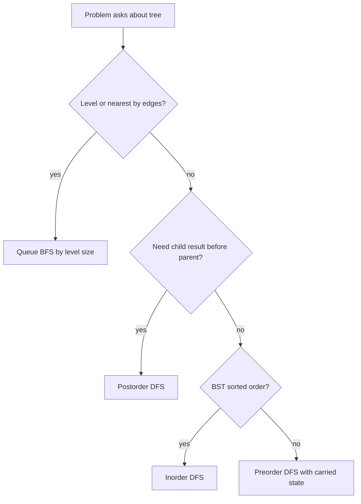
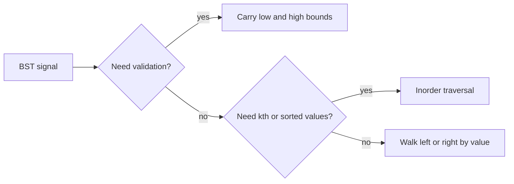
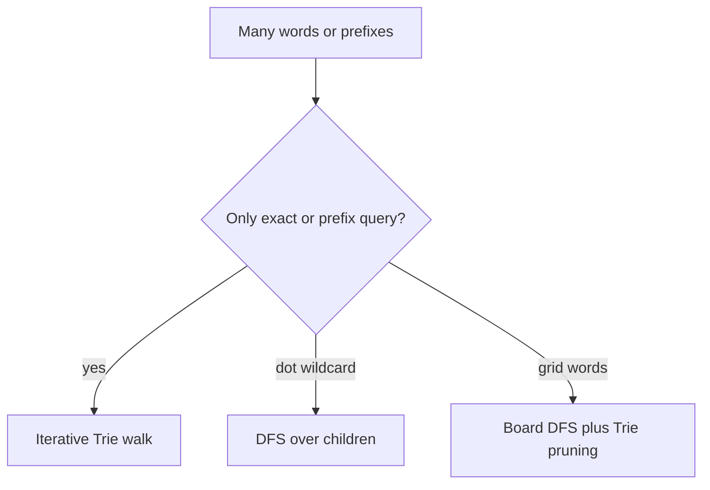

# 08d · DSA Trees, BST, and Trie

Interview-ready Java guide for tree traversals, BST invariants, and Trie prefix search. Focus on explaining the invariant first, then code the compact recursive or iterative template.

**Legend:** 🟢 Beginner · 🟡 Intermediate · 🔴 Advanced · ⚫ FAANG · 🔥 = very frequently asked

**Table of Contents**
- [Binary Tree Traversal Patterns](#binary-tree-traversal-patterns)
- [BST Patterns](#bst-patterns)
- [Trie and Prefix Search Patterns](#trie-and-prefix-search-patterns)
- [Problems](#problems)
- [Revision Cheat Sheet](#revision-cheat-sheet)
- [Flashcards](#flashcards)

> Java note: binary-tree solutions assume LeetCode's standard `TreeNode` class.

## Binary Tree Traversal Patterns

Use DFS when a node must return information to its parent: height, validity, gain, serialized token, or a path. Use BFS when the question is level-based.



Reusable Java template:

```java
import java.util.*;
class TraversalTemplates {
    void preorder(TreeNode node, List<Integer> out) {
        if (node == null) return;
        out.add(node.val);
        preorder(node.left, out);
        preorder(node.right, out);
    }
    List<Integer> inorderIterative(TreeNode root) {
        List<Integer> ans = new ArrayList<>();
        Deque<TreeNode> st = new ArrayDeque<>();
        while (root != null || !st.isEmpty()) {
            while (root != null) { st.push(root); root = root.left; }
            root = st.pop();
            ans.add(root.val);
            root = root.right;
        }
        return ans;
    }
    List<List<Integer>> levelOrder(TreeNode root) {
        List<List<Integer>> ans = new ArrayList<>();
        if (root == null) return ans;
        Queue<TreeNode> q = new ArrayDeque<>();
        q.offer(root);
        while (!q.isEmpty()) {
            int size = q.size();
            List<Integer> level = new ArrayList<>();
            for (int i = 0; i < size; i++) {
                TreeNode cur = q.poll();
                level.add(cur.val);
                if (cur.left != null) q.offer(cur.left);
                if (cur.right != null) q.offer(cur.right);
            }
            ans.add(level);
        }
        return ans;
    }
}
```

## BST Patterns

A BST node inherits an open value range from all ancestors. Inorder traversal visits values in ascending order.



Reusable Java template:

```java
class BSTTemplates {
    boolean valid(TreeNode node, long low, long high) {
        if (node == null) return true;
        if (node.val <= low || node.val >= high) return false;
        return valid(node.left, low, node.val) && valid(node.right, node.val, high);
    }
    TreeNode search(TreeNode root, int target) {
        while (root != null && root.val != target) {
            root = target < root.val ? root.left : root.right;
        }
        return root;
    }
}
```

## Trie and Prefix Search Patterns

Trie is the right default when many operations share prefixes: autocomplete, dictionary lookup, wildcard search, and board-word pruning.



Reusable Java template:

```java
class TrieTemplate {
    static class Node { Node[] next = new Node[26]; boolean word; }
    private final Node root = new Node();
    void insert(String s) {
        Node cur = root;
        for (char ch : s.toCharArray()) {
            int i = ch - 'a';
            if (cur.next[i] == null) cur.next[i] = new Node();
            cur = cur.next[i];
        }
        cur.word = true;
    }
    boolean startsWith(String p) {
        Node cur = root;
        for (char ch : p.toCharArray()) {
            cur = cur.next[ch - 'a'];
            if (cur == null) return false;
        }
        return true;
    }
}
```

## Problems

### P1. Maximum Depth of Binary Tree (LeetCode 104)
`🟢 Easy` `🔥` `Must-know SDE-1` · Pattern: Tree DFS · Commonly reported at: Amazon, Microsoft, Google; verify tags
**Problem:** Return max root-to-leaf depth. Example `[3,9,20,null,null,15,7]` → `3`.
**How to recognize the pattern:** Answer is `1 + best child answer`.
**Brute force:** Enumerate all paths — O(n) time, O(h) space.
**Optimal:** Postorder DFS returns subtree height.
```java
class Solution {
    public int maxDepth(TreeNode root) {
        if (root == null) return 0;
        return 1 + Math.max(maxDepth(root.left), maxDepth(root.right));
    }
}
```
**Complexity:** Time O(n), Space O(h)
**Dry run:** `20` returns `2`; root returns `1 + max(1,2) = 3`.
**Edge cases:** Empty tree; single node; skewed tree.
**Follow-ups:** Iterative BFS count levels; minimum depth uses BFS first leaf.

### P2. Invert Binary Tree (LeetCode 226)
`🟢 Easy` `🔥` `Must-know SDE-1` · Pattern: Tree DFS mutation · Commonly reported at: Google, Amazon; verify tags
**Problem:** Mirror a binary tree. Example `[4,2,7,1,3,6,9]` → `[4,7,2,9,6,3,1]`.
**How to recognize the pattern:** Same local child swap at every node.
**Brute force:** Build a new mirrored tree — O(n) time, O(n) space.
**Optimal:** Swap children in place and recurse.
```java
class Solution {
    public TreeNode invertTree(TreeNode root) {
        if (root == null) return null;
        TreeNode left = root.left;
        root.left = invertTree(root.right);
        root.right = invertTree(left);
        return root;
    }
}
```
**Complexity:** Time O(n), Space O(h)
**Dry run:** Root `4` receives mirrored `7` as left and mirrored `2` as right.
**Edge cases:** Empty; one child; repeated values.
**Follow-ups:** Iterative queue; immutable tree creates new nodes.

### P3. Same Tree (LeetCode 100)
`🟢 Easy` `🔥` `Must-know SDE-1` · Pattern: Dual-tree DFS · Commonly reported at: Amazon, Microsoft; verify tags
**Problem:** Check structural and value equality. Example `[1,2,3]` and `[1,2,3]` → `true`.
**How to recognize the pattern:** Compare two nodes in lockstep.
**Brute force:** Serialize both with null markers — O(n) time, O(n) space.
**Optimal:** Recursive pair comparison.
```java
class Solution {
    public boolean isSameTree(TreeNode p, TreeNode q) {
        if (p == null || q == null) return p == q;
        return p.val == q.val && isSameTree(p.left, q.left) && isSameTree(p.right, q.right);
    }
}
```
**Complexity:** Time O(n), Space O(h)
**Dry run:** Equal roots recurse to both child pairs.
**Edge cases:** Both null; one null; same values different shape.
**Follow-ups:** Iterative stack of pairs; use as subtree helper.

### P4. Subtree of Another Tree (LeetCode 572)
`🟢 Easy` `🔥` `Must-know SDE-1` · Pattern: Tree matching · Commonly reported at: Amazon, Meta, Microsoft; verify tags
**Problem:** Check whether `subRoot` appears as an identical subtree. Example root `[3,4,5,1,2]`, sub `[4,1,2]` → `true`.
**How to recognize the pattern:** Need candidate root search plus exact-tree comparison.
**Brute force:** Compare `subRoot` at each `root` node — O(n*m) time.
**Optimal:** Same DFS is accepted; serialization with null markers is an advanced alternative.
```java
class Solution {
    public boolean isSubtree(TreeNode root, TreeNode subRoot) {
        if (root == null) return subRoot == null;
        return same(root, subRoot) || isSubtree(root.left, subRoot) || isSubtree(root.right, subRoot);
    }
    private boolean same(TreeNode a, TreeNode b) {
        if (a == null || b == null) return a == b;
        return a.val == b.val && same(a.left, b.left) && same(a.right, b.right);
    }
}
```
**Complexity:** Time O(n*m) worst case, Space O(h)
**Dry run:** At value `4`, helper confirms children `1` and `2`.
**Edge cases:** Duplicate values; empty `subRoot`; repeated skewed chains.
**Follow-ups:** Serialize and KMP; Merkle hashes need collision handling.

### P5. Diameter of Binary Tree (LeetCode 543)
`🟢 Easy` `🔥` `Must-know SDE-1` · Pattern: Postorder with global best · Commonly reported at: Amazon, Google, Microsoft; verify tags
**Problem:** Return longest path length in edges. Example `[1,2,3,4,5]` → `3`.
**How to recognize the pattern:** Parent needs height, but answer may pass through current node.
**Brute force:** Recompute heights at every node — O(n²) worst-case.
**Optimal:** One DFS returns height and updates `left + right`.
```java
class Solution {
    private int best;
    public int diameterOfBinaryTree(TreeNode root) {
        best = 0;
        height(root);
        return best;
    }
    private int height(TreeNode node) {
        if (node == null) return 0;
        int left = height(node.left), right = height(node.right);
        best = Math.max(best, left + right);
        return 1 + Math.max(left, right);
    }
}
```
**Complexity:** Time O(n), Space O(h)
**Dry run:** Node `2` candidate is `2`; root candidate becomes `3`.
**Edge cases:** One node returns `0`; empty; skewed tree.
**Follow-ups:** Diameter in nodes adds one; weighted tree returns weighted downward gain.

### P6. Balanced Binary Tree (LeetCode 110)
`🟢 Easy` `🔥` `Must-know SDE-1` · Pattern: DFS sentinel · Commonly reported at: Amazon, Bloomberg, Microsoft; verify tags
**Problem:** Every node's subtree heights differ by at most 1. Example `[3,9,20,null,null,15,7]` → `true`.
**How to recognize the pattern:** Need height and validity together.
**Brute force:** Recompute height for each node — O(n²) time.
**Optimal:** Return `-1` when a subtree is already unbalanced.
```java
class Solution {
    public boolean isBalanced(TreeNode root) {
        return height(root) != -1;
    }
    private int height(TreeNode node) {
        if (node == null) return 0;
        int left = height(node.left);
        if (left == -1) return -1;
        int right = height(node.right);
        if (right == -1 || Math.abs(left - right) > 1) return -1;
        return 1 + Math.max(left, right);
    }
}
```
**Complexity:** Time O(n), Space O(h)
**Dry run:** First unbalanced child returns `-1` and ancestors stop.
**Edge cases:** Empty; single node; long chain.
**Follow-ups:** Iterative postorder; AVL tree maintains this after updates.

### P7. Binary Tree Level Order Traversal (LeetCode 102)
`🟡 Medium` `🔥` `Must-know SDE-1` · Pattern: BFS by level · Commonly reported at: Amazon, Microsoft, Meta; verify tags
**Problem:** Return values level by level. Example `[3,9,20,null,null,15,7]` → `[[3],[9,20],[15,7]]`.
**How to recognize the pattern:** Output grouped by distance from root.
**Brute force:** DFS with depth buckets — O(n) time, O(n) space.
**Optimal:** Queue BFS and process current `size`.
```java
import java.util.*;
class Solution {
    public List<List<Integer>> levelOrder(TreeNode root) {
        List<List<Integer>> ans = new ArrayList<>();
        if (root == null) return ans;
        Queue<TreeNode> q = new ArrayDeque<>();
        q.offer(root);
        while (!q.isEmpty()) {
            int size = q.size();
            List<Integer> level = new ArrayList<>();
            for (int i = 0; i < size; i++) {
                TreeNode node = q.poll();
                level.add(node.val);
                if (node.left != null) q.offer(node.left);
                if (node.right != null) q.offer(node.right);
            }
            ans.add(level);
        }
        return ans;
    }
}
```
**Complexity:** Time O(n), Space O(w)
**Dry run:** Queue levels are `[3]`, `[9,20]`, `[15,7]`.
**Edge cases:** Empty; one node; wide tree.
**Follow-ups:** Bottom-up order reverses answer; averages store sum per level.

### P8. Binary Tree Right Side View (LeetCode 199)
`🟡 Medium` `🔥` `Must-know SDE-1` · Pattern: BFS last per level · Commonly reported at: Amazon, Meta, Microsoft; verify tags
**Problem:** Return visible values from the right. Example `[1,2,3,null,5,null,4]` → `[1,3,4]`.
**How to recognize the pattern:** Need one representative per level.
**Brute force:** Level-order all values then take last — O(n) time.
**Optimal:** Record the last node polled at each level.
```java
import java.util.*;
class Solution {
    public List<Integer> rightSideView(TreeNode root) {
        List<Integer> ans = new ArrayList<>();
        if (root == null) return ans;
        Queue<TreeNode> q = new ArrayDeque<>();
        q.offer(root);
        while (!q.isEmpty()) {
            int size = q.size();
            for (int i = 0; i < size; i++) {
                TreeNode node = q.poll();
                if (i == size - 1) ans.add(node.val);
                if (node.left != null) q.offer(node.left);
                if (node.right != null) q.offer(node.right);
            }
        }
        return ans;
    }
}
```
**Complexity:** Time O(n), Space O(w)
**Dry run:** Levels `[1]`, `[2,3]`, `[5,4]` contribute `1,3,4`.
**Edge cases:** Left-only tree; empty; duplicate values.
**Follow-ups:** DFS root-right-left; left side view flips direction.

### P9. Binary Tree Zigzag Level Order Traversal (LeetCode 103)
`🟡 Medium` `🔥` `Must-know SDE-1` · Pattern: BFS alternating order · Commonly reported at: Amazon, Microsoft; verify tags
**Problem:** Alternate level order direction. Example `[3,9,20,null,null,15,7]` → `[[3],[20,9],[15,7]]`.
**How to recognize the pattern:** Same BFS levels with alternating insertion direction.
**Brute force:** Normal BFS then reverse odd levels — O(n) time.
**Optimal:** Add values to front or back of a `LinkedList`.
```java
import java.util.*;
class Solution {
    public List<List<Integer>> zigzagLevelOrder(TreeNode root) {
        List<List<Integer>> ans = new ArrayList<>();
        if (root == null) return ans;
        Queue<TreeNode> q = new ArrayDeque<>();
        q.offer(root);
        boolean leftToRight = true;
        while (!q.isEmpty()) {
            int size = q.size();
            LinkedList<Integer> level = new LinkedList<>();
            for (int i = 0; i < size; i++) {
                TreeNode node = q.poll();
                if (leftToRight) level.addLast(node.val); else level.addFirst(node.val);
                if (node.left != null) q.offer(node.left);
                if (node.right != null) q.offer(node.right);
            }
            ans.add(level);
            leftToRight = !leftToRight;
        }
        return ans;
    }
}
```
**Complexity:** Time O(n), Space O(w)
**Dry run:** Second level inserts `9`, then `20` at front → `[20,9]`.
**Edge cases:** Single node; sparse tree; odd/even heights.
**Follow-ups:** Use deque traversal; vertical traversal also needs column ordering.

### P10. Lowest Common Ancestor of a BST (LeetCode 235)
`🟢 Easy` `🔥` `Must-know SDE-1` · Pattern: BST guided walk · Commonly reported at: Amazon, Microsoft; verify tags
**Problem:** Return LCA in a BST. Example root `[6,2,8,0,4,7,9,3,5]`, `p=2`, `q=8` → `6`.
**How to recognize the pattern:** BST ordering shows whether both targets are left, right, or split.
**Brute force:** Build root-to-node paths — O(h) time, O(h) space.
**Optimal:** Walk until current value is between `p` and `q`.
```java
class Solution {
    public TreeNode lowestCommonAncestor(TreeNode root, TreeNode p, TreeNode q) {
        int a = p.val, b = q.val;
        while (root != null) {
            if (a < root.val && b < root.val) root = root.left;
            else if (a > root.val && b > root.val) root = root.right;
            else return root;
        }
        return null;
    }
}
```
**Complexity:** Time O(h), Space O(1)
**Dry run:** `2 < 6 < 8`, so `6` is the split.
**Edge cases:** One node is ancestor; same target; skewed BST.
**Follow-ups:** If nodes may be absent, validate existence; normal tree cannot use ordering.

### P11. Lowest Common Ancestor of a Binary Tree (LeetCode 236)
`🟡 Medium` `🔥` `Must-know SDE-1` · Pattern: Recursive ancestor bubbling · Commonly reported at: Amazon, Google, Meta; verify tags
**Problem:** Return LCA in a general tree. Example root `[3,5,1,6,2,0,8,null,null,7,4]`, `p=5`, `q=1` → `3`.
**How to recognize the pattern:** No ordering; search both subtrees.
**Brute force:** Parent map plus ancestor set — O(n) time, O(n) space.
**Optimal:** Return found node from child; two non-null children mean current is LCA.
```java
class Solution {
    public TreeNode lowestCommonAncestor(TreeNode root, TreeNode p, TreeNode q) {
        if (root == null || root == p || root == q) return root;
        TreeNode left = lowestCommonAncestor(root.left, p, q);
        TreeNode right = lowestCommonAncestor(root.right, p, q);
        if (left != null && right != null) return root;
        return left != null ? left : right;
    }
}
```
**Complexity:** Time O(n), Space O(h)
**Dry run:** One target found left and one right, so root returns.
**Edge cases:** One target ancestor; nodes are references; LeetCode guarantees both exist.
**Follow-ups:** Missing nodes → return count and candidate; many queries → Euler tour plus RMQ.

### P12. Validate Binary Search Tree (LeetCode 98)
`🟡 Medium` `🔥` `Must-know SDE-1` · Pattern: BST bounds · Commonly reported at: Amazon, Microsoft, Bloomberg; verify tags
**Problem:** Check strict BST validity. Example `[5,1,4,null,null,3,6]` → `false`.
**How to recognize the pattern:** Descendants must respect ancestor bounds.
**Brute force:** Scan min/max of each subtree — O(n²) time.
**Optimal:** Carry `(low, high)` as `long` open bounds.
```java
class Solution {
    public boolean isValidBST(TreeNode root) {
        return valid(root, Long.MIN_VALUE, Long.MAX_VALUE);
    }
    private boolean valid(TreeNode node, long low, long high) {
        if (node == null) return true;
        if (node.val <= low || node.val >= high) return false;
        return valid(node.left, low, node.val) && valid(node.right, node.val, high);
    }
}
```
**Complexity:** Time O(n), Space O(h)
**Dry run:** Node `3` in right subtree of `5` violates low bound `5`.
**Edge cases:** Duplicates invalid; integer min/max; empty tree.
**Follow-ups:** Inorder previous value; duplicate policy must be specified.

### P13. Kth Smallest Element in a BST (LeetCode 230)
`🟡 Medium` `🔥` `Must-know SDE-1` · Pattern: BST inorder · Commonly reported at: Amazon, Google, Microsoft; verify tags
**Problem:** Return kth smallest BST value. Example root `[3,1,4,null,2]`, `k=1` → `1`.
**How to recognize the pattern:** BST inorder is sorted ascending.
**Brute force:** Store full inorder list — O(n) time, O(n) space.
**Optimal:** Iterative inorder stops after kth pop.
```java
import java.util.*;
class Solution {
    public int kthSmallest(TreeNode root, int k) {
        Deque<TreeNode> st = new ArrayDeque<>();
        while (root != null || !st.isEmpty()) {
            while (root != null) { st.push(root); root = root.left; }
            root = st.pop();
            if (--k == 0) return root.val;
            root = root.right;
        }
        throw new IllegalArgumentException();
    }
}
```
**Complexity:** Time O(h + k), Space O(h)
**Dry run:** First pop is minimum `1`, so `k=1` returns.
**Edge cases:** `k=1`; `k=n`; skewed BST.
**Follow-ups:** Frequent queries → subtree sizes; kth largest → reverse inorder.

### P14. Construct Binary Tree from Preorder and Inorder Traversal (LeetCode 105)
`🟡 Medium` `🔥` `Must-know SDE-1` · Pattern: Divide and conquer · Commonly reported at: Amazon, Microsoft, Google; verify tags
**Problem:** Build tree from preorder and inorder arrays. Example preorder `[3,9,20,15,7]`, inorder `[9,3,15,20,7]`.
**How to recognize the pattern:** Preorder gives root; inorder splits left/right.
**Brute force:** Linear-search root in inorder each call — O(n²) time.
**Optimal:** Hash value to inorder index and recurse on ranges.
```java
import java.util.*;
class Solution {
    private int preIdx;
    private int[] preorder;
    private Map<Integer, Integer> pos;
    public TreeNode buildTree(int[] preorder, int[] inorder) {
        this.preorder = preorder;
        pos = new HashMap<>();
        for (int i = 0; i < inorder.length; i++) pos.put(inorder[i], i);
        return build(0, inorder.length - 1);
    }
    private TreeNode build(int left, int right) {
        if (left > right) return null;
        TreeNode root = new TreeNode(preorder[preIdx++]);
        int mid = pos.get(root.val);
        root.left = build(left, mid - 1);
        root.right = build(mid + 1, right);
        return root;
    }
}
```
**Complexity:** Time O(n), Space O(n)
**Dry run:** Root `3` splits inorder into `[9]` and `[15,20,7]`.
**Edge cases:** Empty; one node; unique values required.
**Follow-ups:** Inorder plus postorder; duplicates need extra occurrence tracking.

### P15. Binary Tree Maximum Path Sum (LeetCode 124)
`🔴 Hard` `🔥` `Stretch` · Pattern: DFS with global maximum · Commonly reported at: Amazon, Google, Meta; verify tags
**Problem:** Max sum of any non-empty path. Example `[-10,9,20,null,null,15,7]` → `42`.
**How to recognize the pattern:** Path may start/end anywhere and pass through a node.
**Brute force:** Try many endpoint pairs — O(n²) or worse.
**Optimal:** Return one-side gain; update global with both child gains.
```java
class Solution {
    private int best;
    public int maxPathSum(TreeNode root) {
        best = Integer.MIN_VALUE;
        gain(root);
        return best;
    }
    private int gain(TreeNode node) {
        if (node == null) return 0;
        int left = Math.max(0, gain(node.left));
        int right = Math.max(0, gain(node.right));
        best = Math.max(best, node.val + left + right);
        return node.val + Math.max(left, right);
    }
}
```
**Complexity:** Time O(n), Space O(h)
**Dry run:** At `20`, candidate `20+15+7=42`.
**Edge cases:** All negative; single node; skewed tree.
**Follow-ups:** Return actual path; root-to-leaf max sum is a different constraint.

### P16. Serialize and Deserialize Binary Tree (LeetCode 297)
`🔴 Hard` `🔥` `Stretch` · Pattern: Tree encoding · Commonly reported at: Amazon, Google, Microsoft; verify tags
**Problem:** Convert tree to string and back. Example `[1,2,3,null,null,4,5]` round-trips.
**How to recognize the pattern:** Must preserve null structure, not just values.
**Brute force:** BFS with nulls — O(n) time, possible long trailing nulls.
**Optimal:** Preorder with `#` null markers.
```java
import java.util.*;
public class Codec {
    public String serialize(TreeNode root) {
        StringBuilder sb = new StringBuilder();
        write(root, sb);
        return sb.toString();
    }
    private void write(TreeNode node, StringBuilder sb) {
        if (node == null) { sb.append("#,"); return; }
        sb.append(node.val).append(',');
        write(node.left, sb);
        write(node.right, sb);
    }
    public TreeNode deserialize(String data) {
        Queue<String> q = new ArrayDeque<>(Arrays.asList(data.split(",")));
        return read(q);
    }
    private TreeNode read(Queue<String> q) {
        String token = q.poll();
        if (token.equals("#")) return null;
        TreeNode node = new TreeNode(Integer.parseInt(token));
        node.left = read(q);
        node.right = read(q);
        return node;
    }
}
```
**Complexity:** Time O(n), Space O(n)
**Dry run:** `1,2,#,#,3,4,#,#,5,#,#` rebuilds preorder.
**Edge cases:** Empty tree; negative values; missing null markers break shape.
**Follow-ups:** BFS codec; production parser should validate malformed input.

### P17. Path Sum II (LeetCode 113)
`🟡 Medium` `🔥` `Must-know SDE-1` · Pattern: Tree backtracking · Commonly reported at: Amazon, Microsoft; verify tags
**Problem:** Return root-to-leaf paths summing to target. Example target `22` → `[[5,4,11,2],[5,8,4,5]]`.
**How to recognize the pattern:** Need enumerate paths and undo after recursion.
**Brute force:** Store all paths then filter — O(n*h) extra copying.
**Optimal:** Maintain one path, copy only at valid leaf.
```java
import java.util.*;
class Solution {
    public List<List<Integer>> pathSum(TreeNode root, int targetSum) {
        List<List<Integer>> ans = new ArrayList<>();
        dfs(root, targetSum, new ArrayList<>(), ans);
        return ans;
    }
    private void dfs(TreeNode node, int remain, List<Integer> path, List<List<Integer>> ans) {
        if (node == null) return;
        path.add(node.val);
        remain -= node.val;
        if (node.left == null && node.right == null && remain == 0) ans.add(new ArrayList<>(path));
        dfs(node.left, remain, path, ans);
        dfs(node.right, remain, path, ans);
        path.remove(path.size() - 1);
    }
}
```
**Complexity:** Time O(n*h) including answer copies, Space O(h)
**Dry run:** Path `5,4,11,2` reaches leaf with remaining `0`.
**Edge cases:** Negative values; empty tree; target zero without nodes is no path.
**Follow-ups:** Count paths anywhere → prefix sums; existence only → boolean short-circuit.

### P18. Count Good Nodes in Binary Tree (LeetCode 1448)
`🟡 Medium` `🔥` `Must-know SDE-1` · Pattern: DFS carrying state · Commonly reported at: Amazon, Google; verify tags
**Problem:** Count nodes at least as large as every previous node on their root path. Example `[3,1,4,3,null,1,5]` → `4`.
**How to recognize the pattern:** Need running max along each path.
**Brute force:** Rescan ancestors for every node — O(n*h) time.
**Optimal:** DFS carries `maxSoFar`.
```java
class Solution {
    public int goodNodes(TreeNode root) {
        return dfs(root, Integer.MIN_VALUE);
    }
    private int dfs(TreeNode node, int maxSoFar) {
        if (node == null) return 0;
        int good = node.val >= maxSoFar ? 1 : 0;
        int next = Math.max(maxSoFar, node.val);
        return good + dfs(node.left, next) + dfs(node.right, next);
    }
}
```
**Complexity:** Time O(n), Space O(h)
**Dry run:** On path `3→4→5`, all three are good.
**Edge cases:** Negative values; equal value counts; single node.
**Follow-ups:** Carry min for decreasing property; return list of good nodes.

### P19. Implement Trie Prefix Tree (LeetCode 208)
`🟡 Medium` `🔥` `Must-know SDE-1` · Pattern: Trie · Commonly reported at: Amazon, Google, Microsoft; verify tags
**Problem:** Implement `insert`, `search`, `startsWith`. Example insert `apple`; search `app` → false; startsWith `app` → true.
**How to recognize the pattern:** Many prefix queries over a dictionary.
**Brute force:** Store words in set and scan all prefixes — O(number of words * L).
**Optimal:** Store one node per character edge.
```java
class Trie {
    static class Node { Node[] next = new Node[26]; boolean word; }
    private final Node root = new Node();
    public Trie() {}
    public void insert(String word) {
        Node cur = root;
        for (char ch : word.toCharArray()) {
            int i = ch - 'a';
            if (cur.next[i] == null) cur.next[i] = new Node();
            cur = cur.next[i];
        }
        cur.word = true;
    }
    public boolean search(String word) {
        Node node = walk(word);
        return node != null && node.word;
    }
    public boolean startsWith(String prefix) {
        return walk(prefix) != null;
    }
    private Node walk(String s) {
        Node cur = root;
        for (char ch : s.toCharArray()) {
            cur = cur.next[ch - 'a'];
            if (cur == null) return null;
        }
        return cur;
    }
}
```
**Complexity:** Time O(L) per operation, Space O(total characters)
**Dry run:** `apple` marks terminal only at `e`; `app` is prefix but not word.
**Edge cases:** Duplicate insert; prefix not full word; lowercase assumption.
**Follow-ups:** Unicode with `Map<Character, Node>`; delete and prune unused nodes.

### P20. Word Search II (LeetCode 212)
`🔴 Hard` `🔥` `Stretch` · Pattern: Trie plus backtracking · Commonly reported at: Amazon, Google, Meta; verify tags
**Problem:** Return dictionary words found in a board by adjacent cells. Example board with words `[oath,pea,eat,rain]` → `[oath,eat]`.
**How to recognize the pattern:** Many word searches share prefixes on one board.
**Brute force:** DFS separately for each word — O(words*m*n*4^L).
**Optimal:** Build Trie once and prune board DFS by missing prefix edge.
```java
import java.util.*;
class Solution {
    static class Node { Node[] next = new Node[26]; String word; }
    private final int[][] dirs = {{1,0},{-1,0},{0,1},{0,-1}};
    public List<String> findWords(char[][] board, String[] words) {
        Node root = new Node();
        for (String w : words) insert(root, w);
        List<String> ans = new ArrayList<>();
        for (int r = 0; r < board.length; r++)
            for (int c = 0; c < board[0].length; c++)
                dfs(board, r, c, root, ans);
        return ans;
    }
    private void insert(Node root, String word) {
        Node cur = root;
        for (char ch : word.toCharArray()) {
            int i = ch - 'a';
            if (cur.next[i] == null) cur.next[i] = new Node();
            cur = cur.next[i];
        }
        cur.word = word;
    }
    private void dfs(char[][] b, int r, int c, Node node, List<String> ans) {
        if (r < 0 || c < 0 || r == b.length || c == b[0].length || b[r][c] == '#') return;
        char ch = b[r][c];
        Node next = node.next[ch - 'a'];
        if (next == null) return;
        if (next.word != null) { ans.add(next.word); next.word = null; }
        b[r][c] = '#';
        for (int[] d : dirs) dfs(b, r + d[0], c + d[1], next, ans);
        b[r][c] = ch;
    }
}
```
**Complexity:** Time O(m*n*4^L) worst-case, Space O(total word characters)
**Dry run:** Path `o→a→t→h` reaches terminal `oath` and is added once.
**Edge cases:** Duplicate words; cannot reuse cell; one-cell board.
**Follow-ups:** Add diagonal directions; huge dictionary → compressed Trie.

### P21. Design Add and Search Words Data Structure (LeetCode 211)
`🟡 Medium` `🔥` `Must-know SDE-1` · Pattern: Trie wildcard DFS · Commonly reported at: Amazon, Google; verify tags
**Problem:** Support `addWord` and `search` where `.` matches one character. Example add `bad`, `dad`; search `.ad` → true.
**How to recognize the pattern:** Dot wildcard causes branching over children.
**Brute force:** Store words by length and compare — O(words of same length * L).
**Optimal:** Trie DFS: normal char takes one edge, dot tries all edges.
```java
class WordDictionary {
    static class Node { Node[] next = new Node[26]; boolean word; }
    private final Node root = new Node();
    public WordDictionary() {}
    public void addWord(String word) {
        Node cur = root;
        for (char ch : word.toCharArray()) {
            int i = ch - 'a';
            if (cur.next[i] == null) cur.next[i] = new Node();
            cur = cur.next[i];
        }
        cur.word = true;
    }
    public boolean search(String word) {
        return dfs(word, 0, root);
    }
    private boolean dfs(String word, int idx, Node node) {
        if (node == null) return false;
        if (idx == word.length()) return node.word;
        char ch = word.charAt(idx);
        if (ch != '.') return dfs(word, idx + 1, node.next[ch - 'a']);
        for (Node child : node.next) if (child != null && dfs(word, idx + 1, child)) return true;
        return false;
    }
}
```
**Complexity:** Add O(L), Search O(26^dots * L) worst-case, Space O(total characters)
**Dry run:** `.ad` branches at first char, then follows `a→d`.
**Edge cases:** All dots; length mismatch; repeated add.
**Follow-ups:** Length buckets for early reject; `*` wildcard needs DP over Trie states.

## Revision Cheat Sheet

- DFS interview line: define what each node returns to its parent.
- Preorder is root-first; inorder is BST sorted; postorder is child aggregation.
- Queue BFS with fixed `size` handles level grouping.
- BST validation requires ancestor bounds, not only parent-child checks.
- LCA in BST uses value split; LCA in a normal tree uses found-node bubbling.
- Diameter and max-path-sum return one-side values but update a global answer.
- Serialize trees with null markers to preserve shape.
- Trie replaces repeated prefix scans with O(length) walks.
- Use `ArrayDeque` instead of legacy `Stack`.
- Recursion space is O(h): balanced O(log n), skewed O(n).

## Flashcards

1. Q → Which traversal gives sorted BST values? A → Inorder.
2. Q → Why use `long` bounds in Validate BST? A → Node values can be integer extremes.
3. Q → Diameter in LeetCode 543 counts what? A → Edges.
4. Q → Max path sum child gains are clamped why? A → Negative branches reduce the path.
5. Q → BFS level-order key variable? A → Current queue `size`.
6. Q → Trie plain search complexity? A → O(word length).
7. Q → Word Search II dedupe trick? A → Set terminal `word` to null after adding.
8. Q → General-tree LCA base cases? A → `null`, `p`, or `q`.
9. Q → Build tree root source for preorder/inorder? A → Next preorder element.
10. Q → Balanced tree one-pass trick? A → Return `-1` sentinel.
11. Q → Right side view DFS order? A → Root, right, left.
12. Q → Subtree serialization must include what? A → Null markers.
