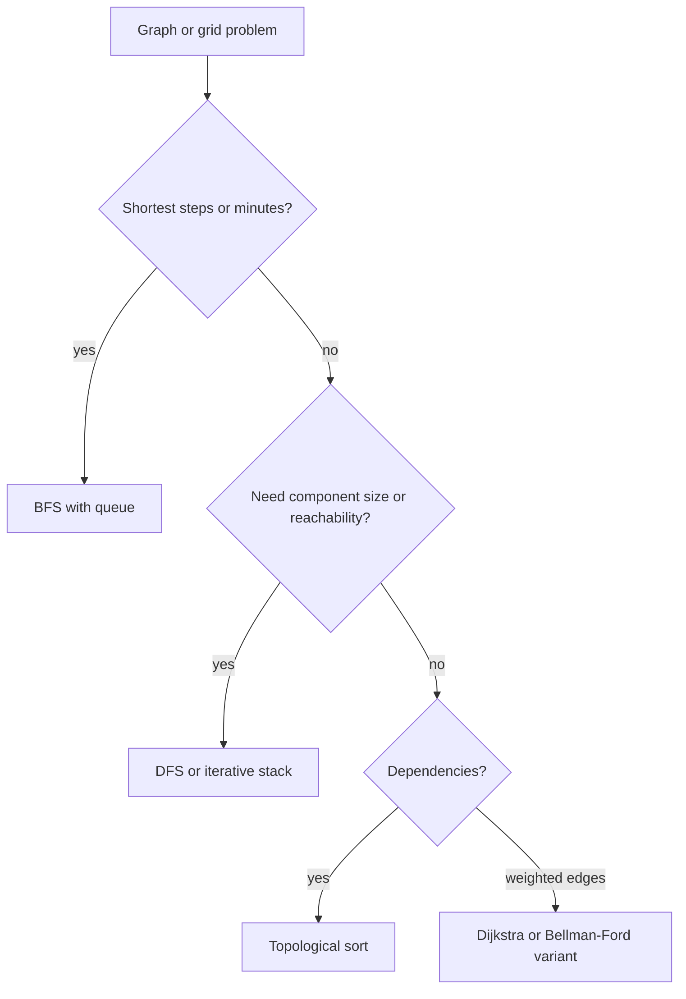
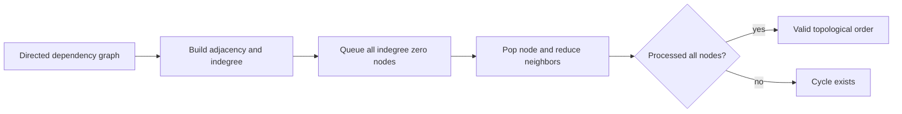
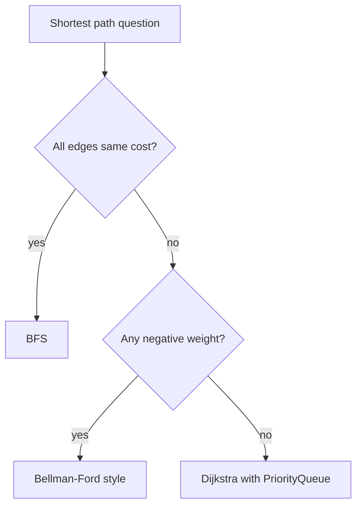
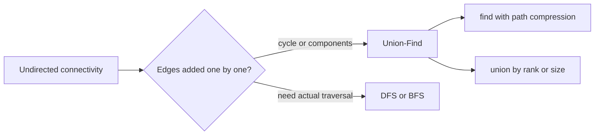

# 08e · DSA Graphs and Union-Find

Graph rounds test whether you can model relationships, choose traversal order, and reason about visited state. This guide covers BFS/DFS, topological sort, shortest paths, MST, and Union-Find in Java.

**Legend:** 🟢 Beginner · 🟡 Intermediate · 🔴 Advanced · ⚫ FAANG · 🔥 = very frequently asked

**Table of Contents**
- [Beginner guide to this file](#beginner-guide-to-this-file)
- [BFS and DFS Patterns](#bfs-and-dfs-patterns)
- [Topological Sort Pattern](#topological-sort-pattern)
- [Dijkstra and Shortest Path Pattern](#dijkstra-and-shortest-path-pattern)
- [Union-Find Pattern](#union-find-pattern)
- [Problems](#problems)
- [Revision Cheat Sheet](#revision-cheat-sheet)
- [Flashcards](#flashcards)

## Beginner guide to this file

### What this file teaches

This file teaches how to model relationships as graphs, grids, dependencies, shortest paths, and connectivity
sets. Interviewers ask these because backend work includes dependency ordering, routing, reachability,
relationship merging, and failure spread.

### Mental model

Think of a graph as a city map: nodes are places, edges are roads, and each algorithm answers a travel question.

- Breadth-First Search (BFS) spreads in rings and gives shortest unweighted distance.
- Depth-First Search (DFS) explores a whole region before returning.
- Topological sort orders directed prerequisites if no cycle blocks them.
- Dijkstra expands the cheapest frontier for non-negative weighted edges.
- Union-Find groups nodes by representative roots as edges arrive.

### How to think through any question here

1. Convert the story into nodes and edges, including direction and weight.
2. Decide whether the input is a grid, explicit graph, implicit state graph, or relationships list.
3. Use BFS for shortest unweighted steps or time waves.
4. Use DFS or BFS for components, reachability, and boundary marking.
5. Use indegree and topological sort for prerequisites or ordering.
6. Use Dijkstra only after checking that weights are non-negative.
7. Use Union-Find when edge additions only ask connectivity or cycles.
8. State indexing, disconnected nodes, duplicate edges, and input mutation edge cases.

### Pattern recognition cues

| If the question mentions... | Think about... | Why it fits |
|---|---|---|
| Islands, regions, components | DFS or BFS flood fill | You must mark each reachable cell or node once. |
| Minutes, levels, shortest steps | Multi-source or normal BFS | Each queue layer is one distance or time unit. |
| Border-connected cells | Reverse traversal from boundary | Marking survivors is cheaper than testing every region. |
| Prerequisites or alien order | Topological sort | Directed edges encode before-after constraints. |
| Undirected cycle while adding edges | Union-Find | A failed union means endpoints were already connected. |
| Shared emails or accounts | Union-Find or components | Shared identifiers connect records. |
| Non-negative travel time | Dijkstra | A priority queue expands smallest known distance. |
| Stop limit or edge-count limit | Bellman-Ford style rounds | Number of edges used is part of the state. |
| Connect all points cheaply | Minimum spanning tree | Need cheapest connected edge set, not one path. |

### Abbreviations and key terms

| Short form | Expanded form | Plain meaning |
|---|---|---|
| BFS | Breadth-First Search | Queue traversal by distance layers. |
| DFS | Depth-First Search | Deep traversal before backtracking. |
| DSU | Disjoint Set Union | Another name for Union-Find. |
| DSA | Data Structures and Algorithms | Interview problem-solving topics. |
| E | Edge count | Number of graph connections. |
| FAANG | Facebook, Apple, Amazon, Netflix, and Google | Shorthand for large product-company interviews. |
| MST | Minimum Spanning Tree | Cheapest set of edges connecting all nodes. |
| O(...) | Big O notation | Time or space growth description. |
| PQ | Priority Queue | Data structure that removes the smallest or highest-priority item first. |
| SDE | Software Development Engineer | Interview role level used in this guide. |
| V | Vertex count | Number of graph nodes. |
| Indegree | Indegree | Number of incoming prerequisite edges. |
| Path compression | Path compression | Union-Find optimization that flattens parent links. |

### Common beginner traps

- Marking a BFS node only when popped, causing duplicate enqueues.
- Mixing row and column bounds in grids.
- Using Dijkstra when stops, keys, or remaining budget must be part of state.
- Treating directed prerequisites as undirected edges.
- Forgetting isolated nodes when counting components.
- Missing 1-indexed graph inputs.

### How to study this file

1. Draw the graph or grid movement before reading the solution.
2. Name the traversal, ordering, shortest-path, or connectivity invariant.
3. Dry-run the queue, stack, indegree array, priority queue, or parent array.
4. Recode the template from memory and compare edge cases.
5. Use flashcards to practice choosing BFS, DFS, topological sort, Dijkstra, or Union-Find.

## BFS and DFS Patterns

Use DFS when exploring a full component, mutating regions, or recursively marking reachable cells. Use BFS for shortest path in unweighted graphs or level/time spread.



Reusable Java template:

```java
import java.util.*;
class GraphTraversalTemplates {
    void dfsGrid(char[][] grid, int r, int c) {
        if (r < 0 || c < 0 || r == grid.length || c == grid[0].length || grid[r][c] != '1') return;
        grid[r][c] = '0';
        dfsGrid(grid, r + 1, c); dfsGrid(grid, r - 1, c);
        dfsGrid(grid, r, c + 1); dfsGrid(grid, r, c - 1);
    }
    int bfsShortest(int[][] grid) {
        int n = grid.length;
        Queue<int[]> q = new ArrayDeque<>();
        boolean[][] seen = new boolean[n][n];
        q.offer(new int[]{0, 0, 1});
        seen[0][0] = true;
        int[][] dirs = {{1,0},{-1,0},{0,1},{0,-1}};
        while (!q.isEmpty()) {
            int[] cur = q.poll();
            for (int[] d : dirs) {
                int nr = cur[0] + d[0], nc = cur[1] + d[1];
            }
        }
        return -1;
    }
}
```

## Topological Sort Pattern

Use topological sort for directed prerequisites. Kahn's algorithm removes zero-indegree nodes; DFS color marking detects cycles.



Reusable Java template:

```java
import java.util.*;
class TopoTemplate {
    int[] topo(int n, int[][] edges) {
        List<Integer>[] g = new ArrayList[n];
        for (int i = 0; i < n; i++) g[i] = new ArrayList<>();
        int[] indeg = new int[n];
        for (int[] e : edges) { g[e[1]].add(e[0]); indeg[e[0]]++; }
        Queue<Integer> q = new ArrayDeque<>();
        for (int i = 0; i < n; i++) if (indeg[i] == 0) q.offer(i);
        int[] order = new int[n];
        int idx = 0;
        while (!q.isEmpty()) {
            int u = q.poll();
            order[idx++] = u;
            for (int v : g[u]) if (--indeg[v] == 0) q.offer(v);
        }
        return idx == n ? order : new int[0];
    }
}
```

## Dijkstra and Shortest Path Pattern

Use BFS for unweighted edges. Use Dijkstra for non-negative weighted edges. Use Bellman-Ford style relaxation when stops/edge-count constraints matter.



Reusable Java template:

```java
import java.util.*;
class DijkstraTemplate {
    int[] shortest(int n, List<int[]>[] graph, int src) {
        int[] dist = new int[n];
        Arrays.fill(dist, Integer.MAX_VALUE);
        dist[src] = 0;
        PriorityQueue<int[]> pq = new PriorityQueue<>(Comparator.comparingInt(a -> a[1]));
        pq.offer(new int[]{src, 0});
        while (!pq.isEmpty()) {
            int[] cur = pq.poll();
            int u = cur[0], d = cur[1];
            if (d != dist[u]) continue;
            for (int[] e : graph[u]) {
                int v = e[0], w = e[1];
                if (d + w < dist[v]) {
                    dist[v] = d + w;
                    pq.offer(new int[]{v, dist[v]});
                }
            }
        }
        return dist;
    }
}
```

## Union-Find Pattern

Union-Find answers dynamic connectivity: are two nodes in the same component, or does an edge create a cycle?



Reusable Java template:

```java
class UnionFind {
    private final int[] parent;
    private final int[] rank;
    int count;
    UnionFind(int n) {
        parent = new int[n];
        rank = new int[n];
        count = n;
        for (int i = 0; i < n; i++) parent[i] = i;
    }
    int find(int x) {
        if (parent[x] != x) parent[x] = find(parent[x]);
        return parent[x];
    }
    boolean union(int a, int b) {
        int ra = find(a), rb = find(b);
        if (ra == rb) return false;
        if (rank[ra] < rank[rb]) parent[ra] = rb;
        else if (rank[ra] > rank[rb]) parent[rb] = ra;
        else { parent[rb] = ra; rank[ra]++; }
        count--;
        return true;
    }
}
```

## Problems

### P1. Number of Islands (LeetCode 200)
`🟡 Medium` `🔥` `Must-know SDE-1` · Pattern: Grid DFS/BFS · Commonly reported at: Amazon, Microsoft, Google; verify tags
**Problem:** Count connected groups of `'1'` in a grid. Example `11110/11010/11000/00000` → `1`.

**How to recognize and think:** The plain task is to count separate land blobs. Words like `grid`, `'1'`,
`connected`, and 4-direction neighbors point to a grid-component traversal. Starting a fresh search from every
land square repeats the same island many times. The aha is to mark land the moment Depth-First Search (DFS) or
Breadth-First Search (BFS) reaches it, often by sinking it to water. Then the invariant is simple: every
remaining `1` begins one never-seen island, and every cell in that island is erased before the scan continues.
Picture spilling paint through north, south, east, and west only. Say aloud: all water, all land, and a single
cell.

**How to recognize the pattern:** Grid components with 4-direction connectivity.
**Brute force:** For every land cell, scan all cells to find component — O((mn)²).
**Optimal:** DFS/BFS each unvisited island once and sink it.
```java
class Solution {
    public int numIslands(char[][] grid) {
        int count = 0;
        for (int r = 0; r < grid.length; r++) for (int c = 0; c < grid[0].length; c++) {
            if (grid[r][c] == '1') { count++; dfs(grid, r, c); }
        }
        return count;
    }
    private void dfs(char[][] g, int r, int c) {
        if (r < 0 || c < 0 || r == g.length || c == g[0].length || g[r][c] != '1') return;
        g[r][c] = '0';
        dfs(g, r+1, c); dfs(g, r-1, c); dfs(g, r, c+1); dfs(g, r, c-1);
    }
}
```
**Complexity:** Time O(mn), Space O(mn) worst recursion
**Dry run:** First `1` sinks the whole island; later cells are `0`.
**Edge cases:** All water; all land; one cell.
**Follow-ups:** Do not mutate input → visited matrix; dynamic islands → Union-Find.

### P2. Clone Graph (LeetCode 133)
`🟡 Medium` `🔥` `Must-know SDE-1` · Pattern: Graph DFS with map · Commonly reported at: Amazon, Meta, Google; verify tags
**Problem:** Deep-copy an undirected graph. Example node `1` with neighbors clones to a separate graph.

**How to recognize and think:** This asks for a separate graph with the same neighbor shape. The revealing
words are `deep-copy`, `neighbors`, cycles, and shared references. Plain recursion is not just inefficient: on
a cycle or self-loop it calls forever, and without a cache it can create two clones for the same original
node. The aha is to put `original -> clone` in a map before cloning neighbors. The invariant is that any time
an original node is encountered again, its one official clone is reused, so edges preserve sharing. Imagine
labeling each original with a sticky note copy. Check null input, self-cycles, and that only nodes reachable
from the given node are cloned.

**How to recognize the pattern:** Need preserve cycles and shared references.
**Brute force:** Recursing without a map loops forever on cycles.
**Optimal:** Map original node to cloned node during DFS/BFS.
```java
import java.util.*;
class Solution {
    private final Map<Node, Node> map = new HashMap<>();
    public Node cloneGraph(Node node) {
        if (node == null) return null;
        if (map.containsKey(node)) return map.get(node);
        Node copy = new Node(node.val, new ArrayList<>());
        map.put(node, copy);
        for (Node nei : node.neighbors) copy.neighbors.add(cloneGraph(nei));
        return copy;
    }
}
```
**Complexity:** Time O(V+E), Space O(V)
**Dry run:** Clone `1`, put in map, then clone neighbors; returning to `1` uses map.
**Edge cases:** Null graph; self-cycle; disconnected input not reachable from node.
**Follow-ups:** Iterative BFS clone; clone directed graph same idea.

### P3. Max Area of Island (LeetCode 695)
`🟡 Medium` `🔥` `Must-know SDE-1` · Pattern: Grid DFS area · Commonly reported at: Amazon, Google; verify tags
**Problem:** Return largest 4-connected island area. Example grid with max island of 6 cells → `6`.

**How to recognize and think:** Here the answer is the size of the biggest land blob, not the number of blobs.
Phrases such as `largest`, `area`, `island`, and `4-connected` identify a component-size traversal. If each
land cell starts a fresh flood fill with a new visited set, one large island is recounted from many entrances.
The improvement is to let DFS return `1 + neighbor areas` while marking each visited cell as water. The
invariant is that a cell contributes to exactly one recursive sum, so the maximum over starting cells is the
maximum island. Mentally scoop one island out of the grid, count the scoops, then move on. Mention no land,
full land, and a thin snake.

**How to recognize the pattern:** Component size is needed.
**Brute force:** For each land, flood-fill with fresh visited — O((mn)²).
**Optimal:** DFS once per island and return area.
```java
class Solution {
    public int maxAreaOfIsland(int[][] grid) {
        int best = 0;
        for (int r = 0; r < grid.length; r++)
            for (int c = 0; c < grid[0].length; c++)
                if (grid[r][c] == 1) best = Math.max(best, dfs(grid, r, c));
        return best;
    }
    private int dfs(int[][] g, int r, int c) {
        if (r < 0 || c < 0 || r == g.length || c == g[0].length || g[r][c] == 0) return 0;
        g[r][c] = 0;
        return 1 + dfs(g,r+1,c) + dfs(g,r-1,c) + dfs(g,r,c+1) + dfs(g,r,c-1);
    }
}
```
**Complexity:** Time O(mn), Space O(mn)
**Dry run:** Each visited land contributes `1` and is zeroed.
**Edge cases:** No land; full land; thin snake island.
**Follow-ups:** 8-direction area; preserve grid via visited.

### P4. Pacific Atlantic Water Flow (LeetCode 417)
`🟡 Medium` `🔥` `Must-know SDE-1` · Pattern: Reverse DFS/BFS · Commonly reported at: Amazon, Google, Facebook; verify tags
**Problem:** Cells can flow downhill to oceans; return cells reaching both. Example standard sample → `[[0,4],[1,3],[1,4],[2,2],[3,0],[3,1],[4,0]]`.

**How to recognize and think:** The story says water moves downhill from cells to two oceans, but the useful
clue is many possible starts and fixed ocean borders. A DFS from every cell repeats the same downhill
corridors again and again. Reverse the arrows: start from Pacific and Atlantic borders, then move only to
equal or higher cells. The invariant is reversible reachability: if an ocean search can climb from the ocean
to a cell, water from that cell can flow back down to that ocean. Picture two colors of ink rising inland;
cells with both colors are answers. Call out one-row grids, all equal heights, and strictly sloping terrain.

**How to recognize the pattern:** Many sources/sinks; reverse reachability is cheaper.
**Brute force:** DFS from every cell to oceans — O((mn)²).
**Optimal:** Start from ocean borders and move to equal/higher cells.
```java
import java.util.*;
class Solution {
    private int[][] h;
    private int m, n;
    public List<List<Integer>> pacificAtlantic(int[][] heights) {
        h = heights; m = h.length; n = h[0].length;
        boolean[][] pac = new boolean[m][n], atl = new boolean[m][n];
        for (int r = 0; r < m; r++) { dfs(r, 0, pac, -1); dfs(r, n - 1, atl, -1); }
        for (int c = 0; c < n; c++) { dfs(0, c, pac, -1); dfs(m - 1, c, atl, -1); }
        List<List<Integer>> ans = new ArrayList<>();
        for (int r = 0; r < m; r++) for (int c = 0; c < n; c++)
            if (pac[r][c] && atl[r][c]) ans.add(Arrays.asList(r, c));
        return ans;
    }
    private void dfs(int r, int c, boolean[][] seen, int prev) {
        if (r < 0 || c < 0 || r == m || c == n || seen[r][c] || h[r][c] < prev) return;
        seen[r][c] = true;
        dfs(r+1,c,seen,h[r][c]); dfs(r-1,c,seen,h[r][c]); dfs(r,c+1,seen,h[r][c]); dfs(r,c-1,seen,h[r][c]);
    }
}
```
**Complexity:** Time O(mn), Space O(mn)
**Dry run:** Pacific border marks uphill-reachable cells; Atlantic does same; intersect.
**Edge cases:** One row; all equal; strict slopes.
**Follow-ups:** Use BFS to avoid recursion; multiple sinks same reverse idea.

### P5. Rotting Oranges (LeetCode 994)
`🟡 Medium` `🔥` `Must-know SDE-1` · Pattern: Multi-source BFS · Commonly reported at: Amazon, Microsoft; verify tags
**Problem:** Rotten oranges spread each minute to adjacent fresh oranges. Example `[[2,1,1],[1,1,0],[0,1,1]]` → `4`.

**How to recognize and think:** The key words are `each minute`, `adjacent`, and many initially rotten
oranges. Scanning the whole grid after every minute wastes time revisiting oranges whose status can no longer
change, and it obscures the time layers. Put every rotten orange in one queue and run multi-source
Breadth-First Search (BFS). The invariant is that all items currently in the queue rot their fresh neighbors
during the next minute, so each completed layer increments time once. Visualize smell spreading as rings
across the grid. Before coding, say: no fresh oranges returns 0, isolated fresh oranges return -1, and all
fresh with no rotten source cannot start.

**How to recognize the pattern:** Time spreads in layers from many starting points.
**Brute force:** Scan grid every minute — O((mn)²).
**Optimal:** Multi-source BFS from all rotten cells.
```java
import java.util.*;
class Solution {
    public int orangesRotting(int[][] grid) {
        int fresh = 0, minutes = 0;
        Queue<int[]> q = new ArrayDeque<>();
        for (int r = 0; r < grid.length; r++) for (int c = 0; c < grid[0].length; c++) {
            if (grid[r][c] == 2) q.offer(new int[]{r,c});
            else if (grid[r][c] == 1) fresh++;
        }
        int[][] dirs = {{1,0},{-1,0},{0,1},{0,-1}};
        while (fresh > 0 && !q.isEmpty()) {
            for (int size = q.size(); size > 0; size--) {
                int[] cur = q.poll();
                for (int[] d : dirs) {
                    int nr = cur[0]+d[0], nc = cur[1]+d[1];
                    if (nr<0||nc<0||nr==grid.length||nc==grid[0].length||grid[nr][nc]!=1) continue;
                    grid[nr][nc] = 2; fresh--; q.offer(new int[]{nr,nc});
                }
            }
            minutes++;
        }
        return fresh == 0 ? minutes : -1;
    }
}
```
**Complexity:** Time O(mn), Space O(mn)
**Dry run:** Each BFS layer is one minute of rotting.
**Edge cases:** No fresh → 0; unreachable fresh → -1; all fresh no rotten.
**Follow-ups:** Walls or weighted spread → shortest path variant.

### P6. Surrounded Regions (LeetCode 130)
`🟡 Medium` `🔥` `Must-know SDE-1` · Pattern: Boundary DFS · Commonly reported at: Amazon, Microsoft; verify tags
**Problem:** Capture `O` regions fully surrounded by `X`. Example middle region flips to `X`; border-connected `O` stays.

**How to recognize and think:** This is about which `O` regions are protected by the border. Words such as
`surrounded`, `capture`, and `border` are the giveaway. Testing every `O` component independently repeats
searches through the same open area and can accidentally flip a region before knowing whether it leaks to the
edge. The aha is to mark only border-connected `O`s as safe, then flip every unmarked `O`. The invariant is
that a safe mark means there is a path of `O`s to the border, so it cannot be surrounded. Picture water
entering from the frame; wet cells survive. Edge cases: all cells on the border, one-row boards, and boards
with no `O`.

**How to recognize the pattern:** Keep cells connected to boundary; flip the rest.
**Brute force:** For each `O`, test if component touches border — O((mn)²).
**Optimal:** Mark border-connected `O` as safe, then flip unmarked `O`.
```java
class Solution {
    public void solve(char[][] board) {
        int m = board.length, n = board[0].length;
        for (int r = 0; r < m; r++) { mark(board, r, 0); mark(board, r, n - 1); }
        for (int c = 0; c < n; c++) { mark(board, 0, c); mark(board, m - 1, c); }
        for (int r = 0; r < m; r++) for (int c = 0; c < n; c++) {
            if (board[r][c] == 'O') board[r][c] = 'X';
            else if (board[r][c] == 'S') board[r][c] = 'O';
        }
    }
    private void mark(char[][] b, int r, int c) {
        if (r<0||c<0||r==b.length||c==b[0].length||b[r][c] != 'O') return;
        b[r][c] = 'S';
        mark(b,r+1,c); mark(b,r-1,c); mark(b,r,c+1); mark(b,r,c-1);
    }
}
```
**Complexity:** Time O(mn), Space O(mn)
**Dry run:** Border `O`s become `S`; internal `O`s flip.
**Edge cases:** All border; 1-row board; no `O`.
**Follow-ups:** Union-Find with virtual border node; iterative BFS.

### P7. Course Schedule (LeetCode 207)
`🟡 Medium` `🔥` `Must-know SDE-1` · Pattern: Topological cycle detection · Commonly reported at: Amazon, Google, Microsoft; verify tags
**Problem:** Given prerequisites, decide if all courses can be completed. Example `numCourses=2`, `[[1,0]]` → `true`.

**How to recognize and think:** Prerequisites form directed arrows, and the question `can finish` really asks
whether those arrows contain a cycle. Repeatedly scanning all prerequisite pairs to find a removable course
rechecks the same blocked edges many times. The aha is Kahn topological sorting: count indegrees, queue
courses with zero unmet prerequisites, and remove their outgoing edges. The invariant is that a queued course
currently depends on nothing left, so taking it cannot break a valid schedule. Imagine unlocking doors; each
completed course may drop keys for later rooms. If the processed count is short, a cycle kept some door
locked. Say no prerequisites, self-cycle, and disconnected courses.

**How to recognize the pattern:** Directed prerequisites and cycle detection.
**Brute force:** Repeatedly scan for removable courses — O(VE).
**Optimal:** Kahn topological sort; processed count must equal courses.
```java
import java.util.*;
class Solution {
    public boolean canFinish(int numCourses, int[][] prerequisites) {
        List<Integer>[] g = new ArrayList[numCourses];
        for (int i = 0; i < numCourses; i++) g[i] = new ArrayList<>();
        int[] indeg = new int[numCourses];
        for (int[] p : prerequisites) { g[p[1]].add(p[0]); indeg[p[0]]++; }
        Queue<Integer> q = new ArrayDeque<>();
        for (int i = 0; i < numCourses; i++) if (indeg[i] == 0) q.offer(i);
        int done = 0;
        while (!q.isEmpty()) {
            int u = q.poll(); done++;
            for (int v : g[u]) if (--indeg[v] == 0) q.offer(v);
        }
        return done == numCourses;
    }
}
```
**Complexity:** Time O(V+E), Space O(V+E)
**Dry run:** Course `0` has indegree zero, unlocks `1`.
**Edge cases:** No prerequisites; self-cycle; disconnected courses.
**Follow-ups:** Return order → Course Schedule II; DFS colors detect cycle.

### P8. Course Schedule II (LeetCode 210)
`🟡 Medium` `🔥` `Must-know SDE-1` · Pattern: Topological ordering · Commonly reported at: Amazon, Google, Microsoft; verify tags
**Problem:** Return a valid course order or empty array. Example `2, [[1,0]]` → `[0,1]`.

**How to recognize and think:** This is the ordering version of the prerequisite problem. The words `valid
course order` and prerequisites still signal a directed acyclic graph and topological sort. A repeated-scan
solution keeps looking through the same edges to see what is now free, and it must separately remember order.
Use indegrees and a queue of zero-prerequisite courses; append each popped course to the answer. The invariant
is that every appended course has all prerequisites already appended, because only then did its indegree
become zero. Picture a playlist where songs become available after their intros are played. Mention multiple
valid orders, cycles returning an empty array, and isolated courses.

**How to recognize the pattern:** Need actual topological order.
**Brute force:** Same repeated scan — O(VE).
**Optimal:** Kahn algorithm and record popped nodes.
```java
import java.util.*;
class Solution {
    public int[] findOrder(int numCourses, int[][] prerequisites) {
        List<Integer>[] g = new ArrayList[numCourses];
        for (int i = 0; i < numCourses; i++) g[i] = new ArrayList<>();
        int[] indeg = new int[numCourses];
        for (int[] p : prerequisites) { g[p[1]].add(p[0]); indeg[p[0]]++; }
        Queue<Integer> q = new ArrayDeque<>();
        for (int i = 0; i < numCourses; i++) if (indeg[i] == 0) q.offer(i);
        int[] order = new int[numCourses];
        int idx = 0;
        while (!q.isEmpty()) {
            int u = q.poll();
            order[idx++] = u;
            for (int v : g[u]) if (--indeg[v] == 0) q.offer(v);
        }
        return idx == numCourses ? order : new int[0];
    }
}
```
**Complexity:** Time O(V+E), Space O(V+E)
**Dry run:** Zero indegree courses enter queue first and appear first in answer.
**Edge cases:** Multiple valid orders; cycle; isolated courses.
**Follow-ups:** Lexicographically smallest order → priority queue.

### P9. Number of Connected Components in an Undirected Graph (LeetCode 323)
`🟡 Medium` `🔥` `Must-know SDE-1` · Pattern: Union-Find · Commonly reported at: Amazon, LinkedIn; verify tags
**Problem:** Count components among `n` nodes and undirected edges. Example `n=5`, `[[0,1],[1,2],[3,4]]` → `2`.

**How to recognize and think:** The task is to count connected groups among numbered nodes. `Undirected`,
`components`, and `edges` are the pattern words. A DFS adjacency solution is valid, but if connectivity is
asked while edges are being processed, repeated searches redo old reachability work. Union-Find makes each
edge a small merge request. The invariant is that `find(x)` names the current component containing `x`; only a
union of two different roots reduces the component count. Think of rubber bands tying node groups together,
with duplicates merely tugging the same band. Say aloud: no edges means `n` components, all connected means
one, and duplicate edges must not decrement twice.

**How to recognize the pattern:** Undirected connectivity count.
**Brute force:** DFS from every unvisited node — O(V+E), valid.
**Optimal:** Union all edges; remaining set count is answer.
```java
class Solution {
    public int countComponents(int n, int[][] edges) {
        int[] parent = new int[n], rank = new int[n];
        for (int i = 0; i < n; i++) parent[i] = i;
        int count = n;
        for (int[] e : edges) if (union(parent, rank, e[0], e[1])) count--;
        return count;
    }
    private int find(int[] p, int x) {
        if (p[x] != x) p[x] = find(p, p[x]);
        return p[x];
    }
    private boolean union(int[] p, int[] r, int a, int b) {
        int ra = find(p,a), rb = find(p,b);
        if (ra == rb) return false;
        if (r[ra] < r[rb]) p[ra] = rb;
        else if (r[ra] > r[rb]) p[rb] = ra;
        else { p[rb] = ra; r[ra]++; }
        return true;
    }
}
```
**Complexity:** Time O((V+E) α(V)), Space O(V)
**Dry run:** Union `0-1-2` makes one component; `3-4` another.
**Edge cases:** No edges; all connected; duplicate edges.
**Follow-ups:** DFS implementation; dynamic connectivity uses Union-Find online.

### P10. Graph Valid Tree (LeetCode 261)
`🟡 Medium` `🔥` `Must-know SDE-1` · Pattern: Union-Find tree check · Commonly reported at: Amazon, Google; verify tags
**Problem:** Determine if undirected graph is a tree. Example `n=5`, edges `[[0,1],[0,2],[0,3],[1,4]]` → `true`.

**How to recognize and think:** A tree is an undirected graph that is connected and has no cycle; the exact
signals are `tree`, `n` nodes, and an edge list. A DFS solution must track parents for cycles and then verify
every node was reached. The sharper observation is that a valid tree must have exactly `n - 1` edges, and
every edge must connect two previously separate components. Union-Find enforces that invariant: a failed union
reveals a cycle; with `n - 1` successful unions, connectivity follows. Picture adding beams to connect
islands; one extra beam makes a loop, too few leaves a gap. Check `n=1`, cycles, and disconnected graphs.

**How to recognize the pattern:** Tree means connected and acyclic; for `n` nodes exactly `n-1` edges.
**Brute force:** DFS cycle check and connectivity — O(V+E).
**Optimal:** Check edge count then Union-Find rejects cycles.
```java
class Solution {
    public boolean validTree(int n, int[][] edges) {
        if (edges.length != n - 1) return false;
        int[] p = new int[n];
        for (int i = 0; i < n; i++) p[i] = i;
        for (int[] e : edges) {
            int a = find(p, e[0]), b = find(p, e[1]);
            if (a == b) return false;
            p[a] = b;
        }
        return true;
    }
    private int find(int[] p, int x) {
        if (p[x] != x) p[x] = find(p, p[x]);
        return p[x];
    }
}
```
**Complexity:** Time O(E α(V)), Space O(V)
**Dry run:** `n-1` edges and every union connects two components, so graph is tree.
**Edge cases:** `n=1` no edges; cycle; disconnected with too few edges.
**Follow-ups:** Directed tree validation differs; DFS parent tracking alternative.

### P11. Redundant Connection (LeetCode 684)
`🟡 Medium` `🔥` `Must-know SDE-1` · Pattern: Union-Find cycle edge · Commonly reported at: Amazon, Google; verify tags
**Problem:** Return the extra edge that creates a cycle. Example `[[1,2],[1,3],[2,3]]` → `[2,3]`.

**How to recognize and think:** The phrase `extra edge` in an undirected graph that began as a tree points
directly to online cycle detection. A brute check can run DFS before each new edge to ask whether endpoints
were already connected, recomputing paths through old edges. Union-Find stores that answer incrementally. The
invariant is that before processing the current edge, roots summarize connectivity using all previous edges;
if both endpoints have the same root, this edge closes the first cycle and is redundant. Imagine drawing roads
until one road connects two towns already linked by roads. Remember nodes are 1-indexed, the cycle edge can
appear late, and inputs do not rely on duplicate edges.

**How to recognize the pattern:** Edges added to an undirected tree until one cycle appears.
**Brute force:** For each edge, DFS if endpoints already connected — O(E(V+E)).
**Optimal:** Union-Find; first failed union is redundant.
```java
class Solution {
    public int[] findRedundantConnection(int[][] edges) {
        int n = edges.length;
        int[] p = new int[n + 1], rank = new int[n + 1];
        for (int i = 1; i <= n; i++) p[i] = i;
        for (int[] e : edges) if (!union(p, rank, e[0], e[1])) return e;
        return new int[0];
    }
    private int find(int[] p, int x) { return p[x] == x ? x : (p[x] = find(p, p[x])); }
    private boolean union(int[] p, int[] rank, int a, int b) {
        int ra = find(p,a), rb = find(p,b);
        if (ra == rb) return false;
        if (rank[ra] < rank[rb]) p[ra] = rb;
        else if (rank[ra] > rank[rb]) p[rb] = ra;
        else { p[rb] = ra; rank[ra]++; }
        return true;
    }
}
```
**Complexity:** Time O(E α(V)), Space O(V)
**Dry run:** `1-2`, `1-3` union; `2-3` endpoints already connected.
**Edge cases:** 1-indexed nodes; cycle edge late; no duplicate assumption.
**Follow-ups:** Directed version is Redundant Connection II and harder.

### P12. Accounts Merge (LeetCode 721)
`🟡 Medium` `🔥` `Must-know SDE-1` · Pattern: Union-Find by email · Commonly reported at: Amazon, Facebook; verify tags
**Problem:** Merge accounts sharing any email. Example John accounts sharing email merge into one sorted email list.

**How to recognize and think:** Accounts are really nodes connected by shared email identifiers. The clues are
`merge`, `sharing any email`, and transitive examples such as A sharing with B and B sharing with C. Pairwise
account comparisons repeat email-overlap checks and are awkward when merges cascade. Treat each email as a
node, union all emails that appear in the same account, then group by root. The invariant is that two emails
have the same root exactly when a chain of shared accounts connects them. Picture paperclips joining email
cards into piles; the account name labels the pile afterward. Speak about same-name different people,
one-email accounts, and duplicate emails inside one account.

**How to recognize the pattern:** Items connected by shared identifiers.
**Brute force:** Pairwise account overlap checks — O(A²E).
**Optimal:** Union emails in the same account, then group by root.
```java
import java.util.*;
class Solution {
    private final Map<String, String> parent = new HashMap<>();
    public List<List<String>> accountsMerge(List<List<String>> accounts) {
        Map<String, String> name = new HashMap<>();
        for (List<String> acc : accounts) {
            String first = acc.get(1);
            for (int i = 1; i < acc.size(); i++) {
                parent.putIfAbsent(acc.get(i), acc.get(i));
                name.put(acc.get(i), acc.get(0));
                union(first, acc.get(i));
            }
        }
        Map<String, TreeSet<String>> groups = new HashMap<>();
        for (String email : parent.keySet()) groups.computeIfAbsent(find(email), k -> new TreeSet<>()).add(email);
        List<List<String>> ans = new ArrayList<>();
        for (var entry : groups.entrySet()) {
            List<String> row = new ArrayList<>();
            row.add(name.get(entry.getKey()));
            row.addAll(entry.getValue());
            ans.add(row);
        }
        return ans;
    }
    private String find(String x) {
        if (!parent.get(x).equals(x)) parent.put(x, find(parent.get(x)));
        return parent.get(x);
    }
    private void union(String a, String b) { parent.put(find(a), find(b)); }
}
```
**Complexity:** Time O(E log E), Space O(E)
**Dry run:** Shared email causes roots to merge, then grouped emails are sorted.
**Edge cases:** Same name different people; one-email account; duplicate email in account.
**Follow-ups:** Graph DFS on emails; preserve deterministic account order if required.

### P13. Word Ladder (LeetCode 127)
`🔴 Hard` `🔥` `Stretch` · Pattern: BFS shortest transformation · Commonly reported at: Amazon, Google, Meta; verify tags
**Problem:** Shortest sequence from `beginWord` to `endWord`, changing one letter each step. Example `hit→cog` with dictionary → `5`.

**How to recognize and think:** This asks for the shortest chain of one-letter word changes, so `shortest
sequence`, `dictionary`, and `change one letter` reveal an unweighted graph. Comparing every pair of words
builds too many edges, while DFS explores long chains before shorter ones. Generate neighbors on demand by
changing each character to `a..z`, and search by Breadth-First Search (BFS). The invariant is that BFS levels
equal transformation length, so the first time `endWord` is reached is optimal. Picture ripples from `hit`
through valid dictionary words. Say: if the end word is absent return 0, repeated words should be removed, and
constraints may define begin equals end differently.

**How to recognize the pattern:** Unweighted shortest path over implicit word graph.
**Brute force:** Compare every word pair — O(N²L).
**Optimal:** BFS and generate one-letter mutations using a dictionary set.
```java
import java.util.*;
class Solution {
    public int ladderLength(String beginWord, String endWord, List<String> wordList) {
        Set<String> dict = new HashSet<>(wordList);
        if (!dict.contains(endWord)) return 0;
        Queue<String> q = new ArrayDeque<>();
        q.offer(beginWord);
        int steps = 1;
        while (!q.isEmpty()) {
            for (int size = q.size(); size > 0; size--) {
                String word = q.poll();
                if (word.equals(endWord)) return steps;
                char[] arr = word.toCharArray();
                for (int i = 0; i < arr.length; i++) {
                    char old = arr[i];
                    for (char ch = 'a'; ch <= 'z'; ch++) {
                        arr[i] = ch;
                        String next = new String(arr);
                        if (dict.remove(next)) q.offer(next);
                    }
                    arr[i] = old;
                }
            }
            steps++;
        }
        return 0;
    }
}
```
**Complexity:** Time O(N*L*26), Space O(N)
**Dry run:** BFS levels are transformation lengths; first time `cog` appears is shortest.
**Edge cases:** End missing; begin equals end by constraints varies; repeated words.
**Follow-ups:** Return all shortest paths → BFS parents plus backtrack; bidirectional BFS faster.

### P14. Network Delay Time (LeetCode 743)
`🟡 Medium` `🔥` `Must-know SDE-1` · Pattern: Dijkstra · Commonly reported at: Amazon, Google; verify tags
**Problem:** Signal from `k` reaches all nodes over weighted directed edges; return time or `-1`. Example `[[2,1,1],[2,3,1],[3,4,1]], n=4, k=2` → `2`.

**How to recognize and think:** The phrase `signal reaches all nodes` over weighted directed edges means
single-source shortest paths with non-negative times. Bellman-Ford-style relaxation of every edge for every
hop works but keeps revisiting edges whose source distance is not competitive. Dijkstra's algorithm uses a
priority queue so the nearest unsettled node is handled next. The invariant is that when a node is popped with
its current best distance, no later path can improve it because all edge weights are non-negative. Imagine
radio waves choosing the closest frontier tower first. Edge cases to say: unreachable node gives -1, nodes are
1-indexed, and duplicate directed edges may exist.

**How to recognize the pattern:** Non-negative weighted shortest paths from one source.
**Brute force:** Bellman-Ford relax all edges `n-1` times — O(VE).
**Optimal:** Dijkstra with priority queue.
```java
import java.util.*;
class Solution {
    public int networkDelayTime(int[][] times, int n, int k) {
        List<int[]>[] g = new ArrayList[n + 1];
        for (int i = 1; i <= n; i++) g[i] = new ArrayList<>();
        for (int[] t : times) g[t[0]].add(new int[]{t[1], t[2]});
        int[] dist = new int[n + 1];
        Arrays.fill(dist, Integer.MAX_VALUE);
        dist[k] = 0;
        PriorityQueue<int[]> pq = new PriorityQueue<>(Comparator.comparingInt(a -> a[1]));
        pq.offer(new int[]{k, 0});
        while (!pq.isEmpty()) {
            int[] cur = pq.poll();
            if (cur[1] != dist[cur[0]]) continue;
            for (int[] e : g[cur[0]]) if (cur[1] + e[1] < dist[e[0]]) {
                dist[e[0]] = cur[1] + e[1];
                pq.offer(new int[]{e[0], dist[e[0]]});
            }
        }
        int ans = 0;
        for (int i = 1; i <= n; i++) ans = Math.max(ans, dist[i]);
        return ans == Integer.MAX_VALUE ? -1 : ans;
    }
}
```
**Complexity:** Time O((V+E) log V), Space O(V+E)
**Dry run:** Source `2` sets `1` and `3` at `1`, then `4` at `2`.
**Edge cases:** Unreachable node; 1-indexed nodes; duplicate edges.
**Follow-ups:** Negative weights → Bellman-Ford; all pairs → Floyd-Warshall.

### P15. Cheapest Flights Within K Stops (LeetCode 787)
`🟡 Medium` `🔥` `Must-know SDE-1` · Pattern: Bounded Bellman-Ford · Commonly reported at: Amazon, Google; verify tags
**Problem:** Cheapest price from `src` to `dst` using at most `k` stops. Example flights sample → `200`.

**How to recognize and think:** This mixes cost minimization with a limit on stops. The words `cheapest`, `at
most k stops`, and directed flights warn that normal shortest path state must include how many edges were
used. DFS over routes repeats the same city with the same remaining stop budget, and plain Dijkstra can pick a
cheaper path that uses too many stops. The aha is Bellman-Ford in exactly `k + 1` edge rounds, copying the
distance array each round. The invariant is that after round `r`, distances use at most `r + 1` flights.
Picture buying boarding passes one leg at a time. Check no route, `k=0`, and cheap-but-too-long routes.

**How to recognize the pattern:** Edge-count limit means normal Dijkstra state must include stops.
**Brute force:** DFS all routes up to k stops — exponential.
**Optimal:** Relax all flights `k+1` times using a copy each round.
```java
import java.util.*;
class Solution {
    public int findCheapestPrice(int n, int[][] flights, int src, int dst, int k) {
        int INF = 1_000_000_000;
        int[] dist = new int[n];
        Arrays.fill(dist, INF);
        dist[src] = 0;
        for (int i = 0; i <= k; i++) {
            int[] next = dist.clone();
            for (int[] f : flights) {
                if (dist[f[0]] != INF) next[f[1]] = Math.min(next[f[1]], dist[f[0]] + f[2]);
            }
            dist = next;
        }
        return dist[dst] == INF ? -1 : dist[dst];
    }
}
```
**Complexity:** Time O((k+1)E), Space O(V)
**Dry run:** Round 0 uses direct flights; round 1 permits one intermediate city.
**Edge cases:** No route; `k=0`; cheaper route with too many stops invalid.
**Follow-ups:** PQ with `(cost,node,stops)` state; exact K stops changes rounds.

### P16. Min Cost to Connect All Points (LeetCode 1584)
`🟡 Medium` `🔥` `Must-know SDE-1` · Pattern: Minimum spanning tree · Commonly reported at: Amazon, Google; verify tags
**Problem:** Connect all points with min total Manhattan distance. Example `[[0,0],[2,2],[3,10],[5,2],[7,0]]` → `20`.

**How to recognize and think:** The request is to connect all points at minimum total Manhattan cost, which is
the minimum spanning tree signal. Building every pair edge and sorting is correct but stores a huge complete
graph. Prim's algorithm avoids that list: keep, for every outside point, its cheapest connection to the
growing tree. The safe local choice comes from the cut property: the minimum edge crossing from the built set
to the unbuilt set can be included in some optimal tree. Mentally grow a cable network, always attaching the
nearest unconnected point. Edge cases are one point, duplicate coordinates with zero-cost edges, and distances
large enough to compute carefully.

**How to recognize the pattern:** Need connect all nodes with minimum total edge weight.
**Brute force:** Build all edges and Kruskal sort — O(n² log n).
**Optimal:** Prim without materializing all edges in a list; O(n²) works for constraints.
```java
import java.util.*;
class Solution {
    public int minCostConnectPoints(int[][] points) {
        int n = points.length, ans = 0;
        boolean[] used = new boolean[n];
        int[] min = new int[n];
        Arrays.fill(min, Integer.MAX_VALUE);
        min[0] = 0;
        for (int iter = 0; iter < n; iter++) {
            int u = -1;
            for (int i = 0; i < n; i++) if (!used[i] && (u == -1 || min[i] < min[u])) u = i;
            used[u] = true;
            ans += min[u];
            for (int v = 0; v < n; v++) {
                int d = Math.abs(points[u][0]-points[v][0]) + Math.abs(points[u][1]-points[v][1]);
                if (!used[v] && d < min[v]) min[v] = d;
            }
        }
        return ans;
    }
}
```
**Complexity:** Time O(n²), Space O(n)
**Dry run:** Each iteration adds cheapest outside point to growing MST.
**Edge cases:** One point; duplicate coordinates; large distances still fit int under constraints.
**Follow-ups:** Kruskal with Union-Find; sparse graph MST uses PQ Prim.

### P17. Alien Dictionary (LeetCode 269)
`🔴 Hard` `🔥` `Stretch` · Pattern: Topological sort from ordering constraints · Commonly reported at: Google, Airbnb; verify tags
**Problem:** Infer character order from sorted alien words. Example `["wrt","wrf","er","ett","rftt"]` → `"wertf"`.

**How to recognize and think:** A sorted list in an unknown alphabet hides ordering constraints. Look for
`alien`, `sorted words`, and `infer order`. Trying letter permutations is hopeless, and comparing nonadjacent
words can invent constraints that are not justified. The aha is to compare adjacent words only; the first
differing characters create one directed edge, while later characters are irrelevant for that pair. Then
topological sort returns any valid alphabet. The invariant is that every edge records a necessary precedence
seen in the dictionary order. Picture solving a partial-order puzzle from side-by-side words. Say invalid
prefix like `abc` before `ab`, cycles, and multiple valid answers.

**How to recognize the pattern:** Adjacent sorted words imply directed precedence constraints.
**Brute force:** Try permutations — impossible.
**Optimal:** Compare adjacent words, add first differing char edge, topologically sort.
```java
import java.util.*;
class Solution {
    public String alienOrder(String[] words) {
        Map<Character, Set<Character>> g = new HashMap<>();
        Map<Character, Integer> indeg = new HashMap<>();
        for (String w : words) for (char ch : w.toCharArray()) { g.putIfAbsent(ch, new HashSet<>()); indeg.putIfAbsent(ch, 0); }
        for (int i = 0; i + 1 < words.length; i++) {
            String a = words[i], b = words[i + 1];
            if (a.length() > b.length() && a.startsWith(b)) return "";
            int len = Math.min(a.length(), b.length());
            for (int j = 0; j < len; j++) if (a.charAt(j) != b.charAt(j)) {
                if (g.get(a.charAt(j)).add(b.charAt(j))) indeg.put(b.charAt(j), indeg.get(b.charAt(j)) + 1);
                break;
            }
        }
        Queue<Character> q = new ArrayDeque<>();
        for (char ch : indeg.keySet()) if (indeg.get(ch) == 0) q.offer(ch);
        StringBuilder sb = new StringBuilder();
        while (!q.isEmpty()) {
            char u = q.poll(); sb.append(u);
            for (char v : g.get(u)) if (indeg.merge(v, -1, Integer::sum) == 0) q.offer(v);
        }
        return sb.length() == indeg.size() ? sb.toString() : "";
    }
}
```
**Complexity:** Time O(total characters + edges), Space O(unique characters + edges)
**Dry run:** `wrt` vs `wrf` gives `t→f`; topo yields an order.
**Edge cases:** Invalid prefix; cycle; multiple valid answers.
**Follow-ups:** Lexicographically smallest valid order → priority queue.

### P18. Shortest Path in Binary Matrix (LeetCode 1091)
`🟡 Medium` `🔥` `Must-know SDE-1` · Pattern: Grid BFS shortest path · Commonly reported at: Amazon, Google; verify tags
**Problem:** Shortest clear path from top-left to bottom-right with 8 directions. Example `[[0,1],[1,0]]` → `2`.

**How to recognize and think:** The task says `shortest clear path` in a binary grid with 8 directions, which
is an unweighted grid shortest-path problem. DFS tries many complete paths and can revisit cells through
longer routes. Breadth-First Search (BFS) from the top-left fixes that by expanding all cells at distance `d`
before distance `d + 1`; mark visited when enqueuing so each clear cell enters once. The invariant is first
visit equals shortest path length in an unweighted graph. Visualize a square ripple that can also move
diagonally. Check blocked start, blocked end, and a clear `1x1` grid, which returns length 1.

**How to recognize the pattern:** Unweighted shortest path on grid.
**Brute force:** DFS all paths — exponential.
**Optimal:** BFS from start; first time reaching target is shortest.
```java
import java.util.*;
class Solution {
    public int shortestPathBinaryMatrix(int[][] grid) {
        int n = grid.length;
        if (grid[0][0] == 1 || grid[n-1][n-1] == 1) return -1;
        int[][] dirs = {{1,0},{-1,0},{0,1},{0,-1},{1,1},{1,-1},{-1,1},{-1,-1}};
        Queue<int[]> q = new ArrayDeque<>();
        q.offer(new int[]{0,0});
        grid[0][0] = 1;
        int dist = 1;
        while (!q.isEmpty()) {
            for (int size = q.size(); size > 0; size--) {
                int[] cur = q.poll();
                if (cur[0] == n - 1 && cur[1] == n - 1) return dist;
                for (int[] d : dirs) {
                    int nr = cur[0]+d[0], nc = cur[1]+d[1];
                    if (nr<0||nc<0||nr==n||nc==n||grid[nr][nc]!=0) continue;
                    grid[nr][nc] = 1;
                    q.offer(new int[]{nr,nc});
                }
            }
            dist++;
        }
        return -1;
    }
}
```
**Complexity:** Time O(n²), Space O(n²)
**Dry run:** BFS layer count is path length; diagonal reaches target in 2.
**Edge cases:** Start blocked; end blocked; `1x1` clear grid returns 1.
**Follow-ups:** Weighted cells → Dijkstra; return actual path via parent pointers.

## Revision Cheat Sheet

- Grid DFS: boundary check, visited/mutate, four directions.
- BFS: queue, mark when enqueued, process by level for distance or minutes.
- Topological sort: directed graph, indegree, zero-indegree queue, processed count detects cycle.
- Dijkstra requires non-negative weights and a priority queue of best-known distance.
- Stops-constrained flight problems are often Bellman-Ford by number of edges.
- Union-Find: `find` compresses path; `union` by rank/size; failed union detects cycle.
- Tree validation for undirected graph: `edges == n - 1` and connected.
- Reverse graph thinking helps Pacific Atlantic and boundary-safe regions.
- MST signal: connect all nodes with minimum total cost.
- For implicit graphs, generate neighbors on the fly instead of building all edges.

## Flashcards

1. Q → BFS marks visited when? A → When enqueuing, to avoid duplicates.
2. Q → Number of Islands pattern? A → Grid component DFS/BFS.
3. Q → Course Schedule detects what? A → Directed cycle.
4. Q → Dijkstra handles negative weights? A → No.
5. Q → Cheapest Flights with K stops uses what? A → Bounded Bellman-Ford or stateful PQ.
6. Q → Union-Find failed union means? A → Endpoints already connected; cycle edge.
7. Q → Graph valid tree edge count? A → Exactly `n - 1`.
8. Q → Multi-source BFS example? A → Rotting Oranges.
9. Q → Alien Dictionary invalid prefix? A → Longer word before its prefix.
10. Q → MST acronym means? A → Minimum spanning tree.
11. Q → Clone Graph needs a map why? A → Cycles and shared neighbors.
12. Q → Word Ladder graph is explicit? A → Usually implicit via one-letter mutations.
