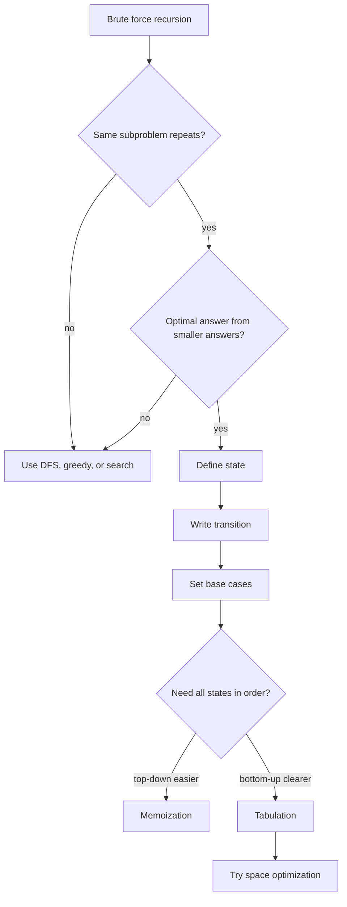
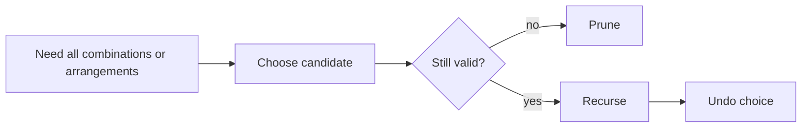
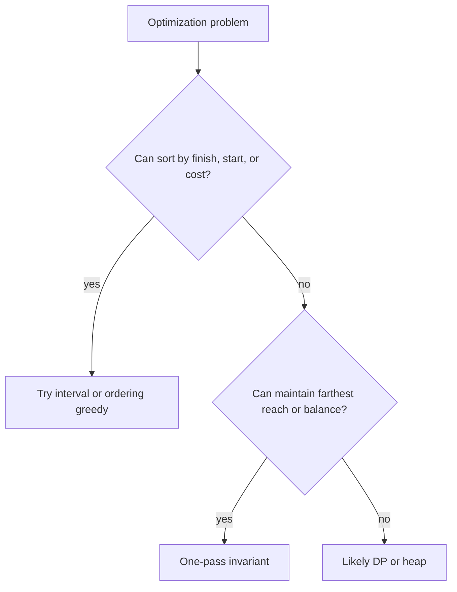
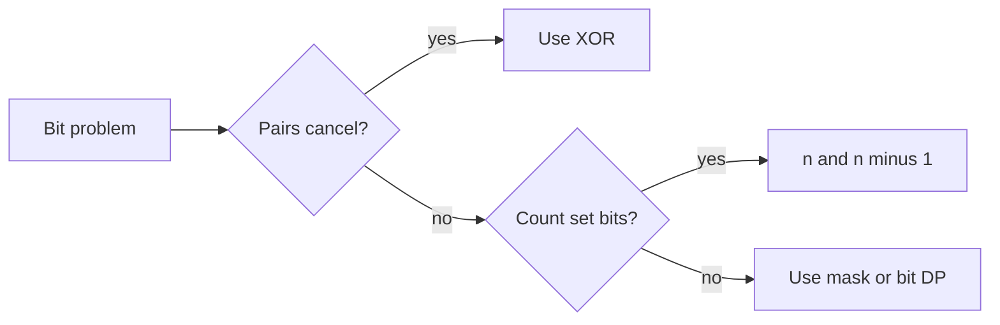

# 08f · DSA Dynamic Programming, Backtracking, Greedy, and Bits

This guide covers the four pattern families that usually decide SDE-1/SDE-2 coding rounds after arrays, trees, and graphs: DP, backtracking, greedy, and bit manipulation. For each problem, say the state or invariant before coding.

**Legend:** 🟢 Beginner · 🟡 Intermediate · 🔴 Advanced · ⚫ FAANG · 🔥 = very frequently asked

**Table of Contents**
- [Beginner guide to this file](#beginner-guide-to-this-file)
- [Dynamic Programming Framework](#dynamic-programming-framework)
- [Backtracking Framework](#backtracking-framework)
- [Greedy Framework](#greedy-framework)
- [Bit Manipulation Framework](#bit-manipulation-framework)
- [Problems](#problems)
- [Revision Cheat Sheet](#revision-cheat-sheet)
- [Flashcards](#flashcards)

## Beginner guide to this file

### What this file teaches

This file teaches choice-heavy Data Structures and Algorithms (DSA) patterns: reuse answers with Dynamic
Programming (DP), enumerate with backtracking, prove a local greedy choice, and use bits for cancellation or
compact state. Interviewers ask these to see whether you can turn brute force into a reusable invariant.

### Mental model

Think of the search space as a maze. DP writes notes on repeated rooms, backtracking explores every doorway,
greedy follows a proven shortcut, and bits use the wiring of numbers directly.

- DP needs a state, transition, base case, and fill order.
- Backtracking needs choose, recurse, and undo.
- Greedy needs a proof that the local choice stays safe.
- Bit manipulation relies on identities such as cancellation and masking.
- Edge cases usually live in base cases, zeros, duplicates, and boundaries.

### How to think through any question here

1. Write the brute-force choice tree in words.
2. Ask whether branches repeat the same subproblem; if yes, define a DP state.
3. Pick state dimensions: index, amount, capacity, two strings, interval, or holding status.
4. Choose a fill order where every transition reads known answers.
5. If all valid answers must be listed, use backtracking and undo each mutation.
6. If a local choice seems enough, state the invariant proving greedy safety.
7. For bit problems, write the binary identity before coding.

### Pattern recognition cues

| If the question mentions... | Think about... | Why it fits |
|---|---|---|
| Ways, minimum cost, maximum value | DP | Choices overlap and can be summarized by state. |
| Target amount or subset sum | Knapsack-style DP | Remaining sum or capacity is the key state. |
| Two strings or edit operations | 2D DP | Prefixes of both strings define subproblems. |
| Substring interval or last action | Interval DP | Choosing a boundary or last action splits the problem. |
| All subsets, permutations, partitions | Backtracking | The answer requires enumerating a choice tree. |
| Duplicate combinations | Sort and skip duplicates | Same-depth duplicates repeat answers. |
| Farthest reachable index | Greedy | A maintained frontier proves progress. |
| Intervals to keep or remove | Greedy sorting | Earliest finishing is the safety invariant. |
| Pairs cancel or one value is missing | Bit manipulation | Exclusive OR removes equal pairs. |

### Abbreviations and key terms

| Short form | Expanded form | Plain meaning |
|---|---|---|
| 0/1 | Zero-or-one choice | Each item can be used at most once. |
| 1D | One-dimensional | A single array of DP states. |
| 2D | Two-dimensional | A table indexed by two variables. |
| BFS | Breadth-First Search | Layer-by-layer search. |
| DFS | Depth-First Search | Deep recursive or stack exploration. |
| DP | Dynamic Programming | Store answers to repeated subproblems. |
| DSA | Data Structures and Algorithms | Coding-interview problem-solving topics. |
| FAANG | Facebook, Apple, Amazon, Netflix, and Google | Shorthand for large product-company interviews. |
| LCS | Longest Common Subsequence | Longest ordered sequence shared by two strings. |
| O(...) | Big O notation | Time or space growth description. |
| SDE | Software Development Engineer | Interview role level used in this guide. |
| XOR | Exclusive OR | Bit operation where equal values cancel. |
| State | State | Smallest information needed to describe a subproblem. |

### Common beginner traps

- Coding DP before defining what one state means.
- Looping capacity forward in zero-or-one knapsack and reusing an item.
- Counting permutations when the problem asks for combinations.
- Forgetting to undo path, board, or used-array changes in backtracking.
- Using greedy without explaining the proof invariant.
- Treating exclusive OR as arithmetic addition.

### How to study this file

1. Write the brute-force recursion or choice tree first.
2. Identify the exact state or greedy invariant from the short answer.
3. Dry-run the transition order on a small input before reading code.
4. Recode from the detailed explanation and test base cases.
5. Use flashcards to distinguish DP, backtracking, greedy, and bit triggers.

## Dynamic Programming Framework

DP is appropriate when brute force repeats overlapping subproblems and the optimal answer can be composed from smaller answers. Always define state, transition, base case, and iteration order.



Reusable DP template:

```java
import java.util.*;
class DPTemplates {
    int topDown(int i, int[] nums, int[] memo) {
        if (i >= nums.length) return 0;
        if (memo[i] != -1) return memo[i];
        return memo[i] = Math.max(topDown(i + 1, nums, memo), nums[i] + topDown(i + 2, nums, memo));
    }
    int bottomUpHouseRobber(int[] nums) {
        int prev2 = 0, prev1 = 0;
        for (int x : nums) {
            int cur = Math.max(prev1, prev2 + x);
            prev2 = prev1;
            prev1 = cur;
        }
        return prev1;
    }
}
```

## Backtracking Framework

Backtracking enumerates valid choices by choosing, exploring, and undoing. Prune as early as possible.



Reusable Java template:

```java
import java.util.*;
class BacktrackingTemplate {
    void dfs(int start, int[] nums, List<Integer> path, List<List<Integer>> ans) {
        ans.add(new ArrayList<>(path));
        for (int i = start; i < nums.length; i++) {
            path.add(nums[i]);
            dfs(i + 1, nums, path, ans);
            path.remove(path.size() - 1);
        }
    }
}
```

## Greedy Framework

Greedy works when a local choice can be proven safe by an exchange argument or invariant. In interviews, state the invariant before coding.



Reusable Java template:

```java
import java.util.*;
class GreedyTemplate {
    int eraseOverlapIntervals(int[][] intervals) {
        Arrays.sort(intervals, Comparator.comparingInt(a -> a[1]));
        int kept = 0, end = Integer.MIN_VALUE;
        for (int[] in : intervals) {
            if (in[0] >= end) { kept++; end = in[1]; }
        }
        return intervals.length - kept;
    }
}
```

## Bit Manipulation Framework

Bit questions are usually about XOR cancellation, testing/clearing bits, or representing a set as an integer mask.



Reusable Java template:

```java
class BitTemplates {
    boolean hasBit(int mask, int bit) { return (mask & (1 << bit)) != 0; }
    int setBit(int mask, int bit) { return mask | (1 << bit); }
    int clearLowestSetBit(int x) { return x & (x - 1); }
}
```

## Problems

### P1. Climbing Stairs (LeetCode 70)
`🟢 Easy` `🔥` `Must-know SDE-1` · Pattern: 1D DP Fibonacci · Commonly reported at: Amazon, Adobe, Microsoft; verify tags
**Problem:** Count ways to climb `n` stairs using 1 or 2 steps. Example `n=3` → `3`.

**How to recognize and think:** This asks for a count of ways, not the actual paths. The giveaway words are
`count ways`, `n stairs`, and fixed moves of 1 or 2 steps. Naive recursion recomputes the number of ways to
finish from the same stair, so `ways(3)` appears in many branches. Dynamic Programming (DP) state is
`ways[i]`, the ways to stand on stair `i`; transition `ways[i] = ways[i-1] + ways[i-2]`; base `ways[0] =
ways[1] = 1`; evaluate increasing `i`. The aha is that only the previous two states are needed. Picture each
stair receiving arrows from the two stairs below. Say `n=1` and `n=2`.

**How to recognize the pattern:** Ways to reach `i` depend on previous fixed-size states.
**Brute force:** Recursively try 1 or 2 steps — O(2^n) time, O(n) space.
**Better:** Memoize `ways(i)` — O(n) time, O(n) space.
**Optimal:** Keep last two counts.
```java
class Solution {
    public int climbStairs(int n) {
        int a = 1, b = 1;
        for (int i = 2; i <= n; i++) {
            int c = a + b;
            a = b; b = c;
        }
        return b;
    }
}
```
**Complexity:** Time O(n), Space O(1)
**Dry run:** `n=3`: counts `1,2,3`.
**Edge cases:** `n=1`; `n=2`.
**Follow-ups:** Steps `{1,2,3}` → sum previous three; cost version → min-cost DP.

### P2. House Robber (LeetCode 198)
`🟡 Medium` `🔥` `Must-know SDE-1` · Pattern: 1D choose-skip DP · Commonly reported at: Amazon, Google, Microsoft; verify tags
**Problem:** Max money without robbing adjacent houses. Example `[1,2,3,1]` → `4`.

**How to recognize and think:** The plain problem is choosing non-adjacent houses for maximum money. Words
like `adjacent`, `rob or skip`, and a line of houses reveal choose-skip DP. Brute force subsets revisit the
same suffix after different earlier decisions, for example the best from house 3 onward. Let `dp[i]` mean best
profit after considering houses through `i`; transition is max of skipping current (`dp[i-1]`) or taking it
(`nums[i] + dp[i-2]`); base profit before the array is 0; scan left to right. Rolling variables keep `dp[i-1]`
and `dp[i-2]`. Imagine a guard between neighbors. Mention one house, all zeros, and empty input conceptually.

**How to recognize the pattern:** At each index choose current plus `i-2`, or skip to `i-1`.
**Brute force:** Try all subsets respecting adjacency — O(2^n).
**Better:** Memoized recursion by index.
**Optimal:** Rolling two DP values.
```java
class Solution {
    public int rob(int[] nums) {
        int prev2 = 0, prev1 = 0;
        for (int x : nums) {
            int cur = Math.max(prev1, prev2 + x);
            prev2 = prev1;
            prev1 = cur;
        }
        return prev1;
    }
}
```
**Complexity:** Time O(n), Space O(1)
**Dry run:** `[1,2,3,1]` states become `1,2,4,4`.
**Edge cases:** Empty conceptually; one house; all zeros.
**Follow-ups:** Circular houses → solve two ranges; tree robber → DFS returns rob/skip.

### P3. House Robber II (LeetCode 213)
`🟡 Medium` `🔥` `Must-know SDE-1` · Pattern: Circular DP split · Commonly reported at: Amazon, Google; verify tags
**Problem:** Houses are circular, so first and last are adjacent. Example `[2,3,2]` → `3`.

**How to recognize and think:** The circle is the entire trick: `first and last are adjacent` blocks the usual
straight-line robber DP. A brute force with a `first picked` flag still explores the same suffixes repeatedly.
Split the world into two exhaustive cases: use houses `0..n-2` or use `1..n-1`; any legal solution must
exclude at least one endpoint. Inside each range, state is the same linear `best through index`, transition
`max(skip, take + two-back)`, base 0, and order is left to right. The invariant is that each range has no
first-last conflict. Picture cutting the bracelet at one of two clasps. Say one house, two houses, and both
endpoints large.

**How to recognize the pattern:** Linear DP is blocked by first-last conflict.
**Brute force:** Try all valid subsets — exponential.
**Better:** Memoize with first-picked flag.
**Optimal:** Max of robbing range `[0,n-2]` and `[1,n-1]`.
```java
class Solution {
    public int rob(int[] nums) {
        if (nums.length == 1) return nums[0];
        return Math.max(robRange(nums, 0, nums.length - 2), robRange(nums, 1, nums.length - 1));
    }
    private int robRange(int[] nums, int l, int r) {
        int prev2 = 0, prev1 = 0;
        for (int i = l; i <= r; i++) {
            int cur = Math.max(prev1, prev2 + nums[i]);
            prev2 = prev1; prev1 = cur;
        }
        return prev1;
    }
}
```
**Complexity:** Time O(n), Space O(1)
**Dry run:** `[2,3,2]`: ranges give `3` and `3`.
**Edge cases:** One house; two houses; first and last both large.
**Follow-ups:** Tree variant; houses in graph becomes maximum independent set, hard generally.

### P4. Coin Change (LeetCode 322)
`🟡 Medium` `🔥` `Must-know SDE-1` · Pattern: Unbounded min DP · Commonly reported at: Amazon, Google, Microsoft; verify tags
**Problem:** Fewest coins to make `amount`. Example coins `[1,2,5]`, amount `11` → `3`.

**How to recognize and think:** The request is the fewest coins for a target amount, with coins reusable.
Clues are `fewest`, `amount`, and repeated denominations. Trying every coin sequence recomputes the same
remaining amount and treats `5+1+5` separately from `5+5+1`. DP state is `dp[a]`, the minimum coins needed for
amount `a`; base `dp[0] = 0`; transition tries each coin: `dp[a] = min(dp[a], dp[a-coin] + 1)`; evaluate
amounts from 1 upward so smaller amounts are ready. The invariant is that `INF` means unreachable so far.
Picture filling a number line with cheapest labels. Edge cases: amount 0, impossible amount, and no coin 1.

**How to recognize the pattern:** Min items to reach target sum with repeated choices.
**Brute force:** Try every coin sequence — exponential.
**Better:** Memoize remaining amount.
**Optimal:** Bottom-up `dp[a] = min(dp[a-coin]+1)`.
```java
import java.util.*;
class Solution {
    public int coinChange(int[] coins, int amount) {
        int INF = amount + 1;
        int[] dp = new int[amount + 1];
        Arrays.fill(dp, INF);
        dp[0] = 0;
        for (int a = 1; a <= amount; a++)
            for (int coin : coins)
                if (coin <= a) dp[a] = Math.min(dp[a], dp[a - coin] + 1);
        return dp[amount] == INF ? -1 : dp[amount];
    }
}
```
**Complexity:** Time O(amount * coins), Space O(amount)
**Dry run:** Amount `11` uses `5+5+1`.
**Edge cases:** Amount 0; impossible amount; coin 1 absent.
**Follow-ups:** Return combination → store parent coin; bounded coins → 0/1 style.

### P5. Coin Change II (LeetCode 518)
`🟡 Medium` `🔥` `Must-know SDE-1` · Pattern: Unbounded count DP · Commonly reported at: Amazon, Google; verify tags
**Problem:** Count combinations to make amount. Example amount `5`, coins `[1,2,5]` → `4`.

**How to recognize and think:** This counts combinations, so order must not create new answers. The words
`count`, `combinations`, `amount`, and `coins` are the signal. A recursion that chooses any coin at each step
counts permutations like `1+2+2` and `2+1+2` separately. DP state is `dp[a]`, combinations for amount `a`
using coin types already processed; base `dp[0] = 1`; transition `dp[a] += dp[a-coin]`; evaluate coins in the
outer loop and amounts ascending to allow reuse of the same coin. The invariant is that combinations appear in
nondecreasing coin-type order. Mention amount 0, empty coin list, and large counts within constraints.

**How to recognize the pattern:** Count combinations, order does not matter.
**Brute force:** Enumerate combinations — exponential.
**Better:** 2D DP by coin index and amount.
**Optimal:** 1D DP iterating coins outside to avoid permutations.
```java
class Solution {
    public int change(int amount, int[] coins) {
        int[] dp = new int[amount + 1];
        dp[0] = 1;
        for (int coin : coins)
            for (int a = coin; a <= amount; a++)
                dp[a] += dp[a - coin];
        return dp[amount];
    }
}
```
**Complexity:** Time O(amount * coins), Space O(amount)
**Dry run:** After coin `5`, `dp[5]` includes `[5]` plus previous combos.
**Edge cases:** Amount 0; empty coins; large counts within constraints.
**Follow-ups:** Permutations count → amount outer loop; limited coins → reverse amount loop.

### P6. Longest Increasing Subsequence (LeetCode 300)
`🟡 Medium` `🔥` `Must-know SDE-1` · Pattern: DP or patience sorting · Commonly reported at: Amazon, Google, Microsoft; verify tags
**Problem:** Length of longest strictly increasing subsequence. Example `[10,9,2,5,3,7,101,18]` → `4`.

**How to recognize and think:** The phrase `strictly increasing subsequence` says order matters but contiguity
does not. Enumerating subsequences repeats the same possible tail values for many prefixes. The compact
DP-like state is `tails[len]`: the smallest possible ending value of an increasing subsequence of length `len
+ 1`. For each number, binary-search the first tail `>= x`; replace it, or append if none exists. Base is an
empty tails array, and evaluation is left to right. The invariant is that a smaller tail is always at least as
good for future extension, so replacement never loses an optimal length. Picture shelves labeled by length
holding the lightest ending card. Check decreasing arrays and duplicates.

**How to recognize the pattern:** Need subsequence order, not contiguous subarray.
**Brute force:** Enumerate subsequences — O(2^n).
**Better:** `dp[i]` LIS ending at `i` — O(n²).
**Optimal:** Maintain minimal tail for each length and binary-search position.
```java
import java.util.*;
class Solution {
    public int lengthOfLIS(int[] nums) {
        int[] tails = new int[nums.length];
        int size = 0;
        for (int x : nums) {
            int i = Arrays.binarySearch(tails, 0, size, x);
            if (i < 0) i = -i - 1;
            tails[i] = x;
            if (i == size) size++;
        }
        return size;
    }
}
```
**Complexity:** Time O(n log n), Space O(n)
**Dry run:** Tails evolve `[2]`, `[2,3]`, `[2,3,7]`, `[2,3,7,18]`.
**Edge cases:** Strictly decreasing; duplicates do not extend; empty not in constraints.
**Follow-ups:** Return sequence → store predecessors; non-decreasing → upper bound.

### P7. Longest Common Subsequence (LeetCode 1143)
`🟡 Medium` `🔥` `Must-know SDE-1` · Pattern: 2D string DP · Commonly reported at: Amazon, Google, Microsoft; verify tags
**Problem:** Length of LCS of two strings. Example `abcde`, `ace` → `3`.

**How to recognize and think:** Two strings and the phrase `longest common subsequence` point to prefix DP.
Brute force tries subsequences from both strings and repeats comparisons of the same suffix pair. Let
`dp[i][j]` be the Longest Common Subsequence length for the first `i` characters of `a` and first `j` of `b`.
Base row 0 and column 0 are 0. If characters match, transition from diagonal plus one; otherwise take max of
dropping one character from either side. Fill rows and columns forward so needed prefixes are known. Visualize
a grid where matches add a diagonal step. Edge cases: empty string, no common characters, identical strings.

**How to recognize the pattern:** Compare prefixes of two sequences.
**Brute force:** Try all subsequences — exponential.
**Better:** Memoized `(i,j)` recursion.
**Optimal:** Bottom-up 2D DP.
```java
class Solution {
    public int longestCommonSubsequence(String a, String b) {
        int m = a.length(), n = b.length();
        int[][] dp = new int[m + 1][n + 1];
        for (int i = 1; i <= m; i++)
            for (int j = 1; j <= n; j++)
                dp[i][j] = a.charAt(i-1) == b.charAt(j-1) ? 1 + dp[i-1][j-1] : Math.max(dp[i-1][j], dp[i][j-1]);
        return dp[m][n];
    }
}
```
**Complexity:** Time O(mn), Space O(mn)
**Dry run:** Matching `a,c,e` increase diagonal values to `3`.
**Edge cases:** Empty string; no common char; identical strings.
**Follow-ups:** Space optimize to two rows; print LCS by walking table.

### P8. Edit Distance (LeetCode 72)
`🔴 Hard` `🔥` `Stretch` · Pattern: 2D string DP · Commonly reported at: Amazon, Google, Microsoft; verify tags
**Problem:** Minimum insert/delete/replace operations to convert word1 to word2. Example `horse` → `ros` is `3`.

**How to recognize and think:** This asks for the minimum edits to convert one prefix into another. The signal
words are `insert`, `delete`, `replace`, and two strings. Plain recursion branches into three operations and
revisits the same `(i,j)` prefix pair many times. State `dp[i][j]` is the edit distance from `a[0..i)` to
`b[0..j)`. Base cases are `dp[i][0]=i` deletes and `dp[0][j]=j` inserts. If final chars match, copy diagonal;
otherwise use `1 + min(replace diagonal, delete up, insert left)`. Fill top-left to bottom-right. Picture
aligning two words on graph paper. Say empty source, empty target, same strings, and one-character changes.

**How to recognize the pattern:** Prefix conversion with three operation choices.
**Brute force:** Recursive operations — exponential.
**Better:** Memoized `(i,j)`.
**Optimal:** Bottom-up edit distance table.
```java
class Solution {
    public int minDistance(String a, String b) {
        int m = a.length(), n = b.length();
        int[][] dp = new int[m + 1][n + 1];
        for (int i = 0; i <= m; i++) dp[i][0] = i;
        for (int j = 0; j <= n; j++) dp[0][j] = j;
        for (int i = 1; i <= m; i++)
            for (int j = 1; j <= n; j++)
                if (a.charAt(i-1) == b.charAt(j-1)) dp[i][j] = dp[i-1][j-1];
                else dp[i][j] = 1 + Math.min(dp[i-1][j-1], Math.min(dp[i-1][j], dp[i][j-1]));
        return dp[m][n];
    }
}
```
**Complexity:** Time O(mn), Space O(mn)
**Dry run:** Replace `h→r`, delete `r`, delete `e` gives 3.
**Edge cases:** Empty source/target; same strings; one char.
**Follow-ups:** Weighted operations; space optimize with two rows.

### P9. Word Break (LeetCode 139)
`🟡 Medium` `🔥` `Must-know SDE-1` · Pattern: Prefix DP · Commonly reported at: Amazon, Google, Meta; verify tags
**Problem:** Can string be segmented into dictionary words? Example `leetcode`, `[leet,code]` → `true`.

**How to recognize and think:** The problem is whether the string can be cut into dictionary words. Look for
`segmented`, `wordDict`, and prefix/suffix language. Brute recursion tries every cut and repeatedly asks
whether the same suffix can be completed. Use state `dp[i]`: the prefix `s[0..i)` can be segmented. Base
`dp[0]=true` for the empty prefix. Transition checks some split `j` with `dp[j]` true and `s[j..i)` in the
set. Evaluate `i` from 1 to `n`, with inner splits before it. The invariant is that a true prefix is already
fully explained by dictionary words. Mention empty string, repeated dictionary words, and an impossible
suffix.

**How to recognize the pattern:** Validity of prefix depends on earlier split point.
**Brute force:** Try all splits recursively — exponential.
**Better:** Memoize start index.
**Optimal:** `dp[i]` true if some `j` has `dp[j]` and substring `j..i` in set.
```java
import java.util.*;
class Solution {
    public boolean wordBreak(String s, List<String> wordDict) {
        Set<String> set = new HashSet<>(wordDict);
        boolean[] dp = new boolean[s.length() + 1];
        dp[0] = true;
        for (int i = 1; i <= s.length(); i++)
            for (int j = 0; j < i; j++)
                if (dp[j] && set.contains(s.substring(j, i))) { dp[i] = true; break; }
        return dp[s.length()];
    }
}
```
**Complexity:** Time O(n³) with substring copying in Java, Space O(n + dict)
**Dry run:** `dp[4]` true for `leet`, then `dp[8]` true for `code`.
**Edge cases:** Empty string; repeated words; impossible suffix.
**Follow-ups:** Return all sentences → backtracking with memo; Trie reduces substring checks.

### P10. Partition Equal Subset Sum (LeetCode 416)
`🟡 Medium` `🔥` `Must-know SDE-1` · Pattern: 0/1 knapsack boolean DP · Commonly reported at: Amazon, Google; verify tags
**Problem:** Can array be split into two subsets with equal sum? Example `[1,5,11,5]` → `true`.

**How to recognize and think:** This is subset sum in disguise. The clue words are `split into two subsets`
and `equal sum`; the target must be half the total. Trying all subsets repeats the same reachable sums after
each prefix of numbers. DP state is `dp[s]`, whether sum `s` is reachable using numbers processed so far. Base
`dp[0]=true`. For each number `x`, transition `dp[s] |= dp[s-x]`, and the sum loop must go downward so `x` is
used at most once. Evaluation order is numbers outer, sums descending. Imagine reachable sums lighting up on a
ruler. Say odd total, single element, and zeros.

**How to recognize the pattern:** Subset sum target is half total.
**Brute force:** Try all subsets — O(2^n).
**Better:** 2D `dp[i][sum]`.
**Optimal:** 1D reverse-loop boolean DP.
```java
class Solution {
    public boolean canPartition(int[] nums) {
        int sum = 0;
        for (int x : nums) sum += x;
        if ((sum & 1) == 1) return false;
        int target = sum / 2;
        boolean[] dp = new boolean[target + 1];
        dp[0] = true;
        for (int x : nums)
            for (int s = target; s >= x; s--)
                dp[s] |= dp[s - x];
        return dp[target];
    }
}
```
**Complexity:** Time O(n*sum), Space O(sum)
**Dry run:** `11` becomes reachable, so equal partition exists.
**Edge cases:** Odd total; single element; zeros.
**Follow-ups:** Count partitions → integer DP; minimum subset difference → maximize reachable sum near half.

### P11. Unique Paths (LeetCode 62)
`🟡 Medium` `🔥` `Must-know SDE-1` · Pattern: Grid DP · Commonly reported at: Amazon, Microsoft; verify tags
**Problem:** Count paths from top-left to bottom-right moving only right/down. Example `m=3,n=7` → `28`.

**How to recognize and think:** A grid path count with only right and down moves means every cell depends on
the cell above and the cell left. DFS repeats the number of paths from the same intermediate cell. State can
be `dp[r][c]`, but the solution compresses it to `dp[c]`, paths to column `c` in the current row. Base: top
row and first column have one path. Transition `dp[c] = dp[c] + dp[c-1]`, where old `dp[c]` is from above and
`dp[c-1]` is from left. Evaluate rows top to bottom and columns left to right. Picture water flowing through a
lattice. Check one row, one column, and max dimensions.

**How to recognize the pattern:** Ways to cell from top plus left.
**Brute force:** DFS all paths — exponential.
**Better:** 2D DP.
**Optimal:** 1D row DP.
```java
import java.util.*;
class Solution {
    public int uniquePaths(int m, int n) {
        int[] dp = new int[n];
        Arrays.fill(dp, 1);
        for (int r = 1; r < m; r++)
            for (int c = 1; c < n; c++)
                dp[c] += dp[c - 1];
        return dp[n - 1];
    }
}
```
**Complexity:** Time O(mn), Space O(n)
**Dry run:** Each cell accumulates paths from above and left.
**Edge cases:** One row/column; max dimensions.
**Follow-ups:** Obstacles → zero blocked cells; combinatorics solution using binomial coefficient.

### P12. Decode Ways (LeetCode 91)
`🟡 Medium` `🔥` `Must-know SDE-1` · Pattern: String DP with validity checks · Commonly reported at: Amazon, Facebook; verify tags
**Problem:** Count decodings where `1=A` to `26=Z`. Example `226` → `3`.

**How to recognize and think:** Digits map to letters only through numbers 1 to 26, so `0` handling is the
warning sign. Recursive splitting into one or two digits recomputes the same suffix count. Let `dp[i]` be the
number of decodings for the first `i` characters. Base `dp[0]=1`; `dp[1]` is 1 only if the first char is not
`0`. Transition adds `dp[i-1]` when the one-digit code is valid and `dp[i-2]` when the two-digit code lies
from 10 to 26. Evaluate left to right; rolling variables store the last two states. Mentally branch `226` into
`2|26` and `22|6`. Say leading `0`, `10`, and `30`.

**How to recognize the pattern:** One or two previous characters can form a valid code.
**Brute force:** Recursive split into 1 or 2 digits — exponential.
**Better:** Memoize index.
**Optimal:** Rolling DP over string.
```java
class Solution {
    public int numDecodings(String s) {
        int prev2 = 1, prev1 = s.charAt(0) == '0' ? 0 : 1;
        for (int i = 2; i <= s.length(); i++) {
            int cur = 0;
            char one = s.charAt(i - 1);
            if (one != '0') cur += prev1;
            int two = Integer.parseInt(s.substring(i - 2, i));
            if (two >= 10 && two <= 26) cur += prev2;
            prev2 = prev1; prev1 = cur;
        }
        return prev1;
    }
}
```
**Complexity:** Time O(n), Space O(1)
**Dry run:** `226`: `2,2,6`, `22,6`, `2,26`.
**Edge cases:** Starts with `0`; `10` valid; `30` invalid.
**Follow-ups:** Wildcard `*` version needs modulo DP.

### P13. Longest Palindromic Subsequence (LeetCode 516)
`🟡 Medium` `🔥` `Must-know SDE-1` · Pattern: Interval DP · Commonly reported at: Amazon, Google; verify tags
**Problem:** Longest palindromic subsequence length. Example `bbbab` → `4`.

**How to recognize and think:** The phrase `palindromic subsequence` means characters may be skipped, so
substring intervals are natural. Enumerating subsequences repeats the same question for many `(left,right)`
windows. State `dp[l][r]` is the best palindrome length inside `s[l..r]`. Base `dp[i][i]=1`. If the ends
match, transition is `2 + dp[l+1][r-1]`; otherwise take max of dropping the left or right end. Evaluate with
`l` decreasing and `r` increasing so inner intervals are ready. Picture squeezing a window inward and deciding
whether the two ends can pair. Say one character, all distinct, and all same.

**How to recognize the pattern:** State over substring interval `(l,r)`.
**Brute force:** Enumerate subsequences — exponential.
**Better:** Memoized interval recursion.
**Optimal:** Bottom-up interval DP by decreasing left index.
```java
class Solution {
    public int longestPalindromeSubseq(String s) {
        int n = s.length();
        int[][] dp = new int[n][n];
        for (int i = n - 1; i >= 0; i--) {
            dp[i][i] = 1;
            for (int j = i + 1; j < n; j++) {
                if (s.charAt(i) == s.charAt(j)) dp[i][j] = 2 + dp[i + 1][j - 1];
                else dp[i][j] = Math.max(dp[i + 1][j], dp[i][j - 1]);
            }
        }
        return dp[0][n - 1];
    }
}
```
**Complexity:** Time O(n²), Space O(n²)
**Dry run:** In `bbbab`, four `b`s form subsequence.
**Edge cases:** One char; all distinct; all same.
**Follow-ups:** Longest palindromic substring uses expand/DP contiguous logic.

### P14. Maximum Product Subarray (LeetCode 152)
`🟡 Medium` `🔥` `Must-know SDE-1` · Pattern: DP tracking max and min · Commonly reported at: Amazon, LinkedIn; verify tags
**Problem:** Max product of a contiguous subarray. Example `[2,3,-2,4]` → `6`.

**How to recognize and think:** This is a contiguous product problem where negative values flip roles. The
signal is `maximum product subarray`, not sum. Testing every subarray repeats products and fails to remember
that a very negative product can become best after another negative. State at each index is two values:
maximum product ending here and minimum product ending here. Base is `nums[0]`. Transition considers starting
fresh at `x` or extending previous max/min by `x`; when `x` is negative, max and min swap roles. Evaluate left
to right. Imagine carrying both the hottest and coldest spark because the next sign can invert them. Say
zeros, all negatives, and one element.

**How to recognize the pattern:** Negative number can turn smallest product into largest.
**Brute force:** Test every subarray product — O(n²).
**Better:** Prefix products with zero handling.
**Optimal:** Track max and min product ending here.
```java
class Solution {
    public int maxProduct(int[] nums) {
        int max = nums[0], min = nums[0], ans = nums[0];
        for (int i = 1; i < nums.length; i++) {
            int x = nums[i];
            if (x < 0) { int t = max; max = min; min = t; }
            max = Math.max(x, max * x);
            min = Math.min(x, min * x);
            ans = Math.max(ans, max);
        }
        return ans;
    }
}
```
**Complexity:** Time O(n), Space O(1)
**Dry run:** `-2` swaps max/min; answer remains `6`.
**Edge cases:** Zeros; all negatives; one element.
**Follow-ups:** Max sum subarray → Kadane; return indices by storing starts.

### P15. 0/1 Knapsack
`🟡 Medium` `🔥` `Must-know SDE-1` · Pattern: 0/1 knapsack DP · Commonly reported at: product companies and OA rounds; verify source
**Problem:** Max value with capacity `W`, each item used once. Example weights `[1,3,4]`, values `[15,20,30]`, `W=4` → `35`.

**How to recognize and think:** The exact clues are `capacity`, `weights`, `values`, and `each item used
once`. Enumerating subsets repeats the same item index and remaining capacity. State `dp[cap]` is the best
value achievable at capacity `cap` after processing some prefix of items. Base is all zeros before any item.
For each item, transition `dp[cap] = max(dp[cap], value + dp[cap-weight])`. The capacity loop must go downward
so the current item cannot feed itself and be reused. Evaluation order is items outer, capacity descending.
Picture packing a bag from right to left on the capacity ruler. Mention capacity 0, too-heavy items, and
zero-weight items carefully.

**How to recognize the pattern:** Choose or skip each item under capacity.
**Brute force:** Enumerate subsets — O(2^n).
**Better:** 2D `dp[item][capacity]`.
**Optimal:** 1D capacity loop descending.
```java
class Solution {
    public int knapSack(int W, int[] wt, int[] val) {
        int[] dp = new int[W + 1];
        for (int i = 0; i < wt.length; i++)
            for (int cap = W; cap >= wt[i]; cap--)
                dp[cap] = Math.max(dp[cap], val[i] + dp[cap - wt[i]]);
        return dp[W];
    }
}
```
**Complexity:** Time O(nW), Space O(W)
**Dry run:** Capacity `4` chooses item weight `1` and `3`.
**Edge cases:** Capacity 0; item too heavy; zero-weight item requires care.
**Follow-ups:** Unbounded knapsack → loop capacity ascending; reconstruct items → store choices.

### P16. Best Time to Buy and Sell Stock with Cooldown (LeetCode 309)
`🟡 Medium` `🔥` `Must-know SDE-1` · Pattern: State-machine DP · Commonly reported at: Amazon, Google; verify tags
**Problem:** Max profit with 1-day cooldown after selling. Example `[1,2,3,0,2]` → `3`.

**How to recognize and think:** The cooldown rule means profit depends on yesterday's status. Signal words are
`buy`, `sell`, and `1-day cooldown`. Brute force calendars revisit the same `(day, holding, cooldown)` state.
Use three states after each day: `hold` for owning a stock, `sold` for selling today, and `rest` for not
holding and free to buy. Base day 0 has `hold = -price[0]`, `sold = 0`, `rest = 0`. Transitions are sell from
hold, buy from rest, or rest after previous sold/rest. Evaluate days left to right. The invariant is every
state is legal under cooldown. Say one day, decreasing prices, and equal prices.

**How to recognize the pattern:** Profit depends on whether holding, sold today, or resting.
**Brute force:** Try all buy/sell days — exponential.
**Better:** Memoize `(day, holding, cooldown)`.
**Optimal:** Iterative states `hold`, `sold`, `rest`.
```java
class Solution {
    public int maxProfit(int[] prices) {
        int hold = -prices[0], sold = 0, rest = 0;
        for (int i = 1; i < prices.length; i++) {
            int prevSold = sold;
            sold = hold + prices[i];
            hold = Math.max(hold, rest - prices[i]);
            rest = Math.max(rest, prevSold);
        }
        return Math.max(sold, rest);
    }
}
```
**Complexity:** Time O(n), Space O(1)
**Dry run:** Buy day 0, sell day 1, cooldown day 2, buy day 3, sell day 4.
**Edge cases:** One day; decreasing prices; equal prices.
**Follow-ups:** Transaction fee → subtract fee on sell; at most k transactions → 2D state DP.

### P17. Target Sum (LeetCode 494)
`🟡 Medium` `🔥` `Must-know SDE-1` · Pattern: Subset sum transform · Commonly reported at: Amazon, Facebook; verify tags
**Problem:** Assign `+` or `-` to reach target. Example `[1,1,1,1,1]`, target `3` → `5`.

**How to recognize and think:** The plus/minus signs form two groups: positives and negatives. `Assign + or -`
and `target` are the signal, but the brute binary tree repeats `(index, currentSum)` states. The algebraic aha
is `P - N = target` and `P + N = total`, so `P = (total + target) / 2`. Now count subsets with sum `P`. State
`dp[s]` is the number of ways to reach sum `s`; base `dp[0]=1`; transition `dp[s] += dp[s-x]` with sums
descending; process numbers left to right. The invariant is each number is used once. Edge cases: zeros double
counts, parity mismatch, and target outside total magnitude.

**How to recognize the pattern:** Plus/minus partition can transform to subset sum.
**Brute force:** Try both signs for every number — O(2^n).
**Better:** Memoize `(index,sum)`.
**Optimal:** Let positive subset sum be `(total + target)/2`, count subsets.
```java
class Solution {
    public int findTargetSumWays(int[] nums, int target) {
        int sum = 0;
        for (int x : nums) sum += x;
        if (Math.abs(target) > sum || ((sum + target) & 1) == 1) return 0;
        int want = (sum + target) / 2;
        int[] dp = new int[want + 1];
        dp[0] = 1;
        for (int x : nums)
            for (int s = want; s >= x; s--)
                dp[s] += dp[s - x];
        return dp[want];
    }
}
```
**Complexity:** Time O(n*sum), Space O(sum)
**Dry run:** Need subset sum `4`; choose four of five ones → `5`.
**Edge cases:** Zeros double ways; impossible parity; negative target.
**Follow-ups:** Return expressions → backtrack with pruning.

### P18. Burst Balloons (LeetCode 312)
`🔴 Hard` `🔥` `Stretch` · Pattern: Interval DP · Commonly reported at: Google, Amazon; verify tags
**Problem:** Max coins from bursting balloons; bursting `i` earns left*nums[i]*right. Example `[3,1,5,8]` → `167`.

**How to recognize and think:** Burst order changes neighbors, which is why the direct recursion explodes. The
key phrase is that bursting `i` earns left times current times right; neighbors are stable only if `i` is
chosen as the last balloon inside an interval. State `dp[l][r]` is max coins from bursting balloons `l..r`
after padding boundaries with 1. Base empty intervals are 0. Transition tries each `last` in `[l,r]` and
combines solved left interval, last-burst coins, and solved right interval. Evaluate by increasing interval
length. The invariant is that when `last` bursts, its outside neighbors are fixed. Picture choosing the final
domino in a fenced segment. Check one balloon, zeros, and all ones.

**How to recognize the pattern:** Last action inside an interval makes subproblems independent.
**Brute force:** Try all burst orders — O(n!).
**Better:** Memoized interval recursion.
**Optimal:** Bottom-up interval DP choosing last balloon.
```java
class Solution {
    public int maxCoins(int[] nums) {
        int n = nums.length;
        int[] a = new int[n + 2];
        a[0] = a[n + 1] = 1;
        for (int i = 0; i < n; i++) a[i + 1] = nums[i];
        int[][] dp = new int[n + 2][n + 2];
        for (int len = 1; len <= n; len++)
            for (int l = 1; l + len - 1 <= n; l++) {
                int r = l + len - 1;
                for (int last = l; last <= r; last++)
                    dp[l][r] = Math.max(dp[l][r], dp[l][last-1] + a[l-1]*a[last]*a[r+1] + dp[last+1][r]);
            }
        return dp[1][n];
    }
}
```
**Complexity:** Time O(n³), Space O(n²)
**Dry run:** Treat each balloon as last in interval; combine left/right solved intervals.
**Edge cases:** One balloon; zeros; all ones.
**Follow-ups:** Matrix chain multiplication uses same interval shape.

### P19. Minimum Path Sum (LeetCode 64)
`🟡 Medium` `🔥` `Must-know SDE-1` · Pattern: Grid min DP · Commonly reported at: Amazon, Microsoft; verify tags
**Problem:** Min sum path from top-left to bottom-right moving right/down. Example `[[1,3,1],[1,5,1],[4,2,1]]` → `7`.

**How to recognize and think:** This grid asks for a minimum-cost route using only right and down. DFS
enumerates many paths that share the same suffix from a cell. State is the minimum sum to reach each cell; the
solution stores it back into `grid[r][c]`. Base is the start cell unchanged; first row and first column have
only one possible predecessor. Transition adds the current cost to `min(top, left)`. Evaluation order is
row-major from top-left to bottom-right, so both predecessors are final when used. Imagine each cell stamping
the cheapest receipt to arrive there. Edge cases: one row, one column, and large values.

**How to recognize the pattern:** Cell answer is cost plus min of top/left.
**Brute force:** DFS all paths — exponential.
**Better:** 2D DP.
**Optimal:** Modify grid in place.
```java
class Solution {
    public int minPathSum(int[][] grid) {
        for (int r = 0; r < grid.length; r++) for (int c = 0; c < grid[0].length; c++) {
            if (r == 0 && c == 0) continue;
            int top = r > 0 ? grid[r-1][c] : Integer.MAX_VALUE;
            int left = c > 0 ? grid[r][c-1] : Integer.MAX_VALUE;
            grid[r][c] += Math.min(top, left);
        }
        return grid[grid.length - 1][grid[0].length - 1];
    }
}
```
**Complexity:** Time O(mn), Space O(1)
**Dry run:** Path `1→3→1→1→1` sums to 7.
**Edge cases:** One row; one column; large values.
**Follow-ups:** Obstacles; allow diagonal moves by adding transition.

### P20. Palindromic Substrings (LeetCode 647)
`🟡 Medium` `🔥` `Must-know SDE-1` · Pattern: Expand around center · Commonly reported at: Amazon, Microsoft; verify tags
**Problem:** Count palindromic substrings. Example `aaa` → `6`.

**How to recognize and think:** The word `substrings` means contiguous palindromes, and every palindrome has a
center. Checking every substring repeats the same inward character comparisons. A table DP could use state
`pal[l][r]`, base length 1 and 2, transition matching ends plus inner palindrome, filled by length. The given
aha is even smaller: expand around every odd and even center, counting while both sides match. The invariant
is that each palindromic substring has exactly one center representation, so expansions count all and do not
duplicate. Picture mirrors opening from a center crack. Say empty string conceptually, one character, and all
same characters like `aaa`.

**How to recognize the pattern:** Contiguous palindrome around centers.
**Brute force:** Check all substrings — O(n³).
**Better:** DP palindrome table — O(n²) space.
**Optimal:** Expand around each odd and even center.
```java
class Solution {
    public int countSubstrings(String s) {
        int ans = 0;
        for (int center = 0; center < s.length(); center++) {
            ans += expand(s, center, center);
            ans += expand(s, center, center + 1);
        }
        return ans;
    }
    private int expand(String s, int l, int r) {
        int count = 0;
        while (l >= 0 && r < s.length() && s.charAt(l--) == s.charAt(r++)) count++;
        return count;
    }
}
```
**Complexity:** Time O(n²), Space O(1)
**Dry run:** `aaa` centers count `a,a,a,aa,aa,aaa`.
**Edge cases:** Empty conceptually; one char; all same.
**Follow-ups:** Longest palindromic substring; subsequence version uses interval DP.

### P21. Subsets (LeetCode 78)
`🟡 Medium` `🔥` `Must-know SDE-1` · Pattern: Backtracking subsets · Commonly reported at: Amazon, Meta; verify tags
**Problem:** Return all subsets. Example `[1,2]` → `[[],[1],[2],[1,2]]`.

**How to recognize and think:** The output asks for every subset, so the decision at each number is include it
or move past it. Bitmasks work, but backtracking shows the recursion tree directly. At a node, choose the next
index's value by appending it, explore deeper indices, then undo by removing it. The invariant is that `path`
contains values chosen in increasing index order, so each subset appears once. Also add a copy of `path`
before trying children, because the current partial choice is already a valid subset. Picture walking down a
tree where each level may take a later number. Say empty input and one element.

**How to recognize the pattern:** Need all combinations of include/exclude.
**Brute force:** Bitmask all `2^n` subsets.
**Optimal:** Backtrack choosing next index.
```java
import java.util.*;
class Solution {
    public List<List<Integer>> subsets(int[] nums) {
        List<List<Integer>> ans = new ArrayList<>();
        dfs(0, nums, new ArrayList<>(), ans);
        return ans;
    }
    private void dfs(int start, int[] nums, List<Integer> path, List<List<Integer>> ans) {
        ans.add(new ArrayList<>(path));
        for (int i = start; i < nums.length; i++) {
            path.add(nums[i]); dfs(i + 1, nums, path, ans); path.remove(path.size() - 1);
        }
    }
}
```
**Complexity:** Time O(n*2^n), Space O(n)
**Dry run:** Add `[]`, choose `1`, then `2`, backtrack.
**Edge cases:** Empty input; one element.
**Follow-ups:** Iterative bitmask; subsets with duplicates sort and skip.

### P22. Subsets II (LeetCode 90)
`🟡 Medium` `🔥` `Must-know SDE-1` · Pattern: Backtracking duplicates · Commonly reported at: Amazon, Meta; verify tags
**Problem:** Return unique subsets when nums may contain duplicates. Example `[1,2,2]`.

**How to recognize and think:** Duplicates in the input but unique subsets in the output are the important
words. Generating all subsets and throwing them into a set wastes duplicate branches and extra list
comparisons. Sort first so equal values sit together. At each recursion depth, choose the first copy of a
value, explore with it, and undo; skip later equal siblings when the earlier equal value was not chosen at
that depth. The invariant is that sibling branches never start with the same value, while deeper branches may
still include duplicates legitimately. Picture identical cards in a row: only the leftmost unused twin may
lead a branch. Say all duplicates, empty input, and negative numbers.

**How to recognize the pattern:** Duplicate input with unique combination output.
**Brute force:** Generate all and put lists in set — costly.
**Optimal:** Sort, then skip duplicate choices at same recursion depth.
```java
import java.util.*;
class Solution {
    public List<List<Integer>> subsetsWithDup(int[] nums) {
        Arrays.sort(nums);
        List<List<Integer>> ans = new ArrayList<>();
        dfs(0, nums, new ArrayList<>(), ans);
        return ans;
    }
    private void dfs(int start, int[] nums, List<Integer> path, List<List<Integer>> ans) {
        ans.add(new ArrayList<>(path));
        for (int i = start; i < nums.length; i++) {
            if (i > start && nums[i] == nums[i - 1]) continue;
            path.add(nums[i]); dfs(i + 1, nums, path, ans); path.remove(path.size() - 1);
        }
    }
}
```
**Complexity:** Time O(n*2^n), Space O(n)
**Dry run:** At same depth, second `2` is skipped if first `2` was not chosen there.
**Edge cases:** All duplicates; empty; negative numbers.
**Follow-ups:** Combination Sum II uses same duplicate-skip idea.

### P23. Permutations (LeetCode 46)
`🟡 Medium` `🔥` `Must-know SDE-1` · Pattern: Backtracking permutations · Commonly reported at: Amazon, Microsoft; verify tags
**Problem:** Return all permutations of distinct numbers. Example `[1,2,3]` → 6 permutations.

**How to recognize and think:** Permutations are all orderings, not just choices. Since numbers are distinct,
the signal is `all permutations` and the recursion position matters. A swap method is valid but easy to undo
incorrectly; the shown version keeps a `used` array. Choose an unused number for the next slot, explore the
following slot, then undo by removing the number and clearing `used[i]`. The invariant is that `path` has no
repeated element and its length equals the number of filled positions. Picture arranging cards in seats from
left to right. Edge cases are one element and relying on the distinct-input guarantee.

**How to recognize the pattern:** Need all orderings, not subsets.
**Brute force:** Generate all arrangements with swaps.
**Optimal:** Track used elements in current path.
```java
import java.util.*;
class Solution {
    public List<List<Integer>> permute(int[] nums) {
        List<List<Integer>> ans = new ArrayList<>();
        dfs(nums, new boolean[nums.length], new ArrayList<>(), ans);
        return ans;
    }
    private void dfs(int[] nums, boolean[] used, List<Integer> path, List<List<Integer>> ans) {
        if (path.size() == nums.length) { ans.add(new ArrayList<>(path)); return; }
        for (int i = 0; i < nums.length; i++) if (!used[i]) {
            used[i] = true; path.add(nums[i]);
            dfs(nums, used, path, ans);
            path.remove(path.size() - 1); used[i] = false;
        }
    }
}
```
**Complexity:** Time O(n*n!), Space O(n)
**Dry run:** First choose `1`, then permute `[2,3]`, backtrack.
**Edge cases:** One element; distinct assumption.
**Follow-ups:** Duplicates → sort and skip used duplicate; kth permutation uses factorial math.

### P24. Combination Sum (LeetCode 39)
`🟡 Medium` `🔥` `Must-know SDE-1` · Pattern: Backtracking reuse candidates · Commonly reported at: Amazon, Microsoft; verify tags
**Problem:** Find combinations summing to target; candidates reusable. Example `[2,3,6,7]`, target `7` → `[[2,2,3],[7]]`.

**How to recognize and think:** The clues are `combinations`, `target`, and candidates can be reused. A brute
sequence search produces duplicates such as `[2,2,3]`, `[2,3,2]`, and `[3,2,2]`. Backtracking fixes the order:
choose candidate `i`, explore with the same `i` because reuse is allowed, then undo by popping it. The
invariant is that indices in `path` never decrease, so permutations of the same multiset cannot appear. Stop a
branch when remaining target is negative; record it when remaining target is zero. Imagine a vending machine
where you may press the same button again but never go back to earlier buttons. Say target below all
candidates, exact candidate match, and no solution.

**How to recognize the pattern:** Combination choices with unlimited reuse.
**Brute force:** Try all sequences and dedupe.
**Optimal:** Backtrack with `start` index; recurse with same `i` to reuse.
```java
import java.util.*;
class Solution {
    public List<List<Integer>> combinationSum(int[] candidates, int target) {
        List<List<Integer>> ans = new ArrayList<>();
        dfs(0, target, candidates, new ArrayList<>(), ans);
        return ans;
    }
    private void dfs(int start, int remain, int[] c, List<Integer> path, List<List<Integer>> ans) {
        if (remain == 0) { ans.add(new ArrayList<>(path)); return; }
        if (remain < 0) return;
        for (int i = start; i < c.length; i++) {
            path.add(c[i]); dfs(i, remain - c[i], c, path, ans); path.remove(path.size() - 1);
        }
    }
}
```
**Complexity:** Exponential, Space O(target/min candidate)
**Dry run:** Choose `2` repeatedly, then `3` reaches `0`.
**Edge cases:** Target less than all; candidate equal target; no solution.
**Follow-ups:** Each candidate once → increment `i+1`; duplicate candidates → sort and skip.

### P25. Letter Combinations of a Phone Number (LeetCode 17)
`🟡 Medium` `🔥` `Must-know SDE-1` · Pattern: Backtracking Cartesian product · Commonly reported at: Amazon, Google; verify tags
**Problem:** Return letter combinations for phone digits. Example `23` → `ad, ae, ..., cf`.

**How to recognize and think:** A phone digit string is a product of small choice lists. Words like `digits`
and `letter combinations` reveal backtracking over positions. Hard-coded nested loops only work for a fixed
number of digits and repeat code for each length. Choose one mapped letter for the current digit, explore the
next digit, then undo by deleting that letter from the builder. The invariant is that the builder length
equals the digit index, so each complete builder uses exactly one letter per digit. Picture an odometer where
each wheel is a digit's letters. Say empty input returns an empty list, and digits `7` and `9` have four
choices.

**How to recognize the pattern:** Choose one character from each digit's options.
**Brute force:** Nested loops are not scalable for variable length.
**Optimal:** DFS by digit index.
```java
import java.util.*;
class Solution {
    private static final String[] MAP = {"","","abc","def","ghi","jkl","mno","pqrs","tuv","wxyz"};
    public List<String> letterCombinations(String digits) {
        List<String> ans = new ArrayList<>();
        if (digits.isEmpty()) return ans;
        dfs(0, digits, new StringBuilder(), ans);
        return ans;
    }
    private void dfs(int idx, String digits, StringBuilder sb, List<String> ans) {
        if (idx == digits.length()) { ans.add(sb.toString()); return; }
        for (char ch : MAP[digits.charAt(idx) - '0'].toCharArray()) {
            sb.append(ch); dfs(idx + 1, digits, sb, ans); sb.deleteCharAt(sb.length() - 1);
        }
    }
}
```
**Complexity:** Time O(4^n*n), Space O(n)
**Dry run:** Digit `2` chooses `a`, then digit `3` chooses `d/e/f`.
**Edge cases:** Empty input; digits 7/9 have four letters.
**Follow-ups:** Custom keypad; stream output instead of storing all.

### P26. Palindrome Partitioning (LeetCode 131)
`🟡 Medium` `🔥` `Must-know SDE-1` · Pattern: Backtracking partition · Commonly reported at: Amazon, Google; verify tags
**Problem:** Partition string so every substring is palindrome. Example `aab` → `[[a,a,b],[aa,b]]`.

**How to recognize and think:** The task is to cut a string so every piece is a palindrome. The words
`partition` and `every substring is palindrome` signal cut-based backtracking. Trying all cuts while
rechecking palindromes repeats many inner checks. Choose a palindromic prefix `s[start..end]`, explore
partitions starting at `end + 1`, then undo by removing that piece. For an optimization, DP state `pal[l][r]`
says whether a substring is palindrome; base length 1, transition equal ends plus inner truth, evaluated by
length. The invariant of backtracking is that every piece in `path` is already valid. Mention one char, all
same, and no multi-character palindrome.

**How to recognize the pattern:** Need all valid cuts of a string.
**Brute force:** Try all cuts and recheck palindrome repeatedly.
**Better:** Precompute palindrome table.
**Optimal:** Backtrack cuts with palindrome check; precompute if optimizing.
```java
import java.util.*;
class Solution {
    public List<List<String>> partition(String s) {
        List<List<String>> ans = new ArrayList<>();
        dfs(0, s, new ArrayList<>(), ans);
        return ans;
    }
    private void dfs(int start, String s, List<String> path, List<List<String>> ans) {
        if (start == s.length()) { ans.add(new ArrayList<>(path)); return; }
        for (int end = start; end < s.length(); end++) if (pal(s, start, end)) {
            path.add(s.substring(start, end + 1));
            dfs(end + 1, s, path, ans);
            path.remove(path.size() - 1);
        }
    }
    private boolean pal(String s, int l, int r) {
        while (l < r) if (s.charAt(l++) != s.charAt(r--)) return false;
        return true;
    }
}
```
**Complexity:** Time O(n*2^n), Space O(n)
**Dry run:** For `aab`, cuts `a|a|b` and `aa|b` are valid.
**Edge cases:** One char; all same; no multi-char palindrome.
**Follow-ups:** Minimum cuts → DP; precompute palindrome table.

### P27. Word Search (LeetCode 79)
`🟡 Medium` `🔥` `Must-know SDE-1` · Pattern: Grid backtracking · Commonly reported at: Amazon, Microsoft; verify tags
**Problem:** Determine if word exists in grid using adjacent cells once. Example board with `ABCCED` → `true`.

**How to recognize and think:** This is path search in a grid with the rule that a cell may be used once.
Signal words are `exists`, `adjacent cells`, and a target word. Starting DFS blindly from every cell explores
branches whose first character already fails, and without marking visited it can reuse a cell illegally.
Choose a cell only when it matches the current character, mark it temporarily, explore four neighbors for the
next character, then undo by restoring the old character. The invariant is that marked cells are exactly the
current path. Picture laying breadcrumbs on letters and picking them back up. Say word longer than cells,
one-cell board, and reuse being invalid.

**How to recognize the pattern:** Path search with visited cells and backtracking.
**Brute force:** Start DFS from every cell without pruning.
**Optimal:** DFS only when char matches; mark cell temporarily.
```java
class Solution {
    public boolean exist(char[][] board, String word) {
        for (int r = 0; r < board.length; r++)
            for (int c = 0; c < board[0].length; c++)
                if (dfs(board, word, 0, r, c)) return true;
        return false;
    }
    private boolean dfs(char[][] b, String w, int i, int r, int c) {
        if (i == w.length()) return true;
        if (r<0||c<0||r==b.length||c==b[0].length||b[r][c] != w.charAt(i)) return false;
        char old = b[r][c]; b[r][c] = '#';
        boolean ok = dfs(b,w,i+1,r+1,c)||dfs(b,w,i+1,r-1,c)||dfs(b,w,i+1,r,c+1)||dfs(b,w,i+1,r,c-1);
        b[r][c] = old;
        return ok;
    }
}
```
**Complexity:** Time O(mn*4^L), Space O(L)
**Dry run:** Match `A`, mark visited, move to `B`, continue.
**Edge cases:** Reusing same cell invalid; one-cell board; word longer than cells.
**Follow-ups:** Many words → Trie Word Search II; diagonal moves add directions.

### P28. N-Queens (LeetCode 51)
`🔴 Hard` `🔥` `Stretch` · Pattern: Backtracking with constraints · Commonly reported at: Google, Amazon; verify tags
**Problem:** Place `n` queens so none attack. Example `n=4` → 2 boards.

**How to recognize and think:** The problem is to place queens row by row with no shared column or diagonal.
Brute force square combinations revisit boards that already have two queens attacking. The backtracking choice
is a column in the current row; explore the next row after marking its column and both diagonals; undo by
clearing the queen and marks. The invariant is that rows before `r` each have one safe queen, and the three
boolean arrays describe every attacked line. Picture placing one queen per row on a chessboard with laser
lines. Say `n=1` works, while `n=2` and `n=3` have no solutions.

**How to recognize the pattern:** Row-by-row choices with column and diagonal constraints.
**Brute force:** Try every square combination — huge.
**Optimal:** Backtrack rows and maintain occupied columns and diagonals.
```java
import java.util.*;
class Solution {
    public List<List<String>> solveNQueens(int n) {
        List<List<String>> ans = new ArrayList<>();
        char[][] board = new char[n][n];
        for (char[] row : board) Arrays.fill(row, '.');
        dfs(0, board, new boolean[n], new boolean[2*n], new boolean[2*n], ans);
        return ans;
    }
    private void dfs(int r, char[][] b, boolean[] col, boolean[] d1, boolean[] d2, List<List<String>> ans) {
        int n = b.length;
        if (r == n) { List<String> one = new ArrayList<>(); for (char[] row : b) one.add(new String(row)); ans.add(one); return; }
        for (int c = 0; c < n; c++) {
            int a = r - c + n, z = r + c;
            if (col[c] || d1[a] || d2[z]) continue;
            col[c] = d1[a] = d2[z] = true; b[r][c] = 'Q';
            dfs(r + 1, b, col, d1, d2, ans);
            b[r][c] = '.'; col[c] = d1[a] = d2[z] = false;
        }
    }
}
```
**Complexity:** Exponential, Space O(n²)
**Dry run:** Place one queen per row; invalid columns/diagonals are skipped.
**Edge cases:** `n=1`; `n=2` or `3` no solutions.
**Follow-ups:** Count only → avoid board strings; bitmask optimization.

### P29. Jump Game (LeetCode 55)
`🟡 Medium` `🔥` `Must-know SDE-1` · Pattern: Greedy farthest reach · Commonly reported at: Amazon, Google, Microsoft; verify tags
**Problem:** Can you reach last index? Example `[2,3,1,1,4]` → `true`.

**How to recognize and think:** The question is reachability, and the clue is each index gives a jump length.
DFS explores many jump paths that land inside the same already-known reachable prefix. The greedy local update
is safe because if any index up to `reach` can be reached, then all those indices may be considered as launch
pads; keeping only the farthest future reach dominates the shorter choices. The invariant before processing
index `i` is that every position up to `reach` is reachable. If `i` passes `reach`, the path is broken.
Picture a flashlight beam extending along the array. Edge cases: first element zero, one element, and zeros
after enough reach.

**How to recognize the pattern:** Maintain farthest reachable index.
**Brute force:** DFS all jumps — exponential.
**Better:** DP reachable states — O(n²).
**Optimal:** One-pass greedy farthest reach.
```java
class Solution {
    public boolean canJump(int[] nums) {
        int reach = 0;
        for (int i = 0; i < nums.length; i++) {
            if (i > reach) return false;
            reach = Math.max(reach, i + nums[i]);
        }
        return true;
    }
}
```
**Complexity:** Time O(n), Space O(1)
**Dry run:** `[2,3,1,1,4]` reach becomes `2`, then `4`.
**Edge cases:** First zero; one element; zeros after enough reach.
**Follow-ups:** Minimum jumps → Jump Game II; exact jump count uses BFS/DP.

### P30. Jump Game II (LeetCode 45)
`🟡 Medium` `🔥` `Must-know SDE-1` · Pattern: Greedy BFS window · Commonly reported at: Amazon, Google; verify tags
**Problem:** Minimum jumps to reach last index. Example `[2,3,1,1,4]` → `2`.

**How to recognize and think:** This asks for the fewest jumps, which is Breadth-First Search (BFS) on array
ranges without building the graph. A literal BFS or DP checks many edges from each index. Greedy groups all
indices reachable with the current number of jumps into a range ending at `end`; while scanning that range,
record the farthest next boundary. The local choice is safe because every index in the current range costs the
same jumps, so the farthest next boundary gives the widest next layer. The invariant is that when `i == end`,
one more jump is necessary. Picture waves crossing intervals. Say one element, guaranteed reachable input, and
a huge first jump.

**How to recognize the pattern:** Min jumps in implicit unweighted graph, optimized by range.
**Brute force:** BFS indices — O(n²).
**Better:** DP min jumps — O(n²).
**Optimal:** Greedy current jump boundary and next farthest boundary.
```java
class Solution {
    public int jump(int[] nums) {
        int jumps = 0, end = 0, far = 0;
        for (int i = 0; i < nums.length - 1; i++) {
            far = Math.max(far, i + nums[i]);
            if (i == end) { jumps++; end = far; }
        }
        return jumps;
    }
}
```
**Complexity:** Time O(n), Space O(1)
**Dry run:** First range `[0]` reaches `2`; second range reaches `4`.
**Edge cases:** One element; guaranteed reachable; large jump at start.
**Follow-ups:** Unreachable variant checks `far`; path reconstruction stores chosen boundary source.

### P31. Gas Station (LeetCode 134)
`🟡 Medium` `🔥` `Must-know SDE-1` · Pattern: Greedy reset · Commonly reported at: Amazon, Google; verify tags
**Problem:** Find starting gas station to complete circuit. Example gas `[1,2,3,4,5]`, cost `[3,4,5,1,2]` → `3`.

**How to recognize and think:** The route is circular, and each station contributes `gas[i] - cost[i]`. Trying
every start repeats the same failed prefix. The greedy reset is safe: if the tank becomes negative at station
`i`, no station between the old start and `i` can be a valid start, because it would begin with even less
accumulated surplus before the same failure. The invariant is that `start` is just after the most recent
impossible prefix, and `tank` is surplus from that candidate. A separate `total` decides whether any answer
exists. Picture walking with a fuel can that empties; after a spill, restart after the spill. Say total
negative, one station, and exact zero tank.

**How to recognize the pattern:** If total gas is enough, failed prefix cannot be a start.
**Brute force:** Try each start — O(n²).
**Optimal:** Track tank; reset start after tank goes negative.
```java
class Solution {
    public int canCompleteCircuit(int[] gas, int[] cost) {
        int total = 0, tank = 0, start = 0;
        for (int i = 0; i < gas.length; i++) {
            int diff = gas[i] - cost[i];
            total += diff; tank += diff;
            if (tank < 0) { start = i + 1; tank = 0; }
        }
        return total >= 0 ? start : -1;
    }
}
```
**Complexity:** Time O(n), Space O(1)
**Dry run:** Tank fails before index 3; station 3 starts with enough surplus.
**Edge cases:** Total negative; one station; exact zero tank.
**Follow-ups:** Multiple valid starts; circular route variants.

### P32. Non-overlapping Intervals (LeetCode 435)
`🟡 Medium` `🔥` `Must-know SDE-1` · Pattern: Greedy by earliest finish · Commonly reported at: Amazon, Microsoft; verify tags
**Problem:** Minimum intervals to remove so remaining do not overlap. Example `[[1,2],[2,3],[3,4],[1,3]]` → `1`.

**How to recognize and think:** Removing the fewest intervals equals keeping the most non-overlapping
intervals. The clue words are `minimum remove` and `do not overlap`. Trying subsets repeats compatibility
checks for many interval sets. Sort by end time and keep an interval whenever its start is at or after the
current end. The greedy choice is safe because the earliest finishing compatible interval leaves at least as
much room for all future intervals as any later finisher. The invariant is that after each kept interval,
`end` is the smallest possible finishing time for the number kept. Picture reserving a room and always
choosing the meeting that frees it soonest. Say touching endpoints, negative times, and empty input
conceptually.

**How to recognize the pattern:** Keep maximum number of compatible intervals.
**Brute force:** Try all subsets — exponential.
**Optimal:** Sort by end; greedily keep earliest finishing intervals.
```java
import java.util.*;
class Solution {
    public int eraseOverlapIntervals(int[][] intervals) {
        Arrays.sort(intervals, Comparator.comparingInt(a -> a[1]));
        int keep = 0, end = Integer.MIN_VALUE;
        for (int[] in : intervals) {
            if (in[0] >= end) { keep++; end = in[1]; }
        }
        return intervals.length - keep;
    }
}
```
**Complexity:** Time O(n log n), Space O(1) excluding sort
**Dry run:** Keep `[1,2]`, `[2,3]`, `[3,4]`, remove `[1,3]`.
**Edge cases:** Touching endpoints not overlap; negative times; empty conceptual.
**Follow-ups:** Meeting rooms count uses heap/sweep line; merge intervals sorts by start.

### P33. Meeting Rooms II (LeetCode 253)
`🟡 Medium` `🔥` `Must-know SDE-1` · Pattern: Sweep line or min-heap · Commonly reported at: Amazon, Google, Microsoft; verify tags
**Problem:** Minimum rooms for meeting intervals. Example `[[0,30],[5,10],[15,20]]` → `2`.

**How to recognize and think:** This asks for the maximum number of meetings active at once. For each meeting,
counting all overlaps repeats pair comparisons. Sort all start times and all end times. Sweep starts in order;
if the next meeting starts after or exactly when the earliest ending meeting ends, release one room before
allocating. The invariant is that `rooms` equals meetings currently active, and `best` is the peak active
count. This is like watching people enter and leave through two sorted doors. A min-heap of end times is
another form of the same idea, but the two-pointer sweep is simpler here. Mention back-to-back meetings share
a room, no intervals, and equal starts.

**How to recognize the pattern:** Need maximum number of simultaneous intervals.
**Brute force:** For each meeting count overlaps — O(n²).
**Better:** Min-heap of end times — O(n log n).
**Optimal:** Sort starts and ends; sweep with two pointers.
```java
import java.util.*;
class Solution {
    public int minMeetingRooms(int[][] intervals) {
        int n = intervals.length;
        int[] starts = new int[n], ends = new int[n];
        for (int i = 0; i < n; i++) { starts[i] = intervals[i][0]; ends[i] = intervals[i][1]; }
        Arrays.sort(starts); Arrays.sort(ends);
        int rooms = 0, endPtr = 0, best = 0;
        for (int s : starts) {
            if (s >= ends[endPtr]) { rooms--; endPtr++; }
            rooms++;
            best = Math.max(best, rooms);
        }
        return best;
    }
}
```
**Complexity:** Time O(n log n), Space O(n)
**Dry run:** Starts `0,5,15`; first end `10`; peak rooms is 2.
**Edge cases:** Back-to-back meetings share room; no intervals; same start.
**Follow-ups:** Return room assignment → min-heap with room ids.

### P34. Partition Labels (LeetCode 763)
`🟡 Medium` `🔥` `Must-know SDE-1` · Pattern: Greedy last occurrence · Commonly reported at: Amazon, Meta; verify tags
**Problem:** Partition string so each character appears in at most one part. Example `ababcbacadefegdehijhklij` → `[9,7,8]`.

**How to recognize and think:** Each character must appear in at most one partition, so the revealing words
are `last occurrence` hidden inside the rule. Trying possible cut points and validating segments rescans
characters repeatedly. Precompute each character's last index. While scanning a segment, extend its end to the
farthest last occurrence of any character seen. The greedy cut at `i == end` is safe because no character
inside the segment appears later; cutting earlier would split one character across parts. The invariant is
that `end` is the rightmost required boundary for the current segment. Picture a rubber band stretching until
all seen letters fit. Say all unique, all same, and one character.

**How to recognize the pattern:** Segment must extend to last occurrence of every char inside it.
**Brute force:** Try partition points and validate — O(n²).
**Optimal:** Precompute last index; scan and close segment when `i == end`.
```java
import java.util.*;
class Solution {
    public List<Integer> partitionLabels(String s) {
        int[] last = new int[26];
        for (int i = 0; i < s.length(); i++) last[s.charAt(i) - 'a'] = i;
        List<Integer> ans = new ArrayList<>();
        int start = 0, end = 0;
        for (int i = 0; i < s.length(); i++) {
            end = Math.max(end, last[s.charAt(i) - 'a']);
            if (i == end) { ans.add(end - start + 1); start = i + 1; }
        }
        return ans;
    }
}
```
**Complexity:** Time O(n), Space O(1)
**Dry run:** First segment extends until last `a/b/c` at index 8.
**Edge cases:** All unique; all same; one char.
**Follow-ups:** Unicode → map last positions; minimum partitions with custom constraints.

### P35. Single Number (LeetCode 136)
`🟢 Easy` `🔥` `Must-know SDE-1` · Pattern: XOR cancellation · Commonly reported at: Amazon, Microsoft; verify tags
**Problem:** Every element appears twice except one. Example `[4,1,2,1,2]` → `4`.

**How to recognize and think:** The statement says every value appears twice except one. A hash map count
works but stores information for all numbers. XOR is the aha because `x ^ x = 0`, `x ^ 0 = x`, and order does
not matter. The invariant after processing a prefix is that the running XOR equals the XOR of values with odd
frequency in that prefix; pairs have canceled themselves out. Picture a light switch toggled by each
occurrence: paired numbers turn off, the single number remains on. This is specific to the exactly-twice
pattern. Say negative numbers still work bitwise, a one-element array, and unsorted input.

**How to recognize the pattern:** Pairs cancel and one remains.
**Brute force:** HashMap counts — O(n) time, O(n) space.
**Optimal:** XOR all values.
```java
class Solution {
    public int singleNumber(int[] nums) {
        int ans = 0;
        for (int x : nums) ans ^= x;
        return ans;
    }
}
```
**Complexity:** Time O(n), Space O(1)
**Dry run:** `1^1=0`, `2^2=0`, leaves `4`.
**Edge cases:** Negative numbers; single element; unsorted input.
**Follow-ups:** One appears once, others thrice → bit counts mod 3.

### P36. Number of 1 Bits (LeetCode 191)
`🟢 Easy` `🔥` `Must-know SDE-1` · Pattern: Clear lowest set bit · Commonly reported at: Amazon, Apple; verify tags
**Problem:** Count set bits in a 32-bit integer. Example `000...1011` → `3`.

**How to recognize and think:** The task is to count set bits in a 32-bit integer. Checking all 32 positions
is simple, but it does fixed work even for sparse numbers. The bit trick `n & (n - 1)` clears only the lowest
set bit. The invariant is that each loop removes exactly one `1` and leaves all higher bits represented
correctly, so the number of loop iterations is the answer. Picture turning off the rightmost lit bulb until
the room is dark. In Java, negative ints still have a finite 32-bit two's-complement representation, and the
loop reaches zero. Say zero, negative input, and all bits set.

**How to recognize the pattern:** Need bit count, not decimal digits.
**Brute force:** Check all 32 bit positions — O(32).
**Optimal:** Repeatedly clear the lowest set bit.
```java
class Solution {
    public int hammingWeight(int n) {
        int count = 0;
        while (n != 0) {
            n &= n - 1;
            count++;
        }
        return count;
    }
}
```
**Complexity:** Time O(number of set bits), Space O(1)
**Dry run:** `1011 → 1010 → 1000 → 0000`, count 3.
**Edge cases:** Zero; negative int uses two's-complement bits; all ones.
**Follow-ups:** Built-in `Integer.bitCount`; count bits for all numbers uses DP.

### P37. Counting Bits (LeetCode 338)
`🟢 Easy` `🔥` `Must-know SDE-1` · Pattern: Bit DP · Commonly reported at: Amazon, Microsoft; verify tags
**Problem:** Return set-bit counts for every `0..n`. Example `n=5` → `[0,1,1,2,1,2]`.

**How to recognize and think:** This asks for bit counts for every number from `0` to `n`, so individual
counts repeat work on shared prefixes. DP state is `bits[i]`, the number of set bits in `i`. Base `bits[0]=0`.
Transition uses the smaller number formed by shifting right: `bits[i] = bits[i >> 1] + (i & 1)`. Evaluation
order is increasing `i`, because `i >> 1` is always smaller and already known. The invariant is that the low
bit contributes either 0 or 1 after removing it. Picture each number inheriting its parent's count in a binary
tree. Say `n=0`, powers of two, and odd/even transitions.

**How to recognize the pattern:** Counts for numbers reuse counts of smaller numbers.
**Brute force:** Run bit count for every number — O(n log n).
**Optimal:** `bits[i] = bits[i >> 1] + (i & 1)`.
```java
class Solution {
    public int[] countBits(int n) {
        int[] bits = new int[n + 1];
        for (int i = 1; i <= n; i++) bits[i] = bits[i >> 1] + (i & 1);
        return bits;
    }
}
```
**Complexity:** Time O(n), Space O(n)
**Dry run:** `5` uses `bits[2] + 1 = 2`.
**Edge cases:** `n=0`; powers of two; odd/even transitions.
**Follow-ups:** Use `bits[i & (i-1)] + 1`; memory streaming if only printing.

### P38. Missing Number (LeetCode 268)
`🟢 Easy` `🔥` `Must-know SDE-1` · Pattern: XOR or arithmetic sum · Commonly reported at: Amazon, Microsoft; verify tags
**Problem:** Array has distinct numbers from `0..n` missing one. Example `[3,0,1]` → `2`.

**How to recognize and think:** The input is a complete range `0..n` with one value absent. A boolean seen
array solves it but stores one flag per possible value, and sum formulas can overflow in some languages. XOR
avoids both. Initialize with `n`, then XOR every index and every array value. The invariant is that values
appearing once as an index and once in the array cancel; the only unmatched range value left is the missing
number. Picture pairing numbered socks from the index pile and value pile; the orphan sock is the answer. Say
missing `0`, missing `n`, and the one-element cases `[0]` or `[1]`.

**How to recognize the pattern:** Complete range with one missing value.
**Brute force:** Boolean seen array — O(n) time, O(n) space.
**Better:** Sum formula, but discuss overflow in other languages.
**Optimal:** XOR indices and values.
```java
class Solution {
    public int missingNumber(int[] nums) {
        int xor = nums.length;
        for (int i = 0; i < nums.length; i++) xor ^= i ^ nums[i];
        return xor;
    }
}
```
**Complexity:** Time O(n), Space O(1)
**Dry run:** XOR cancels present values and indices, leaving missing `2`.
**Edge cases:** Missing `0`; missing `n`; one element.
**Follow-ups:** Multiple missing numbers → cyclic sort or set; one duplicate one missing → XOR partition.

## Revision Cheat Sheet

- DP checklist: state, transition, base case, order, answer location, space optimization.
- 0/1 knapsack loops capacity descending; unbounded loops ascending.
- String DP usually compares prefixes `(i,j)` or intervals `(l,r)`.
- Interval DP often chooses the last action inside the interval.
- Backtracking template: choose, recurse, undo; sort first when duplicates require skipping.
- Grid backtracking marks a cell, explores, then restores it.
- Greedy needs an invariant or exchange argument, not just intuition.
- Interval scheduling keeps earliest finish; meeting rooms counts peak overlap.
- XOR cancels equal pairs; `n & (n-1)` clears lowest set bit.
- In Java, use `long` for sums if constraints may overflow `int`.

## Flashcards

1. Q → DP state means? A → The minimal information needed to describe a subproblem.
2. Q → Coin Change min vs Coin Change II? A → Min coins vs count combinations.
3. Q → Why iterate 0/1 knapsack capacity backward? A → To avoid reusing the same item.
4. Q → LIS O(n log n) array stores what? A → Minimum possible tail for each length.
5. Q → Edit distance operations? A → Insert, delete, replace.
6. Q → Backtracking duplicate skip condition? A → `i > start && nums[i] == nums[i-1]`.
7. Q → Jump Game greedy variable? A → Farthest reachable index.
8. Q → Gas Station reset condition? A → Current tank below zero.
9. Q → Partition Labels closes when? A → Current index equals max last occurrence in segment.
10. Q → XOR pair property? A → `x ^ x = 0`.
11. Q → Bit count trick? A → Repeatedly do `n &= n - 1`.
12. Q → Burst Balloons key insight? A → Choose the last balloon in an interval.
