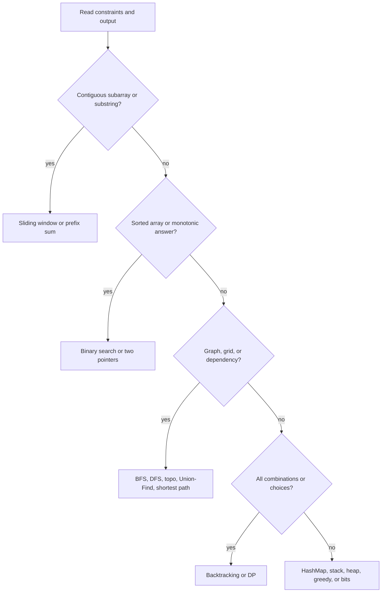

# 08g · DSA Top 200 Problem List

Use this as the tracking sheet for SDE-1/SDE-2 DSA prep in Java. Company tags below are **hedged** and must be verified on LeetCode company tags, LeetCode Discuss, Glassdoor, or recent interview reports. Also cross-check with NeetCode 150, Striver SDE Sheet, and LeetCode Top Interview 150.

**Legend:** 🟢 Beginner · 🟡 Intermediate · 🔴 Advanced · ⚫ FAANG · 🔥 = very frequently asked

**Table of Contents**
- [Beginner guide to this file](#beginner-guide-to-this-file)
- [How to Choose the Pattern](#how-to-choose-the-pattern)
- [Pattern Recognition Cheat Sheet](#pattern-recognition-cheat-sheet)
- [Top 200 Problems](#top-200-problems)
- [30-Day Problem Schedule](#30-day-problem-schedule)
- [Revision Cheat Sheet](#revision-cheat-sheet)
- [Flashcards](#flashcards)

## Beginner guide to this file

### What this file teaches

This file is a study map for Data Structures and Algorithms (DSA) practice. It groups problems by pattern so you
can recognize the shape, choose a template, and explain why it fits in Java interviews for Software Development
Engineer (SDE) roles.

### Mental model

Think of the list as a gym plan: each category trains one problem-solving muscle.

- Arrays and hashing train counting, indexing, and one-pass state.
- Windows, pointers, stacks, heaps, and binary search train invariants over ordered data.
- Trees and graphs train traversal, reachability, and node-edge modeling.
- Dynamic Programming (DP), backtracking, greedy, and bits train choice compression and proof.
- The schedule turns recognition into repetition, and flashcards test whether the trigger stuck.

### How to think through any question here

1. Read the output requirement: one value, all answers, a path, an order, or a structure change.
2. Match the strongest signal to a category before opening a solution.
3. Say the brute-force method and why constraints make it too slow.
4. Name the invariant: window validity, sorted order, queue level, stack monotonicity, DP state, or proof.
5. Check edge cases such as empty input, duplicates, ties, overflow, or disconnected nodes.
6. Mark whether the pattern was recognized quickly or needs review.

### Pattern recognition cues

| If the question mentions... | Think about... | Why it fits |
|---|---|---|
| Counts, duplicates, pair sums | HashMap or HashSet | Membership or frequency gives constant-time lookup. |
| Contiguous subarray or substring | Sliding window or prefix sum | A maintained range or prefix difference captures the answer. |
| Sorted input or monotonic answer | Two pointers or binary search | Movement can discard impossible choices safely. |
| Next greater or nested delimiters | Stack | The most recent unresolved item must be handled first. |
| Current best among many candidates | Heap | You repeatedly need the smallest, largest, or top k item. |
| Tree or graph reachability | DFS, BFS, or Union-Find | The problem is about visiting connected structure. |
| Dependencies | Topological sort | Directed edges must be ordered without cycles. |
| Repeated optimal choices | DP | Subproblems overlap and have optimal substructure. |
| All combinations or arrangements | Backtracking | The output requires exploring a choice tree. |
| Local choice with proof | Greedy | A maintained invariant makes the local decision safe. |
| Pair cancellation or binary masks | Bit manipulation | Binary operations solve the problem without extra collections. |

### Abbreviations and key terms

| Short form | Expanded form | Plain meaning |
|---|---|---|
| 1D | One-dimensional | A single-array DP state. |
| 2D | Two-dimensional | A table indexed by two variables. |
| BFS | Breadth-First Search | Queue traversal by layers. |
| BST | Binary Search Tree | Ordered tree with smaller left and larger right values. |
| DFS | Depth-First Search | Explore deeply before backtracking. |
| DP | Dynamic Programming | Store answers to repeated subproblems. |
| DSA | Data Structures and Algorithms | Core coding-interview problem solving. |
| FAANG | Facebook, Apple, Amazon, Netflix, and Google | Shorthand for large product-company interviews. |
| LFU | Least Frequently Used | Cache eviction based on access count. |
| LRU | Least Recently Used | Cache eviction based on recency. |
| MST | Minimum Spanning Tree | Cheapest edge set connecting all nodes. |
| O(...) | Big O notation | Time or space growth description. |
| SDE | Software Development Engineer | Interview role level used in this guide. |
| XOR | Exclusive OR | Bit operation where equal values cancel. |
| Invariant | Invariant | A fact kept true after every step. |

### Common beginner traps

- Solving rows in order without first naming the pattern signal.
- Treating company tags as guaranteed facts instead of verifying recent sources.
- Jumping to DP for every hard problem when a greedy or stack invariant is enough.
- Ignoring duplicates, ties, disconnected nodes, or overflow.
- Practicing only code and not the two-minute explanation.

### How to study this file

1. Start with Tier 1 problems in each category.
2. Say the pattern and invariant before opening a solution.
3. Use the detailed topic files for short answers, dry runs, and edge cases.
4. Revisit missed rows after 24 hours.
5. Use the 30-day schedule for volume and flashcards for recognition speed.

## How to Choose the Pattern

## Pattern Recognition Cheat Sheet

| Signal in problem | Think pattern | Interview phrase |
|---|---|---|
| Pair sum, frequency, anagram, duplicates | HashMap or HashSet | “I need O(1) membership or counts.” |
| Sorted array, pair/triplet, palindrome validation | Two pointers | “Move the pointer that can still improve the answer.” |
| Longest or shortest contiguous substring/subarray | Sliding window | “Maintain a valid window and shrink when invalid.” |
| Count subarrays with exact sum or balance | Prefix sum + HashMap | “Equal prefix differences imply target subarray.” |
| Search in sorted or answer space | Binary search | “The predicate is monotonic.” |
| Next greater, largest rectangle, temperatures | Monotonic stack | “Pop while the invariant is violated.” |
| Top K, running median, merge k lists | Heap | “I only need the current best candidate.” |
| Tree height, validity, path | DFS postorder/preorder | “Define what a node returns to its parent.” |
| Level order, shortest unweighted path | BFS | “First visit by level is shortest.” |
| Directed prerequisites | Topological sort | “Cycle means impossible schedule.” |
| Undirected connectivity or cycle while adding edges | Union-Find | “Find roots and union components.” |
| Weighted non-negative shortest path | Dijkstra | “Use min-heap by current distance.” |
| Repeated prefix queries | Trie | “Share common prefixes.” |
| Overlapping choices with optimal substructure | DP | “State, transition, base case, order.” |
| All subsets/permutations/partitions | Backtracking | “Choose, recurse, undo.” |
| Local choice with provable invariant | Greedy | “I can prove the local choice is safe.” |
| Pairs cancel, set bits, missing number | Bit manipulation | “XOR cancels equal values.” |

## Top 200 Problems

### Arrays, Hashing, Prefix Sum, and Matrix

**Pattern cue:** Use this category for frequencies, duplicates, pair sums, prefix totals, intervals, or
matrix markers. Brute force scans nested pairs or subarrays; the invariant is a map, set, prefix value,
marker, or running best. Variants include top k, majority vote, cyclic placement, and matrix boundaries.
Watch duplicates, negatives, overflow, empty input, and in-place constraints.

| # | Problem | LeetCode # | Pattern | Difficulty | Commonly reported at (hedged) | Tier |
|---:|---|---:|---|---|---|---:|
| 1 | Two Sum | 1 | HashMap | Easy | Amazon, Google, Microsoft; verify | 1 |
| 2 | Contains Duplicate | 217 | HashSet | Easy | Amazon, Microsoft; verify | 1 |
| 3 | Valid Anagram | 242 | Frequency array | Easy | Amazon, Bloomberg; verify | 1 |
| 4 | Group Anagrams | 49 | HashMap keying | Medium | Amazon, Meta, Uber; verify | 1 |
| 5 | Top K Frequent Elements | 347 | Heap or bucket | Medium | Amazon, Google, Microsoft; verify | 1 |
| 6 | Product of Array Except Self | 238 | Prefix and suffix | Medium | Amazon, Meta, Microsoft; verify | 1 |
| 7 | Valid Sudoku | 36 | HashSet encoding | Medium | Amazon, Apple; verify | 1 |
| 8 | Longest Consecutive Sequence | 128 | HashSet sequence start | Medium | Google, Amazon; verify | 1 |
| 9 | Best Time to Buy and Sell Stock | 121 | One-pass min | Easy | Amazon, Microsoft; verify | 1 |
| 10 | Maximum Subarray | 53 | Kadane DP | Medium | Amazon, Microsoft, Google; verify | 1 |
| 11 | Merge Intervals | 56 | Sort intervals | Medium | Amazon, Microsoft; verify | 1 |
| 12 | Insert Interval | 57 | Intervals | Medium | Google, Meta; verify | 2 |
| 13 | Set Matrix Zeroes | 73 | Matrix markers | Medium | Amazon, Microsoft; verify | 1 |
| 14 | Spiral Matrix | 54 | Matrix simulation | Medium | Amazon, Microsoft; verify | 1 |
| 15 | Rotate Image | 48 | Matrix transpose and reverse | Medium | Amazon, Apple; verify | 1 |
| 16 | Game of Life | 289 | Matrix in-place states | Medium | Google, Amazon; verify | 2 |
| 17 | Majority Element | 169 | Boyer-Moore | Easy | Amazon, Microsoft; verify | 1 |
| 18 | Majority Element II | 229 | Boyer-Moore extended | Medium | Amazon, Google; verify | 2 |
| 19 | Subarray Sum Equals K | 560 | Prefix sum HashMap | Medium | Amazon, Meta; verify | 1 |
| 20 | Subarray Sums Divisible by K | 974 | Prefix modulo | Medium | Amazon, Google; verify | 2 |
| 21 | Contiguous Array | 525 | Prefix balance | Medium | Amazon, Facebook; verify | 2 |
| 22 | Insert Delete GetRandom O(1) | 380 | HashMap plus ArrayList | Medium | Amazon, Google; verify | 2 |
| 23 | First Missing Positive | 41 | Cyclic placement | Hard | Amazon, Microsoft; verify | 2 |
| 24 | Pascal's Triangle | 118 | Array DP | Easy | Amazon; verify | 3 |
| 25 | Pascal's Triangle II | 119 | Array DP | Easy | Amazon; verify | 3 |

### Two Pointers

**Pattern cue:** Use this category when input is sorted, can be sorted, or asks for pairs, palindromes,
merging, or in-place removal. Brute force tries all pairs or extra arrays; the invariant is that one pointer
move discards choices that cannot improve the answer. Variants include slow-fast writes, reverse merge,
Dutch flag, and one-skip palindrome. Watch pointer crossing, duplicates, and stability.

| # | Problem | LeetCode # | Pattern | Difficulty | Commonly reported at (hedged) | Tier |
|---:|---|---:|---|---|---|---:|
| 26 | Valid Palindrome | 125 | Two pointers | Easy | Meta, Amazon; verify | 1 |
| 27 | Two Sum II Input Array Is Sorted | 167 | Two pointers | Medium | Amazon, Microsoft; verify | 1 |
| 28 | 3Sum | 15 | Sort plus two pointers | Medium | Amazon, Meta, Google; verify | 1 |
| 29 | Container With Most Water | 11 | Two pointers | Medium | Amazon, Google; verify | 1 |
| 30 | Trapping Rain Water | 42 | Two pointers | Hard | Amazon, Google, Meta; verify | 1 |
| 31 | Remove Duplicates from Sorted Array | 26 | Slow-fast pointers | Easy | Microsoft, Amazon; verify | 1 |
| 32 | Remove Element | 27 | Slow-fast pointers | Easy | Amazon; verify | 2 |
| 33 | Move Zeroes | 283 | Stable two pointers | Easy | Amazon, Microsoft; verify | 1 |
| 34 | Sort Colors | 75 | Dutch national flag | Medium | Amazon, Microsoft; verify | 1 |
| 35 | Merge Sorted Array | 88 | Reverse merge | Easy | Amazon, Microsoft; verify | 1 |
| 36 | Squares of a Sorted Array | 977 | Two pointers | Easy | Amazon; verify | 2 |
| 37 | Backspace String Compare | 844 | Reverse two pointers | Easy | Google, Facebook; verify | 2 |
| 38 | String Compression | 443 | Two pointers | Medium | Amazon; verify | 2 |
| 39 | Valid Palindrome II | 680 | Two pointers with one skip | Easy | Facebook, Amazon; verify | 2 |
| 40 | 4Sum | 18 | Sort plus k-sum | Medium | Amazon, Microsoft; verify | 2 |

### Sliding Window

**Pattern cue:** Use this category for longest, shortest, or count over a contiguous substring or subarray.
Brute force restarts every window; the invariant is a valid window maintained by counts, cost, product, or
distinct types. Variants include fixed size, at most k, exact k by subtraction, monotonic deque, and
target-subarray transforms. Watch zeros, repeats, and positive-only assumptions.

| # | Problem | LeetCode # | Pattern | Difficulty | Commonly reported at (hedged) | Tier |
|---:|---|---:|---|---|---|---:|
| 41 | Longest Substring Without Repeating Characters | 3 | Sliding window set/map | Medium | Amazon, Bloomberg, Microsoft; verify | 1 |
| 42 | Longest Repeating Character Replacement | 424 | Sliding window max frequency | Medium | Amazon, Google; verify | 1 |
| 43 | Permutation in String | 567 | Fixed window counts | Medium | Amazon, Microsoft; verify | 1 |
| 44 | Minimum Window Substring | 76 | Sliding window need counts | Hard | Amazon, Google, Meta; verify | 1 |
| 45 | Sliding Window Maximum | 239 | Monotonic deque | Hard | Amazon, Google; verify | 1 |
| 46 | Find All Anagrams in a String | 438 | Fixed window counts | Medium | Amazon, Facebook; verify | 1 |
| 47 | Minimum Size Subarray Sum | 209 | Positive sliding window | Medium | Amazon, Microsoft; verify | 1 |
| 48 | Subarray Product Less Than K | 713 | Positive sliding window | Medium | Amazon; verify | 2 |
| 49 | Max Consecutive Ones III | 1004 | Window with at most k zeros | Medium | Amazon, Google; verify | 2 |
| 50 | Get Equal Substrings Within Budget | 1208 | Cost window | Medium | Google; verify | 3 |
| 51 | Fruit Into Baskets | 904 | At most two types | Medium | Amazon; verify | 2 |
| 52 | Maximum Number of Vowels in a Substring | 1456 | Fixed window | Medium | Amazon; verify | 3 |
| 53 | Longest Subarray of 1's After Deleting One Element | 1493 | Window with one deletion | Medium | Amazon; verify | 2 |
| 54 | Minimum Operations to Reduce X to Zero | 1658 | Longest subarray target | Medium | Google, Amazon; verify | 2 |
| 55 | Substring with Concatenation of All Words | 30 | Multi-word window | Hard | Amazon, Google; verify | 2 |

### Binary Search

**Pattern cue:** Use this category when data is sorted or the answer has a monotonic yes/no predicate. Brute
force scans values or tries every answer; the invariant is that one half of data or answer space can be
discarded safely. Variants include lower bound, rotated arrays, matrix search, peak slope, and answer
search. Watch infinite loops, duplicates, and inclusive bounds.

| # | Problem | LeetCode # | Pattern | Difficulty | Commonly reported at (hedged) | Tier |
|---:|---|---:|---|---|---|---:|
| 56 | Binary Search | 704 | Binary search | Easy | Many companies; verify | 1 |
| 57 | Search Insert Position | 35 | Lower bound | Easy | Amazon; verify | 1 |
| 58 | Search a 2D Matrix | 74 | Binary search matrix | Medium | Amazon, Microsoft; verify | 1 |
| 59 | Koko Eating Bananas | 875 | Binary search answer | Medium | Amazon, Google; verify | 1 |
| 60 | Find Minimum in Rotated Sorted Array | 153 | Rotated binary search | Medium | Amazon, Microsoft; verify | 1 |
| 61 | Search in Rotated Sorted Array | 33 | Rotated binary search | Medium | Amazon, Microsoft, Google; verify | 1 |
| 62 | Time Based Key-Value Store | 981 | Binary search by timestamp | Medium | Amazon, Google; verify | 1 |
| 63 | Median of Two Sorted Arrays | 4 | Partition binary search | Hard | Google, Amazon; verify | 2 |
| 64 | Find First and Last Position | 34 | Lower and upper bound | Medium | Amazon, Microsoft; verify | 1 |
| 65 | Find Peak Element | 162 | Binary search slope | Medium | Google, Amazon; verify | 2 |
| 66 | Find K Closest Elements | 658 | Binary search window | Medium | Google, Amazon; verify | 2 |
| 67 | Split Array Largest Sum | 410 | Binary search answer | Hard | Google, Amazon; verify | 2 |
| 68 | Capacity To Ship Packages Within D Days | 1011 | Binary search answer | Medium | Amazon; verify | 2 |
| 69 | Minimum Number of Days to Make m Bouquets | 1482 | Binary search answer | Medium | Amazon; verify | 2 |
| 70 | Sqrt x | 69 | Binary search numeric | Easy | Amazon, Microsoft; verify | 2 |

### Linked List

**Pattern cue:** Use this category when only next pointers are available and the prompt asks to reverse,
merge, detect cycles, remove from end, or copy random links. Brute force stores nodes elsewhere; the
invariant is careful pointer ownership with dummy nodes, fast-slow pointers, or reversed halves. Variants
include heap merge, weaving copies, and k-group reversal. Watch null heads and lost next pointers.

| # | Problem | LeetCode # | Pattern | Difficulty | Commonly reported at (hedged) | Tier |
|---:|---|---:|---|---|---|---:|
| 71 | Reverse Linked List | 206 | Pointer reversal | Easy | Amazon, Microsoft; verify | 1 |
| 72 | Merge Two Sorted Lists | 21 | Dummy pointer | Easy | Amazon, Microsoft; verify | 1 |
| 73 | Reorder List | 143 | Middle, reverse, merge | Medium | Amazon, Meta; verify | 1 |
| 74 | Remove Nth Node From End | 19 | Fast-slow pointers | Medium | Amazon, Microsoft; verify | 1 |
| 75 | Linked List Cycle | 141 | Floyd cycle | Easy | Amazon, Microsoft; verify | 1 |
| 76 | Linked List Cycle II | 142 | Floyd entry | Medium | Amazon, Microsoft; verify | 2 |
| 77 | Add Two Numbers | 2 | Linked list carry | Medium | Amazon, Microsoft; verify | 1 |
| 78 | Merge k Sorted Lists | 23 | Heap divide merge | Hard | Amazon, Google; verify | 1 |
| 79 | Copy List with Random Pointer | 138 | HashMap or weaving | Medium | Amazon, Microsoft; verify | 1 |
| 80 | Reverse Nodes in k-Group | 25 | Linked list reversal | Hard | Amazon, Google; verify | 2 |
| 81 | Intersection of Two Linked Lists | 160 | Two pointer switch | Easy | Amazon, Microsoft; verify | 2 |
| 82 | Palindrome Linked List | 234 | Reverse second half | Easy | Amazon, Meta; verify | 2 |

### Stack and Monotonic Stack

**Pattern cue:** Use this category when the most recent unresolved item matters: parentheses, path
components, temperatures, histograms, encoded strings, or next greater values. Brute force searches backward
or forward for each item; the invariant is a stack of candidates, often monotonic by value or index.
Variants include circular scans, greedy digit removal, and evaluation stacks. Watch equal values and cleanup
passes.

| # | Problem | LeetCode # | Pattern | Difficulty | Commonly reported at (hedged) | Tier |
|---:|---|---:|---|---|---|---:|
| 83 | Valid Parentheses | 20 | Stack | Easy | Amazon, Microsoft; verify | 1 |
| 84 | Min Stack | 155 | Stack with min | Medium | Amazon, Google; verify | 1 |
| 85 | Evaluate Reverse Polish Notation | 150 | Stack evaluation | Medium | Amazon, LinkedIn; verify | 1 |
| 86 | Generate Parentheses | 22 | Backtracking stack idea | Medium | Amazon, Google; verify | 1 |
| 87 | Daily Temperatures | 739 | Monotonic stack | Medium | Amazon, Google; verify | 1 |
| 88 | Car Fleet | 853 | Stack by position | Medium | Amazon; verify | 2 |
| 89 | Largest Rectangle in Histogram | 84 | Monotonic stack | Hard | Amazon, Google; verify | 1 |
| 90 | Next Greater Element I | 496 | Monotonic stack | Easy | Amazon; verify | 2 |
| 91 | Next Greater Element II | 503 | Circular monotonic stack | Medium | Amazon; verify | 2 |
| 92 | Online Stock Span | 901 | Monotonic stack | Medium | Amazon; verify | 2 |
| 93 | Decode String | 394 | Stack | Medium | Amazon, Google; verify | 1 |
| 94 | Asteroid Collision | 735 | Stack simulation | Medium | Amazon, Google; verify | 2 |
| 95 | Simplify Path | 71 | Stack path normalization | Medium | Amazon, Microsoft; verify | 2 |
| 96 | Remove K Digits | 402 | Monotonic stack greedy | Medium | Google, Amazon; verify | 2 |

### Trees, BST, and Trie

**Pattern cue:** Use this category for parent-child structure, levels, ancestors, sorted tree order,
serialization, or prefixes. Brute force stores full traversals or scans every word; the invariant is what
each node returns, the BFS level, BST bounds, or a Trie path. Variants include path backtracking, wildcard
branching, and board search. Watch null roots, skewed trees, duplicates, and recursion depth.

| # | Problem | LeetCode # | Pattern | Difficulty | Commonly reported at (hedged) | Tier |
|---:|---|---:|---|---|---|---:|
| 97 | Maximum Depth of Binary Tree | 104 | Tree DFS | Easy | Amazon, Microsoft; verify | 1 |
| 98 | Same Tree | 100 | Dual-tree DFS | Easy | Amazon; verify | 1 |
| 99 | Invert Binary Tree | 226 | Tree DFS mutation | Easy | Google, Amazon; verify | 1 |
| 100 | Subtree of Another Tree | 572 | Tree matching | Easy | Amazon, Meta; verify | 1 |
| 101 | Diameter of Binary Tree | 543 | Postorder DFS | Easy | Amazon, Google; verify | 1 |
| 102 | Balanced Binary Tree | 110 | DFS sentinel | Easy | Amazon; verify | 1 |
| 103 | Binary Tree Level Order Traversal | 102 | BFS | Medium | Amazon, Microsoft; verify | 1 |
| 104 | Binary Tree Right Side View | 199 | BFS/DFS level | Medium | Amazon, Meta; verify | 1 |
| 105 | Binary Tree Zigzag Level Order Traversal | 103 | BFS | Medium | Amazon; verify | 2 |
| 106 | Lowest Common Ancestor of a BST | 235 | BST walk | Easy | Amazon; verify | 1 |
| 107 | Lowest Common Ancestor of a Binary Tree | 236 | Tree DFS | Medium | Amazon, Google; verify | 1 |
| 108 | Validate Binary Search Tree | 98 | BST bounds | Medium | Amazon, Microsoft; verify | 1 |
| 109 | Kth Smallest Element in a BST | 230 | Inorder | Medium | Amazon, Google; verify | 1 |
| 110 | Construct Binary Tree from Preorder and Inorder | 105 | Divide and conquer | Medium | Amazon, Microsoft; verify | 1 |
| 111 | Binary Tree Maximum Path Sum | 124 | DFS global best | Hard | Amazon, Google; verify | 1 |
| 112 | Serialize and Deserialize Binary Tree | 297 | Tree codec | Hard | Amazon, Google; verify | 1 |
| 113 | Path Sum II | 113 | Tree backtracking | Medium | Amazon; verify | 2 |
| 114 | Count Good Nodes in Binary Tree | 1448 | DFS carried state | Medium | Amazon; verify | 1 |
| 115 | Implement Trie Prefix Tree | 208 | Trie | Medium | Amazon, Google; verify | 1 |
| 116 | Design Add and Search Words | 211 | Trie wildcard | Medium | Amazon, Google; verify | 1 |
| 117 | Word Search II | 212 | Trie plus backtracking | Hard | Amazon, Google; verify | 1 |
| 118 | Insert into a Binary Search Tree | 701 | BST mutation | Medium | Amazon; verify | 2 |
| 119 | Delete Node in a BST | 450 | BST mutation | Medium | Amazon; verify | 2 |
| 120 | Populating Next Right Pointers in Each Node | 116 | Tree BFS or pointers | Medium | Amazon, Microsoft; verify | 2 |
| 121 | Binary Search Tree Iterator | 173 | Controlled inorder | Medium | Google, Amazon; verify | 2 |

### Graphs, BFS, DFS, Topological Sort, Union-Find, Shortest Path

**Pattern cue:** Use this category when entities are connected by edges, grid neighbors, prerequisites,
transformations, or weighted routes. Brute force rescans states or paths; the invariant is visited state,
queue layer, indegree count, parent root, or shortest distance. Variants include multi-source BFS, reverse
traversal, Dijkstra, Bellman-Ford rounds, and minimum spanning tree. Watch disconnected nodes, cycles,
indexing, and mutation limits.

| # | Problem | LeetCode # | Pattern | Difficulty | Commonly reported at (hedged) | Tier |
|---:|---|---:|---|---|---|---:|
| 122 | Number of Islands | 200 | Grid DFS/BFS | Medium | Amazon, Microsoft; verify | 1 |
| 123 | Clone Graph | 133 | Graph DFS map | Medium | Amazon, Meta; verify | 1 |
| 124 | Max Area of Island | 695 | Grid DFS area | Medium | Amazon; verify | 1 |
| 125 | Pacific Atlantic Water Flow | 417 | Reverse DFS/BFS | Medium | Amazon, Google; verify | 1 |
| 126 | Rotting Oranges | 994 | Multi-source BFS | Medium | Amazon, Microsoft; verify | 1 |
| 127 | Surrounded Regions | 130 | Boundary DFS | Medium | Amazon; verify | 1 |
| 128 | Course Schedule | 207 | Topological sort | Medium | Amazon, Google; verify | 1 |
| 129 | Course Schedule II | 210 | Topological order | Medium | Amazon, Google; verify | 1 |
| 130 | Number of Connected Components | 323 | Union-Find | Medium | Amazon, LinkedIn; verify | 1 |
| 131 | Graph Valid Tree | 261 | Union-Find | Medium | Amazon, Google; verify | 1 |
| 132 | Redundant Connection | 684 | Union-Find cycle | Medium | Amazon; verify | 1 |
| 133 | Accounts Merge | 721 | Union-Find | Medium | Amazon, Meta; verify | 1 |
| 134 | Word Ladder | 127 | BFS shortest path | Hard | Amazon, Google; verify | 1 |
| 135 | Network Delay Time | 743 | Dijkstra | Medium | Amazon, Google; verify | 2 |
| 136 | Cheapest Flights Within K Stops | 787 | Bounded Bellman-Ford | Medium | Amazon, Google; verify | 2 |
| 137 | Min Cost to Connect All Points | 1584 | MST | Medium | Amazon, Google; verify | 2 |
| 138 | Alien Dictionary | 269 | Topological sort | Hard | Google, Airbnb; verify | 2 |
| 139 | Shortest Path in Binary Matrix | 1091 | Grid BFS | Medium | Amazon; verify | 1 |
| 140 | Number of Provinces | 547 | DFS or Union-Find | Medium | Amazon, Microsoft; verify | 1 |
| 141 | Evaluate Division | 399 | Weighted graph DFS | Medium | Google, Amazon; verify | 2 |
| 142 | Minimum Genetic Mutation | 433 | BFS | Medium | Amazon; verify | 2 |
| 143 | Open the Lock | 752 | BFS states | Medium | Amazon, Google; verify | 2 |
| 144 | Snakes and Ladders | 909 | BFS board states | Medium | Amazon; verify | 2 |
| 145 | Is Graph Bipartite | 785 | BFS coloring | Medium | Google, Amazon; verify | 2 |
| 146 | Critical Connections in a Network | 1192 | Tarjan bridges | Hard | Amazon, Google; verify | 3 |

### Dynamic Programming

**Pattern cue:** Use this category when brute-force choices repeat subproblems and the prompt asks for
count, min, max, or feasibility. The invariant is a state such as index, amount, capacity, prefix pair,
interval, or stock status. Variants include 1D compression, 2D strings, interval DP, knapsack, grid paths,
and ordered counts. Watch base cases, loop direction, zeros, impossible states, and overflow.

| # | Problem | LeetCode # | Pattern | Difficulty | Commonly reported at (hedged) | Tier |
|---:|---|---:|---|---|---|---:|
| 147 | Climbing Stairs | 70 | 1D DP | Easy | Amazon, Adobe; verify | 1 |
| 148 | House Robber | 198 | Choose-skip DP | Medium | Amazon, Google; verify | 1 |
| 149 | House Robber II | 213 | Circular DP split | Medium | Amazon; verify | 1 |
| 150 | Coin Change | 322 | Unbounded min DP | Medium | Amazon, Microsoft; verify | 1 |
| 151 | Coin Change II | 518 | Unbounded count DP | Medium | Amazon; verify | 1 |
| 152 | Longest Increasing Subsequence | 300 | DP or binary search | Medium | Amazon, Google; verify | 1 |
| 153 | Longest Common Subsequence | 1143 | 2D DP | Medium | Amazon, Google; verify | 1 |
| 154 | Edit Distance | 72 | 2D DP | Hard | Google, Amazon; verify | 1 |
| 155 | Word Break | 139 | Prefix DP | Medium | Amazon, Meta; verify | 1 |
| 156 | Partition Equal Subset Sum | 416 | 0/1 knapsack | Medium | Amazon, Google; verify | 1 |
| 157 | Unique Paths | 62 | Grid DP | Medium | Amazon, Microsoft; verify | 1 |
| 158 | Decode Ways | 91 | String DP | Medium | Amazon, Meta; verify | 1 |
| 159 | Longest Palindromic Subsequence | 516 | Interval DP | Medium | Amazon; verify | 2 |
| 160 | Maximum Product Subarray | 152 | Max/min DP | Medium | Amazon, LinkedIn; verify | 1 |
| 161 | Best Time to Buy and Sell Stock with Cooldown | 309 | State DP | Medium | Amazon, Google; verify | 2 |
| 162 | Target Sum | 494 | Subset count DP | Medium | Amazon, Meta; verify | 1 |
| 163 | Burst Balloons | 312 | Interval DP | Hard | Google, Amazon; verify | 3 |
| 164 | Minimum Path Sum | 64 | Grid DP | Medium | Amazon, Microsoft; verify | 1 |
| 165 | Palindromic Substrings | 647 | Center expansion or DP | Medium | Amazon; verify | 1 |
| 166 | Longest Palindromic Substring | 5 | Center expansion | Medium | Amazon, Microsoft; verify | 1 |
| 167 | Maximal Square | 221 | 2D DP | Medium | Amazon, Microsoft; verify | 2 |
| 168 | Perfect Squares | 279 | DP or BFS | Medium | Amazon, Google; verify | 2 |
| 169 | Combination Sum IV | 377 | Ordered count DP | Medium | Amazon; verify | 2 |
| 170 | Unique Binary Search Trees | 96 | Catalan DP | Medium | Amazon; verify | 2 |
| 171 | Regular Expression Matching | 10 | 2D DP | Hard | Google, Facebook; verify | 3 |
| 172 | Wildcard Matching | 44 | 2D DP | Hard | Google, Amazon; verify | 3 |
| 173 | Distinct Subsequences | 115 | 2D DP | Hard | Google, Amazon; verify | 3 |
| 174 | Best Time to Buy and Sell Stock III | 123 | Transaction DP | Hard | Amazon, Google; verify | 3 |
| 175 | Best Time to Buy and Sell Stock IV | 188 | Transaction DP | Hard | Amazon; verify | 3 |
| 176 | Best Time to Buy and Sell Stock with Transaction Fee | 714 | State DP | Medium | Amazon; verify | 2 |

### Backtracking

**Pattern cue:** Use this category when output requires all subsets, permutations, combinations, cuts,
boards, or paths. Brute force is unavoidable in size, but the template prunes invalid branches early. The
invariant is a path plus remaining choices, with every mutation undone before returning. Variants include
duplicate skipping, reusable candidates, palindrome cuts, grid visited cells, and constraint sets. Watch
empty input and restoring state.

| # | Problem | LeetCode # | Pattern | Difficulty | Commonly reported at (hedged) | Tier |
|---:|---|---:|---|---|---|---:|
| 177 | Subsets | 78 | Backtracking | Medium | Amazon, Meta; verify | 1 |
| 178 | Subsets II | 90 | Backtracking duplicates | Medium | Amazon; verify | 1 |
| 179 | Permutations | 46 | Backtracking | Medium | Amazon, Microsoft; verify | 1 |
| 180 | Permutations II | 47 | Backtracking duplicates | Medium | Amazon; verify | 2 |
| 181 | Combination Sum | 39 | Backtracking reuse | Medium | Amazon, Microsoft; verify | 1 |
| 182 | Combination Sum II | 40 | Backtracking once | Medium | Amazon; verify | 2 |
| 183 | Letter Combinations of a Phone Number | 17 | Backtracking product | Medium | Amazon, Google; verify | 1 |
| 184 | Palindrome Partitioning | 131 | Backtracking partition | Medium | Amazon, Google; verify | 1 |
| 185 | Word Search | 79 | Grid backtracking | Medium | Amazon, Microsoft; verify | 1 |
| 186 | N-Queens | 51 | Constraint backtracking | Hard | Google, Amazon; verify | 2 |

### Greedy

**Pattern cue:** Use this category when a local choice can be proved safe: farthest reach, earliest ending
interval, tank reset, or segment closing at last occurrence. Brute force tries all paths, starts, or
subsets. The invariant is the proof that discarded choices cannot beat the kept one. Variants include sweep
line, heap scheduling, sorting by custom keys, and BFS-window greedy. Watch ties, boundary equality, and
unreachable cases.

| # | Problem | LeetCode # | Pattern | Difficulty | Commonly reported at (hedged) | Tier |
|---:|---|---:|---|---|---|---:|
| 187 | Jump Game | 55 | Greedy reach | Medium | Amazon, Google; verify | 1 |
| 188 | Jump Game II | 45 | Greedy BFS window | Medium | Amazon, Google; verify | 1 |
| 189 | Gas Station | 134 | Greedy reset | Medium | Amazon, Google; verify | 1 |
| 190 | Non-overlapping Intervals | 435 | Greedy intervals | Medium | Amazon, Microsoft; verify | 1 |
| 191 | Meeting Rooms II | 253 | Sweep line or heap | Medium | Amazon, Google; verify | 1 |
| 192 | Partition Labels | 763 | Greedy last occurrence | Medium | Amazon, Meta; verify | 1 |
| 193 | Queue Reconstruction by Height | 406 | Greedy sorting | Medium | Google, Amazon; verify | 2 |
| 194 | Task Scheduler | 621 | Greedy counting | Medium | Amazon, Facebook; verify | 2 |

### Bit Manipulation and Math

**Pattern cue:** Use this category when pairs cancel, bits are counted, a value is missing, addition must
avoid plus, or bits are reversed. Brute force uses arrays, maps, or strings; the invariant is a binary
identity such as XOR cancellation, masking, shifting, or carry propagation. Variants include modulo bit
counts, range math, and fixed-width reversal. Watch negatives, 32-bit width, overflow, and missing zero.

| # | Problem | LeetCode # | Pattern | Difficulty | Commonly reported at (hedged) | Tier |
|---:|---|---:|---|---|---|---:|
| 195 | Single Number | 136 | XOR | Easy | Amazon, Microsoft; verify | 1 |
| 196 | Number of 1 Bits | 191 | Bit count | Easy | Amazon, Apple; verify | 1 |
| 197 | Counting Bits | 338 | Bit DP | Easy | Amazon, Microsoft; verify | 1 |
| 198 | Missing Number | 268 | XOR or math | Easy | Amazon, Microsoft; verify | 1 |
| 199 | Sum of Two Integers | 371 | Bit addition | Medium | Amazon, Google; verify | 2 |
| 200 | Reverse Bits | 190 | Bit shifting | Easy | Apple, Amazon; verify | 2 |

## 30-Day Problem Schedule

Aim for 6-8 problems daily: code, dry-run, then explain aloud in 2 minutes. On workdays, do Tier 1 first and move Tier 2/3 to weekends.

| Day | Problems | Focus |
|---:|---|---|
| 1 | #1-7 | HashMap, anagrams, prefix/suffix |
| 2 | #8-14 | Kadane, intervals, matrix basics |
| 3 | #15-21 | Matrix, majority vote, prefix sums |
| 4 | #22-28 | Randomized set, cyclic placement, two pointers |
| 5 | #29-35 | Water, Dutch flag, reverse merge |
| 6 | #36-42 | Palindrome and sliding-window basics |
| 7 | #43-49 | Fixed windows, minimum windows, deque maximum |
| 8 | #50-56 | Advanced windows and binary search basics |
| 9 | #57-63 | Rotated search, timestamp search, median stretch |
| 10 | #64-70 | Binary-search answer problems |
| 11 | #71-78 | Linked list core and heap merge |
| 12 | #79-86 | Random pointer, k-group, stack basics |
| 13 | #87-96 | Monotonic stack and stack simulations |
| 14 | #97-104 | Tree DFS and BFS |
| 15 | #105-113 | BST, LCA, tree construction, hard tree |
| 16 | #114-121 | Trie, word search, BST iterator |
| 17 | #122-129 | Grid BFS/DFS and course schedule |
| 18 | #130-138 | Union-Find, Dijkstra, topo hard |
| 19 | #139-146 | Graph BFS variants and bridges stretch |
| 20 | #147-154 | Foundational DP |
| 21 | #155-162 | Word break, knapsack, grid, stock DP |
| 22 | #163-170 | Interval DP, palindrome, square, Catalan |
| 23 | #171-176 | Hard string DP and transaction DP |
| 24 | #177-184 | Backtracking subsets, permutations, partitions |
| 25 | #185-192 | Word search, N-Queens, greedy core |
| 26 | #193-200 | Greedy extras, bit manipulation |
| 27 | Redo misses from #1-70 | Arrays, windows, binary search timed set |
| 28 | Redo misses from #71-146 | Linked list, trees, graphs timed set |
| 29 | Redo misses from #147-200 | DP, backtracking, greedy timed set |
| 30 | Mock day | 2 easy, 2 medium, 1 hard; write postmortem |

## Revision Cheat Sheet

- Tier 1 is interview survival: arrays, hashmap, two pointers, sliding window, binary search, linked list, tree, graph BFS/DFS, basic DP.
- Tier 2 differentiates: topo sort, intervals, heap, Trie, Union-Find, greedy.
- Tier 3 is stretch: interval DP, Tarjan bridges, hard string DP, advanced binary search.
- Always clarify input size; it usually reveals O(n), O(n log n), or O(n²) target.
- For each solved problem, record pattern, invariant/state, complexity, and one edge case.
- Verify company tags before interviews; do not claim exact frequencies.
- Prefer explaining brute force first, then the invariant that unlocks optimization.

## Flashcards

1. Q → Best starter sheet? A → NeetCode 150, Striver SDE Sheet, and LeetCode Top Interview 150.
2. Q → Prefix sum key signal? A → Count or find subarrays with target sum/balance.
3. Q → Sliding window requires? A → Contiguous range and maintainable validity.
4. Q → Binary search answer requires? A → Monotonic feasible predicate.
5. Q → Topological sort solves? A → Directed dependency order and cycle detection.
6. Q → Union-Find solves? A → Dynamic undirected connectivity.
7. Q → Dijkstra requirement? A → Non-negative weighted edges.
8. Q → DP interview checklist? A → State, transition, base case, order, complexity.
9. Q → Backtracking checklist? A → Choose, validate, recurse, undo.
10. Q → Greedy proof style? A → State invariant or exchange argument.
11. Q → Trie trigger? A → Many prefix queries or dictionary pruning.
12. Q → Bit XOR trigger? A → Pairs cancel or one value is missing/unique.
