# 09a · HLD Framework, Estimation, and Building Blocks I

This part turns HLD interviews into a repeatable 45-minute conversation. It covers the interview flow, estimation toolkit, and the first half of core system-design building blocks with practical tradeoffs, diagrams, and interviewer-style questions.

**Legend:** 🟢 Beginner · 🟡 Intermediate · 🔴 Advanced · ⚫ FAANG · 🔥 = very frequently asked

## Table of Contents
- [Part A · 45-minute HLD framework](#part-a--45-minute-hld-framework)
- [Part B · Back-of-the-envelope estimation](#part-b--back-of-the-envelope-estimation)
- [Part C · Building Blocks 1-11](#part-c--building-blocks-1-11)
- [Revision Cheat Sheet](#revision-cheat-sheet)
- [Flashcards](#flashcards)

## Part A · 45-minute HLD framework

### Q1. How should I run a 45-minute HLD interview from blank page to tradeoffs?
`🟢 Beginner` `🔥` `Must-know SDE-1`

**Why they ask:** They want to see structured thinking, not a memorized architecture dump.

**Short answer (say this first, 20-40 sec):**
Use a fixed agenda: clarify requirements, estimate scale, define APIs, model data, draw the high-level design, deep-dive into bottlenecks, then summarize tradeoffs. I will keep checking assumptions out loud and choose the simplest design that meets scale and reliability.

**Detailed answer:**
| Time | Activity | Output |
|---:|---|---|
| 0-5 min | Requirements | Functional and non-functional scope |
| 5-10 min | Estimation | QPS, storage, bandwidth, cache |
| 10-15 min | API design | Endpoints, idempotency, auth |
| 15-20 min | Data model | Entities, indexes, DB choice |
| 20-30 min | HLD | Services, DBs, caches, queues |
| 30-40 min | Deep dives | Bottleneck, consistency, failures |
| 40-45 min | Tradeoffs | Alternatives, risks, next steps |

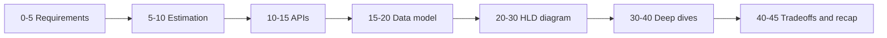

Use this spoken template: `I assume X users and Y QPS. If you want a different scale, I can adjust. I choose X over Y because it improves latency but costs consistency.`

**Common mistakes:**
- Drawing microservices before clarifying requirements.
- Optimizing for global scale when the interviewer asked for MVP.
- Ignoring failure cases and data consistency.

**Follow-ups:**
- *What if the interviewer interrupts?* → Adapt, but keep the same mental checklist.
- *Should I mention exact cloud products?* → Use generic components first, then map to AWS or Azure if helpful.

### Q2. What clarifying questions should I ask before designing?
`🟢 Beginner` `🔥` `Must-know SDE-1`

**Why they ask:** Good designers narrow ambiguous problems before choosing components.

**Short answer (say this first, 20-40 sec):**
Ask about users, core features, scale, read-write ratio, latency, availability, consistency, geography, data retention, security, and cost constraints. Then explicitly mark in-scope and out-of-scope items.

**Detailed answer:**
| Area | Questions |
|---|---|
| Users | Who uses it: consumers, admins, internal services? |
| Scale | DAU, peak QPS, data size, growth rate? |
| Reads vs writes | Is it read-heavy like feeds or write-sensitive like payments? |
| Latency | P50 and P99 target? Sync or async allowed? |
| Consistency | Strong, read-your-writes, or eventual consistency? |
| Availability | Single region, multi-AZ, multi-region? |
| Geography | Local, India-only, global users? |
| Security | AuthN, authZ, PII, encryption, audit logs? |
| Retention | TTL, archival, deletion, compliance? |
| Cost | Prefer managed services, cold storage, batching? |

For Mohd's Java/Spring profile, say: `I will expose REST APIs with Spring Boot, keep services stateless, use Redis where latency matters, and choose PostgreSQL or NoSQL based on access patterns.`

**Common mistakes:**
- Asking 20 questions but not using the answers.
- Forgetting non-functional requirements.
- Not defining explicit assumptions.

**Follow-ups:**
- *How many questions are enough?* → Ask 5-8 high-impact questions, then proceed with assumptions.
- *What if requirements conflict?* → Call out the tradeoff and ask which dimension is primary.

### Q3. What do interviewers score at SDE-1, SDE-2, and Senior levels?
`🟡 Intermediate` `🔥` `Must-know SDE-1`

**Why they ask:** The expected depth changes by level; you must calibrate your answer.

**Short answer (say this first, 20-40 sec):**
SDE-1 is scored on clean fundamentals and a workable design. SDE-2 is scored on bottlenecks, data modeling, scaling, and tradeoffs. Senior is scored on ambiguous requirements, organizational constraints, reliability, cost, migration, and failure-mode reasoning.

**Detailed answer:**
| Dimension | SDE-1 | SDE-2 | Senior |
|---|---|---|---|
| Requirements | Basic scope | Prioritizes scope | Handles ambiguity and product tradeoffs |
| Estimation | Rough QPS and storage | Peak load and capacity | Cost, growth, and migration planning |
| Components | LB, app, DB, cache, queue | Correct DB/cache/queue choices | Multi-region, DR, cost, ops |
| Data model | Tables and indexes | Partitioning and denormalization | Evolution, compliance, ownership |
| Reliability | Mentions retries and HA | Designs failover | SLOs, blast radius, incident response |
| Communication | Clear structure | Justifies tradeoffs | Drives conversation and alternatives |

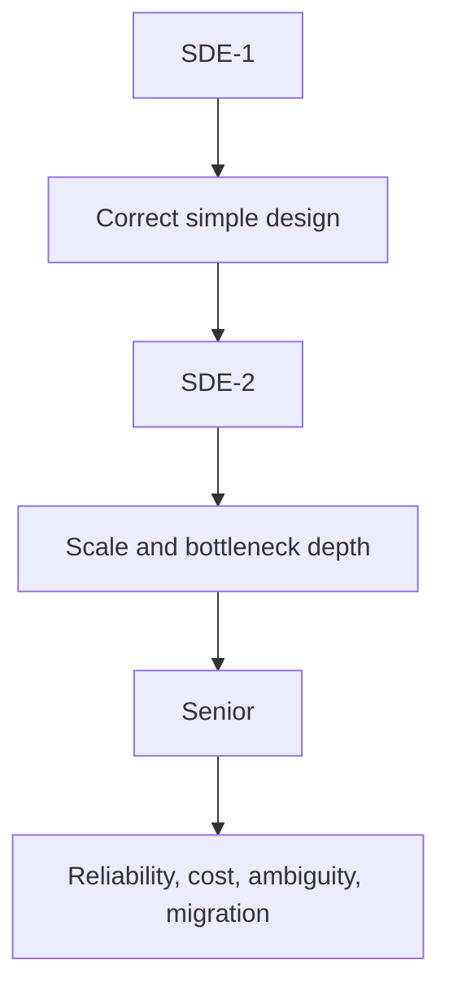

**Common mistakes:**
- Giving Senior-level complexity for an SDE-1 prompt.
- Not explaining why a component is chosen.
- Saying `Kafka solves scaling` without discussing ordering, retries, or consumers.

**Follow-ups:**
- *What is enough to pass SDE-1?* → Requirements, APIs, DB, HLD, one bottleneck, one failure case.
- *What is the fastest way to sound stronger?* → Explain tradeoffs with numbers and failure modes.

### Q4. How should I discuss tradeoffs out loud?
`🟡 Intermediate` `🔥` `Must-know SDE-1`

**Why they ask:** System design is mostly about choosing among imperfect options.

**Short answer (say this first, 20-40 sec):**
Use the sentence: `I choose X over Y because X optimizes for A, but the cost is B. If requirement C changes, I would switch to Y.` This shows you understand alternatives, not just components.

**Detailed answer:**
Common tradeoff dimensions:
- **Latency vs consistency:** cache and async writes reduce latency but may show stale data.
- **Availability vs strong consistency:** multi-region active-active is highly available but conflict-prone.
- **Storage vs compute:** precompute feeds for fast reads but consume more storage.
- **Cost vs reliability:** multi-region DR costs more but improves RTO.
- **Simplicity vs scale:** start with one SQL DB, move to sharding only when needed.

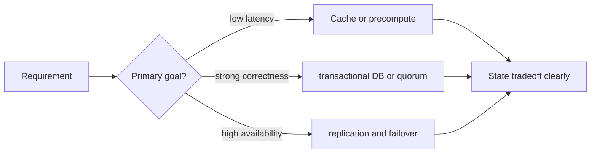

**Common mistakes:**
- Claiming one design is always best.
- Not revisiting assumptions after changing scale.
- Forgetting operational complexity.

**Follow-ups:**
- *How do I reject an alternative?* → State the rejected option and the requirement it fails.
- *Should I mention cost?* → Yes, especially for storage, egress, replicas, and queues.

## Part B · Back-of-the-envelope estimation

### Q5. What latency numbers and powers of two should I memorize?
`🟢 Beginner` `🔥` `Must-know SDE-1`

**Why they ask:** Estimation checks whether your design matches real-world scale.

**Short answer (say this first, 20-40 sec):**
Know rough orders of magnitude: memory is nanoseconds, SSD is tens to hundreds of microseconds, network within a region is sub-millisecond to a few milliseconds, cross-region is tens to hundreds of milliseconds. Memorize KB, MB, GB, TB powers of two and use powers of ten for fast interview math.

**Detailed answer:**
Approximate numbers for interviews, not hard guarantees:

| Operation | Typical order |
|---|---:|
| L1 cache reference | ~1 ns |
| RAM access | ~100 ns |
| SSD random read | ~100 microseconds |
| Same-AZ network call | ~0.5-2 ms |
| Cross-region network call | ~50-200 ms |
| HDD seek | ~5-10 ms |
| TLS + internet API call | tens to hundreds of ms |

| Unit | Power of 2 | Interview shortcut |
|---|---:|---:|
| 1 KB | 2^10 bytes | 10^3 |
| 1 MB | 2^20 bytes | 10^6 |
| 1 GB | 2^30 bytes | 10^9 |
| 1 TB | 2^40 bytes | 10^12 |
| 1 PB | 2^50 bytes | 10^15 |

Time conversions: day = 86,400 seconds, month ≈ 30 days, year ≈ 365 days.

**Common mistakes:**
- Using exact arithmetic and wasting time.
- Forgetting peak traffic is higher than average.
- Estimating storage but not bandwidth.

**Follow-ups:**
- *Should I use binary or decimal units?* → Use decimal shortcuts unless precision matters.
- *What if my numbers are off?* → State assumptions and focus on order of magnitude.

### Q6. What formulas cover most HLD capacity estimation?
`🟢 Beginner` `🔥` `Must-know SDE-1`

**Why they ask:** Capacity drives component choices like cache size, shard count, and queue throughput.

**Short answer (say this first, 20-40 sec):**
Estimate average QPS from requests per day divided by 86,400, peak QPS as 2-5 times average, storage as objects times object size times retention, bandwidth as QPS times response size, and server count as peak QPS divided by safe per-server QPS.

**Detailed answer:**
| Metric | Formula |
|---|---|
| Average QPS | daily requests / 86,400 |
| Peak QPS | average QPS × peak factor |
| Write storage | writes/day × record size × retention days |
| Read bandwidth | read QPS × average response size |
| Cache memory | hot keys × average value size × overhead factor |
| Servers | peak QPS / target QPS per instance, then add headroom |
| Partitions | data size or QPS / safe shard capacity |

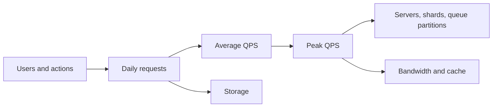

**Common mistakes:**
- Not showing math.
- Forgetting replication factor.
- Ignoring metadata and index overhead.

**Follow-ups:**
- *What peak factor should I use?* → 2x for stable enterprise load, 5-10x for social or ticketing spikes.
- *How much headroom?* → Commonly 30-50 percent for safe interview estimates.

### Q7. Work through five common estimation examples.
`🟡 Intermediate` `🔥` `Must-know SDE-1`

**Why they ask:** They want evidence you can size systems without a calculator.

**Short answer (say this first, 20-40 sec):**
I estimate reads, writes, storage, bandwidth, and hot cache. Then I use these numbers to justify cache, queue, partitioning, and database choices.

**Detailed answer:**
**Example 1: URL shortener**
- Assumption: 100M redirects/day, 1M new URLs/day, response 1 KB, mapping row 500 B, retention 5 years.
- Read QPS = 100M / 86,400 ≈ 1,160; peak ≈ 5,800.
- Write QPS = 1M / 86,400 ≈ 12; peak ≈ 60.
- Storage = 1M × 500 B × 365 × 5 ≈ 912 GB before replication and indexes.
- Conclusion: read-heavy, cache hot mappings, async analytics.

**Example 2: Chat app**
- 10M DAU, 50 messages/user/day = 500M messages/day.
- Write QPS ≈ 5,800 average, 29K peak.
- Message size 1 KB → 500 GB/day raw, with 3x replication ≈ 1.5 TB/day.
- Conclusion: append-friendly storage, partition by conversation, queue for fan-out.

**Example 3: News feed**
- 20M DAU, 20 feed opens/day = 400M reads/day → 4.6K avg, 23K peak.
- 2M creators post 2/day = 4M writes/day → 46 avg, 230 peak.
- Conclusion: read-heavy, precompute feeds for normal users, fan-out-on-read for celebrities.

**Example 4: Typeahead**
- 50M searches/day, each search 10 keystrokes → 500M suggestions/day.
- QPS ≈ 5.8K avg, 30K peak; response 5 KB → 150 MB/s peak.
- Conclusion: in-memory trie/FST cache, prefix shards, CDN not very useful for personalized queries.

**Example 5: Ticket booking**
- Sale event: 1M users in 10 min → 1,667 users/s.
- Each user polls seat map 5 times → 8.3K read QPS.
- Booking attempts 100K in 10 min → 167 write QPS but high contention.
- Conclusion: correctness is harder than QPS; use seat locks, DB unique constraints, idempotency.

**Common mistakes:**
- Treating average QPS as enough for flash-sale systems.
- Not separating read and write paths.
- Forgetting indexes, replication, and analytics storage.

**Follow-ups:**
- *Which number changes the design most?* → Peak write contention for booking, peak read QPS for feed and URL shortener.
- *When do you shard?* → When one node cannot handle storage, QPS, or write contention with headroom.

## Part C · Building Blocks 1-11

### Q8. How do DNS, reverse proxy, API gateway, and CDN fit at the system entry layer?
`🟢 Beginner` `🔥` `Must-know SDE-1`

**Why they ask:** Almost every HLD starts with request routing and edge components.

**Short answer (say this first, 20-40 sec):**
DNS maps a domain to an edge or load balancer. CDN serves static or cacheable content near users. A reverse proxy or load balancer routes traffic to services. An API gateway centralizes auth, rate limiting, routing, request validation, and sometimes protocol translation.

**Detailed answer:**
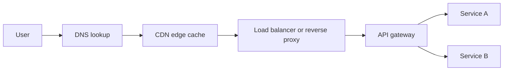

| Component | Main job | Use when |
|---|---|---|
| DNS | Name resolution and geo routing | Any public system |
| CDN | Cache static/media/public responses | Images, JS, videos, downloads |
| Reverse proxy | TLS termination, routing, compression | Web/API front door |
| API gateway | Auth, rate limit, API aggregation | Many services or public APIs |

CDN push means origin uploads content to CDN ahead of time. CDN pull means CDN fetches on first miss and caches.

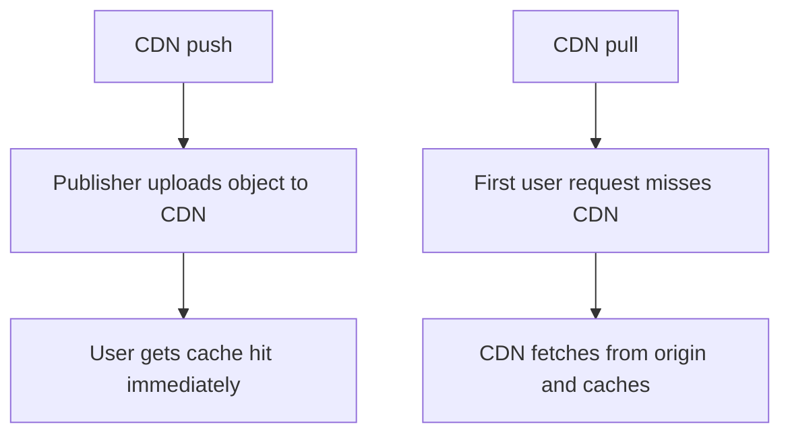

**Common mistakes:**
- Putting private personalized APIs behind a public CDN without cache rules.
- Treating API gateway and load balancer as identical.
- Forgetting TLS termination and WAF/DDoS protection.

**Follow-ups:**
- *When not to use CDN?* → Highly personalized, non-cacheable, or very small internal APIs.
- *Where does authentication happen?* → Often at API gateway, with service-level authorization still enforced.

### Q9. What is the difference between L4 and L7 load balancing?
`🟡 Intermediate` `🔥` `Must-know SDE-1`

**Why they ask:** Load balancing choice affects latency, routing flexibility, and protocol behavior.

**Short answer (say this first, 20-40 sec):**
L4 load balancers route by IP and port using TCP/UDP information, so they are fast and protocol-agnostic. L7 load balancers inspect HTTP metadata like path, host, headers, or cookies, so they support smarter routing but add more processing.

**Detailed answer:**
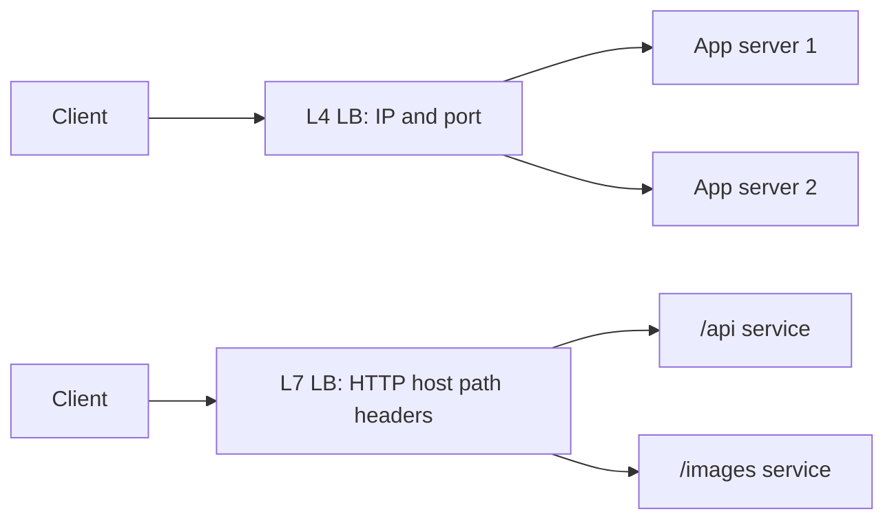

| Feature | L4 | L7 |
|---|---|---|
| Layer | Transport | Application |
| Routing | IP, port, connection | Host, path, header, cookie |
| Speed | Usually faster | More CPU work |
| Use | TCP, UDP, raw performance | HTTP APIs, canary, path routing |
| Algorithms | round robin, least connections, hash | same plus content-aware routing |

Consistent hashing routes a key to a stable backend, useful for caches.

**Common mistakes:**
- Saying L7 is always better.
- Forgetting health checks.
- Using sticky sessions instead of stateless services without justification.

**Follow-ups:**
- *What is least connections?* → Send new traffic to server with fewest active connections.
- *What about sticky sessions?* → Avoid unless session state cannot be externalized to Redis or DB.

### Q10. How do vertical scaling, horizontal scaling, stateless services, sticky sessions, and autoscaling relate?
`🟢 Beginner` `🔥` `Must-know SDE-1`

**Why they ask:** Basic scaling vocabulary must be clear before advanced designs.

**Short answer (say this first, 20-40 sec):**
Vertical scaling means bigger machines; horizontal scaling means more machines. Stateless services are easier to horizontally scale because any instance can handle any request. Sticky sessions pin users to one server but reduce flexibility. Autoscaling adds or removes instances based on load.

**Detailed answer:**
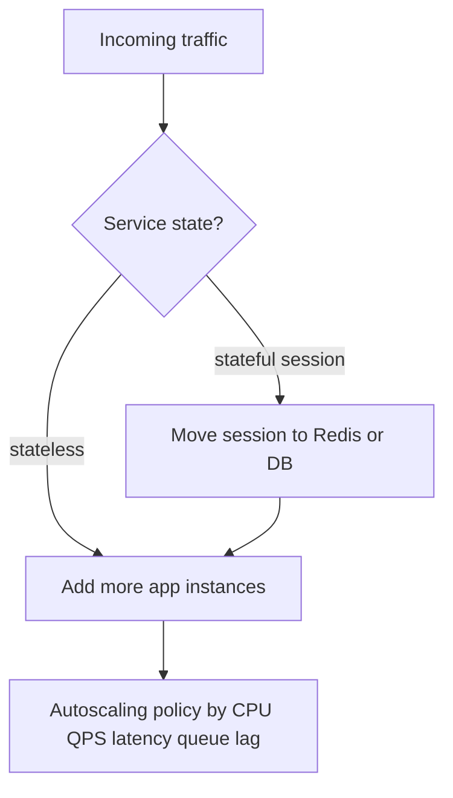

| Strategy | Pros | Cons |
|---|---|---|
| Vertical scaling | Simple, no distribution | Hardware limit, bigger blast radius |
| Horizontal scaling | Elastic, resilient | Needs statelessness, LB, shared data |
| Sticky sessions | Easy for legacy sessions | Uneven load, hard failover |
| Autoscaling | Cost efficient | Cold starts, bad metrics can oscillate |

**Common mistakes:**
- Keeping user sessions in app memory.
- Autoscaling only on CPU while queue lag or P99 latency is the real signal.
- Ignoring DB as the next bottleneck.

**Follow-ups:**
- *How do you make Spring Boot stateless?* → JWT or opaque token plus external session/cache, no in-memory user state.
- *What is scale-in risk?* → Killing instances with in-flight requests; use graceful shutdown.

### Q11. How do cache-aside, write-through, write-back, eviction, invalidation, stampede, and hot keys work?
`🟡 Intermediate` `🔥` `Must-know SDE-1`

**Why they ask:** Caching is the most common low-latency design lever and the most common source of bugs.

**Short answer (say this first, 20-40 sec):**
Cache-aside lets the app read cache first and load from DB on miss. Write-through writes cache and DB synchronously. Write-back writes cache first and flushes later, improving write latency but risking data loss. Hard parts are invalidation, stampedes, hot keys, and consistency.

**Detailed answer:**
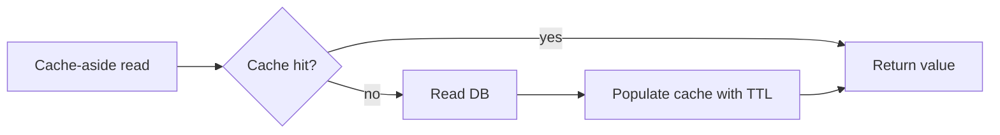

| Pattern | Write path | Best for | Risk |
|---|---|---|---|
| Cache-aside | App updates DB then evicts cache | Read-heavy apps | stale reads on bad invalidation |
| Write-through | App writes cache and DB | Stronger cache freshness | higher write latency |
| Write-back | App writes cache, async DB flush | High write volume | data loss if cache fails |
| Refresh-ahead | Cache refreshes before expiry | predictable hot keys | wasted work |

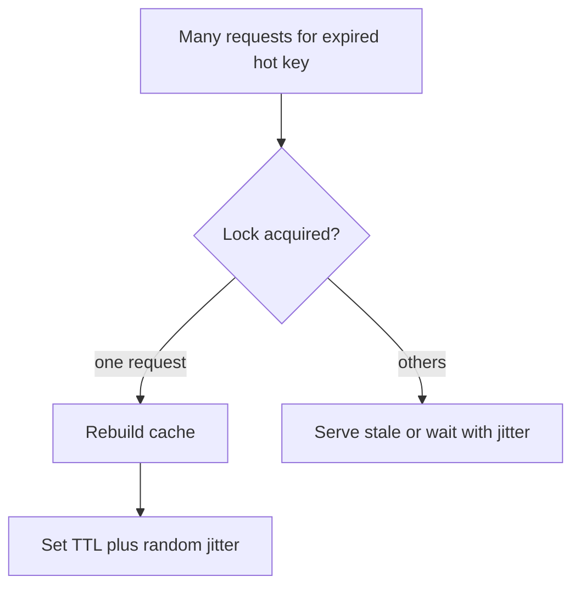

Mitigations: TTL jitter, single-flight locks, stale-while-revalidate, request coalescing, local cache for very hot keys, key salting for write-hot counters.

**Common mistakes:**
- Cache without TTL or invalidation plan.
- Caching large unbounded values.
- Using Redis as the source of truth for critical data without persistence design.

**Follow-ups:**
- *How do you invalidate cache after DB update?* → Delete cache after successful DB commit; use outbox/CDC for distributed invalidation.
- *What is cache penetration?* → Repeated misses for nonexistent keys; use null caching or Bloom filters.

### Q12. How do SQL and NoSQL choices map to access patterns?
`🟢 Beginner` `🔥` `Must-know SDE-1`

**Why they ask:** Database choice is a core HLD decision.

**Short answer (say this first, 20-40 sec):**
Use SQL when you need transactions, joins, relational constraints, and flexible queries. Use NoSQL when access patterns are known and you need high scale, flexible schema, low-latency key access, wide rows, graph traversal, time-series ingestion, or full-text search.

**Detailed answer:**
| Store | Example use | Strength | Weakness |
|---|---|---|---|
| SQL | orders, tickets, payments | ACID, joins, constraints | horizontal sharding harder |
| Key-value | sessions, cache, feature flags | very low-latency lookup | limited queries |
| Document | profiles, product catalogs | flexible JSON | joins weaker |
| Wide-column | chat messages, time-series events | massive writes | query-model driven |
| Graph | social graph, fraud links | relationship traversal | expensive at huge scale |
| Search | autocomplete, logs search | inverted index, ranking | not source of truth |
| Time-series | metrics, IoT | time-window queries | limited entity joins |

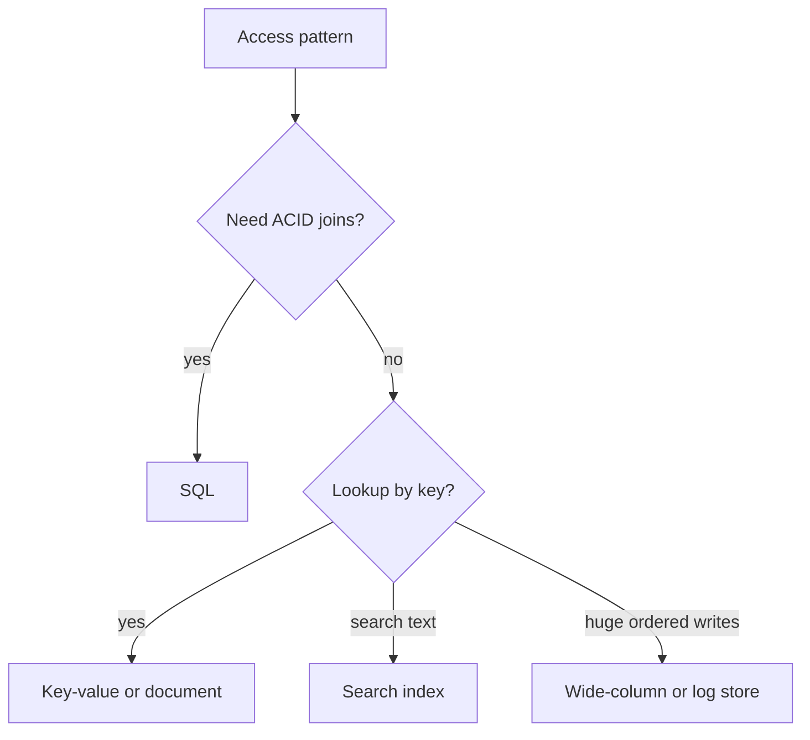

**Common mistakes:**
- Choosing NoSQL just because the system is large.
- Forgetting indexes and query patterns.
- Using Elasticsearch as primary transactional DB.

**Follow-ups:**
- *Where does PostgreSQL fit Mohd's projects?* → Great for transactional data and pgvector-backed semantic retrieval when scale is moderate.
- *When denormalize?* → When read paths are hot and joins become a bottleneck.

### Q13. How do indexing and denormalization improve reads, and what do they cost?
`🟡 Intermediate` `🔥` `Must-know SDE-1`

**Why they ask:** Candidates often say `add index` without explaining internals or write cost.

**Short answer (say this first, 20-40 sec):**
An index is an extra data structure, often B-Tree based, that lets the DB find rows without scanning the whole table. It speeds reads but increases storage and write overhead. Denormalization stores duplicated read-optimized data, reducing joins at the cost of consistency complexity.

**Detailed answer:**
```sql
-- PostgreSQL example
CREATE INDEX idx_messages_conversation_created
ON messages (conversation_id, created_at DESC);
```

| Technique | Improves | Cost |
|---|---|---|
| Single-column index | equality/range filter | write amplification |
| Composite index | multi-column filters and sort | order matters |
| Covering index | avoids table lookup | more storage |
| Denormalized table | fast read path | duplicated updates |
| Materialized view | precomputed query | refresh lag |

For a chat table, `(conversation_id, created_at DESC)` supports `get latest messages for conversation` better than indexing `created_at` alone.

**Common mistakes:**
- Indexing every column.
- Ignoring composite index order.
- Denormalizing without a repair or reconciliation job.

**Follow-ups:**
- *How do indexes slow writes?* → Every insert/update/delete must update index pages too.
- *How do you keep denormalized data correct?* → Transactional updates if possible, otherwise outbox events plus idempotent consumers.

### Q14. How do leader-follower, multi-leader, and leaderless replication differ?
`🟡 Intermediate` `🔥` `Must-know SDE-1`

**Why they ask:** Replication affects read scaling, failover, and consistency.

**Short answer (say this first, 20-40 sec):**
Leader-follower sends writes to one leader and replicates to read replicas. Multi-leader allows writes in multiple regions but must resolve conflicts. Leaderless replication writes to multiple replicas directly and uses quorums to tolerate failures.

**Detailed answer:**
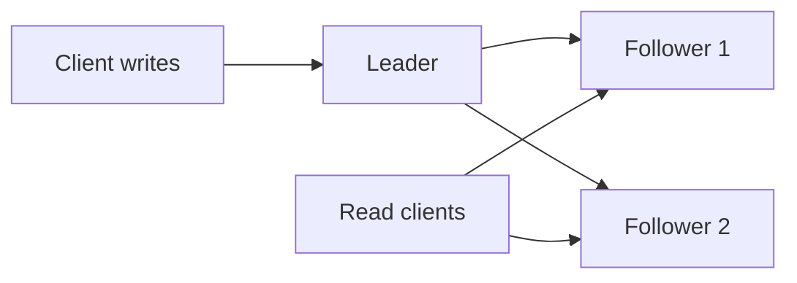

| Model | Best for | Main risk |
|---|---|---|
| Leader-follower | simple read scaling | replication lag, leader failover |
| Multi-leader | multi-region writes | conflicts and convergence |
| Leaderless | high availability writes | read repair, quorum tuning |

Replication can be synchronous or asynchronous. Async improves latency but may lose recent writes if the leader dies before replication.

**Common mistakes:**
- Assuming replicas are always up to date.
- Sending read-after-write traffic to stale followers.
- Ignoring failover split brain.

**Follow-ups:**
- *How to provide read-your-writes?* → Read from leader after writes, use session stickiness to same region, or wait for replica LSN.
- *What is replication lag?* → Delay between leader commit and follower applying the change.

### Q15. How do partitioning and sharding strategies compare?
`🟡 Intermediate` `🔥` `Must-know SDE-1`

**Why they ask:** Sharding is the usual next step when one database cannot handle data or QPS.

**Short answer (say this first, 20-40 sec):**
Range sharding groups nearby keys and supports range scans but can create hot partitions. Hash sharding spreads load evenly but range queries are expensive. Directory sharding uses a lookup service for flexible placement but adds complexity.

**Detailed answer:**
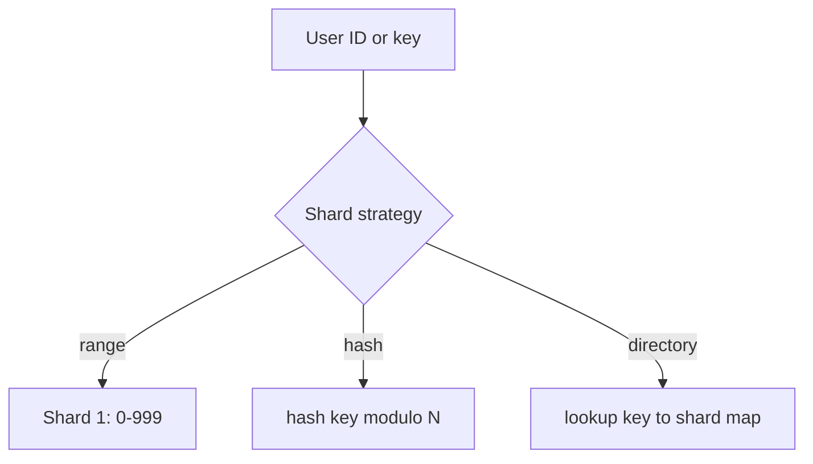

| Strategy | Pros | Cons |
|---|---|---|
| Range | range scans, simple reasoning | hot ranges, manual splits |
| Hash | even distribution | hard range queries, resharding |
| Directory | flexible moves, custom placement | extra lookup, metadata HA |

Shard key properties: high cardinality, stable, present in most queries, evenly distributed, avoids hot tenants.

**Common mistakes:**
- Sharding before indexing and caching.
- Choosing date as shard key for write-heavy traffic, causing hot latest shard.
- Cross-shard joins in hot paths.

**Follow-ups:**
- *How do you handle hot partitions?* → Better shard key, salting, split hot shard, cache, or route celebrity traffic specially.
- *How do you reshard?* → Dual-write or backfill, route with shard map, verify, then cut over.

### Q16. How does consistent hashing with virtual nodes work?
`🔴 Advanced` `🔥` `Stretch`

**Why they ask:** It is common in caches, distributed stores, and load balancing.

**Short answer (say this first, 20-40 sec):**
Consistent hashing maps both keys and nodes onto a ring. A key belongs to the first node clockwise. When a node is added or removed, only nearby keys move. Virtual nodes place multiple positions per physical node to smooth load imbalance.

**Detailed answer:**
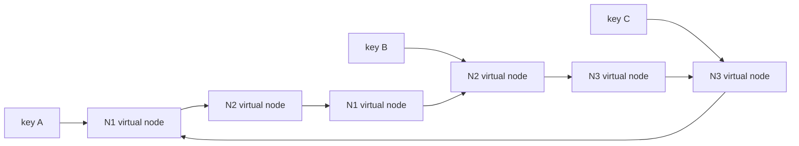

Without virtual nodes, one physical node may own a large ring range. With 100-200 virtual nodes per server, ownership becomes smoother, and adding a stronger server can mean assigning more virtual nodes.

**Common mistakes:**
- Thinking no keys move during membership changes.
- Forgetting replication factor on the ring.
- Not handling node health and gossip membership.

**Follow-ups:**
- *Where is this used?* → Distributed caches, Dynamo-style stores, Cassandra-like partitioning.
- *How do you replicate?* → Store key on first N distinct physical nodes clockwise.

### Q17. How do B-Trees and LSM Trees differ inside storage engines?
`🔴 Advanced` `🔥` `Stretch`

**Why they ask:** Storage internals explain why SQL DBs and log-structured stores behave differently.

**Short answer (say this first, 20-40 sec):**
B-Trees update sorted pages in place and are great for point and range reads. LSM Trees write to a memory table and WAL first, flush immutable SSTables, and compact later, making writes fast but reads and compaction more complex.

**Detailed answer:**
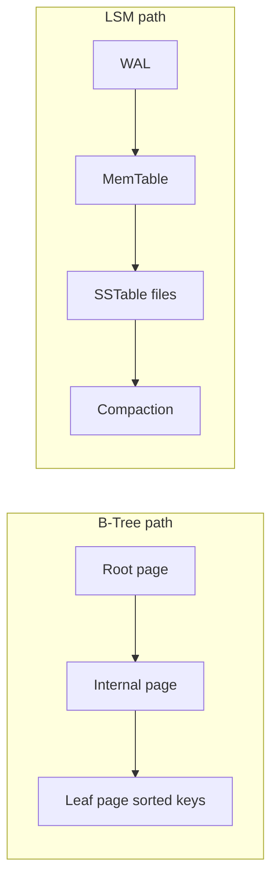

| Feature | B-Tree | LSM Tree |
|---|---|---|
| Writes | update pages | append WAL, flush later |
| Reads | efficient point/range | may check memtable and SSTables |
| Space | less write amplification | compaction and tombstones |
| Examples | PostgreSQL, MySQL InnoDB indexes | RocksDB, Cassandra-like engines |
| Helpers | page cache | Bloom filters, compaction |

**Common mistakes:**
- Saying LSM is always faster.
- Ignoring compaction impact on latency.
- Forgetting WAL exists in both many designs for durability.

**Follow-ups:**
- *What is a Bloom filter used for?* → Quickly says a key is definitely absent from an SSTable.
- *Why are range scans good in B-Trees?* → Leaf pages are sorted and linked or navigable.

### Q18. How should object storage be used for blobs, chunks, multipart uploads, and presigned URLs?
`🟡 Intermediate` `🔥` `Must-know SDE-1`

**Why they ask:** Many systems store large files outside the primary database.

**Short answer (say this first, 20-40 sec):**
Store large blobs in object storage like S3 or Azure Blob, and keep metadata in a database. Use chunking and multipart upload for large files, deduplication by content hash when useful, and presigned URLs so clients upload/download directly without passing bytes through app servers.

**Detailed answer:**
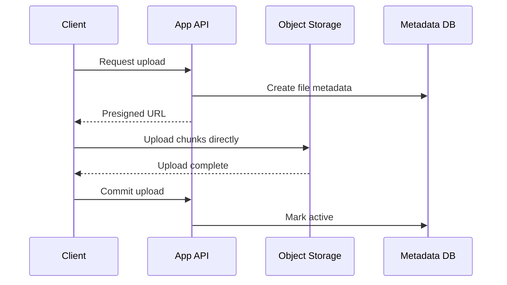

| Technique | Why |
|---|---|
| Chunking | resume failed uploads, parallelism |
| Multipart upload | upload large objects efficiently |
| Deduplication | save storage for identical content |
| Presigned URL | app controls auth, storage handles bytes |
| Lifecycle tiers | move old objects to cheaper cold storage |

**Common mistakes:**
- Storing large files as DB BLOBs by default.
- Not validating upload completion and file type.
- Exposing permanent public object URLs for private files.

**Follow-ups:**
- *How do you serve downloads fast?* → CDN in front of object storage, signed URLs for private content.
- *How do you delete safely?* → Soft-delete metadata, async object deletion, lifecycle policy.

### Q19. Queue vs pub/sub vs log: when do you choose each messaging model?
`🟡 Intermediate` `🔥` `Must-know SDE-1`

**Why they ask:** Async processing appears in almost every scalable design.

**Short answer (say this first, 20-40 sec):**
Use a queue when each task should be processed by one worker. Use pub/sub when many independent subscribers should receive the same event. Use a durable log like Kafka when you need replay, ordered partitions, high throughput, and consumer groups.

**Detailed answer:**
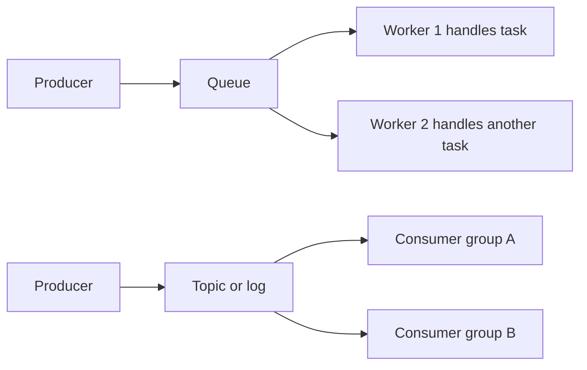

| Model | Delivery | Use case |
|---|---|---|
| Queue | one consumer per message | email jobs, thumbnail generation |
| Pub/sub | all subscribers get event | notifications, cache invalidation |
| Log | durable ordered partitions | analytics, event sourcing, replay |

Consider delivery semantics: at-most-once may lose messages, at-least-once may duplicate messages, exactly-once is usually limited and still needs idempotent consumers.

**Common mistakes:**
- Ignoring retries and DLQ.
- Assuming global ordering in Kafka; ordering is per partition.
- Not planning backpressure when consumers are slow.

**Follow-ups:**
- *How do you handle duplicates?* → Idempotency keys, processed-event table, or deterministic writes.
- *What is a DLQ?* → Dead-letter queue for messages that repeatedly fail.

### Q20. How do consistency models, CAP, PACELC, quorum, vector clocks, LWW, and CRDTs fit together?
`🔴 Advanced` `🔥` `Stretch`

**Why they ask:** Distributed systems require explicit consistency tradeoffs.

**Short answer (say this first, 20-40 sec):**
Strong consistency returns the latest committed value but may reduce availability or increase latency. Eventual consistency returns quickly and converges later. CAP says under a network partition you choose consistency or availability. PACELC adds that even else, during normal operation, you trade latency against consistency.

**Detailed answer:**
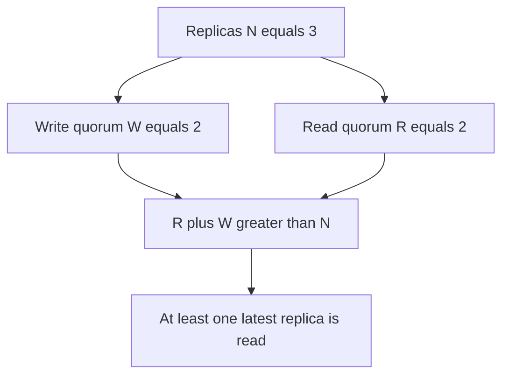

| Concept | Meaning |
|---|---|
| Strong | every read sees latest committed write |
| Eventual | replicas converge if writes stop |
| Causal | causally related operations preserve order |
| Quorum | read/write from enough replicas, commonly R + W > N |
| Vector clock | track causality across replicas |
| LWW | latest timestamp wins, simple but can lose updates |
| CRDT | data type designed to merge without conflicts |

**Common mistakes:**
- Saying CAP means choose two forever; partition tolerance is required in distributed systems.
- Forgetting clock skew breaks naive LWW.
- Ignoring user-visible anomalies.

**Follow-ups:**
- *When use eventual consistency?* → Feeds, counters, analytics, likes where slight staleness is acceptable.
- *When require strong consistency?* → Payments, seat booking, inventory decrement, permissions.

### Q21. How do leader election and Raft consensus work at a high level?
`🔴 Advanced` `🔥` `Stretch`

**Why they ask:** Coordination systems like ZooKeeper and etcd rely on consensus basics.

**Short answer (say this first, 20-40 sec):**
Raft elects one leader that accepts writes, replicates log entries to followers, and commits when a majority acknowledges. If followers stop receiving heartbeats, they start an election. Majority voting prevents two leaders from safely committing conflicting entries in the same term.

**Detailed answer:**
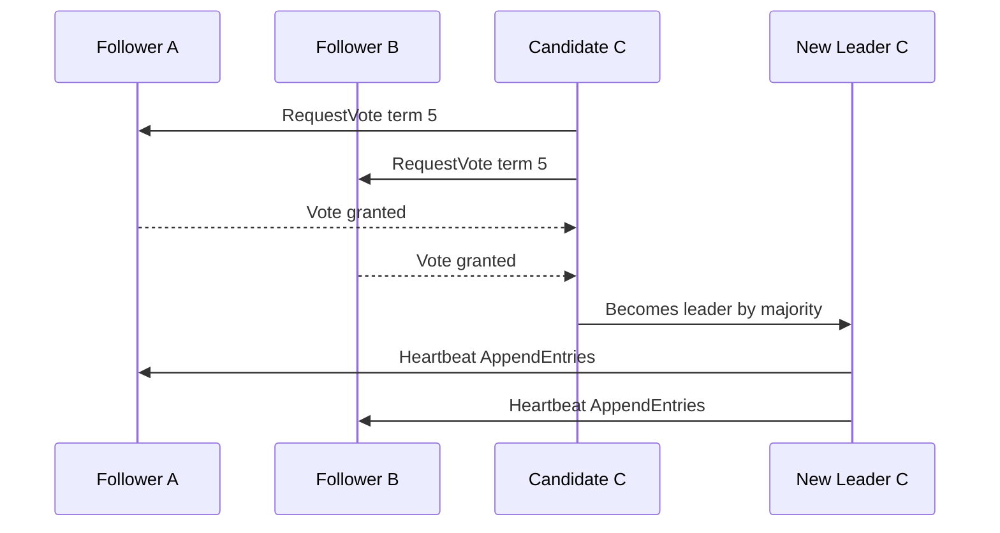

Coordination components:
- **ZooKeeper/etcd:** store small critical metadata, leader election, config, locks.
- **Heartbeats:** detect failures but can be fooled by pauses and network delays.
- **Gossip:** scalable membership dissemination.
- **Split brain:** two nodes think they are leader; fencing tokens help protect resources.

**Common mistakes:**
- Using distributed locks for everything.
- Ignoring lock lease expiry and clock issues.
- Treating heartbeat timeout as proof of death rather than suspicion.

**Follow-ups:**
- *What is a fencing token?* → Monotonic token checked by resource to reject stale lock holders.
- *Why majority?* → Any two majorities overlap, preserving committed state.

### Q22. When should I use distributed locks, gossip, and heartbeats?
`🟡 Intermediate` `🔥` `Must-know SDE-1`

**Why they ask:** Coordination primitives are powerful but easy to misuse.

**Short answer (say this first, 20-40 sec):**
Use distributed locks sparingly for short critical sections where duplicate work is harmful. Use heartbeats for failure detection and gossip for scalable membership and state spread. For correctness-critical operations, prefer database constraints or consensus-backed locks over best-effort cache locks.

**Detailed answer:**
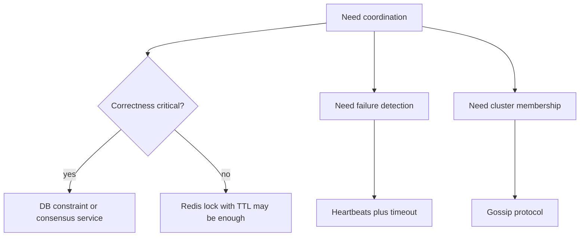

Guidelines:
- Lock has owner id, TTL, renewal, and safe release check.
- Critical writes still need idempotency or unique constraints.
- Heartbeat timeout must include GC pauses and network jitter.
- Gossip is eventually consistent; do not use it for strict decisions alone.

**Common mistakes:**
- Releasing another client's expired lock.
- Holding locks while doing slow external calls.
- Not making the protected operation idempotent.

**Follow-ups:**
- *Can Redis locks guarantee correctness?* → Only with careful algorithms and still not equivalent to a transactional DB constraint.
- *What is split brain?* → Network partition makes multiple nodes believe they own leadership.

## Additional Building Block Interview Drills

### Q23. When should an API gateway do authentication, routing, rate limiting, and aggregation?
`🟡 Intermediate` `🔥` `Must-know SDE-1`

**Why they ask:** Gateway responsibilities are often overused or confused with business logic.

**Short answer (say this first, 20-40 sec):**
Use the gateway for cross-cutting edge concerns: authN, coarse authZ, rate limiting, routing, TLS termination, request validation, and API composition when it reduces client round trips. Keep domain rules inside services.

**Detailed answer:**
```mermaid
flowchart LR
    C["Client"] --> G["Gateway"]
    G --> A["Auth and rate limit"]
    A --> R["Route by path or header"]
    R --> S1["Service 1"]
    R --> S2["Service 2"]
```
Gateway aggregation is useful for mobile clients but can become a bottleneck; cache stable responses and avoid putting business transactions there.

**Common mistakes:**
- Putting order/payment business logic in gateway.
- Making gateway a single point of failure.
- Skipping service-level authorization.

**Follow-ups:**
- *Gateway vs service mesh?* → Gateway handles north-south traffic; mesh handles service-to-service traffic.
- *Where implement fine-grained authZ?* → In the owning service.

### Q24. How do you remove sticky sessions from a stateful web application?
`🟡 Intermediate` `🔥` `Must-know SDE-1`

**Why they ask:** Statelessness is the prerequisite for horizontal scaling.

**Short answer (say this first, 20-40 sec):**
Move session state out of app memory into Redis, database, or signed tokens. Then any app instance can serve any request, enabling normal load balancing and graceful failover.

**Detailed answer:**
```mermaid
flowchart LR
    U["User"] --> LB["Load balancer"]
    LB --> A1["App instance 1"]
    LB --> A2["App instance 2"]
    A1 --> R["External session store"]
    A2 --> R
```
For Spring Boot, prefer stateless JWT for simple auth or Spring Session backed by Redis when server-side revocation is needed.

**Common mistakes:**
- Storing carts only in one app node's memory.
- Using JWT for sensitive mutable state.
- Not handling logout/revocation.

**Follow-ups:**
- *JWT downside?* → Revocation and token size.
- *Redis session downside?* → Extra network hop and Redis availability dependency.

### Q25. How do cache invalidation strategies compare for product or profile data?
`🟡 Intermediate` `🔥` `Must-know SDE-1`

**Why they ask:** Cache correctness is a common production problem.

**Short answer (say this first, 20-40 sec):**
Common strategies are TTL-only, delete-on-write, write-through, and event-driven invalidation. TTL-only is simple but stale. Delete-on-write is common with cache-aside. Event-driven invalidation scales across services but needs reliable delivery.

**Detailed answer:**
```mermaid
sequenceDiagram
    participant A as App
    participant D as DB
    participant R as Redis
    participant Q as Event Bus
    A->>D: Update product
    D-->>A: Commit success
    A->>R: Delete product cache
    A->>Q: Publish ProductUpdated
```
For critical data, update DB first, then invalidate cache. If invalidation event is lost, TTL is a safety net.

**Common mistakes:**
- Updating cache before DB commit.
- No fallback TTL.
- Forgetting local in-process caches.

**Follow-ups:**
- *What is stale-while-revalidate?* → Serve stale value briefly while one worker refreshes it.
- *How handle failed cache delete?* → Retry via outbox or rely on short TTL for eventual repair.

### Q26. How do read-your-writes and monotonic reads work with replicas?
`🔴 Advanced` `🔥` `Stretch`

**Why they ask:** Replica lag creates user-visible consistency bugs.

**Short answer (say this first, 20-40 sec):**
Read-your-writes means after I update data, my later reads see it. Monotonic reads mean once I have seen a version, I do not later see an older version. Achieve this by reading from leader, session stickiness, or waiting for replica catch-up.

**Detailed answer:**
```mermaid
flowchart LR
    W["User writes to leader"] --> L["Leader"]
    L --> F["Follower with lag"]
    R1["Immediate read"] --> L
    R2["Later stale read risk"] --> F
```
Store last seen commit timestamp/LSN in session; route reads to replicas that have applied at least that LSN.

**Common mistakes:**
- Sending profile update confirmation then reading stale replica.
- Assuming async replicas are current.
- Not measuring replication lag.

**Follow-ups:**
- *When is stale read acceptable?* → Feeds, analytics, counters.
- *When not acceptable?* → Permissions, payments, bookings.

### Q27. How do hot partitions happen and how do you fix them?
`🟡 Intermediate` `🔥` `Must-know SDE-1`

**Why they ask:** Sharding can fail even when total capacity seems enough.

**Short answer (say this first, 20-40 sec):**
A hot partition occurs when one shard receives disproportionate reads or writes due to a poor shard key, celebrity tenant, or time-based key. Fix it with better keys, salting, splitting, caching, or special-case routing for hot entities.

**Detailed answer:**
| Cause | Fix |
|---|---|
| date shard for latest writes | add hash bucket inside date |
| celebrity user | separate celebrity shard or fan-out-on-read |
| single hot counter | sharded counters |
| skewed tenant | tenant-aware placement |

**Common mistakes:**
- Looking only at cluster average CPU.
- Picking sequential IDs as shard keys for writes.
- Cross-shard transactions on hot path.

**Follow-ups:**
- *What is salting?* → Add random/hash suffix to spread one logical key across buckets.
- *How read salted data?* → Read all salt buckets and aggregate.

### Q28. How do WAL, SSTables, compaction, and Bloom filters work together in LSM storage?
`🔴 Advanced` `🔥` `Stretch`

**Why they ask:** It explains write-heavy stores like Cassandra/RocksDB at interview depth.

**Short answer (say this first, 20-40 sec):**
Writes append to WAL for durability and update an in-memory memtable. When full, the memtable flushes to immutable SSTables. Compaction merges SSTables and removes old versions/tombstones. Bloom filters avoid checking SSTables that definitely do not contain a key.

**Detailed answer:**
```mermaid
flowchart LR
    W["Write"] --> WAL["Append WAL"]
    WAL --> M["MemTable"]
    M --> S1["Flush SSTable"]
    S1 --> C["Compaction"]
    C --> S2["Larger sorted SSTable"]
    BF["Bloom filter"] --> S1
```

**Common mistakes:**
- Ignoring tombstone buildup.
- Forgetting compaction can cause latency spikes.
- Assuming reads touch only one file.

**Follow-ups:**
- *Why append writes are fast?* → Sequential disk writes avoid random page updates.
- *What is read amplification?* → Reads may check multiple SSTables before finding the latest value.

### Q29. How do presigned URLs protect application servers during uploads?
`🟢 Beginner` `🔥` `Must-know SDE-1`

**Why they ask:** It is the standard scalable pattern for large files.

**Short answer (say this first, 20-40 sec):**
The app authenticates the user and returns a short-lived upload URL scoped to one object. The client uploads directly to object storage, so app servers avoid handling large byte streams.

**Detailed answer:**
```mermaid
sequenceDiagram
    participant C as Client
    participant A as App
    participant O as Object Store
    C->>A: request upload for file
    A-->>C: presigned URL
    C->>O: PUT file bytes
    C->>A: complete upload
```
Validate content type/size, scan asynchronously, and mark metadata active only after completion.

**Common mistakes:**
- Creating URLs that never expire.
- Trusting client-provided MIME type only.
- Serving private files with public URLs.

**Follow-ups:**
- *How support resume?* → Multipart upload with part ETags.
- *How delete orphan uploads?* → Lifecycle cleanup and pending-upload TTL.

### Q30. How do retries, backpressure, and DLQs prevent queue failures from becoming outages?
`🟡 Intermediate` `🔥` `Must-know SDE-1`

**Why they ask:** Async systems fail when slow consumers are ignored.

**Short answer (say this first, 20-40 sec):**
Retries handle transient failures, backpressure slows producers or scales consumers when lag grows, and DLQs isolate poison messages after repeated failures. Consumers must be idempotent because retries can duplicate work.

**Detailed answer:**
```mermaid
flowchart LR
    P["Producer"] --> Q["Queue"]
    Q --> C["Consumer"]
    C -->|"transient fail"| R["Retry with backoff"]
    C -->|"repeated fail"| D["DLQ"]
    Q --> M["Lag metric triggers autoscale"]
```

**Common mistakes:**
- Infinite immediate retries.
- No visibility into consumer lag.
- DLQ never monitored.

**Follow-ups:**
- *What is poison message?* → A message that always fails due to bad data or code bug.
- *How avoid duplicate effects?* → Idempotency key or processed-event table.

### Q31. How do vector clocks and conflict resolution appear in real systems?
`🔴 Advanced` `🔥` `Stretch`

**Why they ask:** Conflict handling separates eventual consistency from hand-waving.

**Short answer (say this first, 20-40 sec):**
Vector clocks track which replica versions causally preceded another. If versions are concurrent, the system must merge or choose a winner. LWW is simple but can lose writes; CRDTs merge certain data types safely.

**Detailed answer:**
| Conflict method | Good for | Risk |
|---|---|---|
| LWW | profiles where last edit wins | clock skew, lost update |
| manual merge | documents/carts | user complexity |
| CRDT set/counter | likes, counters, collaborative state | data-type limits |
| vector clock | detect concurrency | metadata overhead |

**Common mistakes:**
- Saying eventual consistency means no conflicts.
- Using timestamps as absolute truth.
- Not exposing conflict resolution in product behavior.

**Follow-ups:**
- *Where use CRDT?* → Counters, sets, collaborative editing components.
- *Where avoid LWW?* → Payments, inventory, seat booking.

### Q32. What is split brain and how do fencing tokens prevent stale leaders?
`🔴 Advanced` `🔥` `Stretch`

**Why they ask:** Leader election without fencing can corrupt shared resources.

**Short answer (say this first, 20-40 sec):**
Split brain occurs when multiple nodes believe they are leader, often due to network partition. Fencing tokens are monotonically increasing values issued with leadership; downstream resources reject writes with older tokens.

**Detailed answer:**
```mermaid
flowchart LR
    L1["Old leader token 7"] --> R["Shared resource"]
    L2["New leader token 8"] --> R
    R --> D{"Accept highest token only"}
    D -->|"token 8"| A["accept"]
    D -->|"token 7"| B["reject stale write"]
```

**Common mistakes:**
- Assuming lock expiry stops an old process immediately.
- No token check at the actual resource.
- Long GC pause causing stale owner to resume.

**Follow-ups:**
- *Where enforce fencing?* → Database row, storage system, or service receiving writes.
- *Is heartbeat enough?* → No; heartbeat detects suspicion, not exclusive authority.

### Q33. How do DB read replicas change API design and routing?
`🟡 Intermediate` `🔥` `Must-know SDE-1`

**Why they ask:** Read scaling often introduces consistency surprises.

**Short answer (say this first, 20-40 sec):**
Read replicas scale read-heavy endpoints, but APIs must know which reads tolerate lag. Critical read-after-write paths should read from leader or a caught-up replica; public browsing and analytics can use replicas.

**Detailed answer:**
```mermaid
flowchart TD
    API["API request"] --> B{"Needs fresh read?"}
    B -->|"yes"| L["Leader DB"]
    B -->|"no"| R["Read replica"]
```
Annotate repository methods or service calls by consistency level: `STRONG`, `SESSION`, or `EVENTUAL`.

**Common mistakes:**
- Sending login permission checks to stale replica.
- Not handling replica failover.
- Creating replica lag with heavy analytical queries.

**Follow-ups:**
- *How monitor lag?* → Replica apply delay or last replayed LSN.
- *How isolate analytics?* → Separate analytics replica or warehouse.

### Q34. How do database migrations work safely in a high-traffic system?
`🟡 Intermediate` `🔥` `Must-know SDE-1`

**Why they ask:** Schema evolution is a practical HLD concern.

**Short answer (say this first, 20-40 sec):**
Use expand-and-contract: add backward-compatible schema first, deploy code that writes both or reads both, backfill gradually, switch reads, then remove old schema later. Avoid long blocking migrations.

**Detailed answer:**
Steps: add nullable column/table, deploy dual-write, backfill in batches, verify counts, switch reads, stop old writes, drop old column in later release.

**Common mistakes:**
- Dropping/renaming columns before old code is gone.
- One massive backfill transaction.
- No rollback plan.

**Follow-ups:**
- *How backfill safely?* → Small batches with rate limit and checkpoints.
- *How verify?* → Compare counts/checksums and monitor errors.

### Q35. How do you design cache keys and TTLs?
`🟢 Beginner` `🔥` `Must-know SDE-1`

**Why they ask:** Bad keys cause collisions, stale data, and hard invalidation.

**Short answer (say this first, 20-40 sec):**
Cache keys should include entity type, id, version or tenant, and query parameters that change the response. TTL should match freshness needs and origin load tolerance, with jitter to avoid synchronized expiry.

**Detailed answer:**
Examples: `user:v2:tenant42:profile:123`, `feed:v1:user123:page1`. Add random TTL jitter like ±10 percent for hot sets.

**Common mistakes:**
- Missing locale or auth scope in key.
- No version prefix during format change.
- Same TTL for all data types.

**Follow-ups:**
- *Why version cache keys?* → Safe deployment when value schema changes.
- *Why jitter?* → Avoid many keys expiring simultaneously.

### Q36. How do CDNs handle dynamic APIs differently from static assets?
`🟡 Intermediate` `🔥` `Must-know SDE-1`

**Why they ask:** CDN misuse can leak private data or provide stale APIs.

**Short answer (say this first, 20-40 sec):**
Static assets can have long TTL and content-hash filenames. Dynamic APIs require careful cache-control, vary headers, auth awareness, and short TTLs or no-store for private responses.

**Detailed answer:**
| Content | CDN policy |
|---|---|
| `app.abc123.js` | long TTL immutable |
| public image | cache with purge/version |
| personalized feed | no-store or private cache |
| public product page | short TTL plus purge |

**Common mistakes:**
- Caching authenticated responses publicly.
- No purge strategy for changed public content.
- Not including `Vary` headers for locale/encoding.

**Follow-ups:**
- *How invalidate CDN?* → Versioned URLs, purge API, or short TTL.
- *Can CDN help APIs?* → Yes for public, idempotent, cacheable GETs.

### Q37. How do service discovery and health checks fit with load balancing?
`🟡 Intermediate` `🔥` `Must-know SDE-1`

**Why they ask:** Load balancers need a current healthy backend set.

**Short answer (say this first, 20-40 sec):**
Service discovery tracks available instances, while health checks decide which instances should receive traffic. Load balancers use this information to route only to healthy targets and remove bad ones quickly.

**Detailed answer:**
```mermaid
flowchart LR
    S["Service instance"] --> D["Service registry"]
    LB["Load balancer"] --> D
    LB --> H["Health checks"]
    H --> S
    LB --> C["Client traffic to healthy nodes"]
```
Use readiness checks for traffic eligibility and liveness checks for restart decisions.

**Common mistakes:**
- Health check only says process is up, not dependency readiness.
- Restarting during temporary downstream outage.
- No graceful drain before shutdown.

**Follow-ups:**
- *Readiness vs liveness?* → Readiness controls traffic; liveness controls restart.
- *What is connection draining?* → Stop new traffic and let in-flight requests finish.

## Revision Cheat Sheet

- HLD flow: requirements → estimation → APIs → data model → HLD → deep dives → tradeoffs.
- SDE-1 pass: simple correct design, clear APIs, DB choice, cache, queue, one bottleneck, one failure case.
- Average QPS = daily requests / 86,400; peak = average × 2-10 depending on burstiness.
- Use CDN for static/cacheable content; API gateway for auth, rate limits, routing.
- L4 balances TCP/UDP by IP and port; L7 routes by HTTP metadata.
- Stateless services scale horizontally; sticky sessions are a fallback, not a default.
- Cache-aside is common; hard parts are invalidation, stampede, hot keys, and stale data.
- SQL for ACID and joins; NoSQL for known high-scale access patterns.
- Leader-follower is simple but has lag; multi-leader has conflicts; leaderless uses quorums.
- Range shard for range scans, hash shard for distribution, directory shard for flexibility.
- B-Tree favors reads/ranges; LSM favors writes but needs compaction and Bloom filters.
- Object storage stores bytes; DB stores metadata; presigned URLs keep app servers off the data path.
- Queue = one worker per message; pub/sub = many subscribers; log = replay and ordered partitions.
- CAP/PACELC force explicit consistency vs availability and latency tradeoffs.
- Raft elects a leader and commits through majority replication.

## Flashcards

1. Q → What is the 45-minute HLD split? A → 5 req, 5 estimate, 5 API, 5 data, 10 HLD, 10 deep dive, 5 tradeoffs.
2. Q → Average QPS formula? A → Daily requests divided by 86,400.
3. Q → Peak QPS shortcut? A → Average QPS times 2-10 depending on burstiness.
4. Q → L4 vs L7 LB? A → L4 routes by transport info; L7 routes by HTTP content.
5. Q → Why stateless services? A → Any instance can handle any request, enabling horizontal scaling.
6. Q → Cache-aside flow? A → Read cache, on miss read DB, populate cache with TTL.
7. Q → Cache stampede fix? A → Single-flight lock, stale-while-revalidate, TTL jitter.
8. Q → SQL best fit? A → ACID transactions, joins, constraints, flexible queries.
9. Q → Hash sharding downside? A → Range queries and resharding are harder.
10. Q → Consistent hashing benefit? A → Membership changes move only nearby keys.
11. Q → B-Tree vs LSM? A → B-Tree updates sorted pages; LSM appends and compacts SSTables.
12. Q → Queue vs pub/sub? A → Queue delivers task to one worker; pub/sub delivers event to all subscribers.
13. Q → R + W > N means? A → Read and write quorums overlap on at least one replica.
14. Q → Raft commit rule? A → Leader commits after majority replication.
15. Q → Distributed lock safety fallback? A → Use fencing tokens and DB constraints for correctness.
