# 09b · HLD Building Blocks II

This part completes the HLD building-block toolbox: transactions, IDs, rate limits, search, geo, real-time, processing, reliability, security, observability, and cost. Use these as reusable deep dives during any case study.

**Legend:** 🟢 Beginner · 🟡 Intermediate · 🔴 Advanced · ⚫ FAANG · 🔥 = very frequently asked

## Table of Contents
- [Distributed Transactions](#distributed-transactions)
- [Unique ID Generation](#unique-id-generation)
- [Rate Limiting](#rate-limiting)
- [Search](#search)
- [Geospatial](#geospatial)
- [Real-time Communication](#real-time-communication)
- [Data Processing](#data-processing)
- [Reliability](#reliability)
- [Security in Design](#security-in-design)
- [Observability in Design](#observability-in-design)
- [Cost Awareness](#cost-awareness)
- [Revision Cheat Sheet](#revision-cheat-sheet)
- [Flashcards](#flashcards)

## Distributed Transactions

### Q1. How do 2PC, Saga, Outbox, idempotency keys, and exactly-once illusions compare?
`🔴 Advanced` `🔥` `Stretch`

**Why they ask:** Cross-service consistency is one of the hardest design areas.

**Short answer (say this first, 20-40 sec):**
2PC coordinates a distributed commit but hurts availability and latency. Saga breaks work into local transactions with compensating actions. Outbox reliably publishes events after a local DB commit. Idempotency keys make retries safe. Exactly-once across distributed systems is usually an illusion; aim for at-least-once plus idempotent processing.

**Detailed answer:**
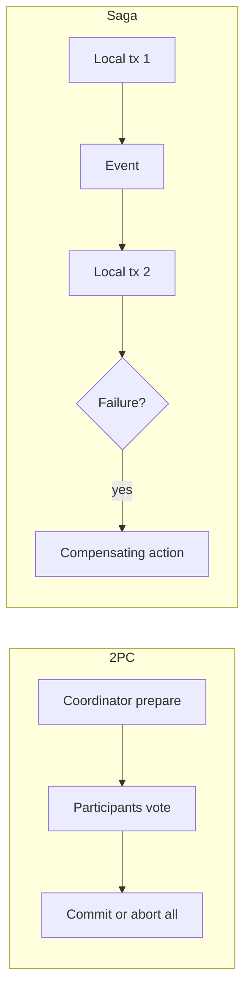

| Pattern | Use when | Tradeoff |
|---|---|---|
| 2PC | rare, controlled systems needing atomicity | blocking, coordinator dependency |
| Saga | long-running business workflows | eventual consistency, compensation complexity |
| Outbox | DB update must emit event | needs relay and dedupe |
| Idempotency key | client retries create/update | key storage and expiry |

Outbox sketch: write business row and outbox event in one DB transaction, relay publishes to Kafka, consumer dedupes by event id.

**Common mistakes:**
- Calling Kafka exactly-once a complete business guarantee.
- Using distributed transactions for every microservice call.
- Missing compensation when saga step fails after partial success.

**Follow-ups:**
- *What is a compensating action?* → A business reversal, like refunding payment after inventory reservation fails.
- *Where store idempotency keys?* → Durable DB or Redis with TTL depending on correctness requirement.

### Q2. How would you design a safe order creation workflow across services?
`🟡 Intermediate` `🔥` `Must-know SDE-1`

**Why they ask:** It tests practical application of transactions, retries, and queues.

**Short answer (say this first, 20-40 sec):**
Use a local transaction to create the order and outbox event, then async consumers reserve inventory and payment. Each step is idempotent and emits success or failure. On failure, run compensating actions and update order status.

**Detailed answer:**
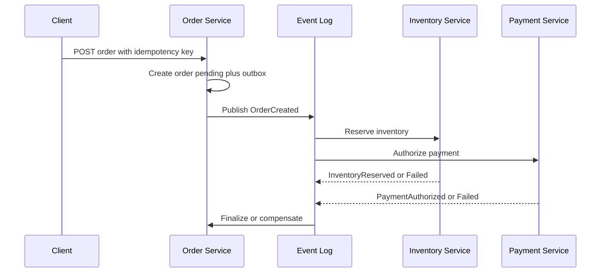

Key tables: `orders(id, user_id, status, idempotency_key)`, `outbox(id, aggregate_id, event_type, payload, published_at)`, `processed_events(event_id, consumer)`.

**Common mistakes:**
- Making synchronous chains with no timeout or rollback plan.
- Retrying payment without idempotency.
- Not exposing pending state to the user.

**Follow-ups:**
- *Why not one DB for all services?* → It is simpler for a monolith; split only when ownership/scale requires it.
- *How do consumers dedupe?* → Insert processed event id with unique constraint before applying side effects.

## Unique ID Generation

### Q3. How do UUID, DB sequences, ticket servers, and Snowflake IDs compare?
`🟡 Intermediate` `🔥` `Must-know SDE-1`

**Why they ask:** IDs affect scale, ordering, storage, and database index locality.

**Short answer (say this first, 20-40 sec):**
UUIDs are decentralized but large and often not time-ordered. DB sequences are simple and ordered but can bottleneck or couple systems to one DB. Ticket servers allocate ranges centrally. Snowflake-style IDs combine timestamp, worker id, and sequence for decentralized, roughly time-ordered 64-bit IDs.

**Detailed answer:**
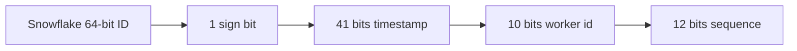

| Method | Pros | Cons |
|---|---|---|
| UUID v4 | no coordination | large, random index writes |
| DB sequence | simple, monotonic | DB dependency, central bottleneck |
| Ticket server | range allocation | server HA needed |
| Snowflake | compact, sortable, high throughput | clock rollback and worker id management |

**Common mistakes:**
- Exposing sequential IDs for sensitive resources without authorization.
- Ignoring clock rollback in Snowflake.
- Using random UUID as clustered primary key in write-heavy SQL without considering fragmentation.

**Follow-ups:**
- *How many IDs can 12 sequence bits generate per ms?* → 4096 per worker per millisecond.
- *What if clock moves backward?* → Wait, use monotonic clock guard, or allocate new worker epoch carefully.

### Q4. How would you implement a Snowflake-like generator in a Java service?
`🔴 Advanced` `🔥` `Stretch`

**Why they ask:** They check concurrency and failure awareness beyond the diagram.

**Short answer (say this first, 20-40 sec):**
Keep worker id fixed per instance, track last timestamp and per-millisecond sequence under synchronization, and block or fail if the clock moves backward. Use the generated long as a sortable primary key or public opaque ID after encoding.

**Detailed answer:**
```java
public final class SnowflakeIdGenerator {
    private static final long EPOCH = 1704067200000L;
    private final long workerId;
    private long lastMs = -1L;
    private long sequence = 0L;

    public SnowflakeIdGenerator(long workerId) {
        if (workerId < 0 || workerId > 1023) throw new IllegalArgumentException("workerId");
        this.workerId = workerId;
    }

    public synchronized long nextId() {
        long now = System.currentTimeMillis();
        if (now < lastMs) throw new IllegalStateException("clock moved backward");
        if (now == lastMs) {
            sequence = (sequence + 1) & 4095L;
            if (sequence == 0) {
                while ((now = System.currentTimeMillis()) <= lastMs) { Thread.onSpinWait(); }
            }
        } else {
            sequence = 0L;
        }
        lastMs = now;
        return ((now - EPOCH) << 22) | (workerId << 12) | sequence;
    }
}
```

Worker ID comes from config, Kubernetes StatefulSet ordinal, or a coordination service.

**Common mistakes:**
- Not synchronizing sequence updates.
- Reusing worker IDs across instances.
- Assuming generated IDs are globally secret.

**Follow-ups:**
- *Can this run across regions?* → Yes if worker ids are globally unique, but clock discipline is critical.
- *Why not use DB auto-increment?* → Fine for one DB; harder for many shards or offline generation.

## Rate Limiting

### Q5. How do token bucket, leaky bucket, fixed window, sliding log, and sliding counter compare?
`🟡 Intermediate` `🔥` `Must-know SDE-1`

**Why they ask:** Rate limiting appears in API gateway, auth, notification, and LLM systems.

**Short answer (say this first, 20-40 sec):**
Fixed window is simple but allows boundary bursts. Sliding log is accurate but memory-heavy. Sliding counter approximates with less memory. Token bucket allows bursts up to bucket capacity while enforcing average rate. Leaky bucket smooths output at a constant rate.

**Detailed answer:**
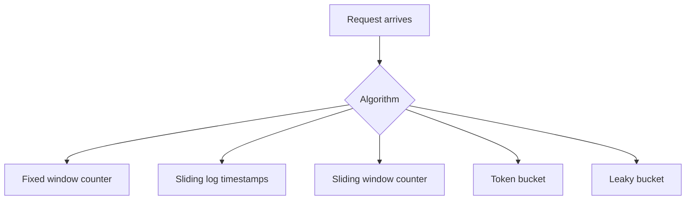

| Algorithm | Burst allowed | Accuracy | Memory | Best use |
|---|---|---|---|---|
| Fixed window | high at boundary | low | low | simple quotas |
| Sliding log | controlled | high | high | strict per-user limit |
| Sliding counter | moderate | medium | low | API gateway |
| Token bucket | yes | medium | low | public APIs, LLM calls |
| Leaky bucket | no, smooths | medium | queue-size based | traffic shaping |

**Common mistakes:**
- Using only IP limit for logged-in APIs.
- Not returning `429` with retry hints.
- Forgetting distributed race conditions.

**Follow-ups:**
- *Where enforce limits?* → Edge/API gateway for coarse limits, service layer for business-specific limits.
- *What key do you rate-limit on?* → user id, API key, IP, device id, tenant, or endpoint-specific combination.

### Q6. How do you build a distributed rate limiter with Redis?
`🟡 Intermediate` `🔥` `Must-know SDE-1`

**Why they ask:** It tests atomicity, latency, and failure behavior.

**Short answer (say this first, 20-40 sec):**
Use Redis because it gives low-latency shared counters. Use atomic Lua scripts or Redis commands to increment and expire keys together. For strict sliding windows, use sorted sets; for high throughput, use token bucket counters with TTL.

**Detailed answer:**
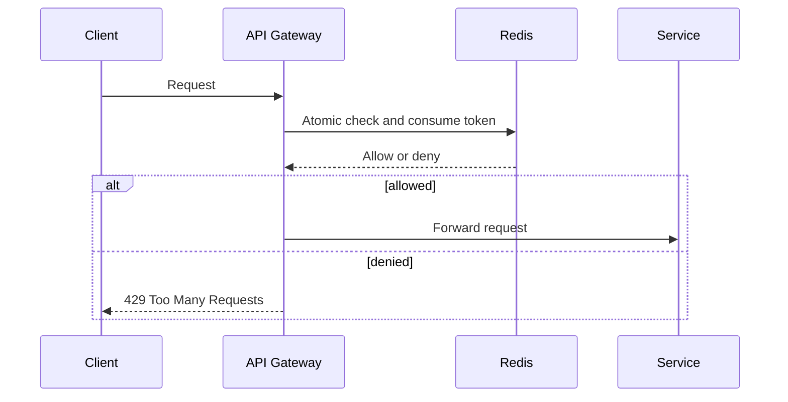

Redis Lua token bucket state: `tokens`, `last_refill_ms`, TTL. If Redis is down, choose fail-open for non-critical APIs or fail-closed for abuse-prone expensive endpoints.

**Common mistakes:**
- Separate GET and SET causing races.
- No TTL, causing unbounded keys.
- One global Redis node becoming bottleneck.

**Follow-ups:**
- *How to scale Redis limiter?* → Cluster by key hash, local warm cache for low-risk decisions, regional limits plus global coarse limit.
- *How to handle clock?* → Use Redis server time inside Lua where possible.

## Search

### Q7. How do inverted indexes, ranking, Elasticsearch, and typeahead tries work?
`🟡 Intermediate` `🔥` `Must-know SDE-1`

**Why they ask:** Search is common in autocomplete, logs, products, and documents.

**Short answer (say this first, 20-40 sec):**
An inverted index maps terms to documents containing those terms. Search engines tokenize, normalize, index, then rank matches using signals like term frequency, field boosts, recency, popularity, and personalization. Typeahead often uses tries, FSTs, or prefix indexes for low-latency prefix lookup.

**Detailed answer:**
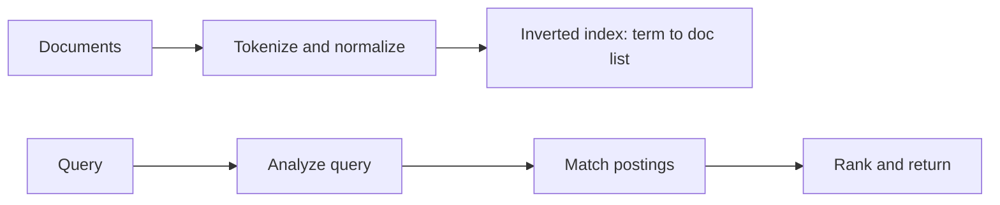

| Need | Technique |
|---|---|
| Full-text search | inverted index |
| Prefix suggestions | trie, FST, edge n-grams |
| Typo tolerance | edit distance, fuzzy query |
| Ranking | BM25-like score plus business features |
| Near-real-time indexing | async indexing pipeline |

**Common mistakes:**
- Using search index as the only source of truth.
- Forgetting refresh lag after writes.
- Returning unbounded suggestions without popularity ranking.

**Follow-ups:**
- *How do you update index?* → DB outbox/CDC publishes document changes to indexing consumers.
- *How do you shard search?* → By document id or tenant; queries fan out then merge top K.

### Q8. How would you design autocomplete for low latency?
`🟡 Intermediate` `🔥` `Must-know SDE-1`

**Why they ask:** It combines estimation, ranking, caching, and prefix data structures.

**Short answer (say this first, 20-40 sec):**
Precompute top suggestions per prefix from query logs, keep hot prefixes in memory or Redis, and fall back to search index for long-tail prefixes. Update suggestions asynchronously because perfect freshness is not required.

**Detailed answer:**
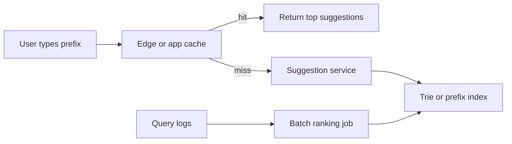

Data model: `suggestions(prefix, locale, top_terms_json, version, updated_at)`. Keep prefix length 1-10; popular prefixes cached aggressively.

**Common mistakes:**
- Hitting the main DB per keystroke.
- Ignoring language, locale, and personalization boundaries.
- Recomputing suggestions synchronously on every query.

**Follow-ups:**
- *How do you handle new trending query?* → Streaming counters for fast updates plus batch correction.
- *How do you handle abuse?* → Rate limit per user/IP and filter unsafe terms before indexing.

## Geospatial

### Q9. How do geohash, quadtree, S2, and H3 solve nearby search?
`🔴 Advanced` `🔥` `Stretch`

**Why they ask:** Geo indexing is common in ride-hailing, nearby restaurants, and delivery.

**Short answer (say this first, 20-40 sec):**
Geohash encodes latitude and longitude into a prefix where nearby points often share prefixes. Quadtree recursively divides 2D space into four cells. S2 and H3 use spherical cell systems that handle earth geometry better. Nearby search queries candidate cells, then filters by exact distance.

**Detailed answer:**
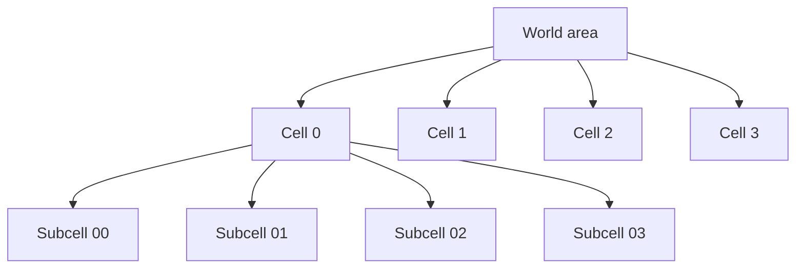

| Index | Shape | Pros | Cons |
|---|---|---|---|
| Geohash | rectangular-ish prefix | simple string prefix search | edge cases near cell borders |
| Quadtree | recursive squares | intuitive and adaptive | hotspots need deep split |
| S2 | sphere projected cells | good global geometry | library complexity |
| H3 | hexagons | neighbor consistency | fixed hierarchy tradeoffs |

**Common mistakes:**
- Returning by cell only without exact distance filter.
- Missing neighboring cells at boundaries.
- Using one precision for dense cities and sparse rural areas.

**Follow-ups:**
- *Why filter after candidate lookup?* → Cell membership is approximate; exact haversine distance removes false positives.
- *How handle moving drivers?* → Update current cell in Redis with TTL and periodically persist history.

### Q10. How would you design nearby drivers or restaurants lookup?
`🟡 Intermediate` `🔥` `Must-know SDE-1`

**Why they ask:** It tests real-time updates and spatial indexing.

**Short answer (say this first, 20-40 sec):**
Store current active entities in Redis by geohash or geospatial index with TTL. Query the user's cell and neighboring cells, expand radius if not enough results, then exact-distance sort and apply business filters.

**Detailed answer:**
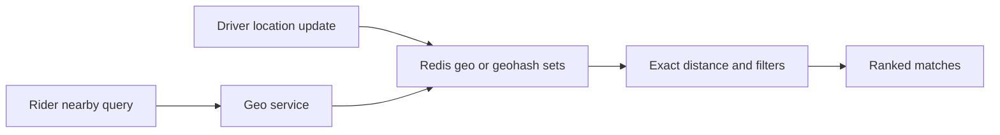

Use Redis for current location, PostgreSQL/PostGIS or search index for relatively static restaurants, and Kafka for location stream analytics.

**Common mistakes:**
- Writing every GPS ping to primary SQL synchronously.
- Not expiring stale driver locations.
- Not expanding neighboring cells.

**Follow-ups:**
- *How do you reduce write load?* → Send only significant movement or timed batches.
- *How do you rank restaurants?* → Distance, rating, open status, delivery ETA, personalization.

## Real-time Communication

### Q11. Polling, long polling, WebSockets, and SSE: when do you choose each?
`🟡 Intermediate` `🔥` `Must-know SDE-1`

**Why they ask:** Real-time features appear in chat, notifications, collaboration, and dashboards.

**Short answer (say this first, 20-40 sec):**
Polling is simplest but wasteful. Long polling keeps a request open until data arrives. SSE is one-way server-to-client streaming over HTTP. WebSockets provide bidirectional persistent connections and fit chat, presence, and live collaboration.

**Detailed answer:**
| Technique | Direction | Pros | Cons |
|---|---|---|---|
| Polling | client pulls | simple, cacheable | latency or waste |
| Long polling | server waits | fewer empty responses | many open requests |
| SSE | server to client | simple streaming | one-way |
| WebSocket | bidirectional | low latency, interactive | connection state and scaling |

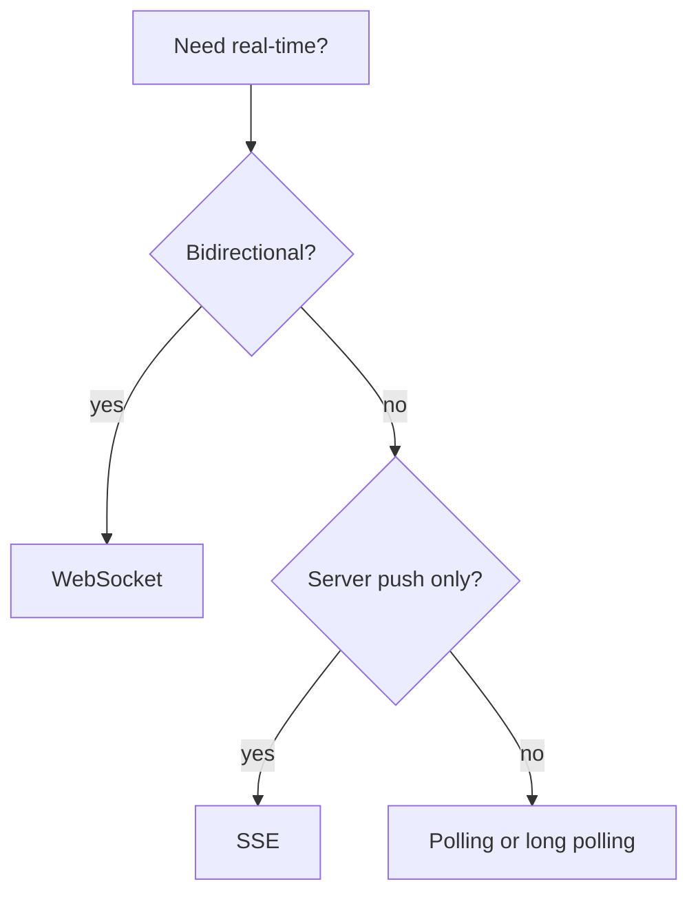

**Common mistakes:**
- Using WebSockets for simple rarely-changing dashboards.
- Storing connection state only in one app instance without recovery plan.
- Ignoring backpressure for slow clients.

**Follow-ups:**
- *How scale WebSockets?* → Gateway fleet, connection registry, pub/sub message routing, sticky or consistent routing.
- *Where store presence?* → Redis keys with TTL renewed by heartbeat.

### Q12. Fan-out on write vs fan-out on read: how do feeds and notifications choose?
`🟡 Intermediate` `🔥` `Must-know SDE-1`

**Why they ask:** It is central to news feed, chat, notifications, and social timelines.

**Short answer (say this first, 20-40 sec):**
Fan-out on write pushes a new item to followers' inboxes at write time, making reads fast but writes expensive for celebrities. Fan-out on read stores posts once and builds feed at read time, making writes cheap but reads slower. Large systems often use a hybrid.

**Detailed answer:**
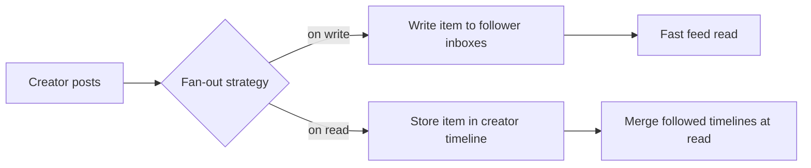

Hybrid: precompute feeds for normal users, do fan-out-on-read for celebrities or high-follower accounts, then merge and rank at read time.

**Common mistakes:**
- Fan-out to millions synchronously in the request path.
- Not handling unfollow/delete propagation.
- Ignoring ordering and ranking requirements.

**Follow-ups:**
- *Where use queues?* → Async fan-out workers consume post-created events.
- *How handle celebrities?* → Do not push to all followers; pull their posts during feed generation.

## Data Processing

### Q13. Batch vs stream, Lambda vs Kappa, warehouse vs lake: how do they differ?
`🟡 Intermediate` `🔥` `Must-know SDE-1`

**Why they ask:** Modern systems need analytics, ranking, fraud detection, and reporting.

**Short answer (say this first, 20-40 sec):**
Batch processes bounded data periodically; stream processes events continuously. Lambda architecture has separate batch and speed layers. Kappa uses one streaming pipeline and replays logs for recomputation. Warehouses are structured analytics stores; data lakes store raw/curated files cheaply.

**Detailed answer:**
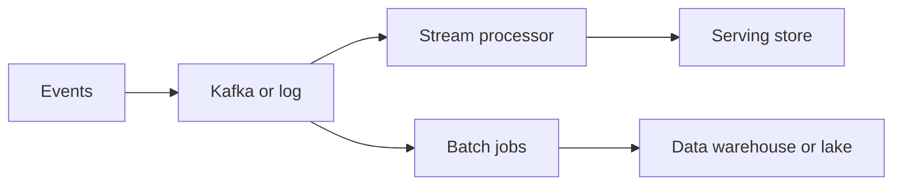

| Need | Tool pattern |
|---|---|
| daily reports | batch job to warehouse |
| near-real-time alerts | stream processing |
| simple architecture | Kappa if replayable log is enough |
| exact historical correction | batch recomputation |
| raw cheap storage | data lake object storage |

**Common mistakes:**
- Using stream processing for everything even when daily batch is enough.
- No event schema/versioning.
- Not planning backfills.

**Follow-ups:**
- *Where do Spark and Flink fit?* → Spark is common for batch and micro-batch; Flink for low-latency stateful streams.
- *How connect to Mohd's data background?* → Mention indexing, semantic model tuning, and validation checks as analytics reliability habits.

### Q14. How do you design reliable event pipelines with ordering, backpressure, and replay?
`🔴 Advanced` `🔥` `Stretch`

**Why they ask:** Queues/logs fail in subtle ways under load.

**Short answer (say this first, 20-40 sec):**
Partition events by the key that needs ordering, monitor consumer lag for backpressure, store events durably for replay, make consumers idempotent, and use DLQs for poison messages. Schema evolution and replay safety are as important as throughput.

**Detailed answer:**
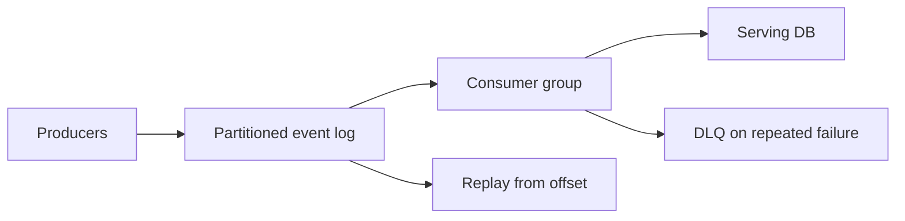

Controls:
- Partition key: `user_id`, `order_id`, or `conversation_id` for per-entity ordering.
- Backpressure: pause consumers, autoscale, shed low-priority producers.
- Replay: retain events long enough and version schemas.
- Idempotency: deterministic upsert or processed-event table.

**Common mistakes:**
- Expecting global ordering across partitions.
- Replaying non-idempotent side effects like SMS sends.
- Dropping bad messages silently.

**Follow-ups:**
- *How do you handle schema changes?* → Additive changes first, schema registry, backward/forward compatible consumers.
- *What is consumer lag?* → Difference between latest produced offset and consumed offset.

## Reliability

### Q15. How do redundancy, failover, multi-AZ, multi-region, RPO, and RTO work?
`🟡 Intermediate` `🔥` `Must-know SDE-1`

**Why they ask:** A design is incomplete if it works only when everything is healthy.

**Short answer (say this first, 20-40 sec):**
Redundancy removes single points of failure. Multi-AZ protects against data-center failure within a region. Multi-region protects against regional outages but adds latency, cost, and consistency challenges. RPO is acceptable data loss; RTO is acceptable recovery time.

**Detailed answer:**
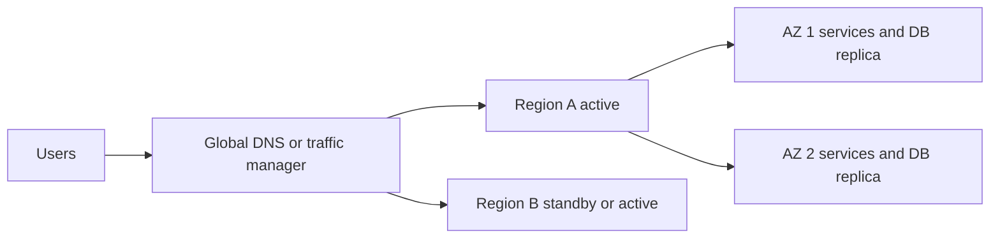

| Term | Meaning |
|---|---|
| RPO | how much data loss is acceptable |
| RTO | how long recovery may take |
| Active-passive | standby region takes over during disaster |
| Active-active | both regions serve traffic |
| Failover | moving traffic to healthy replica or region |

**Common mistakes:**
- Claiming multi-region but leaving one global database as SPOF.
- Not testing failover.
- Ignoring data reconciliation after failback.

**Follow-ups:**
- *Which systems need low RPO?* → Payments, orders, seat booking, identity.
- *How do you test DR?* → Game days, controlled failover, backup restore drills.

### Q16. How do circuit breakers, bulkheads, graceful degradation, and chaos testing improve reliability?
`🟡 Intermediate` `🔥` `Must-know SDE-1`

**Why they ask:** They test production-readiness and failure isolation.

**Short answer (say this first, 20-40 sec):**
A circuit breaker stops calling a failing dependency after errors cross a threshold, then probes recovery. Bulkheads isolate resources so one dependency cannot exhaust the whole service. Graceful degradation serves partial functionality. Chaos testing validates assumptions by injecting failures safely.

**Detailed answer:**
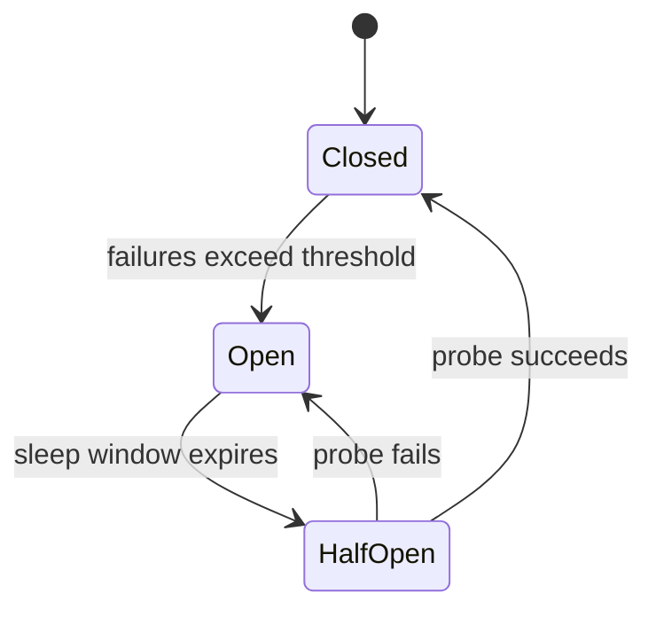

| Pattern | Example |
|---|---|
| Circuit breaker | stop calling slow payment provider temporarily |
| Bulkhead | separate thread pools for search and checkout |
| Timeout | fail fast instead of hanging request threads |
| Fallback | show cached feed when ranking is down |
| Graceful degradation | disable recommendations, keep checkout working |

**Common mistakes:**
- Retrying without timeout and jitter.
- One shared thread pool for all downstream calls.
- Fallbacks that call the same failing dependency.

**Follow-ups:**
- *How combine retries and circuit breaker?* → Retry limited transient errors, breaker opens when failures persist.
- *What is chaos testing?* → Controlled failure injection to prove resilience before real incidents.

## Security in Design

### Q17. What security topics should be included in HLD?
`🟢 Beginner` `🔥` `Must-know SDE-1`

**Why they ask:** Security must be built into architecture, not patched later.

**Short answer (say this first, 20-40 sec):**
Mention authentication, authorization, encryption in transit and at rest, secrets management, input validation, API keys or OAuth for integrations, rate limiting, audit logs, and DDoS protection. Keep secrets out of code and enforce least privilege.

**Detailed answer:**
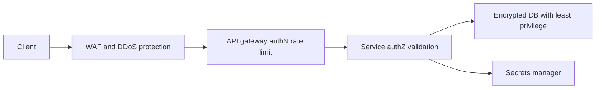

| Area | Design point |
|---|---|
| AuthN | OAuth, JWT, sessions, MFA if needed |
| AuthZ | RBAC/ABAC, resource ownership checks |
| Encryption | TLS in transit, managed keys at rest |
| Secrets | environment/secret manager, rotation |
| DDoS | CDN/WAF/rate limits/load shedding |
| Audit | immutable logs for sensitive actions |

**Common mistakes:**
- Authenticated but not authorized endpoints.
- Logging tokens, passwords, or PII.
- Hardcoding API keys; Mohd's email assistant should use env-var secrets as a good example.

**Follow-ups:**
- *JWT vs session?* → JWT is stateless but revocation is harder; sessions are revocable but need shared store.
- *Where validate ownership?* → In the service and database query, not just frontend.

### Q18. How do you secure APIs and data stores in a microservice system?
`🟡 Intermediate` `🔥` `Must-know SDE-1`

**Why they ask:** Service-to-service and data access are common weak points.

**Short answer (say this first, 20-40 sec):**
Use TLS everywhere, verify identity at the edge, pass signed user context or tokens internally, enforce authorization in each service, restrict DB permissions per service, and audit sensitive operations. Use private networking and secrets rotation.

**Detailed answer:**
Security checklist:
- Edge: WAF, TLS, rate limits, request size limits.
- API: OAuth/JWT validation, idempotency, schema validation.
- Service-to-service: mTLS or signed tokens, network policies.
- Data: least-privilege DB user, encryption, backups protected.
- Operations: secret manager, rotation, audit logs, alerting on anomalies.

**Common mistakes:**
- Trusting internal network blindly.
- Sharing one DB superuser across services.
- No audit trail for admin actions.

**Follow-ups:**
- *How handle PII?* → Minimize, encrypt, restrict access, redact logs, define retention/deletion.
- *What is defense in depth?* → Multiple controls so one failure does not expose the system.

## Observability in Design

### Q19. What metrics, logs, traces, SLOs, and alerts should be designed upfront?
`🟡 Intermediate` `🔥` `Must-know SDE-1`

**Why they ask:** You cannot operate what you cannot observe.

**Short answer (say this first, 20-40 sec):**
Track golden signals: latency, traffic, errors, and saturation. Add structured logs with correlation IDs, distributed traces across services, SLOs for user journeys, and alerts based on symptoms, not every low-level metric.

**Detailed answer:**
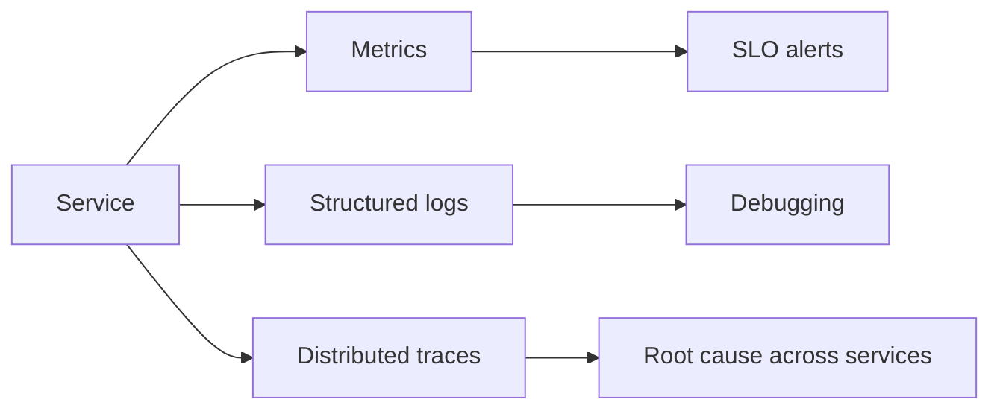

| Signal | Example |
|---|---|
| Latency | P50/P95/P99 per endpoint |
| Traffic | QPS, queue depth, active connections |
| Errors | 5xx, business failures, retry exhaustion |
| Saturation | CPU, memory, DB connections, consumer lag |
| SLO | 99.9 percent of sends complete under 2 seconds |

**Common mistakes:**
- Alerting on CPU only.
- No correlation ID across logs.
- No business metrics like bookings failed or messages delayed.

**Follow-ups:**
- *What is an SLI?* → Measured indicator, like successful requests under 300 ms.
- *What is an SLO?* → Target for SLI, like 99.9 percent monthly.

### Q20. How do you debug a production latency spike using observability?
`🟡 Intermediate` `🔥` `Must-know SDE-1`

**Why they ask:** It connects system design to production debugging.

**Short answer (say this first, 20-40 sec):**
Start from user-facing SLOs, identify which endpoint and percentile regressed, inspect traces to locate the slow dependency, check saturation metrics, then use logs for errors and deployment correlation. Roll back or shed load if users are impacted.

**Detailed answer:**
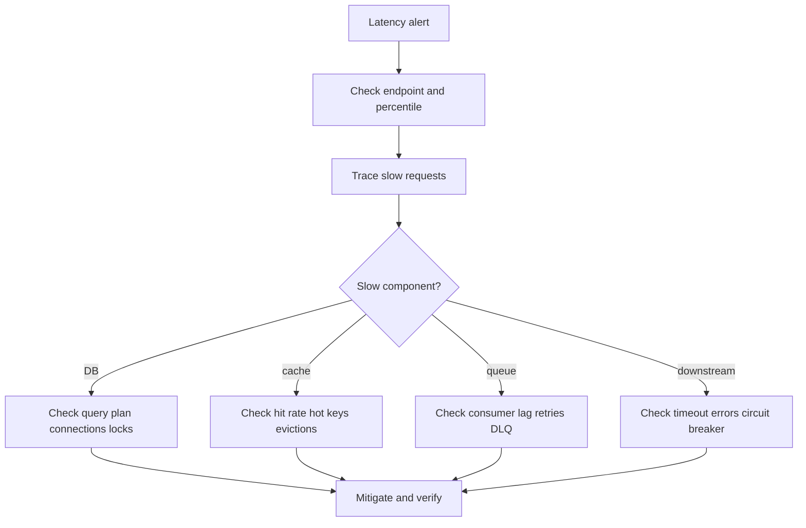

Tie to Mohd's experience: mention query tuning, indexing, validation checks, and performance analyzer-style bottleneck isolation.

**Common mistakes:**
- Jumping to code changes without identifying bottleneck.
- Looking only at averages.
- Ignoring recent deployments and configuration changes.

**Follow-ups:**
- *Why P99?* → Tail latency captures the worst user experience hidden by averages.
- *What is RED method?* → Rate, Errors, Duration for request-driven services.

## Cost Awareness

### Q21. How do storage tiers, compute choices, and egress costs affect design?
`🟢 Beginner` `🔥` `Must-know SDE-1`

**Why they ask:** Good designs satisfy requirements without runaway cost.

**Short answer (say this first, 20-40 sec):**
Hot data belongs on fast expensive stores; warm data can use cheaper disks; cold data should move to archival object storage. Compute can scale horizontally or serverlessly depending on workload. Egress and cross-region replication can dominate costs for media-heavy systems.

**Detailed answer:**
| Cost lever | Design tactic |
|---|---|
| Hot storage | cache and SSD only for active data |
| Cold storage | lifecycle policies to archive tiers |
| Compute | autoscaling, right-size instances, batch off-peak |
| Network egress | CDN, regional processing, compression |
| Replication | replicate only data needing HA/DR |
| Search indexes | index required fields only, retention policy |

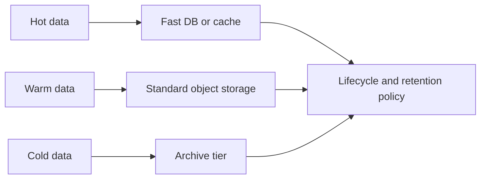

**Common mistakes:**
- Replicating everything to every region.
- Keeping logs forever in hot search storage.
- Ignoring CDN egress and origin bandwidth.

**Follow-ups:**
- *What is a cheap-first design?* → Meet SLOs with simplest managed components, then optimize hotspots with measured data.
- *Where can compression help?* → Logs, API payloads, object storage, inter-service events.

### Q22. How do you discuss cost tradeoffs without sounding cheap?
`🟡 Intermediate` `🔥` `Must-know SDE-1`

**Why they ask:** Interviewers value business-aware engineering.

**Short answer (say this first, 20-40 sec):**
Frame cost as a tradeoff against latency, reliability, and complexity. Say which data or traffic path deserves expensive infrastructure and which can be asynchronous, cached, compressed, tiered, or sampled.

**Detailed answer:**
Use this language:
- `For the hot path, I choose Redis because it protects P99 latency.`
- `For analytics, I choose async batch because real-time correctness is not required.`
- `For old files, lifecycle to cold storage reduces cost without hurting user experience.`
- `For multi-region, I would start active-passive unless RTO requires active-active.`

Cost-aware checklist:
- Can we reduce data before storing it?
- Can we cache to reduce origin reads?
- Can we batch or sample low-value events?
- Can we use retention and deletion policies?
- Is the expensive component on the critical path?

**Common mistakes:**
- Optimizing cost before correctness for payments or bookings.
- Treating cost as only server count.
- Ignoring operational cost and team complexity.

**Follow-ups:**
- *When pay more?* → User-facing latency, correctness-critical data, compliance, and high-availability paths.
- *When use managed services?* → When operational simplicity and reliability outweigh raw infrastructure cost.

## Additional Building Block Interview Drills

### Q23. How do you make payment and booking APIs idempotent?
`🟡 Intermediate` `🔥` `Must-know SDE-1`

**Why they ask:** Retries are unavoidable; duplicate side effects are unacceptable.

**Short answer (say this first, 20-40 sec):**
Require an idempotency key from the client for create/charge operations. Store the key with request hash and final response. If the same key repeats, return the original response instead of executing the side effect again.

**Detailed answer:**
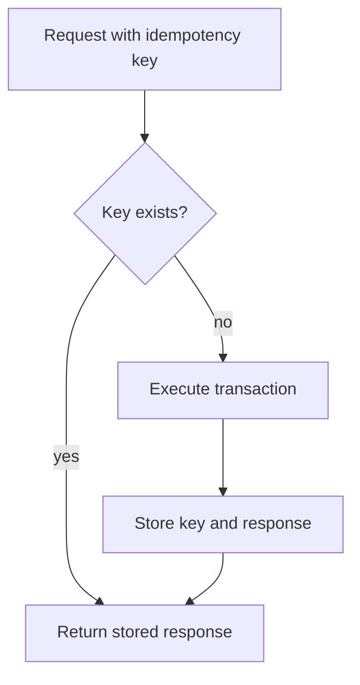
Use a unique constraint on `(client_id, idempotency_key)`. Reject same key with different request body.

**Common mistakes:**
- Generating idempotency key on server after duplicate request arrives.
- Expiring keys too soon for payment reconciliation.
- Not storing failure/success response consistently.

**Follow-ups:**
- *Where store keys?* → Durable DB for payments/bookings; Redis TTL is enough for low-risk actions.
- *What status for in-progress duplicate?* → Return `409`/`202` with retry-after or wait for result.

### Q24. How do you safely expose a custom tool or external provider through a service?
`🟡 Intermediate` `🔥` `Must-know SDE-1`

**Why they ask:** Many designs call third-party APIs like SMS, email, LLM, or payment providers.

**Short answer (say this first, 20-40 sec):**
Wrap providers behind an internal adapter with timeouts, retries, circuit breakers, idempotency, rate limits, and audit logs. Never let provider-specific behavior leak deeply into core business logic.

**Detailed answer:**
```mermaid
flowchart LR
    S["Core service"] --> A["Provider adapter"]
    A --> R["Rate limit and circuit breaker"]
    R --> P1["Provider A"]
    R --> P2["Provider B fallback"]
```
Store provider request id and response status for reconciliation.

**Common mistakes:**
- No timeout on external calls.
- Retrying non-idempotent provider operations.
- Hardcoding provider credentials.

**Follow-ups:**
- *How choose provider fallback?* → Based on health, cost, geography, and compliance.
- *What if provider returns unknown?* → Reconcile by provider id before retrying.

### Q25. How do push notifications, in-app notifications, and WebSocket events differ?
`🟢 Beginner` `🔥` `Must-know SDE-1`

**Why they ask:** Real-time delivery choices have different guarantees.

**Short answer (say this first, 20-40 sec):**
WebSocket events are best for online low-latency delivery. Push notifications wake offline mobile users but are provider-mediated and not guaranteed. In-app notifications are durable records users can view later.

**Detailed answer:**
| Channel | Best for | Durability |
|---|---|---|
| WebSocket | active chat/session updates | app must persist separately |
| Push | offline alert | provider best effort |
| In-app | notification center | durable DB row |
| Email/SMS | external reach | provider status/retries |

**Common mistakes:**
- Treating push notification as source of truth.
- Sending every event on every channel.
- No user preference controls.

**Follow-ups:**
- *How dedupe channels?* → Notification id and user preference state.
- *What if WebSocket user offline?* → Store event and send push/in-app notification.

### Q26. How do you design a ranking pipeline for feeds or search suggestions?
`🔴 Advanced` `🔥` `Stretch`

**Why they ask:** Ranking is often the deepest part of feed/search systems.

**Short answer (say this first, 20-40 sec):**
Separate candidate generation from ranking. Generate a manageable set of candidates, score them with features such as recency, popularity, affinity, and quality, then apply filters and diversification before returning results.

**Detailed answer:**
```mermaid
flowchart LR
    U["User context"] --> C["Candidate generation"]
    C --> F["Feature fetch"]
    F --> R["Rank model or rules"]
    R --> P["Policy filters"]
    P --> O["Ordered results"]
```
For SDE-1, rule-based ranking is enough; Senior can mention offline training, online A/B tests, and feature stores.

**Common mistakes:**
- Ranking every item in the database.
- No fallback when model service is down.
- Ignoring policy filters after ranking.

**Follow-ups:**
- *What is candidate generation?* → Fast retrieval of possible relevant items before expensive scoring.
- *How handle model failure?* → Serve chronological/popularity fallback.

### Q27. How do you combine geospatial search with ranking and filtering?
`🟡 Intermediate` `🔥` `Must-know SDE-1`

**Why they ask:** Nearby results are not just nearest-by-distance.

**Short answer (say this first, 20-40 sec):**
First use geohash/S2/H3 cells to get nearby candidates, then exact-distance filter, then rank by distance plus business signals like rating, availability, ETA, price, or personalization.

**Detailed answer:**
```mermaid
flowchart LR
    Q["User lat lon"] --> C["Neighbor cells"]
    C --> D["Candidate places"]
    D --> F["Exact distance filter"]
    F --> R["Rank by distance quality availability"]
```

**Common mistakes:**
- Sorting by distance only.
- Missing cell boundary neighbors.
- Returning closed/unavailable entities.

**Follow-ups:**
- *How expand radius?* → Query rings of neighboring cells until enough candidates are found.
- *How handle dense cities?* → Use finer precision and pagination.

### Q28. How do you decide between synchronous request, queue, and stream processing?
`🟡 Intermediate` `🔥` `Must-know SDE-1`

**Why they ask:** It tests whether you keep critical paths small.

**Short answer (say this first, 20-40 sec):**
Use synchronous requests for immediate user-visible decisions. Use queues for background tasks that must eventually happen once. Use streams/logs for high-throughput event processing, replay, analytics, and multiple subscribers.

**Detailed answer:**
| Work | Pattern |
|---|---|
| check seat availability | synchronous DB transaction |
| send confirmation email | queue |
| update analytics dashboards | stream/log |
| rebuild autocomplete | batch plus stream |

**Common mistakes:**
- Putting slow email/SMS calls in checkout response.
- Queueing a task that must immediately decide correctness.
- No user status for async work.

**Follow-ups:**
- *What is a workflow engine?* → Orchestrates long-running steps, retries, and compensation.
- *When use stream over queue?* → When events need replay or multiple consumer groups.

### Q29. How do SLOs guide system design decisions?
`🟡 Intermediate` `🔥` `Must-know SDE-1`

**Why they ask:** SLOs turn vague reliability into engineering targets.

**Short answer (say this first, 20-40 sec):**
An SLO defines the reliability target for a user-visible behavior, such as 99.9 percent successful message sends under 2 seconds. It guides redundancy, caching, alerting, capacity, and graceful degradation choices.

**Detailed answer:**
```mermaid
flowchart LR
    SLO["SLO target"] --> A["Architecture"]
    SLO --> C["Capacity headroom"]
    SLO --> O["Observability"]
    SLO --> D["Degradation plan"]
```
Error budget = allowed unreliability; if spent, prioritize reliability over feature velocity.

**Common mistakes:**
- Alerting on every internal metric instead of user symptoms.
- No error budget.
- SLO target impossible for dependencies chosen.

**Follow-ups:**
- *SLI vs SLO?* → SLI is measurement; SLO is target.
- *What is SLA?* → External contract, often with business consequences.

### Q30. How do you reduce cost in a design without breaking the SLO?
`🟡 Intermediate` `🔥` `Must-know SDE-1`

**Why they ask:** Cost-aware tradeoffs show practical engineering maturity.

**Short answer (say this first, 20-40 sec):**
Protect the hot path and SLO-critical data, then optimize everything else with caching, batching, compression, sampling, storage lifecycle tiers, and retention. Measure first; do not weaken correctness for payments, bookings, or security.

**Detailed answer:**
| Area | Cost reduction |
|---|---|
| API reads | cache hot public responses |
| logs | sample debug logs, archive old logs |
| media | CDN, compression, object lifecycle |
| analytics | batch jobs, columnar warehouse |
| multi-region | active-passive unless active-active is required |

**Common mistakes:**
- Removing redundancy from critical state.
- Keeping all telemetry in hot search forever.
- Overusing global replication.

**Follow-ups:**
- *What is first cost metric to inspect?* → Top services by compute, storage, egress, and managed-service spend.
- *How justify expensive cache?* → Show it protects P99 latency and reduces DB load.

## Revision Cheat Sheet

- 2PC gives atomic distributed commit but hurts availability; Saga uses local transactions and compensation.
- Outbox = DB change and event written atomically, later published reliably.
- Idempotency keys make retries safe; exactly-once business effects still require dedupe.
- Snowflake ID = timestamp + worker id + sequence; beware clock rollback.
- Token bucket allows bursts; leaky bucket smooths; sliding log is accurate but memory-heavy.
- Inverted index maps term to documents; autocomplete uses prefix structures plus ranking.
- Geohash/quadtree/S2/H3 produce candidate cells; exact distance filtering is still needed.
- WebSockets are bidirectional; SSE is one-way server streaming; polling is simplest.
- Fan-out-on-write optimizes reads; fan-out-on-read optimizes writes; hybrid handles celebrities.
- Batch is periodic bounded processing; stream is continuous event processing.
- Multi-AZ protects data-center failure; multi-region protects regional failure but costs more.
- Circuit breaker states: closed, open, half-open.
- Security: authN, authZ, TLS, encryption, secrets, rate limiting, audit, DDoS protection.
- Observability: metrics, logs, traces, SLO alerts, correlation IDs.
- Cost awareness: hot/warm/cold tiers, autoscaling, retention, compression, egress control.

## Flashcards

1. Q → 2PC vs Saga? A → 2PC atomic but blocking; Saga local transactions plus compensation.
2. Q → Outbox pattern? A → Write event with business row in same DB transaction, publish later.
3. Q → Snowflake fields? A → sign, timestamp, worker id, sequence.
4. Q → Token bucket benefit? A → Allows bursts while enforcing average rate.
5. Q → Fixed window weakness? A → Boundary bursts.
6. Q → Inverted index? A → Term-to-document-list mapping.
7. Q → Typeahead data structure? A → Trie, FST, or prefix index with popularity ranking.
8. Q → Geohash caveat? A → Must query neighboring cells and exact-distance filter.
9. Q → WebSocket use case? A → Bidirectional low-latency communication like chat.
10. Q → Fan-out hybrid? A → Push normal creators, pull celebrity posts at read time.
11. Q → RPO? A → Acceptable data loss.
12. Q → RTO? A → Acceptable recovery time.
13. Q → Circuit breaker states? A → Closed, open, half-open.
14. Q → Golden signals? A → Latency, traffic, errors, saturation.
15. Q → Biggest hidden media cost? A → Network egress and cross-region replication.
