# 09c · HLD Case Studies Tier 1 I

This file covers the first five Tier-1 HLD case studies with interview-ready structure: requirements, estimation, APIs, data model, diagrams, deep dives, scaling, failure handling, and revision notes.

**Legend:** 🟢 Beginner · 🟡 Intermediate · 🔴 Advanced · ⚫ FAANG · 🔥 = very frequently asked

## Table of Contents
- [Beginner guide to this file](#beginner-guide-to-this-file)
- [1. Design URL Shortener](#1-design-url-shortener)
- [2. Design Pastebin](#2-design-pastebin)
- [3. Design Distributed Rate Limiter](#3-design-distributed-rate-limiter)
- [4. Design Unique ID Generator](#4-design-unique-id-generator)
- [5. Design Distributed Cache / Key-Value Store](#5-design-distributed-cache--key-value-store)
- [Revision Cheat Sheet](#revision-cheat-sheet)
- [Flashcards](#flashcards)

## Beginner guide to this file

### What this file teaches
This file teaches foundational high-level design (HLD) patterns: short-code lookup, blob storage,
shared counters, unique identifier generation, and distributed caching. Interviewers ask these because
small-looking systems expose the same backend choices used in production Java services: where to keep
durable truth, what to cache, what to process asynchronously, and how to survive common failures.

### Mental model
Think of each design as a busy service desk: some questions need the official ledger, some can be
answered from a sticky note, and some should be placed in a side queue.

- Durable stores keep facts that must not disappear, such as URL mappings, paste metadata, and aliases.
- Redis-like caches keep hot answers close to the caller but are not the final source of truth.
- Queues remove slow work, such as analytics, scans, and cleanup, from the user-facing path.
- Identifiers, keys, and time-to-live rules decide how data is found and when it can expire.
- Scaling usually starts by splitting reads, then sharding writes, then planning failover behavior.

### How to think through any question here
1. State the core object: link mapping, paste content, quota key, generated identifier, or cache entry.
2. Separate read-heavy paths from correctness-heavy write paths before naming technologies.
3. Decide the source of truth, then decide which cache can safely speed it up.
4. Estimate queries per second (QPS), data size, and hot-key risk using simple round numbers.
5. Walk the write path and read path, including exactly when a response is returned to the user.
6. Add asynchronous work only after the critical path is clear.
7. Name the failure behavior for Redis, database, queue, and a single service instance.

### Pattern recognition cues
| If the question mentions... | Think about... | Why it fits |
|---|---|---|
| Short links, aliases, or redirects | SQL mapping plus Redis cache | The mapping must be durable, but redirects are read-heavy. |
| Large text bodies or pasted content | Metadata database plus object storage | The database should not carry large blobs when cheap blob storage can. |
| Per-user or per-API limits | Token bucket in Redis | Each request atomically consumes shared quota with low latency. |
| Globally unique, sortable IDs | Snowflake-style timestamp, worker, and sequence | It avoids a central database sequence bottleneck. |
| In-memory key-value data | Consistent hashing and replicas | Keys must spread across nodes while surviving node loss. |
| Click stats, scans, or cleanup | Queue and background workers | Slow side effects should not delay redirects or writes. |
| Expiry or temporary state | Time-to-live plus cleanup worker | Expired links, holds, and cache entries need predictable removal. |
| One hot key or viral object | Local cache, replication, and request coalescing | One shard can overload even when average QPS looks safe. |

### Abbreviations and key terms
| Short form | Expanded form | Plain meaning |
|---|---|---|
| AOF | Append-only file | Persistence log used by cache systems to replay writes after restart. |
| API | Application programming interface | Contract that callers use to create, read, update, or delete data. |
| Base62 | Not an abbreviation | Encoding using digits plus uppercase and lowercase letters for compact IDs. |
| CDN | Content delivery network | Edge cache that serves static or public content near users. |
| DB | Database | Durable store for data that must survive process or cache loss. |
| DLQ | Dead-letter queue | Queue for messages that failed too many retries and need inspection. |
| DNS | Domain Name System | Internet naming layer that maps domains to network addresses. |
| FAANG | Facebook, Amazon, Apple, Netflix, Google | Shorthand for large product-company interview style. |
| GB | Gigabyte | Roughly one billion bytes of storage. |
| GDPR | General Data Protection Regulation | Privacy regulation that affects deletion and data retention choices. |
| HA | High availability | Design goal of staying usable during partial failures. |
| HLD | High-level design | System design discussion focused on components, data, scale, and trade-offs. |
| ID | Identifier | Value used to uniquely name an object, row, worker, or request. |
| IP | Internet Protocol | Network address family often used for client or abuse signals. |
| JSON | JavaScript Object Notation | Lightweight request and response format. |
| KB | Kilobyte | Roughly one thousand bytes. |
| KV | Key-value | Data model that retrieves a value by an exact key. |
| LB | Load balancer | Component that spreads traffic across service instances. |
| LFU | Least frequently used | Eviction policy that keeps often-used cache entries. |
| LLM | Large language model | Expensive model call that may need stricter rate limiting. |
| LRU | Least recently used | Eviction policy that removes the least recently touched entries. |
| ms | Millisecond | One thousandth of a second, used for latency targets. |
| P99 | 99th percentile | Latency value under which 99 percent of requests complete. |
| PK | Primary key | Column or field that uniquely identifies a database row. |
| QPS | Queries per second | Throughput measure for incoming requests. |
| Redis | Not an abbreviation | In-memory data store commonly used for cache, counters, and locks. |
| SDE-1 | Software Development Engineer level 1 | Entry-level engineering interview bar in this guide. |
| SEO | Search engine optimization | Search ranking concern affected by permanent redirects. |
| Snowflake | Not an abbreviation | Timestamp-based distributed ID generation pattern. |
| SQL | Structured Query Language | Relational database query language and shorthand for relational storage. |
| TB | Terabyte | Roughly one trillion bytes of storage. |
| TTL | Time to live | Expiration duration after which cached or temporary data is invalid. |
| URL | Uniform Resource Locator | Web address that points to a resource. |
| UUID | Universally Unique Identifier | 128-bit identifier format, often random and non-sortable. |

### Common beginner traps
- Choosing Redis as the only store for mappings or bookings, then losing data on cache failure.
- Putting analytics, scans, or syntax highlighting in the synchronous user path.
- Saying shard the database before estimating whether the first version actually needs sharding.
- Forgetting collision handling for custom aliases, random short codes, or worker identifiers.
- Treating average traffic as enough and ignoring viral links, hot keys, and cache miss storms.
- Promising exact global behavior when a simpler regional or eventual answer is acceptable.

### How to study this file
1. Read the short revision summary of each case to learn the main pattern first.
2. Rebuild the detailed answer aloud in this order: requirements, math, API, data, flow, failures.
3. Use the diagrams to trace one write path and one read path without looking at the prose.
4. Turn every flashcard into a two-minute answer, then add one trade-off and one failure case.
5. Practice changing one assumption, such as 100 times more reads or Redis unavailable, and adapt the design.

### Scalability and production lens
A toy design can run as one Spring Boot service with one database. Production designs add read replicas,
Redis clusters, queues, monitoring, idempotency, circuit breakers, and runbooks. The key shift is that every
component can be slow, down, or overloaded, so each answer should explain the degraded behavior, not just the
happy path.

## 1. Design URL Shortener
Tier 1 · SDE-1 must-know

### 0. Beginner primer

**Simple problem:** Convert a long web address into a short code and send users back to the original address
fast. **Mental model:** It is a durable phone book with a small front-desk memory: SQL owns the mapping, Redis
remembers popular codes, and the queue records clicks later. **Thought process:** Start with redirect versus
creation traffic; redirects dominate, so keep the read path tiny. Core data is code, long URL, owner, expiry,
and click event. The bottleneck is hot redirects and cache misses, while consistency is strict only for alias
creation and expiry decisions. **Request flow:** Write path creates or validates a code, inserts the mapping,
warms cache if useful, and returns the short URL. Read path checks cache, falls back to SQL, refreshes cache,
emits analytics asynchronously, and returns a redirect. **Key trade-offs and alternatives:** Base62 sequence is
simple and collision-free; random codes need retry; synchronous analytics improves freshness but hurts latency.
**How it scales:** Add Redis cluster, read replicas, database sharding by code hash, multi-region read caches,
and abuse scanning without blocking redirects.

### 1. Clarifying questions to ask
- Should short links be custom aliases or generated only?
- Do links expire? Do users need analytics?
- Expected redirects per day and new links per day?
- Is low latency more important than strong analytics freshness?
- Are links public, private, or abuse-scanned?

### 2. Functional & Non-functional requirements
Functional: create short URL, redirect to long URL, optional custom alias, expiry, basic click analytics. Non-functional: redirect P99 under 100 ms from cache, high availability, durable mappings, abuse detection, read-heavy scaling.

### 3. Capacity estimation (show the math)
Assume 1M new URLs/day and 100M redirects/day. Write QPS = 1M / 86,400 ≈ 12, peak 60. Read QPS = 100M / 86,400 ≈ 1,160, peak 5,800. Mapping row ≈ 500 B; 5-year raw storage = 1M × 365 × 5 × 500 B ≈ 912 GB before indexes and replication. Analytics event 200 B × 100M/day = 20 GB/day raw; store in log/object storage with aggregation.

### 4. API design (endpoints with request/response)
`POST /api/v1/links`
```json
{"longUrl":"https://example.com/a/b","customAlias":"az-poem","expiresAt":"2027-01-01T00:00:00Z"}
```
Response:
```json
{"shortUrl":"https://sho.rt/az-poem","code":"az-poem","expiresAt":"2027-01-01T00:00:00Z"}
```
`GET /{code}` returns `301` or `302` with `Location`. Use `404` for missing, `410` for expired, `409` for alias conflict.

### 5. Data model + DB choice with justification
Use PostgreSQL/MySQL for canonical mappings because writes are modest and uniqueness constraints matter. Use Redis for hot code-to-longUrl cache. Use Kafka/log storage for click events.

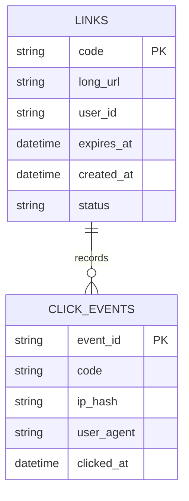

### 6. High-level design (Mermaid flowchart LR)
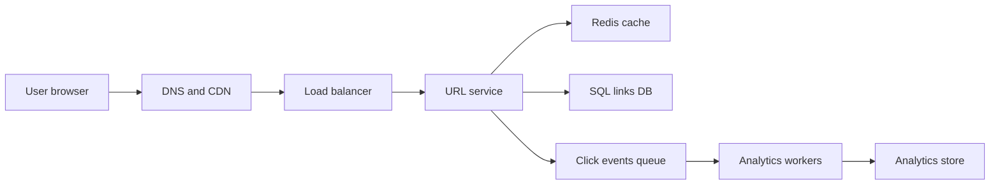

### 7. Key flow sequence diagram(s)
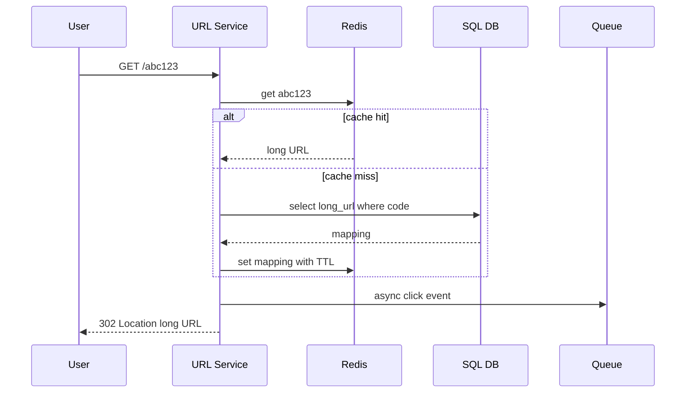

### 8. Deep dives into 2-3 hardest parts
**Short-code generation:** Base62 counter is compact and collision-free with a sequence or Snowflake ID; hash of long URL is deterministic but collision-prone and leaks duplicates; random code needs collision retry. For SDE-1, choose Snowflake/DB sequence → Base62. For custom alias, use DB unique constraint.

**Redirect latency:** Cache hot mappings in Redis with TTL; also use local in-process cache for very hot codes if invalidation is acceptable. Do not synchronously write analytics before redirect.

**Abuse and expiry:** Validate URL scheme, block malware domains, enforce per-user creation limits, and return `410 Gone` for expired links.

### 9. Redis usage · Message queue usage
Redis: `code -> longUrl`, custom alias reservation locks, rate limits. Queue: click analytics events, abuse scans, cache invalidation.

### 10. Scaling 10x -> 100x · High availability & "what if X goes down"
10x: read replicas, Redis cluster, partition analytics by code/date. 100x: shard mapping DB by hash(code), multi-region read cache, asynchronous global replication. If Redis goes down, fall back to DB with circuit breaker and lower TTL after recovery. If DB leader goes down, failover to replica; redirects for cached links still work. If queue is down, buffer best effort or drop analytics, never block redirect.

### 11. Tradeoffs & alternatives rejected
Rejected storing mappings only in Redis because durability and alias uniqueness are critical. Rejected synchronous analytics because it hurts redirect latency. Rejected hash-only code because collision handling and unwanted dedupe complicate behavior.

### 12. "SDE-1 answer (enough to pass)" vs "Senior answer [Stretch]"
- **SDE-1:** LB, URL service, SQL mappings, Redis cache, async analytics, Base62 IDs, unique constraint.
- **Senior [Stretch]:** abuse pipeline, multi-region cache warmup, custom domain support, GDPR deletion, per-tenant quotas, active-active conflict strategy.

### 13. Interviewer follow-up questions with short answers
- *301 or 302?* → 302 by default for analytics/control; 301 for permanent SEO links if allowed.
- *How avoid collisions?* → Generate numeric ID then Base62, or random with DB unique retry.
- *How track analytics?* → Async event queue and aggregate offline.

### 14. One-paragraph revision summary
URL shortener is read-heavy: generate collision-free Base62 codes, store canonical mappings in SQL, cache hot redirects in Redis, and push analytics asynchronously. The main interview tradeoff is redirect latency versus analytics freshness and durability.

## 2. Design Pastebin
Tier 1 · SDE-1 must-know

### 0. Beginner primer

**Simple problem:** Let users save text or code and share it through a short paste link. **Mental model:** The
paste body is a file in a warehouse, while the database card says who owns it, whether it expires, and where the
file lives. **Thought process:** First ask size, privacy, retention, and read/write ratio. Reads are higher than
writes, but writes must durably connect metadata to content. Core data is paste ID, visibility, object key,
language, owner, and expiry. The bottleneck is serving hot public pastes and storing large bodies; consistency is
mainly metadata plus permission correctness. **Request flow:** Write path validates size, stores content in
object storage, inserts metadata in SQL, queues moderation or highlighting, and returns the paste URL. Read path
checks metadata/cache, verifies visibility, fetches content from cache or object storage, and records stats
asynchronously. **Key trade-offs and alternatives:** SQL blobs are simple but bloat backups; object storage is
cheap but separates metadata and content. **How it scales:** Use content delivery network caching for public raw
reads, shard metadata by paste ID, and clean expired or orphaned objects in workers.

### 1. Clarifying questions to ask
- Max paste size and retention period?
- Public, unlisted, or private pastes?
- Syntax highlighting required?
- Editable after creation or immutable?
- Expected reads vs writes and abuse moderation needs?

### 2. Functional & Non-functional requirements
Functional: create paste, read paste by key, optional expiry, visibility, raw view, metadata. Non-functional: durable storage, high read availability, large content support, low read latency, spam/malware controls.

### 3. Capacity estimation (show the math)
Assume 500K pastes/day, average 10 KB, 20M reads/day. Write QPS ≈ 6, peak 30. Read QPS ≈ 231, peak 1,200. Storage/day = 500K × 10 KB = 5 GB/day; 1-year raw ≈ 1.8 TB before replication. Metadata row ≈ 1 KB/day = 0.5 GB/day.

### 4. API design (endpoints with request/response)
`POST /api/v1/pastes`
```json
{"content":"public class A {}","language":"java","visibility":"UNLISTED","expiresInSeconds":604800}
```
Response:
```json
{"pasteId":"p9Kx2a","url":"https://paste.io/p9Kx2a","rawUrl":"https://paste.io/raw/p9Kx2a"}
```
`GET /pastes/{pasteId}`, `GET /raw/{pasteId}`, `DELETE /pastes/{pasteId}` for owner/admin.

### 5. Data model + DB choice with justification
Use SQL for metadata and permissions. Store large paste body in object storage for cost and scalability. Small pastes may be stored inline initially, but object storage is cleaner at scale.

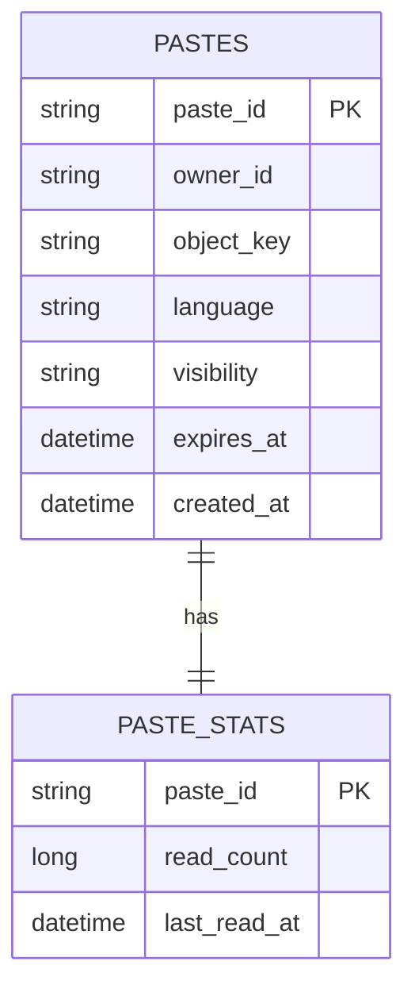

### 6. High-level design (Mermaid flowchart LR)
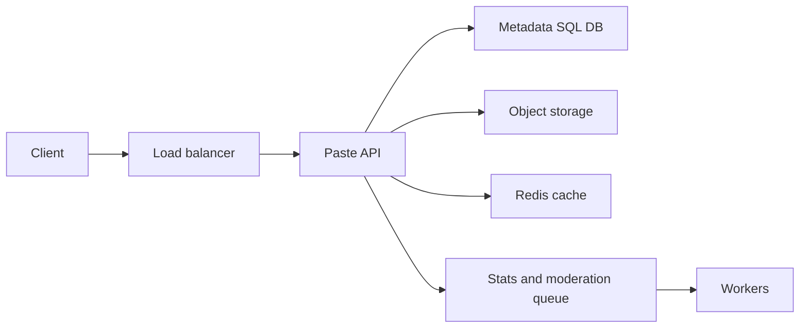

### 7. Key flow sequence diagram(s)
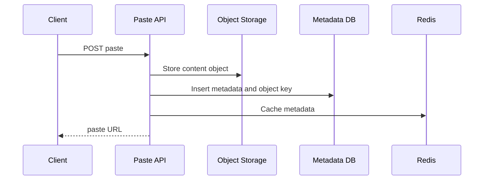

### 8. Deep dives into 2-3 hardest parts
**Content storage:** Object storage handles large blobs better than DB BLOBs. Metadata DB stores owner, visibility, expiry, language, and object key.

**Expiry and deletion:** A background job scans expired metadata and deletes or tombstones content. Object lifecycle policies clean orphaned objects.

**Read path:** Cache metadata and small hot content in Redis/CDN. Raw public pastes can be CDN cached; private pastes require signed access and auth checks.

### 9. Redis usage · Message queue usage
Redis: hot paste metadata/content, rate limits for paste creation, abuse counters. Queue: moderation scan, syntax highlighting precompute, stats aggregation, expiry cleanup.

### 10. Scaling 10x -> 100x · High availability & "what if X goes down"
10x: CDN for public raw reads, object storage multipart uploads, DB read replicas. 100x: shard metadata by pasteId hash, region-local caches, async replication. If object storage is slow, serve cached hot pastes; if metadata DB is down, cached public reads continue; if queue is down, creation still works but moderation/stats lag.

### 11. Tradeoffs & alternatives rejected
Rejected storing all content in SQL because blobs bloat backups and reduce DB cache efficiency. Rejected synchronous syntax highlighting because it slows paste creation. Rejected public sequential IDs because enumeration increases abuse.

### 12. "SDE-1 answer (enough to pass)" vs "Senior answer [Stretch]"
- **SDE-1:** API service, SQL metadata, object storage content, Redis cache, expiry worker.
- **Senior [Stretch]:** malware scanning, privacy model, legal takedown workflow, CDN signed URLs, object lifecycle tiers, regional replication.

### 13. Interviewer follow-up questions with short answers
- *How protect private pastes?* → Auth check metadata, signed short-lived object URL, no CDN public cache.
- *How handle very large pastes?* → Multipart direct upload with size limits.
- *How prevent spam?* → Rate limit, captcha/risk scoring, moderation queue.

### 14. One-paragraph revision summary
Pastebin is mostly metadata plus blob storage. Keep DB for searchable metadata and permissions, store content in object storage, cache hot public reads, and handle moderation, stats, syntax highlighting, and expiry asynchronously.

## 3. Design Distributed Rate Limiter
Tier 1 · SDE-1 must-know

### 0. Beginner primer

**Simple problem:** Decide whether a caller may make one more request right now. **Mental model:** Each user or
API key has a bucket of tokens; every request spends a token, and time slowly refills the bucket. **Thought
process:** Clarify the subject being limited, strictness, burst allowance, and failure mode. Traffic is all
write-like because each check updates quota state. Core data is rule, key, current tokens, last refill time, and
audit sample. The bottleneck is atomic counter updates, and consistency needs are bounded by policy rather than
business transactions. **Request flow:** Write path loads the cached rule, sends one atomic Redis script to
refill and consume, then allows the backend call or returns retry-after. Read path for configuration reads rules
from SQL into gateway caches. **Key trade-offs and alternatives:** Token bucket allows bursts; sliding log is
stricter but memory-heavy; local-only limiting is fast but bypassed across servers. **How it scales:** Shard
Redis by key, keep local fallback buckets, split hot tenant limits, and choose fail-open or fail-closed by risk.

### 1. Clarifying questions to ask
- Limit by user, IP, API key, tenant, endpoint, or all?
- Strict global limits or approximate regional limits?
- Burst allowed or smooth traffic only?
- What happens if limiter store is down: fail-open or fail-closed?
- Required response headers and audit logs?

### 2. Functional & Non-functional requirements
Functional: check and consume quota, configure rules, return allow/deny and retry-after. Non-functional: sub-millisecond to few-ms decision, atomic updates, high availability, bounded memory, distributed correctness good enough for policy.

### 3. Capacity estimation (show the math)
Assume 50K API QPS, one limiter check per request, 1 KB Redis operation response/request overhead approximate. Peak Redis ops ≈ 50K/s. If 10M active keys/day and each key state ≈ 100 B plus overhead 2x, memory ≈ 2 GB; shard Redis for throughput and HA.

### 4. API design (endpoints with request/response)
Internal check:
```http
POST /internal/rate-limit/check
```
```json
{"key":"user:42:/send","limit":100,"windowSeconds":60,"cost":1}
```
Response:
```json
{"allowed":true,"remaining":73,"retryAfterSeconds":0}
```
Admin config: `PUT /rules/{ruleId}` with subject, endpoint, algorithm, rate, burst.

### 5. Data model + DB choice with justification
Rules live in SQL/config store for auditability. Runtime counters live in Redis Cluster for atomic low-latency updates.

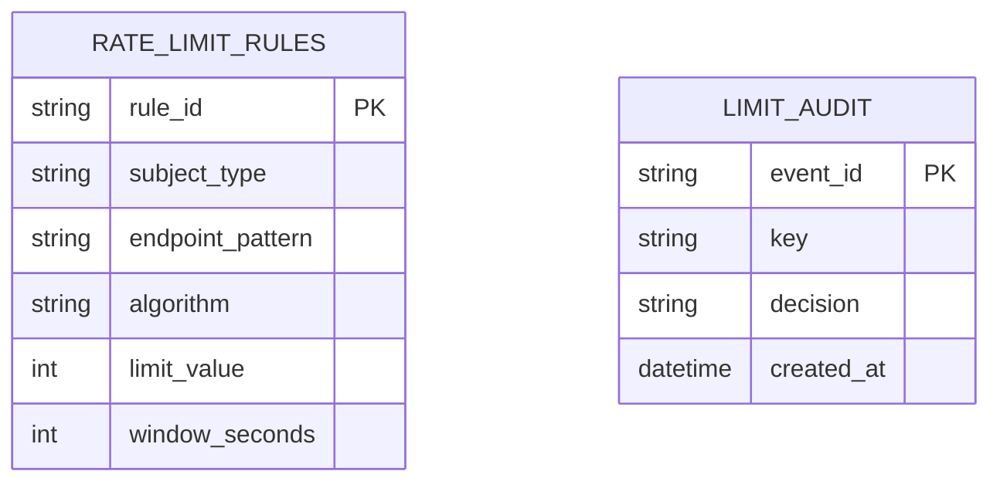

### 6. High-level design (Mermaid flowchart LR)
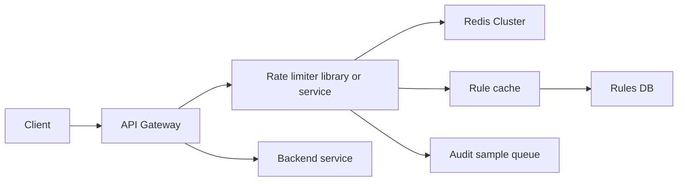

### 7. Key flow sequence diagram(s)
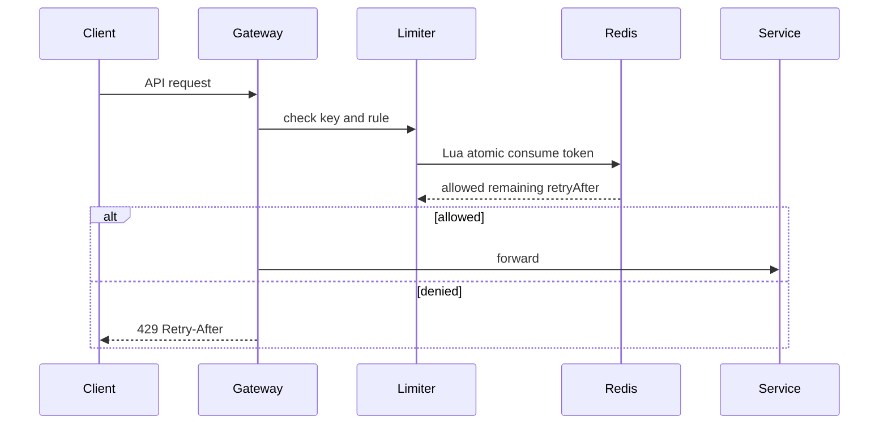

### 8. Deep dives into 2-3 hardest parts
**Algorithm choice:** Token bucket for public APIs because it permits bursts while limiting average. Sliding log for strict compliance but memory-heavy. Sliding counter for balanced accuracy and memory.

**Atomicity:** Use Lua script so refill, consume, TTL update, and response are one atomic operation. Avoid GET then SET races.

**Failure mode:** Fail-open for low-risk traffic to protect availability; fail-closed for login, expensive LLM calls, or abuse-prone endpoints. Add local fallback token buckets if Redis is degraded.

### 9. Redis usage · Message queue usage
Redis stores token bucket state and TTL keys. Queue stores sampled audit events, rule changes for cache invalidation, and abuse analytics.

### 10. Scaling 10x -> 100x · High availability & "what if X goes down"
Shard Redis by key hash; keep gateway-local rule cache; use regional limiters plus coarse global quotas. If Redis shard goes down, route to replica or use local emergency limiter. If rules DB goes down, cached rules continue until TTL; if audit queue is down, drop samples, not decisions.

### 11. Tradeoffs & alternatives rejected
Rejected DB counters due to write latency and lock contention. Rejected purely local limiters because limits are bypassed across gateway instances. Accepted small distributed approximation errors for availability.

### 12. "SDE-1 answer (enough to pass)" vs "Senior answer [Stretch]"
- **SDE-1:** Gateway checks Redis token bucket atomically; returns 429; rules cached.
- **Senior [Stretch]:** hierarchical global/regional limits, adaptive abuse detection, local fallback, multi-tenant fairness, Redis hot-key mitigation.

### 13. Interviewer follow-up questions with short answers
- *Why Lua?* → Atomic multi-step update in Redis.
- *How avoid hot keys?* → Split huge tenant counters by shard and aggregate, or enforce per-user plus tenant limits.
- *What headers return?* → `X-RateLimit-Limit`, `Remaining`, `Reset`, `Retry-After`.

### 14. One-paragraph revision summary
A distributed rate limiter sits at the gateway, uses Redis for atomic shared counters, and chooses token bucket or sliding-window algorithms based on burst tolerance. Main tradeoffs are strictness versus latency and availability.

## 4. Design Unique ID Generator
Tier 1 · SDE-1 must-know

### 0. Beginner primer

**Simple problem:** Generate IDs that are unique across many machines without asking one central database for
every value. **Mental model:** Each ID is a packed ticket containing time, worker number, and a per-millisecond
counter. **Thought process:** Ask whether IDs must be sortable, compact, public, and multi-region. Writes are
ID requests; reads are mostly monitoring worker leases. Core data is epoch, worker ID, sequence, last timestamp,
and namespace. The bottleneck is a central sequence if you choose one; consistency depends on never reusing a
worker ID and never moving time backward silently. **Request flow:** Write path usually calls a local library,
reads the current clock, combines timestamp plus worker plus sequence, and returns immediately. Read path checks
lease/config state and generator health. **Key trade-offs and alternatives:** Database sequences are simple but
centralized; UUIDs are easy but large and not time ordered; Snowflake-style IDs are fast but clock-sensitive.
**How it scales:** Allocate worker ranges per region, use lease fencing, pause on clock rollback, and monitor
sequence exhaustion.

### 1. Clarifying questions to ask
- Required throughput and number of regions?
- Should IDs be sortable by time?
- Numeric only or string allowed?
- Can IDs reveal creation time or machine id?
- What is acceptable behavior during clock rollback?

### 2. Functional & Non-functional requirements
Functional: generate globally unique IDs, expose service/library endpoint, monitor worker IDs. Non-functional: high throughput, low latency, no central bottleneck, roughly ordered if needed, resilient to restarts.

### 3. Capacity estimation (show the math)
Assume 100K IDs/sec peak globally, 100 workers. Per worker ≈ 1K IDs/sec. Snowflake with 12-bit sequence gives 4096 IDs/ms/worker ≈ 4M/sec/worker theoretical, far above need. 64-bit IDs store 8 bytes each; 1B rows need 8 GB raw for ID column before indexes.

### 4. API design (endpoints with request/response)
Library method preferred for low latency: `long nextId()`. Service fallback:
```http
POST /internal/ids/batch
```
```json
{"namespace":"orders","count":1000}
```
Response:
```json
{"ids":["7423912340001","7423912340002"],"expiresAt":"2026-09-23T23:00:00Z"}
```

### 5. Data model + DB choice with justification
No DB on hot path for Snowflake. Use coordination/config store for worker assignments and audit.

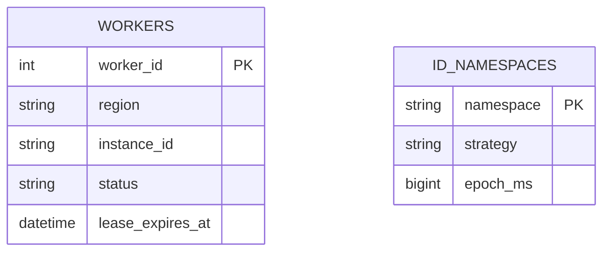

### 6. High-level design (Mermaid flowchart LR)
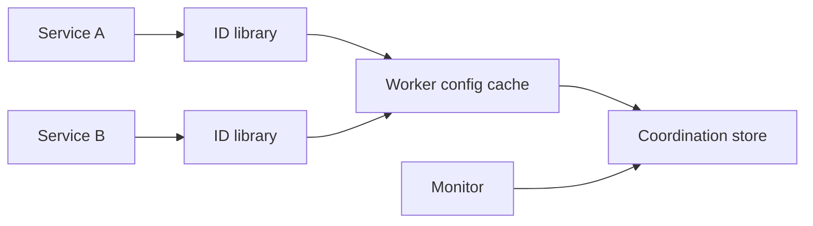

### 7. Key flow sequence diagram(s)
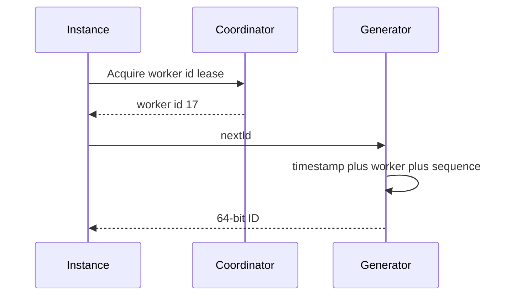

### 8. Deep dives into 2-3 hardest parts
**Bit layout:** 1 sign bit, 41 timestamp bits, 10 worker bits, 12 sequence bits is common. Timestamp bits define lifetime; worker bits define scale; sequence bits define per-ms throughput.

**Worker assignment:** Use static config for simple systems or coordination leases for dynamic fleets. Never run two active instances with same worker id.

**Clock rollback:** Detect `now < lastTimestamp`. Options: block until clock catches up, fail fast, or use logical sequence extension. For correctness, never generate duplicate timestamp-worker-sequence tuple.

### 9. Redis usage · Message queue usage
Redis optional for worker leases or range allocation but coordination store is safer. Queue optional for audit/monitoring events; not in hot path.

### 10. Scaling 10x -> 100x · High availability & "what if X goes down"
Add worker bits or namespaces, run generator as library to avoid network hop, reserve worker ranges per region. If coordinator goes down, existing leases continue until TTL; new instances cannot start. If clock skew occurs, instance self-protects by pausing or failing.

### 11. Tradeoffs & alternatives rejected
Rejected DB sequence at high scale due to central bottleneck. Rejected UUID v4 when compact sortable IDs are required. Rejected timestamp-only IDs because same-millisecond duplicates are likely.

### 12. "SDE-1 answer (enough to pass)" vs "Senior answer [Stretch]"
- **SDE-1:** Snowflake-style ID with timestamp, worker id, sequence, unique worker assignment.
- **Senior [Stretch]:** region bits, clock rollback strategy, worker lease fencing, privacy encoding, migration from DB IDs.

### 13. Interviewer follow-up questions with short answers
- *How many IDs per ms with 12 bits?* → 4096 per worker.
- *Are IDs globally ordered?* → Roughly time-ordered, not perfectly across skewed machines.
- *Can users infer traffic?* → Yes if exposed; encode or use opaque public IDs if needed.

### 14. One-paragraph revision summary
Use Snowflake-style IDs when you need compact, high-throughput, roughly sortable unique IDs without a DB bottleneck. The critical correctness issues are worker-id uniqueness, sequence overflow, and clock rollback handling.

## 5. Design Distributed Cache / Key-Value Store
Tier 1 · SDE-1 must-know

### 0. Beginner primer

**Simple problem:** Store and fetch values by key with very low latency across several machines. **Mental
model:** Imagine many labeled drawers arranged in a ring; consistent hashing tells the client which drawer owns
a key, and replicas keep spare copies. **Thought process:** Clarify cache versus durable store, key size, value
size, query rate, time-to-live, eviction, and acceptable data loss. Reads and writes are both hot, and memory is
the scarce resource. Core data is key, value, expiry, version, owner node, and replica set. The bottleneck is hot
keys and rebalancing; consistency can be eventual for cache but may require quorum for durable key-value use.
**Request flow:** Write path routes to the primary, stores memory state, optionally appends persistence, and
replicates. Read path routes by hash, returns from primary or replica, and treats expired entries as misses.
**Key trade-offs and alternatives:** Client-side routing is fast but needs membership updates; perfect least
recently used eviction is costly. **How it scales:** Add virtual nodes, replicas, failover, hot-key replication,
request coalescing, and background repair.

### 1. Clarifying questions to ask
- Cache only or durable KV store?
- Expected key/value size, QPS, TTL, eviction policy?
- Need replication and consistency level?
- Operations: get, set, delete, compare-and-set, batch?
- Is data loss acceptable?

### 2. Functional & Non-functional requirements
Functional: get/set/delete keys, TTL, eviction, replication, client routing. Non-functional: low latency, horizontal scaling, high availability, hot-key handling, bounded memory, optional persistence.

### 3. Capacity estimation (show the math)
Assume 10M keys, average value 1 KB, metadata overhead 100 B, replication factor 2. Memory ≈ 10M × 1.1 KB × 2 ≈ 22 GB. Peak 200K QPS; with 20K safe QPS/node, need at least 10 nodes plus headroom, so 15-20 nodes.

### 4. API design (endpoints with request/response)
Client library preferred:
```java
Optional<byte[]> get(String key);
void set(String key, byte[] value, Duration ttl);
boolean delete(String key);
boolean compareAndSet(String key, byte[] expected, byte[] next);
```
Wire endpoint if service-based: `GET /kv/{key}`, `PUT /kv/{key}`, `DELETE /kv/{key}`.

### 5. Data model + DB choice with justification
In-memory hash table per node for speed. Optional append-only log and snapshots for recovery. Consistent hashing maps keys to nodes.

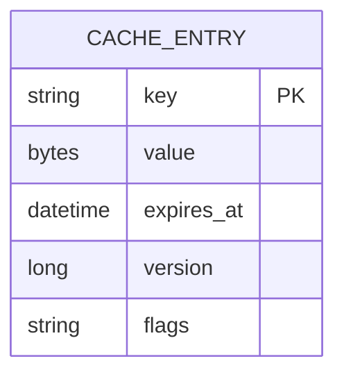

### 6. High-level design (Mermaid flowchart LR)
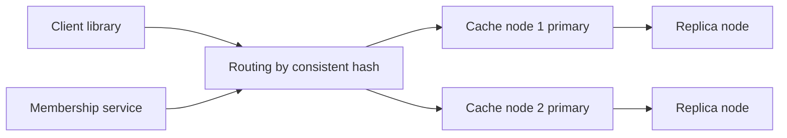

### 7. Key flow sequence diagram(s)
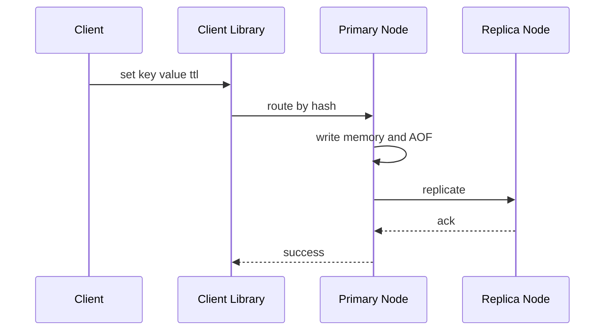

### 8. Deep dives into 2-3 hardest parts
**Partitioning:** Use consistent hashing with virtual nodes so adding/removing nodes moves limited keys. Replicate to next N distinct nodes on the ring.

**Eviction:** LRU approximations, LFU, TTL-based expiry, and memory pressure eviction. Choose based on workload; Redis often uses approximate policies for speed.

**Consistency:** For cache, eventual replication is usually fine. For durable KV, allow quorum reads/writes and versioning to resolve conflicts.

### 9. Redis usage · Message queue usage
This system is Redis-like. Redis can be used directly in real interviews unless asked to design cache internals. Queue is not hot path; membership changes and async persistence events can be logged.

### 10. Scaling 10x -> 100x · High availability & "what if X goes down"
Add nodes and rebalance virtual nodes; shard metadata; use replicas and automatic failover. If a node dies, client routes to replica and membership updates. If hot key overloads one node, add local cache, key salting for counters, or special replication for hot keys.

### 11. Tradeoffs & alternatives rejected
Rejected centralized router only because it can bottleneck; client-side routing is faster but needs membership updates. Rejected perfect LRU because it is expensive under high concurrency. Accepted eventual consistency for cache use cases.

### 12. "SDE-1 answer (enough to pass)" vs "Senior answer [Stretch]"
- **SDE-1:** Hash keys across nodes, replicate, TTL, eviction, client library routing.
- **Senior [Stretch]:** virtual nodes, quorum mode, anti-entropy repair, AOF/snapshot recovery, hot-key replication, split-brain handling.

### 13. Interviewer follow-up questions with short answers
- *How add a node?* → Add virtual nodes to ring and move only affected key ranges.
- *What if cache misses spike?* → Use request coalescing, backpressure, and warmup.
- *How choose TTL?* → Based on freshness requirement and origin load tolerance.

### 14. One-paragraph revision summary
A distributed cache partitions keys with consistent hashing, stores values in memory with TTL/eviction, and replicates for availability. The main design choices are routing, eviction, replication consistency, persistence, and hot-key protection.

## Revision Cheat Sheet

- URL shortener: SQL mapping, Redis redirect cache, Base62 IDs, async analytics.
- Pastebin: SQL metadata, object storage content, CDN/cache for public raw reads.
- Rate limiter: gateway + Redis atomic token bucket; fail-open or fail-closed by risk.
- Unique ID: Snowflake avoids DB bottleneck; protect worker IDs and clocks.
- Distributed cache: consistent hashing, virtual nodes, TTL, eviction, replicas.
- For read-heavy systems, never put analytics or slow scans in the user critical path.
- For correctness, prefer DB unique constraints and idempotency over best-effort locks.
- For blob-heavy systems, app servers should issue signed URLs rather than proxy all bytes.
- For cache systems, plan for cache miss storms and hot keys.
- For every case, say what happens when Redis, DB, queue, or a node goes down.

## Flashcards

1. Q → URL shortener DB? A → SQL for mappings, Redis for hot redirects.
2. Q → URL analytics path? A → Async queue after redirect decision.
3. Q → Pastebin content store? A → Object storage; DB stores metadata.
4. Q → Paste expiry? A → Metadata TTL plus cleanup worker and object lifecycle.
5. Q → Token bucket store? A → Redis atomic script with TTL.
6. Q → Rate limiter failure choice? A → Fail-open for availability, fail-closed for abuse-sensitive paths.
7. Q → Snowflake risk? A → Clock rollback or duplicate worker id.
8. Q → Snowflake throughput with 12 sequence bits? A → 4096 IDs per ms per worker.
9. Q → Cache partitioning? A → Consistent hashing with virtual nodes.
10. Q → Cache hot key mitigation? A → local cache, replication, salting, request coalescing.
