# 09d · HLD Case Studies Tier 1 II

This file completes the Tier-1 HLD set with notification, chat, feed, autocomplete, and ticket-booking designs. Each case is optimized for SDE-1 clarity with Senior stretch points.

**Legend:** 🟢 Beginner · 🟡 Intermediate · 🔴 Advanced · ⚫ FAANG · 🔥 = very frequently asked

## Table of Contents
- [Beginner guide to this file](#beginner-guide-to-this-file)
- [6. Design Notification Service](#6-design-notification-service)
- [7. Design Chat App](#7-design-chat-app-whatsapp)
- [8. Design News Feed](#8-design-news-feed)
- [9. Design Search Autocomplete](#9-design-search-autocomplete)
- [10. Design Ticket Booking](#10-design-ticket-booking-bookmyshow)
- [Revision Cheat Sheet](#revision-cheat-sheet)
- [Flashcards](#flashcards)

## Beginner guide to this file

### What this file teaches
This file teaches user-facing high-level design (HLD) systems where latency, reliability, and correctness meet:
notifications, chat, feeds, autocomplete, and ticket booking. Interviewers like these cases because they reveal
whether you can separate the fast read path from the durable write path and explain user experience during
failure.

### Mental model
Think of these systems as live event operations: some work must happen immediately for the user, while other work
can be scheduled, fanned out, retried, or repaired.

- Queues absorb provider calls, fan-out, delivery, and expiry work so APIs stay responsive.
- Redis stores ephemeral state such as presence, rate limits, seat holds, and hot pages.
- Durable stores keep messages, bookings, posts, templates, and user preferences.
- Idempotency prevents duplicate emails, messages, holds, payments, or bookings.
- The read path is often cached; the write path usually owns correctness.

### How to think through any question here
1. Identify the user-visible action: send, receive, post, suggest, hold, or confirm.
2. Ask what must be durable before acknowledging success.
3. Decide what can be stale, such as feed freshness or autocomplete ranking.
4. Model the main state machine: notification status, message cursor, post fan-out, or seat state.
5. Estimate peak traffic and call out bursty moments such as flash sales or push storms.
6. Add queues, retries, and dedupe where external systems or fan-out are involved.
7. Explain how the user recovers when a gateway, provider, cache, or database fails.

### Pattern recognition cues
| If the question mentions... | Think about... | Why it fits |
|---|---|---|
| Email, SMS, push, or provider failure | Async queue and provider adapters | External providers are slow and unreliable. |
| Online users or typing indicators | WebSocket gateways plus Redis presence | Presence is temporary and connection-oriented. |
| Offline message history | Append-first durable message store | Delivery can be retried only if the message is stored. |
| Feed from followers | Fan-out-on-write and celebrity fan-out-on-read | Normal users need fast reads; celebrities avoid huge writes. |
| Prefix suggestions per keystroke | Precomputed top prefixes | Per-keystroke database queries are too slow. |
| Reserved seats or no double booking | Redis hold plus SQL transaction | Temporary user experience needs final durable correctness. |
| Duplicate retry after timeout | Idempotency key | Retrying should return the previous result, not repeat work. |
| Flash sale traffic | Waiting room, rate limit, and cached metadata | The hot write endpoint needs protection before the database. |

### Abbreviations and key terms
| Short form | Expanded form | Plain meaning |
|---|---|---|
| API | Application programming interface | Contract used by clients and services. |
| CDN | Content delivery network | Edge cache for pages, media, or public assets. |
| DAU | Daily active users | Count of unique users active in one day. |
| DB | Database | Durable storage for important state. |
| DLQ | Dead-letter queue | Queue for jobs that exceeded retry limits. |
| DR | Disaster recovery | Plan for restoring service after a major outage. |
| E2E | End to end | Protection or behavior that spans sender to receiver, often encryption. |
| FAANG | Facebook, Amazon, Apple, Netflix, Google | Shorthand for large product-company interview style. |
| Fan-out | Not an abbreviation | Copying one event to many recipients or feed inboxes. |
| FST | Finite state transducer | Compact trie-like structure used for suggestions. |
| GB | Gigabyte | Roughly one billion bytes. |
| HLD | High-level design | Component-level system design discussion. |
| ID | Identifier | Unique value for a user, message, post, booking, or request. |
| Idempotency | Not an abbreviation | Safe retry pattern where the same request key returns the same result. |
| KB | Kilobyte | Roughly one thousand bytes. |
| KV | Key-value | Data model that reads by exact key. |
| MB | Megabyte | Roughly one million bytes. |
| ML | Machine learning | Model-based ranking, filtering, or prediction. |
| ms | Millisecond | One thousandth of a second. |
| P99 | 99th percentile | Tail-latency measure for most-but-not-all requests. |
| PK | Primary key | Unique row identifier in a relational table. |
| QPS | Queries per second | Request throughput. |
| REST | Representational state transfer | Common HTTP API style using resources and verbs. |
| SDE-1 | Software Development Engineer level 1 | Entry-level engineering interview bar in this guide. |
| SMS | Short Message Service | Text-message notification channel. |
| SQL | Structured Query Language | Relational query language and shorthand for relational databases. |
| TB | Terabyte | Roughly one trillion bytes. |
| TTL | Time to live | Expiration duration for cache, presence, or holds. |
| UX | User experience | How responsive and understandable the system feels to users. |
| WebSocket | WebSocket protocol | Long-lived two-way connection for real-time updates. |

### Common beginner traps
- Acknowledging chat messages before durable storage, then losing messages on crash.
- Treating a push provider, SMS provider, or payment provider as always available.
- Recomputing a news feed or autocomplete result from raw data on every read.
- Using Redis-only seat locks without a final SQL constraint or transaction.
- Forgetting idempotency for notification requests, message sends, and booking confirmation.
- Ignoring celebrity users, flash sales, or per-keystroke request multiplication.

### How to study this file
1. Start with the revision cheat sheet and name the core pattern for each system.
2. For each case, trace the write path until the point where success is acknowledged.
3. Trace the read path and mark which data can be stale without harming correctness.
4. Use flashcards to practice the one-sentence answer, then add a failure scenario.
5. Rehearse one SDE-1 answer and one Senior stretch point for every design.

### Scalability and production lens
In production, these systems fail at the edges: mobile clients disconnect, providers throttle, queues lag, and
hot events overload one partition. A strong answer keeps durable state separate from ephemeral state, makes retry
safe with idempotency, and gives a degraded but honest user experience when real-time delivery or ranking is
behind.

## 6. Design Notification Service
Tier 1 · SDE-1 must-know

### 0. Beginner primer

**Simple problem:** Accept a request to notify a user and deliver it through email, SMS, push, or in-app without
blocking the caller on provider delays. **Mental model:** It is a postal dispatch center: the API accepts an
envelope, workers choose the carrier, and status tracking records what happened. **Thought process:** Start with
transactional versus marketing traffic, delivery urgency, preferences, and provider limits. Writes dominate the
pipeline because every notification becomes status plus queued work; reads are mainly status and preferences.
Core data is request ID, user, channel, template, provider response, and status. The bottleneck is provider
throughput, while consistency needs focus on avoiding duplicate sends. **Request flow:** Write path validates
idempotency and preferences, persists status, enqueues a channel job, and returns queued. Read path fetches status
or preference data from SQL/cache. **Key trade-offs and alternatives:** Synchronous provider calls are simpler
but fragile; at-least-once delivery plus dedupe is realistic. **How it scales:** Partition queues by channel and
tenant, rate-limit with Redis, fail over providers, and use dead-letter queues for manual repair.

### 1. Clarifying questions to ask
- Channels: email, SMS, push, in-app?
- Transactional only or marketing too?
- Required delivery latency and retry policy?
- User preferences, quiet hours, unsubscribe?
- Need templates, localization, provider failover?

### 2. Functional & Non-functional requirements
Functional: accept notification request, render template, honor preferences, send via provider, retry, track status. Non-functional: high availability, at-least-once processing, idempotency, provider failover, rate limiting, auditability.

### 3. Capacity estimation (show the math)
Assume 10M notifications/day, peak factor 5. Average QPS = 10M / 86,400 ≈ 116; peak ≈ 580 sends/sec. Payload/status row 1 KB → 10 GB/day raw metadata. If provider allows 100/sec/account, need multiple provider accounts or queued throttling for peak.

### 4. API design (endpoints with request/response)
`POST /api/v1/notifications`
```json
{"requestId":"req-123","userId":"u1","channel":"EMAIL","templateId":"ticket-confirmed","data":{"event":"Concert"}}
```
Response:
```json
{"notificationId":"n789","status":"QUEUED"}
```
`GET /api/v1/notifications/{id}` returns status. `PUT /api/v1/preferences/{userId}` updates channel preferences.

### 5. Data model + DB choice with justification
Use SQL for templates, preferences, and notification status because they need auditability. Queue decouples API from providers. Redis handles rate limits and dedupe windows.

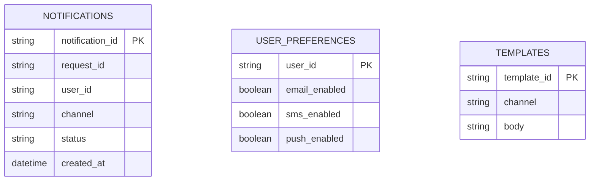

### 6. High-level design (Mermaid flowchart LR)
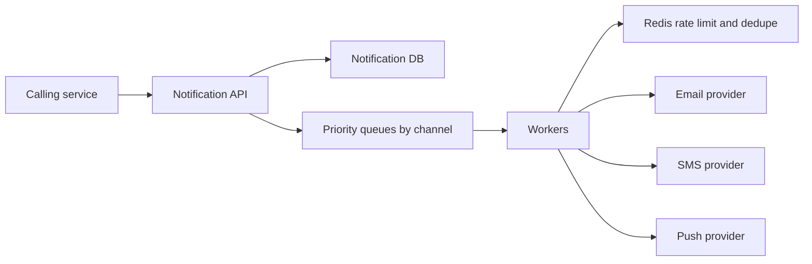

### 7. Key flow sequence diagram(s)
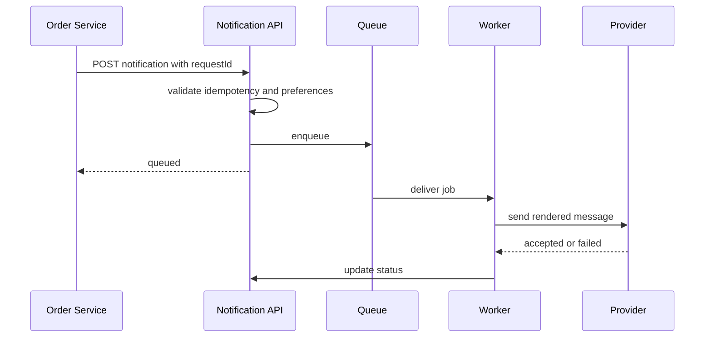

### 8. Deep dives into 2-3 hardest parts
**Retries and idempotency:** Store `requestId` unique per caller to avoid duplicate sends. Retry transient provider failures with exponential backoff and DLQ after max attempts.

**Provider failover:** Abstract provider adapters; if primary SMS provider fails, use secondary if allowed. Track provider message id for reconciliation.

**Preferences and compliance:** Check unsubscribe, quiet hours, and channel opt-in before enqueueing non-critical messages.

### 9. Redis usage · Message queue usage
Redis: per-user/channel dedupe, provider rate limits, quiet-hour cache. Queue: priority channel queues, retries, DLQ, delayed jobs.

### 10. Scaling 10x -> 100x · High availability & "what if X goes down"
Scale workers horizontally by channel. Partition queues by tenant/channel. If provider is down, retry and failover; if queue is down, API can reject or persist pending outbox; if DB is down, do not accept new sends unless outbox is local to caller.

### 11. Tradeoffs & alternatives rejected
Rejected synchronous provider calls in API because provider latency and downtime would affect callers. Rejected exactly-once delivery promise; providers and retries make at-least-once plus dedupe realistic.

### 12. "SDE-1 answer (enough to pass)" vs "Senior answer [Stretch]"
- **SDE-1:** API, DB status, queue, workers, provider adapters, retries.
- **Senior [Stretch]:** priority scheduling, multi-provider routing, compliance rules, provider webhooks, cost-aware channel fallback.

### 13. Interviewer follow-up questions with short answers
- *How avoid duplicate emails?* → Idempotency key plus dedupe window.
- *How handle provider rate limits?* → Redis token bucket per provider/account.
- *How know delivery status?* → Provider webhooks update notification status.

### 14. One-paragraph revision summary
Notification service is an async delivery pipeline. Persist requests, enqueue jobs, render templates in workers, enforce preferences/rate limits, retry safely, and treat provider calls as unreliable external dependencies.

## 7. Design Chat App (WhatsApp)
Tier 1 · SDE-1 must-know

### 0. Beginner primer

**Simple problem:** Send messages quickly to online users while keeping history safe for offline users. **Mental
model:** A chat app is a notebook plus a live messenger: the notebook is durable storage, and WebSocket delivery
is only the fast courier. **Thought process:** Clarify one-to-one versus groups, media, receipts, retention, and
encryption. Writes are message sends and receipt updates; reads are history sync and live delivery. Core data is
conversation, message ID, sender, sequence, cursor, and connection mapping. The bottleneck is concurrent
connections and fan-out, while consistency is per-conversation ordering rather than global ordering. **Request
flow:** Write path accepts a client message ID, validates membership, appends to the message store, returns an
acknowledgement, then pushes to online devices or queues push notification. Read path fetches messages after a
cursor and uses presence to route live updates. **Key trade-offs and alternatives:** Global ordering is wasteful;
per-conversation ordering is enough. **How it scales:** Shard conversations, scale WebSocket gateways, keep
presence in Redis with time-to-live, and let clients reconnect and resume from cursor.

### 1. Clarifying questions to ask
- One-to-one only or groups too?
- Text only or media, read receipts, typing indicators?
- Online delivery latency target?
- Message history retention?
- End-to-end encryption required?

### 2. Functional & Non-functional requirements
Functional: send/receive messages, offline sync, conversations, delivery/read receipts, presence, media metadata. Non-functional: low latency for online users, durable message storage, ordered messages per conversation, scalable WebSocket connections, high availability.

### 3. Capacity estimation (show the math)
Assume 10M DAU, 50 messages/user/day = 500M messages/day. Write QPS = 500M / 86,400 ≈ 5,800; peak ≈ 29K. Message average 1 KB → 500 GB/day raw, 1.5 TB/day at 3x replication. WebSockets: 2M concurrent connections; if one gateway handles 100K connections, need 20+ gateways plus headroom.

### 4. API design (endpoints with request/response)
REST for history: `GET /conversations/{id}/messages?after=cursor`. WebSocket event:
```json
{"type":"SEND_MESSAGE","clientMessageId":"c1","conversationId":"conv1","body":"hi"}
```
Ack:
```json
{"type":"MESSAGE_ACK","clientMessageId":"c1","messageId":"m900","serverTs":1790000000000}
```

### 5. Data model + DB choice with justification
Use wide-column/partitioned store for messages keyed by conversation and time. SQL can store user/conversation metadata. Redis stores presence and connection routing.

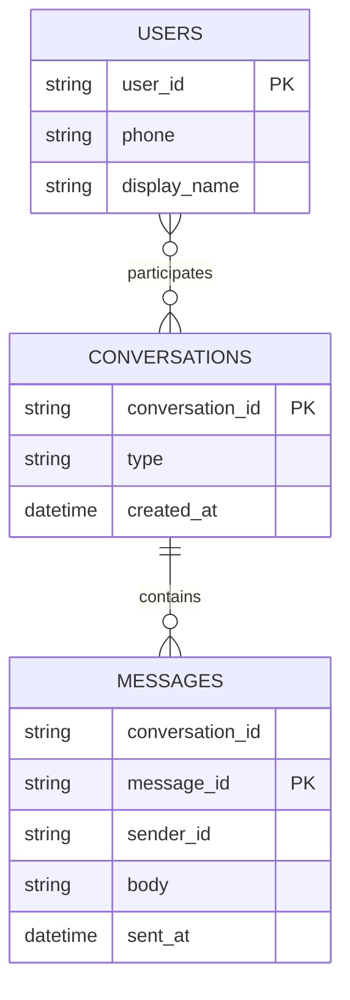

### 6. High-level design (Mermaid flowchart LR)
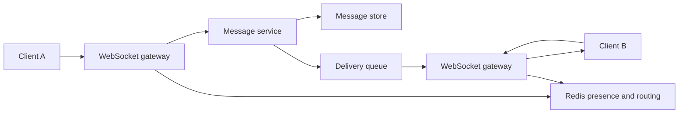

### 7. Key flow sequence diagram(s)
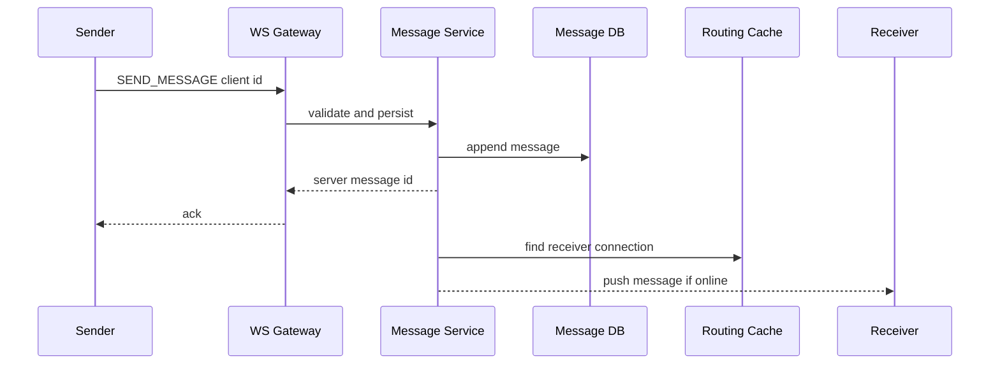

### 8. Deep dives into 2-3 hardest parts
**Ordering:** Guarantee order per conversation by partitioning messages by `conversation_id` and assigning monotonically increasing sequence numbers per conversation.

**Offline sync:** Persist every message first, then deliver. Offline devices fetch messages after last seen cursor on reconnect.

**Media:** Upload media to object storage using signed URLs; chat message stores media metadata and object key.

### 9. Redis usage · Message queue usage
Redis: user presence with TTL, user-to-gateway mapping, typing indicators, rate limits. Queue/log: delivery fan-out, push notifications for offline users, receipt updates.

### 10. Scaling 10x -> 100x · High availability & "what if X goes down"
Shard conversations by ID, scale WebSocket gateways, use regional routing, store messages with replication. If gateway dies, clients reconnect and resume from cursor. If Redis presence dies, online routing degrades but history remains. If message DB is down, do not ack as sent.

### 11. Tradeoffs & alternatives rejected
Rejected storing messages only in gateway memory because offline sync and durability matter. Rejected global ordering because per-conversation ordering is sufficient and cheaper. Rejected synchronous push notification in send path.

### 12. "SDE-1 answer (enough to pass)" vs "Senior answer [Stretch]"
- **SDE-1:** WebSocket gateways, message service, durable store, Redis presence, offline fetch.
- **Senior [Stretch]:** multi-device sync, E2E encryption, group fan-out, regional routing, abuse detection, media CDN.

### 13. Interviewer follow-up questions with short answers
- *How handle offline users?* → Store messages, send push notification, sync after cursor on reconnect.
- *How know user is online?* → WebSocket heartbeat updates Redis TTL.
- *How avoid duplicates?* → Client message id plus unique constraint per sender/conversation.

### 14. One-paragraph revision summary
Chat design centers on durable append-first messaging and real-time delivery as an optimization. Persist messages, ack after durability, route online delivery through WebSocket gateways and Redis presence, and let offline clients sync by cursor.

## 8. Design News Feed
Tier 1 · SDE-1 must-know

### 0. Beginner primer

**Simple problem:** Show each user a timeline of posts from people they follow with low read latency. **Mental
model:** Each user has an inbox of post pointers; normal authors drop copies into follower inboxes, while
celebrity posts are pulled in later. **Thought process:** Ask whether the feed is chronological or ranked, how
large follower counts can be, and how fresh the feed must be. Reads are much heavier than writes, so precompute
for normal users. Core data is post, follow edge, feed item, score, and cursor. The bottleneck is fan-out for
high-follower authors; consistency can be eventual because a slightly stale feed is acceptable. **Request flow:**
Write path persists the post, enqueues fan-out, workers read followers and insert feed item pointers. Read path
loads a cached feed page or feed store entries, merges celebrity posts, and hydrates post details. **Key
trade-offs and alternatives:** Fan-out-on-write gives fast reads but write amplification; fan-out-on-read avoids
celebrity explosions but costs read latency. **How it scales:** Shard by user, partition fan-out queues, cache the
first page, and monitor fan-out lag.

### 1. Clarifying questions to ask
- Follow graph or friends graph?
- Chronological feed or ranked feed?
- Text only or media posts?
- Read latency target and freshness?
- How many followers can a user have?

### 2. Functional & Non-functional requirements
Functional: create post, follow/unfollow, fetch feed, like/comment optional. Non-functional: low feed-read latency, eventual consistency acceptable, high availability, celebrity handling, scalable fan-out.

### 3. Capacity estimation (show the math)
Assume 20M DAU, each opens feed 20/day → 400M reads/day, QPS ≈ 4,630, peak 23K. 4M posts/day → 46 write QPS, peak 230. Feed item pointer 32 B; fan-out to 500 followers average means 4M × 500 × 32 B = 64 GB/day feed-index writes before replication.

### 4. API design (endpoints with request/response)
`POST /api/v1/posts`
```json
{"text":"hello","mediaIds":["m1"]}
```
`GET /api/v1/feed?cursor=abc&limit=20`
```json
{"items":[{"postId":"p1","authorId":"u2","score":0.91}],"nextCursor":"def"}
```
`POST /api/v1/follows/{targetUserId}`.

### 5. Data model + DB choice with justification
Use SQL/graph store for follow edges if moderate, or sharded KV for huge graph. Store posts in durable DB/object storage. Store precomputed feed inboxes in Redis/Cassandra-like store.

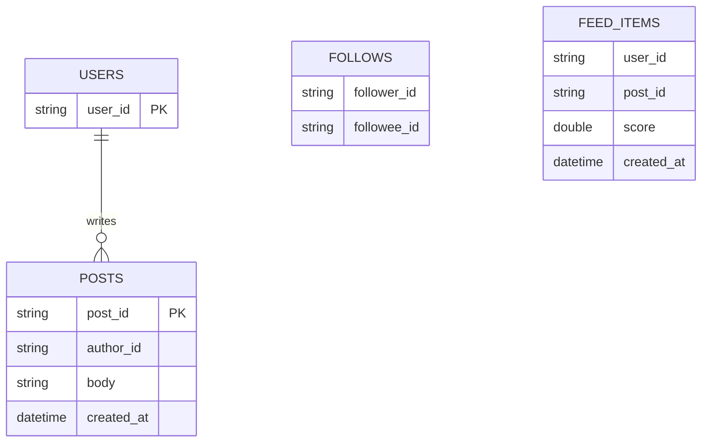

### 6. High-level design (Mermaid flowchart LR)
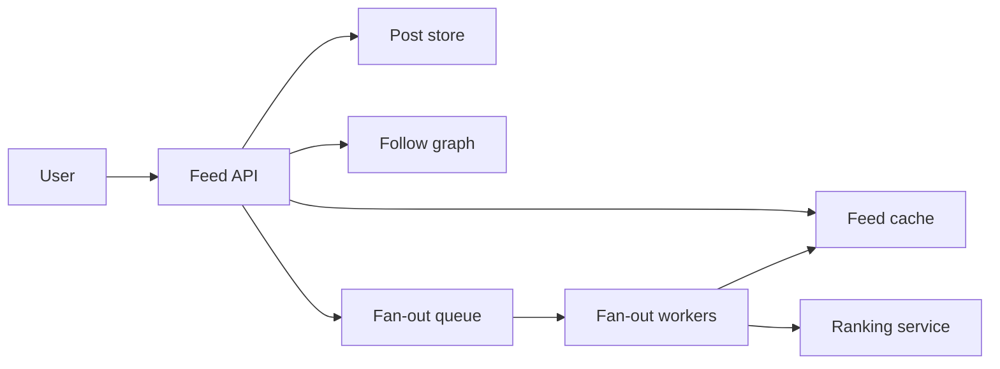

### 7. Key flow sequence diagram(s)
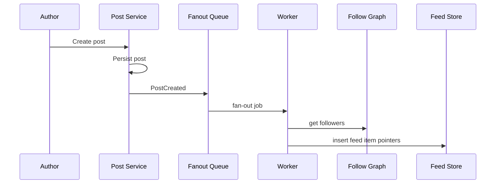

### 8. Deep dives into 2-3 hardest parts
**Fan-out hybrid:** Fan-out-on-write for normal users creates fast feed reads. For celebrities, avoid writing to millions of inboxes; merge celebrity posts at read time.

**Ranking:** Start chronological for SDE-1. Senior answer adds rank score from recency, affinity, engagement, freshness, and negative feedback.

**Follow/unfollow:** On follow, optionally backfill recent posts. On unfollow, remove future items and lazily filter older feed entries.

### 9. Redis usage · Message queue usage
Redis: hot feed pages, user timeline cache, counters. Queue: fan-out jobs, ranking refresh, notification events.

### 10. Scaling 10x -> 100x · High availability & "what if X goes down"
Shard feed store by userId, partition fan-out queue by authorId or postId, cache first feed page. If fan-out workers lag, feeds become stale but post creation succeeds. If ranking is down, serve chronological fallback. If feed cache is down, rebuild from feed store.

### 11. Tradeoffs & alternatives rejected
Rejected pure fan-out-on-read for all users because feed reads are too frequent. Rejected pure fan-out-on-write for celebrities due to write amplification. Accepted eventual consistency for feed freshness.

### 12. "SDE-1 answer (enough to pass)" vs "Senior answer [Stretch]"
- **SDE-1:** Post store, follow graph, fan-out queue, feed cache/store, read API.
- **Senior [Stretch]:** celebrity hybrid, ranking pipeline, ML features, privacy filtering, backpressure, multi-region timelines.

### 13. Interviewer follow-up questions with short answers
- *How handle celebrity with 50M followers?* → Do not push to all; pull/merge at read time.
- *How delete a post?* → Tombstone post and lazily remove/filter from feeds.
- *How keep feed fresh?* → Async fan-out with lag monitoring; read-time merge for recent important items.

### 14. One-paragraph revision summary
News feed is read-heavy, so precompute feed inboxes for normal users and use hybrid read-time merge for celebrities. Queues decouple post creation from fan-out, and ranking can evolve from chronological to ML-based.

## 9. Design Search Autocomplete
Tier 1 · SDE-1 must-know

### 0. Beginner primer

**Simple problem:** Return likely search suggestions after each typed prefix, usually within a few milliseconds.
**Mental model:** It is a prepared dictionary, not a live database scan: query logs build the dictionary, and the
online API only looks up prefixes. **Thought process:** Clarify data sources, personalization, typo tolerance,
locale, freshness, and per-keystroke traffic. Reads dominate because one search creates many suggestion calls;
writes are query events and ranking updates. Core data is prefix, suggestion, score, locale, and safety filter.
The bottleneck is latency at high query rate, and consistency is eventual because suggestions can lag. **Request
flow:** Write path logs query events, ranking jobs aggregate popularity, and versioned snapshots update the trie
or prefix table. Read path checks hot prefix cache, falls back to trie or finite state transducer, filters unsafe
terms, and returns top K. **Key trade-offs and alternatives:** Precomputed prefix tables are simple and fast;
tries compress shared prefixes; full personalization fragments cache. **How it scales:** Shard by prefix or
locale, cache hot prefixes, serve stale data if ranking updates lag, and stream trend deltas.

### 1. Clarifying questions to ask
- Suggestions from historical queries, products, users, or documents?
- Personalized or global?
- Typo tolerance and language support?
- Freshness requirement for trending terms?
- QPS per keystroke and latency target?

### 2. Functional & Non-functional requirements
Functional: return top K suggestions for prefix, ingest query logs, update rankings, filter unsafe terms. Non-functional: P99 under 50 ms, high read QPS, eventual freshness, locale awareness, abuse filtering.

### 3. Capacity estimation (show the math)
Assume 50M searches/day and 10 keystrokes/search → 500M autocomplete requests/day. Average QPS = 5,787; peak ≈ 30K. Response 5 KB → peak bandwidth ≈ 150 MB/s. Top suggestions for 10M prefixes × 10 suggestions × 40 B ≈ 4 GB raw before overhead, feasible in memory/sharded Redis.

### 4. API design (endpoints with request/response)
`GET /api/v1/suggest?q=iph&locale=en-IN&limit=10`
```json
{"suggestions":[{"text":"iphone 15","score":98.2},{"text":"iphone charger","score":76.1}]}
```
Ingest: `POST /internal/query-events` with query text, locale, timestamp, anonymized user/tenant.

### 5. Data model + DB choice with justification
Use in-memory trie/FST or Redis for hot prefix suggestions; search index for fallback; object storage/warehouse for query logs and batch jobs.

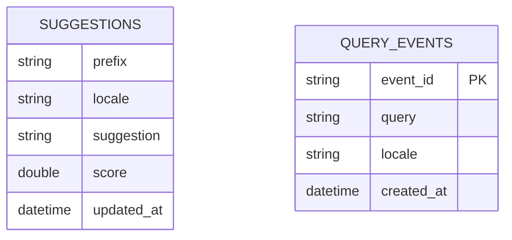

### 6. High-level design (Mermaid flowchart LR)
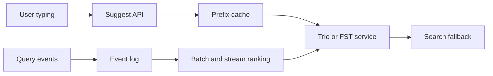

### 7. Key flow sequence diagram(s)
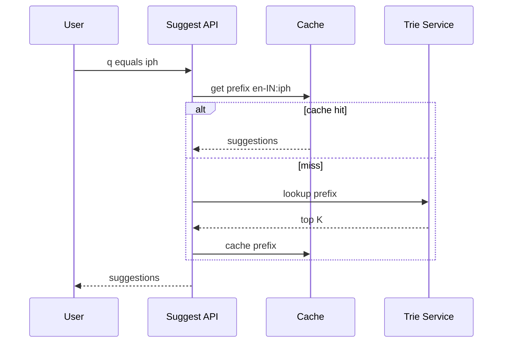

### 8. Deep dives into 2-3 hardest parts
**Trie vs precomputed prefix table:** Trie is memory efficient for shared prefixes; precomputed prefix table is simple and very fast for top K. FST compresses trie-like structure for large dictionaries.

**Ranking:** Score from frequency, recency, locale, business quality, personalization, and safety filters. Start global, add personalization as stretch.

**Freshness:** Batch recompute daily plus streaming counters for trending terms. Use versioned snapshots to swap suggestion data safely.

### 9. Redis usage · Message queue usage
Redis: hot prefix cache and counters. Queue/log: query events, streaming popularity updates, batch recomputation triggers.

### 10. Scaling 10x -> 100x · High availability & "what if X goes down"
Shard by prefix hash/locale, keep hot prefixes in memory, CDN generally not helpful for personalized suggestions. If trie service is down, serve cached stale suggestions. If logging pipeline is down, suggestions continue but freshness suffers.

### 11. Tradeoffs & alternatives rejected
Rejected DB lookup per keystroke due to latency/QPS. Rejected full personalization initially because it increases cache fragmentation. Accepted eventual freshness because suggestions need not be transactionally current.

### 12. "SDE-1 answer (enough to pass)" vs "Senior answer [Stretch]"
- **SDE-1:** Precompute top suggestions per prefix, serve from cache/trie, ingest logs async.
- **Senior [Stretch]:** FST compression, multilingual tokenization, typo tolerance, trending stream, personalization, abuse filtering.

### 13. Interviewer follow-up questions with short answers
- *How update suggestions?* → Batch from query logs plus streaming deltas.
- *How handle typos?* → Fuzzy search/edit distance fallback after prefix lookup.
- *Why not CDN?* → Query prefixes are dynamic and often personalized; edge cache may help only hot global prefixes.

### 14. One-paragraph revision summary
Autocomplete is an ultra-read-heavy prefix lookup system. Precompute ranked suggestions from logs, serve hot prefixes from memory/Redis/trie, update asynchronously, and keep the online path simple enough for sub-50-ms latency.

## 10. Design Ticket Booking (BookMyShow)
Tier 1 · SDE-1 must-know

### 0. Beginner primer

**Simple problem:** Let users browse events and reserve exact seats without ever selling the same seat twice.
**Mental model:** Browsing is a public catalog, but seat booking is a bank vault: a temporary hold helps the user,
and SQL is the final lock. **Thought process:** Ask about reserved seats, hold duration, payment, and flash-sale
traffic. Reads are event pages and seat maps; writes are holds, payments, confirmations, and expiry. Core data is
show, seat, hold, booking, payment status, and expiration. The bottleneck is contention on popular seats, and
consistency must be strong for final booking. **Request flow:** Write path creates Redis hold keys, conditionally
updates available seats to held in SQL, returns expiry, then confirms booking after idempotent payment. Read path
serves event metadata and seat map snapshots from cache while checking authoritative seat state when needed.
**Key trade-offs and alternatives:** Redis-only locks are unsafe; SQL-only locks are safer but slower. **How it
scales:** Shard by show, add waiting rooms and rate limits, keep short holds, reconcile payment success versus
booking failure, and fail closed when the booking database is unavailable.

### 1. Clarifying questions to ask
- Movies/events only or all venues?
- Reserved seats with seat map?
- How long can seats be held before payment?
- Payment integration and idempotency?
- Flash-sale traffic expected?

### 2. Functional & Non-functional requirements
Functional: browse events, view seat map, lock seats, create booking, pay, confirm/cancel, expire holds. Non-functional: no double booking, low read latency for browsing, strong consistency for seat state, high availability, safe payment retries.

### 3. Capacity estimation (show the math)
Flash sale: 1M users in 10 min ≈ 1,667 users/sec. If each refreshes seat map 5 times, read QPS ≈ 8.3K. Booking attempts 100K in 10 min ≈ 167/sec, but contention on same seats is high. Seat rows per show: 300 seats × 10K shows/day = 3M seat-show rows/day if precomputed.

### 4. API design (endpoints with request/response)
`GET /events?city=Lucknow&date=2026-09-24`
`GET /shows/{showId}/seats`
`POST /shows/{showId}/holds`
```json
{"seatIds":["A1","A2"],"idempotencyKey":"hold-123"}
```
Response:
```json
{"holdId":"h1","expiresAt":"2026-09-23T22:15:00Z","status":"HELD"}
```
`POST /bookings` with holdId and payment token; response confirmed booking.

### 5. Data model + DB choice with justification
Use SQL for bookings and seat state because strong constraints are needed. Redis can hold temporary locks for fast UX, but SQL unique/conditional update is final authority.

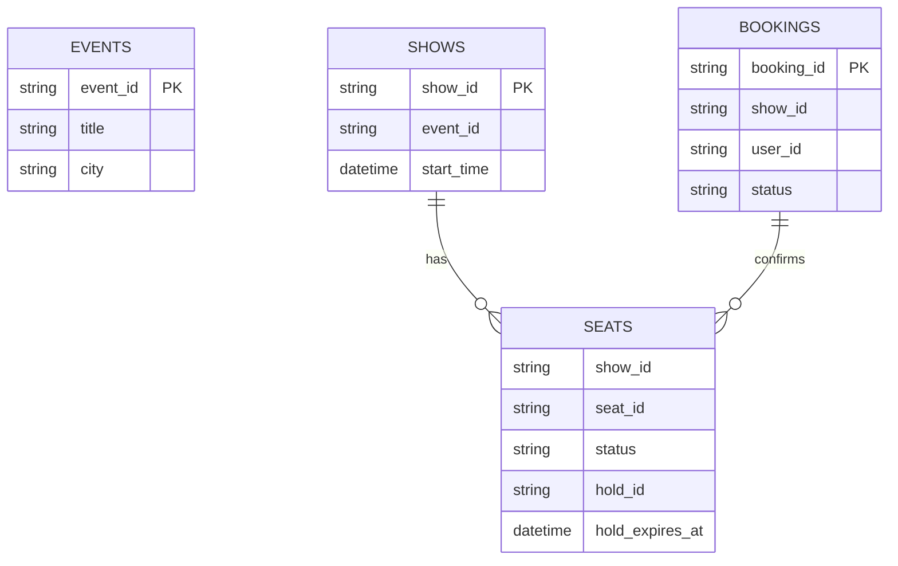

### 6. High-level design (Mermaid flowchart LR)
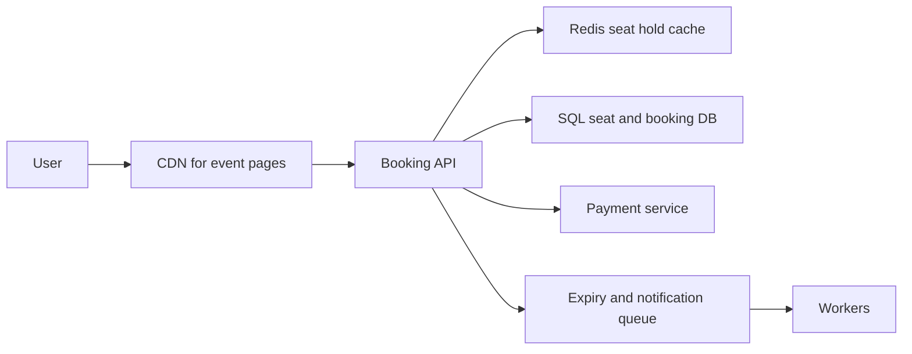

### 7. Key flow sequence diagram(s)
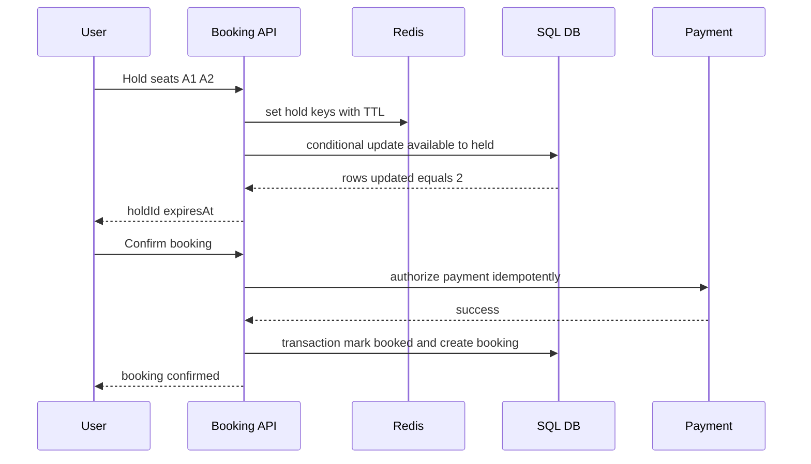

### 8. Deep dives into 2-3 hardest parts
**Seat locking:** Redis TTL gives fast temporary lock and expiry. SQL conditional update like `WHERE status = 'AVAILABLE'` or unique booking constraint prevents double booking. If Redis and DB disagree, DB wins.

**Payment idempotency:** Use booking id/idempotency key when calling payment provider. If payment succeeds but confirmation fails, reconciliation worker completes or refunds.

**Flash sale load:** Cache event/show metadata and seat map snapshots; protect hold endpoint with rate limits and queue/wait room if needed.

### 9. Redis usage · Message queue usage
Redis: seat hold TTL keys, seat map cache, rate limits, waiting room tokens. Queue: hold expiry cleanup, payment reconciliation, notifications, analytics.

### 10. Scaling 10x -> 100x · High availability & "what if X goes down"
Shard by showId or venue/date; route all seat writes for one show to the same shard to reduce contention. If Redis is down, fall back to DB-only locks with higher latency. If payment provider is down, keep hold until expiry and let user retry. If DB leader is down, do not confirm bookings until failover.

### 11. Tradeoffs & alternatives rejected
Rejected eventually consistent seat booking because double booking is unacceptable. Rejected Redis-only locks because cache loss could sell same seat twice. Rejected long holds because they reduce inventory availability.

### 12. "SDE-1 answer (enough to pass)" vs "Senior answer [Stretch]"
- **SDE-1:** Event browsing cache, seat hold with Redis TTL, SQL transaction/constraint for final booking, payment idempotency.
- **Senior [Stretch]:** virtual waiting room, per-show write partition, reconciliation ledger, fraud checks, surge autoscaling, active-passive DR.

### 13. Interviewer follow-up questions with short answers
- *How guarantee no double booking?* → Conditional SQL update/unique constraint inside transaction is final authority.
- *What if hold expires during payment?* → Check hold validity before final booking; optionally extend hold during payment start.
- *How handle payment success but booking failure?* → Reconciliation job confirms if possible or refunds.

### 14. One-paragraph revision summary
Ticket booking is correctness-first. Cache browsing, but make seat locking and booking strongly consistent using Redis TTL for temporary UX and SQL constraints/transactions as final authority. Payment must be idempotent and reconciled.

## Revision Cheat Sheet

- Notification service: async queue, provider adapters, retries, idempotency, preferences.
- Chat: WebSocket gateway, durable message store, Redis presence, offline cursor sync.
- News feed: fan-out-on-write for normal users, fan-out-on-read for celebrities, queues for async fan-out.
- Autocomplete: precomputed top prefixes, trie/FST/Redis, logs feed ranking jobs.
- Ticket booking: Redis TTL hold plus SQL conditional update/constraint; DB is source of truth.
- Always separate browse/read-heavy paths from correctness-critical write paths.
- Queue external provider calls and fan-out work; do not block user APIs unnecessarily.
- Use Redis for fast ephemeral state, not as sole authority for critical booking/payment data.
- Idempotency is mandatory for payment, notification, message send, and booking confirmation.
- Have a fallback: cached feed, chronological ranking, stale suggestions, provider failover, or DB-only lock.

## Flashcards

1. Q → Notification delivery guarantee? A → At-least-once with idempotency/dedupe.
2. Q → Notification provider down? A → Retry, failover provider, DLQ after max attempts.
3. Q → Chat ack after what? A → After durable message persistence.
4. Q → Chat presence store? A → Redis TTL heartbeat keys.
5. Q → Feed celebrity strategy? A → Fan-out-on-read and merge at read time.
6. Q → Feed normal user strategy? A → Fan-out-on-write to precomputed inbox.
7. Q → Autocomplete online path? A → Prefix cache/trie lookup, not DB scan.
8. Q → Autocomplete freshness? A → Batch recompute plus streaming trends.
9. Q → Ticket no-double-booking guarantee? A → SQL transaction with conditional update or unique constraint.
10. Q → Seat hold expiry? A → Redis TTL plus DB expiry cleanup worker.
