# 09e · HLD Case Studies Tier 2 Part 1

Tier-2 SDE-2 case studies in interview order. For each design, move from requirements and math to APIs, storage, diagrams, deep dives, scaling, tradeoffs, and revision.

**Legend:** 🟢 Beginner · 🟡 Intermediate · 🔴 Advanced · ⚫ FAANG · 🔥 = very frequently asked

## Table of Contents
- [1. Design YouTube or Netflix Video Streaming](#1-design-youtube-or-netflix-video-streaming)
- [2. Design Uber or Ola Ride Hailing](#2-design-uber-or-ola-ride-hailing)
- [3. Design Swiggy or Zomato Food Delivery](#3-design-swiggy-or-zomato-food-delivery)
- [4. Design E-commerce Flipkart](#4-design-e-commerce-flipkart)
- [5. Design Payment Gateway Wallet or UPI](#5-design-payment-gateway-wallet-or-upi)
- [6. Design Dropbox or Google Drive File Sync](#6-design-dropbox-or-google-drive-file-sync)
- [7. Design Web Crawler](#7-design-web-crawler)
- [Revision Cheat Sheet](#revision-cheat-sheet)
- [Flashcards](#flashcards)

## 1. Design YouTube or Netflix Video Streaming
Tier 2 · SDE-2 must-know

### 1. Clarifying questions to ask
- VOD only or live streaming too? Include upload, transcoding, search, comments, DRM, ads?
- Target devices and quality levels: mobile 240p to TV 4K?
- Geography, startup latency, and acceptable processing delay after upload?

### 2. Functional & Non-functional requirements
Functional: upload video, chunked resumable upload, transcode to renditions, generate thumbnail, publish metadata, stream adaptive bitrate, resume playback, search. Non-functional: read-heavy, low playback startup latency, highly available, durable media storage, CDN-first delivery, eventual consistency for processing status.

### 3. Capacity estimation (show the math)
Assume 20M DAU, 5 views/user/day, average watch 8 minutes at 3 Mbps. Views/day = 100M. Playback starts QPS = 100M / 86,400 ≈ 1,158, peak 5x ≈ 5.8K/s. CDN bandwidth/day = 100M × 8 × 60 × 3 Mb ≈ 144,000 Tb ≈ 18 PB/day. Uploads: 200K/day × 500 MB raw ≈ 100 TB/day; renditions can make it 2-4x.

### 4. API design
`POST /videos/uploads` returns presigned multipart URLs. `POST /videos/{id}/complete` enqueues transcode. `GET /videos/{id}/manifest.m3u8` returns signed HLS manifest. `GET /search?q=...`, `GET /users/{id}/watch-history`. Upload completion and publish calls should be idempotent.

### 5. Data model + DB choice
| Entity | Store | Key fields | Why |
|---|---|---|---|
| video_metadata | PostgreSQL or MySQL | video_id, owner_id, title, status | ownership and lifecycle |
| video_segments | Object storage | video_id, rendition, segment_path, checksum | cheap durable media |
| transcode_job | Queue plus SQL | job_id, video_id, state, attempts | retryable async work |
| watch_history | Cassandra or DynamoDB | user_id, video_id, offset | write-heavy by user |
| search_doc | Elasticsearch | title, tags, captions | full-text search |

### 6. High-level design
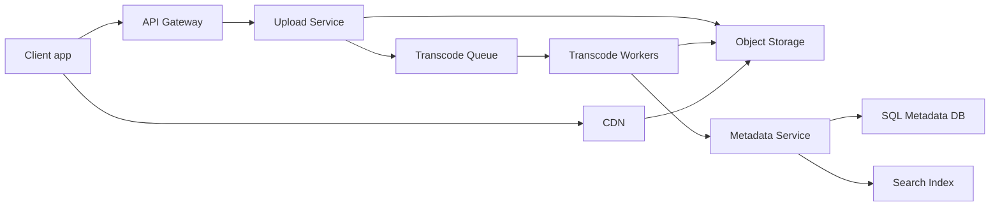

### 7. Key flow sequence diagram(s)
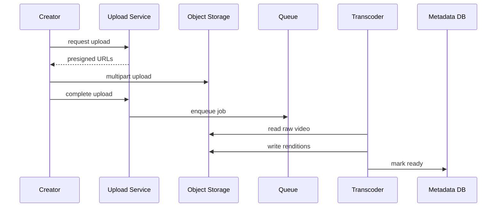

### 8. Deep dives into 2-3 hardest parts
**Adaptive bitrate:** store video as short HLS or DASH segments with multiple bitrates; player switches rendition using bandwidth and buffer health. **CDN and origin protection:** immutable segments get long TTL; manifests use shorter TTL and signed URLs; origin shield and request coalescing reduce object-store load. **Transcoding reliability:** job state machine `UPLOADED → PROCESSING → READY`; retry each rendition independently and make writes idempotent by output path and checksum.

### 9. Redis usage · Message queue usage
Redis: hot video metadata, playback offset cache, rate limits, short-lived signed manifest cache. Queue: transcode, thumbnails, captions, search indexing, analytics events, DLQ for bad media.

### 10. Scaling & HA / failure scenarios
Stateless APIs across AZs; CDN absorbs most reads. If transcoder fails, retry and expose partial lower-quality playback if policy allows. If CDN misses spike, origin shield protects blob storage. If metadata DB leader fails, cached playback still works for hot videos while writes pause or fail over.

### 11. Tradeoffs
Object storage is cheaper than DB for media but separates metadata consistency. Async transcode improves upload latency but delays publish. HLS has broad support; DASH offers advanced player control.

### 12. SDE-1 answer vs Senior answer [Stretch]
- **SDE-1:** upload service, object storage, SQL metadata, queue, transcoders, CDN, Redis cache.
- **Senior [Stretch]:** multi-CDN, DRM, per-title encoding, QoE telemetry, origin shielding, regional placement, backpressure-aware transcode scheduler.

### 13. Interviewer follow-up questions with short answers
- *How resume upload?* → Multipart upload tracks completed parts and checksums.
- *How prevent duplicate upload?* → Hash chunks or file and dedupe at chunk or object level.
- *How handle viral video?* → Pre-warm CDN, raise TTL, cache metadata, throttle origin fill.

### 14. Revision summary
Video streaming is object storage plus CDN plus asynchronous processing. The hard parts are adaptive bitrate, transcode reliability, and origin protection during viral traffic.

## 2. Design Uber or Ola Ride Hailing
Tier 2 · SDE-2 must-know

### 1. Clarifying questions to ask
- Design city-level or global? Cars only or autos, bikes, pooling?
- Need pricing, payments, cancellation, driver incentives, ETA?
- Location update interval and match latency target?

### 2. Functional & Non-functional requirements
Functional: riders request rides, drivers publish locations, matching assigns driver, trip tracking, fare calculation, payment. Non-functional: low-latency match, high availability, real-time-ish locations, no double assignment, graceful degradation during surge.

### 3. Capacity estimation (show the math)
500K active drivers sending location every 5 seconds gives 500K / 5 = 100K location writes/s. 2M rides/day gives 23 requests/s average, peak 10x ≈ 230/s. Location data is ephemeral with TTL; durable trip records 2M/day × 2 KB ≈ 4 GB/day.

### 4. API design
`POST /drivers/{id}/locations` with lat, lon, heading, timestamp. `POST /rides` with pickup, drop, payment_method, idempotency_key. `POST /rides/{id}/accept`, `POST /rides/{id}/cancel`, `POST /rides/{id}/complete`. `GET /rides/{id}/track` by WebSocket or SSE.

### 5. Data model + DB choice
| Entity | Store | Key fields | Why |
|---|---|---|---|
| driver_location | Redis GEO or grid | driver_id, cell, lat, lon, ttl | hot nearby search |
| driver_state | Redis plus SQL snapshot | driver_id, AVAILABLE, RESERVED | atomic assignment |
| ride | PostgreSQL | ride_id, rider_id, driver_id, status | transaction history |
| location_event | Kafka plus lake | driver_id, lat, lon, ts | replay and analytics |
| payment | SQL | ride_id, amount, status | audit |

### 6. High-level design
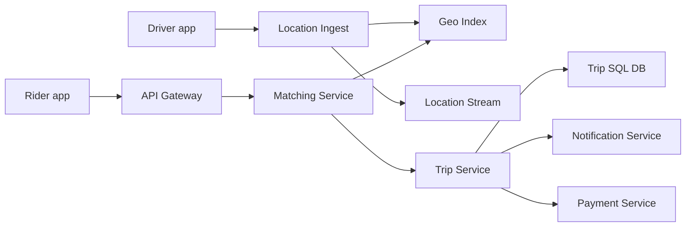

### 7. Key flow sequence diagram(s)
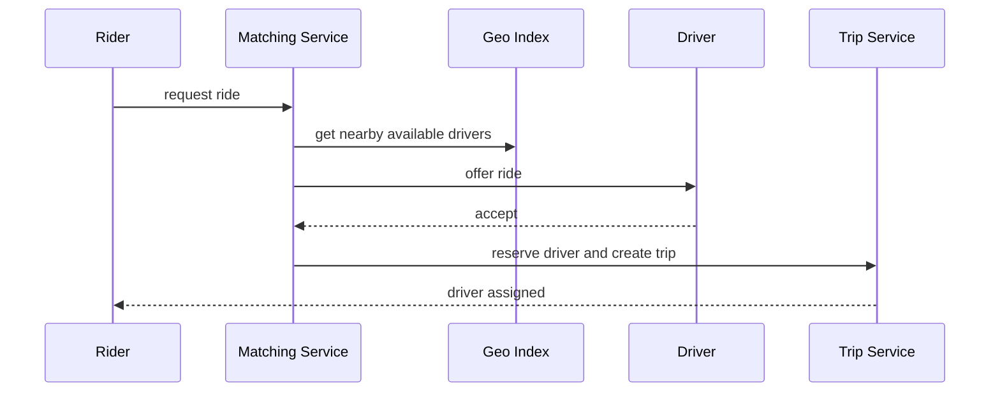

### 8. Deep dives into 2-3 hardest parts
**Geo-indexing:** use geohash, S2, H3, or grid cells; search current cell and neighbors, then exact-filter by distance. **Driver matching:** rank candidates by ETA, distance, vehicle type, acceptance probability; atomically change driver state `AVAILABLE → RESERVED` with TTL. **Surge pricing:** compute demand/supply per cell and time bucket, smooth changes, and cap to avoid poor UX.

### 9. Redis usage · Message queue usage
Redis: driver location TTL, availability state, reservation CAS, surge counters, rider session. Queue: driver offers, notifications, trip state events, location analytics, payment events.

### 10. Scaling & HA / failure scenarios
Partition geo service by city or cell prefix. If Redis loses state, rebuild from driver pings within seconds. If driver accepts but trip creation fails, reservation TTL releases the driver. If notification fails, retry and then pick next driver.

### 11. Tradeoffs
Redis GEO is simple; custom grid/S2 gives better sharding. Strong consistency is required only for assignment, not map display. WebSocket improves tracking but polling is simpler.

### 12. SDE-1 answer vs Senior answer [Stretch]
- **SDE-1:** driver pings location service, rider request hits matching service, nearest driver assigned, trip in SQL.
- **Senior [Stretch]:** ETA model, marketplace balancing, reservation tokens, regional failover, fraud checks, dispatch experiments.

### 13. Interviewer follow-up questions with short answers
- *How prevent double assignment?* → Atomic state transition with TTL and trip id.
- *How ignore stale locations?* → TTL plus timestamp monotonic checks.
- *How scale a hot city?* → Partition by geohash, isolate city cluster, prefetch candidates.

### 14. Revision summary
Ride hailing is a real-time geo and marketplace problem. Store hot locations ephemerally, but make driver assignment strongly consistent.

## 3. Design Swiggy or Zomato Food Delivery
Tier 2 · SDE-2 must-know

### 1. Clarifying questions to ask
- Marketplace only or include restaurant POS and delivery fleet?
- Need live tracking, coupons, ETA, batching, refunds?
- How strict should menu availability and price consistency be?

### 2. Functional & Non-functional requirements
Functional: browse restaurants, maintain cart, place order, collect payment, restaurant accept/reject, assign delivery partner, track delivery, rate order. Non-functional: low browse latency, reliable order state, high availability during meal peaks, no lost payments, eventual menu consistency.

### 3. Capacity estimation (show the math)
10M DAU and 2M orders/day gives 23 orders/s average. If 20% of orders arrive in 2 dinner hours, 400K / 7,200 ≈ 56/s, city spike 5x ≈ 280/s. Browse QPS: 10M × 20 searches/day / 86,400 ≈ 2.3K average, peak 15K. Order storage 2M × 5 KB ≈ 10 GB/day.

### 4. API design
`GET /restaurants?lat=&lon=&q=`, `GET /restaurants/{id}/menu`, `POST /carts/{id}/items`, `POST /orders` with idempotency_key, `POST /restaurants/{id}/orders/{orderId}/accept`, `GET /orders/{id}/track`.

### 5. Data model + DB choice
| Entity | Store | Key fields | Why |
|---|---|---|---|
| restaurant | PostgreSQL plus search | id, location, cuisine, open_state | source and geo search |
| menu_item | PostgreSQL or document DB | item_id, restaurant_id, price, availability | restaurant-owned data |
| order | PostgreSQL | order_id, user_id, status, total | transactional state |
| order_event | Kafka plus lake | order_id, event_type, ts | audit and analytics |
| assignment | SQL plus Redis | order_id, partner_id, state | delivery lifecycle |

### 6. High-level design
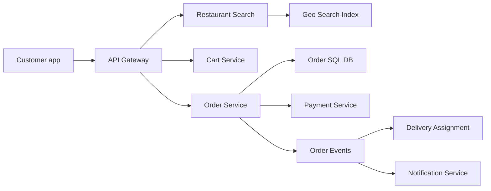

### 7. Key flow sequence diagram(s)
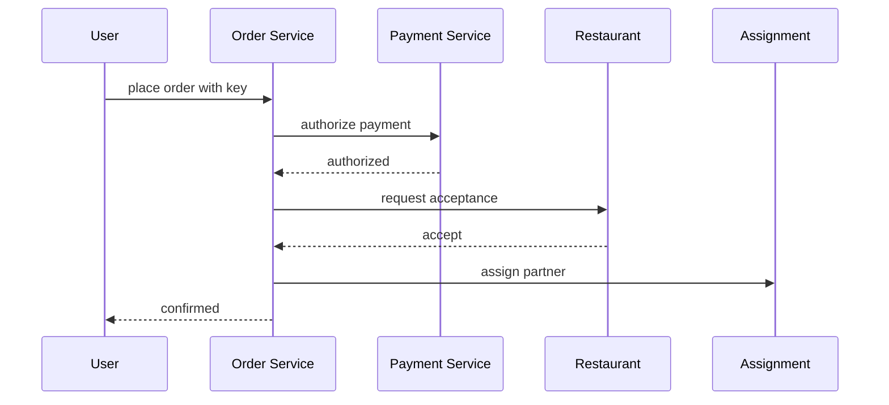

### 8. Deep dives into 2-3 hardest parts
**Order state machine:** `CREATED → PAID → RESTAURANT_ACCEPTED → PICKED_UP → DELIVERED`; compensating refund on rejection. **ETA:** combine prep estimate, delivery partner distance, traffic, and batching. **Price/menu correctness:** cache menus for reads but snapshot item price, taxes, and fees in order items at checkout.

### 9. Redis usage · Message queue usage
Redis: menu cache, cart, restaurant open-state by cell, delivery partner location, idempotency keys. Queue: order events, payment callbacks, restaurant notifications, assignment, analytics, refunds.

### 10. Scaling & HA / failure scenarios
Partition by city and restaurant_id. If payment succeeds but client times out, idempotency returns existing order. If restaurant rejects, refund event is published. If partner cancels, assignment service reassigns without changing payment state.

### 11. Tradeoffs
SQL orders give correctness; NoSQL menus can scale but complicate joins. Payment before restaurant acceptance improves seriousness but creates refunds; auth then capture reduces refunds. Batching improves efficiency but can increase delivery time.

### 12. SDE-1 answer vs Senior answer [Stretch]
- **SDE-1:** restaurant search, cart, order service, payment, restaurant confirmation, delivery assignment.
- **Senior [Stretch]:** saga/outbox, dynamic batching, ETA model, promo abuse checks, restaurant capacity limits, idempotent webhooks.

### 13. Interviewer follow-up questions with short answers
- *How avoid wrong price?* → Store immutable order-item price snapshot.
- *How handle restaurant rejection?* → Transition to rejected and issue refund or release authorization.
- *How scale search?* → Geo index, filters, and cache by cell plus cuisine.

### 14. Revision summary
Food delivery is reliable orchestration across customer, restaurant, delivery, and payment. The hardest part is a clean order state machine.

## 4. Design E-commerce Flipkart
Tier 2 · SDE-2 must-know

### 1. Clarifying questions to ask
- Marketplace or first-party inventory? Include cart, checkout, payment, shipment?
- Need flash sale and inventory reservation? Is oversell acceptable?
- Search and recommendations in scope?

### 2. Functional & Non-functional requirements
Functional: product browse/search, product detail, cart, checkout, reserve inventory, pay, create order, track shipment. Non-functional: high read scale, low checkout latency, no oversell for limited stock, high availability during flash sale, durable order history.

### 3. Capacity estimation (show the math)
50M DAU × 30 product views/day = 1.5B views/day ≈ 17K avg QPS, peak 200K. Orders 5M/day ≈ 58/s avg, peak 2K/s. Flash sale for one SKU can create 100K requests/s. Catalog 100M SKUs × 2 KB ≈ 200 GB metadata; images live in object storage.

### 4. API design
`GET /products?q=&filters=`, `GET /products/{sku}`, `POST /cart/items`, `POST /checkout/reservations`, `POST /orders`, `POST /payments/authorize`, `POST /inventory/{sku}/release`. Use idempotency for checkout and order creation.

### 5. Data model + DB choice
| Entity | Store | Key fields | Why |
|---|---|---|---|
| product | Document DB plus search | sku, title, attrs, seller_id | flexible catalog |
| inventory | SQL or strong KV | sku, available, reserved, version | no oversell |
| cart | Redis or DynamoDB | user_id, sku, qty | high write with TTL |
| order | PostgreSQL or MySQL | order_id, user_id, status, total | transactions |
| order_event | Kafka | order_id, event_type | fulfillment pipeline |

### 6. High-level design
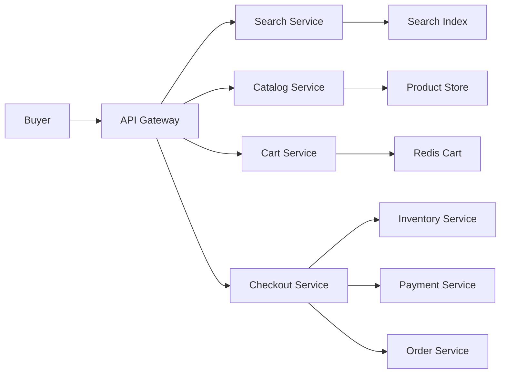

### 7. Key flow sequence diagram(s)
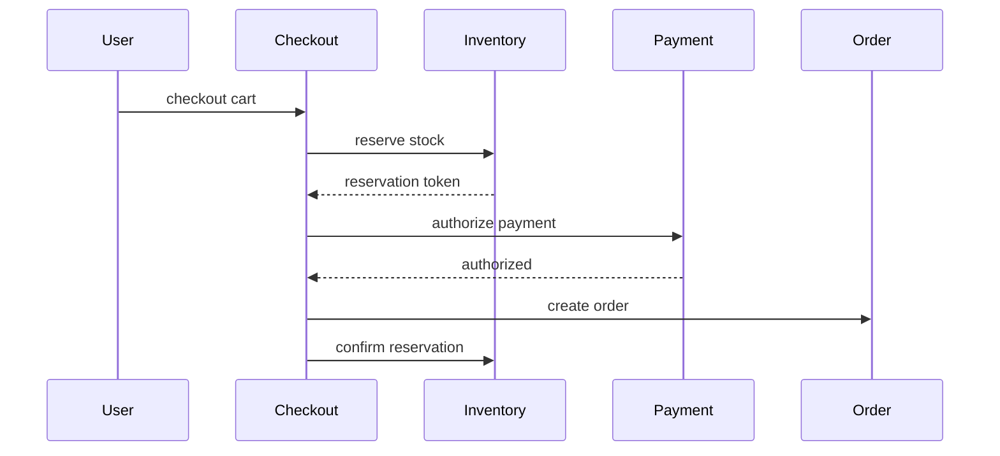

### 8. Deep dives into 2-3 hardest parts
**Flash sale:** CDN static pages, waiting room, per-user limits, Redis sale tokens, and queue admission before touching inventory DB. **Inventory reservation:** atomic decrement or optimistic locking with version; reservation TTL releases stock if payment fails. **Catalog/search:** denormalize docs into Elasticsearch; catalog DB remains source of truth.

### 9. Redis usage · Message queue usage
Redis: product cache, cart, sale tokens, reservation TTL, rate limits. Queue: order placed, payment callbacks, inventory release, shipment creation, search-index updates.

### 10. Scaling & HA / failure scenarios
Serve product pages from CDN/cache; shard catalog by SKU. If payment succeeds but order creation fails, reconciliation either creates order or refunds. If inventory DB is hot, sale token layer and waiting room protect it.

### 11. Tradeoffs
Strong inventory prevents oversell but may reduce availability. Queue-based flash sale improves fairness but adds latency. Denormalized search is fast but eventually consistent.

### 12. SDE-1 answer vs Senior answer [Stretch]
- **SDE-1:** catalog, search, cart, checkout, inventory, payment, order DB.
- **Senior [Stretch]:** reservation state machine, outbox saga, sale admission control, fraud scoring, reconciliation, read replicas.

### 13. Interviewer follow-up questions with short answers
- *How avoid overselling?* → Atomic reservation with TTL and final confirmation.
- *How handle one hot SKU?* → CDN, waiting room, Redis tokens, queue, per-user limits.
- *How recover stuck reservations?* → Expiry scanner releases unconfirmed reservations.

### 14. Revision summary
E-commerce is read-heavy catalog plus correctness-heavy checkout. Flash sales require admission control before inventory writes.

## 5. Design Payment Gateway Wallet or UPI
Tier 2 · SDE-2 must-know

### 1. Clarifying questions to ask
- Gateway, wallet, or UPI switch? P2P, merchant payments, refunds, settlements?
- Required consistency, compliance, reconciliation frequency, fraud checks?
- Can external bank APIs be slow or unavailable?

### 2. Functional & Non-functional requirements
Functional: initiate payment, idempotent retry, debit and credit ledger entries, webhook status, refund, settlement, reconciliation. Non-functional: correctness over availability, auditability, encryption, no duplicate money movement, safe handling of at-least-once callbacks.

### 3. Capacity estimation (show the math)
10M payments/day ≈ 116/s average, peak 2K/s. Each payment creates at least two ledger rows, so 20M ledger rows/day. If ledger row is 500 B, raw ledger ≈ 10 GB/day; with indexes and audit plan 30-50 GB/day. Idempotency keys retained 72 hours: 30M keys × 200 B ≈ 6 GB.

### 4. API design
`POST /payments` with amount, currency, payer, payee, idempotency_key. `GET /payments/{id}` returns authoritative state. `POST /payments/{id}/refunds` with separate idempotency key. `POST /webhooks/bank-status` validates signature and updates state idempotently.

### 5. Data model + DB choice
| Entity | Store | Key fields | Why |
|---|---|---|---|
| payment | PostgreSQL | payment_id, idem_key, amount, state | ACID state |
| ledger_entry | PostgreSQL append-only | entry_id, txn_id, account_id, debit, credit | double-entry audit |
| account_balance | SQL materialized view | account_id, available, pending | fast balance reads |
| bank_message | Kafka plus DB | message_id, payload_hash, state | retries and audit |
| reconciliation_file | Object storage | bank, date, checksum | batch comparison |

### 6. High-level design
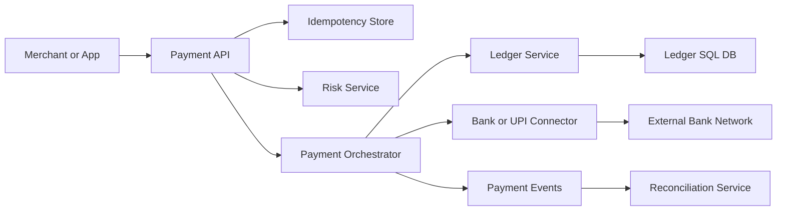

### 7. Key flow sequence diagram(s)
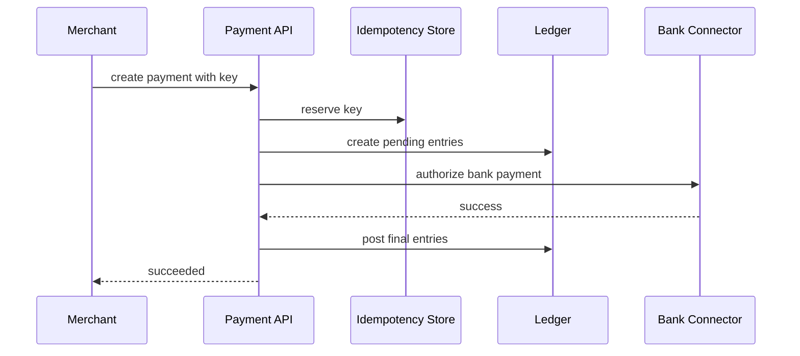

### 8. Deep dives into 2-3 hardest parts
**Idempotency:** unique constraint on merchant_id plus key; retry returns original response and never repeats money movement. **Double-entry ledger:** every transaction posts equal debit and credit entries; ledger is append-only, balances are derived. **Reconciliation:** compare internal payments with bank files, detect missing, extra, and amount mismatch, then adjustment or manual review.

### 9. Redis usage · Message queue usage
Redis: short-lived idempotency cache, rate limits, duplicate webhook suppression; not source of truth. Queue: bank retries, webhooks, ledger events, settlement, reconciliation, DLQ for manual investigation.

### 10. Scaling & HA / failure scenarios
If ledger DB is unavailable, fail or keep payment pending rather than move money without audit. External bank timeout leaves `PENDING`; webhook or polling finalizes. Multi-AZ SQL, backups, immutable audit logs, and reconciliation are mandatory.

### 11. Tradeoffs
Synchronous bank call gives immediate UX but is brittle; async pending improves resilience. SQL ledger simplifies audit; NoSQL ledger scales but complicates transactions. Exactly-once is replaced by idempotency and atomic state transitions.

### 12. SDE-1 answer vs Senior answer [Stretch]
- **SDE-1:** payment API, idempotency key, ledger DB, bank connector, webhook, reconciliation job.
- **Senior [Stretch]:** append-only double-entry ledger, outbox, saga state, settlement windows, PCI-style isolation, disaster recovery tests.

### 13. Interviewer follow-up questions with short answers
- *What if user retries after timeout?* → Same idempotency key returns same payment state.
- *How detect bank mismatch?* → Reconcile with bank settlement files and network reports.
- *Can Redis store ledger?* → No; use durable ACID storage for money records.

### 14. Revision summary
Payment design prioritizes correctness, idempotency, audit, and reconciliation. The double-entry ledger is the centerpiece.

## 6. Design Dropbox or Google Drive File Sync
Tier 2 · SDE-2 must-know

### 1. Clarifying questions to ask
- Backup only or multi-device sync with sharing and versioning?
- Max file size, chunk size, conflict behavior, offline support?
- Need encryption, permissions, comments, collaboration?

### 2. Functional & Non-functional requirements
Functional: upload, download, sync folder, chunked upload, dedup, file versions, share links, conflict copies. Non-functional: durable storage, resumable transfers, bandwidth efficiency, secure ACLs, eventual consistency across devices.

### 3. Capacity estimation (show the math)
100M users, 10M DAU, average 20 MB upload per DAU/day gives 200 TB/day logical uploads. With 40% dedup, physical writes ≈ 120 TB/day. Metadata ops: 10M × 100 ops/day = 1B/day ≈ 11.6K avg QPS, peak 100K. Chunk size 4 MB means 1 GB file has 256 chunks.

### 4. API design
`POST /files/upload-session`, `PUT /files/upload-session/{id}/chunks/{n}` with checksum, `POST /files/upload-session/{id}/commit`, `GET /sync/changes?cursor=...`, `GET /files/{id}/download-url`.

### 5. Data model + DB choice
| Entity | Store | Key fields | Why |
|---|---|---|---|
| file_metadata | SQL or Spanner-like DB | file_id, owner_id, parent_id, version | hierarchy and ACL |
| chunk | KV metadata DB | chunk_hash, size, ref_count, path | dedup lookup |
| object_chunk | Object storage | chunk_hash bytes | durable blob |
| change_log | Kafka plus DB | user_id, seq, file_id, op | sync cursor |
| acl | SQL | resource_id, principal, role | permissions |

### 6. High-level design
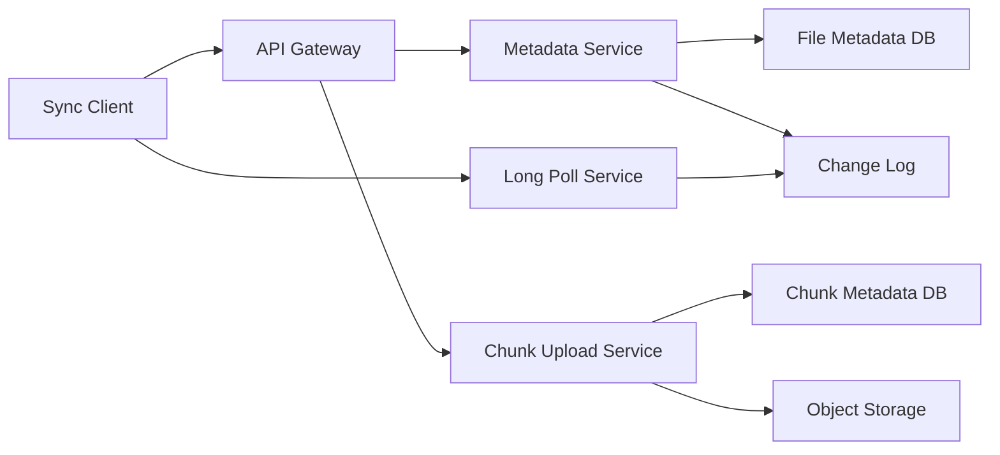

### 7. Key flow sequence diagram(s)
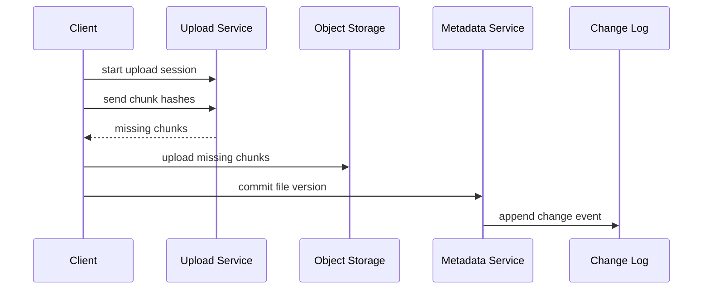

### 8. Deep dives into 2-3 hardest parts
**Chunked sync:** split files into fixed or content-defined chunks, upload only missing checksummed chunks. **Dedup:** global dedup saves storage but has privacy implications; per-user dedup is safer. **Conflicts:** if devices edit same base version offline, create conflict copy or use app-specific merge.

### 9. Redis usage · Message queue usage
Redis: upload sessions, hot metadata, share-link token cache, cursor cache. Queue: change events, virus scans, thumbnails, search indexing, notification fanout, garbage collection.

### 10. Scaling & HA / failure scenarios
Shard metadata by user_id and chunks by hash prefix. Interrupted uploads resume from committed chunks. If metadata commit fails after chunk upload, unreferenced chunks are garbage-collected after grace period.

### 11. Tradeoffs
Fixed chunks are simple; content-defined chunks improve delta sync after insertions. Strong metadata consistency avoids confusing folder state; search and thumbnails can be eventual. Long polling is simpler than millions of idle WebSockets.

### 12. SDE-1 answer vs Senior answer [Stretch]
- **SDE-1:** metadata DB, object storage, chunk upload, sync cursor, change notifications.
- **Senior [Stretch]:** dedup security, version DAG, conflict semantics, regional placement, encryption keys, quota enforcement.

### 13. Interviewer follow-up questions with short answers
- *How resume upload?* → Session records uploaded chunks by index and checksum.
- *How sync deletes?* → Tombstone event with sequence number.
- *How reduce bandwidth?* → Chunk hashing, delta upload, compression, CDN downloads.

### 14. Revision summary
File sync separates metadata correctness from blob durability. Chunking, dedup, resumability, and change logs are the key points.

## 7. Design Web Crawler
Tier 2 · SDE-2 must-know

### 1. Clarifying questions to ask
- General web search crawler or focused domain crawler?
- Freshness target, scale, robots.txt compliance, duplicate detection?
- Store full HTML, extracted text, screenshots, or index directly?

### 2. Functional & Non-functional requirements
Functional: accept seed URLs, schedule fetches, respect robots and politeness, parse links, dedup URL and content, store pages, feed indexer. Non-functional: scalable distributed crawl, fault-tolerant workers, no host overload, duplicate control, pipeline backpressure.

### 3. Capacity estimation (show the math)
Crawl 1B pages/month = 33M/day ≈ 386 pages/s average, peak 2K/s. Average compressed page 100 KB gives 100 TB/month raw compressed content. URL frontier of 10B URLs × 100 B ≈ 1 TB before overhead. Per-host politeness may allow only 1 request/host/s.

### 4. API design
Internal APIs: `POST /seeds`, `GET /frontier/next?worker=`, `POST /fetch-results`, `POST /domain-rules`. Work item includes normalized_url, host, priority, earliest_fetch_time, retry_count.

### 5. Data model + DB choice
| Entity | Store | Key fields | Why |
|---|---|---|---|
| url_frontier | Priority queue plus KV | url, host, priority, next_fetch | scheduling |
| visited_url | Bloom filter plus KV | normalized_url_hash, last_fetch | duplicate control |
| robots_cache | Redis or KV | host, rules, expiry | politeness |
| page_store | Object storage | content_hash, html, headers | cheap storage |
| link_graph | Wide-column store | from_url, to_url | ranking analysis |

### 6. High-level design
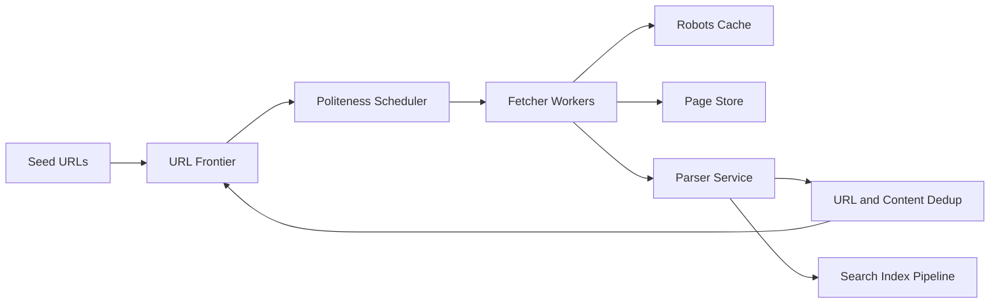

### 7. Key flow sequence diagram(s)
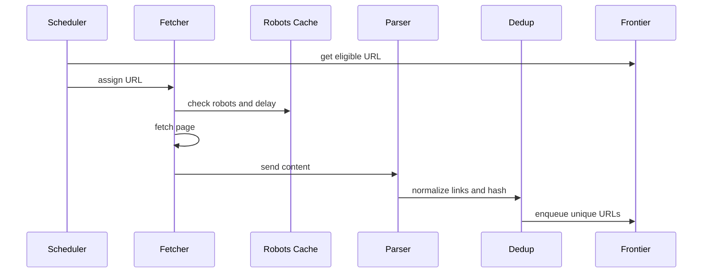

### 8. Deep dives into 2-3 hardest parts
**URL frontier:** prioritize by page importance and freshness; maintain per-host queues so one domain cannot dominate. **Politeness:** cache robots.txt, enforce crawl-delay or default delay, throttle by host and IP. **Dedup:** canonicalize URLs, Bloom filter for seen checks, content hash or simhash for duplicate pages.

### 9. Redis usage · Message queue usage
Redis: robots cache, host politeness timers, rate counters, small frontier shards. Queue: frontier partitions, fetch results, parse jobs, index updates; Kafka is useful when replay matters.

### 10. Scaling & HA / failure scenarios
Partition by host hash to preserve per-host ordering. If fetcher dies, lease expires and URL returns to frontier. If parser backlog grows, scheduler slows fetches to avoid storage overload.

### 11. Tradeoffs
Central frontier is simple but bottlenecks; distributed frontier scales but complicates fairness. Bloom filters save memory but false positives skip some URLs. Freshness and coverage compete.

### 12. SDE-1 answer vs Senior answer [Stretch]
- **SDE-1:** seed URLs, frontier, fetchers, parser, dedup, page store, indexer.
- **Senior [Stretch]:** host-aware scheduling, adaptive recrawl, simhash, spam traps, compliance, backpressure.

### 13. Interviewer follow-up questions with short answers
- *How respect robots.txt?* → Fetch and cache rules before scheduling URLs for that host.
- *How avoid infinite calendars?* → URL normalization, trap filters, depth and pattern limits.
- *How make crawler fresh?* → Recrawl priority based on change frequency and importance.

### 14. Revision summary
A crawler is a distributed scheduling system. The hard parts are frontier priority, politeness, deduplication, and backpressure.

## Revision Cheat Sheet
- Video: object storage, CDN, async transcode, HLS/DASH, origin shielding.
- Ride hailing: ephemeral geo state, durable trips, atomic driver reservation.
- Food delivery: order state machine across payment, restaurant, and delivery.
- E-commerce: cache catalog, reserve inventory strongly, protect DB during flash sales.
- Payments: idempotency, append-only double-entry ledger, reconciliation, pending timeout state.
- File sync: chunking, checksums, dedup, resumable upload, sync cursor, tombstones.
- Crawler: frontier, robots, politeness, dedup, parser pipeline, backpressure.
- Redis is for hot ephemeral state; durable DB remains source of truth.
- Queues decouple slow side effects, retries, DLQs, and burst absorption.
- Senior answers name failure modes and recovery, not only components.

## Flashcards
- Q: Why CDN for video? → A: High-bandwidth reads are served near users and origin is protected.
- Q: How avoid duplicate ride assignment? → A: Atomic `AVAILABLE → RESERVED` transition with TTL.
- Q: Why snapshot food order price? → A: Menu prices can change after checkout.
- Q: How stop flash-sale oversell? → A: Admission tokens plus atomic inventory reservation.
- Q: What is payment idempotency? → A: Same key returns same result without repeating money movement.
- Q: Why double-entry ledger? → A: Every debit has a matching credit for auditability.
- Q: How resume file upload? → A: Track uploaded chunks and send only missing chunks.
- Q: What is a sync cursor? → A: Monotonic marker for changes since last sync.
- Q: How avoid duplicate crawl URLs? → A: Normalize URL and check seen set or Bloom filter.
- Q: What is crawler politeness? → A: Per-host rate limiting and robots.txt compliance.
- Q: Redis source of truth for orders? → A: No, use durable DB; Redis accelerates hot temporary state.
- Q: Queue benefit in HLD? → A: It decouples services, absorbs bursts, supports retry and DLQ.
