# 09f · HLD Case Studies Tier 2 Part 2 and AI

Continuation of Tier-2 HLD case studies plus AI-system designs connected to Lafz and the Email Reply Assistant projects. Use this as a compact spoken-interview checklist.

**Legend:** 🟢 Beginner · 🟡 Intermediate · 🔴 Advanced · ⚫ FAANG · 🔥 = very frequently asked

## Table of Contents
- [Beginner guide to this file](#beginner-guide-to-this-file)
- [8. Design Proximity Service Yelp](#8-design-proximity-service-yelp)
- [9. Design Hotel Booking Airbnb](#9-design-hotel-booking-airbnb)
- [10. Design Leaderboard or Top-K Heavy Hitters](#10-design-leaderboard-or-top-k-heavy-hitters)
- [11. Design Distributed Job Scheduler](#11-design-distributed-job-scheduler)
- [12. Design Email Service Gmail](#12-design-email-service-gmail)
- [13. Design Metrics Logging and Monitoring System](#13-design-metrics-logging-and-monitoring-system)
- [14. Design RAG Semantic Search for 100M Documents](#14-design-rag-semantic-search-for-100m-documents)
- [15. Design LLM-powered Assistant at Scale](#15-design-llm-powered-assistant-at-scale)
- [16. Design MCP-based Tool Platform for AI Agents](#16-design-mcp-based-tool-platform-for-ai-agents)
- [Tier 3 Stretch quick designs](#tier-3-stretch-quick-designs)
- [Revision Cheat Sheet](#revision-cheat-sheet)
- [Flashcards](#flashcards)

## Beginner guide to this file

### What this file teaches
This file teaches advanced high-level design (HLD) patterns across geo search, booking, leaderboards, scheduling,
email, observability, retrieval-augmented generation, large language model assistants, and Model Context Protocol
tool platforms. Interviewers use these cases to test whether you can pick the right consistency level, scale the
hard part, and explain production risk.

### Mental model
Think of this file as a toolkit of specialized engines: geo candidate engines, booking locks, ranked counters,
time schedulers, mail pipelines, telemetry pipelines, retrieval indexes, model orchestrators, and governed tool
gateways.

- Candidate generation narrows huge data sets before ranking or exact validation.
- Correctness gates protect bookings, schedules, audits, and privileged tool calls.
- Streams and queues preserve replay for leaderboards, email, monitoring, and artificial intelligence workflows.
- Caches and indexes make reads fast but require authoritative rechecks where correctness matters.
- Safety, isolation, and cost controls become first-class design requirements for AI systems.

### How to think through any question here
1. Identify the specialist workload: geo, inventory, ranking, time, mail, telemetry, retrieval, model, or tools.
2. State the invariant, such as no double booking, no missed due job, no data leak, or answer with citations.
3. Split ingestion/write path, query/read path, and background repair or evaluation path.
4. Choose the index or ordering structure that matches the access pattern.
5. Estimate the largest dimension: cells, listing-days, users, schedules, messages, samples, chunks, tokens, or calls.
6. Add guardrails: idempotency, authorization, leases, replay, rate limits, budgets, and audit.
7. Describe graceful degradation when a shard, provider, stream, index, or model fails.

### Pattern recognition cues
| If the question mentions... | Think about... | Why it fits |
|---|---|---|
| Nearby places or radius | Cell candidates plus exact distance filtering | Geo cells make search scalable before ranking. |
| Room nights or listing dates | Conditional inventory rows | Final booking must atomically own every date. |
| Top K, rank, or heavy hitters | Sorted sets or sketches | Exact rank and approximate trends need different data structures. |
| Cron, delayed jobs, or retries | Durable due store plus leases | Schedulers must avoid missed work and tolerate duplicates. |
| Mailbox, labels, or spam | Immutable message plus per-user index | One message can appear in many mailbox views. |
| Metrics, logs, or traces | Ingestion buffer and time-series storage | Writes are huge and queries are time-windowed. |
| Retrieval-augmented answers | Chunk, embed, retrieve, re-rank, cite | Quality depends on retrieval before generation. |
| Large language model costs | Queue, rate limit, cache, and route models | Model calls are slow, expensive, and provider-limited. |
| Agent tool calls | Gateway, policy, audit, and vault | Tool execution needs governance and tenant isolation. |

### Abbreviations and key terms
| Short form | Expanded form | Plain meaning |
|---|---|---|
| ACL | Access control list | Permission list used to filter documents or tool access. |
| AI | Artificial intelligence | Systems that use models for retrieval, generation, or decisions. |
| ANN | Approximate nearest neighbor | Fast vector search that trades perfect recall for speed. |
| API | Application programming interface | Contract used by clients and services. |
| BM25 | Best Matching 25 | Classic keyword ranking function used in search. |
| CRDT | Conflict-free replicated data type | Data structure that can merge concurrent offline edits. |
| DAU | Daily active users | Count of unique users active in one day. |
| DB | Database | Durable storage for important state. |
| DLQ | Dead-letter queue | Queue for repeatedly failed jobs. |
| FAANG | Facebook, Amazon, Apple, Netflix, Google | Shorthand for large product-company interview style. |
| FIFO | First in, first out | Queue order where earliest accepted item is processed first. |
| GB | Gigabyte | Roughly one billion bytes. |
| H3 | Hexagonal hierarchical geospatial index | Grid system for geo search. |
| HA | High availability | Ability to keep serving during partial failures. |
| HLD | High-level design | Component-level system design discussion. |
| HNSW | Hierarchical navigable small world | Popular vector index structure for approximate search. |
| HTTP | Hypertext Transfer Protocol | Web protocol used for APIs and streaming formats. |
| ID | Identifier | Unique value for a row, user, tool, job, or request. |
| IO | Input/output | Disk or network reading and writing. |
| ISR | In-sync replicas | Kafka replicas caught up enough to be eligible for failover. |
| KB | Kilobyte | Roughly one thousand bytes. |
| KV | Key-value | Data model that retrieves by exact key. |
| LLM | Large language model | Model that generates or reasons over text. |
| MB | Megabyte | Roughly one million bytes. |
| MCP | Model Context Protocol | Protocol for connecting agents to tools and context. |
| MIME | Multipurpose Internet Mail Extensions | Email body and attachment format. |
| ML | Machine learning | Model-based prediction, ranking, filtering, or spam detection. |
| MRR | Mean reciprocal rank | Retrieval quality metric based on first relevant result position. |
| OAuth | Open Authorization | Delegated authorization protocol for scoped access. |
| OLAP | Online analytical processing | Analytics storage optimized for aggregate queries. |
| OT | Operational transformation | Collaborative-editing technique that transforms concurrent edits. |
| QPS | Queries per second | Request throughput. |
| RAG | Retrieval-augmented generation | Pattern that retrieves context before asking a model to answer. |
| S2 | Spherical geometry cell library | Cell-based geo-indexing approach. |
| SaaS | Software as a service | Hosted third-party application or connector. |
| SDE-1 | Software Development Engineer level 1 | Entry-level engineering interview bar. |
| SDE-2 | Software Development Engineer level 2 | Mid-level engineering interview bar. |
| SFU | Selective forwarding unit | Video server that forwards selected media streams. |
| SLA | Service-level agreement | External promise for availability or latency. |
| SLO | Service-level objective | Internal reliability target, often for alerts. |
| SMTP | Simple Mail Transfer Protocol | Internet email delivery protocol. |
| SQL | Structured Query Language | Relational query language and shorthand for relational databases. |
| SSE | Server-sent events | One-way server-to-client streaming protocol. |
| TB | Terabyte | Roughly one trillion bytes. |
| TSDB | Time-series database | Database optimized for timestamped metrics. |
| TTL | Time to live | Expiration duration for cache or temporary state. |
| TURN | Traversal Using Relays around NAT | Relay protocol for media when direct connectivity fails. |
| UX | User experience | How responsive and understandable the product feels. |
| WAL | Write-ahead log | Durable command log written before applying state changes. |
| WebRTC | Web Real-Time Communication | Browser media protocol for real-time audio and video. |
| ZADD | Redis sorted-set add command | Adds or updates a member score in a sorted set. |
| ZREVRANGE | Redis reverse range command | Reads top members from a sorted set. |
| ZREVRANK | Redis reverse rank command | Reads a member rank from a sorted set. |
| ZSET | Redis sorted set | Ordered set keyed by member score. |

### Common beginner traps
- Using a search index as the final authority for booking, permission, or payment decisions.
- Treating exact rank, approximate heavy hitters, and trend detection as the same problem.
- Promising exactly-once scheduled execution instead of leases plus idempotent workers.
- Ignoring cardinality in monitoring labels or vector-index size in retrieval systems.
- Calling a large language model directly without queues, budgets, rate limits, or fallback.
- Letting agents call tools without scoped authorization, audit, or tenant isolation.
- Forgetting evaluation and citation quality for retrieval-augmented generation answers.

### How to study this file
1. Group cases by pattern: geo, inventory, ranking, scheduling, pipelines, retrieval, model orchestration, and security.
2. For each case, write the invariant in one sentence before reading the detailed answer.
3. Use the diagrams to trace ingestion/write path and query/read path separately.
4. Convert each flashcard into a follow-up answer with one trade-off and one failure mode.
5. For artificial intelligence cases, always add quality, cost, privacy, evaluation, and fallback discussion.

### Scalability and production lens
These systems often fail because one dimension silently explodes: labels, vectors, tokens, schedules, hotel dates,
mailboxes, tool calls, or media streams. Production answers should state guardrails, quotas, replay paths,
evaluation metrics, tenant isolation, and what degraded result is safer than an incorrect result.

## 8. Design Proximity Service Yelp
Tier 2 · SDE-2 must-know

### 0. Beginner primer

**Simple problem:** Find nearby businesses that match a location, category, filters, and ranking rules. **Mental
model:** It is a map search funnel: cells create candidates, exact distance removes mistakes, and ranking orders
the survivors. **Thought process:** Clarify business types, radius, personalization, ad mixing, freshness, and
review/rating needs. Reads dominate because nearby search is frequent; writes are business updates, reviews, and
aggregate refreshes. Core data is business, geo cell, review, rating aggregate, and search document. The
bottleneck is hot city cells and ranking latency; consistency is eventual for ratings but source-of-truth details
must be correct. **Request flow:** Write path stores business or review data, emits events to update geo/search
indexes and rating aggregates. Read path checks cell cache, queries neighbor cells, exact-filters by distance,
ranks, and hydrates details. **Key trade-offs and alternatives:** Elasticsearch is quick to build; S2 or H3 gives
predictable sharding. **How it scales:** Partition by city or geo prefix, cache cell candidates, personalize
after cache, rebuild stale indexes from database events, and fall back to distance plus rating.

### 1. Clarifying questions to ask
- Nearby restaurants only or all businesses? Need filters, reviews, ads, personalization?
- Query radius, latency target, and freshness of business updates?
- Approximate geo search acceptable if exact distance filter follows?

### 2. Functional & Non-functional requirements
Functional: search nearby places by lat/lon, category, open now, rating; show details and reviews. Non-functional: low-latency reads, high availability, scalable geo index, eventual consistency for ratings and reviews.

### 3. Capacity estimation (show the math)
20M DAU × 10 nearby searches/day = 200M/day ≈ 2.3K average QPS, peak 25K. 100M businesses × 1 KB metadata ≈ 100 GB; reviews are stored separately. Hot city-cell results should be cached because traffic is geographically skewed.

### 4. API design
`GET /businesses/nearby?lat=&lon=&radius=&category=&openNow=`, `GET /businesses/{id}`, `GET /businesses/{id}/reviews?cursor=`, `POST /reviews` with idempotency key.

### 5. Data model + DB choice
| Entity | Store | Key fields | Why |
|---|---|---|---|
| business | PostgreSQL plus geo index | id, lat, lon, category, rating | source of truth |
| geo_index | Elasticsearch or S2 cell KV | cell_id, business_ids | nearby lookup |
| review | Cassandra or SQL shards | business_id, review_id, user_id | high fanout reads |
| rating_aggregate | Redis plus DB | business_id, count, avg | fast ranking |

### 6. High-level design
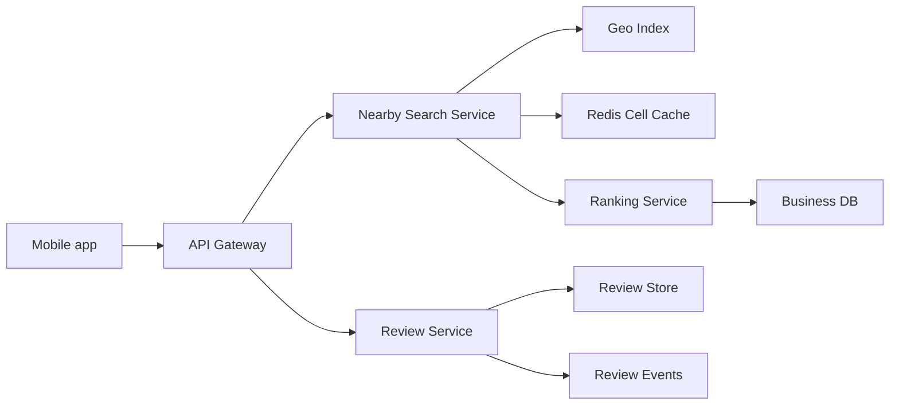

### 7. Key flow sequence diagram(s)
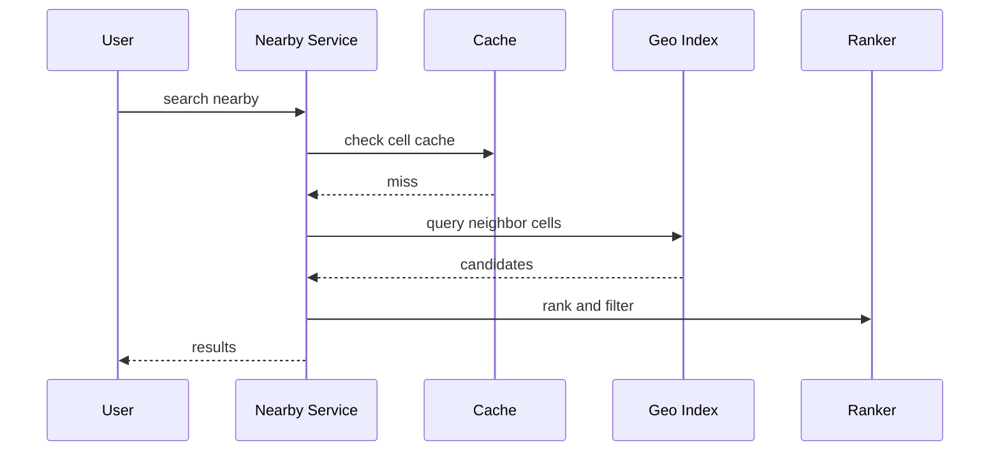

### 8. Deep dives into 2-3 hardest parts
**Geo indexing:** use geohash, S2, or H3 cells; fetch current cell plus neighbors and exact-filter by distance. **Ranking:** blend distance, rating, open status, text relevance, personalization, and ads; cache candidates before personalization. **Aggregates:** reviews write durably, rating aggregates update asynchronously.

### 9. Redis usage · Message queue usage
Redis: cell result cache, business detail cache, rating aggregates, rate limits. Queue: review moderation, aggregate updates, search-index refresh, photo processing.

### 10. Scaling & HA / failure scenarios
Partition by city or geo prefix. If ranking fails, fallback to distance plus rating. If geo index is stale, detail page still reads source DB. Rebuild index from business DB events.

### 11. Tradeoffs
Elasticsearch geo query is quick to build; S2/H3 service gives predictable sharding. Large cells reduce index size but increase post-filter work. Eventual rating freshness is acceptable.

### 12. SDE-1 answer vs Senior answer [Stretch]
- **SDE-1:** nearby API, geo index, business DB, review DB, Redis cache.
- **Senior [Stretch]:** cell hierarchy, ranking features, index rebuilds, anti-spam reviews, ads separation, cold-start cities.

### 13. Interviewer follow-up questions with short answers
- *How handle radius crossing cells?* → Query neighboring cells and exact-filter.
- *How update moved business?* → Remove old cell entry and insert new cell entry through an event.
- *How cache personalized results?* → Cache candidates by cell, personalize later.

### 14. Revision summary
Proximity service is geo candidate generation plus ranking. Approximate cell lookup followed by exact filtering is the core answer.

## 9. Design Hotel Booking Airbnb
Tier 2 · SDE-2 must-know

### 0. Beginner primer

**Simple problem:** Let guests search listings and reserve nights without two guests owning the same inventory.
**Mental model:** Search is a catalog, but booking is a calendar lock: every requested night must move from
available to held or booked together. **Thought process:** Ask homes versus hotels, inventory granularity,
holds, cancellation, pricing, and payment flow. Reads are search and availability checks; writes are holds,
payments, confirmations, cancellations, and calendar sync. Core data is listing, availability row, hold, booking,
price snapshot, and search document. The bottleneck is large listing-day inventory and popular destinations;
consistency must be strong only on the final availability service. **Request flow:** Write path creates a hold by
conditionally updating all date rows, charges payment, creates booking, and marks dates booked. Read path serves
search from denormalized index and rechecks authoritative availability before commit. **Key trade-offs and
alternatives:** Per-day rows are simple but large; interval structures save space but complicate concurrent
locking. **How it scales:** Shard availability by listing, cache popular searches, expire holds quickly, reconcile
payment success, and reject stale search results on final booking.

### 1. Clarifying questions to ask
- Homes, hotels, or both? Need search, pricing, reviews, payments, cancellation?
- Can overbooking happen? Need holds before payment?
- Inventory granularity: exact listing, room type, or room-night?

### 2. Functional & Non-functional requirements
Functional: search listings, view availability, hold dates, pay, confirm booking, cancel, review. Non-functional: no double booking, fast search, correct price snapshot, high availability, auditable booking state.

### 3. Capacity estimation (show the math)
10M DAU × 20 searches/day = 200M searches/day ≈ 2.3K average QPS, peak 30K. 1M bookings/day ≈ 12/s average, peak 500/s. Availability table with 5M listings × 365 days ≈ 1.8B listing-day rows.

### 4. API design
`GET /listings/search?city=&start=&end=&guests=`, `GET /listings/{id}/availability`, `POST /reservations/holds` with idempotency_key, `POST /bookings` from hold_id, `POST /bookings/{id}/cancel`.

### 5. Data model + DB choice
| Entity | Store | Key fields | Why |
|---|---|---|---|
| listing | PostgreSQL plus search | listing_id, host_id, city, attrs | source of truth |
| availability | SQL sharded by listing | listing_id, date, state, price, version | no double booking |
| reservation_hold | SQL or Redis plus SQL | hold_id, dates, expires_at | temporary lock |
| booking | PostgreSQL | booking_id, guest_id, status, total | durable transaction |
| search_doc | Elasticsearch | geo, city, price, amenities | fast search |

### 6. High-level design
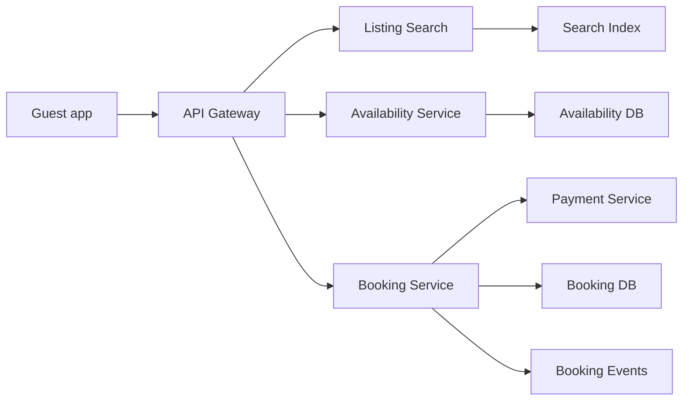

### 7. Key flow sequence diagram(s)
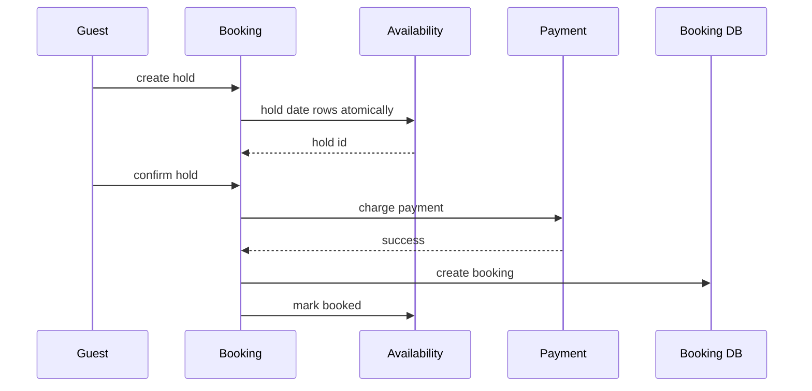

### 8. Deep dives into 2-3 hardest parts
**No double booking:** update all date rows with condition `state = AVAILABLE`; commit only if affected rows equal requested nights. **Hold expiry:** short TTL hold and scanner releases expired holds. **Search correctness:** search index can be stale; final availability service is authoritative.

### 9. Redis usage · Message queue usage
Redis: listing detail cache, search cache, hold TTL accelerator, rate limits. Queue: booking events, emails, calendar sync, search-index updates, expired hold release.

### 10. Scaling & HA / failure scenarios
Shard availability by listing_id. If payment succeeds but booking confirmation fails, reconciler confirms or refunds. If search stale, booking path rejects unavailable dates.

### 11. Tradeoffs
Per-day rows are simple but large; interval trees are compact but harder for concurrency. Holds improve UX but temporarily reduce inventory. Strong consistency is required only for final booking.

### 12. SDE-1 answer vs Senior answer [Stretch]
- **SDE-1:** search, listing DB, availability DB, booking service, payment, hold expiry.
- **Senior [Stretch]:** multi-night atomic locking, price snapshot, calendar sync conflicts, cancellation policies, reconciliation.

### 13. Interviewer follow-up questions with short answers
- *How avoid double booking?* → Conditional transaction across all requested date rows.
- *What if hold expires during payment?* → Recheck hold before confirming and refund if needed.
- *How scale search?* → Denormalized Elasticsearch docs and cache popular destinations.

### 14. Revision summary
Hotel booking is search-heavy but booking-correctness critical. Final reservation must atomically own the date inventory.

## 10. Design Leaderboard or Top-K Heavy Hitters
Tier 2 · SDE-2 must-know

### 0. Beginner primer

**Simple problem:** Accept many score updates and quickly return top players, ranks, or trending items. **Mental
model:** A leaderboard is a sorted scoreboard; heavy hitters are a memory-saving sketch of what appears most
often. **Thought process:** Clarify exact rank versus approximation, season resets, windows, ties, and anti-cheat.
Writes are score events; reads are top K, rank, and around-me queries. Core data is score event, leaderboard ID,
member, score, snapshot, and sketch state. The bottleneck is huge sorted sets or hot boards; consistency can be
slightly stale if the product exposes lag. **Request flow:** Write path validates and deduplicates a score,
appends it to Kafka, processor updates Redis sorted set and durable snapshot. Read path queries Redis for top or
rank through an API. **Key trade-offs and alternatives:** Redis sorted sets give exact rank but use memory;
Count-Min or Space-Saving sketches are cheap but approximate. **How it scales:** Shard by board, season, region,
or score range, merge top results, rebuild from snapshot plus event log, and isolate hot tournaments.

### 1. Clarifying questions to ask
- Global, per-region, per-game, per-season, or sliding time window?
- Exact ranks or approximate heavy hitters acceptable?
- Need rank of a user, top K, percentile, anti-cheat?

### 2. Functional & Non-functional requirements
Functional: submit score/event, get top K, get user rank, get users around me, reset seasons. Non-functional: high write throughput, low read latency, durable rebuild, well-defined consistency, anti-cheat controls.

### 3. Capacity estimation (show the math)
50M users × 10 score updates/day = 500M/day ≈ 5.8K/s average, peak 100K/s. Top 100 read QPS can be 10K during events. Redis ZSET with 50M members may need multiple GB per board, so shard or split by season/game.

### 4. API design
`POST /leaderboards/{id}/scores`, `GET /leaderboards/{id}/top?k=100`, `GET /leaderboards/{id}/users/{userId}/rank`, `GET /leaderboards/{id}/around/{userId}?window=20`.

### 5. Data model + DB choice
| Entity | Store | Key fields | Why |
|---|---|---|---|
| score_event | Kafka plus object store | event_id, user_id, delta, ts | replay and audit |
| leaderboard | Redis Sorted Set | user_id, score | fast rank |
| score_snapshot | Cassandra or SQL | leaderboard_id, user_id, score | durable rebuild |
| heavy_hitter_sketch | Redis or stream state | Count-Min or Space-Saving | approximate top trends |

### 6. High-level design
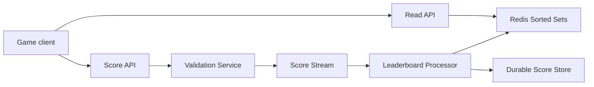

### 7. Key flow sequence diagram(s)
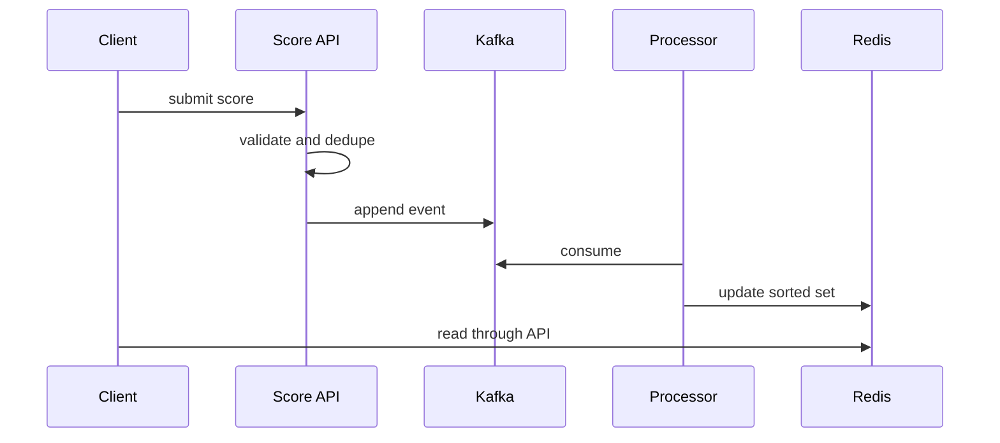

### 8. Deep dives into 2-3 hardest parts
**Exact rank:** Redis ZSET supports `ZREVRANK` and `ZREVRANGE`, but huge boards need sharding and top-K merge. **Heavy hitters:** Count-Min Sketch or Space-Saving gives approximate top items with bounded memory. **Durability:** Kafka event log and snapshots rebuild Redis after failures.

### 9. Redis usage · Message queue usage
Redis: sorted sets, top-K cache, rank cache, rate limits. Queue: score events, anti-cheat, seasonal snapshots, notifications.

### 10. Scaling & HA / failure scenarios
Shard by leaderboard_id, region, or score range. Redis replica failover handles node failure; rebuild from snapshot plus event tail if data loss occurs. If processor lags, reads are stale and expose lag metric.

### 11. Tradeoffs
Exact ranks are expensive at huge scale; sketches are cheap but cannot answer exact user rank. Redis is fast but memory-heavy. Async updates improve write latency but add staleness.

### 12. SDE-1 answer vs Senior answer [Stretch]
- **SDE-1:** score API, Redis ZSET, DB backup, top K and rank APIs.
- **Senior [Stretch]:** shard merge, sketches, replay, anti-cheat, season resets, hot-board isolation.

### 13. Interviewer follow-up questions with short answers
- *How get rank?* → Redis `ZREVRANK` for exact sorted-set boards.
- *How handle ties?* → Composite score or tie-break by timestamp.
- *How rebuild Redis?* → Load snapshot then replay Kafka tail.

### 14. Revision summary
Leaderboards are Redis sorted-set systems until scale forces sharding or approximation. Always pair Redis with durable replay.

## 11. Design Distributed Job Scheduler
Tier 2 · SDE-2 must-know

### 0. Beginner primer

**Simple problem:** Run jobs at the right time, retry failures, and avoid losing work when machines die. **Mental
model:** It is a train timetable plus dispatch office: schedules define future departures, scanners find due
trains, and leases prevent two dispatchers from claiming the same train forever. **Thought process:** Clarify
cron versus one-time jobs, time zones, priorities, long jobs, retries, and duplicate tolerance. Writes are
schedule changes, job instances, heartbeats, completions, and retry records; reads are due-job scans and job
status. Core data is schedule, next run time, job instance, lease, attempt, and history. The bottleneck is minute
boundary spikes and due scanning; consistency aims for no missed jobs, while duplicates are handled by
idempotent workers. **Request flow:** Write path creates schedule metadata and next due bucket. Read/dispatch
path scans due partitions, enqueues jobs, workers claim leases, heartbeat, and complete. **Key trade-offs and
alternatives:** Database polling is simple but can overload; time buckets and sorted sets scale better. **How it
scales:** Partition scanners, use leases, requeue expired jobs, add backpressure, and pause claiming if the queue
is unavailable.

### 1. Clarifying questions to ask
- Cron, delayed jobs, one-time jobs, or DAG workflows?
- Need exactly-once, priorities, retries, time zones, long jobs?
- Number of schedules and due jobs per second?

### 2. Functional & Non-functional requirements
Functional: create/update schedule, trigger due jobs, assign workers, retry failures, cancel jobs, show history. Non-functional: high availability, no missed jobs, at-least-once execution, bounded duplicates through idempotent workers.

### 3. Capacity estimation (show the math)
100M schedules and 10M due jobs/day gives 116/s average, peak 5K/s at minute boundaries. Schedule metadata 100M × 500 B ≈ 50 GB before indexes. Job history 10M/day × 1 KB ≈ 10 GB/day, archived by retention.

### 4. API design
`POST /schedules` with cron, timezone, payload, retry_policy. `PATCH /schedules/{id}` pause/update. `GET /jobs/{id}`, `POST /jobs/{id}/cancel`. Workers call `POST /jobs/{id}/heartbeat` and `POST /jobs/{id}/complete`.

### 5. Data model + DB choice
| Entity | Store | Key fields | Why |
|---|---|---|---|
| schedule | SQL or Cassandra | schedule_id, cron, next_run_at | durable config |
| job_instance | SQL | job_id, schedule_id, state, attempt | lifecycle |
| due_bucket | Redis ZSET or DB index | run_at, schedule_id | due polling |
| lease | Redis or DB | job_id, worker_id, expires_at | assignment safety |

### 6. High-level design
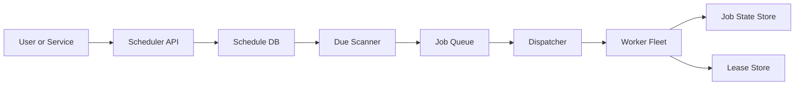

### 7. Key flow sequence diagram(s)
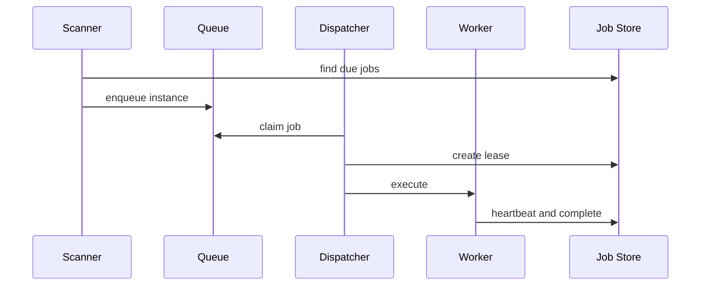

### 8. Deep dives into 2-3 hardest parts
**Due scanning:** use sorted set or time buckets by next_run_at; scanners claim partitions with leases. **At-least-once:** duplicates can happen after timeout; job handlers need idempotency. **Retries:** exponential backoff, max attempts, DLQ, and misfire policy for late jobs.

### 9. Redis usage · Message queue usage
Redis: due ZSET, worker leases, heartbeats, rate limits. Queue: ready jobs, retry jobs, DLQ, completion events.

### 10. Scaling & HA / failure scenarios
Multiple scanners own partitions via leases. If worker dies, lease expires and job is requeued. If queue is down, scanner stops claiming due jobs to avoid lost dispatch.

### 11. Tradeoffs
DB polling is simple but can overload; time buckets scale better. Exactly-once is unrealistic with external effects; use at-least-once plus idempotency. Central leader is simple; partitioned leaders scale.

### 12. SDE-1 answer vs Senior answer [Stretch]
- **SDE-1:** schedule DB, scanner, queue, workers, retries.
- **Senior [Stretch]:** partitioned scanners, leases, time zones, DAGs, idempotency, backpressure, misfire rules.

### 13. Interviewer follow-up questions with short answers
- *How avoid missed jobs?* → Durable schedule store and scanner over next_run_at.
- *How avoid duplicates?* → Unique job instance plus idempotent worker.
- *What if job runs long?* → Heartbeats extend lease; expiry causes retry.

### 14. Revision summary
Schedulers are delayed-queue systems. Durable due-time discovery, leases, retries, and idempotent execution are the core.

## 12. Design Email Service Gmail
Tier 2 · SDE-2 must-know

### 0. Beginner primer

**Simple problem:** Send, receive, store, search, label, and sync email reliably for many users. **Mental model:**
The raw email is an immutable parcel, while each user's mailbox index is a set of labels and pointers to parcels.
**Thought process:** Clarify mailbox-only versus full Simple Mail Transfer Protocol, spam, attachments, search,
retention, and mobile sync. Writes are inbound mail, outbound send, labels, spam decisions, and indexing; reads
are mailbox listing, message fetch, and search. Core data is MIME blob, mailbox index row, thread, attachment,
search document, and delivery state. The bottleneck is storage volume and indexing throughput; consistency must
never lose messages, but search can lag. **Request flow:** Write path stores sent or received message blob,
updates mailbox index, enqueues delivery, spam scan, and search indexing. Read path lists mailbox rows, fetches
message blobs, or queries the per-user inverted index. **Key trade-offs and alternatives:** Separate blobs reduce
duplication; aggressive spam filtering risks false positives. **How it scales:** Partition mailbox index by user,
replicate blobs, retry SMTP delivery with bounce, tier attachments, and degrade search before mailbox listing.

### 1. Clarifying questions to ask
- Mailbox storage only or full SMTP send/receive? Include search, spam, attachments?
- Consumer or enterprise scale? Retention and privacy requirements?
- Need mobile push and offline sync?

### 2. Functional & Non-functional requirements
Functional: send email, receive email, store mailbox, labels, threads, search, attachments, spam filtering. Non-functional: durable storage, high availability, fast search, anti-abuse, retryable delivery, access control.

### 3. Capacity estimation (show the math)
100M users × 20 emails/day = 2B emails/day ≈ 23K/s average. Average message 75 KB excluding attachments means 150 TB/day raw. Search index can be 20-50% of content size depending fields and compression.

### 4. API design
`POST /messages/send`, `GET /mailboxes/{id}/messages?cursor=`, `GET /messages/{id}`, `POST /messages/{id}/labels`. SMTP ingress and egress handle internet mail; sync API serves clients.

### 5. Data model + DB choice
| Entity | Store | Key fields | Why |
|---|---|---|---|
| message_blob | Object storage | message_id, MIME body | durable large object |
| mailbox_index | Bigtable or Cassandra | user_id, label, received_at, message_id | fast listing |
| thread | KV or SQL | thread_id, subject_hash, participants | conversation view |
| attachment | Object storage | hash, path, size | dedup and scanning |
| search_index | Inverted index | tokens, user_id, message_id | full-text search |

### 6. High-level design
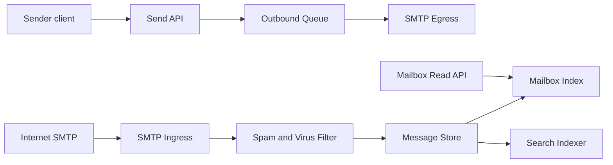

### 7. Key flow sequence diagram(s)
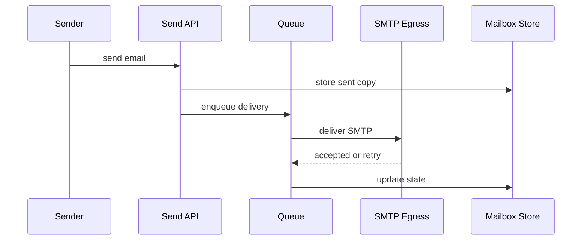

### 8. Deep dives into 2-3 hardest parts
**Mailbox index:** immutable message stored once, per-user index maps labels and time to message IDs. **Spam filtering:** reputation, content models, attachment scanning, and user feedback. **Search:** inverted index scoped by user with body, subject, sender, labels, and optional attachment text.

### 9. Redis usage · Message queue usage
Redis: sessions, rate limits, hot mailbox counters, token cache. Queue: inbound processing, outbound SMTP retries, indexing, spam scanning, push notifications.

### 10. Scaling & HA / failure scenarios
Partition mailbox index by user_id and replicate blobs. SMTP failures retry with backoff; permanent failure creates bounce. If search lags, mailbox listing still works from primary index.

### 11. Tradeoffs
Store MIME blob separately to avoid duplicate copies. Eventual search indexing is acceptable; losing messages is not. Spam aggressiveness trades abuse reduction against false positives.

### 12. SDE-1 answer vs Senior answer [Stretch]
- **SDE-1:** send API, SMTP queues, receive pipeline, message store, mailbox DB, search index.
- **Senior [Stretch]:** per-user index, threading, deliverability reputation, spam ML, attachment dedup, retention policy.

### 13. Interviewer follow-up questions with short answers
- *How retry delivery?* → Queue with exponential backoff and final bounce.
- *How store labels?* → Per-user mailbox index with label mapping.
- *How search fast?* → Inverted index partitioned by user or tenant.

### 14. Revision summary
Email is durable message storage plus async delivery and indexing. Separate immutable messages from per-user mailbox views.

## 13. Design Metrics Logging and Monitoring System
Tier 2 · SDE-2 must-know

### 0. Beginner primer

**Simple problem:** Ingest metrics, logs, and traces, store them cheaply, query dashboards, and fire reliable
alerts. **Mental model:** It is a telemetry river: agents pour events into a buffer, processors compress and
index them, and query systems read time windows. **Thought process:** Clarify metrics versus logs versus traces,
push or pull, retention, cardinality, tenant isolation, and alert freshness. Writes are enormous batched samples
and log events; reads are dashboard queries and alert evaluations. Core data is metric sample, label set, log
event, trace span, alert rule, and retention tier. The bottleneck is ingestion volume and label cardinality;
consistency favors freshness and durability over strict transactions. **Request flow:** Write path batches data
from agents, appends to Kafka, processors write time-series and log stores. Read path queries by time range,
uses caches, and alert evaluators scan windows with leases. **Key trade-offs and alternatives:** Full log indexing
is powerful but expensive; metadata indexes plus object storage reduce cost. **How it scales:** Partition by
tenant and label hash, downsample, enforce label limits, buffer locally, and let Kafka absorb spikes.

### 1. Clarifying questions to ask
- Metrics, logs, traces, or all three? Pull or push?
- Retention, cardinality, query latency, alerting SLA?
- Single tenant or multi-tenant SaaS?

### 2. Functional & Non-functional requirements
Functional: ingest metrics/logs/traces, store time series, query dashboards, trigger alerts, retain and downsample. Non-functional: very high write throughput, compressed storage, bounded cardinality, reliable alerts, partial availability during spikes.

### 3. Capacity estimation (show the math)
100K hosts × 1K metrics/host every 10 seconds = 10M samples/s. At 16 bytes/sample raw, ingest ≈ 160 MB/s ≈ 13.8 TB/day before labels and compression. Logs can be 50 TB/day; use hot, warm, and cold tiers.

### 4. API design
`POST /ingest/metrics` batched samples, `POST /ingest/logs` compressed batches, `POST /ingest/traces`, `GET /query?expr=&start=&end=`, `POST /alerts/rules`. Agents buffer locally and retry.

### 5. Data model + DB choice
| Entity | Store | Key fields | Why |
|---|---|---|---|
| metric_sample | TSDB | metric, labels_hash, ts, value | time ranges |
| log_event | object store plus index | tenant, ts, service, text | cheap retention |
| trace_span | columnar store | trace_id, span_id, latency | trace analysis |
| alert_rule | SQL | rule_id, expr, threshold | configuration |

### 6. High-level design
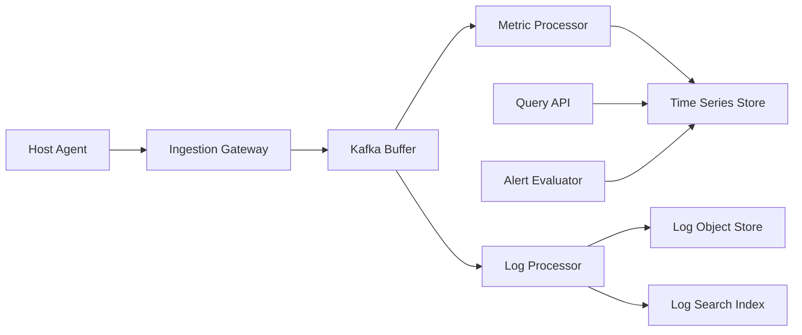

### 7. Key flow sequence diagram(s)
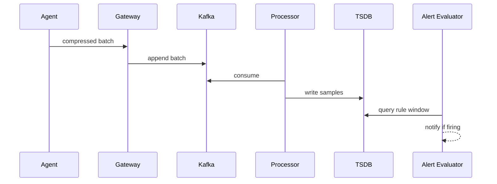

### 8. Deep dives into 2-3 hardest parts
**Cardinality:** labels like user_id explode series count; enforce limits and sampling. **Storage:** compress by series and time, downsample older metrics, store logs in object storage with searchable indexes. **Alerting:** sliding windows, dedupe, silences, escalation, and burn-rate SLO alerts.

### 9. Redis usage · Message queue usage
Redis: query cache, dashboard cache, alert dedupe and silence cache. Queue: Kafka absorbs ingestion spikes and enables replay to storage backends.

### 10. Scaling & HA / failure scenarios
Partition metrics by tenant and label hash. If TSDB lags, Kafka retains backlog; agents buffer locally when gateway fails. Alert evaluator uses leases so standby can take over partitions.

### 11. Tradeoffs
Pull is simple for service discovery; push works better for ephemeral clients. Full log indexing is expensive; metadata indexing and sampling control cost. Freshness matters more than strict consistency.

### 12. SDE-1 answer vs Senior answer [Stretch]
- **SDE-1:** agents, ingest API, Kafka, TSDB, log store, query API, alerting.
- **Senior [Stretch]:** cardinality guardrails, downsampling, multi-tenant isolation, query planner, SLO burn alerts.

### 13. Interviewer follow-up questions with short answers
- *How handle ingestion spike?* → Kafka buffer, backpressure, sampling, local retry.
- *Why TSDB?* → Efficient append, compression, and time-range queries.
- *How reduce log cost?* → Tiering, compression, sampling, metadata indexes.

### 14. Revision summary
Monitoring systems are write-heavy pipelines. Cardinality, retention cost, query performance, and reliable alerting are the hard parts.

## 14. Design RAG Semantic Search for 100M Documents
Tier 2 · SDE-2 must-know · Scaled Lafz project

### 0. Beginner primer

**Simple problem:** Search a huge document collection by meaning and optionally generate cited answers. **Mental
model:** It is a library with semantic fingerprints: documents are cut into chunks, each chunk gets an embedding,
and questions retrieve nearby fingerprints before the model writes. **Thought process:** Clarify document types,
permissions, freshness, recall, latency, and whether answers need citations. Writes are ingestion jobs, chunks,
embeddings, tombstones, and evaluation results; reads are query embedding, vector retrieval, reranking, and answer
generation. Core data is document, chunk, vector, access control list, index job, and evaluation metric. The
bottleneck is vector index size and embedding throughput; consistency must protect permissions more than instant
freshness. **Request flow:** Write path parses, chunks, deduplicates, embeds, and upserts vector shards. Read path
embeds the query, applies filters, retrieves candidates, reranks, and streams a cited answer. **Key trade-offs
and alternatives:** pgvector is convenient at moderate scale; dedicated approximate nearest neighbor shards fit
hundreds of millions of chunks. **How it scales:** Shard vectors, cache query embeddings, over-fetch for filters,
replicate shards, evaluate recall and faithfulness, and return passages if the model fails.

### 1. Clarifying questions to ask
- Document types, update rate, languages, permissions, freshness SLA?
- Semantic search only or RAG answer generation with citations?
- Target latency, recall, and whether pgvector is enough?

### 2. Functional & Non-functional requirements
Functional: ingest documents, parse, chunk, embed, index vectors, retrieve top K, re-rank, generate answer with citations, evaluate quality. Non-functional: 100M docs, high recall, ACL filtering, incremental updates, scalable embedding, bounded LLM cost.

### 3. Capacity estimation (show the math)
100M docs × 2,000 tokens average. Chunk 500 tokens with overlap gives about 5 chunks/doc = 500M chunks. A 2048-dim float32 embedding is 8 KB, so raw vectors ≈ 4 TB; HNSW index and replicas can push vector tier to 8-12 TB. At 1K query QPS, retrieve top 100 and re-rank top 50; cache repeated query embeddings/results.

### 4. API design
`POST /documents`, `POST /ingestion/jobs`, `POST /search` with query, filters, top_k, user_acl_token, `POST /answers` with stream=true, `GET /evaluation/runs/{id}`.

### 5. Data model + DB choice
| Entity | Store | Key fields | Why |
|---|---|---|---|
| document | PostgreSQL | doc_id, source, acl, version, checksum | metadata and permissions |
| chunk | PostgreSQL or KV | chunk_id, doc_id, text, offsets, hash | citations and dedup |
| embedding | pgvector or vector DB | chunk_id, vector, shard_id | ANN retrieval |
| index_job | Queue plus SQL | job_id, doc_id, state, attempts | pipeline reliability |
| eval_result | SQL | run_id, metric, value | quality tracking |

### 6. High-level design
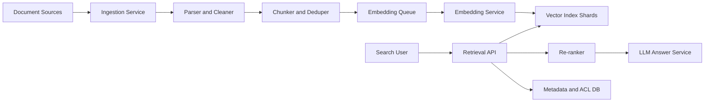

### 7. Key flow sequence diagram(s)
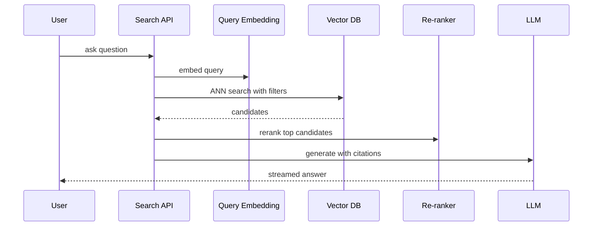

### 8. Deep dives into 2-3 hardest parts
**Ingestion:** parse formats, normalize text, chunk with overlap, dedup by hash, preserve offsets, re-embed only changed chunks. **pgvector vs vector DB:** pgvector matches a Lafz-style Postgres stack and moderate scale; at 500M chunks, dedicated vector DB or custom ANN shards improve HNSW memory operations, compaction, and replicas. **HNSW and sharding:** HNSW gives low latency and high recall but heavy memory; shard by tenant/domain/hash, fan out, then merge and re-rank. **Evaluation:** track recall at K, MRR, faithfulness, citation accuracy, latency, and cost.

### 9. Redis usage · Message queue usage
Redis: query embedding cache, result cache, ACL cache, rate limits. Queue: parse jobs, embedding jobs, index upserts, tombstones, evaluation jobs.

### 10. Scaling & HA / failure scenarios
Autoscale embedding workers by queue depth and provider rate limits. Replicate vector shards; skip a failing shard with degraded recall and alert. If LLM fails, return ranked passages or fallback model.

### 11. Tradeoffs
Larger chunks improve context but reduce precision; smaller chunks improve retrieval but increase index size. ANN trades exact recall for latency; re-ranking recovers relevance. Pre-filter ACL is safest; post-filter requires over-fetch.

### 12. SDE-1 answer vs Senior answer [Stretch]
- **SDE-1:** ingest docs, chunk, embed, vector search, top-K context, LLM answer.
- **Senior [Stretch]:** HNSW tuning, sharding, ACL-safe retrieval, hybrid BM25 plus vector search, re-ranking, eval harness, cost controls.

### 13. Interviewer follow-up questions with short answers
- *Why not only PostgreSQL?* → pgvector is strong for moderate scale; 500M chunks usually need dedicated ANN operations.
- *How update a document?* → Version it, diff chunks, tombstone removed chunks, upsert new embeddings.
- *How reduce hallucination?* → Cite chunks, use answerability thresholds, constrain prompt, evaluate faithfulness.

### 14. Revision summary
Large RAG is an ingestion, ANN indexing, retrieval-quality, and evaluation problem. It scales the candidate's Lafz pgvector idea with sharding, HNSW, caching, re-ranking, and evals.

## 15. Design LLM-powered Assistant at Scale
Tier 2 · SDE-2 must-know · Scaled Email Reply Assistant

### 0. Beginner primer

**Simple problem:** Turn user context into useful generated replies while controlling latency, cost, safety, and
provider failures. **Mental model:** The assistant is an orchestrator around an expensive expert: it trims the
question, checks budget, retrieves context, calls the model, streams tokens, and records feedback. **Thought
process:** Clarify chat versus email drafting, streaming, privacy, provider limits, and human review. Writes are
requests, model calls, feedback, and cost records; reads are conversation history, prompt templates, cache, and
streamed responses. Core data is request, tenant, prompt version, conversation, model call, cache entry, and
budget. The bottleneck is provider token limits and tail latency; consistency centers on audit, quota, and final
state. **Request flow:** Write path accepts a request, checks safety and budget, enqueues or dispatches,
retrieves context, calls the model, and stores final output. Read path streams tokens through a gateway and lets
clients reconnect by request ID. **Key trade-offs and alternatives:** Synchronous calls are simple; queues handle
rate limits and fallback. **How it scales:** Use tenant queues, token buckets, prompt and semantic cache, model
routing, token caps, fallback providers, and evaluation jobs.

### 1. Clarifying questions to ask
- Chat assistant, email reply drafting, or agentic workflow? Need streaming?
- Model providers, rate limits, data privacy, prompt retention, human review?
- Latency and cost target per request?

### 2. Functional & Non-functional requirements
Functional: accept prompt/email context, retrieve optional context, call LLM, stream response, store request, feedback, fallback. Non-functional: low tail latency, rate-limit handling, cost caps, safety filters, tenant isolation, graceful degradation.

### 3. Capacity estimation (show the math)
1M DAU × 5 calls/day = 5M/day ≈ 58/s average, peak 1K/s. Average 2K input and 500 output tokens gives 12.5B tokens/day. If 20% repeated templates are cacheable, exact/semantic caching cuts model calls for common prompts.

### 4. API design
`POST /assistant/replies` with email, tone, context, stream=true. `GET /assistant/jobs/{id}` for async requests. `POST /assistant/feedback`, `POST /tenants/{id}/budgets` for quotas and cost controls.

### 5. Data model + DB choice
| Entity | Store | Key fields | Why |
|---|---|---|---|
| request | PostgreSQL | request_id, tenant, state, tokens, cost | audit and billing |
| conversation | Document DB or SQL | user_id, messages, summary | history |
| prompt_template | SQL | template_id, version | controlled prompts |
| model_call | Kafka plus DB | provider, latency, status | observability |
| cache_entry | Redis plus vector cache | prompt_hash, response, embedding | reuse |

### 6. High-level design
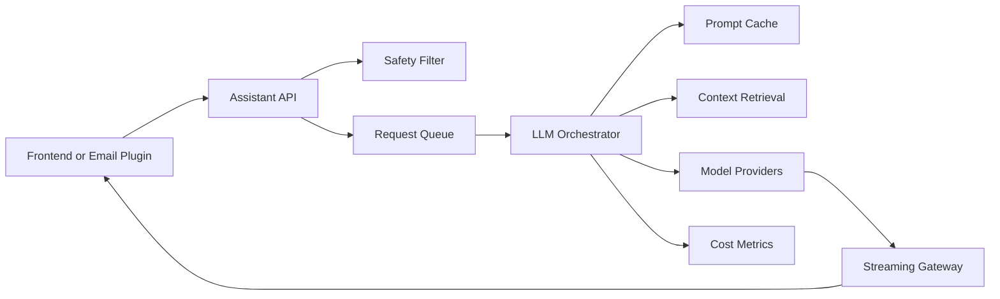

### 7. Key flow sequence diagram(s)
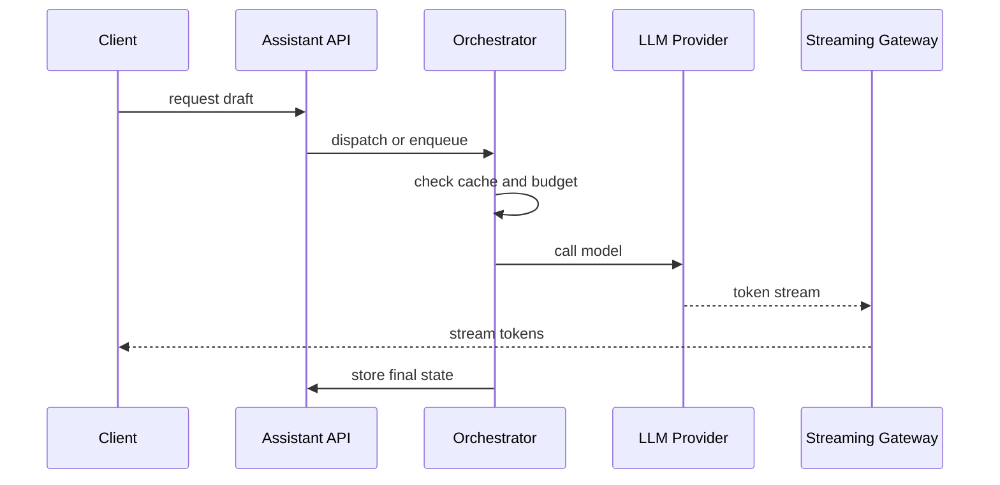

### 8. Deep dives into 2-3 hardest parts
**Queueing and rate limits:** provider token buckets, priority queues, backoff, and tenant quotas. **Streaming:** SSE or WebSocket forwards tokens; final response is stored after completion; reconnect uses request_id. **Cost control:** prompt trimming, smaller model routing, exact/semantic cache, token caps, budget alerts.

### 9. Redis usage · Message queue usage
Redis: rate limits, prompt cache, streaming session state, budget counters. Queue: async generation, retries, provider failover, feedback processing, evaluation jobs.

### 10. Scaling & HA / failure scenarios
Provider outage triggers fallback model or pending async response. If streaming gateway fails, client reconnects and receives buffered tokens if available. Per-tenant queues avoid noisy neighbors.

### 11. Tradeoffs
Synchronous calls are simple but brittle; queueing improves resilience. Bigger models improve quality but cost more; route by complexity. Semantic cache risks wrong tone if matching is too broad.

### 12. SDE-1 answer vs Senior answer [Stretch]
- **SDE-1:** Spring Boot API, queue, LLM provider, response storage, rate limit, fallback.
- **Senior [Stretch]:** token-budget scheduler, streaming recovery, provider abstraction, prompt versioning, evaluation, tenant cost governance.

### 13. Interviewer follow-up questions with short answers
- *How handle provider 429?* → Backoff, queue, switch provider, enforce rate limits.
- *How stream response?* → SSE or WebSocket from model stream through gateway.
- *How control cost?* → Token caps, cache, model routing, quotas, monitoring.

### 14. Revision summary
An LLM assistant is orchestration around expensive unreliable models. The senior answer focuses on queues, streaming, rate limits, cost, fallbacks, and evals.

## 16. Design MCP-based Tool Platform for AI Agents
Tier 2 · SDE-2 must-know · Stretch

### 0. Beginner primer

**Simple problem:** Let artificial intelligence agents discover and call tools safely across tenants, users, and
external systems. **Mental model:** It is a controlled airport for tool calls: the gateway checks passports,
policy decides allowed gates, vault releases scoped secrets, and audit records every trip. **Thought process:**
Clarify internal versus public platform, tool types, authorization, approvals, sandboxing, and audit retention.
Writes are tool registration, policy changes, tool calls, approvals, and audit events; reads are discovery,
schema lookup, and audit queries. Core data is tool registry, tenant policy, OAuth grant, secret reference, tool
call, and audit event. The bottleneck is policy and routing latency, while consistency is strict for authorization
and audit. **Request flow:** Write path validates tool schema, stores versioned metadata, and later records each
tool call before or during execution. Read path discovers allowed tools, validates token and scope, routes to the
tool or sandbox, then returns typed results. **Key trade-offs and alternatives:** Direct calls are faster but
ungoverned; gateway control adds safety. **How it scales:** Keep gateways stateless, cache policy safely, rate
limit tenants, retry only idempotent tools, isolate secrets, and fail closed for high-risk audit outages.

### 1. Clarifying questions to ask
- Internal enterprise platform or public tool marketplace?
- Tools are HTTP APIs, local processes, databases, or SaaS connectors?
- Need OAuth 2.1, multi-tenancy, audit, approvals, and sandboxing?

### 2. Functional & Non-functional requirements
Functional: register tools, discover schemas, authorize agent calls, execute tools, audit actions, manage tenants and versions. Non-functional: strong authZ, tenant isolation, low-latency routing, policy enforcement, secure secrets, replayable audit.

### 3. Capacity estimation (show the math)
10K tenants, 1M agents, 100M tool calls/day ≈ 1.1K/s average, peak 20K/s. Audit event 1 KB gives 100 GB/day raw. Registry metadata 100K tools × 10 KB ≈ 1 GB plus versions.

### 4. API design
`POST /tools` registers schema, auth type, tenant scope. `GET /tools?tenant=&capability=` discovers allowed tools. `POST /tool-calls` executes with agent_id, tool_id, arguments, idempotency_key. `GET /audit?tenant=&cursor=` supports compliance.

### 5. Data model + DB choice
| Entity | Store | Key fields | Why |
|---|---|---|---|
| tool_registry | PostgreSQL | tool_id, version, schema, owner | strong metadata |
| tenant_policy | PostgreSQL | tenant_id, allowed_tools, scopes | authorization |
| oauth_grant | secure DB | subject, scopes, expiry | delegated auth |
| tool_call | Kafka plus SQL | call_id, agent_id, status, hash | audit and retry |
| secret_ref | vault | tenant_id, connector_secret | secure credentials |

### 6. High-level design
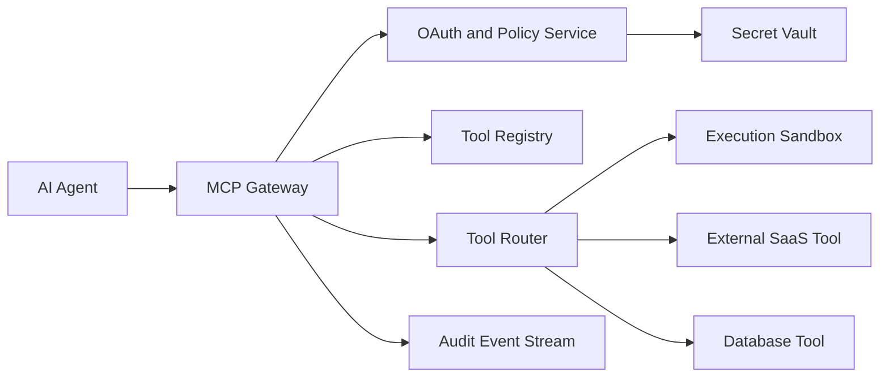

### 7. Key flow sequence diagram(s)
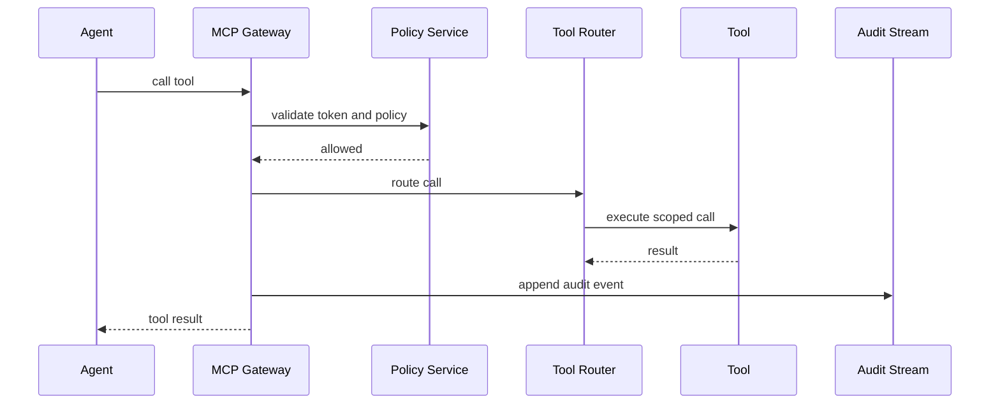

### 8. Deep dives into 2-3 hardest parts
**Registry:** versioned tool schemas, capability tags, owner, risk level, auth type, validation rules, deprecation state. **OAuth 2.1 and authZ:** agent acts for user or service; scopes are least privilege; risky tools can require approval. **Multi-tenancy and audit:** tenant_id on every call, secrets in vault, immutable audit with who, what, arguments hash, status, and correlation id.

### 9. Redis usage · Message queue usage
Redis: token introspection cache, registry cache, rate limits, idempotency keys. Queue: audit events, long-running tool calls, approval workflows, retries, webhooks.

### 10. Scaling & HA / failure scenarios
Gateway is stateless behind load balancer. If a tool is down, return typed error and let agent fallback; retry only idempotent calls. If audit stream is down, fail closed for high-risk tools or buffer with strict limits.

### 11. Tradeoffs
Direct tool calls are faster but ungoverned; gateway centralizes auth and audit. Strong schemas improve safety but add registration work. Fail-open improves availability but is unsafe for privileged actions.

### 12. SDE-1 answer vs Senior answer [Stretch]
- **SDE-1:** registry, gateway, auth, router, audit log.
- **Senior [Stretch]:** OAuth 2.1 delegated scopes, policy engine, sandboxing, approvals, idempotency, secret vault, signed manifests.

### 13. Interviewer follow-up questions with short answers
- *How prevent data leak?* → Tenant isolation, scoped tokens, output filtering, audit, policy checks.
- *How register safely?* → Validate schema, risk classify, owner approval, test sandbox.
- *How handle non-idempotent tools?* → Require idempotency key or disable automatic retry.

### 14. Revision summary
An MCP platform is a governed gateway for agent tools. Security, multi-tenancy, audit, and safe execution are the core senior points.

## Tier 3 [Stretch] quick designs

### A. Google Docs collaborative editing
- Clarify text editing, comments, presence, history, offline support.
- WebSocket rooms carry low-latency edit operations.
- Store snapshots plus operation log.
- OT transforms concurrent operations against server order.
- CRDT operations commute and support offline merge but add metadata overhead.
- Use OT for centralized server-authoritative editing; CRDT for offline-first clients.
- Persist accepted operations with monotonic revision.
- Compact old operations into snapshots.
- Presence and cursors are ephemeral; document content is durable.
- Replay missed operations after reconnect.
- ACL check before joining room.
- Queue indexing, export, and notifications.
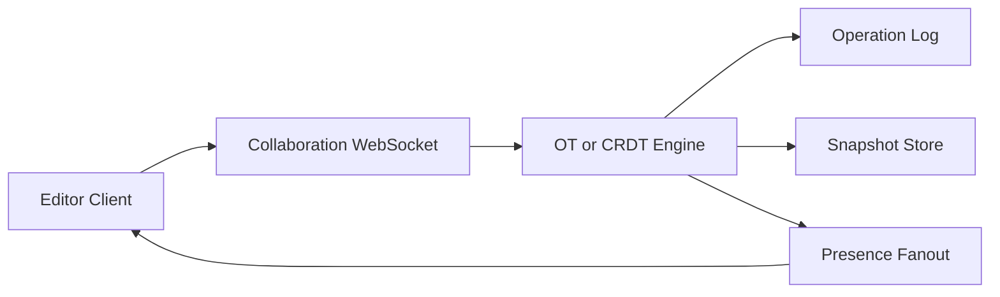

### B. Design Kafka
- Clarify topics, partitions, throughput, retention, ordering, replication.
- Producer writes records to topic partitions.
- Partition is append-only log; order is per partition.
- Broker stores segment files and indexes.
- Replication factor 3: leader serves reads/writes, followers replicate.
- Controller manages leadership and metadata.
- Consumer group assigns partitions to consumers.
- Offsets are committed per group and partition.
- Retention by time or size; compaction keeps latest value per key.
- Batching and compression drive throughput.
- Idempotent producers and transactions support Kafka-scoped exactly-once semantics.
- Senior angle: ISR, page cache, sequential IO, rebalance behavior.
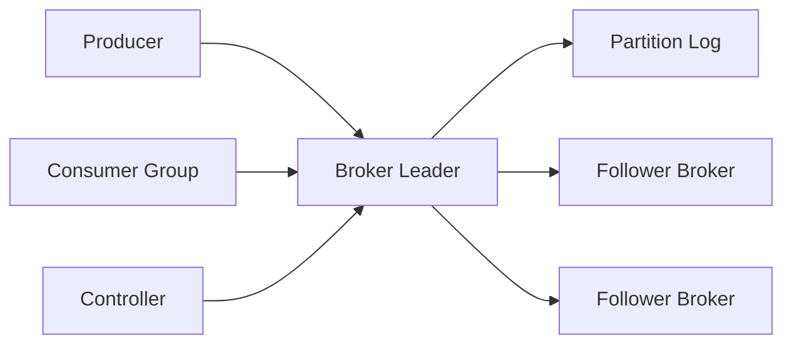

### C. Stock exchange matching engine
- Clarify order types, latency, fairness, audit, market data.
- Gateway authenticates and normalizes orders.
- Risk checks before order enters book.
- One symbol partition uses one sequencer thread for deterministic order.
- In-memory order book has buy and sell price levels with FIFO queues.
- Price-time priority decides matches.
- WAL every accepted command before execution or via synchronous replication.
- Cancel uses order_id lookup map.
- Market data and execution reports are emitted after match.
- Recovery replays WAL to rebuild book.
- No Redis or remote call in hot matching path.
- Senior angle: determinism and tail latency beat generic horizontal scaling.
```mermaid
flowchart LR
  Client["Trading Client"] --> Gateway["Order Gateway"]
  Gateway --> Risk["Risk Checks"]
  Risk --> Seq["Sequencer"]
  Seq --> Engine["Matching Engine"]
  Engine --> WAL["Write Ahead Log"]
  Engine --> MD["Market Data"]
  Engine --> Exec["Execution Reports"]
```

### D. Ad click aggregation
- Clarify impressions, clicks, attribution window, fraud, real-time dashboard.
- Edge collectors ingest signed click events.
- Validate and dedupe by click_id.
- Kafka partitions by campaign_id or ad_id.
- Stream processor aggregates tumbling or sliding windows.
- Raw events are stored in object storage for replay.
- Aggregates go to OLAP or time-series store.
- Late events handled with watermark and correction records.
- Fraud detector flags bots, repeated IPs, impossible user agents.
- Billing reconciles aggregates with raw events.
- Redis hot counters only if loss tolerance is explicit.
- Senior angle: dedup, late data, attribution, reconciliation.
```mermaid
flowchart LR
  Click["Click Event"] --> Edge["Edge Collector"]
  Edge --> Kafka["Kafka Stream"]
  Kafka --> Stream["Stream Aggregator"]
  Stream --> OLAP["Aggregate Store"]
  Kafka --> Lake["Raw Event Lake"]
  Stream --> Fraud["Fraud Detector"]
```

### E. Zoom video conferencing
- Clarify meeting size, screen share, recording, chat, global latency.
- Signaling service handles join, auth, room metadata.
- Media plane uses WebRTC where possible.
- Group calls use SFU to forward selected streams.
- TURN relays media when direct connectivity fails.
- Pick SFU region by latency and capacity.
- Simulcast and adaptive bitrate support varied networks.
- Chat and reactions use reliable messaging separate from media.
- Recording service consumes SFU output and writes object storage.
- Presence is ephemeral; meeting metadata is durable.
- Shard meetings to SFU clusters.
- Failure reconnects participants to backup SFU.
```mermaid
flowchart LR
  UserA["Participant A"] --> Signal["Signaling Service"]
  UserB["Participant B"] --> Signal
  Signal --> Room["Room Service"]
  UserA --> SFU["Regional SFU"]
  UserB --> SFU
  SFU --> Rec["Recording Service"]
  Rec --> Blob["Object Storage"]
```

## Revision Cheat Sheet
- Proximity: cell candidates plus exact distance and ranking.
- Hotel booking: stale search is okay; final reservation must be atomic.
- Leaderboard: Redis ZSET for exact rank; sketches for approximate heavy hitters.
- Scheduler: durable due jobs, leases, retries, at-least-once execution.
- Email: immutable MIME blob plus per-user mailbox index plus SMTP retry.
- Monitoring: agents to ingest to Kafka to TSDB/log store; control cardinality.
- RAG: chunk, embed, ANN search, re-rank, generate, cite, evaluate.
- LLM assistant: queue, stream, rate-limit, cache, budget, fallback.
- MCP: registry, gateway, OAuth scopes, tenant policy, audit, vault.
- Tier 3 hard invariants: convergence, ordering, determinism, dedup, media latency.

## Flashcards
- Q: Geo search first step? → A: Convert coordinates into cells and query neighbors.
- Q: Hotel no double-booking pattern? → A: Conditional transaction over listing-date rows.
- Q: Redis leaderboard commands? → A: `ZADD`, `ZREVRANGE`, `ZREVRANK`.
- Q: Scheduler guarantee? → A: Usually at-least-once, so jobs must be idempotent.
- Q: Email search backend? → A: Per-user inverted index fed asynchronously.
- Q: Monitoring cardinality risk? → A: Unbounded labels create too many time series.
- Q: RAG chunk tradeoff? → A: Smaller chunks improve precision but increase index size.
- Q: HNSW tradeoff? → A: High recall and low latency with high memory overhead.
- Q: LLM assistant cost controls? → A: Caching, quotas, token caps, smaller model routing.
- Q: MCP auth model? → A: OAuth scopes plus tenant policy at the gateway.
- Q: OT vs CRDT? → A: OT centralizes transform order; CRDT supports offline merge.
- Q: Kafka ordering scope? → A: Within one partition.
- Q: Matching engine scaling unit? → A: Symbol partition with deterministic sequencer.
- Q: Ad aggregation hard part? → A: Dedup, late events, attribution, reconciliation.
- Q: Zoom core split? → A: Control plane signaling separate from SFU media plane.
