# 10a · Low-Level Design (LLD) Fundamentals and Design Patterns

A beginner-first, interview-ready Java 17 guide for object-oriented design, SOLID principles, Gang of Four
(GoF) design patterns, and machine-coding strategy. The short answer is for interview revision; the detailed
answer is where you should build intuition.

**Table of Contents**
- [How to learn Low-Level Design from this series](#how-to-learn-low-level-design-from-this-series)
- [Core OOD Fundamentals](#core-ood-fundamentals)
- [SOLID and Design Principles](#solid-and-design-principles)
- [GoF and Enterprise Patterns](#gof-and-enterprise-patterns)
- [Machine Coding Round Strategy](#machine-coding-round-strategy)
- [Revision Cheat Sheet](#revision-cheat-sheet)
- [Flashcards](#flashcards)

🟢 Beginner · 🟡 Intermediate · 🔴 Advanced · ⚫ FAANG · 🔥 = very frequently asked

## How to learn Low-Level Design from this series

### What this file teaches

Low-Level Design means turning requirements into classes, interfaces, methods, relationships, and object
interactions. High-Level Design (HLD) decides major services, databases, and deployment boundaries. LLD
decides what happens inside one service or program.

### How to think through any question here

For every design, use this reasoning order:

1. **Restate the user goal:** explain what the system must do without technical words.
2. **Find actors and use cases:** who uses the system, and what action does each actor perform?
3. **Find nouns:** stable nouns often become entities or value objects.
4. **Find verbs:** verbs often become methods on an entity or orchestration service.
5. **Write invariants:** an invariant is a rule that must always remain true, such as “one seat cannot have
   two confirmed bookings.”
6. **Assign responsibility:** put data and rules together; do not create a class merely because a noun exists.
7. **Mark variation points:** pricing, allocation, notification, and persistence often change independently.
8. **Choose a pattern only after finding change pressure:** patterns are names for recurring structures, not
   decorations that must be forced into every answer.
9. **Walk one complete flow:** trace the call from the user-facing method to the final state change.
10. **Test failure paths:** invalid input, duplicate request, unavailable resource, payment failure, and
    concurrent requests reveal whether the model is correct.

### Mental model: objects as a team

Imagine the design as a small team:

- **Entities** remember identity and lifecycle, for example `Booking` or `Ticket`.
- **Value objects** describe immutable values, for example `Money`, `Position`, or `TimeRange`.
- **Services or facades** coordinate a use case that crosses several objects.
- **Strategies** perform one replaceable policy, such as pricing or allocation.
- **Repositories** load and save domain objects without exposing database details.
- **Adapters** translate an external Software Development Kit (SDK) or vendor interface into the interface
  expected by the domain.
- **Factories or builders** create valid objects when construction is conditional or has many inputs.

A class should have one clear job. An interface should represent a genuine variation or boundary. A method
should either answer a question or perform a clearly named state change.

### Abbreviations used in the LLD guides

| Short form | Expanded form | Meaning in these guides |
|---|---|---|
| AOP | Aspect-Oriented Programming | Cross-cutting behavior such as logging or transactions around core code |
| API | Application Programming Interface | A callable contract exposed to another component |
| AST | Abstract Syntax Tree | Tree representation of parsed code, useful in tooling or interpreters |
| ATM | Automated Teller Machine | A stateful machine often used to explain State and Command patterns |
| AWT | Abstract Window Toolkit | Older Java user-interface toolkit, mentioned only as Java ecosystem context |
| CDI | Contexts and Dependency Injection | Java dependency-injection standard used in enterprise applications |
| CSRF | Cross-Site Request Forgery | Web attack where an unwanted action is submitted using a user's session |
| DAO | Data Access Object | Persistence abstraction usually organized around tables or queries |
| DB | Database | Persistent storage used by repositories, DAOs, or services |
| DCL | Double-Checked Locking | Lazy Singleton technique that is only safe with a volatile field in Java |
| DI | Dependency Injection | Supplying collaborators from outside an object |
| DIP | Dependency Inversion Principle | High-level policy depends on abstractions rather than concrete details |
| DRY | Don't Repeat Yourself | Avoid duplicating the same rule, decision, or knowledge in many places |
| DTO | Data Transfer Object | Data-shaped object used to cross a boundary |
| ETL | Extract, Transform, Load | Data pipeline style for moving and reshaping data |
| FAANG | Facebook, Amazon, Apple, Netflix, Google | Shorthand for large product-company interview style |
| GoF | Gang of Four | Authors who catalogued 23 classic object-oriented patterns |
| HLD | High-Level Design | Services, storage, deployment, and system-wide data flow |
| HTTP | Hypertext Transfer Protocol | Protocol used by most web APIs |
| ID | Identifier | Value used to distinguish one object or row from another |
| IO | Input/Output | Reading from or writing to files, network, console, or other external systems |
| ISP | Interface Segregation Principle | Prefer small client-specific interfaces over one broad interface |
| JAXP | Java API for XML Processing | Java API family for parsing and transforming XML |
| JDBC | Java Database Connectivity | Java API for talking to relational databases |
| JDK | Java Development Kit | Java compiler, runtime tools, and standard libraries |
| JPA | Java Persistence API | Java specification for object-relational mapping |
| JVM | Java Virtual Machine | Runtime that executes Java bytecode |
| KISS | Keep It Simple, Stupid | Choose the simplest design that satisfies the real requirement |
| LLD | Low-Level Design | Classes, interfaces, methods, and object collaboration |
| LLM | Large Language Model | AI model sometimes hidden behind a gateway or adapter in examples |
| LSP | Liskov Substitution Principle | A subtype must honor the expectations of its parent type |
| MVC | Model-View-Controller | UI/application pattern separating data, presentation, and input handling |
| OCP | Open/Closed Principle | Add new behavior with new code instead of changing tested code |
| OOD | Object-Oriented Design | The design activity that produces the object model |
| OOP | Object-Oriented Programming | Modeling behavior and state through collaborating objects |
| RAG | Retrieval-Augmented Generation | AI flow where retrieved documents are provided to a model before answering |
| REST | Representational State Transfer | Common HTTP style for exposing resources through APIs |
| SDK | Software Development Kit | Vendor library used to integrate an external system |
| SDE-1 | Software Development Engineer level 1 | Early-career engineering interview level focused on fundamentals and coding |
| SLF4J | Simple Logging Facade for Java | Java logging facade often used behind application logging calls |
| SOLID | Five object-design principles | SRP, OCP, LSP, ISP, and DIP together |
| SQL | Structured Query Language | Language used to query and update relational databases |
| SRP | Single Responsibility Principle | A class should have one reason to change |
| TD | Top Down | Mermaid flowchart direction from top to bottom |
| UI | User Interface | The screen or command surface used by a person |
| UML | Unified Modeling Language | Standard visual notation for class and sequence diagrams |
| YAGNI | You Aren't Gonna Need It | Do not build speculative features until the requirement appears |
| Cohesion | Not an abbreviation | How tightly the responsibilities inside one class belong together |
| Coupling | Not an abbreviation | How strongly one class depends on another class's details |
| Invariant | Not an abbreviation | A rule that must remain true before and after every operation |
| Value object | Not an abbreviation | Immutable object identified by its values rather than database identity |

### How to recognize a design pattern

Do not begin with “I will use Strategy.” Begin with the pressure in the requirement:

| Requirement signal | Likely pattern | Recognition question |
|---|---|---|
| “Several algorithms can be selected or replaced” | Strategy | Does one policy vary while the caller stays the same? |
| “Behavior changes when lifecycle state changes” | State | Do valid operations depend on the object’s current state? |
| “Create one of several related types” | Factory Method or Abstract Factory | Is object construction conditional or family-based? |
| “Integrate an incompatible vendor library” | Adapter | Must data, methods, units, or errors be translated? |
| “Add optional behavior around the same contract” | Decorator | Can wrappers be stacked independently? |
| “Notify multiple interested components” | Observer | Should the producer avoid knowing every consumer? |
| “Process a request through ordered steps” | Chain of Responsibility | May each step handle, reject, or forward the request? |
| “Hide a complex subsystem behind one use-case API” | Facade | Should callers know fewer collaborators? |
| “Store and retrieve domain aggregates” | Repository | Should domain logic be independent of storage technology? |

Pattern suitability has three parts: the requirement exposes a variation or coupling problem, the pattern
localizes that problem, and the added indirection costs less than repeated conditionals or hard-coded
dependencies. If a direct method or small `switch` is clearer and unlikely to change, prefer it.

### How to explain every class, interface, method, and relationship

Use the following questions whenever you read or present a solution:

| Element | What to explain | Example |
|---|---|---|
| Class | Its single responsibility, state it owns, and invariant it protects | `ParkingSpot` owns occupancy and prevents a second vehicle |
| Interface | The variation or external boundary it represents | `PricingStrategy` allows fee algorithms to change |
| Constructor | Required collaborators and validation needed for a valid object | `BookingService` requires repositories, lock provider, and payment gateway |
| Query method | What it returns and whether it changes state | `availableSeats()` reads current availability |
| Command method | Preconditions, state change, postcondition, and failure | `confirm()` requires a valid hold and ends in booked or explicit failure |
| Association | One object knows or uses another | `Ticket` references its allocated `ParkingSpot` |
| Composition | Parent owns the child lifecycle | `ParkingFloor` owns its `ParkingSpot` objects |
| Dependency | Temporary method-level use | `PaymentService` calls a gateway during checkout |
| Inheritance/implementation | The substitutable contract being honored | `EmailSender` implements `ChannelSender` |

For each public method, say:

1. **Input:** what the caller supplies and what must be valid.
2. **Read set:** which state or collaborators the method reads.
3. **Write set:** which state may change.
4. **Atomicity boundary:** which reads and writes must succeed together.
5. **Output:** returned value and what it guarantees.
6. **Failure:** exception or result returned, and which state remains unchanged or is compensated.

This method-contract explanation is more valuable than reading code line by line. It shows that you
understand ownership, invariants, and failure behavior rather than only syntax.

### Common beginner traps

- Starting from a pattern name instead of the requirement pressure; this makes the design look memorized.
- Turning every noun into a class even when it has no state, behavior, invariant, or lifecycle.
- Using inheritance for code reuse, then discovering that one subtype cannot safely support a parent method.
- Exposing mutable collections or public fields, which lets callers bypass the invariant you described.
- Adding factories, repositories, or dependency injection before there is a real construction, storage, or testing need.
- Describing diagrams but not walking one concrete happy path and one failure path.
- Forgetting concurrency and persistence boundaries when a rule must survive more than one request or thread.

### How to study this file

1. Read each **Short answer** first and try to say it aloud in under 40 seconds.
2. Then read the **Beginner lens** and identify the requirement signal, invariant, or change pressure.
3. Study the detailed answer only after you can explain why the concept is needed in plain language.
4. For every pattern, name one real-world analogy, one confused-with pattern, and one reason not to use it.
5. Use the flashcards for spaced revision, but convert each card into a tiny class sketch or example flow.
6. Practice by redesigning the same problem twice: direct code first, then code after a realistic change.

### Scalability and production lens

A machine-coding answer can keep data in memory, use direct method calls, and run in one process. Production
usually adds persistence, retries, observability, concurrency control, configuration, and deployment boundaries.
When a rule must survive restarts or multiple application servers, move it from only Java objects into database
constraints, idempotency keys, locks, versions, or queues. Mention this boundary briefly without overbuilding the
interview solution.

## Core OOD Fundamentals

### Q1. How do you apply the four OOP pillars in an LLD problem?
`🟢 Beginner` `🔥` `Must-know SDE-1`

**Why they ask:** They check whether you can convert requirements into maintainable classes, not just recite definitions.

**Beginner lens:** The four pillars are tools for keeping rules in the right place. Think of a hotel desk:
guests see a simple check-in operation, while room state and payment details stay protected behind the counter.
Encapsulation protects invariants, abstraction hides unnecessary detail, inheritance is only for true is-a
relationships, and polymorphism lets one contract call many implementations. Interviewers are testing whether
you can turn requirements into collaborators and stable extension points, not textbook definitions.

**Short answer (say this first, 20-40 sec):**
Encapsulation protects invariants, abstraction exposes only required behavior, inheritance models true is-a reuse, and polymorphism lets clients depend on contracts. Start from use cases, identify entities/services, keep state private, and introduce interfaces where variation is expected.

**Detailed answer:**
| Pillar | Interview use | Java cue |
|---|---|---|
| Encapsulation | protect balance, spot count, state transitions | private fields + validation |
| Abstraction | hide payment, storage, matching, rate limit algorithm | interface boundary |
| Inheritance | stable is-a taxonomy only | Car extends Vehicle |
| Polymorphism | swap pricing/notification/scheduling | Strategy.calculate() |

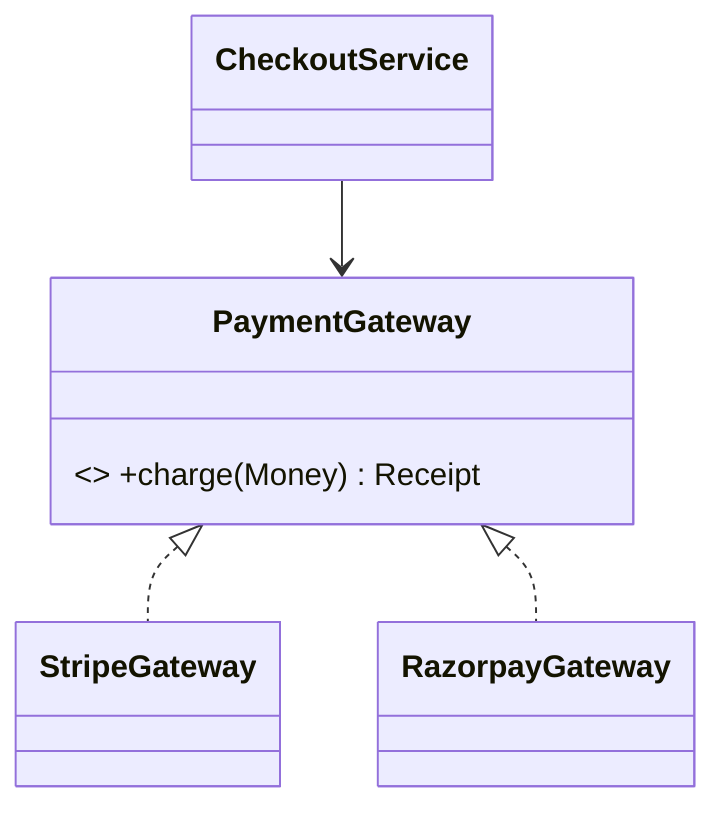
Resume hook: frame your Spring Boot/RAG projects as controllers depending on services/repositories, not concrete DB or LLM details.

**Common mistakes:**
- Creating one god class.
- Exposing mutable collections directly.
- Using inheritance only for code reuse.

**Follow-ups:**
- *When avoid inheritance?* → When behavior varies independently.
- *Where is polymorphism useful?* → Pricing, rate limiting, scheduling, payment modes.

### Q2. Why prefer composition over inheritance?
`🟢 Beginner` `🔥` `Must-know SDE-1`

**Why they ask:** Deep inheritance hierarchies make machine-coding designs rigid.

**Beginner lens:** Composition means an object has helpers; inheritance means an object is a specialized
parent. A car with a replaceable engine is easier to change than a car whose engine behavior is baked into its
family tree. Recognize this when capabilities vary independently, such as pricing, movement, payment, or
notification. The alternative is inheritance, which is useful for stable taxonomy but dangerous when subtypes
must disable or contradict parent behavior.

**Short answer (say this first, 20-40 sec):**
Composition gives behavior by holding collaborators; inheritance gives behavior from a parent. Prefer composition when behavior changes independently.

**Detailed answer:**
```java
// Bad
class Bird { void fly() {} }
class Penguin extends Bird { @Override void fly(){ throw new UnsupportedOperationException(); } }
// Good
interface Movement { void move(); }
final class Flying implements Movement { public void move(){ System.out.println("fly"); } }
final class Bird2 {
    private final Movement movement;

    Bird2(Movement movement) {
        this.movement = movement;
    }

    void move() {
        movement.move();
    }
}
```
Use inheritance for stable taxonomy; use composition for strategies, policies, and capabilities.

**Common mistakes:**
- Overriding methods to throw exceptions.
- Deep Vehicle to Car to ElectricCar trees.
- Not naming collaborators by role.

**Follow-ups:**
- *Example?* → Parking fee policy composed into ParkingLot.
- *JDK?* → Collections use Comparator composition.

### Q3. Interface vs abstract class: how do you choose?
`🟢 Beginner` `🔥` `Must-know SDE-1`

**Why they ask:** They want practical Java design judgment.

**Beginner lens:** An interface is a promise that many unrelated classes can keep; an abstract class is
shared family code with optional fixed steps. Use the plug-socket analogy: the socket shape is the interface,
while a base appliance class would share wires and helpers. Choose an interface for external boundaries,
testing fakes, and replaceable strategies. Choose an abstract class when related classes genuinely share state
or a template algorithm. The interviewer is checking practical Java trade-offs, especially single inheritance.

**Short answer (say this first, 20-40 sec):**
Use an interface for a capability or boundary with multiple implementations. Use an abstract class when closely related classes share state, protected helpers, or a fixed template algorithm.

**Detailed answer:**
```java
interface Sink { void write(String msg); }
abstract class AbstractLogger {
  protected final Sink sink;
  protected AbstractLogger(Sink sink){ this.sink = sink; }
  public final void log(String msg){ if (enabled(msg)) sink.write(format(msg)); }
  protected abstract boolean enabled(String msg);
  protected String format(String msg){ return java.time.Instant.now() + " " + msg; }
}
```
Java 8 added default interface methods; Java 9 added private helpers. Still avoid stateful fat interfaces.

**Common mistakes:**
- Using abstract classes only to avoid duplication.
- Forgetting Java single class inheritance.
- Making interfaces too broad.

**Follow-ups:**
- *Testing impact?* → Interfaces are easier to fake.
- *Can abstract class implement interface?* → Yes.

## SOLID and Design Principles

### Q4. Explain Single Responsibility Principle with bad to good Java code.
`🟡 Intermediate` `🔥` `Must-know SDE-1`

**Why they ask:** SOLID quickly reveals whether your design survives extensions.

**Beginner lens:** Single Responsibility Principle (SRP) says one class should have one main reason to
change. Picture a restaurant: the chef, cashier, and delivery partner should not be the same person just because
one order touches all three. Recognize SRP issues when one class formats, validates, persists, logs, and applies
policy together. The common alternative is a god service; the safer move is to split by responsibility while
keeping orchestration readable.

**Short answer (say this first, 20-40 sec):**
A class should have one reason to change. Split orchestration, persistence, formatting, and policy.

**Detailed answer:**
```java
// Bad
class InvoiceService {
    void save(Invoice invoice) {}

    String print(Invoice invoice) {
        return invoice.toString();
    }

    double tax(Invoice invoice) {
        return invoice.total() * 0.18;
    }
}
// Good
class InvoiceRepository { void save(Invoice i){} }
class InvoicePrinter { String print(Invoice i){ return i.toString(); } }
class TaxCalculator { double tax(Invoice i){ return i.total()*0.18; } }
```
In interviews, name the likely future change: new vehicle type, sink, payment mode, or repository.

**Common mistakes:**
- Quoting the principle without code.
- Overengineering every small class.
- Depending on concrete classes inside services.

**Follow-ups:**
- *Is it mandatory everywhere?* → No; apply where change/testing pressure exists.
- *Spring help?* → DI injects abstractions and lets tests replace beans.

### Q5. Explain Open Closed Principle with bad to good Java code.
`🟡 Intermediate` `🔥` `Must-know SDE-1`

**Why they ask:** SOLID quickly reveals whether your design survives extensions.

**Beginner lens:** Open/Closed Principle (OCP) means new behavior should usually be added by adding a new
class, not editing a risky central branch every time. It is like adding a new payment counter without rebuilding
the whole mall. The signal is repeated conditionals for type, channel, discount, or strategy. It fits when future
variants are likely and tested code should stay stable. Do not overuse it for one-off logic where a small direct
branch is clearer.

**Short answer (say this first, 20-40 sec):**
Code should be open for extension and closed for modification. Add variants through interfaces, strategies, or registration.

**Detailed answer:**
```java
// Bad
class Fee { int fee(String type){ return type.equals("CAR") ? 40 : 20; } }
// Good
interface FeePolicy { int fee(); }
class CarFee implements FeePolicy { public int fee(){ return 40; } }
class BikeFee implements FeePolicy { public int fee(){ return 20; } }
```
In interviews, name the likely future change: new vehicle type, sink, payment mode, or repository.

**Common mistakes:**
- Quoting the principle without code.
- Overengineering every small class.
- Depending on concrete classes inside services.

**Follow-ups:**
- *Is it mandatory everywhere?* → No; apply where change/testing pressure exists.
- *Spring help?* → DI injects abstractions and lets tests replace beans.

### Q6. Explain Liskov Substitution Principle with bad to good Java code.
`🟡 Intermediate` `🔥` `Must-know SDE-1`

**Why they ask:** SOLID quickly reveals whether your design survives extensions.

**Beginner lens:** Liskov Substitution Principle (LSP) asks whether a child can stand in for its parent
without surprising the caller. A debit card and credit card may both be payment methods, but a read-only list
that throws on normal list operations breaks expectations. Recognize LSP when inheritance forces a subclass to
weaken guarantees, throw unsupported exceptions, or change meaning. The alternative is composition or a smaller
interface that says only what every implementation can truly do.

**Short answer (say this first, 20-40 sec):**
A subtype must be usable wherever its parent is expected without weakening behavior or surprising callers.

**Detailed answer:**
```java
// Bad
class Rectangle { int w,h; void setW(int w){this.w=w;} void setH(int h){this.h=h;} }
class Square extends Rectangle { @Override void setW(int w){this.w=this.h=w;} }
// Good
interface Shape { int area(); }
record Rect(int w, int h) implements Shape { public int area(){ return w*h; } }
record Square2(int side) implements Shape { public int area(){ return side*side; } }
```
In interviews, name the likely future change: new vehicle type, sink, payment mode, or repository.

**Common mistakes:**
- Quoting the principle without code.
- Overengineering every small class.
- Depending on concrete classes inside services.

**Follow-ups:**
- *Is it mandatory everywhere?* → No; apply where change/testing pressure exists.
- *Spring help?* → DI injects abstractions and lets tests replace beans.

### Q7. Explain Interface Segregation Principle with bad to good Java code.
`🟡 Intermediate` `🔥` `Must-know SDE-1`

**Why they ask:** SOLID quickly reveals whether your design survives extensions.

**Beginner lens:** Interface Segregation Principle (ISP) means callers should depend only on the operations
they actually use. Think of a remote control with three useful buttons, not a cockpit panel for every device.
The signal is an interface where implementations leave methods empty, throw unsupported errors, or need irrelevant
dependencies. Split by client role, such as `Reader`, `Writer`, or `Refunder`. The trade-off is too many tiny
interfaces, so split only around real client needs.

**Short answer (say this first, 20-40 sec):**
Clients should not depend on methods they do not use. Prefer small role-specific interfaces.

**Detailed answer:**
```java
// Bad
interface Machine { void print(); void scan(); void fax(); }
// Good
interface Printer { void print(); } interface Scanner { void scan(); }
class SimplePrinter implements Printer { public void print(){} }
```
In interviews, name the likely future change: new vehicle type, sink, payment mode, or repository.

**Common mistakes:**
- Quoting the principle without code.
- Overengineering every small class.
- Depending on concrete classes inside services.

**Follow-ups:**
- *Is it mandatory everywhere?* → No; apply where change/testing pressure exists.
- *Spring help?* → DI injects abstractions and lets tests replace beans.

### Q8. Explain Dependency Inversion Principle with bad to good Java code.
`🟡 Intermediate` `🔥` `Must-know SDE-1`

**Why they ask:** SOLID quickly reveals whether your design survives extensions.

**Beginner lens:** Dependency Inversion Principle (DIP) says important policy should depend on stable
abstractions, not concrete tools. A delivery manager should request a courier, not hard-code one driver's phone
number. Recognize it when a service directly constructs a database client, payment gateway, or sender, making
tests and replacements painful. Dependency Injection (DI) is the usual implementation technique. Avoid fake
abstraction when there is only one local helper and no realistic variation.

**Short answer (say this first, 20-40 sec):**
High-level modules should depend on abstractions, not low-level concretions. Pass dependencies through constructors.

**Detailed answer:**
```java
// Bad
class OrderService { private final MySqlOrderRepo repo = new MySqlOrderRepo(); }
// Good
interface OrderRepository { void save(Order o); }
class OrderService2 {
    private final OrderRepository repo;

    OrderService2(OrderRepository repo) {
        this.repo = repo;
    }
}
```
In interviews, name the likely future change: new vehicle type, sink, payment mode, or repository.

**Common mistakes:**
- Quoting the principle without code.
- Overengineering every small class.
- Depending on concrete classes inside services.

**Follow-ups:**
- *Is it mandatory everywhere?* → No; apply where change/testing pressure exists.
- *Spring help?* → DI injects abstractions and lets tests replace beans.

### Q9. How do DRY, KISS, YAGNI, Law of Demeter, cohesion, and coupling guide LLD?
`🟡 Intermediate` `🔥` `Must-know SDE-1`

**Why they ask:** These show practical judgment under time pressure.

**Beginner lens:** These principles are guardrails for design judgment. Don't Repeat Yourself (DRY) protects
shared knowledge, Keep It Simple, Stupid (KISS) protects readability, You Aren't Gonna Need It (YAGNI) protects
scope, Law of Demeter protects boundaries, cohesion keeps related rules together, and coupling measures
dependency pain. Interviewers expect trade-offs: sometimes two similar lines are better than a premature
framework. Use them to justify concrete moves, not as slogans.

**Short answer (say this first, 20-40 sec):**
Keep code simple, avoid premature abstractions, remove duplicated knowledge, and avoid long object chains. High cohesion means one focused class; low coupling means classes know only required collaborators.

**Detailed answer:**
| Principle | Interview sentence |
|---|---|
| DRY | duplicate knowledge is worse than repeated lines |
| KISS | simple code beats clever generic engines |
| YAGNI | do not build DB/UI/distributed locks unless asked |
| Law of Demeter | talk to direct collaborators only |

```java
// Bad train wreck
String city = order.customer().address().city().name();
// Better intent
boolean ok = order.canDeliverTo("Lucknow");
```

**Common mistakes:**
- Utility-class dumping.
- Overengineering.
- Refactoring before understanding variation.

**Follow-ups:**
- *DRY vs readability?* → Prefer readable duplication until abstraction is stable.
- *Cohesion smell?* → Vague Manager classes.

### Q10. Draw UML relationships used in class diagrams.
`🟢 Beginner` `🔥` `Must-know SDE-1`

**Why they ask:** LLD interviews require quick, correct diagrams before coding.

**Beginner lens:** Unified Modeling Language (UML) diagrams are a compact map of who owns, knows, creates,
or substitutes whom. Treat arrows like relationship labels in a family tree: composition is strong ownership,
association is a reference, dependency is temporary use, and inheritance means substitutability. Use UML when
explaining class responsibilities or pattern structure. The interviewer is checking whether your diagram matches
the code flow and invariants, not whether every symbol is artistically perfect.

**Short answer (say this first, 20-40 sec):**
Association is knows, aggregation is weak whole-part, composition is strong owned lifecycle, inheritance is is-a, and dependency is temporary use.

**Detailed answer:**
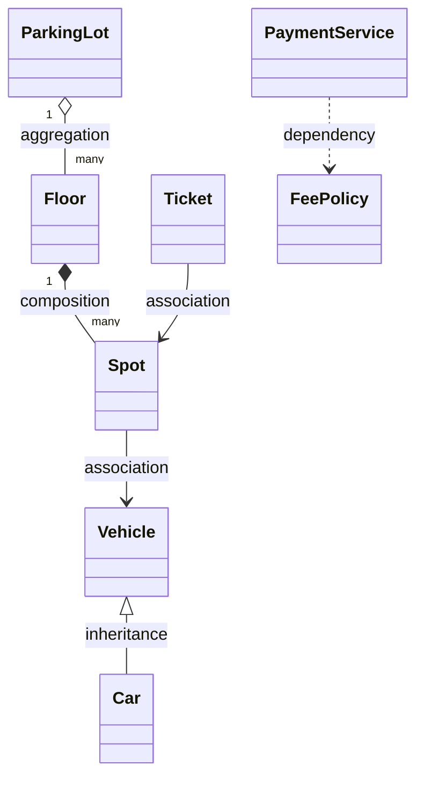
Use composition when deleting parent deletes child; use aggregation when part can outlive or be shared. Mermaid generics use List~Spot~.

**Common mistakes:**
- Drawing composition for every relation.
- Missing multiplicity.
- Showing too many fields.

**Follow-ups:**
- *Dependency vs association?* → Method-local use vs stored reference.
- *Aggregation in code?* → Usually references; lifecycle is semantic.

### Q11. What are immutable objects and value objects?
`🟡 Intermediate` `🔥` `Must-know SDE-1`

**Why they ask:** Thread-safety, equality, and domain modeling depend on this.

**Beginner lens:** An immutable object cannot change after construction; a value object is identified by its
values rather than a database identity. Think of a printed ticket price: if the amount changes, you create a new
value, not mutate the old receipt. Use this for money, date ranges, coordinates, identifiers, and configuration
snapshots. The key distinction is identity versus value. Production benefits include thread-safety and safer map
keys, but avoid huge immutable copies in hot paths.

**Short answer (say this first, 20-40 sec):**
An immutable object cannot change after construction. A value object is identified by values, not database identity. Java records are good for small immutable value objects.

**Detailed answer:**
```java
import java.math.BigDecimal;
public record Money(BigDecimal amount, String currency) {
  public Money {
    if (amount == null || amount.signum() < 0) throw new IllegalArgumentException("amount");
    if (currency == null || currency.length() != 3) throw new IllegalArgumentException("currency");
  }
  public Money add(Money other){
    if (!currency.equals(other.currency)) throw new IllegalArgumentException("currency mismatch");
    return new Money(amount.add(other.amount), currency);
  }
}
```
Entity: BookCopy has identity/lifecycle. Value object: Money, Email, Position.

**Common mistakes:**
- Exposing mutable lists.
- Assuming records are deeply immutable.
- Giving value objects setters.

**Follow-ups:**
- *How copy collections?* → List.copyOf.
- *Where useful?* → Cache keys, money, coordinates, user IDs.

### Q12. How do you design for testability?
`🟡 Intermediate` `🔥` `Must-know SDE-1`

**Why they ask:** Hidden tests and extension requests punish tightly coupled code.

**Beginner lens:** Testability means the design lets you check behavior without real databases, networks,
clocks, or random values. It is like rehearsing a play with mock props before opening night. Recognize poor
testability when classes create their own collaborators, hide time, mix input/output with rules, or require a
full server for simple logic. Interfaces, constructor injection, small pure methods, and explicit results help.
The alternative is end-to-end-only testing, which is slower and harder to debug.

**Short answer (say this first, 20-40 sec):**
Isolate pure logic, inject dependencies, depend on interfaces, and wrap time/random/IO. Services should run without Spring, DB, network, or filesystem.

**Detailed answer:**
```java
interface Clock { long millis(); }
class SystemClock implements Clock { public long millis(){ return System.currentTimeMillis(); } }
class TokenBucket {
  private final Clock clock;
  TokenBucket(Clock clock){ this.clock = clock; }
  boolean allow(String user){ return clock.millis() >= 0; }
}
```
Checklist: constructor injection, deterministic IDs, repository interfaces, no static mutable state, driver separate from logic.

**Common mistakes:**
- Static singletons everywhere.
- Direct time/random in algorithms.
- Tests that inspect only console output.

**Follow-ups:**
- *How test concurrency?* → Latches and small capacities.
- *Need Mockito?* → Hand-written fakes are fine.

### Q13. How should exceptions and validation be modeled?
`🟡 Intermediate` `🔥` `Must-know SDE-1`

**Why they ask:** They check robust boundaries and clear failure modes.

**Beginner lens:** Validation decides whether input is acceptable; exception modeling decides how failure is
reported and what state remains safe. Think of airport security: invalid luggage is rejected before boarding,
and a cancelled flight has a clear status for passengers. Recognize this topic when flows include bad input,
duplicate actions, payment failure, or unavailable resources. Prefer domain-specific exceptions or result
objects. Avoid swallowing exceptions or returning `null`, because callers lose the reason and recovery path.

**Short answer (say this first, 20-40 sec):**
Validate at boundaries and constructors, use meaningful domain exceptions for invalid operations, and fail fast instead of returning null.

**Detailed answer:**
```java
class OutOfStockException extends RuntimeException {
    OutOfStockException(String item) {
        super(item + " out of stock");
    }
}

record SlotId(int floor, int number) {
    SlotId {
        if (floor < 0 || number < 0) {
            throw new IllegalArgumentException("negative slot");
        }
    }
}

class Inventory {
    private int count;

    void dispense(String item) {
        if (count <= 0) {
            throw new OutOfStockException(item);
        }
        count--;
    }
}
```
In REST apps, map domain exceptions to HTTP status in controller advice, not in domain services.

**Common mistakes:**
- Returning null for errors.
- Catching and swallowing exceptions.
- Throwing generic Exception.

**Follow-ups:**
- *Checked or unchecked?* → Domain validation is usually unchecked.
- *Where validate?* → Constructors and workflow service methods.

## GoF and Enterprise Patterns

### Q14. Explain Singleton, five variants, and how it can break.
`🔴 Advanced` `🔥` `Must-know SDE-1`

**Why they ask:** Singleton checks whether you understand global state, JVM class loading, and Java object-creation loopholes.

**Beginner lens:** Singleton solves the problem of one process-wide instance with safe access, like one
building security desk. The requirement signal is exactly one shared registry or configuration object, but the
hidden risk is construction and test coupling. It fits only when identity is truly global and safely published.
It is commonly confused with Dependency Injection container singletons: Spring may create one bean, but callers
should still depend on injected abstractions rather than calling `getInstance()` everywhere.

**Short answer (say this first, 20-40 sec):**
Use Singleton only when exactly one shared coordinator is required. Enum is safest; holder is lazy and simple; double-checked locking needs `volatile`. In Spring, prefer DI-managed singleton beans over manual global access.

**Detailed answer:**
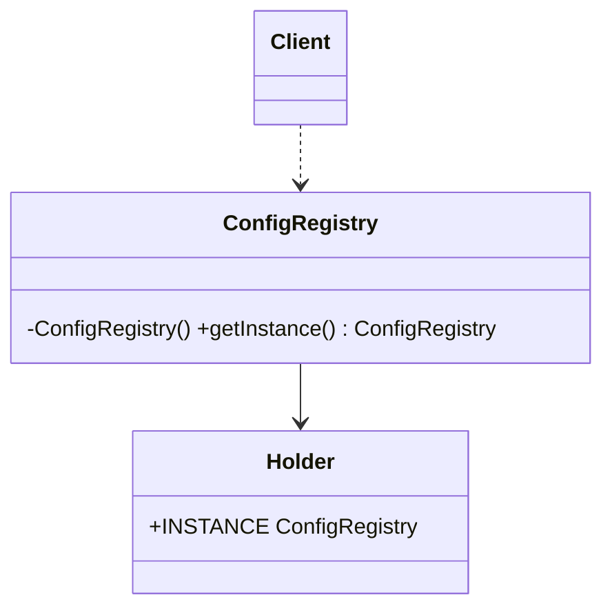
```java
public enum AppConfig {
    INSTANCE;
    public String get(String key) {
        return System.getProperty(key);
    }
}
public final class HolderSingleton {
    private HolderSingleton() {
    }
    private static class Holder {
        private static final HolderSingleton INSTANCE = new HolderSingleton();
    }
    public static HolderSingleton getInstance() {
        return Holder.INSTANCE;
    }
}
```
one controlled instance. Use: stateless config, logger adapters, or metadata registries. Avoid for request/user state, hidden dependencies, or anything tests must replace. JDK: `Runtime.getRuntime()`. Spring: singleton bean scope is one bean per container, not a GoF singleton. LLD: config registry or logging sink in Parking Lot.

**Common mistakes:**
- Missing volatile in DCL.
- Using Singleton for mutable business state.

**Follow-ups:**
- *How can it break?* → Reflection, serialization, or cloning can create extra instances unless blocked.
- *Enum singleton?* → Safest Java option; JVM protects enum constants during reflection and serialization.

### Q15. Explain the Factory Method pattern.
`🟡 Intermediate` `🔥` `Must-know SDE-1`

**Why they ask:** Factory Method tests whether you can hide creation choices without overengineering every constructor.

**Beginner lens:** Factory Method solves conditional creation without spreading `new` and `if` statements
across callers, like asking a travel desk to issue the right ticket type. The signal is create one subtype based
on input, but callers use a common interface. It fits because construction variation stays in one overridable or
dedicated creator. It is commonly confused with Abstract Factory; Factory Method usually creates one product
family member, while Abstract Factory creates related products together.

**Short answer (say this first, 20-40 sec):**
Factory Method creates a product through a method while clients depend on the product interface. Use when the concrete class depends on input, config, or subtype. Avoid it for one obvious constructor.

**Detailed answer:**
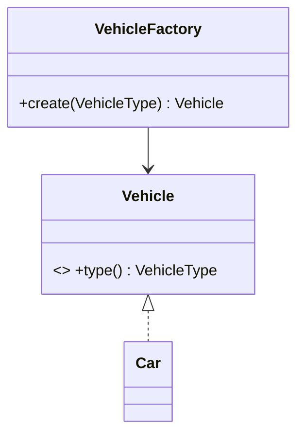
```java
enum VehicleType {
    CAR,
    BIKE
}
interface Vehicle {
    VehicleType type();
}
record Car() implements Vehicle {
    public VehicleType type() {
        return VehicleType.CAR;
    }
}
final class VehicleFactory {
    Vehicle create(VehicleType type) {
        return switch (type) {
            case CAR -> new Car();
            case BIKE -> () -> VehicleType.BIKE;
        };
    }
}
```
centralize product selection. Use when variants should not change clients. Avoid when `new` is stable and readable. JDK/Spring: `Calendar.getInstance()`, `NumberFormat.getCurrencyInstance()`, Spring `FactoryBean`. LLD: creating vehicle, ticket, or fee-policy objects.

**Common mistakes:**
- Mixing creation with business rules.
- Returning concrete types instead of product interfaces.

**Follow-ups:**
- *Factory Method vs Abstract Factory?* → Factory Method creates one product; Abstract Factory creates related products.
- *When avoid it?* → When a direct constructor is stable and readable.

### Q16. Explain the Abstract Factory pattern.
`🟡 Intermediate` `🔥` `Must-know SDE-1`

**Why they ask:** Abstract Factory checks whether you can keep related provider-specific objects consistent.

**Beginner lens:** Abstract Factory solves the problem of creating compatible families of objects, like
buying a matching laptop, charger, and adapter set for one region. The signal is all created objects must belong
to the same theme, vendor, or platform. It fits because callers ask a factory for a family instead of mixing
incompatible concrete classes. It is commonly confused with Factory Method; Abstract Factory coordinates several
related product types, not just one conditional object.

**Short answer (say this first, 20-40 sec):**
Abstract Factory creates families of related objects without binding clients to concrete classes. Use when products must be compatible, like payment gateway plus refund service. Avoid it for one product type.

**Detailed answer:**
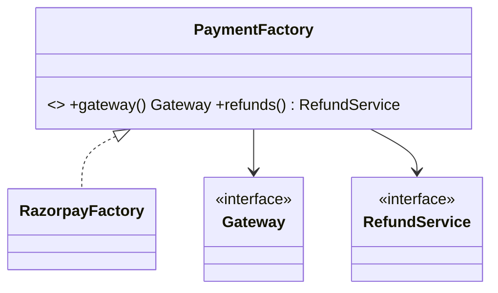
```java
interface Gateway {
    Receipt charge(long paise);
}
interface RefundService {
    void refund(String paymentId);
}
record Receipt(String id) {
}
interface PaymentFactory {
    Gateway gateway();
    RefundService refunds();
}
final class RazorpayFactory implements PaymentFactory {
    public Gateway gateway() {
        return amount -> new Receipt("rzp-" + amount);
    }
    public RefundService refunds() {
        return paymentId -> { };
    }
}
```
create compatible product families. Use: provider suites selected by config. Avoid when one simple factory or DI profile is enough. JDK/Spring: JAXP factories, Spring profiles/config classes. LLD: payment provider family in Food Delivery or BookMyShow.

**Common mistakes:**
- Creating factories before family variation exists.
- Mixing products from different families.

**Follow-ups:**
- *Spring alternative?* → Profiles or conditional beans can select a compatible family.
- *When avoid it?* → When a single factory method is enough.

### Q17. Explain the Builder pattern.
`🟡 Intermediate` `🔥` `Must-know SDE-1`

**Why they ask:** Builder shows whether you can handle optional fields without unreadable constructors.

**Beginner lens:** Builder solves construction with many optional or ordered inputs, like assembling a
custom meal where some choices are required and others are optional. The signal is long constructors, many
booleans, or object validity that depends on a sequence of fields. It fits because the builder names each choice
and validates before producing the object. It is commonly confused with Factory; a factory chooses a type, while
a builder assembles one complex instance.

**Short answer (say this first, 20-40 sec):**
Builder constructs an object step by step and validates at `build()`. Use it for many optional fields, named construction, or immutable commands. Avoid it for two mandatory fields.

**Detailed answer:**
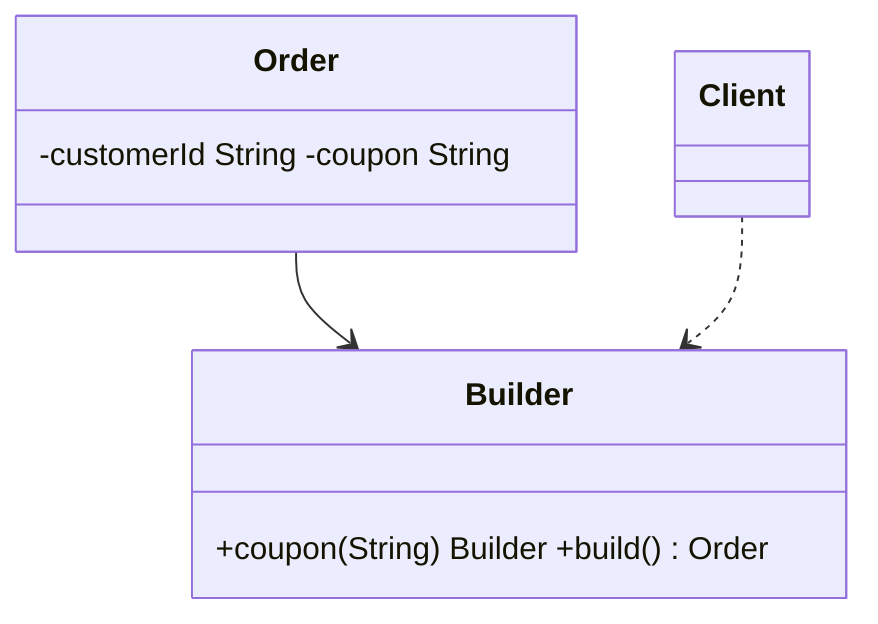
```java
public record Order(String customerId, String coupon, boolean giftWrap) {
    public static Builder builder(String customerId) {
        return new Builder(customerId);
    }
    public static final class Builder {
        private final String customerId;
        private String coupon;
        private boolean giftWrap;
        private Builder(String customerId) {
            this.customerId = java.util.Objects.requireNonNull(customerId);
        }
        public Builder coupon(String coupon) {
            this.coupon = coupon;
            return this;
        }
        public Builder giftWrap(boolean giftWrap) {
            this.giftWrap = giftWrap;
            return this;
        }
        public Order build() {
            return new Order(customerId, coupon, giftWrap);
        }
    }
}
```
readable construction plus validation. Use: immutable requests, notification templates, and search filters. Avoid if fields are few and validation is absent. JDK/Spring: `StringBuilder`, `UriComponentsBuilder`, `ResponseEntity.BodyBuilder`. LLD: order creation request or report filter.

**Common mistakes:**
- Using Builder with no invariants.
- Forgetting mandatory fields or validation.

**Follow-ups:**
- *Builder vs telescoping constructors?* → Builder names optional fields and avoids overload ambiguity.
- *Lombok @Builder?* → It reduces boilerplate, but invariants still need explicit validation.

### Q18. Explain the Prototype pattern.
`🟡 Intermediate` `🔥` `Must-know SDE-1`

**Why they ask:** Prototype reveals whether you understand copying, mutability, and configured templates.

**Beginner lens:** Prototype solves expensive or repetitive construction by cloning a prepared template,
like photocopying a filled form and changing only a few fields. The signal is new objects are mostly like an
existing object or construction needs costly setup. It fits when copying is clearer and cheaper than rebuilding.
It is commonly confused with Builder; Prototype starts from an existing instance, while Builder starts from named
inputs. Watch deep versus shallow copy bugs.

**Short answer (say this first, 20-40 sec):**
Prototype creates new objects by copying an existing configured instance. Use when setup is expensive or templates vary slightly. Avoid shallow copies of mutable fields.

**Detailed answer:**
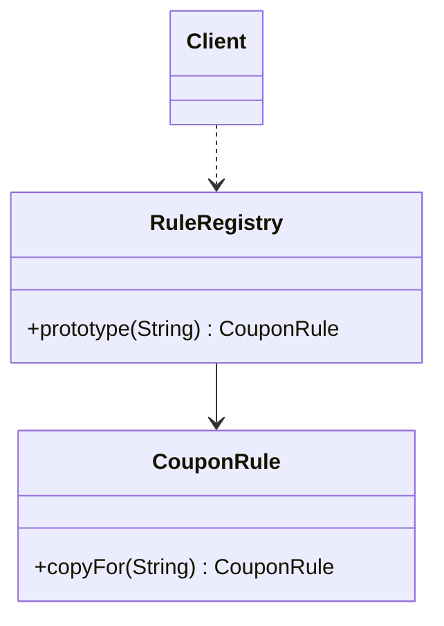
```java
import java.util.List;
record CouponRule(String name, List<String> actions) {
    CouponRule {
        actions = List.copyOf(actions);
    }
    CouponRule copyFor(String newName) {
        return new CouponRule(newName, actions);
    }
}
```
clone a known-good template. Use: game pieces, coupon rules, or tenant defaults. Prefer explicit copy methods over Java `Cloneable`. JDK/Spring: `Object.clone()` concept, Spring prototype bean scope. LLD: Chess piece prototypes or coupon templates.

**Common mistakes:**
- Sharing mutable collections between copies.
- Copying identity fields that should be regenerated.

**Follow-ups:**
- *Deep vs shallow copy?* → Deep-copy owned mutable state; share immutable values.
- *Why avoid Cloneable?* → It is shallow by default and awkward to make safe.

### Q19. Explain the Adapter pattern.
`🟡 Intermediate` `🔥` `Must-know SDE-1`

**Why they ask:** Adapter checks whether you can integrate external APIs without leaking vendor details.

**Beginner lens:** Adapter solves incompatible interfaces, like a travel plug that lets your charger fit a
foreign socket. The signal is this vendor method, data shape, or error model does not match what my domain
expects. It fits because translation is isolated at the boundary and the domain stays clean. It is commonly
confused with Facade; Adapter changes one interface into another expected interface, while Facade simplifies a
larger subsystem for easier use.

**Short answer (say this first, 20-40 sec):**
Adapter converts an incompatible interface into the interface your code expects. Use it around SDKs, legacy code, or different data shapes. Avoid it if clients can directly use the dependency cleanly.

**Detailed answer:**
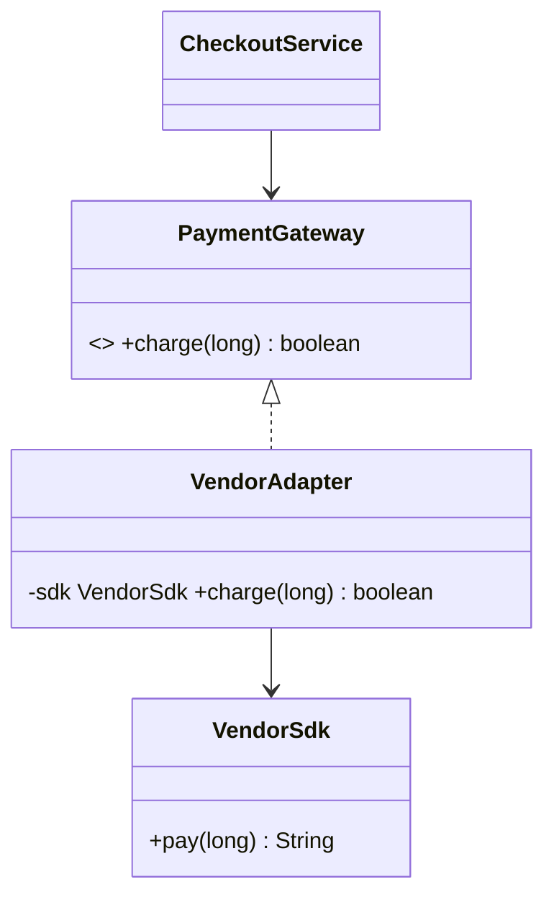
```java
interface PaymentGateway {
    boolean charge(long paise);
}
final class VendorSdk {
    String pay(long paise) {
        return "OK";
    }
}
final class VendorAdapter implements PaymentGateway {
    private final VendorSdk sdk;
    VendorAdapter(VendorSdk sdk) {
        this.sdk = sdk;
    }
    public boolean charge(long paise) {
        return "OK".equals(sdk.pay(paise));
    }
}
```
translate interface, units, exceptions, and models. Use: payments, email providers, or storage clients. Avoid passing vendor DTOs into domain services. JDK/Spring: `InputStreamReader`, `Arrays.asList()`, Spring MVC adapters. LLD: payment gateway in BookMyShow or Food Delivery.

**Common mistakes:**
- Leaking vendor DTOs or exceptions.
- Putting retries, pricing, and persistence inside the adapter.

**Follow-ups:**
- *Adapter vs Proxy?* → Adapter changes an interface; Proxy controls access to the same interface.
- *Adapter vs Facade?* → Adapter translates; Facade simplifies a subsystem.

### Q20. Explain the Decorator pattern.
`🟡 Intermediate` `🔥` `Must-know SDE-1`

**Why they ask:** Decorator tests whether you can add behavior without subclass explosion.

**Beginner lens:** Decorator solves optional behavior around the same contract, like adding gift wrap,
insurance, and tracking around a package. The signal is features can be stacked independently without subclass
explosion. It fits because each wrapper delegates and adds one responsibility. It is commonly confused with
Proxy; Decorator adds behavior for feature composition, while Proxy controls access, laziness, caching, or
remote calls to the same underlying subject.

**Short answer (say this first, 20-40 sec):**
Decorator wraps an object with the same interface and adds behavior before or after delegation. Use it for optional, stackable features. Avoid it when one explicit class is clearer.

**Detailed answer:**
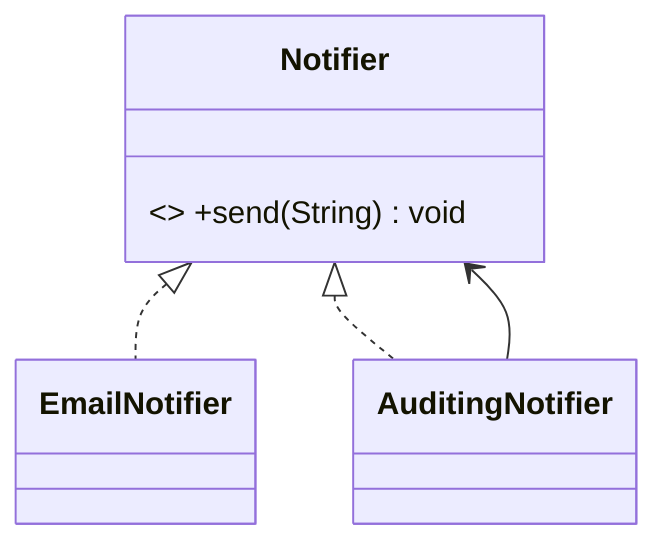
```java
interface Notifier {
    void send(String message);
}
final class EmailNotifier implements Notifier {
    public void send(String message) {
        System.out.println("email " + message);
    }
}
final class AuditingNotifier implements Notifier {
    private final Notifier delegate;
    AuditingNotifier(Notifier delegate) {
        this.delegate = delegate;
    }
    public void send(String message) {
        System.out.println("audit " + message);
        delegate.send(message);
    }
}
```
add responsibilities dynamically while preserving the interface. Use: caching, logging, metrics, compression, or notification add-ons. Avoid deep wrapper stacks. JDK/Spring: `BufferedInputStream`, `Collections.unmodifiableList()`, bean decorators. LLD: logging/metrics around gateways.

**Common mistakes:**
- Changing the interface while decorating.
- Creating deep wrapper stacks that are hard to debug.

**Follow-ups:**
- *Decorator vs Proxy vs Adapter?* → Decorator adds behavior; Proxy controls access; Adapter changes interface.
- *When avoid it?* → When the behavior is mandatory core behavior.

### Q21. Explain the Facade pattern.
`🟡 Intermediate` `🔥` `Must-know SDE-1`

**Why they ask:** Facade shows whether you can make a subsystem usable without creating a god service.

**Beginner lens:** Facade solves subsystem complexity by offering one simple entry point, like a hotel
concierge coordinating taxi, room, and luggage for you. The signal is callers must know too many services or
steps for one use case. It fits because orchestration and dependency knowledge move behind a use-case method.
It is commonly confused with Adapter; Facade simplifies many existing APIs, while Adapter makes an incompatible
API look like a specific expected contract.

**Short answer (say this first, 20-40 sec):**
Facade exposes a small use-case API over several collaborating classes. Use it to reduce client coupling to subsystem details. Avoid letting it absorb all business logic.

**Detailed answer:**
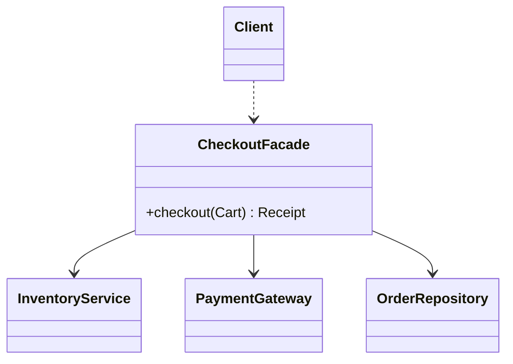
```java
final class CheckoutFacade {
    private final InventoryService inventory;
    private final PaymentGateway payments;
    private final OrderRepository orders;
    CheckoutFacade(
            InventoryService inventory,
            PaymentGateway payments,
            OrderRepository orders) {
        this.inventory = inventory;
        this.payments = payments;
        this.orders = orders;
    }
    Receipt checkout(Cart cart) {
        inventory.reserve(cart);
        Receipt receipt = payments.charge(cart.totalPaise());
        orders.save(cart, receipt);
        return receipt;
    }
}
```
provide one stable entry point to a complex workflow. Use: checkout, booking, or report generation. Avoid vague `Manager` classes. JDK/Spring: `JdbcTemplate` simplifies JDBC; service layers often act as facades. LLD: BookMyShow booking facade.

**Common mistakes:**
- Turning the facade into a god service.
- Exposing subsystem internals through facade methods.

**Follow-ups:**
- *Facade vs Adapter?* → Facade simplifies a subsystem; Adapter converts an incompatible interface.
- *When avoid it?* → When one direct collaborator is already simple.

### Q22. Explain the Proxy pattern.
`🟡 Intermediate` `🔥` `Must-know SDE-1`

**Why they ask:** Proxy connects LLD to Spring AOP, transactions, caching, and access control.

**Beginner lens:** Proxy solves controlled access to another object, like a receptionist who checks
permissions before connecting you to a manager. The signal is same interface, but add lazy loading, authorization,
caching, remote communication, or rate control. It fits because callers keep the same contract while access logic
stays separate. It is commonly confused with Decorator; Proxy is about controlling access to a subject, while
Decorator is about stacking optional features.

**Short answer (say this first, 20-40 sec):**
Proxy exposes the same interface as the real object and controls access to it. Use it for lazy loading, authorization, caching, retries, or transactions. Avoid it when it hides remote or expensive work.

**Detailed answer:**
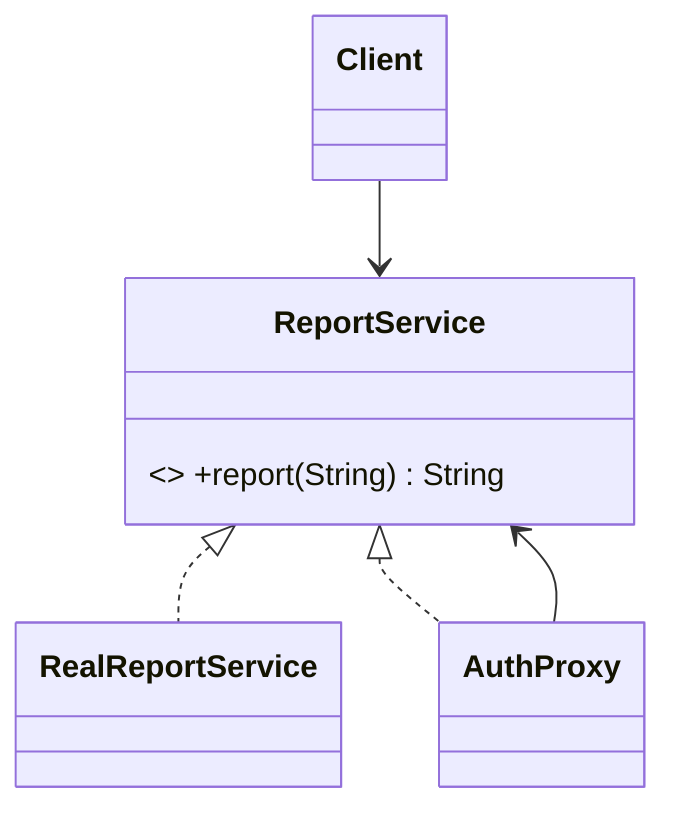
```java
interface ReportService {
    String report(String userId);
}
final class RealReportService implements ReportService {
    public String report(String userId) {
        return "report for " + userId;
    }
}
final class AuthProxy implements ReportService {
    private final ReportService target;
    AuthProxy(ReportService target) {
        this.target = target;
    }
    public String report(String userId) {
        if (userId == null) {
            throw new SecurityException("anonymous");
        }
        return target.report(userId);
    }
}
```
control access while preserving the target interface. Use: protection, virtual, remote, and smart-reference proxies. JDK/Spring: `java.lang.reflect.Proxy`, Hibernate lazy proxies, Spring AOP `@Transactional` and `@Cacheable`. LLD: access-controlled admin service.

**Common mistakes:**
- Confusing Proxy with Adapter.
- Forgetting Spring self-invocation bypasses proxy advice.

**Follow-ups:**
- *How does @Transactional work?* → Spring wraps the bean and manages transaction boundaries around proxied calls.
- *Proxy vs Decorator?* → Proxy controls access; Decorator adds optional behavior.

### Q23. Explain the Composite pattern.
`🟡 Intermediate` `🔥` `Must-know SDE-1`

**Why they ask:** Composite checks if you can model tree structures without type checks everywhere.

**Beginner lens:** Composite solves uniform handling of trees, like folders containing files and other
folders while both can report size. The signal is single items and groups should support the same operation. It
fits because callers can treat leaf and container through one component contract. It is commonly confused with
Decorator; Composite models part-whole hierarchy, while Decorator wraps one object to add behavior without
making a tree of children.

**Short answer (say this first, 20-40 sec):**
Composite lets clients treat leaves and groups through the same interface. Use it for recursive structures like menus, folders, comments, or org charts. Avoid it when the domain is flat.

**Detailed answer:**
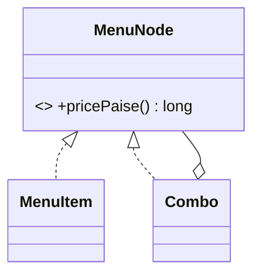
```java
interface MenuNode {
    long pricePaise();
}
record MenuItem(long pricePaise) implements MenuNode {
}
final class Combo implements MenuNode {
    private final java.util.List<MenuNode> items;
    Combo(java.util.List<MenuNode> items) {
        this.items = java.util.List.copyOf(items);
    }
    public long pricePaise() {
        return items.stream().mapToLong(MenuNode::pricePaise).sum();
    }
}
```
uniform operations over part-whole trees. Use when recursion is natural. Avoid forcing flat data into a tree. JDK/Spring: Swing/AWT component trees, expression trees conceptually. LLD: file system, menu combos, nested comments.

**Common mistakes:**
- Putting child operations on leaves without meaning.
- Forgetting cycle prevention when reparenting.

**Follow-ups:**
- *Transparent vs safe composite?* → Transparent exposes child methods everywhere; safe keeps them on composites.
- *When avoid it?* → When the model is flat and not recursive.

### Q24. Explain the Bridge pattern.
`🔴 Advanced` `🔥` `Stretch`

**Why they ask:** Bridge tests if you can separate two dimensions of variation instead of creating class explosions.

**Beginner lens:** Bridge solves two dimensions of variation that should change independently, like a
remote control abstraction working with different television brands. The signal is class hierarchy is multiplying
because abstraction type and implementation platform vary separately. It fits by splitting the high-level
abstraction from the implementation interface. It is commonly confused with Adapter; Bridge is designed up front
to separate dimensions, while Adapter usually reconciles an existing incompatible interface.

**Short answer (say this first, 20-40 sec):**
Bridge decouples an abstraction from its implementation so both can vary independently. Use when type and platform/channel/provider vary separately. Avoid it when Strategy or simple composition is enough.

**Detailed answer:**
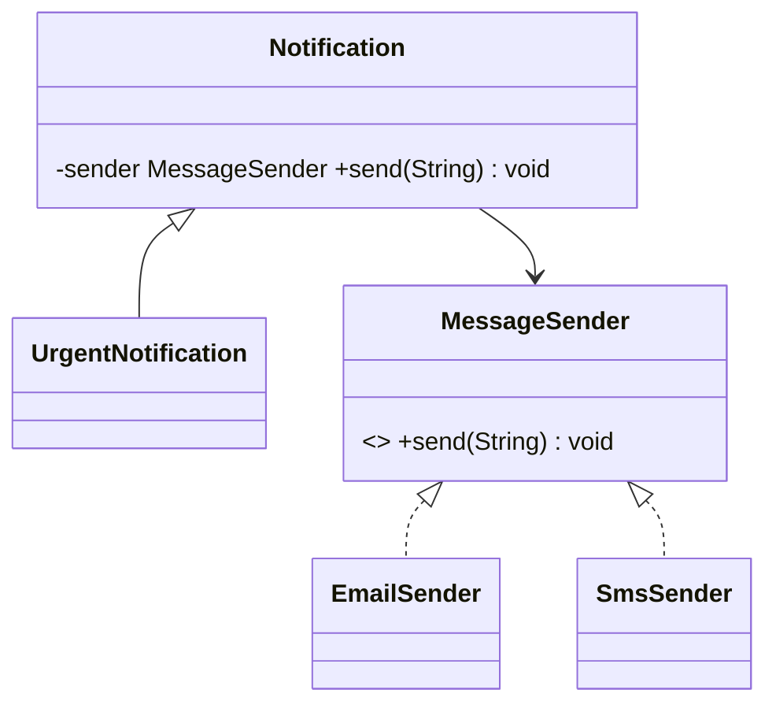
```java
interface MessageSender {
    void send(String text);
}
abstract class Notification {
    private final MessageSender sender;
    protected Notification(MessageSender sender) {
        this.sender = sender;
    }
    public final void send(String text) {
        sender.send(format(text));
    }
    protected abstract String format(String text);
}
final class UrgentNotification extends Notification {
    UrgentNotification(MessageSender sender) {
        super(sender);
    }
    protected String format(String text) {
        return "URGENT: " + text;
    }
}
```
avoid `EmailUrgentNotification`, `SmsUrgentNotification`, etc. Use when abstraction type and implementation channel grow independently. JDK/Spring: JDBC API to drivers; SLF4J to logging implementations. LLD: notification type plus delivery channel.

**Common mistakes:**
- Calling any delegation Bridge.
- Creating two hierarchies before two axes really vary.

**Follow-ups:**
- *Bridge vs Strategy?* → Bridge separates two class hierarchies; Strategy swaps one algorithm.
- *LLD clue?* → Two independent dimensions such as message type and channel both expand.

### Q25. Explain the Flyweight pattern.
`🟡 Intermediate` `🔥` `Must-know SDE-1`

**Why they ask:** Flyweight checks whether you separate shared intrinsic state from per-object extrinsic state.

**Beginner lens:** Flyweight solves memory waste when many objects share identical intrinsic data, like many
map pins sharing one icon image while each pin stores its own coordinates. The signal is millions of similar
objects with repeated immutable fields. It fits by sharing the common state and passing external state separately.
It is commonly confused with Singleton; Flyweight has many logical objects sharing reusable data, while Singleton
enforces one global instance.

**Short answer (say this first, 20-40 sec):**
Flyweight shares immutable common state across many small objects. Use when object count is huge and shared state is duplicated. Avoid it if sharing adds complexity without memory pressure.

**Detailed answer:**
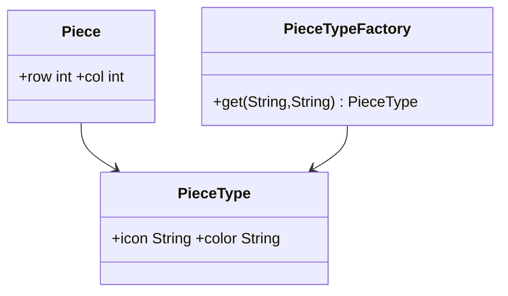
```java
record PieceType(String icon, String color) {
}
record Piece(int row, int col, PieceType type) {
}
final class PieceTypeFactory {
    private final java.util.Map<String, PieceType> cache = new java.util.HashMap<>();
    PieceType get(String icon, String color) {
        String key = icon + ":" + color;
        return cache.computeIfAbsent(key, ignored -> new PieceType(icon, color));
    }
}
```
share intrinsic immutable data and keep extrinsic coordinates outside. Use: chess pieces, map tiles, text glyphs. Avoid sharing mutable per-object state. JDK/Spring: `Integer` cache, string interning. LLD: Chess board or game map.

**Common mistakes:**
- Sharing mutable state accidentally.
- Adding a factory when object counts are tiny.

**Follow-ups:**
- *Intrinsic vs extrinsic?* → Intrinsic is shared immutable data; extrinsic is per-use context.
- *Thread safety?* → Immutable flyweights are safe; guard a concurrent factory cache.

### Q26. Explain the Strategy pattern.
`🟡 Intermediate` `🔥` `Must-know SDE-1`

**Why they ask:** Strategy checks if you replace conditionals with injectable algorithms only where variation matters.

**Beginner lens:** Strategy solves replaceable algorithms, like choosing walking, driving, or transit
directions behind the same navigation button. The signal is one policy varies: pricing, discounting, allocation,
sorting, matching, or rate limiting. It fits because the caller depends on one interface and the chosen algorithm
can change independently. It is commonly confused with State; Strategy is usually selected from outside, while
State changes behavior because the object's lifecycle state changes.

**Short answer (say this first, 20-40 sec):**
Strategy encapsulates interchangeable algorithms behind one interface. Use when behavior varies by policy, tenant, or runtime configuration. Avoid it for stable two-line conditionals.

**Detailed answer:**
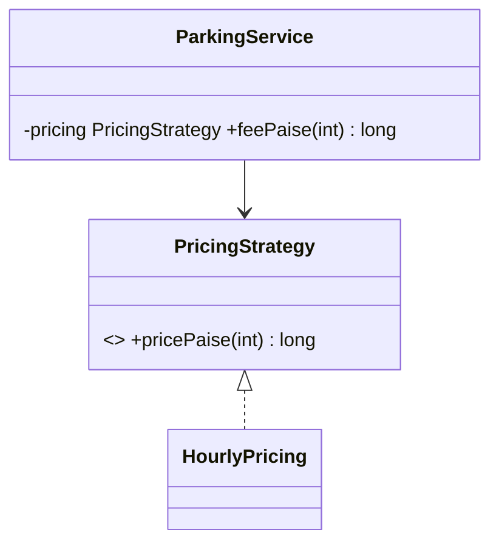
```java
interface PricingStrategy {
    long pricePaise(int hours);
}
final class HourlyPricing implements PricingStrategy {
    public long pricePaise(int hours) {
        return hours * 4_000L;
    }
}
final class ParkingService {
    private final PricingStrategy pricing;
    ParkingService(PricingStrategy pricing) {
        this.pricing = pricing;
    }
    long feePaise(int hours) {
        return pricing.pricePaise(hours);
    }
}
```
swap algorithms without changing the context class. Use: pricing, scheduling, matching, or rate limiting. Avoid class-per-enum-value when a switch is clearer. JDK/Spring: `Comparator`, `FileVisitor`, Spring interface injection. LLD: parking fee policy, elevator scheduling, Splitwise split strategy.

**Common mistakes:**
- Creating one class per tiny branch too early.
- Letting strategies mutate context internals.

**Follow-ups:**
- *Strategy vs State?* → Strategy is chosen from outside; State changes with lifecycle.
- *Spring selection?* → Inject a Map of strategy beans or mark a default with @Primary.

### Q27. Explain the Observer pattern.
`🟡 Intermediate` `🔥` `Must-know SDE-1`

**Why they ask:** Observer tests loose coupling, ordering, backpressure, and sync vs async event delivery.

**Beginner lens:** Observer solves one-to-many notification, like a news publisher alerting subscribers
without knowing what each subscriber does next. The signal is multiple components need to react when something
changes, and the producer should stay decoupled. It fits because observers register interest and the subject
broadcasts events. It is commonly confused with Event Bus; Observer is often direct subject-to-listener, while
Event Bus centralizes routing across broader parts of a system.

**Short answer (say this first, 20-40 sec):**
Observer lets subscribers react when a subject changes. Use it for in-process notifications where the subject should not know every consumer. Avoid it when reliable distributed delivery needs a broker.

**Detailed answer:**
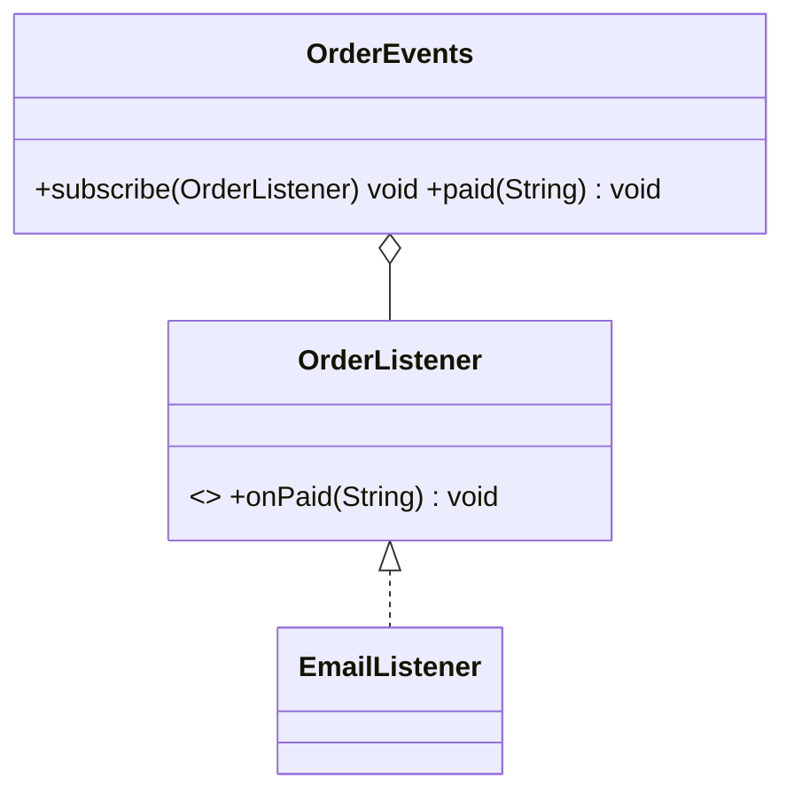
```java
interface OrderListener {
    void onPaid(String orderId);
}
final class OrderEvents {
    private final java.util.List<OrderListener> listeners = new java.util.ArrayList<>();
    void subscribe(OrderListener listener) {
        listeners.add(listener);
    }
    void paid(String orderId) {
        for (OrderListener listener : java.util.List.copyOf(listeners)) {
            listener.onPaid(orderId);
        }
    }
}
```
notify dependents without hard-coding them. Use: UI/domain events inside one process. Avoid slow synchronous observers on critical paths. JDK/Spring: Swing listeners, `PropertyChangeListener`, Spring `ApplicationEventPublisher`. LLD: stock alerts or order notification fan-out.

**Common mistakes:**
- Forgetting unsubscribe and leaks.
- Letting one observer failure stop all observers accidentally.

**Follow-ups:**
- *Observer vs Pub-Sub?* → Observer is usually in-process; Pub-Sub uses broker topics and durable delivery.
- *Sync or async?* → Async needs queues, retries, ordering, and failure handling.

### Q28. Explain the State pattern.
`🟡 Intermediate` `🔥` `Must-know SDE-1`

**Why they ask:** State checks if you can model lifecycle behavior without giant transition switches.

**Beginner lens:** State solves behavior that changes with lifecycle, like a vending machine acting
differently when it has no coin, has coin, or is dispensing. The signal is many methods switch on status, and
valid operations depend on current state. It fits because each state owns allowed transitions and behavior. It is
commonly confused with Strategy; State changes internally as the object moves through lifecycle, while Strategy
is selected to vary an algorithm.

**Short answer (say this first, 20-40 sec):**
State delegates behavior to the current state object, and transitions replace the state. Use when allowed operations depend heavily on lifecycle state. Avoid it when an enum transition table is simpler.

**Detailed answer:**
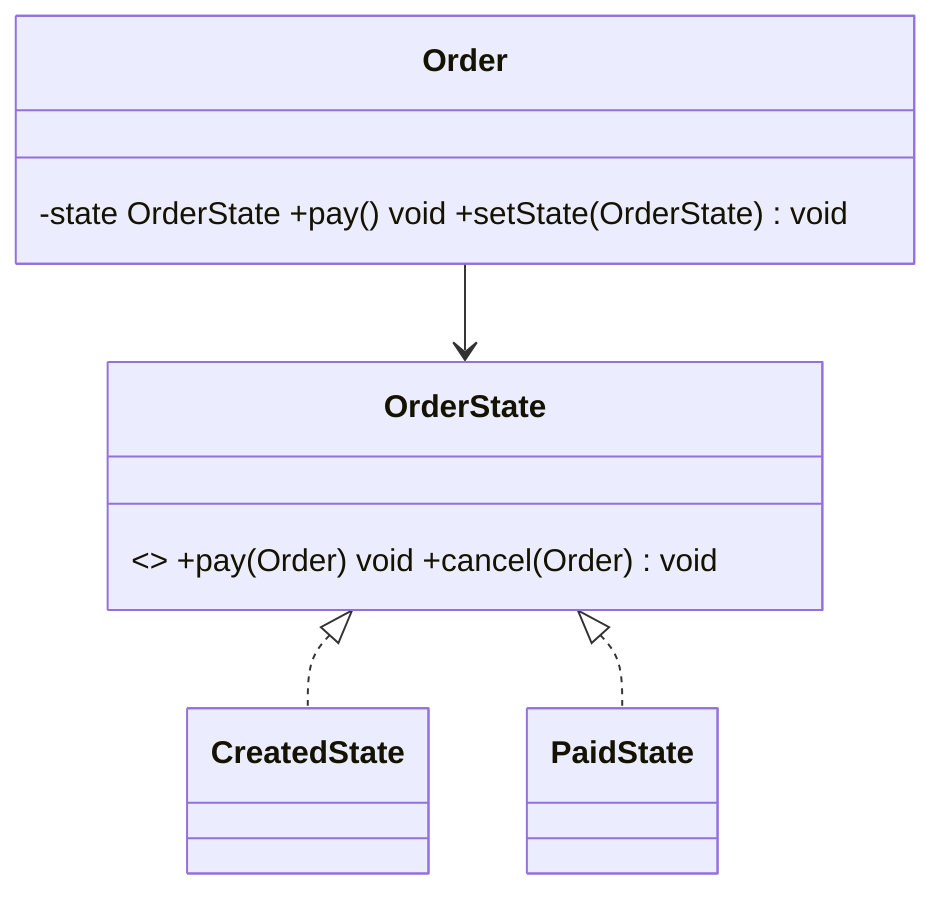
```java
interface OrderState {
    void pay(Order order);
    void cancel(Order order);
}
final class CreatedState implements OrderState {
    public void pay(Order order) {
        order.setState(new PaidState());
    }
    public void cancel(Order order) {
        order.setState(new CancelledState());
    }
}
final class PaidState implements OrderState {
    public void pay(Order order) {
        throw new IllegalStateException("already paid");
    }
    public void cancel(Order order) {
        throw new IllegalStateException("refund required");
    }
}
```
keep state-specific operations near state-specific rules. Use: vending machine, ATM, order, or booking lifecycle. Avoid simple two-state flags. JDK/Spring: `Thread.State`, Spring StateMachine for heavy workflows. LLD: Vending Machine and BookMyShow booking status.

**Common mistakes:**
- Keeping a giant switch inside each state.
- Persisting state objects instead of stable status values.

**Follow-ups:**
- *Strategy vs State?* → Strategy is a chosen algorithm; State represents current lifecycle behavior.
- *How persist it?* → Store an enum/status and reconstruct behavior in domain code.

### Q29. Explain the Command pattern.
`🟡 Intermediate` `🔥` `Must-know SDE-1`

**Why they ask:** Command checks if you can queue, retry, log, or undo operations cleanly.

**Beginner lens:** Command solves turning a request into an object, like writing a restaurant order slip
that can be queued, retried, logged, or undone. The signal is operations must be scheduled, stored, audited,
retried, or reversed. It fits because the action and its inputs travel together behind an execute method. It is
commonly confused with Strategy; Command represents a specific action request, while Strategy represents an
interchangeable algorithm policy.

**Short answer (say this first, 20-40 sec):**
Command wraps a request as an object with `execute`. Use when requests need queuing, retries, scheduling, logging, or undo. Avoid it when a direct method call is enough.

**Detailed answer:**
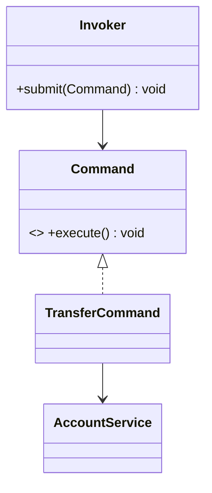
```java
interface Command {
    void execute();
}
final class TransferCommand implements Command {
    private final AccountService accounts;
    private final String from;
    private final String to;
    private final long paise;
    TransferCommand(AccountService accounts, String from, String to, long paise) {
        this.accounts = accounts;
        this.from = from;
        this.to = to;
        this.paise = paise;
    }
    public void execute() {
        accounts.transfer(from, to, paise);
    }
}
```
turn requests into data-like objects. Use: job queues, editor undo, ATM transactions, or scheduling. Avoid command classes with no lifecycle benefit. JDK/Spring: `Runnable`, `Callable`, Swing `Action`, Spring Batch tasklets. LLD: ATM transaction commands.

**Common mistakes:**
- Capturing stale mutable objects.
- Forgetting idempotency for queued retries.

**Follow-ups:**
- *How implement undo?* → Store enough before-state or an inverse command.
- *Command vs Strategy?* → Command is a request; Strategy is an algorithm.

### Q30. Explain the Chain of Responsibility pattern.
`🟡 Intermediate` `🔥` `Must-know SDE-1`

**Why they ask:** Chain maps directly to filters, interceptors, and validation pipelines in Java web apps.

**Beginner lens:** Chain of Responsibility solves ordered handling where each step may handle or pass along,
like airport checks for ticket, baggage, and security. The signal is a request goes through filters, validators,
or handlers until one stops or all pass. It fits because each handler stays small and order is configurable. It
is commonly confused with Pipeline; Chain may stop when handled, while Pipeline usually transforms data through
every stage.

**Short answer (say this first, 20-40 sec):**
Chain passes a request through ordered handlers until one handles it or all run. Use it for filters, validation, authorization, or logging steps. Avoid it when order is unclear.

**Detailed answer:**
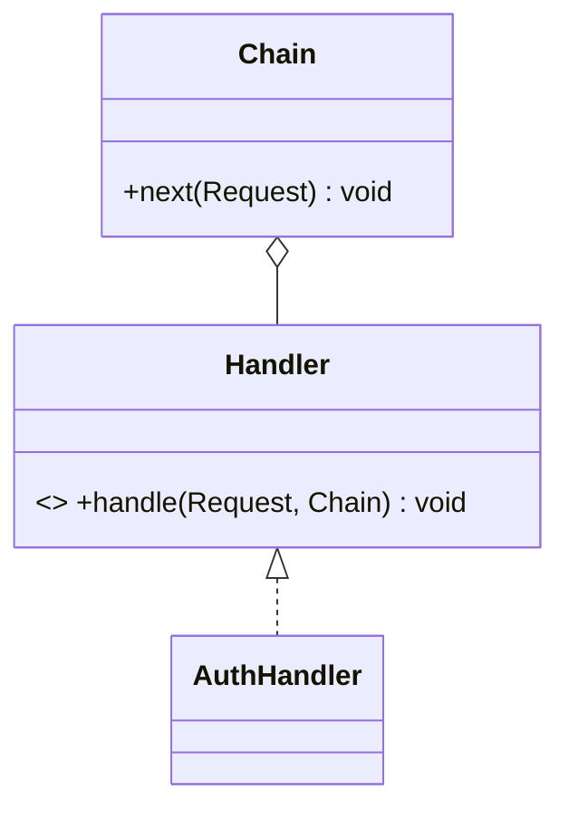
```java
interface Handler {
    void handle(Request request, Chain chain);
}
final class Chain {
    private final java.util.List<Handler> handlers;
    private int index;
    Chain(java.util.List<Handler> handlers) {
        this.handlers = java.util.List.copyOf(handlers);
    }
    void next(Request request) {
        if (index < handlers.size()) {
            handlers.get(index++).handle(request, this);
        }
    }
}
```
decouple sender from ordered processing steps. Use: servlet filters, logging, auth, validation, and approvals. Avoid if direct calls are easier to trace. JDK/Spring: Servlet `FilterChain`, Spring Security filter chain, Spring MVC interceptors. LLD: request pipeline or logger chain.

**Common mistakes:**
- Not defining whether the chain stops or continues.
- Hiding important handler order constraints.

**Follow-ups:**
- *Servlet filters?* → Each filter wraps chain.doFilter, so order affects request and response handling.
- *Spring Security?* → Auth, CSRF, session, and authorization filters run as an ordered chain.

### Q31. Explain the Template Method pattern.
`🟡 Intermediate` `🔥` `Must-know SDE-1`

**Why they ask:** Template Method tests whether you can fix algorithm order while letting selected steps vary.

**Beginner lens:** Template Method solves a fixed algorithm skeleton with customizable steps, like a recipe
that always prepares, cooks, and serves but lets cuisines vary each step. The signal is the overall sequence is
stable, but some steps differ in subclasses. It fits because the base class protects ordering while hooks vary
behavior. It is commonly confused with Strategy; Template Method uses inheritance for step variation, while
Strategy uses composition and replaceable collaborators.

**Short answer (say this first, 20-40 sec):**
Template Method defines an algorithm skeleton in a base class and lets subclasses override steps. Use when order is stable and steps vary. Avoid it when composition avoids inheritance more cleanly.

**Detailed answer:**
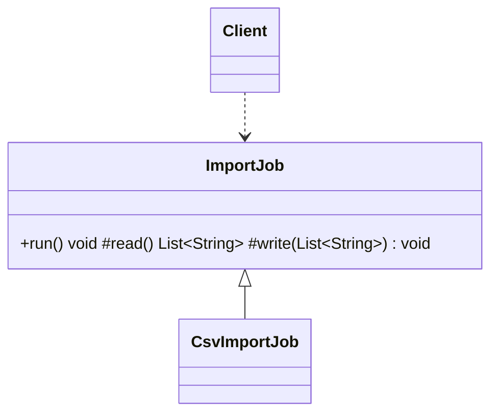
```java
abstract class ImportJob {
    public final void run() {
        java.util.List<String> rows = read();
        validate(rows);
        write(rows);
    }
    protected abstract java.util.List<String> read();
    protected void validate(java.util.List<String> rows) {
        if (rows.isEmpty()) {
            throw new IllegalArgumentException("empty import");
        }
    }
    protected abstract void write(java.util.List<String> rows);
}
```
keep invariant algorithm order in one place. Use: import jobs, game turns, or report generation. Avoid if subclasses need to change the whole flow. JDK/Spring: `AbstractList`, `JdbcTemplate` callback flow, `TransactionTemplate`. LLD: ETL/import workflow.

**Common mistakes:**
- Allowing subclasses to override the template method.
- Using inheritance when composition is simpler.

**Follow-ups:**
- *JdbcTemplate?* → It owns JDBC lifecycle and calls callbacks for variable query-mapping steps.
- *Template vs Strategy?* → Template fixes order with inheritance; Strategy swaps behavior via composition.

### Q32. Explain the Iterator pattern.
`🟡 Intermediate` `🔥` `Must-know SDE-1`

**Why they ask:** Iterator checks traversal abstraction and Java collection fail-fast behavior.

**Beginner lens:** Iterator solves safe traversal without exposing collection internals, like a museum audio
guide that gives the next exhibit without showing the storage map. The signal is clients need to walk items but
should not know array, list, tree, or pagination details. It fits because traversal state stays in the iterator.
It is commonly confused with Composite; Iterator traverses a structure, while Composite models the structure
itself.

**Short answer (say this first, 20-40 sec):**
Iterator exposes sequential traversal without revealing internal structure. Use it for custom collections or paged traversal. Avoid custom iterators when standard collections and streams are enough.

**Detailed answer:**
```mermaid
classDiagram
class Iterator~T~ { <<interface>> +hasNext() boolean +next() T }
class Playlist { +iterator() Iterator~String~ }
class PlaylistIterator
Iterator <|.. PlaylistIterator
Playlist --> PlaylistIterator
```
```java
import java.util.Iterator;
import java.util.List;
final class Playlist implements Iterable<String> {
    private final List<String> songs;
    Playlist(List<String> songs) {
        this.songs = List.copyOf(songs);
    }
    public Iterator<String> iterator() {
        return songs.iterator();
    }
}
```
decouple traversal from storage. Use: custom collections, tree traversal, cursor-like pages. Avoid exposing mutable internals. JDK/Spring: `Iterator`, `Iterable`, `Spliterator`, JDBC `ResultSet` cursor concept. LLD: playlist, catalog pagination, file tree traversal.

**Common mistakes:**
- Mutating a collection while iterating incorrectly.
- Not defining traversal order.

**Follow-ups:**
- *What is fail-fast?* → JDK iterators best-effort throw ConcurrentModificationException after structural changes.
- *Iterator vs Stream?* → Iterator is pull traversal; Stream adds lazy functional operations.

### Q33. Explain the Mediator pattern.
`🔴 Advanced` `🔥` `Stretch`

**Why they ask:** Mediator tests if you can reduce many-to-many object chatter in collaborative workflows.

**Beginner lens:** Mediator solves many objects talking directly to each other, like an air traffic
controller coordinating planes so pilots do not negotiate every movement pairwise. The signal is components have
many tangled references and rules between them. It fits because coordination rules move into one mediator,
reducing coupling. It is commonly confused with Observer; Mediator coordinates interactions, while Observer
broadcasts changes to listeners without central business orchestration.

**Short answer (say this first, 20-40 sec):**
Mediator centralizes communication between components so they do not depend on each other directly. Use when many objects coordinate through rules. Avoid it if the mediator becomes a god object.

**Detailed answer:**
```mermaid
classDiagram
class ChatRoom { +send(User,String) void }
class User { -room ChatRoom +send(String) void +receive(String) void }
ChatRoom o-- User
User --> ChatRoom
```
```java
final class ChatRoom {
    private final java.util.List<User> users = new java.util.ArrayList<>();
    void join(User user) {
        users.add(user);
    }
    void send(User sender, String message) {
        for (User user : users) {
            if (user != sender) {
                user.receive(message);
            }
        }
    }
}
```
move coordination rules out of peer objects. Use: chat rooms, UI dialogs, control towers, or auctions. Avoid when direct dependencies are few and clearer. JDK/Spring: controllers and dispatchers often mediate interactions. LLD: group chat or elevator controller.

**Common mistakes:**
- Moving all business logic into the mediator.
- Using Mediator when Observer or direct calls are simpler.

**Follow-ups:**
- *Mediator vs Observer?* → Mediator coordinates peers; Observer broadcasts changes to subscribers.
- *When avoid it?* → When there is no many-to-many communication problem.

### Q34. Explain the Memento pattern.
`🔴 Advanced` `🔥` `Stretch`

**Why they ask:** Memento checks whether you can support undo without exposing private internals.

**Beginner lens:** Memento solves saving and restoring state without exposing internals, like a game
checkpoint that lets you roll back without revealing all private game fields. The signal is undo, rollback,
snapshot, or restore is needed while encapsulation must stay intact. It fits because the originator creates an
opaque snapshot. It is commonly confused with Command; Command captures an action, while Memento captures state
at a point in time.

**Short answer (say this first, 20-40 sec):**
Memento captures an object's state so it can be restored later. Use it for undo/redo or checkpoints. Avoid it for huge state unless you use diffs or persistence.

**Detailed answer:**
```mermaid
classDiagram
class Editor { +save() Snapshot +restore(Snapshot) void }
class Snapshot { -text String }
class History { +push(Snapshot) void +pop() Snapshot }
Editor --> Snapshot
History o-- Snapshot
```
```java
final class Editor {
    private String text = "";
    void type(String value) {
        text += value;
    }
    Snapshot save() {
        return new Snapshot(text);
    }
    void restore(Snapshot snapshot) {
        text = snapshot.text();
    }
    record Snapshot(String text) {
    }
}
```
restore previous state without exposing mutable internals. Use: text editor undo, game checkpoints, or wizard drafts. Avoid storing huge full snapshots on every change. JDK/Spring: transaction savepoints are a related idea. LLD: text editor or game restore.

**Common mistakes:**
- Capturing mutable references instead of copies.
- Keeping unlimited history in memory.

**Follow-ups:**
- *Full snapshot vs diff?* → Full is simple; diff is cheaper but harder to apply correctly.
- *How limit memory?* → Cap history, compress snapshots, or persist versions.

### Q35. Explain the Visitor pattern.
`🔴 Advanced` `🔥` `Stretch`

**Why they ask:** Visitor tests double dispatch and adding operations across stable class hierarchies.

**Beginner lens:** Visitor solves adding operations across a stable object structure, like a tax inspector
visiting different asset types and calculating rules without changing each asset class. The signal is object
types are stable, but new operations over all of them keep appearing. It fits by separating operations from the
elements. It is commonly confused with Strategy; Visitor dispatches based on element type across a structure,
while Strategy swaps one algorithm for one context.

**Short answer (say this first, 20-40 sec):**
Visitor adds operations to a stable object structure without modifying each class for every operation. Use when element types are stable but operations change. Avoid it when new element types are common.

**Detailed answer:**
```mermaid
classDiagram
class Shape { <<interface>> +accept(ShapeVisitor) void }
class Circle
class RectangleShape
class ShapeVisitor { <<interface>> +visit(Circle) void +visit(RectangleShape) void }
Shape <|.. Circle
Shape <|.. RectangleShape
ShapeVisitor --> Circle
ShapeVisitor --> RectangleShape
```
```java
interface Shape {
    void accept(ShapeVisitor visitor);
}
record Circle(int radius) implements Shape {
    public void accept(ShapeVisitor visitor) {
        visitor.visit(this);
    }
}
record RectangleShape(int width, int height) implements Shape {
    public void accept(ShapeVisitor visitor) {
        visitor.visit(this);
    }
}
interface ShapeVisitor {
    void visit(Circle circle);
    void visit(RectangleShape rectangle);
}
```
separate operations from element classes. Use: ASTs, reports over graphs, or export formats. Avoid it for changing element hierarchies. JDK/Spring: `FileVisitor`, annotation/AST visitors. LLD: file-system reports or expression evaluator.

**Common mistakes:**
- Using Visitor when methods are clearer.
- Forgetting new element types require visitor changes.

**Follow-ups:**
- *Why double dispatch?* → accept picks the runtime element, then visitor overload handles that type.
- *When avoid it?* → When new element types are added more often than operations.

### Q36. Explain the Repository pattern.
`🟡 Intermediate` `🔥` `Must-know SDE-1`

**Why they ask:** Repository checks whether you separate domain logic from persistence and can test without a DB.

**Beginner lens:** Repository solves storage access that should feel like a domain collection, like a
librarian fetching books without exposing shelf database details. The signal is services should load and save
aggregates but not know SQL, cache, or remote API details. It fits because persistence concerns stay behind an
interface. It is commonly confused with Data Access Object (DAO); Repository is domain-oriented around aggregates,
while DAO is often table or query oriented.

**Short answer (say this first, 20-40 sec):**
Repository provides collection-like access to aggregate roots and hides persistence details. Use it behind domain services. Avoid putting workflows or HTTP concerns into repositories.

**Detailed answer:**
```mermaid
classDiagram
class OrderRepository { <<interface>> +save(Order) void +findById(String) Optional~Order~ }
class JpaOrderRepository
class OrderService
OrderRepository <|.. JpaOrderRepository
OrderService --> OrderRepository
JpaOrderRepository ..> Database
```
```java
import java.util.Optional;
interface OrderRepository {
    Optional<Order> findById(String id);
    void save(Order order);
}
final class OrderService {
    private final OrderRepository orders;
    OrderService(OrderRepository orders) {
        this.orders = orders;
    }
    void cancel(String id) {
        Order order = orders.findById(id).orElseThrow();
        order.cancel();
        orders.save(order);
    }
}
```
isolate persistence and keep domain code storage-agnostic. Use: aggregates such as Booking, Order, or Account. Avoid generic repositories that expose every table operation. JDK/Spring: Spring Data and JPA repositories. LLD: BookMyShow, Parking Lot, or Splitwise storage.

**Common mistakes:**
- Putting business decisions in query methods.
- Leaking SQL or JPA APIs into domain services.

**Follow-ups:**
- *DAO vs Repository?* → DAO is table-oriented; Repository is aggregate/domain-oriented.
- *How test?* → Use an in-memory fake implementing the repository interface.

### Q37. Explain the Dependency Injection pattern.
`🟡 Intermediate` `🔥` `Must-know SDE-1`

**Why they ask:** DI checks whether your design is testable and not hard-wired to concrete infrastructure.

**Beginner lens:** Dependency Injection solves hard-wired collaborators, like giving a chef ingredients and
tools instead of making the chef build the oven every time. The signal is `new` calls for gateways, repositories,
clocks, or senders inside business logic. It fits because dependencies become explicit, replaceable, and testable.
It is commonly confused with Service Locator; DI passes dependencies in, while Service Locator asks a global
registry at runtime.

**Short answer (say this first, 20-40 sec):**
Dependency Injection gives an object its collaborators from outside instead of constructing them internally. Prefer constructor injection for required dependencies. Avoid service locators and static globals.

**Detailed answer:**
```mermaid
classDiagram
class EmailSender { <<interface>> +send(String) void }
class SmtpEmailSender
class SignupService { -sender EmailSender +signup(String) void }
EmailSender <|.. SmtpEmailSender
SignupService --> EmailSender
```
```java
interface EmailSender {
    void send(String address);
}
final class SignupService {
    private final EmailSender sender;
    SignupService(EmailSender sender) {
        this.sender = java.util.Objects.requireNonNull(sender);
    }
    void signup(String email) {
        sender.send(email);
    }
}
```
invert object assembly and make dependencies explicit. Use: repositories, gateways, clocks, ID generators, and notifiers. Avoid field injection and hidden lookups. JDK/Spring: Spring constructor injection, CDI/Guice. LLD: testable services in every machine-coding problem.

**Common mistakes:**
- Calling new for infrastructure inside services.
- Using field injection for required dependencies.

**Follow-ups:**
- *Constructor vs setter injection?* → Constructor for required dependencies; setter for optional reconfiguration.
- *DI vs Factory?* → DI supplies collaborators; Factory creates products based on runtime choice.

### Q38. Explain the Null Object pattern.
`🟡 Intermediate` `🔥` `Must-know SDE-1`

**Why they ask:** Null Object checks if you can remove null checks without hiding real absence or errors.

**Beginner lens:** Null Object solves repetitive null checks by supplying a harmless implementation, like a
silent notification sender used when notifications are disabled. The signal is most callers do the same
if-null-do-nothing branch. It fits when absence really means neutral behavior. It is commonly confused with
Optional; Null Object is a polymorphic object with behavior, while Optional is a value wrapper that forces callers
to handle possible absence.

**Short answer (say this first, 20-40 sec):**
Null Object provides a do-nothing implementation of an interface. Use when absence means safe no-op. Avoid it when absence is an error or caller must know no value exists.

**Detailed answer:**
```mermaid
classDiagram
class AuditSink { <<interface>> +record(String) void }
class DbAuditSink
class NoOpAuditSink
AuditSink <|.. DbAuditSink
AuditSink <|.. NoOpAuditSink
OrderService --> AuditSink
```
```java
interface AuditSink {
    void record(String event);
}
final class NoOpAuditSink implements AuditSink {
    public void record(String event) {
        // intentionally no-op
    }
}
final class OrderService {
    private final AuditSink audit;
    OrderService(AuditSink audit) {
        this.audit = audit;
    }
    void place() {
        audit.record("order placed");
    }
}
```
replace repeated null checks with polymorphism. Use: optional logging, metrics, or notifications. Avoid when no-op hides failed payment, missing user, or corrupt state. JDK/Spring: `Collections.emptyList()`, no-op loggers, test fakes. LLD: optional notification/audit sink.

**Common mistakes:**
- Hiding real errors with no-op behavior.
- Using Null Object where Optional or an exception is clearer.

**Follow-ups:**
- *Null Object vs Optional?* → Null Object is behavior; Optional is explicit value absence.
- *When dangerous?* → Payment, security, and persistence failures must not become no-ops.

### Q39. What are Specification, Event Bus, and Pipeline patterns?
`🔴 Advanced` `🔥` `Stretch`

**Why they ask:** These appear when filtering, event routing, or staged processing grows beyond simple methods.

**Beginner lens:** Specification, Event Bus, and Pipeline solve three different growth problems.
Specification packages business predicates like reusable filters; Event Bus decouples publishers from many
subscribers like a notice board; Pipeline runs data through ordered stages like an assembly line. The signals are
growing filter combinations, broad event routing, or staged processing. They fit by naming the variation point.
Specification is confused with Strategy, Event Bus with Observer, and Pipeline with Chain of Responsibility.

**Short answer (say this first, 20-40 sec):**
Specification composes predicates, Event Bus routes events to handlers, and Pipeline runs ordered transformation/validation stages. Use them when rules, event consumers, or stages grow independently. Avoid them for one condition, one listener, or two fixed steps.

**Detailed answer:**
```mermaid
classDiagram
class Specification~T~ { <<interface>> +isSatisfiedBy(T) boolean }
class EventBus { +publish(Object) void }
class Pipeline~T~ { +run(T) T }
Specification --> Candidate
EventBus o-- EventHandler
Pipeline o-- Stage
```
```java
import java.util.List;
import java.util.function.UnaryOperator;
interface Specification<T> {
    boolean isSatisfiedBy(T value);
    default Specification<T> and(Specification<T> other) {
        return value -> isSatisfiedBy(value) && other.isSatisfiedBy(value);
    }
}
final class Pipeline<T> {
    private final List<UnaryOperator<T>> stages;
    Pipeline(List<UnaryOperator<T>> stages) {
        this.stages = List.copyOf(stages);
    }
    T run(T input) {
        T current = input;
        for (UnaryOperator<T> stage : stages) {
            current = stage.apply(current);
        }
        return current;
    }
}
```
Specification names composable rules; Event Bus decouples event producers and consumers; Pipeline makes staged processing explicit. Use Specification for eligibility/search, Event Bus for in-process notifications, Pipeline for validation/enrichment/imports. JDK/Spring: `Predicate`, Spring events, servlet/filter-style pipelines. LLD: cab matching filters, order events, request validation.

**Common mistakes:**
- Building an Event Bus when Observer is enough.
- Continuing a pipeline after mandatory validation fails.

**Follow-ups:**
- *Specification vs Strategy?* → Specification composes yes/no rules; Strategy performs an algorithm.
- *Pipeline vs Chain?* → Pipeline usually transforms through all stages; Chain may stop when handled.

## Machine Coding Round Strategy

### Q40. How should you approach a 90-120 minute machine-coding LLD round?
`🟡 Intermediate` `🔥` `Must-know SDE-1`

**Why they ask:** A good plan prevents half-built, untestable systems.

**Beginner lens:** A machine-coding round tests whether you can deliver a small correct design under time
pressure, not a perfect enterprise system. Treat it like building a walking skeleton: clarify scope, protect core
invariants, code the main flow, then add edge cases and tests. Recognize hidden tests around invalid input,
duplicate actions, and extensibility. The alternative is designing every possible feature first, which usually
leaves no working demo. Mention production concerns briefly, then defer them.

**Short answer (say this first, 20-40 sec):**
Clarify, design the smallest extensible model, code core flows first, then demo and test. State assumptions loudly and defer non-goals like DB/UI unless asked.

**Detailed answer:**
```mermaid
flowchart TD
A["Clarify requirements 10 min"] --> B["Entities and relationships 10 min"]
B --> C["Interfaces and patterns 10 min"]
C --> D["Core code 45-55 min"]
D --> E["Driver demo 10 min"]
E --> F["Focused tests 10-15 min"]
F --> G["Discuss extensions and trade-offs"]
```
| Rubric area | What good looks like |
|---|---|
| Working code | demo covers happy path and edge cases |
| Modularity | model, service, repository, strategy, exception |
| Extensibility | new vehicle/payment/rule added by new class |
| Thread-safety | lock/concurrent collection around shared mutable state |
| Tests | deterministic unit tests, not console-only validation |

```text
com.example.parking
  model/ service/ repository/ strategy/ exception/ Main.java
```
Common failures: coding before requirements, no driver, no tests, god service, null-heavy code, missing concurrency story, overusing patterns.

**Common mistakes:**
- Spending 40 minutes drawing.
- No runnable main method.
- Adding Spring Boot when plain Java was requested.

**Follow-ups:**
- *What code first?* → Domain models and one successful main flow.
- *If time is low?* → Finish demo path, then outline extensions.

## Revision Cheat Sheet

- Encapsulation protects invariants; abstraction hides unstable details.
- Prefer composition for capabilities and strategies; inheritance only for honest is-a.
- Interfaces define roles; abstract classes share algorithm/state among close relatives.
- SOLID is useful when tied to real future changes.
- Mermaid classDiagram generics use List~String~.
- Immutable value objects make equality, caching, and concurrency easier.
- Constructor injection plus interfaces makes code testable without frameworks.
- Singleton: enum safest; DCL needs volatile; Spring singleton is usually better.
- Creational patterns handle object creation; structural patterns adapt/wrap/compose; behavioral patterns manage algorithms and communication.
- Working code + tests + extensibility beats a beautiful incomplete design.

## Flashcards

1. OOP pillars? ? Encapsulation, abstraction, inheritance, polymorphism applied to invariants and extension points.
2. Composition over inheritance? ? Use collaborators when behavior varies independently.
3. Interface vs abstract class? ? Contract vs shared base algorithm/state.
4. SRP? ? One reason to change.
5. OCP? ? Add behavior without modifying tested code.
6. LSP? ? Subtypes preserve parent expectations.
7. DIP? ? Depend on abstractions, not concretions.
8. Value object? ? Equality by fields, usually immutable.
9. Strategy fit? ? Pricing, matching, rate limiting, scheduling.
10. State fit? ? Vending machine, ATM, order lifecycle.
11. Decorator fit? ? Logging, compression, notification channels.
12. Repository fit? ? In-memory or DB storage hidden behind collection-like API.
13. Null Object? ? Safe no-op collaborator when absence is acceptable.
14. Machine-coding flow? ? Clarify, entities, interfaces, core code, demo, tests.
15. Biggest failure? ? Non-runnable code with unclear responsibilities.
