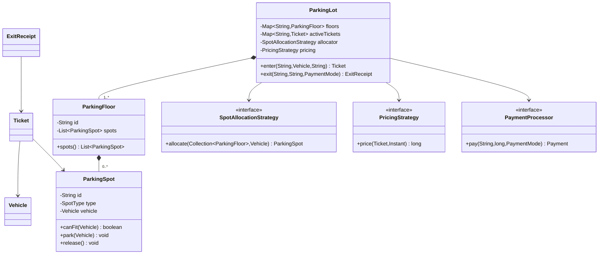
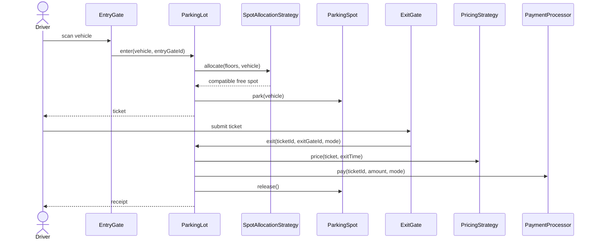
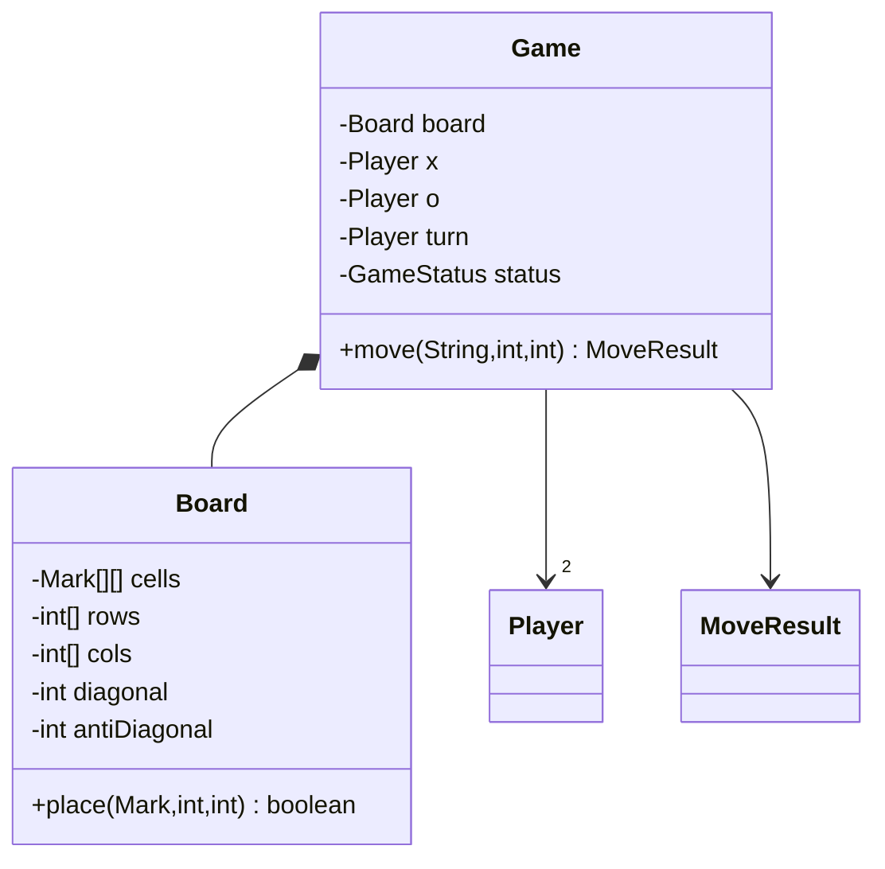
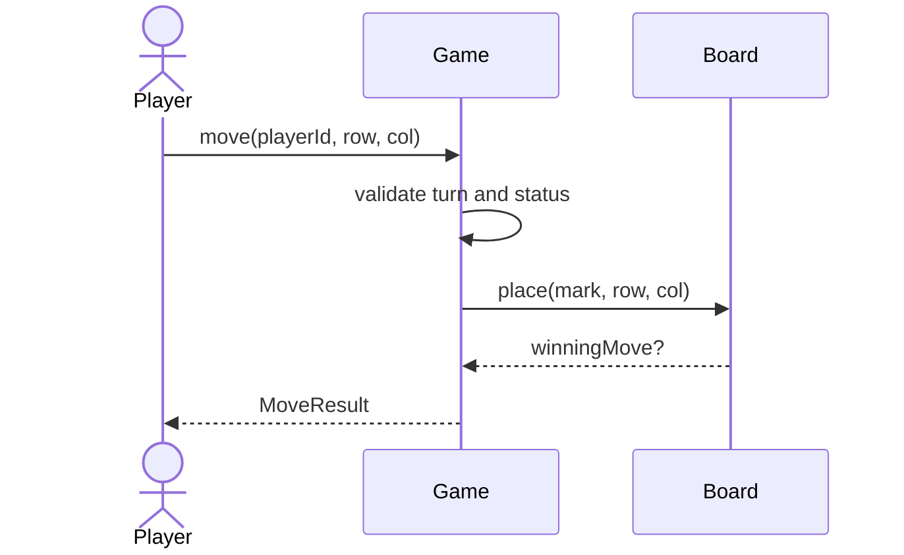
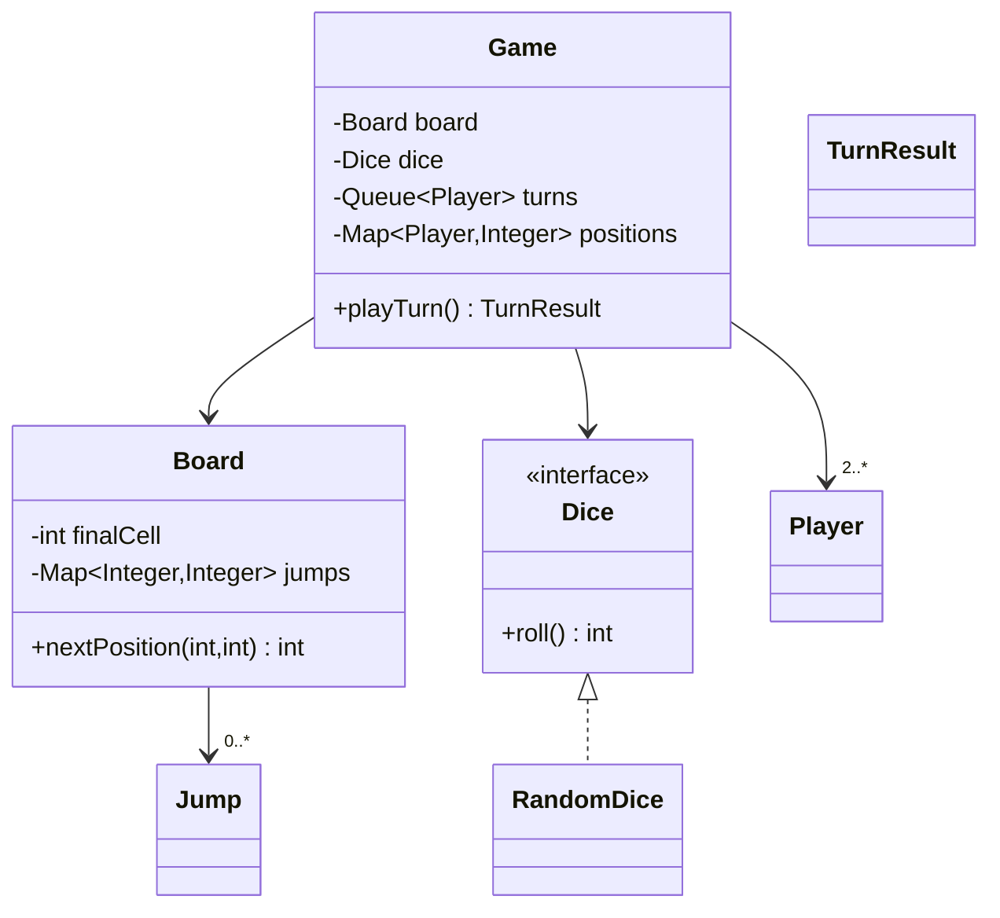
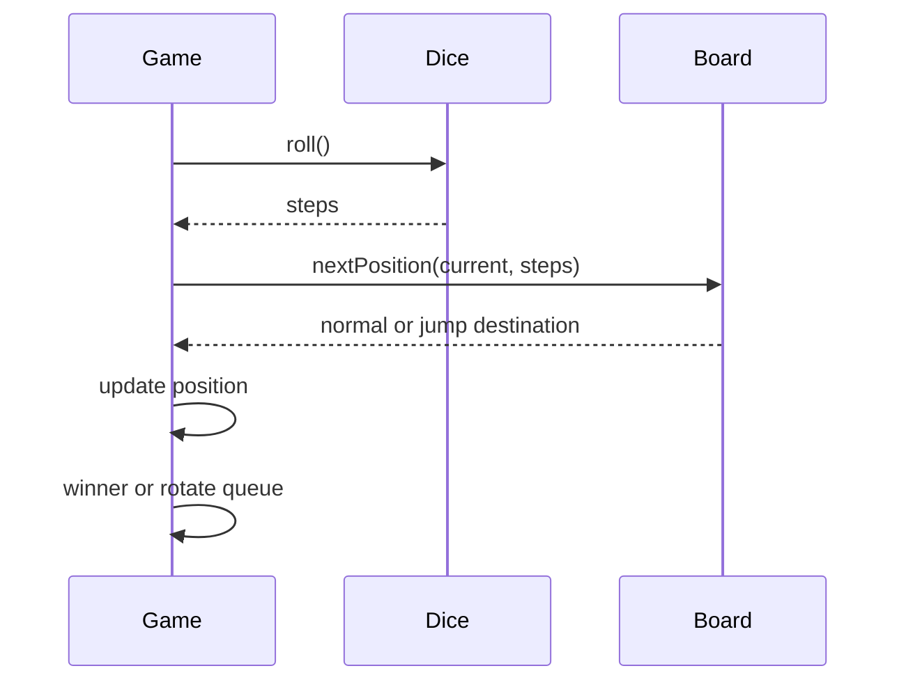
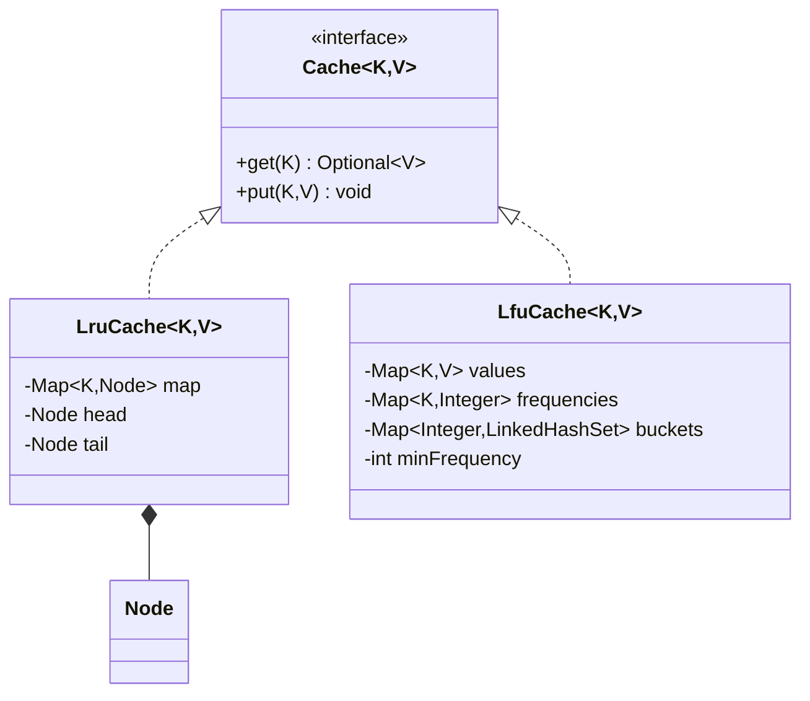
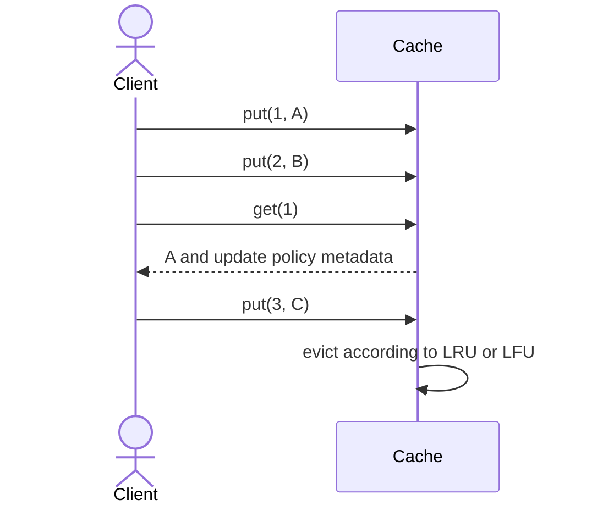
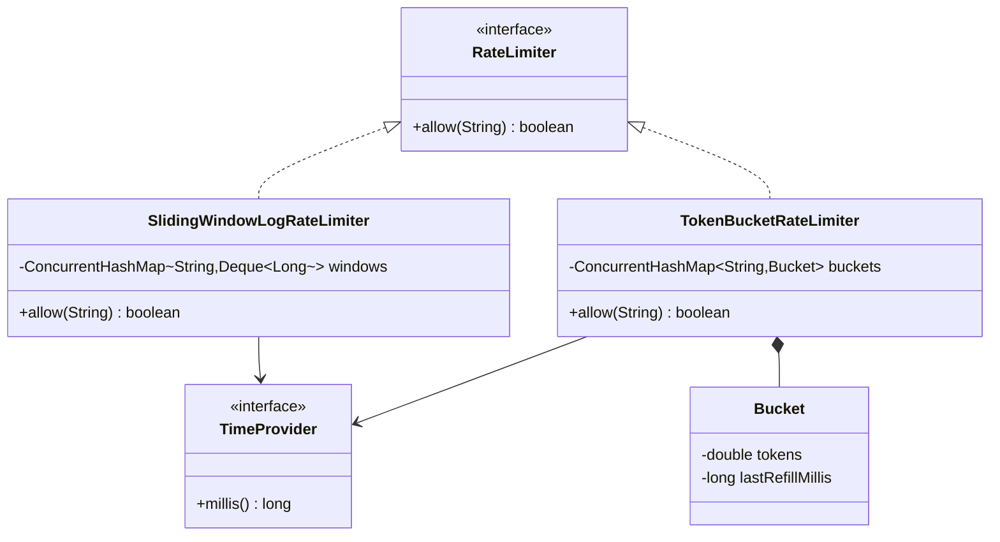
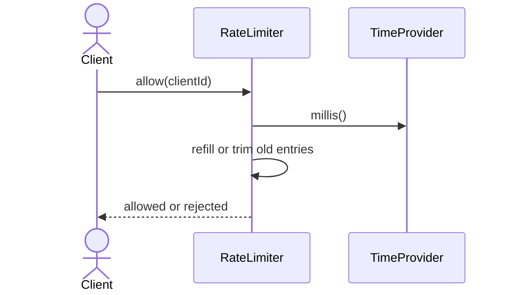

# 10b · LLD Problems Tier-1: Machine Coding Study Guide

Interview-ready Java 17 designs for five high-frequency low-level design rounds. Each problem focuses on
clear requirements, extensible objects, readable code, deterministic tests, and concrete concurrency notes.
Code is shown as package sections; each public top-level type belongs in its own `.java` file with that name.

**Table of Contents**
- [How to present an LLD in 45-90 minutes](#how-to-present-an-lld-in-45-90-minutes)
- [Q1. Design Parking Lot](#q1-design-parking-lot)
- [Q2. Design Tic-Tac-Toe](#q2-design-tic-tac-toe)
- [Q3. Design Snake & Ladder](#q3-design-snake--ladder)
- [Q4. Design LRU Cache and LFU Cache](#q4-design-lru-cache-and-lfu-cache)
- [Q5. Design Rate Limiter](#q5-design-rate-limiter)
- [Revision Cheat Sheet](#revision-cheat-sheet)
- [Flashcards](#flashcards)

🟢 Beginner · 🟡 Intermediate · 🔴 Advanced · ⚫ FAANG · 🔥 = very frequently asked

## How to present an LLD in 45-90 minutes

1. Clarify scope: actors, APIs, scale, concurrency, persistence, and what is explicitly out of scope.
2. Write 5-8 concrete functional requirements and 3-4 non-functional requirements.
3. Identify entities first, then relationships, then lifecycle/state transitions.
4. Draw class and sequence diagrams before coding; keep diagrams small and explain trade-offs.
5. Code the domain model and service APIs first; keep I/O and console output outside core logic.
6. State design patterns only where they remove real change pressure.
7. Add validation, deterministic tests, and concurrency boundaries.
8. End with extensions: "If we add X, I change these exact classes."

---

### Q1. Design Parking Lot
`🟡 Intermediate` `🔥` `Must-know SDE-1`

**Why they ask:** It tests entity modeling, allocation, payments, and atomic updates under contention.

**Short answer (say this first, 20-40 sec):**
Model a parking lot as floors containing typed spots. An entry gate atomically allocates a compatible spot
and issues a ticket; an exit gate calculates fee, collects payment, and releases the spot. Allocation,
pricing, and payment are strategies so the design can add nearest-spot, EV-only, or dynamic pricing.

**Detailed answer:**

#### 1. Clarifying questions & requirements
- Questions: How many floors and gates? Which vehicle and spot types? Is EV charging a separate spot type?
  Should allocation prefer nearest floor or any free spot? Which payment modes and pricing rules are needed?
- Functional: park BIKE/CAR/TRUCK/EV; support floors; spot sizes BIKE/COMPACT/LARGE/EV; entry and exit gates;
  issue one active ticket per parked vehicle; calculate fee; accept payment; release spot after payment.
- Non-functional: atomic allocation for the last spot; O(number of candidate spots) or better lookup; readable
  audit trail through ticket/payment IDs; deterministic tests by injecting `Clock`.
- Out of scope: reservations, camera/ANPR integration, distributed multi-city parking, persisted database.

#### 2. Entities & relationships
- `ParkingLot` owns floors, active tickets, allocation strategy, pricing strategy, and payment processor.
- `ParkingFloor` owns many `ParkingSpot` objects.
- `ParkingSpot` has a `SpotType`, occupied vehicle, and compatibility rule.
- `Ticket` links vehicle, spot, entry gate, entry time, and status.
- `ExitReceipt` records amount and payment status.

#### 3. Class diagram


#### 4. Main-flow sequence diagram


#### 5. Design patterns used & why
- Strategy: `SpotAllocationStrategy`, `PricingStrategy`, and `PaymentProcessor` change independently.
- Factory: useful for creating floors/spots from configuration, not hard-coded constructors.
- Repository style: active ticket map hides storage and can later become a DB repository.

#### 6. Complete, compilable Java 17 code
```java
// parkinglot/model/Models.java
package parkinglot.model;

import java.time.Instant;

public enum VehicleType { BIKE, CAR, TRUCK, EV }

public enum SpotType {
    BIKE, COMPACT, LARGE, EV;

    public boolean fits(VehicleType type) {
        return switch (this) {
            case BIKE -> type == VehicleType.BIKE;
            case COMPACT -> type == VehicleType.BIKE || type == VehicleType.CAR;
            case LARGE -> type != VehicleType.EV;
            case EV -> type == VehicleType.EV;
        };
    }
}

public enum TicketStatus { ACTIVE, PAID, LOST }

public enum PaymentMode { CASH, CARD, UPI }

public record Vehicle(String number, VehicleType type) { }

public record Payment(String id, long amount, PaymentMode mode, boolean success) { }

public record ExitReceipt(String ticketId, long amount, Payment payment) { }

public final class ParkingSpot {
    private final String id;
    private final String floorId;
    private final SpotType type;
    private Vehicle vehicle;

    public ParkingSpot(String id, String floorId, SpotType type) {
        this.id = id;
        this.floorId = floorId;
        this.type = type;
    }

    public String id() {
        return id;
    }

    public boolean canFit(Vehicle candidate) {
        return vehicle == null && type.fits(candidate.type());
    }

    public void park(Vehicle candidate) {
        if (!canFit(candidate)) {
            throw new IllegalStateException("spot not available: " + id);
        }
        vehicle = candidate;
    }

    public void release() {
        vehicle = null;
    }

    @Override
    public String toString() {
        return floorId + "-" + id + "(" + type + ")";
    }
}

public record ParkingFloor(String id, java.util.List<ParkingSpot> spots) { }

public final class Ticket {
    private final String id;
    private final Vehicle vehicle;
    private final ParkingSpot spot;
    private final String entryGateId;
    private final Instant entryTime;
    private TicketStatus status = TicketStatus.ACTIVE;

    public Ticket(String id, Vehicle vehicle, ParkingSpot spot, String entryGateId, Instant entryTime) {
        this.id = id;
        this.vehicle = vehicle;
        this.spot = spot;
        this.entryGateId = entryGateId;
        this.entryTime = entryTime;
    }

    public String id() {
        return id;
    }

    public Vehicle vehicle() {
        return vehicle;
    }

    public ParkingSpot spot() {
        return spot;
    }

    public Instant entryTime() {
        return entryTime;
    }

    public TicketStatus status() {
        return status;
    }

    public void markPaid() {
        status = TicketStatus.PAID;
    }
}
```

```java
// parkinglot/service/ParkingLot.java
package parkinglot.service;

import parkinglot.model.*;

import java.time.Clock;
import java.time.Duration;
import java.time.Instant;
import java.util.Collection;
import java.util.Comparator;
import java.util.LinkedHashMap;
import java.util.Map;
import java.util.UUID;
import java.util.concurrent.locks.ReentrantLock;

public interface SpotAllocationStrategy {
    ParkingSpot allocate(Collection<ParkingFloor> floors, Vehicle vehicle);
}

public final class FirstFitAllocationStrategy implements SpotAllocationStrategy {
    @Override
    public ParkingSpot allocate(Collection<ParkingFloor> floors, Vehicle vehicle) {
        return floors.stream()
                .sorted(Comparator.comparing(ParkingFloor::id))
                .flatMap(floor -> floor.spots().stream())
                .filter(spot -> spot.canFit(vehicle))
                .findFirst()
                .orElseThrow(() -> new IllegalStateException("parking lot full for " + vehicle.type()));
    }
}

public interface PricingStrategy {
    long price(Ticket ticket, Instant exitTime);
}

public final class HourlyPricingStrategy implements PricingStrategy {
    @Override
    public long price(Ticket ticket, Instant exitTime) {
        long minutes = Math.max(1, Duration.between(ticket.entryTime(), exitTime).toMinutes());
        long hours = (minutes + 59) / 60;
        long rate = switch (ticket.vehicle().type()) {
            case BIKE -> 20;
            case CAR, EV -> 40;
            case TRUCK -> 80;
        };
        return hours * rate;
    }
}

public interface PaymentProcessor {
    Payment pay(String ticketId, long amount, PaymentMode mode);
}

public final class InMemoryPaymentProcessor implements PaymentProcessor {
    @Override
    public Payment pay(String ticketId, long amount, PaymentMode mode) {
        if (amount <= 0) {
            throw new IllegalArgumentException("amount must be positive");
        }
        return new Payment(UUID.randomUUID().toString(), amount, mode, true);
    }
}

public final class ParkingLot {
    private final Map<String, ParkingFloor> floors = new LinkedHashMap<>();
    private final Map<String, Ticket> activeTickets = new LinkedHashMap<>();
    private final SpotAllocationStrategy allocator;
    private final PricingStrategy pricing;
    private final PaymentProcessor payments;
    private final Clock clock;
    private final ReentrantLock lock = new ReentrantLock();

    public ParkingLot(
            Collection<ParkingFloor> floors,
            SpotAllocationStrategy allocator,
            PricingStrategy pricing,
            PaymentProcessor payments,
            Clock clock) {
        floors.forEach(floor -> this.floors.put(floor.id(), floor));
        this.allocator = allocator;
        this.pricing = pricing;
        this.payments = payments;
        this.clock = clock;
    }

    public Ticket enter(String entryGateId, Vehicle vehicle) {
        lock.lock();
        try {
            boolean alreadyParked = activeTickets.values().stream()
                    .anyMatch(ticket -> ticket.vehicle().number().equals(vehicle.number()));
            if (alreadyParked) {
                throw new IllegalStateException("vehicle already parked");
            }
            ParkingSpot spot = allocator.allocate(floors.values(), vehicle);
            spot.park(vehicle);
            Ticket ticket = new Ticket(
                    UUID.randomUUID().toString(),
                    vehicle,
                    spot,
                    entryGateId,
                    clock.instant());
            activeTickets.put(ticket.id(), ticket);
            return ticket;
        } finally {
            lock.unlock();
        }
    }

    public ExitReceipt exit(String ticketId, String exitGateId, PaymentMode mode) {
        lock.lock();
        try {
            Ticket ticket = activeTickets.get(ticketId);
            if (ticket == null || ticket.status() != TicketStatus.ACTIVE) {
                throw new IllegalArgumentException("invalid active ticket");
            }
            long amount = pricing.price(ticket, clock.instant());
            Payment payment = payments.pay(ticket.id(), amount, mode);
            if (!payment.success()) {
                throw new IllegalStateException("payment failed");
            }
            ticket.markPaid();
            ticket.spot().release();
            activeTickets.remove(ticket.id());
            return new ExitReceipt(ticket.id(), amount, payment);
        } finally {
            lock.unlock();
        }
    }
}
```

```java
// parkinglot/Main.java
package parkinglot;

import parkinglot.model.*;
import parkinglot.service.*;

import java.time.Clock;
import java.util.List;

public class Main {
    public static void main(String[] args) {
        ParkingFloor floor = new ParkingFloor("F1", List.of(
                new ParkingSpot("B1", "F1", SpotType.BIKE),
                new ParkingSpot("C1", "F1", SpotType.COMPACT),
                new ParkingSpot("L1", "F1", SpotType.LARGE),
                new ParkingSpot("E1", "F1", SpotType.EV)));
        ParkingLot lot = new ParkingLot(
                List.of(floor),
                new FirstFitAllocationStrategy(),
                new HourlyPricingStrategy(),
                new InMemoryPaymentProcessor(),
                Clock.systemUTC());

        Ticket ticket = lot.enter("ENTRY-1", new Vehicle("UP32AB1234", VehicleType.CAR));
        ExitReceipt receipt = lot.exit(ticket.id(), "EXIT-1", PaymentMode.UPI);
        System.out.println(receipt);
    }
}
```

#### 7. Thread-safety considerations
- `ParkingLot.enter` and `ParkingLot.exit` use one `ReentrantLock` because ticket map and spot occupancy must
  change atomically; otherwise two cars can get the same last spot.
- Higher throughput version: lock per floor or per spot plus a concurrent active-ticket repository.
- Payment should be idempotent with a transaction ID if external payment calls can retry.

#### 8. Extensibility
- Add nearest-gate allocation: implement `SpotAllocationStrategy` using gate-to-spot distance metadata.
- Add reservations: add `Reservation`, block reserved spots in `ParkingSpot.canFit`, expire via scheduler.
- Add EV charging fee: add `ChargingSession` and decorate `PricingStrategy` with charging duration.
- Add database: replace active ticket map with `TicketRepository`; keep service API unchanged.

#### 9. JUnit 5 tests
```java
package parkinglot;

import org.junit.jupiter.api.Test;
import parkinglot.model.*;
import parkinglot.service.*;

import java.time.Clock;
import java.time.Instant;
import java.time.ZoneOffset;
import java.util.List;

import static org.junit.jupiter.api.Assertions.*;

class ParkingLotTest {
    private ParkingLot lotWithOneCompactSpot() {
        ParkingFloor floor = new ParkingFloor("F1", List.of(
                new ParkingSpot("C1", "F1", SpotType.COMPACT)));
        return new ParkingLot(
                List.of(floor),
                new FirstFitAllocationStrategy(),
                new HourlyPricingStrategy(),
                new InMemoryPaymentProcessor(),
                Clock.fixed(Instant.parse("2026-01-01T10:00:00Z"), ZoneOffset.UTC));
    }

    @Test
    void parksAndUnparksCar() {
        ParkingLot lot = lotWithOneCompactSpot();
        Ticket ticket = lot.enter("E1", new Vehicle("KA01", VehicleType.CAR));
        ExitReceipt receipt = lot.exit(ticket.id(), "X1", PaymentMode.CARD);

        assertEquals(40, receipt.amount());
        assertTrue(receipt.payment().success());
    }

    @Test
    void rejectsWhenNoCompatibleSpotExists() {
        ParkingLot lot = lotWithOneCompactSpot();

        assertThrows(IllegalStateException.class,
                () -> lot.enter("E1", new Vehicle("TRUCK-1", VehicleType.TRUCK)));
    }

    @Test
    void rejectsDuplicateActiveVehicle() {
        ParkingFloor floor = new ParkingFloor("F1", List.of(
                new ParkingSpot("C1", "F1", SpotType.COMPACT),
                new ParkingSpot("C2", "F1", SpotType.COMPACT)));
        ParkingLot lot = new ParkingLot(
                List.of(floor),
                new FirstFitAllocationStrategy(),
                new HourlyPricingStrategy(),
                new InMemoryPaymentProcessor(),
                Clock.systemUTC());

        lot.enter("E1", new Vehicle("KA01", VehicleType.CAR));

        assertThrows(IllegalStateException.class,
                () -> lot.enter("E2", new Vehicle("KA01", VehicleType.CAR)));
    }
}
```

**Common mistakes:**
- Using one `SpotType.CAR` only; no floor, gate, ticket status, or payment lifecycle.
- Freeing a spot before payment succeeds.
- Hard-coding pricing in `ParkingLot` instead of a pricing strategy.

**Follow-ups:**
- *How do you prevent double allocation in DB?* → Use a transaction with row lock or optimistic version on spot.
- *How do you show free count per floor?* → Maintain counters by `floorId + spotType`, update inside same lock.
- *How do you support lost tickets?* → Mark ticket lost, charge maximum daily fee, then release spot manually.

---

### Q2. Design Tic-Tac-Toe
`🟢 Beginner` `🔥` `Must-know SDE-1`

**Why they ask:** It checks clean validation, turn handling, and O(1) win detection without over-engineering.

**Short answer (say this first, 20-40 sec):**
The `Game` owns players, turn, status, and a `Board`. `Board.place` validates moves and updates row, column,
and diagonal counters using +1 for X and -1 for O, so each move checks win in O(1).

**Detailed answer:**

#### 1. Clarifying questions & requirements
- Questions: fixed 3x3 or NxN? Two players only? Need bot? Need undo or replay? Should API reject out-of-turn moves?
- Functional: create game; validate bounds, occupancy, and turn; place marks; detect X/O win and draw; expose status.
- Non-functional: O(1) winner check per move; deterministic service methods; no console input in game logic.
- Out of scope: online matchmaking, persistence, AI minimax, graphical UI.

#### 2. Entities & relationships
- `Game` coordinates turns and status.
- `Board` stores marks and O(1) counters.
- `Player` is immutable and owns one `Mark`.
- `MoveResult` is returned after each valid move.

#### 3. Class diagram


#### 4. Main-flow sequence diagram


#### 5. Design patterns used & why
- Encapsulation: `Board` owns cell and counter mutation.
- Strategy can be added later for bot moves; not needed for two human players.
- State enum is enough; a State pattern would be overkill for this lifecycle.

#### 6. Complete, compilable Java 17 code
```java
// tictactoe/model/Models.java
package tictactoe.model;

public enum Mark {
    X(1), O(-1), EMPTY(0);

    private final int score;

    Mark(int score) {
        this.score = score;
    }

    public int score() {
        return score;
    }
}

public enum GameStatus { IN_PROGRESS, X_WON, O_WON, DRAW }

public record Player(String id, String name, Mark mark) { }

public record MoveResult(GameStatus status, Mark nextTurn) { }
```

```java
// tictactoe/service/Game.java
package tictactoe.service;

import tictactoe.model.*;

import java.util.Arrays;

final class Board {
    private final int size;
    private final Mark[][] cells;
    private final int[] rows;
    private final int[] cols;
    private int diagonal;
    private int antiDiagonal;
    private int moves;

    Board(int size) {
        this.size = size;
        this.cells = new Mark[size][size];
        this.rows = new int[size];
        this.cols = new int[size];
        for (Mark[] row : cells) {
            Arrays.fill(row, Mark.EMPTY);
        }
    }

    boolean place(Mark mark, int row, int col) {
        if (row < 0 || row >= size || col < 0 || col >= size) {
            throw new IllegalArgumentException("move outside board");
        }
        if (cells[row][col] != Mark.EMPTY) {
            throw new IllegalArgumentException("cell already occupied");
        }
        cells[row][col] = mark;
        moves++;
        int score = mark.score();
        rows[row] += score;
        cols[col] += score;
        if (row == col) {
            diagonal += score;
        }
        if (row + col == size - 1) {
            antiDiagonal += score;
        }
        return Math.abs(rows[row]) == size
                || Math.abs(cols[col]) == size
                || Math.abs(diagonal) == size
                || Math.abs(antiDiagonal) == size;
    }

    boolean full() {
        return moves == size * size;
    }
}

public final class Game {
    private final Board board;
    private final Player x;
    private final Player o;
    private Player turn;
    private GameStatus status = GameStatus.IN_PROGRESS;

    public Game(int size, Player x, Player o) {
        if (x.mark() != Mark.X || o.mark() != Mark.O) {
            throw new IllegalArgumentException("players must be X and O");
        }
        this.board = new Board(size);
        this.x = x;
        this.o = o;
        this.turn = x;
    }

    public synchronized MoveResult move(String playerId, int row, int col) {
        if (status != GameStatus.IN_PROGRESS) {
            throw new IllegalStateException("game already finished");
        }
        if (!turn.id().equals(playerId)) {
            throw new IllegalArgumentException("not player's turn");
        }
        boolean won = board.place(turn.mark(), row, col);
        if (won) {
            status = turn.mark() == Mark.X ? GameStatus.X_WON : GameStatus.O_WON;
        } else if (board.full()) {
            status = GameStatus.DRAW;
        } else {
            turn = turn == x ? o : x;
        }
        return new MoveResult(status, status == GameStatus.IN_PROGRESS ? turn.mark() : Mark.EMPTY);
    }
}
```

```java
// tictactoe/Main.java
package tictactoe;

import tictactoe.model.*;
import tictactoe.service.Game;

public class Main {
    public static void main(String[] args) {
        Player x = new Player("p1", "Azam", Mark.X);
        Player o = new Player("p2", "Interviewer", Mark.O);
        Game game = new Game(3, x, o);

        System.out.println(game.move("p1", 0, 0));
        System.out.println(game.move("p2", 1, 0));
    }
}
```

#### 7. Thread-safety considerations
- `Game.move` is synchronized because status, turn, and board counters mutate together.
- In an online game, process moves through one game actor/queue to preserve order.
- Never expose the mutable `cells` array; return a defensive copy if board display is needed.

#### 8. Extensibility
- Add bot: introduce `MoveStrategy` with `nextMove(BoardView, Mark)`.
- Add undo: keep a stack of `Move` commands and reverse counters.
- Add tournament: create `GameRepository` and `ScoreboardService`.
- Add arbitrary win length: replace row counters with directional streak checking.

#### 9. JUnit 5 tests
```java
package tictactoe;

import org.junit.jupiter.api.Test;
import tictactoe.model.*;
import tictactoe.service.Game;

import static org.junit.jupiter.api.Assertions.*;

class TicTacToeTest {
    private final Player x = new Player("x", "X", Mark.X);
    private final Player o = new Player("o", "O", Mark.O);

    @Test
    void detectsRowWinInConstantTime() {
        Game game = new Game(3, x, o);

        game.move("x", 0, 0);
        game.move("o", 1, 0);
        game.move("x", 0, 1);
        game.move("o", 1, 1);
        MoveResult result = game.move("x", 0, 2);

        assertEquals(GameStatus.X_WON, result.status());
    }

    @Test
    void rejectsOccupiedCell() {
        Game game = new Game(3, x, o);
        game.move("x", 0, 0);

        assertThrows(IllegalArgumentException.class, () -> game.move("o", 0, 0));
    }

    @Test
    void rejectsOutOfTurnMove() {
        Game game = new Game(3, x, o);

        assertThrows(IllegalArgumentException.class, () -> game.move("o", 0, 0));
    }
}
```

**Common mistakes:**
- Scanning the full board after every move when counters give O(1).
- Forgetting turn validation or accepting moves after a terminal state.
- Mixing scanner/console UI with the core game service.

**Follow-ups:**
- *How to support NxN?* → Constructor accepts size; counters already work for N in a row.
- *How to support AI?* → Add `MoveStrategy`; `Game` asks strategy for bot move.
- *How to support replay?* → Persist immutable `Move` events with timestamp and player ID.

---

### Q3. Design Snake & Ladder
`🟢 Beginner` `🔥` `Must-know SDE-1`

**Why they ask:** It checks turn queues, testable randomness, board rules, and clean separation of model from game loop.

**Short answer (say this first, 20-40 sec):**
Represent snakes and ladders as a map from source cell to destination cell. The `Game` keeps player positions
and a turn queue; a `Dice` strategy is injected so tests use fixed rolls and production uses random rolls.

**Detailed answer:**

#### 1. Clarifying questions & requirements
- Questions: Board size? Exact win or allow overshoot? One dice or multiple dice? Extra turn on six? Multiple players?
- Functional: create board with snakes/ladders; validate jumps; roll dice; move current player; apply jump;
  rotate turn; declare winner on exact final cell.
- Non-functional: deterministic tests; O(1) jump lookup; no random object hidden inside `Game`.
- Out of scope: UI animation, network multiplayer, persistence, anti-cheat.

#### 2. Entities & relationships
- `Board` owns final cell and jump map.
- `Jump` represents snake or ladder from start to end.
- `Dice` is a strategy.
- `Game` owns player queue and position map.

#### 3. Class diagram


#### 4. Main-flow sequence diagram


#### 5. Design patterns used & why
- Strategy: `Dice` supports random, fixed, loaded, or multi-dice behavior.
- Value objects: `Jump`, `Player`, and `TurnResult` are immutable records.
- Factory can build a standard board from configuration.

#### 6. Complete, compilable Java 17 code
```java
// snake/model/Models.java
package snake.model;

public record Player(String id, String name) { }

public record Jump(int from, int to) {
    public Jump {
        if (from <= 0 || to <= 0 || from == to) {
            throw new IllegalArgumentException("invalid jump");
        }
    }
}

public record TurnResult(Player player, int roll, int from, int to, boolean won) { }
```

```java
// snake/service/Game.java
package snake.service;

import snake.model.*;

import java.util.ArrayDeque;
import java.util.HashMap;
import java.util.List;
import java.util.Map;
import java.util.Queue;
import java.util.Random;

public interface Dice {
    int roll();
}

public final class RandomDice implements Dice {
    private final Random random = new Random();

    @Override
    public int roll() {
        return 1 + random.nextInt(6);
    }
}

public final class Board {
    private final int finalCell;
    private final Map<Integer, Integer> jumps = new HashMap<>();

    public Board(int finalCell, List<Jump> jumps) {
        this.finalCell = finalCell;
        for (Jump jump : jumps) {
            if (jump.from() >= finalCell || jump.to() > finalCell) {
                throw new IllegalArgumentException("jump outside board");
            }
            this.jumps.put(jump.from(), jump.to());
        }
    }

    public int nextPosition(int current, int roll) {
        int candidate = current + roll;
        if (candidate > finalCell) {
            return current;
        }
        return jumps.getOrDefault(candidate, candidate);
    }

    public int finalCell() {
        return finalCell;
    }
}

public final class Game {
    private final Board board;
    private final Dice dice;
    private final Queue<Player> turns = new ArrayDeque<>();
    private final Map<Player, Integer> positions = new HashMap<>();
    private boolean finished;

    public Game(Board board, Dice dice, List<Player> players) {
        if (players.size() < 2) {
            throw new IllegalArgumentException("need at least two players");
        }
        this.board = board;
        this.dice = dice;
        turns.addAll(players);
        players.forEach(player -> positions.put(player, 0));
    }

    public synchronized TurnResult playTurn() {
        if (finished) {
            throw new IllegalStateException("game already finished");
        }
        Player player = turns.remove();
        int from = positions.get(player);
        int roll = dice.roll();
        int to = board.nextPosition(from, roll);
        positions.put(player, to);
        boolean won = to == board.finalCell();
        if (won) {
            finished = true;
        } else {
            turns.add(player);
        }
        return new TurnResult(player, roll, from, to, won);
    }

    public int position(Player player) {
        return positions.get(player);
    }
}
```

```java
// snake/Main.java
package snake;

import snake.model.*;
import snake.service.*;

import java.util.List;

public class Main {
    public static void main(String[] args) {
        Board board = new Board(30, List.of(new Jump(3, 22), new Jump(27, 1)));
        Game game = new Game(
                board,
                new RandomDice(),
                List.of(new Player("p1", "Azam"), new Player("p2", "Bob")));

        while (!game.playTurn().won()) {
            System.out.println("next turn");
        }
    }
}
```

#### 7. Thread-safety considerations
- `playTurn` is synchronized because queue rotation and position update must be atomic.
- In a web game, store each game instance behind a per-game lock rather than one global lock.
- Dice strategy should be thread-safe or used only inside the synchronized method.

#### 8. Extensibility
- Add extra turn on six: `Game.playTurn` checks roll and skips queue rotation.
- Add multiple dice: implement `Dice` that sums multiple dice.
- Add board generator: `BoardFactory` validates jump endpoints and no duplicate sources.
- Add move history: append each `TurnResult` to an immutable event list.

#### 9. JUnit 5 tests
```java
package snake;

import org.junit.jupiter.api.Test;
import snake.model.*;
import snake.service.*;

import java.util.List;

import static org.junit.jupiter.api.Assertions.*;

class SnakeLadderTest {
    @Test
    void ladderMovesPlayerToDestination() {
        Player a = new Player("a", "A");
        Player b = new Player("b", "B");
        Game game = new Game(new Board(30, List.of(new Jump(3, 22))), () -> 3, List.of(a, b));

        TurnResult result = game.playTurn();

        assertEquals(22, result.to());
        assertEquals(22, game.position(a));
    }

    @Test
    void overshootKeepsSamePosition() {
        Player a = new Player("a", "A");
        Player b = new Player("b", "B");
        Game game = new Game(new Board(5, List.of()), () -> 6, List.of(a, b));

        assertEquals(0, game.playTurn().to());
    }

    @Test
    void exactFinalCellWins() {
        Player a = new Player("a", "A");
        Player b = new Player("b", "B");
        Game game = new Game(new Board(3, List.of()), () -> 3, List.of(a, b));

        assertTrue(game.playTurn().won());
        assertThrows(IllegalStateException.class, game::playTurn);
    }
}
```

**Common mistakes:**
- Creating `new Random()` directly inside `Game`, making tests flaky.
- Forgetting overshoot behavior.
- Modeling every cell as an object when a jump map is enough.

**Follow-ups:**
- *How do you avoid snake-ladder cycles?* → Validate the directed jump graph or trust configured boards.
- *How do you rank all players?* → Continue after first winner and record finish order.
- *How do you support custom rules?* → Add `RuleSet` strategy for extra turns, overshoot, and win policy.

---

### Q4. Design LRU Cache and LFU Cache
`🟡 Intermediate` `🔥` `Must-know SDE-1`

**Why they ask:** It validates O(1) data-structure design, generic APIs, edge cases, and eviction correctness.

**Short answer (say this first, 20-40 sec):**
LRU uses a hash map from key to doubly-linked-list node; get and put move the node to the head in O(1),
and eviction removes the tail. LFU uses key-to-node maps plus frequency buckets; each bucket keeps recency
with a linked set so eviction removes the oldest key in the minimum frequency bucket in O(1).

**Detailed answer:**

#### 1. Clarifying questions & requirements
- Questions: What is capacity zero behavior? Should `get` update recency/frequency? How to break LFU ties?
  Need TTL, metrics, or thread safety?
- Functional: generic `get`/`put`; O(1) average operations; LRU evicts least recently used; LFU evicts lowest
  frequency and oldest within that frequency; update existing key.
- Non-functional: synchronized public methods for thread safety; no use of `LinkedHashMap` for LRU if asked to
  implement nodes; tests for capacity zero and tie-breaks.
- Out of scope: distributed cache, persistence, expiration, admission policies.

#### 2. Entities & relationships
- `Cache<K,V>` is the common interface.
- `LruCache` owns a map and doubly linked list.
- `LfuCache` owns value map, frequency map, frequency buckets, and `minFrequency`.

#### 3. Class diagram


#### 4. Main-flow sequence diagram


#### 5. Design patterns used & why
- Strategy: both implementations satisfy the same `Cache<K,V>` contract.
- Encapsulation: policy metadata is hidden behind `get`/`put`.
- Decorator can add metrics or synchronization around any cache.

#### 6. Complete, compilable Java 17 code
```java
// cache/Cache.java
package cache;

import java.util.Optional;

public interface Cache<K, V> {
    Optional<V> get(K key);

    void put(K key, V value);
}
```

```java
// cache/LruCache.java
package cache;

import java.util.HashMap;
import java.util.Map;
import java.util.Optional;

public final class LruCache<K, V> implements Cache<K, V> {
    private static final class Node<K, V> {
        private final K key;
        private V value;
        private Node<K, V> prev;
        private Node<K, V> next;

        private Node(K key, V value) {
            this.key = key;
            this.value = value;
        }
    }

    private final int capacity;
    private final Map<K, Node<K, V>> map = new HashMap<>();
    private final Node<K, V> head = new Node<>(null, null);
    private final Node<K, V> tail = new Node<>(null, null);

    public LruCache(int capacity) {
        if (capacity < 0) {
            throw new IllegalArgumentException("capacity cannot be negative");
        }
        this.capacity = capacity;
        head.next = tail;
        tail.prev = head;
    }

    @Override
    public synchronized Optional<V> get(K key) {
        Node<K, V> node = map.get(key);
        if (node == null) {
            return Optional.empty();
        }
        moveToFront(node);
        return Optional.ofNullable(node.value);
    }

    @Override
    public synchronized void put(K key, V value) {
        if (capacity == 0) {
            return;
        }
        Node<K, V> existing = map.get(key);
        if (existing != null) {
            existing.value = value;
            moveToFront(existing);
            return;
        }
        if (map.size() == capacity) {
            Node<K, V> victim = tail.prev;
            remove(victim);
            map.remove(victim.key);
        }
        Node<K, V> node = new Node<>(key, value);
        map.put(key, node);
        addAfterHead(node);
    }

    private void moveToFront(Node<K, V> node) {
        remove(node);
        addAfterHead(node);
    }

    private void addAfterHead(Node<K, V> node) {
        node.prev = head;
        node.next = head.next;
        head.next.prev = node;
        head.next = node;
    }

    private void remove(Node<K, V> node) {
        node.prev.next = node.next;
        node.next.prev = node.prev;
    }
}
```

```java
// cache/LfuCache.java
package cache;

import java.util.HashMap;
import java.util.LinkedHashSet;
import java.util.Map;
import java.util.Optional;

public final class LfuCache<K, V> implements Cache<K, V> {
    private final int capacity;
    private int minFrequency;
    private final Map<K, V> values = new HashMap<>();
    private final Map<K, Integer> frequencies = new HashMap<>();
    private final Map<Integer, LinkedHashSet<K>> buckets = new HashMap<>();

    public LfuCache(int capacity) {
        if (capacity < 0) {
            throw new IllegalArgumentException("capacity cannot be negative");
        }
        this.capacity = capacity;
    }

    @Override
    public synchronized Optional<V> get(K key) {
        if (!values.containsKey(key)) {
            return Optional.empty();
        }
        increaseFrequency(key);
        return Optional.ofNullable(values.get(key));
    }

    @Override
    public synchronized void put(K key, V value) {
        if (capacity == 0) {
            return;
        }
        if (values.containsKey(key)) {
            values.put(key, value);
            increaseFrequency(key);
            return;
        }
        if (values.size() == capacity) {
            LinkedHashSet<K> minBucket = buckets.get(minFrequency);
            K victim = minBucket.iterator().next();
            minBucket.remove(victim);
            values.remove(victim);
            frequencies.remove(victim);
        }
        values.put(key, value);
        frequencies.put(key, 1);
        buckets.computeIfAbsent(1, ignored -> new LinkedHashSet<>()).add(key);
        minFrequency = 1;
    }

    private void increaseFrequency(K key) {
        int oldFrequency = frequencies.get(key);
        LinkedHashSet<K> oldBucket = buckets.get(oldFrequency);
        oldBucket.remove(key);
        if (oldFrequency == minFrequency && oldBucket.isEmpty()) {
            minFrequency++;
        }
        int newFrequency = oldFrequency + 1;
        frequencies.put(key, newFrequency);
        buckets.computeIfAbsent(newFrequency, ignored -> new LinkedHashSet<>()).add(key);
    }
}
```

```java
// cache/Main.java
package cache;

public class Main {
    public static void main(String[] args) {
        Cache<Integer, String> cache = new LruCache<>(2);
        cache.put(1, "one");
        cache.put(2, "two");
        cache.get(1);
        cache.put(3, "three");

        System.out.println(cache.get(2)); // Optional.empty
    }
}
```

#### 7. Thread-safety considerations
- Public `get` and `put` are synchronized because they mutate order/frequency metadata.
- For high throughput, use segmented locks or rely on production libraries like Caffeine.
- Avoid returning internal node/bucket references.

#### 8. Extensibility
- Add TTL: wrap value in `CacheEntry` with `expiresAt`; purge lazily on access.
- Add metrics: decorate `Cache` and increment hit/miss/eviction counters.
- Add max weight: replace count capacity with `Weigher<K,V>` and current weight.
- Add write-through: decorate `put` to also update a repository.

#### 9. JUnit 5 tests
```java
package cache;

import org.junit.jupiter.api.Test;

import static org.junit.jupiter.api.Assertions.*;

class CacheTest {
    @Test
    void lruEvictsLeastRecentlyUsed() {
        Cache<Integer, String> cache = new LruCache<>(2);
        cache.put(1, "one");
        cache.put(2, "two");
        cache.get(1);
        cache.put(3, "three");

        assertTrue(cache.get(2).isEmpty());
        assertEquals("one", cache.get(1).orElseThrow());
    }

    @Test
    void lfuEvictsLowestFrequency() {
        Cache<Integer, String> cache = new LfuCache<>(2);
        cache.put(1, "one");
        cache.put(2, "two");
        cache.get(1);
        cache.put(3, "three");

        assertTrue(cache.get(2).isEmpty());
        assertEquals("one", cache.get(1).orElseThrow());
    }

    @Test
    void lfuBreaksTieByOldestWithinFrequency() {
        Cache<Integer, String> cache = new LfuCache<>(2);
        cache.put(1, "one");
        cache.put(2, "two");
        cache.put(3, "three");

        assertTrue(cache.get(1).isEmpty());
        assertEquals("two", cache.get(2).orElseThrow());
    }
}
```

**Common mistakes:**
- Updating LRU order on `put` but not on `get`.
- LFU without recency tie-break inside a frequency bucket.
- Forgetting capacity zero.

**Follow-ups:**
- *Why not just use `LinkedHashMap`?* → It is fine in practice, but interviews test node/list mechanics.
- *How do you make it distributed?* → Put policy state in Redis or use a dedicated distributed cache.
- *What is LFU aging?* → Periodically decay frequencies so old hot keys do not dominate forever.

---

### Q5. Design Rate Limiter
`🟡 Intermediate` `🔥` `Must-know SDE-1`

**Why they ask:** It tests algorithm choice, per-client state, time handling, and thread-safe mutation.

**Short answer (say this first, 20-40 sec):**
Expose a `RateLimiter.allow(clientId)` interface. Token bucket keeps refillable tokens per client and allows
bursts up to capacity; sliding-window-log keeps recent timestamps per client and enforces a strict count in
the last window. Both use a concurrent map and per-client synchronization.

**Detailed answer:**

#### 1. Clarifying questions & requirements
- Questions: Limit per user, IP, API key, or endpoint? Burst allowed? Single JVM or distributed? What response
  metadata is needed? What time precision?
- Functional: support token bucket and sliding-window-log limiters; per-client state; deterministic clock;
  thread-safe `allow`; reject invalid capacities.
- Non-functional: no global lock for all clients; O(1) token bucket; sliding window proportional to hits in window.
- Out of scope: Redis cluster implementation, HTTP middleware, persistent analytics.

#### 2. Entities & relationships
- `RateLimiter` is the strategy interface.
- `TokenBucketRateLimiter` stores one `Bucket` per client.
- `SlidingWindowLogRateLimiter` stores one timestamp deque per client.
- `TimeProvider` makes tests deterministic.

#### 3. Class diagram


#### 4. Main-flow sequence diagram


#### 5. Design patterns used & why
- Strategy: token bucket and sliding window are interchangeable.
- Dependency Injection: `TimeProvider` avoids sleeping in tests.
- Factory: API gateway can choose limiter by tenant plan.

#### 6. Complete, compilable Java 17 code
```java
// ratelimiter/RateLimiter.java
package ratelimiter;

public interface RateLimiter {
    boolean allow(String clientId);
}

public interface TimeProvider {
    long millis();
}

public final class SystemTimeProvider implements TimeProvider {
    @Override
    public long millis() {
        return System.currentTimeMillis();
    }
}
```

```java
// ratelimiter/TokenBucketRateLimiter.java
package ratelimiter;

import java.util.concurrent.ConcurrentHashMap;

public final class TokenBucketRateLimiter implements RateLimiter {
    private static final class Bucket {
        private double tokens;
        private long lastRefillMillis;

        private Bucket(double tokens, long lastRefillMillis) {
            this.tokens = tokens;
            this.lastRefillMillis = lastRefillMillis;
        }
    }

    private final int capacity;
    private final double refillTokensPerMillis;
    private final TimeProvider clock;
    private final ConcurrentHashMap<String, Bucket> buckets = new ConcurrentHashMap<>();

    public TokenBucketRateLimiter(int capacity, double refillTokensPerSecond, TimeProvider clock) {
        if (capacity <= 0 || refillTokensPerSecond <= 0) {
            throw new IllegalArgumentException("capacity and refill must be positive");
        }
        this.capacity = capacity;
        this.refillTokensPerMillis = refillTokensPerSecond / 1000.0;
        this.clock = clock;
    }

    @Override
    public boolean allow(String clientId) {
        Bucket bucket = buckets.computeIfAbsent(
                clientId,
                ignored -> new Bucket(capacity, clock.millis()));
        synchronized (bucket) {
            long now = clock.millis();
            long elapsed = Math.max(0, now - bucket.lastRefillMillis);
            bucket.tokens = Math.min(capacity, bucket.tokens + elapsed * refillTokensPerMillis);
            bucket.lastRefillMillis = now;
            if (bucket.tokens < 1.0) {
                return false;
            }
            bucket.tokens -= 1.0;
            return true;
        }
    }
}
```

```java
// ratelimiter/SlidingWindowLogRateLimiter.java
package ratelimiter;

import java.util.ArrayDeque;
import java.util.Deque;
import java.util.concurrent.ConcurrentHashMap;

public final class SlidingWindowLogRateLimiter implements RateLimiter {
    private final int limit;
    private final long windowMillis;
    private final TimeProvider clock;
    private final ConcurrentHashMap<String, Deque<Long>> windows = new ConcurrentHashMap<>();

    public SlidingWindowLogRateLimiter(int limit, long windowMillis, TimeProvider clock) {
        if (limit <= 0 || windowMillis <= 0) {
            throw new IllegalArgumentException("limit and window must be positive");
        }
        this.limit = limit;
        this.windowMillis = windowMillis;
        this.clock = clock;
    }

    @Override
    public boolean allow(String clientId) {
        Deque<Long> timestamps = windows.computeIfAbsent(clientId, ignored -> new ArrayDeque<>());
        synchronized (timestamps) {
            long now = clock.millis();
            while (!timestamps.isEmpty() && now - timestamps.peekFirst() >= windowMillis) {
                timestamps.removeFirst();
            }
            if (timestamps.size() >= limit) {
                return false;
            }
            timestamps.addLast(now);
            return true;
        }
    }
}
```

```java
// ratelimiter/Main.java
package ratelimiter;

public class Main {
    public static void main(String[] args) {
        RateLimiter limiter = new TokenBucketRateLimiter(2, 1.0, new SystemTimeProvider());

        System.out.println(limiter.allow("azam"));
        System.out.println(limiter.allow("azam"));
        System.out.println(limiter.allow("azam"));
    }
}
```

#### 7. Thread-safety considerations
- `ConcurrentHashMap` isolates client state lookup; synchronizing on each bucket/window avoids global blocking.
- Token refill and token consumption are inside the same monitor.
- Sliding-window trim, size check, and append are inside the same monitor.
- Production cleanup should remove idle clients to avoid unbounded memory.

#### 8. Extensibility
- Add fixed window: implement `RateLimiter` with counter and window start.
- Add tier limits: create `PolicyResolver` returning capacity/window per client.
- Add distributed Redis: use a Lua script to atomically refill/check/update.
- Add HTTP headers: return `RateLimitDecision` instead of boolean.

#### 9. JUnit 5 tests
```java
package ratelimiter;

import org.junit.jupiter.api.Test;

import static org.junit.jupiter.api.Assertions.*;

class RateLimiterTest {
    private static final class FakeClock implements TimeProvider {
        private long now;

        @Override
        public long millis() {
            return now;
        }

        void advance(long millis) {
            now += millis;
        }
    }

    @Test
    void tokenBucketAllowsBurstThenRefills() {
        FakeClock clock = new FakeClock();
        RateLimiter limiter = new TokenBucketRateLimiter(2, 1.0, clock);

        assertTrue(limiter.allow("u"));
        assertTrue(limiter.allow("u"));
        assertFalse(limiter.allow("u"));
        clock.advance(1000);
        assertTrue(limiter.allow("u"));
    }

    @Test
    void slidingWindowRejectsStrictRecentCount() {
        FakeClock clock = new FakeClock();
        RateLimiter limiter = new SlidingWindowLogRateLimiter(2, 1000, clock);

        assertTrue(limiter.allow("u"));
        assertTrue(limiter.allow("u"));
        assertFalse(limiter.allow("u"));
        clock.advance(1000);
        assertTrue(limiter.allow("u"));
    }

    @Test
    void clientsHaveIndependentBudgets() {
        FakeClock clock = new FakeClock();
        RateLimiter limiter = new TokenBucketRateLimiter(1, 1.0, clock);

        assertTrue(limiter.allow("a"));
        assertFalse(limiter.allow("a"));
        assertTrue(limiter.allow("b"));
    }
}
```

**Common mistakes:**
- Global lock around all clients.
- Integer refill that loses fractional tokens.
- Tests using `Thread.sleep` instead of an injected clock.

**Follow-ups:**
- *Token bucket vs sliding window?* → Token bucket allows burst; sliding log is stricter but stores timestamps.
- *How to distribute it?* → Use Redis atomic Lua or API gateway rate-limit primitives.
- *How to avoid memory leak?* → Evict client state after idle TTL or run periodic cleanup.

## Revision Cheat Sheet

- Parking Lot: floor → spot → ticket → payment; lock allocation and release; strategies for allocation/pricing.
- Tic-Tac-Toe: use row/column/diagonal counters for O(1) win detection.
- Snake & Ladder: jump map plus injected dice; exact win keeps overshoot at current cell.
- LRU: hash map plus doubly linked list; get and put both update recency.
- LFU: frequency buckets plus `minFrequency`; ties evict oldest in min bucket.
- Rate Limiter: token bucket permits bursts; sliding-window-log enforces recent request count.
- In machine coding, deterministic tests and clean service APIs matter more than console UI.

## Flashcards

1. Parking allocation race? → Lock allocation and spot occupancy update atomically.
2. Parking EV support? → Add `SpotType.EV` and pricing/charging strategy.
3. Tic-Tac-Toe O(1) win? → Maintain row, column, diagonal counters.
4. Tic-Tac-Toe invalid move? → Reject out-of-bounds, occupied, wrong turn, and finished game.
5. Snake & Ladder testability? → Inject `Dice`.
6. Snake overshoot rule? → Keep current position unless problem says otherwise.
7. LRU core structure? → Hash map from key to node plus doubly linked list.
8. LFU O(1) tie-break? → `LinkedHashSet` per frequency.
9. Cache capacity zero? → `put` is no-op and `get` is empty.
10. Token bucket state? → Capacity, tokens, refill rate, last refill time.
11. Sliding-window-log state? → Deque of timestamps per client.
12. Rate limiter concurrency? → Concurrent map plus per-client monitor.
