# 10c · Low-Level Design (LLD) Problems Tier 1 Continued: Machine-Coding Study Guide

Continuation of Tier-1 LLD machine-coding problems. Code is Java 17, intentionally in-memory, and written
as package sections; each public top-level type should be placed in its own `.java` file with the same name.

**Table of Contents**
- [Beginner reading rule for every problem](#beginner-reading-rule-for-every-problem)
- [Q1. Design Logger](#q1-design-logger)
- [Q2. Design Vending Machine](#q2-design-vending-machine)
- [Q3. Design ATM](#q3-design-atm)
- [Q4. Design Library Management](#q4-design-library-management)
- [Q5. Design Elevator System](#q5-design-elevator-system)
- [Revision Cheat Sheet](#revision-cheat-sheet)
- [Flashcards](#flashcards)

🟢 Beginner · 🟡 Intermediate · 🔴 Advanced · ⚫ FAANG · 🔥 = very frequently asked

## Beginner reading rule for every problem

Read the beginner primer before the class diagram or code. It explains what the system is, how to derive the
objects, why each pattern appears, and how one request moves through the system. In this file, Automated
Teller Machine (ATM), JavaScript Object Notation (JSON), Time To Live (TTL), Dynamic Programming (DP),
Application Programming Interface (API), and database (DB) are expanded before their short forms are used
in an interview answer.

### Mental model

Think of these problems as small machines with a front desk, a set of internal parts, and rules about what can
happen next. Logger routes messages, vending machine and ATM protect money-moving state, library protects book
copy ownership, and elevator system schedules moving cars. The beginner goal is to see where each rule belongs:

- A facade receives caller actions and hides several internal collaborators.
- State objects or enums prevent invalid lifecycle transitions from spreading across many `if` statements.
- Strategies isolate choices such as formatting, dispensing, scheduling, or change-making.
- Records and enums make events, requests, statuses, and constants explicit.
- Tests prove the most important promise: invalid operations fail and successful flows leave state consistent.

### How to think through any question here

1. Name the main actor and one complete request, such as log message, buy item, withdraw cash, borrow copy, or call elevator.
2. List lifecycle states and say which actions are legal in each state.
3. Identify the state that must stay consistent: sink output, stock and paid amount, bank balance and notes, copy loan, or stops.
4. Put local validation inside the object that owns the state, then coordinate multi-object flows in a service.
5. Choose interfaces only for real variation: sink, formatter, state, dispenser, scheduler, or repository.
6. Define failure behavior before code: throw, reject, refund, reverse debit, keep current state, or retry later.
7. Add thread-safety around the smallest shared mutable state, not around every helper object blindly.
8. Finish with production concerns: durability, audit, idempotency, hardware adapters, search indexes, and monitoring.

### Pattern recognition cues

| If the question mentions... | Think about... | Why it fits |
|---|---|---|
| Severity, formatter, file, console, or multiple outputs | Logger facade plus sink and formatter strategies | Callers should not know how messages are filtered or written. |
| Ordered filters or routers | Chain of Responsibility | Each handler can process and forward without caller branching. |
| Select product, insert money, cancel, dispense | State machine | Legal actions depend on the customer session state. |
| Exact change or denominations | Change strategy or Dynamic Programming | Greedy change fails for some denomination sets. |
| Card inserted, authenticated, and withdrawal | ATM state machine plus compensation | Debit and physical dispense can fail independently. |
| Book title versus physical barcode copy | Entity boundary | Borrowing applies to a copy, not the shared book metadata. |
| One active loan per copy | Atomic update or database constraint | Two borrowers must not own the same copy concurrently. |
| Hall calls, direction, and stops | Scheduling strategy | Dispatch policy can change without rewriting elevator movement. |
| Moving up then down through ordered stops | SCAN or LOOK scheduling | Ordered sets model elevator-like traversal. |
| Production hardware or external bank calls | Adapter plus idempotency | Device and gateway failures need explicit boundaries and retries. |

### Abbreviations and key terms

| Short form | Expanded form | Plain meaning |
|---|---|---|
| API | Application Programming Interface | Methods or endpoints used by callers, such as `log`, `select`, or `borrow`. |
| ATM | Automated Teller Machine | Physical banking machine that authenticates users and dispenses cash. |
| DB | Database | Durable storage for logs, inventory, accounts, loans, or elevator requests. |
| DEBUG | Debug log level | Very detailed diagnostic log severity. |
| DP | Dynamic Programming | Algorithmic technique useful for exact change with tricky denominations. |
| EMV | Europay, Mastercard, and Visa | Card-chip payment standard relevant to real ATM or vending integrations. |
| ERROR | Error log level | Log severity for failures that need attention. |
| FAANG | Facebook, Amazon, Apple, Netflix, Google | Shorthand for large product-company interview style. |
| ID | Identifier | Stable value that names a card, copy, elevator, request, or entity. |
| INFO | Informational log level | Normal operational log severity. |
| ISBN | International Standard Book Number | Global identifier for a book title or edition. |
| JSON | JavaScript Object Notation | Text format often used for structured logs or APIs. |
| LLD | Low-Level Design | Class, interface, method, and object-interaction design. |
| LOOK | LOOK elevator scheduling | Elevator scheduling that continues in one direction until no further stops remain. |
| PIN | Personal Identification Number | Secret number used to authenticate an ATM cardholder. |
| QR | Quick Response code | Scannable code sometimes used for payment or pickup flows. |
| SCAN | SCAN elevator scheduling | Disk/elevator-style scheduling that sweeps in one direction then reverses. |
| SDK | Software Development Kit | Vendor library used to call a bank, device, or service. |
| SDE-1 | Software Development Engineer level 1 | Entry-level engineering interview expectation. |
| SDE-2 | Software Development Engineer level 2 | Mid-level expectation with more trade-off and scale discussion. |
| TTL | Time To Live | Expiry duration for cache entries, sessions, or temporary requests. |
| UI | User Interface | Screen, button, or console layer outside core business logic. |
| UPI | Unified Payments Interface | Indian digital payment mode that can be modeled as a payment strategy. |
| UTC | Coordinated Universal Time | Time standard for consistent timestamps. |
| UUID | Universally Unique Identifier | Generated unique id for loans, payments, requests, or events. |
| VM | Virtual Machine | Runtime environment; do not confuse it with a vending machine in this file. |
| WARN | Warning log level | Log severity for suspicious but non-fatal conditions. |
| Facade | Facade pattern | Small public entry point that hides several collaborators. |
| State | State pattern | Object-based lifecycle rules where each state owns legal operations. |
| Compensation | Compensation | Follow-up action, such as crediting money back after a failed dispense. |

### Common beginner traps

- Modeling hardware, database, and user interface details before the core state transitions are clear.
- Forgetting cancellation, refund, eject, return, or failure paths because the happy path looks simple.
- Letting one giant class own formatting, inventory, payment, scheduling, and persistence.
- Updating money or stock before knowing how the design handles the second half of the transaction.
- Treating search and checkout as equally consistent; search can lag, checkout cannot double-borrow.
- Ignoring shutdown, flushing, audit, or device-health concerns in production follow-ups.

### How to study this file

1. For each problem, say the lifecycle states aloud before reading the code.
2. Use the responsibility map to connect each class to one state, policy, or boundary.
3. Practice the short answer as a 30-second design pitch, then expand it with the detailed flow.
4. Re-run the flow for one failure case: debug filtered, cancel vending, bad PIN, double borrow, or busy elevator.
5. Use the tests as prompts and explain which method throws, returns, or mutates state.
6. Finish with flashcards, then propose one production extension such as async logging or bank reconciliation.

---

### Q1. Design Logger
`🟡 Intermediate` `🔥` `Must-know SDE-1`

#### Beginner primer

**Simple problem:** Application code submits messages with severity and context. The logger filters,
formats, and writes them to destinations without making callers know output details.

**Mental model:** `Logger` is the reception desk, immutable `LogEvent` is the envelope, handlers decide
where it goes, a formatter writes the text, and a sink delivers it. Filtering answers “should this continue?”;
routing answers “which sink?”; fan-out sends one event to several sinks.

**Pattern recognition:** **Facade** gives callers small methods such as `info`; **Strategy** fits swappable
formatters and sinks; **Chain of Responsibility** fits ordered filters or routers that may stop or forward.
A chain is unnecessary when one threshold and one sink are the only requirements.

**Flow, alternatives, and scale:** create event with injected clock → filter → format → write to sinks →
apply explicit failure policy. Synchronous writes are simple but add latency. Asynchronous logging uses a
bounded queue and worker, which needs a drop/block policy and shutdown flush. Production systems add file
rotation, redaction, correlation identifiers, and dropped-event metrics.

**Responsibility map:**

| Class or interface | Responsibility | Key methods and contract | Relationships |
|---|---|---|---|
| `Level` enum | Lists log severities in increasing order. | Constants are read-only; ordering via `ordinal()` is used by threshold checks; no mutation or failure behavior. | Used by `LogEvent`, `ThresholdHandler`, and `Logger`. |
| `LogEvent` record | Carries one immutable log message. | Canonical constructor stores level, message, and timestamp; accessors return fields; no validation. | Created by `Logger` and consumed by handlers and formatters. |
| `LogSink` interface | Defines output destination contract. | `write(String)` takes formatted text, may mutate destination state, returns void, and lets sink failures bubble up. | Implemented by console and memory sinks; called by handlers. |
| `ConsoleSink` class | Writes log lines to standard output. | Synchronized `write` prints input line, returns void, and lets `System.out` issues bubble if any. | Implements `LogSink`; used by demo. |
| `MemorySink` class | Stores log lines for tests. | Synchronized `write` appends a line; `lines()` returns a defensive copy; neither validates input. | Implements `LogSink`; used by `LoggerTest`. |
| `LogFormatter` interface | Defines event-to-string conversion. | `format(LogEvent)` returns formatted text without required mutation; failures are implementation-defined. | Implemented by `TextFormatter`; used by `ThresholdHandler`. |
| `TextFormatter` class | Creates simple text log format. | `format` reads event timestamp, level, and message, returns a string, and mutates nothing; null event would fail naturally. | Implements `LogFormatter`. |
| `LogHandler` abstract class | Links handler chain and controls forwarding. | `link(LogHandler)` stores next handler and returns it; final `handle(LogEvent)` calls `process` then next handler; exceptions from processing stop the chain. | Parent of `ThresholdHandler`; owns next handler reference. |
| `ThresholdHandler` class | Filters by level and writes accepted events. | Constructor stores threshold, sink, and formatter; `process` writes formatted line when event level meets threshold, otherwise mutates nothing; sink or formatter exceptions bubble. | Extends `LogHandler`; uses `LogSink` and `LogFormatter`. |
| `Logger` class | Facade used by application code. | Constructor stores handler and clock; `debug`, `info`, and `error` call `log`; `log(Level,String)` creates `LogEvent` with current time and delegates; handler failures bubble. | Depends on `Clock`, `Level`, `LogEvent`, and `LogHandler`. |
| `Main` class | Demonstrates configured logging. | `main(String[])` builds logger and writes info/debug messages; exceptions bubble up. | Wires `Logger`, `ThresholdHandler`, `ConsoleSink`, and `TextFormatter`. |
| `LoggerTest` class | Verifies threshold behavior. | Test methods create `MemorySink`, log messages, and assert captured lines; assertion failures fail tests. | Exercises `Logger`, handlers, formatter, and sink. |

**Why they ask:** Logger checks Chain of Responsibility, formatting, output abstraction, and safe concurrent writes.

**Short answer (say this first, 20-40 sec):**
Expose a `Logger` facade that creates `LogEvent` objects. A level-filtering handler chain decides whether an
event should be written, then forwards it to sink strategies like console or memory. Formatter and sink are
injected so JSON, file, async, or multi-sink logging can be added without changing logger APIs.

**Detailed answer:**

#### 1. Clarifying questions & requirements
- Questions: Which levels? Should one event go to multiple sinks? Sync or async writes? Need timestamps,
  correlation IDs, file rotation, or dynamic level changes?
- Functional: log DEBUG/INFO/WARN/ERROR; apply threshold; format message; write to one or more sinks; support
  in-memory sink for tests.
- Non-functional: thread-safe sink writes; no global hidden singleton in core tests; bounded async queue if added.
- Out of scope: distributed tracing, log shipping, log retention policies.

#### 2. Entities & relationships
- `Logger` facade receives application calls.
- `LogEvent` carries immutable level, message, and timestamp.
- `LogHandler` forms a chain.
- `LogSink` writes formatted events.
- `LogFormatter` controls output shape.

#### 3. Class diagram
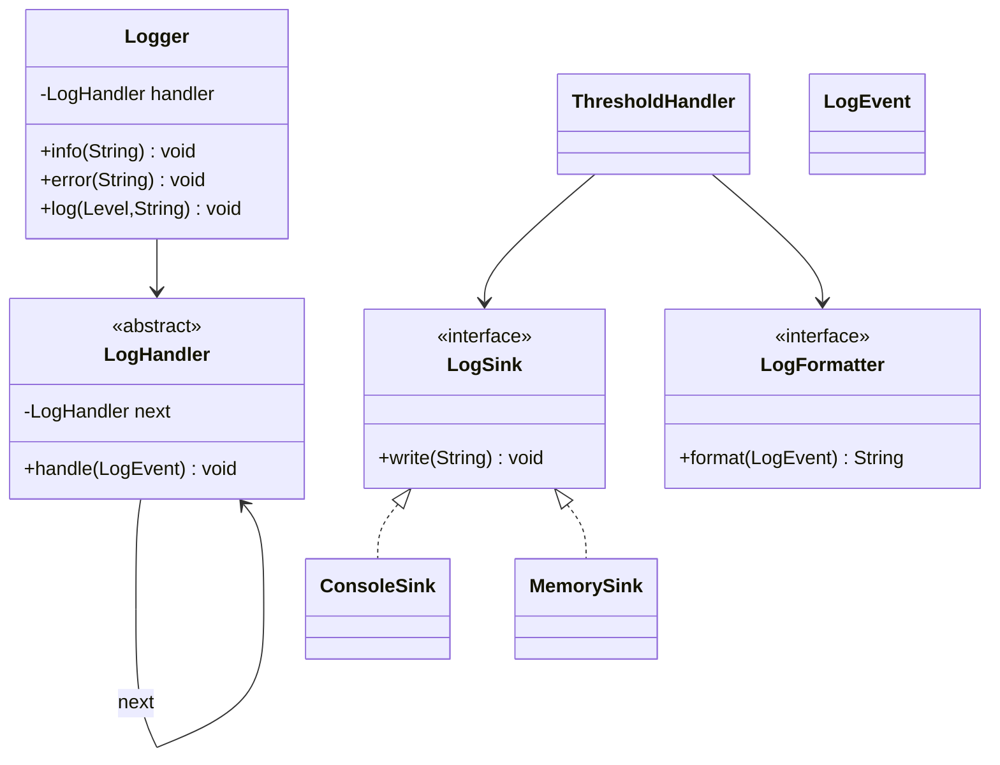

#### 4. Main-flow sequence diagram
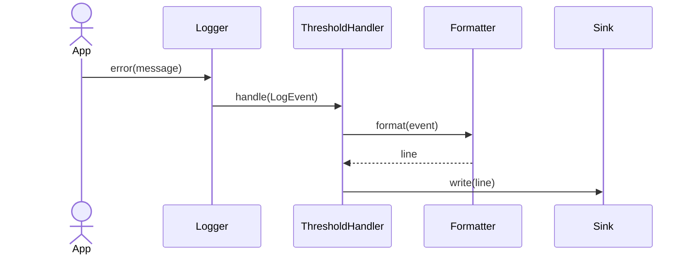

#### 5. Design patterns used & why
- Chain of Responsibility: multiple handlers can filter or route by level/module.
- Strategy: `LogSink` and `LogFormatter` vary independently.
- Facade: callers use `Logger.info` instead of knowing handlers/sinks.
- Singleton is optional for app configuration; avoid hard-coded static singleton in tests.

#### 6. Complete, compilable Java 17 code
```java
// logger/model package
package logger.model;

import java.time.Instant;

public enum Level { DEBUG, INFO, WARN, ERROR }

public record LogEvent(Level level, String message, Instant timestamp) { }
```

```java
// logger/service package
package logger.service;

import logger.model.*;

import java.time.Clock;
import java.util.ArrayList;
import java.util.List;

public interface LogSink {
    void write(String line);
}

public final class ConsoleSink implements LogSink {
    @Override
    public synchronized void write(String line) {
        System.out.println(line);
    }
}

public final class MemorySink implements LogSink {
    private final List<String> lines = new ArrayList<>();

    @Override
    public synchronized void write(String line) {
        lines.add(line);
    }

    public synchronized List<String> lines() {
        return List.copyOf(lines);
    }
}

public interface LogFormatter {
    String format(LogEvent event);
}

public final class TextFormatter implements LogFormatter {
    @Override
    public String format(LogEvent event) {
        return event.timestamp() + " " + event.level() + " " + event.message();
    }
}

public abstract class LogHandler {
    private LogHandler next;

    public LogHandler link(LogHandler handler) {
        this.next = handler;
        return handler;
    }

    public final void handle(LogEvent event) {
        process(event);
        if (next != null) {
            next.handle(event);
        }
    }

    protected abstract void process(LogEvent event);
}

public final class ThresholdHandler extends LogHandler {
    private final Level threshold;
    private final LogSink sink;
    private final LogFormatter formatter;

    public ThresholdHandler(Level threshold, LogSink sink, LogFormatter formatter) {
        this.threshold = threshold;
        this.sink = sink;
        this.formatter = formatter;
    }

    @Override
    protected void process(LogEvent event) {
        if (event.level().ordinal() >= threshold.ordinal()) {
            sink.write(formatter.format(event));
        }
    }
}

public final class Logger {
    private final LogHandler handler;
    private final Clock clock;

    public Logger(LogHandler handler, Clock clock) {
        this.handler = handler;
        this.clock = clock;
    }

    public void debug(String message) {
        log(Level.DEBUG, message);
    }

    public void info(String message) {
        log(Level.INFO, message);
    }

    public void error(String message) {
        log(Level.ERROR, message);
    }

    public void log(Level level, String message) {
        handler.handle(new LogEvent(level, message, clock.instant()));
    }
}
```

```java
// logger/Main.java
package logger;

import logger.model.Level;
import logger.service.*;

import java.time.Clock;

public class Main {
    public static void main(String[] args) {
        Logger logger = new Logger(
                new ThresholdHandler(Level.INFO, new ConsoleSink(), new TextFormatter()),
                Clock.systemUTC());

        logger.info("application started");
        logger.debug("hidden debug line");
    }
}
```

#### 7. Thread-safety considerations
- `MemorySink.lines` and `ConsoleSink.write` are synchronized because sinks are shared mutable resources.
- If async logging is added, use a bounded `BlockingQueue` and a shutdown/flush method.
- Dynamic threshold updates should use `volatile` or an atomic reference.

#### 8. Extensibility
- Add file sink: implement `LogSink` with rotation lock around file handle.
- Add JSON output: implement `LogFormatter`.
- Add async logging: `AsyncSink` decorates another sink and drains a queue.
- Add per-class log levels: add `LoggerFactory` that maps logger name to threshold.

#### 9. JUnit 5 tests
```java
package logger;

import logger.model.Level;
import logger.service.*;
import org.junit.jupiter.api.Test;

import java.time.Clock;
import java.time.Instant;
import java.time.ZoneOffset;

import static org.junit.jupiter.api.Assertions.*;

class LoggerTest {
    @Test
    void thresholdSuppressesDebug() {
        MemorySink sink = new MemorySink();
        Logger logger = new Logger(
                new ThresholdHandler(Level.INFO, sink, new TextFormatter()),
                Clock.fixed(Instant.EPOCH, ZoneOffset.UTC));

        logger.debug("debug");
        logger.info("info");

        assertEquals(1, sink.lines().size());
        assertTrue(sink.lines().get(0).contains("INFO"));
    }

    @Test
    void errorPassesInfoThreshold() {
        MemorySink sink = new MemorySink();
        Logger logger = new Logger(
                new ThresholdHandler(Level.INFO, sink, new TextFormatter()),
                Clock.systemUTC());

        logger.error("boom");

        assertTrue(sink.lines().get(0).contains("boom"));
    }
}
```

**Common mistakes:**
- Hard-coding `System.out.println` in every caller.
- Treating Singleton as the whole design.
- Ignoring file/memory sink thread safety.

**Follow-ups:**
- *How do you log to console and file?* → Chain two handlers or use a composite sink.
- *How do you avoid blocking request threads?* → Async sink with bounded queue and back-pressure policy.
- *How do you add trace ID?* → Add context fields to `LogEvent` or use mapped diagnostic context.

---

### Q2. Design Vending Machine
`🟡 Intermediate` `🔥` `Must-know SDE-1`

#### Beginner primer

**Simple problem:** A user selects a product, inserts money, receives the item and change, or cancels and
gets a refund. Stock, balance, and cash inventory must remain consistent.

**Mental model:** This is a **state machine**. The same action means different things in `IDLE`,
`PRODUCT_SELECTED`, `MONEY_INSERTED`, and `DISPENSING`. Inventory owns product counts, cash inventory owns
denominations, and the machine coordinates one customer session.

**Pattern recognition and flow:** Use **State** when valid operations depend on lifecycle state and
conditionals spread across methods. Use **Strategy** when change-making varies. Select available item →
accept denomination → check payment → compute change without mutation → atomically reserve item and cash →
dispense → return change → reset. Cancellation refunds and resets without reducing stock.

**Alternatives and scale:** Guarded enum methods are clearer for a small machine; state classes help when
each state has substantial behavior. Greedy change is not valid for every denomination set, so Dynamic
Programming (DP) or backtracking may be needed. Hardware needs device adapters, durable audit, power-loss
recovery, and one lock or serialized event loop per machine.

**Responsibility map:**

| Class or interface | Responsibility | Key methods and contract | Relationships |
|---|---|---|---|
| `Money` enum | Lists accepted cash denominations. | Constructor stores amount; `amount()` returns integer value; no mutation or failure. | Passed to `VendingMachine.insert` and `CashBox.accept`. |
| `Product` record | Describes a sellable item. | Canonical constructor stores code, name, and price; accessors return fields; no validation. | Stored in `Inventory` and returned in `DispenseResult`. |
| `DispenseResult` record | Reports dispensed product and change. | Canonical constructor stores product and change; accessors return fields; no mutation or validation. | Returned by `VendingMachine.dispense`. |
| `Inventory` class | Tracks products and quantities. | `add(Product,int)` stores product and merges quantity; `requireAvailable(String)` returns product or throws `IllegalStateException`; `decrement(String)` validates then reduces quantity. | Used by states through `VendingMachine.inventory`. |
| `CashBox` class | Tracks accepted cash amount. | `accept(Money)` adds denomination amount; `returnChange(int)` subtracts and returns requested amount, throwing `IllegalStateException` for negative or insufficient cash. | Used by `SelectedState`, `PaidState`, and `VendingMachine`. |
| `MachineState` interface | Defines legal vending actions per state. | `select`, `insert`, `dispense`, and `cancel` take the machine, may mutate it, return result or refund where applicable, and throw when action is invalid. | Implemented by idle, selected, and paid states. |
| `IdleState` class | Handles machine with no active selection. | `select` validates product, sets selected code, and moves to selected; `insert` and `dispense` throw `IllegalStateException`; `cancel` returns zero. | Uses `Inventory`; sets `SelectedState`. |
| `SelectedState` class | Handles selected product before enough money. | `select` changes selection after availability check; `insert` accepts money, increases paid amount, and moves to paid when enough; `dispense` throws; `cancel` refunds through machine reset. | Uses `CashBox`, `Inventory`, and `PaidState`. |
| `PaidState` class | Handles enough money to dispense or cancel. | `select` throws; `insert` accepts extra money; `dispense` validates product, decrements inventory, returns change, resets session, and returns `DispenseResult`; `cancel` refunds paid amount. | Uses `Inventory`, `CashBox`, and machine reset helpers. |
| `VendingMachine` class | Coordinates one customer session. | Constructor stores inventory and cash box; synchronized public methods delegate to current state; helpers mutate selected code, paid amount, and state; invalid actions throw from state. | Owns `MachineState`, `Inventory`, and `CashBox`. |
| `Main` class | Demonstrates purchase flow. | `main(String[])` creates stock, selects item, inserts money, dispenses, and prints result; exceptions bubble up. | Wires model and service classes. |
| `VendingMachineTest` class | Verifies dispense, invalid insert, and cancel. | Test methods call machine operations and assertions; invalid insert throws `IllegalStateException`; assertion failures fail tests. | Exercises `VendingMachine`, states, `Inventory`, `Money`, and records. |

**Why they ask:** It tests state transitions, inventory, payment/change handling, and invalid operation behavior.

**Short answer (say this first, 20-40 sec):**
Use a State pattern. The machine has inventory, cash box, selected slot, paid amount, and states such as idle,
selected, and paid. Inventory and cash operations are synchronized through the machine so selection, payment,
dispense, and refund remain consistent.

**Detailed answer:**

#### 1. Clarifying questions & requirements
- Questions: Cash only or card/UPI? Should machine return exact change? Can user cancel? Multiple units per slot?
  What happens when selected item goes out of stock mid-flow?
- Functional: add products; select item; insert coins/notes; reject invalid actions; dispense item; return change;
  refund before dispense.
- Non-functional: one customer session per machine; deterministic money calculations in integer paise/cents;
  state-specific errors.
- Out of scope: hardware drivers, remote inventory sync, QR payment callbacks.

#### 2. Entities & relationships
- `VendingMachine` owns `Inventory`, `CashBox`, current `MachineState`, selection, and paid amount.
- `Inventory` maps code to product and stock.
- `CashBox` tracks accepted cash and makes change.
- `MachineState` validates allowed operations.

#### 3. Class diagram
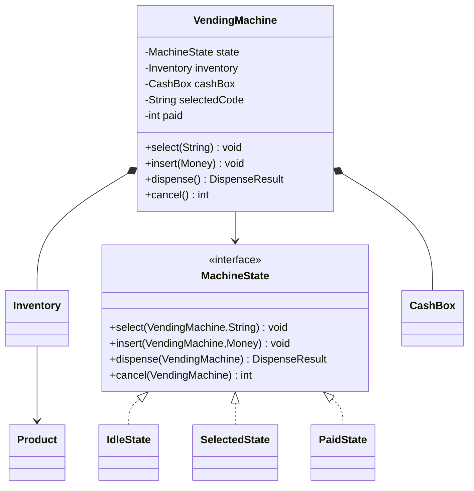

#### 4. Main-flow sequence diagram
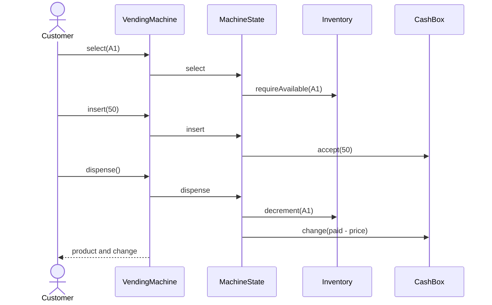

#### 4b. State diagram
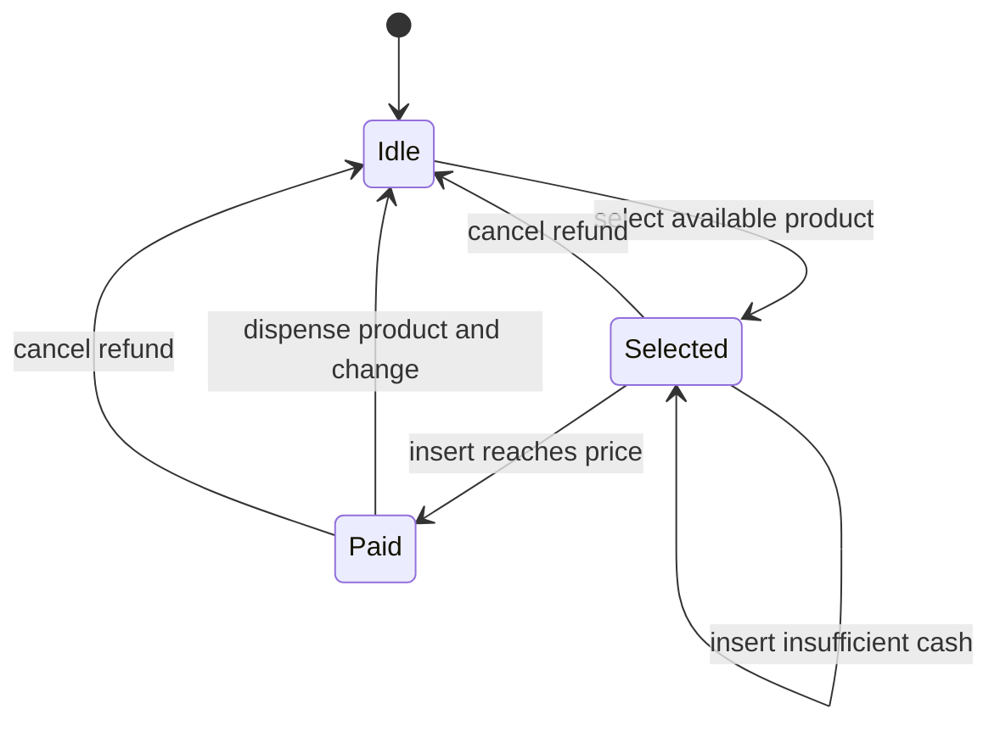

#### 5. Design patterns used & why
- State: each state defines legal operations and avoids a giant switch.
- Strategy: change-making can become `ChangeStrategy`.
- Facade: `VendingMachine` exposes simple methods to UI/hardware adapters.

#### 6. Complete, compilable Java 17 code
```java
// vending/model package
package vending.model;

public enum Money {
    TEN(10), TWENTY(20), FIFTY(50), HUNDRED(100);

    private final int amount;

    Money(int amount) {
        this.amount = amount;
    }

    public int amount() {
        return amount;
    }
}

public record Product(String code, String name, int price) { }

public record DispenseResult(Product product, int change) { }
```

```java
// vending/service package
package vending.service;

import vending.model.*;

import java.util.HashMap;
import java.util.Map;

public final class Inventory {
    private final Map<String, Product> products = new HashMap<>();
    private final Map<String, Integer> quantities = new HashMap<>();

    public void add(Product product, int quantity) {
        products.put(product.code(), product);
        quantities.merge(product.code(), quantity, Integer::sum);
    }

    public Product requireAvailable(String code) {
        Product product = products.get(code);
        if (product == null || quantities.getOrDefault(code, 0) <= 0) {
            throw new IllegalStateException("product unavailable");
        }
        return product;
    }

    public void decrement(String code) {
        requireAvailable(code);
        quantities.computeIfPresent(code, (ignored, quantity) -> quantity - 1);
    }
}

public final class CashBox {
    private int cash;

    public void accept(Money money) {
        cash += money.amount();
    }

    public int returnChange(int amount) {
        if (amount < 0 || cash < amount) {
            throw new IllegalStateException("cannot return change");
        }
        cash -= amount;
        return amount;
    }
}

interface MachineState {
    void select(VendingMachine machine, String code);

    void insert(VendingMachine machine, Money money);

    DispenseResult dispense(VendingMachine machine);

    int cancel(VendingMachine machine);
}

final class IdleState implements MachineState {
    @Override
    public void select(VendingMachine machine, String code) {
        machine.inventory().requireAvailable(code);
        machine.setSelectedCode(code);
        machine.setState(new SelectedState());
    }

    @Override
    public void insert(VendingMachine machine, Money money) {
        throw new IllegalStateException("select product first");
    }

    @Override
    public DispenseResult dispense(VendingMachine machine) {
        throw new IllegalStateException("pay first");
    }

    @Override
    public int cancel(VendingMachine machine) {
        return 0;
    }
}

final class SelectedState implements MachineState {
    @Override
    public void select(VendingMachine machine, String code) {
        machine.inventory().requireAvailable(code);
        machine.setSelectedCode(code);
    }

    @Override
    public void insert(VendingMachine machine, Money money) {
        machine.cashBox().accept(money);
        machine.addPaid(money.amount());
        Product product = machine.inventory().requireAvailable(machine.selectedCode());
        if (machine.paid() >= product.price()) {
            machine.setState(new PaidState());
        }
    }

    @Override
    public DispenseResult dispense(VendingMachine machine) {
        throw new IllegalStateException("insufficient payment");
    }

    @Override
    public int cancel(VendingMachine machine) {
        return machine.resetAndRefund();
    }
}

final class PaidState implements MachineState {
    @Override
    public void select(VendingMachine machine, String code) {
        throw new IllegalStateException("dispense or cancel current selection");
    }

    @Override
    public void insert(VendingMachine machine, Money money) {
        machine.cashBox().accept(money);
        machine.addPaid(money.amount());
    }

    @Override
    public DispenseResult dispense(VendingMachine machine) {
        Product product = machine.inventory().requireAvailable(machine.selectedCode());
        machine.inventory().decrement(product.code());
        int change = machine.cashBox().returnChange(machine.paid() - product.price());
        machine.resetWithoutRefund();
        return new DispenseResult(product, change);
    }

    @Override
    public int cancel(VendingMachine machine) {
        return machine.resetAndRefund();
    }
}

public final class VendingMachine {
    private final Inventory inventory;
    private final CashBox cashBox;
    private MachineState state = new IdleState();
    private String selectedCode;
    private int paid;

    public VendingMachine(Inventory inventory, CashBox cashBox) {
        this.inventory = inventory;
        this.cashBox = cashBox;
    }

    public synchronized void select(String code) {
        state.select(this, code);
    }

    public synchronized void insert(Money money) {
        state.insert(this, money);
    }

    public synchronized DispenseResult dispense() {
        return state.dispense(this);
    }

    public synchronized int cancel() {
        return state.cancel(this);
    }

    Inventory inventory() {
        return inventory;
    }

    CashBox cashBox() {
        return cashBox;
    }

    String selectedCode() {
        return selectedCode;
    }

    int paid() {
        return paid;
    }

    void addPaid(int amount) {
        paid += amount;
    }

    void setSelectedCode(String selectedCode) {
        this.selectedCode = selectedCode;
    }

    void setState(MachineState state) {
        this.state = state;
    }

    int resetAndRefund() {
        int refund = paid;
        resetWithoutRefund();
        return refund;
    }

    void resetWithoutRefund() {
        selectedCode = null;
        paid = 0;
        state = new IdleState();
    }
}
```

```java
// vending/Main.java
package vending;

import vending.model.*;
import vending.service.*;

public class Main {
    public static void main(String[] args) {
        Inventory inventory = new Inventory();
        inventory.add(new Product("A1", "Water", 30), 2);

        VendingMachine machine = new VendingMachine(inventory, new CashBox());
        machine.select("A1");
        machine.insert(Money.FIFTY);

        System.out.println(machine.dispense());
    }
}
```

#### 7. Thread-safety considerations
- Public operations are synchronized to ensure one customer session mutates selection, paid amount, stock, and
  cash atomically.
- In a fleet, each machine has its own lock; admin restock should also acquire the same machine lock.
- Payment callbacks must include idempotency keys if external payments are introduced.

#### 8. Extensibility
- Add card/UPI: add `PaymentStrategy` and a `PaymentState` waiting for callback.
- Add exact coin inventory: make `CashBox` store denomination counts and inject `ChangeStrategy`.
- Add cancel timeout: scheduler calls `cancel` after inactivity.
- Add admin restock: `InventoryService.restock` with authorization around `Inventory.add`.

#### 9. JUnit 5 tests
```java
package vending;

import org.junit.jupiter.api.Test;
import vending.model.*;
import vending.service.*;

import static org.junit.jupiter.api.Assertions.*;

class VendingMachineTest {
    @Test
    void dispensesAfterEnoughPayment() {
        Inventory inventory = new Inventory();
        inventory.add(new Product("A1", "Water", 30), 1);
        VendingMachine machine = new VendingMachine(inventory, new CashBox());

        machine.select("A1");
        machine.insert(Money.FIFTY);
        DispenseResult result = machine.dispense();

        assertEquals("A1", result.product().code());
        assertEquals(20, result.change());
    }

    @Test
    void cannotInsertBeforeSelect() {
        VendingMachine machine = new VendingMachine(new Inventory(), new CashBox());

        assertThrows(IllegalStateException.class, () -> machine.insert(Money.TEN));
    }

    @Test
    void cancelRefundsPaidAmount() {
        Inventory inventory = new Inventory();
        inventory.add(new Product("A1", "Water", 30), 1);
        VendingMachine machine = new VendingMachine(inventory, new CashBox());

        machine.select("A1");
        machine.insert(Money.TWENTY);

        assertEquals(20, machine.cancel());
    }
}
```

**Common mistakes:**
- One giant `switch` on state with duplicated validations.
- No refund/change path.
- Decrementing inventory before payment is complete.

**Follow-ups:**
- *How do you support exact change?* → `CashBox` stores denomination counts and `ChangeStrategy` computes change.
- *How do you handle card failure?* → Keep item selected, move back to selected state, and allow retry/cancel.
- *How do you manage multiple machines?* → `MachineRepository` with one lock per machine.

---

### Q3. Design ATM
`🟡 Intermediate` `🔥` `Must-know SDE-1`

#### Beginner primer

**Terminology and problem:** An Automated Teller Machine (ATM) authenticates a cardholder, performs account
operations through a bank, and dispenses physical cash. It must handle bank debit and cash-dispense failures
without silently losing money.

**Mental model:** The ATM orchestrates a session state machine, bank gateway, and cash dispenser. The bank
balance is authoritative; the ATM separately owns physical-note inventory.

**Pattern recognition:** **State** models card inserted, authenticated, transaction selected, and ejecting.
**Command** fits transaction objects that need logging or reversal. **Adapter** shields the domain from a
bank Software Development Kit (SDK).

**Flow and failure handling:** validate card and Personal Identification Number (PIN) → authorize withdrawal
→ choose notes → debit bank → dispense → produce receipt. On dispense failure, request reversal and report
the failure. This is compensation, not a truly atomic bank-and-hardware transaction. Production needs
idempotency, reconciliation, device health, limits, audit, and manual handling if reversal also fails.

**Responsibility map:**

| Class or interface | Responsibility | Key methods and contract | Relationships |
|---|---|---|---|
| `Account` class | Stores one card credential and balance. | Constructor stores card, PIN, and balance; `matchesPin` returns boolean; `balance` returns amount; `debit` subtracts or throws `IllegalStateException` for insufficient funds; `credit` adds amount. | Owned by `BankService`; package-private domain helper. |
| `BankService` class | Simulates account repository and bank operations. | `addAccount` creates account; synchronized `authenticate` returns boolean; synchronized `debit`, `credit`, and `balance` mutate or read account; unknown card throws `IllegalArgumentException`. | Used by ATM states through `Atm.bank`. |
| `CashDispenser` class | Owns physical note counts and dispensing plan. | Constructor stores descending note counts; synchronized `dispense(int)` validates positive hundred-multiple amount, computes note plan, mutates counts after exact plan, returns notes, and throws for invalid or impossible amount. | Used by `AuthenticatedState` through `Atm.dispenser`. |
| `AtmState` interface | Defines legal card-session actions. | `insertCard`, `authenticate`, `withdraw`, and `eject` take the `Atm`, may mutate session state, return notes for withdraw, and throw when action is invalid. | Implemented by idle, card-inserted, and authenticated states. |
| `IdleState` class | Handles ATM with no card. | `insertCard` sets current card and moves to card-inserted; `authenticate` and `withdraw` throw `IllegalStateException`; `eject` is a no-op. | Sets `CardInsertedState` on `Atm`. |
| `CardInsertedState` class | Handles card present before authentication. | `insertCard` throws; `authenticate` calls bank and moves to authenticated or throws `SecurityException`; `withdraw` throws; `eject` resets ATM. | Uses `BankService`; sets `AuthenticatedState`. |
| `AuthenticatedState` class | Handles authenticated withdrawals. | `insertCard` throws; `authenticate` is a no-op; `withdraw` debits bank, dispenses cash, returns notes, credits back on runtime dispenser failure, and rethrows; `eject` resets. | Coordinates `BankService`, `CashDispenser`, and `Atm.reset`. |
| `Atm` class | Facade and state holder for one physical ATM. | Constructor stores bank and dispenser; synchronized public methods delegate to state; package helpers expose collaborators and mutate card/state; `reset` clears card and returns to idle. | Owns current `AtmState`, `BankService`, and `CashDispenser`. |
| `Main` class | Demonstrates successful withdrawal. | `main(String[])` creates bank, dispenser, ATM, authenticates, withdraws, and prints notes; exceptions bubble up. | Wires ATM service classes. |
| `AtmTest` class | Verifies withdrawal, bad PIN, and debit reversal. | Test methods call ATM flow and assertions; bad PIN throws `SecurityException`; dispenser failure throws `IllegalStateException` and expected balance is asserted. | Exercises states, bank, dispenser, and `Atm`. |

**Why they ask:** ATM combines state transitions, authentication, cash inventory, and transaction consistency.

**Short answer (say this first, 20-40 sec):**
The ATM is a stateful facade over bank authorization and cash dispensing. Withdrawal authenticates the card,
debits the account, dispenses cash by denomination, and reverses the debit if dispensing fails. State pattern
keeps card-inserted, authenticated, and idle transitions explicit.

**Detailed answer:**

#### 1. Clarifying questions & requirements
- Questions: Withdraw only or balance/deposit too? Denominations? Daily limits? Online bank service or local mock?
  What if cash is unavailable after debit?
- Functional: insert card; authenticate PIN; withdraw valid amount; check account balance; check ATM cash;
  dispense denominations; reverse debit on dispense failure; eject card.
- Non-functional: transactional consistency; synchronized ATM session; no duplicate withdrawal on retry.
- Out of scope: EMV hardware, fraud detection, inter-bank settlement, receipt printing.

#### 2. Entities & relationships
- `Atm` owns state, bank service, dispenser, and current card.
- `BankService` owns account authentication and balances.
- `CashDispenser` owns cassette counts and dispense plan.
- `AtmState` controls valid operations.

#### 3. Class diagram
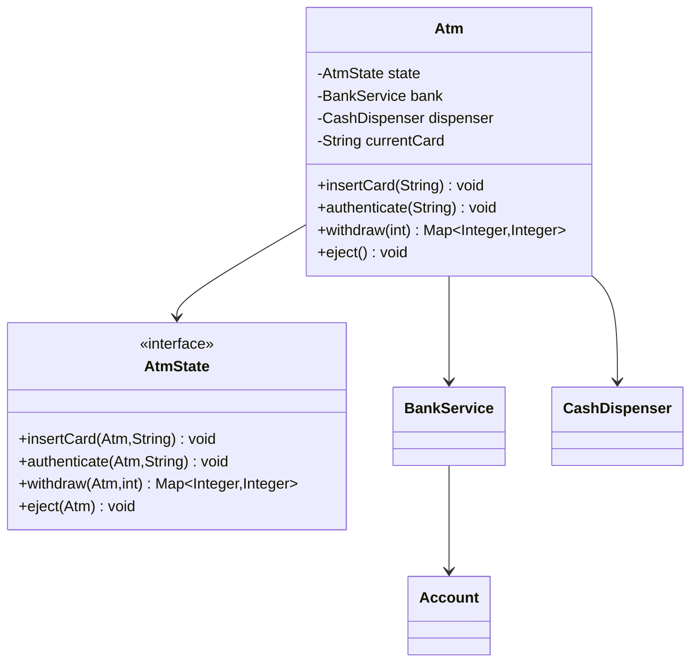

#### 4. Main-flow sequence diagram
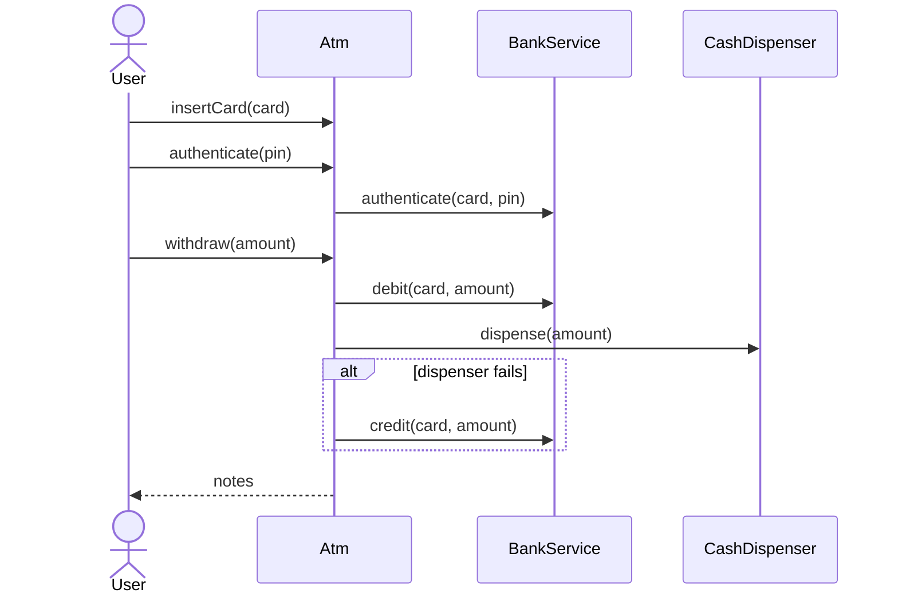

#### 4b. State diagram
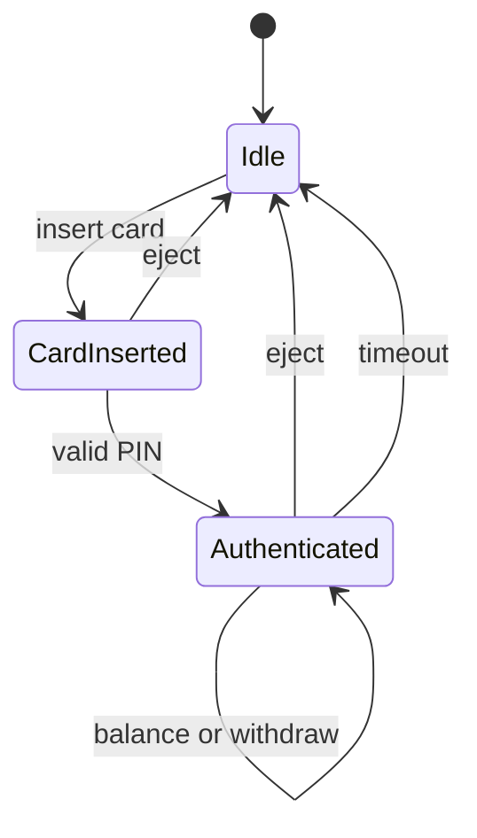

#### 5. Design patterns used & why
- State: legal operations differ before/after card insertion and authentication.
- Chain of Responsibility: denomination handlers can dispense cash from largest to smallest.
- Facade: `Atm` hides bank and dispenser internals.

#### 6. Complete, compilable Java 17 code
```java
// atm/service package
package atm.service;

import java.util.HashMap;
import java.util.LinkedHashMap;
import java.util.Map;

final class Account {
    private final String card;
    private final String pin;
    private int balance;

    Account(String card, String pin, int balance) {
        this.card = card;
        this.pin = pin;
        this.balance = balance;
    }

    boolean matchesPin(String candidate) {
        return pin.equals(candidate);
    }

    int balance() {
        return balance;
    }

    void debit(int amount) {
        if (balance < amount) {
            throw new IllegalStateException("insufficient funds");
        }
        balance -= amount;
    }

    void credit(int amount) {
        balance += amount;
    }
}

public final class BankService {
    private final Map<String, Account> accounts = new HashMap<>();

    public void addAccount(String card, String pin, int balance) {
        accounts.put(card, new Account(card, pin, balance));
    }

    public synchronized boolean authenticate(String card, String pin) {
        Account account = accounts.get(card);
        return account != null && account.matchesPin(pin);
    }

    public synchronized void debit(String card, int amount) {
        account(card).debit(amount);
    }

    public synchronized void credit(String card, int amount) {
        account(card).credit(amount);
    }

    public synchronized int balance(String card) {
        return account(card).balance();
    }

    private Account account(String card) {
        Account account = accounts.get(card);
        if (account == null) {
            throw new IllegalArgumentException("unknown card");
        }
        return account;
    }
}

public final class CashDispenser {
    private final LinkedHashMap<Integer, Integer> notes = new LinkedHashMap<>();

    public CashDispenser(Map<Integer, Integer> noteCountsDescending) {
        notes.putAll(noteCountsDescending);
    }

    public synchronized Map<Integer, Integer> dispense(int amount) {
        if (amount <= 0 || amount % 100 != 0) {
            throw new IllegalArgumentException("invalid amount");
        }
        int remaining = amount;
        Map<Integer, Integer> plan = new LinkedHashMap<>();
        for (Map.Entry<Integer, Integer> entry : notes.entrySet()) {
            int denomination = entry.getKey();
            int count = Math.min(remaining / denomination, entry.getValue());
            if (count > 0) {
                plan.put(denomination, count);
                remaining -= denomination * count;
            }
        }
        if (remaining != 0) {
            throw new IllegalStateException("atm cannot dispense exact amount");
        }
        plan.forEach((denomination, count) -> notes.merge(denomination, -count, Integer::sum));
        return plan;
    }
}
```

```java
// atm/service/Atm.java
package atm.service;

import java.util.Map;

interface AtmState {
    void insertCard(Atm atm, String card);

    void authenticate(Atm atm, String pin);

    Map<Integer, Integer> withdraw(Atm atm, int amount);

    void eject(Atm atm);
}

final class IdleState implements AtmState {
    @Override
    public void insertCard(Atm atm, String card) {
        atm.setCurrentCard(card);
        atm.setState(new CardInsertedState());
    }

    @Override
    public void authenticate(Atm atm, String pin) {
        throw new IllegalStateException("insert card first");
    }

    @Override
    public Map<Integer, Integer> withdraw(Atm atm, int amount) {
        throw new IllegalStateException("authenticate first");
    }

    @Override
    public void eject(Atm atm) {
        // already idle
    }
}

final class CardInsertedState implements AtmState {
    @Override
    public void insertCard(Atm atm, String card) {
        throw new IllegalStateException("card already inserted");
    }

    @Override
    public void authenticate(Atm atm, String pin) {
        if (!atm.bank().authenticate(atm.currentCard(), pin)) {
            throw new SecurityException("invalid pin");
        }
        atm.setState(new AuthenticatedState());
    }

    @Override
    public Map<Integer, Integer> withdraw(Atm atm, int amount) {
        throw new IllegalStateException("authenticate first");
    }

    @Override
    public void eject(Atm atm) {
        atm.reset();
    }
}

final class AuthenticatedState implements AtmState {
    @Override
    public void insertCard(Atm atm, String card) {
        throw new IllegalStateException("session already active");
    }

    @Override
    public void authenticate(Atm atm, String pin) {
        // already authenticated
    }

    @Override
    public Map<Integer, Integer> withdraw(Atm atm, int amount) {
        atm.bank().debit(atm.currentCard(), amount);
        try {
            return atm.dispenser().dispense(amount);
        } catch (RuntimeException ex) {
            atm.bank().credit(atm.currentCard(), amount);
            throw ex;
        }
    }

    @Override
    public void eject(Atm atm) {
        atm.reset();
    }
}

public final class Atm {
    private final BankService bank;
    private final CashDispenser dispenser;
    private AtmState state = new IdleState();
    private String currentCard;

    public Atm(BankService bank, CashDispenser dispenser) {
        this.bank = bank;
        this.dispenser = dispenser;
    }

    public synchronized void insertCard(String card) {
        state.insertCard(this, card);
    }

    public synchronized void authenticate(String pin) {
        state.authenticate(this, pin);
    }

    public synchronized Map<Integer, Integer> withdraw(int amount) {
        return state.withdraw(this, amount);
    }

    public synchronized void eject() {
        state.eject(this);
    }

    BankService bank() {
        return bank;
    }

    CashDispenser dispenser() {
        return dispenser;
    }

    String currentCard() {
        return currentCard;
    }

    void setCurrentCard(String currentCard) {
        this.currentCard = currentCard;
    }

    void setState(AtmState state) {
        this.state = state;
    }

    void reset() {
        currentCard = null;
        state = new IdleState();
    }
}
```

```java
// atm/Main.java
package atm;

import atm.service.*;

import java.util.Map;

public class Main {
    public static void main(String[] args) {
        BankService bank = new BankService();
        bank.addAccount("card1", "1234", 1000);
        CashDispenser dispenser = new CashDispenser(Map.of(500, 4, 100, 10));
        Atm atm = new Atm(bank, dispenser);

        atm.insertCard("card1");
        atm.authenticate("1234");
        System.out.println(atm.withdraw(600));
    }
}
```

#### 7. Thread-safety considerations
- `Atm` public methods are synchronized because one physical ATM serves one session at a time.
- `BankService` synchronizes account mutations; production would use database transactions and transaction IDs.
- Debit and dispense need a journal/reversal flow; this sample credits back on dispenser failure.

#### 8. Extensibility
- Add deposit: add `DepositAcceptor` and `deposit(amount)` in authenticated state.
- Add daily limit: decorate `BankService.debit` with `LimitService`.
- Add receipt: return `TransactionReceipt` from withdraw.
- Add denomination chain: replace greedy loop with handlers per cassette.

#### 9. JUnit 5 tests
```java
package atm;

import atm.service.*;
import org.junit.jupiter.api.Test;

import java.util.Map;

import static org.junit.jupiter.api.Assertions.*;

class AtmTest {
    @Test
    void withdrawDebitsAccountAndReturnsNotes() {
        BankService bank = new BankService();
        bank.addAccount("c", "p", 1000);
        Atm atm = new Atm(bank, new CashDispenser(Map.of(500, 2, 100, 10)));

        atm.insertCard("c");
        atm.authenticate("p");
        Map<Integer, Integer> notes = atm.withdraw(600);

        assertEquals(400, bank.balance("c"));
        assertEquals(1, notes.get(500));
        assertEquals(1, notes.get(100));
    }

    @Test
    void badPinRejected() {
        BankService bank = new BankService();
        bank.addAccount("c", "p", 1000);
        Atm atm = new Atm(bank, new CashDispenser(Map.of(500, 2)));

        atm.insertCard("c");

        assertThrows(SecurityException.class, () -> atm.authenticate("wrong"));
    }

    @Test
    void debitIsReversedWhenCashCannotBeDispensed() {
        BankService bank = new BankService();
        bank.addAccount("c", "p", 1000);
        Atm atm = new Atm(bank, new CashDispenser(Map.of(500, 1)));

        atm.insertCard("c");
        atm.authenticate("p");

        assertThrows(IllegalStateException.class, () -> atm.withdraw(600));
        assertEquals(1000, bank.balance("c"));
    }
}
```

**Common mistakes:**
- Debiting account without handling dispenser failure.
- No state model for card inserted/authenticated.
- Ignoring denomination availability.

**Follow-ups:**
- *How do you avoid duplicate withdrawal on retry?* → Use idempotency key and transaction journal.
- *How do you support multiple ATMs?* → Central bank service with transactional account rows.
- *How do you choose denominations?* → Greedy for canonical denominations; DP/backtracking for arbitrary cassettes.

---

### Q4. Design Library Management
`🟡 Intermediate` `🔥` `Must-know SDE-1`

#### Beginner primer

**Simple problem:** Members search titles and borrow or return physical copies. The system tracks the
borrower, due date, availability, and optionally reservations and fines.

**Mental model:** `Book` is shared bibliographic information; `BookCopy` is one physical barcode item;
`Loan` records temporary ownership by a `Member`. Users borrow copies, not abstract titles.

**Thought process and patterns:** Defend “one copy has at most one active loan.” **Repository** hides storage.
**Strategy** fits varying loan-period and fine policies. `LibraryService` coordinates borrowing while
entities protect local state.

**Flow, alternatives, and scale:** load member and copy → verify eligibility and availability → atomically
mark copy loaned and create loan → return due date. Returning closes the loan, releases the copy, and may
fine or notify. An in-memory map works for a demo; a database should enforce one active loan per copy.
Search may be eventually indexed, but checkout needs strongly consistent copy state.

**Responsibility map:**

| Class or interface | Responsibility | Key methods and contract | Relationships |
|---|---|---|---|
| `CopyStatus` enum | Names physical copy lifecycle states. | Constants are read-only; no inputs, mutation, return value, or failure behavior. | Stored in `BookCopy` and checked by its state methods. |
| `Book` record | Stores shared bibliographic data. | Canonical constructor stores ISBN, title, and author; accessors return fields; no validation. | Referenced by many `BookCopy` instances and search results. |
| `Member` record | Identifies a library member. | Canonical constructor stores id and name immutably; accessors return fields; no validation. | Stored in `LibraryService.membersById` and used by loans. |
| `Loan` record | Captures active borrowing of one copy. | Canonical constructor stores id, member id, copy id, and due date; no mutation or validation. | Created by `LibraryService.borrow` and tracked by copy id. |
| `BookCopy` class | Owns one physical copy and availability status. | Constructor stores id and book; accessors return fields; `markBorrowed` changes available to borrowed or throws `IllegalStateException`; `markAvailable` changes borrowed to available or throws if not borrowed. | Belongs to a `Book`; stored in `LibraryService`. |
| `LibraryService` class | Coordinates catalog, member, copy, and loan operations. | Constructor stores clock; add methods put books, copies, and members; `search(String)` returns matching books and mutates nothing; synchronized `borrow` validates member and copy, marks borrowed, creates loan, stores it, and throws on unknown or unavailable data; `returnCopy` marks available and removes loan; `hasActiveLoan` returns boolean; `requireCopy` throws for unknown copy. | Owns maps of records and `BookCopy`; uses `Clock` and `UUID`. |
| `Main` class | Demonstrates adding and borrowing a copy. | `main(String[])` creates service, adds book/copy/member, borrows, and prints loan; exceptions bubble up. | Wires library model and service classes. |
| `LibraryServiceTest` class | Verifies double-borrow prevention and return behavior. | Test methods add data, borrow, return, and assert status or expected exceptions; assertion failures fail tests. | Exercises `LibraryService`, `BookCopy`, records, and `CopyStatus`. |

**Why they ask:** It tests entity boundaries, copy-vs-book modeling, search, loans, and double-borrow prevention.

**Short answer (say this first, 20-40 sec):**
Separate `Book` metadata from `BookCopy`, because users borrow physical copies, not titles. `LibraryService`
coordinates search, borrow, return, and reservations; borrow atomically marks a copy unavailable and creates
a `Loan` with due date.

**Detailed answer:**

#### 1. Clarifying questions & requirements
- Questions: Physical books only or e-books? How many active loans per member? Reservations? Fine calculation?
  Search by title, author, ISBN, or category?
- Functional: add books/copies/members; search; borrow available copy; return copy; prevent double borrow;
  track due date and active loans.
- Non-functional: borrow/return atomic per copy; search can be eventually indexed; clear model for future DB.
- Out of scope: payment gateway for fines, barcode hardware, recommendation engine.

#### 2. Entities & relationships
- `Book` is bibliographic metadata.
- `BookCopy` is the lendable unit.
- `Member` borrows copies through `Loan`.
- `LibraryService` acts as application service over repositories/maps.

#### 3. Class diagram
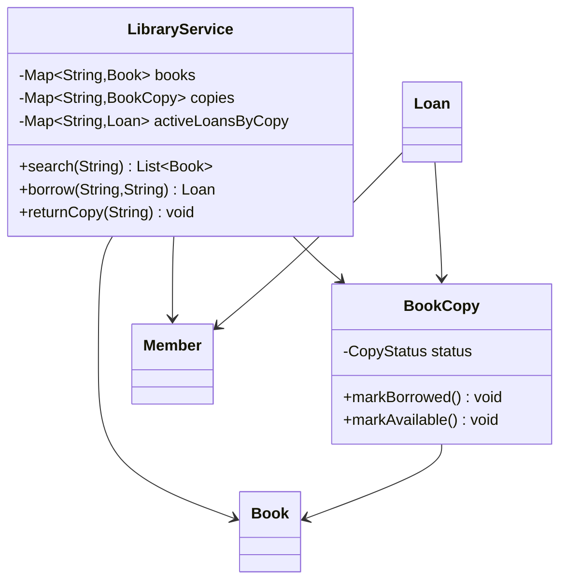

#### 4. Main-flow sequence diagram
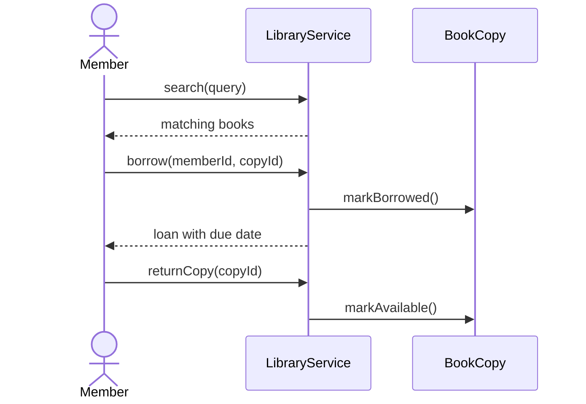

#### 5. Design patterns used & why
- Repository style: in-memory maps can be swapped with DB repositories.
- Strategy: `FineStrategy` or `SearchStrategy` can be added later.
- Observer: notifications for due-date reminders or reservation availability.

#### 6. Complete, compilable Java 17 code
```java
// library/model package
package library.model;

import java.time.LocalDate;

public enum CopyStatus { AVAILABLE, BORROWED, LOST }

public record Book(String isbn, String title, String author) { }

public record Member(String id, String name) { }

public record Loan(String id, String memberId, String copyId, LocalDate dueDate) { }

public final class BookCopy {
    private final String id;
    private final Book book;
    private CopyStatus status = CopyStatus.AVAILABLE;

    public BookCopy(String id, Book book) {
        this.id = id;
        this.book = book;
    }

    public String id() {
        return id;
    }

    public Book book() {
        return book;
    }

    public CopyStatus status() {
        return status;
    }

    public void markBorrowed() {
        if (status != CopyStatus.AVAILABLE) {
            throw new IllegalStateException("copy unavailable");
        }
        status = CopyStatus.BORROWED;
    }

    public void markAvailable() {
        if (status != CopyStatus.BORROWED) {
            throw new IllegalStateException("copy is not borrowed");
        }
        status = CopyStatus.AVAILABLE;
    }
}
```

```java
// library/service/LibraryService.java
package library.service;

import library.model.*;

import java.time.Clock;
import java.time.LocalDate;
import java.util.HashMap;
import java.util.List;
import java.util.Map;
import java.util.UUID;

public final class LibraryService {
    private final Map<String, Book> booksByIsbn = new HashMap<>();
    private final Map<String, BookCopy> copiesById = new HashMap<>();
    private final Map<String, Member> membersById = new HashMap<>();
    private final Map<String, Loan> activeLoansByCopy = new HashMap<>();
    private final Clock clock;

    public LibraryService(Clock clock) {
        this.clock = clock;
    }

    public void addBook(Book book) {
        booksByIsbn.put(book.isbn(), book);
    }

    public void addCopy(BookCopy copy) {
        copiesById.put(copy.id(), copy);
    }

    public void addMember(Member member) {
        membersById.put(member.id(), member);
    }

    public List<Book> search(String query) {
        String normalized = query.toLowerCase();
        return booksByIsbn.values().stream()
                .filter(book -> book.title().toLowerCase().contains(normalized)
                        || book.author().toLowerCase().contains(normalized)
                        || book.isbn().equalsIgnoreCase(query))
                .toList();
    }

    public synchronized Loan borrow(String memberId, String copyId) {
        if (!membersById.containsKey(memberId)) {
            throw new IllegalArgumentException("unknown member");
        }
        BookCopy copy = requireCopy(copyId);
        copy.markBorrowed();
        Loan loan = new Loan(
                UUID.randomUUID().toString(),
                memberId,
                copyId,
                LocalDate.now(clock).plusDays(14));
        activeLoansByCopy.put(copyId, loan);
        return loan;
    }

    public synchronized void returnCopy(String copyId) {
        BookCopy copy = requireCopy(copyId);
        copy.markAvailable();
        activeLoansByCopy.remove(copyId);
    }

    public synchronized boolean hasActiveLoan(String copyId) {
        return activeLoansByCopy.containsKey(copyId);
    }

    private BookCopy requireCopy(String copyId) {
        BookCopy copy = copiesById.get(copyId);
        if (copy == null) {
            throw new IllegalArgumentException("unknown copy");
        }
        return copy;
    }
}
```

```java
// library/Main.java
package library;

import library.model.*;
import library.service.LibraryService;

import java.time.Clock;

public class Main {
    public static void main(String[] args) {
        LibraryService library = new LibraryService(Clock.systemUTC());
        Book book = new Book("978013", "Effective Java", "Joshua Bloch");
        library.addBook(book);
        library.addCopy(new BookCopy("copy-1", book));
        library.addMember(new Member("m1", "Azam"));

        System.out.println(library.borrow("m1", "copy-1"));
    }
}
```

#### 7. Thread-safety considerations
- `borrow` and `returnCopy` are synchronized because copy status and active-loan map must change atomically.
- Production DB design should enforce one active loan per copy with a unique filtered index.
- Search can use immutable indexes or read-write locks if writes are frequent.

#### 8. Extensibility
- Add reservations: maintain queue per ISBN and assign returned copy to next member.
- Add fines: inject `FineStrategy` based on due date and return date.
- Add categories: add fields and secondary indexes by author/category/title.
- Add notifications: publish domain events on borrow, return, and due-date reminders.

#### 9. JUnit 5 tests
```java
package library;

import library.model.*;
import library.service.LibraryService;
import org.junit.jupiter.api.Test;

import java.time.Clock;
import java.time.Instant;
import java.time.ZoneOffset;

import static org.junit.jupiter.api.Assertions.*;

class LibraryServiceTest {
    @Test
    void borrowCreatesLoanAndPreventsDoubleBorrow() {
        LibraryService library = new LibraryService(Clock.systemUTC());
        Book book = new Book("1", "Java", "Author");
        library.addBook(book);
        library.addCopy(new BookCopy("c1", book));
        library.addMember(new Member("m1", "Member"));

        library.borrow("m1", "c1");

        assertTrue(library.hasActiveLoan("c1"));
        assertThrows(IllegalStateException.class, () -> library.borrow("m1", "c1"));
    }

    @Test
    void returnMakesCopyBorrowableAgain() {
        LibraryService library = new LibraryService(Clock.systemUTC());
        Book book = new Book("1", "Java", "Author");
        library.addBook(book);
        library.addCopy(new BookCopy("c1", book));
        library.addMember(new Member("m1", "Member"));

        library.borrow("m1", "c1");
        library.returnCopy("c1");

        assertDoesNotThrow(() -> library.borrow("m1", "c1"));
    }

    @Test
    void dueDateIsFourteenDaysLater() {
        Clock clock = Clock.fixed(Instant.parse("2026-01-01T00:00:00Z"), ZoneOffset.UTC);
        LibraryService library = new LibraryService(clock);
        Book book = new Book("1", "Java", "Author");
        library.addBook(book);
        library.addCopy(new BookCopy("c1", book));
        library.addMember(new Member("m1", "Member"));

        Loan loan = library.borrow("m1", "c1");

        assertEquals("2026-01-15", loan.dueDate().toString());
    }
}
```

**Common mistakes:**
- Borrowing `Book` instead of `BookCopy`.
- Not preventing double borrow.
- No due date or active-loan lifecycle.

**Follow-ups:**
- *How do reservations work?* → Queue member IDs per ISBN; when a copy returns, assign to queue head.
- *What tables would you create?* → `book`, `book_copy`, `member`, `loan`, and `reservation`.
- *How do you compute fines?* → `FineStrategy.calculate(loan, returnedAt)`.

---

### Q5. Design Elevator System
`🔴 Advanced` `🔥` `Must-know SDE-1/SDE-2`

#### Beginner primer

**Simple problem:** Passengers request pickup and destination. A dispatcher chooses an elevator; each
elevator visits stops safely and fairly while minimizing wait and travel.

**Mental model:** The dispatcher is a traffic controller. Each elevator is an independent actor with current
floor, direction, door state, capacity, and ordered stops. Hall calls include direction; car calls are
destinations selected inside.

**Pattern recognition:** **Strategy** fits nearest-car or zone dispatch. **State** fits detailed door and
motion safety. **Observer** may publish telemetry but should not control movement.

**Flow and trade-offs:** hall request → score elevators → queue stop → move one floor at a time → open only
when stopped → board/alight → choose next stop. Separate upward and downward ordered sets support a
SCAN-like schedule, but heavy traffic may starve requests; aging improves fairness. Multiple controllers
need durable requests, leader ownership, health monitoring, and fallback operation.

**Responsibility map:**

| Class or interface | Responsibility | Key methods and contract | Relationships |
|---|---|---|---|
| `Direction` enum | Names elevator movement or hall-call direction. | Constants are read-only; no inputs, mutation, return value, or failure behavior. | Used by `Elevator`, `HallRequest`, and scheduler. |
| `DoorState` enum | Names door lifecycle states. | Constants are read-only; no methods or mutation. | Stored in `Elevator` and asserted in tests. |
| `HallRequest` record | Carries pickup floor and desired direction. | Canonical constructor stores floor and direction; accessors return fields; no validation. | Passed to `SchedulingStrategy.choose`. |
| `Elevator` class | Owns one elevator car state and ordered stops. | Constructor stores id and start floor; synchronized `addStop` queues up or down stop or opens door at current floor; `step` closes door, moves one floor, opens at stop, updates direction or idles; getters return id, floor, direction, door, and pending count; no floor-range validation. | Chosen by scheduler and owned by `ElevatorSystem`. |
| `SchedulingStrategy` interface | Defines dispatcher selection policy. | `choose(List<Elevator>, HallRequest)` returns an elevator or throws according to implementation when none exists. | Implemented by `LookSchedulingStrategy`; used by `ElevatorSystem`. |
| `LookSchedulingStrategy` class | Scores elevators by direction, distance, load, and id. | `choose` returns minimum-cost elevator and throws if list is empty; private `cost` reads elevator state, mutates nothing, and penalizes wrong-direction cars. | Depends on `Elevator` getters and `HallRequest`. |
| `ElevatorSystem` class | Coordinates fleet-level pickup and destination requests. | Constructor creates elevators; synchronized `requestPickup` chooses elevator, adds pickup stop, returns id; `requestDestination` adds car stop by id; `stepAll` advances every elevator; `elevator` returns selected car; bad id bubbles from list access. | Owns elevators and `SchedulingStrategy`. |
| `Main` class | Demonstrates pickup, movement, and destination. | `main(String[])` creates system, requests pickup, steps cars, requests destination, and prints floor; exceptions bubble up. | Wires `ElevatorSystem` and `LookSchedulingStrategy`. |
| `ElevatorSystemTest` class | Verifies movement, assignment, and scheduler preference. | Test methods mutate elevators and system, then assert floor, door, id, or chosen car; assertion failures fail tests. | Exercises model enums, `Elevator`, strategy, and system. |

**Why they ask:** Elevator combines scheduling, state machines, queues, direction, and concurrent requests.

**Short answer (say this first, 20-40 sec):**
Model each elevator as an actor-like object with current floor, direction, and two sorted stop sets. The
dispatcher uses a scheduling strategy to assign hall calls. LOOK/SCAN-style movement serves all stops in the
current direction before reversing, avoiding random oscillation.

**Detailed answer:**

#### 1. Clarifying questions & requirements
- Questions: Number of elevators/floors? Hall calls only or destination control? Capacity? Emergency mode?
  Should scheduler be nearest, SCAN, or LOOK?
- Functional: receive hall request; assign an elevator; add car destination; move one tick at a time; open door
  at requested floors; use LOOK/SCAN direction behavior.
- Non-functional: thread-safe dispatcher; no starvation for opposite direction; strategy-swappable scheduling.
- Out of scope: motor physics, sensor hardware, fire-service integration, predictive traffic learning.

#### 2. Entities & relationships
- `ElevatorSystem` receives requests and owns elevators.
- `Elevator` owns movement state and stop sets.
- `SchedulingStrategy` chooses elevator.
- `HallRequest` captures floor and direction.

#### 3. Class diagram
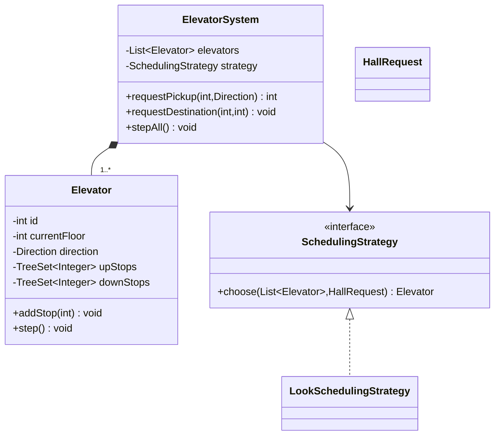

#### 4. Main-flow sequence diagram
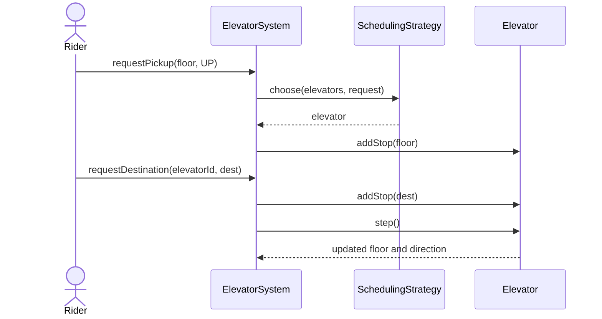

#### 4b. State diagram
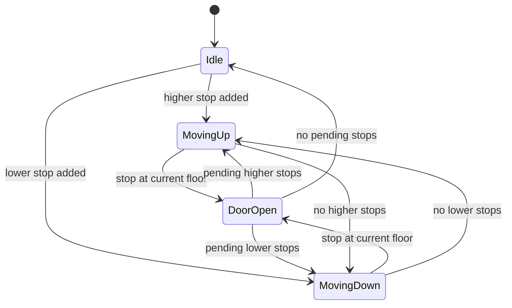

#### 5. Design patterns used & why
- Strategy: scheduling can be LOOK, nearest-car, capacity-aware, or destination-control.
- State via enum: direction and door status are simple enough for enums; full State can be added for hardware.
- Mediator: `ElevatorSystem` coordinates riders, strategy, and elevators.

#### 6. Complete, compilable Java 17 code
```java
// elevator/model package
package elevator.model;

public enum Direction { UP, DOWN, IDLE }

public enum DoorState { OPEN, CLOSED }

public record HallRequest(int floor, Direction direction) { }
```

```java
// elevator/service package
package elevator.service;

import elevator.model.*;

import java.util.ArrayList;
import java.util.Comparator;
import java.util.List;
import java.util.TreeSet;

public final class Elevator {
    private final int id;
    private int currentFloor;
    private Direction direction = Direction.IDLE;
    private DoorState door = DoorState.CLOSED;
    private final TreeSet<Integer> upStops = new TreeSet<>();
    private final TreeSet<Integer> downStops = new TreeSet<>(Comparator.reverseOrder());

    public Elevator(int id, int startFloor) {
        this.id = id;
        this.currentFloor = startFloor;
    }

    public synchronized void addStop(int floor) {
        if (floor > currentFloor) {
            upStops.add(floor);
            if (direction == Direction.IDLE) {
                direction = Direction.UP;
            }
        } else if (floor < currentFloor) {
            downStops.add(floor);
            if (direction == Direction.IDLE) {
                direction = Direction.DOWN;
            }
        } else {
            door = DoorState.OPEN;
        }
    }

    public synchronized void step() {
        door = DoorState.CLOSED;
        chooseDirectionIfNeeded();
        if (direction == Direction.UP) {
            currentFloor++;
            if (upStops.remove(currentFloor)) {
                door = DoorState.OPEN;
            }
            if (upStops.isEmpty() && !downStops.isEmpty()) {
                direction = Direction.DOWN;
            }
        } else if (direction == Direction.DOWN) {
            currentFloor--;
            if (downStops.remove(currentFloor)) {
                door = DoorState.OPEN;
            }
            if (downStops.isEmpty() && !upStops.isEmpty()) {
                direction = Direction.UP;
            }
        }
        if (upStops.isEmpty() && downStops.isEmpty() && door == DoorState.CLOSED) {
            direction = Direction.IDLE;
        }
    }

    private void chooseDirectionIfNeeded() {
        if (direction != Direction.IDLE) {
            return;
        }
        if (!upStops.isEmpty()) {
            direction = Direction.UP;
        } else if (!downStops.isEmpty()) {
            direction = Direction.DOWN;
        }
    }

    public synchronized int id() {
        return id;
    }

    public synchronized int currentFloor() {
        return currentFloor;
    }

    public synchronized Direction direction() {
        return direction;
    }

    public synchronized DoorState door() {
        return door;
    }

    public synchronized int pendingStops() {
        return upStops.size() + downStops.size();
    }
}

public interface SchedulingStrategy {
    Elevator choose(List<Elevator> elevators, HallRequest request);
}

public final class LookSchedulingStrategy implements SchedulingStrategy {
    @Override
    public Elevator choose(List<Elevator> elevators, HallRequest request) {
        return elevators.stream()
                .min(Comparator
                        .comparingInt((Elevator elevator) -> cost(elevator, request))
                        .thenComparingInt(Elevator::pendingStops)
                        .thenComparingInt(Elevator::id))
                .orElseThrow();
    }

    private int cost(Elevator elevator, HallRequest request) {
        Direction direction = elevator.direction();
        int distance = Math.abs(elevator.currentFloor() - request.floor());
        if (direction == Direction.IDLE) {
            return distance;
        }
        boolean sameDirection = direction == request.direction();
        boolean onTheWay = direction == Direction.UP
                ? request.floor() >= elevator.currentFloor()
                : request.floor() <= elevator.currentFloor();
        return sameDirection && onTheWay ? distance : distance + 100;
    }
}

public final class ElevatorSystem {
    private final List<Elevator> elevators = new ArrayList<>();
    private final SchedulingStrategy strategy;

    public ElevatorSystem(int elevatorCount, SchedulingStrategy strategy) {
        this.strategy = strategy;
        for (int i = 0; i < elevatorCount; i++) {
            elevators.add(new Elevator(i, 0));
        }
    }

    public synchronized int requestPickup(int floor, Direction direction) {
        Elevator elevator = strategy.choose(elevators, new HallRequest(floor, direction));
        elevator.addStop(floor);
        return elevator.id();
    }

    public void requestDestination(int elevatorId, int destinationFloor) {
        elevators.get(elevatorId).addStop(destinationFloor);
    }

    public void stepAll() {
        elevators.forEach(Elevator::step);
    }

    public Elevator elevator(int id) {
        return elevators.get(id);
    }
}
```

```java
// elevator/Main.java
package elevator;

import elevator.model.Direction;
import elevator.service.*;

public class Main {
    public static void main(String[] args) {
        ElevatorSystem system = new ElevatorSystem(2, new LookSchedulingStrategy());
        int elevatorId = system.requestPickup(5, Direction.UP);

        for (int i = 0; i < 5; i++) {
            system.stepAll();
        }

        system.requestDestination(elevatorId, 9);
        System.out.println(system.elevator(elevatorId).currentFloor());
    }
}
```

#### 7. Thread-safety considerations
- Dispatcher assignment is synchronized so one hall request is assigned once.
- Each `Elevator` synchronizes stop mutation and movement because scheduler and motor loop may run concurrently.
- Actor model is cleaner in production: one queue per elevator plus one dispatcher queue.

#### 8. Extensibility
- Add capacity: add `currentLoad/maxLoad` to `Elevator`; scheduler skips full elevators.
- Add emergency mode: add `available` flag; scheduler filters unavailable elevators.
- Add destination control: replace hall request with passenger destination and group by floor.
- Add door timing: separate `DoorController` and state machine for open/closing/obstructed.

#### 9. JUnit 5 tests
```java
package elevator;

import elevator.model.*;
import elevator.service.*;
import org.junit.jupiter.api.Test;

import static org.junit.jupiter.api.Assertions.*;

class ElevatorSystemTest {
    @Test
    void elevatorMovesTowardStopAndOpensDoor() {
        Elevator elevator = new Elevator(1, 0);
        elevator.addStop(2);

        elevator.step();
        elevator.step();

        assertEquals(2, elevator.currentFloor());
        assertEquals(DoorState.OPEN, elevator.door());
    }

    @Test
    void systemAssignsPickup() {
        ElevatorSystem system = new ElevatorSystem(1, new LookSchedulingStrategy());

        int id = system.requestPickup(3, Direction.UP);
        system.stepAll();

        assertEquals(0, id);
        assertEquals(1, system.elevator(0).currentFloor());
    }

    @Test
    void lookStrategyPrefersIdleNearestElevator() {
        Elevator idle = new Elevator(1, 0);
        Elevator busy = new Elevator(2, 0);
        busy.addStop(10);
        SchedulingStrategy strategy = new LookSchedulingStrategy();

        Elevator chosen = strategy.choose(java.util.List.of(busy, idle), new HallRequest(1, Direction.UP));

        assertEquals(1, chosen.id());
    }
}
```

**Common mistakes:**
- Assigning purely by nearest floor without considering direction and pending stops.
- No target queues or stop sets.
- Treating elevator movement as immediate teleportation.

**Follow-ups:**
- *SCAN vs LOOK?* → SCAN goes to physical end before reversing; LOOK reverses at furthest pending stop.
- *How to avoid starvation?* → Aging priority for old requests or periodic global rebalance.
- *How do you scale to many elevators?* → Dispatcher queue, per-elevator actor, strategy with cost function.

## Revision Cheat Sheet

- Logger: facade + handler chain + sink/formatter strategies; sinks need synchronization.
- Vending Machine: State pattern for Idle/Selected/Paid; inventory and cash mutate under one machine lock.
- ATM: authenticate, debit, dispense, reverse on failure; state machine prevents invalid operations.
- Library: Book metadata differs from BookCopy; borrow creates active loan atomically.
- Elevator: LOOK/SCAN scheduling uses direction and sorted stop sets; dispatcher assignment must be synchronized.
- For every LLD, state the exact lock boundary and the extension class you would change.

## Flashcards

1. Logger output extension? → Implement `LogSink`.
2. Logger async design? → Bounded queue plus worker and flush/shutdown.
3. Vending state pattern benefit? → Invalid actions are localized per state.
4. Vending exact change? → Denomination-aware `CashBox` plus `ChangeStrategy`.
5. ATM dispense failure after debit? → Reverse debit using transaction journal.
6. ATM denomination logic? → Greedy for canonical notes, DP for arbitrary counts.
7. Library Book vs Copy? → Book is metadata; Copy is lendable physical item.
8. Library double borrow prevention? → Atomic copy status update and active-loan constraint.
9. Elevator LOOK? → Continue current direction until no stops remain that way, then reverse.
10. Elevator scheduler input? → Current floor, direction, pending stops, capacity, and request direction.
11. Shared theme? → Keep core services independent of UI and console input.
12. Best tests? → Deterministic, service-level, and focused on lifecycle edges.
