# 10d · Low-Level Design (LLD) Problems Tier 2 Part 1

Software Development Engineer level 2 (SDE-2) machine-coding designs with runnable Java 17 sketches,
diagrams, tests, and follow-ups. Each problem now begins with a beginner primer; use the later compact
sections for revision.

**Legend:** 🟢 Beginner · 🟡 Intermediate · 🔴 Advanced · ⚫ FAANG · 🔥 = very frequently asked

**Common terms:** Time To Live (TTL), Application Programming Interface (API), database (DB), Java
Persistence API (JPA), Structured Query Language (SQL), and Unified Modeling Language (UML).

## Table of Contents
- [Beginner guide to this file](#beginner-guide-to-this-file)
- [1. Design BookMyShow](#1-design-bookmyshow)
- [2. Design Splitwise](#2-design-splitwise)
- [3. Design Ride Booking / Uber](#3-design-ride-booking--uber)
- [4. Design Food Delivery](#4-design-food-delivery)
- [5. Design Hotel / Meeting Room Booking & Calendar](#5-design-hotel--meeting-room-booking--calendar)
- [6. Design Inventory & Order Management](#6-design-inventory--order-management)
- [7. Design Shopping Cart + Coupon Engine](#7-design-shopping-cart--coupon-engine)
- [Revision Cheat Sheet](#revision-cheat-sheet)
- [Flashcards](#flashcards)

## Beginner guide to this file

### What this file teaches

This file teaches medium-complexity Low-Level Design (LLD) problems where a Java backend service must protect
shared resources: seats, money, drivers, orders, rooms, inventory, carts, and coupons. Interviewers ask these
because they reveal whether you can move from objects to state transitions, contracts, concurrency, and failure
handling. In real backend work, the same patterns appear in booking flows, payment-adjacent ledgers, checkout,
marketplaces, and calendar-style availability systems.

### Mental model

Think of each design as a small control desk for scarce things that many users want at the same time.

- A service is the coordinator: it validates the request, calls helpers, and decides the state change.
- Entities and records are the nouns: seat, booking, expense split, ride, order line, room, coupon.
- State machines describe what changes are legal and what changes must be rejected.
- Strategies let one design swap pricing, matching, discount, or split rules without rewriting the service.
- Locks, transactions, and idempotency keep a repeated or concurrent request from corrupting shared state.
- Tests show the invariant: no double booking, no oversell, no invalid transition, no wrong discount.

### How to think through any question here

1. Restate the main resource in plain words: seat, balance, driver, order, room, stock, or cart total.
2. Define the lifecycle states and say which transitions are legal, rejected, or retried.
3. Pick the core entities first, then the service that owns the workflow and the repository or map that stores it.
4. Find the race condition: two users selecting the same seat, booking the same room, or reserving the same
   Stock Keeping Unit (SKU).
5. Decide which rule belongs in a Strategy, Validator, or state check instead of hard-coding it everywhere.
6. Name the failure path: payment failure, expired lock, invalid split, unavailable driver, or low inventory.
7. Explain the production guard after the in-memory version: database constraint, row lock, version check, or queue.

### Pattern recognition cues

| If the question mentions... | Think about... | Why it fits |
| --- | --- | --- |
| Temporary seat hold or checkout timeout | Lease plus Time To Live (TTL) | The resource should return to available if the user abandons payment. |
| Splitting a bill among many users | Ledger and simplification | Net balances are easier to settle than storing every pairwise debt forever. |
| Nearby driver assignment | Matching Strategy | Distance ranking changes independently from the ride request workflow. |
| Food order progress | State machine | Only some status transitions are valid, and invalid jumps must fail fast. |
| Meeting room or hotel availability | Interval overlap | The key check is whether two time ranges intersect for the same resource. |
| Inventory before payment | Reservation then release | Stock must be protected while payment is pending and restored on failure. |
| Coupon combinations | Validator plus Discount Strategy | Eligibility and discount math vary by coupon type and should be pluggable. |
| Double booking or overselling | Transactional guard | In-memory checks are a teaching aid; production needs an authoritative write guard. |
| Repeated confirm or payment request | Idempotency key | Retrying a request should not create a second booking, expense, or order. |

### Abbreviations and key terms

| Short form | Expanded form | Plain meaning |
| --- | --- | --- |
| API | Application Programming Interface | A callable boundary between services, clients, or modules. |
| BOGO | Buy One, Get One | A promotion where buying one item gives another item free or discounted. |
| DB | Database | Durable storage that should be the source of truth for final writes. |
| FAANG | Facebook, Amazon, Apple, Netflix, Google | Shorthand for large product-company interview style and bar. |
| FX | Foreign Exchange | Currency conversion rate used when expenses involve multiple currencies. |
| H3 | H3 geospatial index | A hexagon-based location index often used to narrow nearby-search candidates. |
| JPA | Java Persistence API | Java specification for mapping objects to relational database tables. |
| JUnit | Java unit testing framework | The test library used by the example test sections. |
| JVM | Java Virtual Machine | The runtime that executes Java bytecode; process-local locks live only inside one JVM. |
| LLD | Low-Level Design | Object, class, method, and interaction design for a focused component. |
| LR | Left to Right | Mermaid diagram direction where nodes flow horizontally. |
| RRULE | Recurrence Rule | Calendar rule format for repeated meetings or bookings. |
| SDE-2 | Software Development Engineer level 2 | Mid-level engineering interview expectation with design and trade-off depth. |
| SKU | Stock Keeping Unit | Unique product inventory identifier used for reservation and stock checks. |
| SLA | Service Level Agreement | Expected time or reliability target, such as food preparation timing. |
| SMS | Short Message Service | Text-message channel mentioned as an extension for booking notifications. |
| SQL | Structured Query Language | Relational database query language used for transactional guards. |
| TD | Top Down | Mermaid diagram direction where nodes flow vertically. |
| TTL | Time To Live | Expiry duration for locks, holds, reservations, or cache entries. |
| UML | Unified Modeling Language | Diagram notation used for class relationships. |
| UUID | Universally Unique Identifier | Random-looking identifier generated for demo bookings, rides, and orders. |

### Common beginner traps

- Drawing many classes before naming the one invariant that must never break.
- Treating an in-memory synchronized block as if it protected a distributed production system.
- Forgetting the failure path after payment, restaurant rejection, expired hold, or invalid coupon.
- Mixing validation, pricing, matching, and persistence into one large class instead of separating responsibilities.
- Not explaining why a State, Strategy, Repository, or Validator pattern is useful for this specific problem.
- Ignoring idempotency when an external client can retry the same checkout or payment request.

### How to study this file

1. For each problem, read the beginner primer and responsibility map before looking at the code.
2. Say the short answer aloud: main entities, workflow, invariant, and the concurrency guard.
3. Walk the Java code method by method and connect each method to a row in the responsibility map.
4. Use the JUnit examples to identify the invariant each design protects.
5. Convert the flashcards into active prompts: answer, then check the detailed sections for missed trade-offs.
6. Re-implement one problem from memory, then add one production concern such as idempotency or row locking.

### Scalability and production lens

The demos are intentionally single-process so the object model is easy to see. In production, the final decision
usually moves to a database transaction, unique constraint, conditional update, or queue consumer. Cache search
and catalog reads, but do not trust a cache for booking, inventory, wallet, or coupon finality. Add observability
around lock expiry, payment failure, oversell attempts, and latency because these are the signals that the toy
answer needs stronger production controls.

## 1. Design BookMyShow
Tier 2 · SDE-2 must-know

### 0. Beginner primer

**Problem and mental model:** Users search shows, temporarily hold seats, pay, and confirm a booking. Think
of every show-seat as a resource moving `AVAILABLE → LOCKED → BOOKED`; a lock is a lease that expires.
`BookingService` orchestrates, `SeatLockProvider` owns leases, `PaymentService` owns the external payment
boundary, and repositories persist show-seat and booking state.

**Recognition and flow:** State fits the lifecycle; Strategy fits pricing; Repository hides storage. Search
show → choose seats → atomically create user-owned hold → charge with idempotency key → atomically confirm
booking or release on failure/expiry. A plain status check is unsafe across servers; production uses row
locks, optimistic versions, or a unique `(show_id, seat_id)` booking constraint. Cache search, not the final
booking decision.

**Responsibility map:**

| Class or interface | Responsibility | Key methods and contract | Relationships |
| --- | --- | --- | --- |
| BookMyShowDemo | Demo namespace and executable sample for the booking design. | main(String[] args) builds a provider and service, places a hold, confirms it, prints the result, and propagates any booking exception. | Owns the nested enum, record, services, and demo flow. |
| SeatStatus | Seat lifecycle marker. | Constants AVAILABLE, LOCKED, and BOOKED carry no methods or state changes; invalid movement is enforced by SeatLockProvider. | Stored per show-seat key in SeatLockProvider. |
| Hold | Immutable lock lease for selected seats. | Canonical record constructor receives id, showId, seats, user, and expiresAt; accessors return those values; it changes no state and has no validation beyond Java record construction. | Created by SeatLockProvider and returned through BookingService. |
| SeatLockProvider | Owns seat availability, active holds, lock expiry, release, and final booking state. | lock(showId, seats, user) cleans expired holds, verifies every seat is AVAILABLE, marks seats LOCKED, stores and returns a Hold, and throws IllegalStateException when any seat is unavailable. confirm(holdId, user) cleans up, finds the hold, validates user and expiry, marks seats BOOKED, removes the hold, and throws when missing, expired, or wrong user. release(holdId) removes the hold, returns locked seats to AVAILABLE, and is a no-op for an unknown hold. | Used by BookingService; stores Hold and SeatStatus by show-seat key. |
| BookingService | Small orchestration layer exposed to callers. | hold(seats, user) delegates to SeatLockProvider with the demo show id and returns a Hold; confirm(holdId, user) delegates confirmation and returns a booking string; failures come from the lock provider. | Depends on SeatLockProvider and hides the lower-level show-seat key detail. |
| BookMyShowDemoTest | JUnit 5 regression tests for seat locking invariants. | cannotDoubleLock, releaseAllowsRelock, and confirmMakesSeatUnavailable use local providers, return void, and fail through JUnit assertions if locking behavior changes. | Exercises SeatLockProvider directly. |

### 1. Clarifying questions & requirements
- Cities, movies, theatres, shows, seats; users search shows and book contiguous/selected seats.
- Seat lock expires after a TTL; only locked seats can be confirmed by that user.
- Avoid double booking under concurrent clicks; payment may fail and release seats.
- Scale read-heavy search separately from write-heavy booking.

### 2. Entities & relationships
City 1-* Theatre 1-* Screen 1-* Seat; Movie 1-* Show; Show 1-* ShowSeat; Booking owns booked seats and payment.

### 3. Class diagram
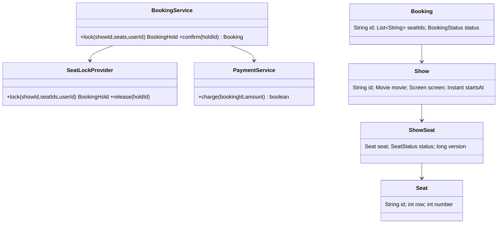

### 4. Main-flow sequence
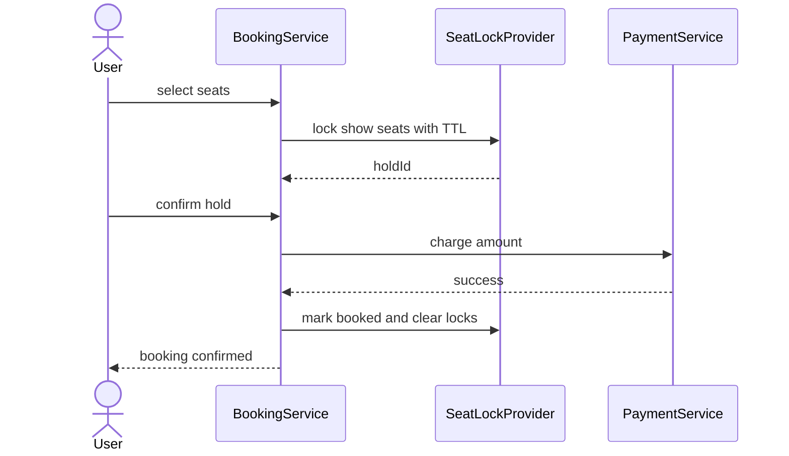

### 5. Design patterns used & why
- Repository for ShowSeat/Booking persistence.
- Strategy for pricing and seat-selection suggestions.
- State for seat lifecycle: AVAILABLE → LOCKED → BOOKED.

### 6. Complete, compilable Java code
```java
import java.time.*;
import java.util.*;
import java.util.concurrent.*;

public class BookMyShowDemo{
    enum SeatStatus{
        AVAILABLE,
        LOCKED,
        BOOKED
    }

    record Hold(String id,String showId,List<String> seats,String user,Instant expiresAt){
    }

    static class SeatLockProvider{
        private final Map<String,
        SeatStatus> seatStatus=new ConcurrentHashMap<>();
        private final Map<String,
        Hold> holds=new ConcurrentHashMap<>();
        private final Duration ttl=Duration.ofMinutes(2);
        SeatLockProvider(Collection<String> seats){
            // Demo keeps valid seat ids outside this snippet; status is tracked per show-seat key.
        }

        synchronized Hold lock(String showId,List<String> seats,String user){
            cleanup();
            for(String s:seats) {
                if(seatStatus.getOrDefault(key(showId,s),SeatStatus.AVAILABLE)!=SeatStatus.AVAILABLE) {
                    throw new IllegalStateException("seat unavailable "+s);
                }
            }

            seats.forEach(s->seatStatus.put(key(showId,s),SeatStatus.LOCKED));
            Hold h=new Hold(
                    UUID.randomUUID().toString(),showId,List.copyOf(seats),user,Instant.now().plus(ttl));
            holds.put(h.id(),h);
            return h;
        }

        synchronized void confirm(String holdId,String user){
            cleanup();
            Hold h=Optional.ofNullable(holds.get(holdId)).orElseThrow();
            if(!h.user().equals(user)||Instant.now().isAfter(h.expiresAt())) {
                throw new IllegalStateException("invalid hold");
            }

            h.seats().forEach(s->seatStatus.put(key(h.showId(),s),SeatStatus.BOOKED));
            holds.remove(holdId);
        }

        synchronized void release(String holdId){
            Hold h=holds.remove(holdId);
            if(h!=null) {
                h.seats().forEach(s -> seatStatus.computeIfPresent(
                        key(h.showId(),s),(k,v) -> v==SeatStatus.LOCKED ? SeatStatus.AVAILABLE : v));
            }
        }

        private void cleanup(){
            Instant now=Instant.now();
            new ArrayList<>(holds.values()).stream()
                    .filter(h -> now.isAfter(h.expiresAt()))
                    .forEach(h -> release(h.id()));
        }

        private String key(String showId,String seatId){
            return showId+":"+seatId;
        }
    }

    static class BookingService{
        private final SeatLockProvider locks;
        BookingService(SeatLockProvider locks){
            this.locks=locks;
        }

        Hold hold(List<String> seats,String user){
            return locks.lock("show1",seats,user);
        }

        String confirm(String holdId,String user){
            locks.confirm(holdId,user);
            return "BOOKED:"+holdId;
        }
    }

    public static void main(String[]a)throws Exception{
        var svc=new BookingService(new SeatLockProvider(List.of("A1","A2")));
        Hold h=svc.hold(List.of("A1"),"u1");
        System.out.println(svc.confirm(h.id(),"u1"));
    }
}
```

### 7. Thread-safety
Use per-show locks or DB transactions on `(show_id, seat_id)` rows. For distributed systems prefer `SELECT ... FOR UPDATE`, optimistic version checks, or unique `booking_seat(show_id, seat_id)` inserts over JVM-only locks.

### 8. Extensibility
- Add seat recommendation with a `SeatSelectionStrategy`.
- Add dynamic pricing with `PricingStrategy`.
- Add outbox events for ticket email/SMS.
- Add Redis locks only with fencing tokens or DB verification.

### 9. JUnit 5 test examples
```java
import static org.junit.jupiter.api.Assertions.*;

import java.util.List;
import org.junit.jupiter.api.Test;

class BookMyShowDemoTest {
    @Test
    void cannotDoubleLock() {
        var provider = new BookMyShowDemo.SeatLockProvider(List.of("A1"));
        provider.lock("s", List.of("A1"), "u1");

        assertThrows(IllegalStateException.class, () -> provider.lock("s", List.of("A1"), "u2"));
    }

    @Test
    void releaseAllowsRelock() {
        var provider = new BookMyShowDemo.SeatLockProvider(List.of("A1"));
        var hold = provider.lock("s", List.of("A1"), "u1");
        provider.release(hold.id());

        assertDoesNotThrow(() -> provider.lock("s", List.of("A1"), "u2"));
    }

    @Test
    void confirmMakesSeatUnavailable() {
        var provider = new BookMyShowDemo.SeatLockProvider(List.of("A1"));
        var hold = provider.lock("s", List.of("A1"), "u1");
        provider.confirm(hold.id(), "u1");

        assertThrows(IllegalStateException.class, () -> provider.lock("s", List.of("A1"), "u2"));
    }
}
```

### 10. Interviewer follow-ups with short answers · Common mistakes
- *How to prevent double booking across servers?* → DB unique constraints/row locks are authoritative; cache locks are only fast-path.
- *What if payment fails?* → Release hold and emit failure event.
- Mistakes: storing seat status only in memory, no lock TTL, not making confirmation idempotent.

## 2. Design Splitwise
Tier 2 · SDE-2 must-know

### 0. Beginner primer

**Problem and mental model:** A user records a group expense, chooses how participants split it, and the
system reports who owes whom. `Expense` is immutable history; `Split` is one participant’s share; balances
are a derived ledger view, not money stored in a wallet.

**Recognition and flow:** Strategy fits equal, exact, and percentage split rules because validation and
calculation vary together. Validate payer/participants and total shares → create expense → write ledger
entries → update or derive balances → optionally simplify debts. Storing only pairwise balances is simpler
but loses audit history. At scale, serialize updates per group or use a transaction and idempotency key;
rebuild materialized balances from the ledger when needed.

**Responsibility map:**

| Class or interface | Responsibility | Key methods and contract | Relationships |
| --- | --- | --- | --- |
| SplitwiseDemo | Demo namespace and executable sample for expense splitting. | main(String[] args) creates ExpenseService, adds an equal split, prints simplified transactions, and lets validation exceptions surface. | Owns split records, strategy, service, and demo flow. |
| Split | Immutable amount owed or credited by one user. | Canonical record constructor takes user and paise; accessors return values; it mutates nothing and performs no validation. | Returned by SplitStrategy and used inside ExpenseService priority queues. |
| Txn | Immutable settlement instruction. | Canonical record constructor takes from, to, and paise; accessors return values; it mutates nothing and performs no validation. | Produced by ExpenseService.simplify. |
| SplitStrategy | Pluggable split calculation contract. | split(amount, users) receives total amount and participants, returns per-user Split rows, and should not mutate service state; invalid inputs are strategy-specific. | Implemented by EqualSplit and consumed before ExpenseService.add. |
| EqualSplit | Divides an amount as evenly as possible. | split(amount, users) returns one Split per user, distributing remainder by list order; it changes no state and fails with ArithmeticException if users is empty. | Implements SplitStrategy and creates Split records. |
| ExpenseService | Tracks net balances and converts them into minimum settlement transactions. | add(paidBy, amount, splits) verifies split total equals amount, mutates net balances, returns void, and throws IllegalArgumentException for a bad total. simplify() reads net balances, returns Txn rows between debtors and creditors, and does not mutate the stored net map. | Uses Split as balance entries and emits Txn settlements. |
| SplitwiseDemoTest | JUnit 5 tests for settlement behavior. | simplifies, equalSplitHandlesRemainder, and invalidSplitTotalFails build local services or strategies, return void, and fail through assertions or expected exceptions. | Exercises EqualSplit and ExpenseService. |

### 1. Clarifying questions & requirements
- Groups, users, expenses; split equally, exact, or percentage.
- Show balances between users and simplify debts inside a group.
- Validate split totals; support audit history, not destructive balance-only updates.

### 2. Entities & relationships
User belongs to Group; Expense has paidBy, amount, and Split rows; BalanceSheet stores net pairwise balances.

### 3. Class diagram
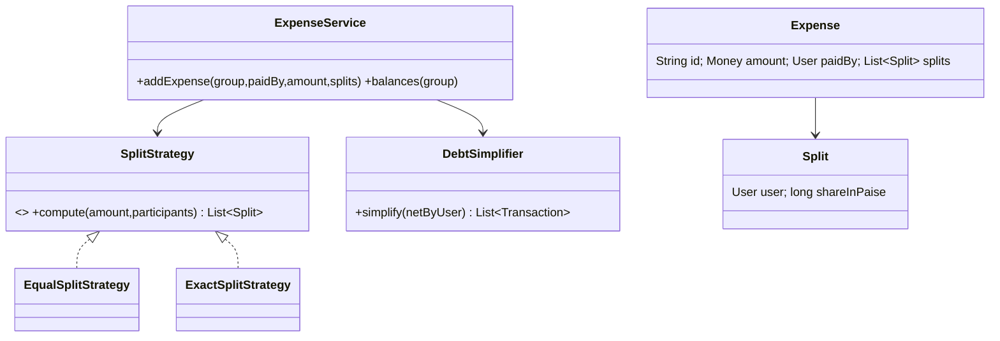

### 4. Main-flow sequence
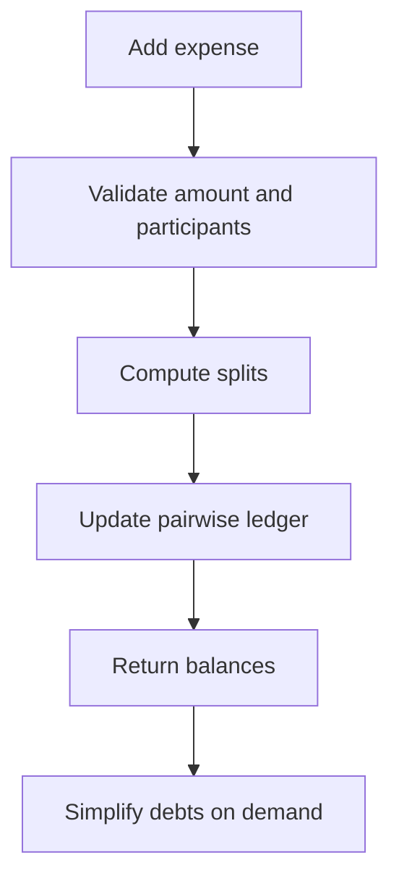

### 5. Design patterns used & why
Strategy for split algorithms; Repository for expenses; Value Object for Money to avoid double precision errors.

### 6. Complete, compilable Java code
```java
import java.util.*;
import java.util.stream.*;

public class SplitwiseDemo{
    record Split(String user,long paise){
    }

    record Txn(String from,String to,long paise){
    }

    interface SplitStrategy{
        List<Split> split(long amount,List<String> users);
    }

    static class EqualSplit implements SplitStrategy{
        public List<Split> split(long amount,List<String> users){
            long q=amount/users.size(),
            r=amount%users.size();
            List<Split> out=new ArrayList<>();
            for(int i=0;i<users.size();i++)out.add(new Split(users.get(i),q+(i<r?1:0)));
            return out;
        }
    }

    static class ExpenseService{
        private final Map<String,
        Long> net=new HashMap<>();
        void add(String paidBy,long amount,List<Split> splits){
            long sum=splits.stream().mapToLong(Split::paise).sum();
            if(sum!=amount)throw new IllegalArgumentException("bad split");
            net.merge(paidBy,amount,Long::sum);
            splits.forEach(s->net.merge(s.user(),-s.paise(),Long::sum));
        }

        List<Txn> simplify(){
            PriorityQueue<Split> cr=new PriorityQueue<>((a,b)->Long.compare(b.paise(),a.paise())),
            db=new PriorityQueue<>((a,b)->Long.compare(b.paise(),a.paise()));
            net.forEach((u,v)->{if(v>0)cr.add(new Split(u,v));else if(v<0)db.add(new Split(u,-v));});
            List<Txn> ans=new ArrayList<>();
            while(!cr.isEmpty()&&!db.isEmpty()){
                Split c=cr.poll(),
                d=db.poll();
                long x=Math.min(c.paise(),d.paise());
                ans.add(new Txn(d.user(),c.user(),x));
                if(c.paise()>x)cr.add(new Split(c.user(),c.paise()-x));
                if(d.paise()>x)db.add(new Split(d.user(),d.paise()-x));
            }
            return ans;
        }
    }

    public static void main(String[]a){
        var svc=new ExpenseService();
        svc.add("A",300,new EqualSplit().split(300,List.of("A","B","C")));
        System.out.println(svc.simplify());
    }
}
```

### 7. Thread-safety
Serialize balance updates per group using a group lock or DB transaction. Ledger insert and balance update must be atomic; idempotency key avoids duplicate expense creation.

### 8. Extensibility
- Add `PercentageSplitStrategy`.
- Add currencies using FX snapshots.
- Add settlements as negative expenses or dedicated payment records.
- Add group-level permissions.

### 9. JUnit 5 test examples
```java
import static org.junit.jupiter.api.Assertions.*;

import java.util.List;
import org.junit.jupiter.api.Test;

class SplitwiseDemoTest {
    @Test
    void simplifies() {
        var service = new SplitwiseDemo.ExpenseService();
        service.add("A", 300, new SplitwiseDemo.EqualSplit().split(300, List.of("A", "B", "C")));

        assertEquals(2, service.simplify().size());
    }

    @Test
    void equalSplitHandlesRemainder() {
        var splits = new SplitwiseDemo.EqualSplit().split(10, List.of("A", "B", "C"));

        assertEquals(List.of(4L, 3L, 3L), splits.stream().map(SplitwiseDemo.Split::paise).toList());
    }

    @Test
    void invalidSplitTotalFails() {
        var service = new SplitwiseDemo.ExpenseService();

        assertThrows(
                IllegalArgumentException.class,
                () -> service.add("A", 100, List.of(new SplitwiseDemo.Split("A", 90))));
    }
}
```

### 10. Interviewer follow-ups with short answers · Common mistakes
- *Why simplify debts?* → Converts many pairwise debts into minimal debtor-to-creditor transfers based on net balances.
- *Why paise not double?* → Exact arithmetic; doubles create rounding bugs.
- Mistakes: mutating historical expenses, ignoring unequal rounding, no audit trail.

## 3. Design Ride Booking / Uber
Tier 2 · SDE-2 must-know

### 0. Beginner primer

**Problem and mental model:** A rider requests a trip; the system finds an eligible nearby driver, one driver
accepts, and the ride advances through a lifecycle. `MatchingStrategy` ranks candidates, `RideService`
coordinates, and `Ride` owns status transitions.

**Recognition and flow:** Strategy fits replaceable matching/pricing. State fits
`REQUESTED → ACCEPTED → STARTED → COMPLETED/CANCELLED`. Validate request → query nearby available drivers →
rank/offer → atomically claim one driver → create ride → track transitions → calculate fare and settle.
First-accept wins must be a compare-and-set or conditional database update. At scale, partition location
indexes by region, expire stale driver locations, and separate real-time dispatch from trip history.

**Responsibility map:**

| Class or interface | Responsibility | Key methods and contract | Relationships |
| --- | --- | --- | --- |
| RideBookingDemo | Demo namespace and executable sample for ride matching. | main(String[] args) creates one driver and a RideService, requests a ride, prints the driver id, and propagates matching failures. | Owns location, driver, strategy, ride, and service types. |
| Location | Immutable two-dimensional point used for demo distance ranking. | dist(Location other) reads both locations and returns Euclidean distance; it mutates nothing and has no explicit failure path. | Stored on Driver and Ride and passed to MatchingStrategy. |
| RideStatus | Ride lifecycle marker. | Constants REQUESTED, ACCEPTED, STARTED, COMPLETED, and CANCELLED carry no methods; service code chooses the status. | Stored in Ride. |
| Driver | Mutable driver aggregate for availability and location. | Constructor Driver(id, loc) initializes id, loc, and available=true; no methods return values or throw explicitly. | Read by Nearest and mutated by RideService.request. |
| Ride | Immutable accepted ride snapshot. | Canonical record constructor takes id, rider, from, to, driver, and status; accessors return values; it mutates nothing and performs no validation. | Created by RideService after MatchingStrategy selects a Driver. |
| MatchingStrategy | Driver selection contract. | match(pickup, drivers) receives the pickup point and candidates, returns Optional<Driver>, mutates no service state, and represents no-match as Optional.empty. | Implemented by Nearest and called by RideService. |
| Nearest | Selects the closest available driver. | match(pickup, drivers) filters available drivers, returns the nearest by Location.dist, mutates nothing, and returns Optional.empty if none are available. | Implements MatchingStrategy and reads Driver availability. |
| RideService | Orchestrates ride request and driver claiming. | request(rider, from, to) is synchronized, asks the matcher for a driver, marks that driver unavailable, returns an ACCEPTED Ride, and throws NoSuchElementException when no driver is matched. | Holds Driver list and MatchingStrategy; creates Ride. |
| RideBookingDemoTest | JUnit 5 tests for matching and driver availability. | picksNearest, assignedDriverBecomesUnavailable, and unavailableDriversAreSkipped use local drivers and services, return void, and fail through assertions or Optional checks. | Exercises Nearest and RideService. |

### 1. Clarifying questions & requirements
- Riders request rides; nearby drivers receive offers; driver accepts; trip moves through lifecycle.
- Matching considers distance, rating, vehicle type, driver availability.
- Pricing can be fixed, distance-time, or surge-based.

### 2. Entities & relationships
Rider, Driver, Vehicle, Location, Ride, Fare, Payment; Driver has availability and current location.

### 3. Class diagram
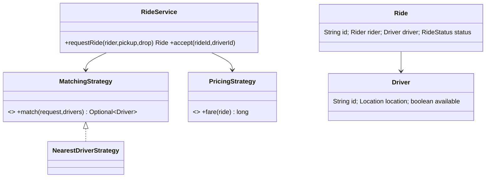

### 4. Main-flow sequence
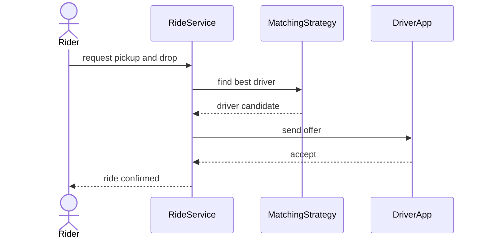

### 5. Design patterns used & why
Strategy for matching/pricing; State for ride status; Observer/EventBus for driver notifications.

### 6. Complete, compilable Java code
```java
import java.util.*;

public class RideBookingDemo{
    record Location(double x,double y){
        double dist(Location o){
            return Math.hypot(x-o.x,y-o.y);
        }
    }

    enum RideStatus{
        REQUESTED,
        ACCEPTED,
        STARTED,
        COMPLETED,
        CANCELLED
    }

    static class Driver{
        final String id;
        Location loc;
        boolean available=true;
        Driver(String id,Location loc){
            this.id=id;
            this.loc=loc;
        }
    }

    record Ride(String id,String rider,Location from,Location to,Driver driver,RideStatus status){
    }

    interface MatchingStrategy{
        Optional<Driver> match(Location pickup,List<Driver> drivers);
    }

    static class Nearest implements MatchingStrategy{
        public Optional<Driver> match(Location p,List<Driver>d){
            return d.stream().filter(x->x.available).min(Comparator.comparingDouble(x->x.loc.dist(p)));
        }
    }

    static class RideService{
        private final List<Driver> drivers;
        private final MatchingStrategy matcher;
        RideService(List<Driver>d,MatchingStrategy m){
            drivers=d;
            matcher=m;
        }

        synchronized Ride request(String rider,Location from,Location to){
            Driver driver=matcher.match(from,drivers).orElseThrow();
            driver.available=false;
            return new Ride(UUID.randomUUID().toString(),rider,from,to,driver,RideStatus.ACCEPTED);
        }
    }

    public static void main(String[]a){
        var svc=new RideService(new ArrayList<>(List.of(new Driver("d1",new Location(0,1)))),new Nearest());
        System.out.println(svc.request("r1",new Location(0,0),new Location(5,5)).driver.id);
    }
}
```

### 7. Thread-safety
Accepting a ride must atomically mark the driver unavailable. Use compare-and-set status or a DB conditional update: `where driver_id=? and status='AVAILABLE'`.

### 8. Extensibility
- Matching: nearest, highest-rated, least-cancelled, pooled ride.
- Pricing: base fare, surge, coupon.
- Dispatch: broadcast offers with timeout.
- Add fraud/risk checks before assignment.

### 9. JUnit 5 test examples
```java
import static org.junit.jupiter.api.Assertions.*;

import java.util.List;
import org.junit.jupiter.api.Test;

class RideBookingDemoTest {
    @Test
    void picksNearest() {
        var far = new RideBookingDemo.Driver("far", new RideBookingDemo.Location(9, 9));
        var near = new RideBookingDemo.Driver("near", new RideBookingDemo.Location(1, 1));
        var service = new RideBookingDemo.RideService(List.of(far, near), new RideBookingDemo.Nearest());

        assertEquals("near", service.request("r", new RideBookingDemo.Location(0, 0),
                new RideBookingDemo.Location(2, 2)).driver.id);
    }

    @Test
    void assignedDriverBecomesUnavailable() {
        var driver = new RideBookingDemo.Driver("d", new RideBookingDemo.Location(0, 0));
        var service = new RideBookingDemo.RideService(List.of(driver), new RideBookingDemo.Nearest());

        service.request("r", new RideBookingDemo.Location(0, 0), new RideBookingDemo.Location(2, 2));

        assertFalse(driver.available);
    }

    @Test
    void unavailableDriversAreSkipped() {
        var driver = new RideBookingDemo.Driver("d", new RideBookingDemo.Location(0, 0));
        driver.available = false;
        var service = new RideBookingDemo.RideService(List.of(driver), new RideBookingDemo.Nearest());

        assertThrows(RuntimeException.class, () -> service.request("r", new RideBookingDemo.Location(0, 0),
                new RideBookingDemo.Location(2, 2)));
    }
}
```

### 10. Interviewer follow-ups with short answers · Common mistakes
- *How to scale geo-search?* → Geohash/H3 buckets plus distance refinement.
- *What if driver ignores offer?* → Expire offer and try next candidate.
- Mistakes: one global synchronized matcher, no ride state validation, no idempotency for retries.

## 4. Design Food Delivery
Tier 2 · SDE-2 must-know

### 0. Beginner primer

**Problem and mental model:** A customer builds a restaurant-specific cart, places an order, pays, and
receives restaurant and delivery updates. `Order` is the aggregate; restaurant, payment, and delivery are
external collaborators coordinated by an application service.

**Recognition and flow:** State fits order lifecycle; Strategy fits fees and delivery assignment; Adapter
wraps payment/map providers. Validate menu snapshot → price cart → create pending order → authorize payment
→ restaurant accepts → assign courier → deliver → settle. A single synchronous transaction cannot include
all businesses; use idempotent steps, events, and compensation. Scale reads with cached menus and partition
writes by restaurant/region while preserving one authoritative order state.

**Responsibility map:**

| Class or interface | Responsibility | Key methods and contract | Relationships |
| --- | --- | --- | --- |
| FoodDeliveryDemo | Demo namespace and executable sample for order state transitions. | main(String[] args) places an order, transitions it to PAID, prints total and status, and propagates invalid-transition failures. | Owns order status, item, order, and service types. |
| Status | Food order lifecycle marker. | Constants CREATED, PAID, ACCEPTED, PREPARING, PICKED_UP, DELIVERED, CANCELLED, and REFUNDED carry no methods; OrderService.allowed defines legal movement. | Stored on Order and passed to OrderService.transition. |
| Item | Immutable order line. | Canonical record constructor receives id, qty, and price; accessors return values; it changes no state and performs no validation. | Stored inside Order. |
| Order | Mutable order aggregate with items and current status. | Constructor Order(items) copies input items, initializes a new id and CREATED status, and throws only if List.copyOf rejects invalid input. total() returns sum of qty times price and mutates nothing. | Created and stored by OrderService. |
| OrderService | Owns order placement and state transition rules. | place(items) creates and stores an Order, returns it, and mutates the orders map. transition(id, next) finds the order, validates the transition, mutates status, returns void, throws IllegalStateException for invalid movement, and may throw NullPointerException for an unknown id. allowed(current, next) returns the transition decision without mutating state. | Stores Order objects keyed by id and uses Status rules. |
| FoodDeliveryDemoTest | JUnit 5 tests for state and total invariants. | invalidTransitionFails, validTransitionUpdatesStatus, and totalUsesQuantityAndPrice create local orders, return void, and fail through assertions or expected exceptions. | Exercises Order and OrderService. |

### 1. Clarifying questions & requirements
- Customer browses restaurants/menu, places order, pays, restaurant accepts, delivery partner delivers.
- Track order lifecycle and cancellations/refunds.
- Inventory availability and delivery assignment may be separate services.

### 2. Entities & relationships
Customer, Restaurant, MenuItem, Cart, Order, OrderItem, Payment, DeliveryPartner.

### 3. Class diagram
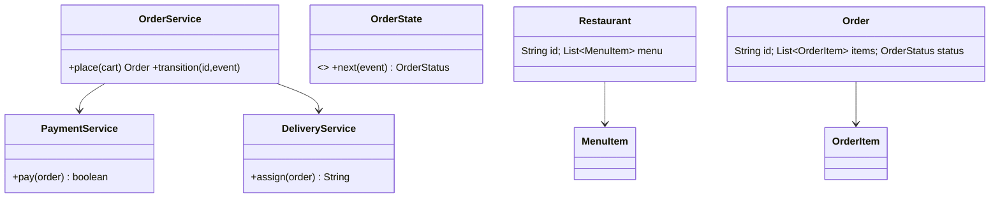

### 4. Main-flow state diagram
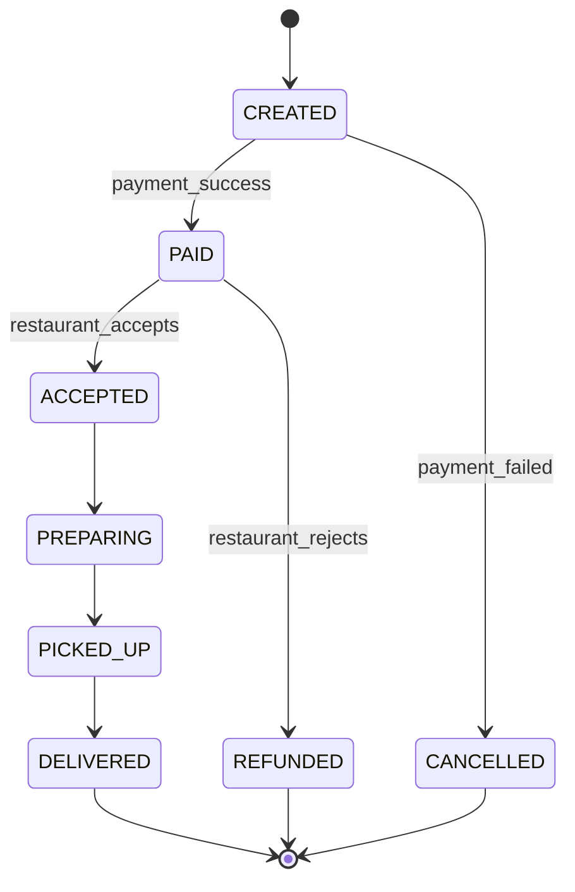

### 5. Design patterns used & why
State for lifecycle, Strategy for delivery assignment, Repository for order persistence, Observer for notifications.

### 6. Complete, compilable Java code
```java
import java.util.*;

public class FoodDeliveryDemo{
    enum Status{
        CREATED,
        PAID,
        ACCEPTED,
        PREPARING,
        PICKED_UP,
        DELIVERED,
        CANCELLED,
        REFUNDED
    }

    record Item(String id,int qty,long price){
    }

    static class Order{
        final String id=UUID.randomUUID().toString();
        final List<Item> items;
        Status status=Status.CREATED;
        Order(List<Item> items){
            this.items=List.copyOf(items);
        }

        long total(){
            return items.stream().mapToLong(i->i.qty()*i.price()).sum();
        }
    }

    static class OrderService{
        private final Map<String,
        Order> orders=new HashMap<>();
        Order place(List<Item> items){
            Order o=new Order(items);
            orders.put(o.id,o);
            return o;
        }

        void transition(String id,Status next){
            Order o=orders.get(id);
            if(!allowed(o.status,next))throw new IllegalStateException(o.status+"->"+next);
            o.status=next;
        }

        private boolean allowed(Status a,Status b){
            return switch(a){
                case CREATED->b==Status.PAID||b==Status.CANCELLED;
                case PAID->b==Status.ACCEPTED||b==Status.REFUNDED;
                case ACCEPTED->b==Status.PREPARING;
                case PREPARING->b==Status.PICKED_UP;
                case PICKED_UP->b==Status.DELIVERED;
                default->false;
            };
        }
    }

    public static void main(String[]a){
        var svc=new OrderService();
        Order o=svc.place(List.of(new Item("biryani",2,25000)));
        svc.transition(o.id,Status.PAID);
        System.out.println(o.total()+":"+o.status);
    }
}
```

### 7. Thread-safety
Order transitions should use optimistic locking on `order.version`. Restaurant menu updates and inventory decrement need transactions or reservation rows.

### 8. Extensibility
- Add scheduled orders and batch delivery.
- Add coupon and surge delivery fees.
- Add restaurant preparation SLA timers.
- Add refund workflow as saga.

### 9. JUnit 5 test examples
```java
import static org.junit.jupiter.api.Assertions.*;

import java.util.List;
import org.junit.jupiter.api.Test;

class FoodDeliveryDemoTest {
    @Test
    void invalidTransitionFails() {
        var service = new FoodDeliveryDemo.OrderService();
        var order = service.place(List.of(new FoodDeliveryDemo.Item("i", 1, 10)));

        assertThrows(IllegalStateException.class,
                () -> service.transition(order.id, FoodDeliveryDemo.Status.DELIVERED));
    }

    @Test
    void validTransitionUpdatesStatus() {
        var service = new FoodDeliveryDemo.OrderService();
        var order = service.place(List.of(new FoodDeliveryDemo.Item("i", 1, 10)));
        service.transition(order.id, FoodDeliveryDemo.Status.PAID);

        assertEquals(FoodDeliveryDemo.Status.PAID, order.status);
    }

    @Test
    void totalUsesQuantityAndPrice() {
        var order = new FoodDeliveryDemo.Order(List.of(new FoodDeliveryDemo.Item("i", 2, 25)));

        assertEquals(50, order.total());
    }
}
```

### 10. Interviewer follow-ups with short answers · Common mistakes
- *How to handle payment success but order write fails?* → Use idempotent order creation and payment callback reconciliation.
- *How to notify users?* → Publish order events; notification service subscribes.
- Mistakes: allowing arbitrary status updates, mixing menu entity with order snapshot, no cancellation policy.

## 5. Design Hotel / Meeting Room Booking & Calendar
Tier 2 · SDE-2 must-know

### 0. Beginner primer

**Problem and mental model:** A user searches a resource for a time interval and books it without overlap.
`Resource` is a room, `TimeRange` is a value object, `Booking` claims the interval, and the service protects
the no-overlap invariant.

**Recognition and flow:** Repository hides calendar storage; Strategy can choose available rooms or price
stays. Normalize the interval rule—usually `[start, end)`—then search candidates → recheck availability
inside a transaction → insert booking → return confirmation. “Check then insert” without one atomic
boundary double-books. At scale, partition by resource/property, index `(resource_id, start, end)`, and use
database exclusion constraints or ordered locking when available.

**Responsibility map:**

| Class or interface | Responsibility | Key methods and contract | Relationships |
| --- | --- | --- | --- |
| RoomBookingDemo | Demo namespace and executable sample for interval booking. | main(String[] args) creates a room, books a one-hour range, prints the booking id, and propagates availability failures. | Owns room, range, booking, and service types. |
| Room | Immutable bookable resource. | Canonical record constructor receives id and capacity; accessors return values; it mutates nothing and performs no validation. | Stored by BookingService and referenced by Booking. |
| Range | Immutable half-open time interval. | overlaps(Range other) returns true when two ranges intersect and false for back-to-back ranges; it mutates nothing and has no explicit failure path. | Used by BookingService.available and BookingService.book. |
| Booking | Immutable room reservation. | Canonical record constructor takes id, room, range, and user; accessors return values; it mutates nothing and performs no validation. | Created and stored by BookingService. |
| BookingService | Owns availability search and synchronized reservation creation. | available(range, capacity) returns rooms with enough capacity and no overlapping booking, mutating no state. book(room, range, user) is synchronized, verifies the room is still available, stores and returns a Booking, and throws IllegalStateException when unavailable. | Reads Room list and writes Booking list. |
| RoomBookingDemoTest | JUnit 5 tests for overlap and capacity behavior. | overlapRejected, backToBackBookingAllowed, and capacityFilterWorks create local ranges and rooms, return void, and fail through assertions or expected exceptions. | Exercises Range and BookingService. |

### 1. Clarifying questions & requirements
- Search available rooms/resources by time range and capacity.
- Create booking only if no overlapping confirmed booking exists.
- Calendar supports recurring meetings and attendee invites as extensions.

### 2. Entities & relationships
Hotel/Office has Rooms; Booking references Room, user, start, end; Calendar stores events and attendees.

### 3. Class diagram
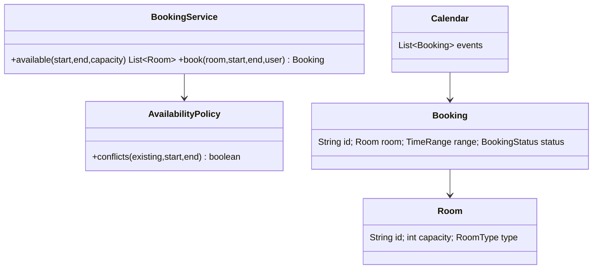

### 4. Main-flow sequence
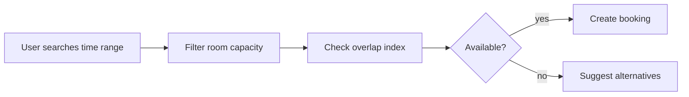

### 5. Design patterns used & why
Specification for filters, Strategy for pricing/availability policy, Value Object for time range.

### 6. Complete, compilable Java code
```java
import java.time.*;
import java.util.*;

public class RoomBookingDemo{
    record Room(String id,int capacity){
    }

    record Range(LocalDateTime start,LocalDateTime end){
        boolean overlaps(Range o){
            return start.isBefore(o.end)&&o.start.isBefore(end);
        }
    }

    record Booking(String id,Room room,Range range,String user){
    }

    static class BookingService{
        private final List<Room> rooms;
        private final List<Booking> bookings=new ArrayList<>();
        BookingService(List<Room> rooms){
            this.rooms=rooms;
        }

        List<Room> available(Range r,int cap){
            return rooms.stream()
                    .filter(x -> x.capacity()>=cap)
                    .filter(x -> bookings.stream()
                            .noneMatch(b -> b.room().equals(x)&&b.range().overlaps(r)))
                    .toList();
        }

        synchronized Booking book(Room room,Range r,String user){
            if(available(r,room.capacity()).stream().noneMatch(room::equals)) {
                throw new IllegalStateException("not available");
            }

            Booking b=new Booking(UUID.randomUUID().toString(),room,r,user);
            bookings.add(b);
            return b;
        }
    }

    public static void main(String[]a){
        Room r=new Room("R1",4);
        var s=new BookingService(List.of(r));
        System.out.println(s.book(
                r,new Range(LocalDateTime.now(),LocalDateTime.now().plusHours(1)),"u").id());
    }
}
```

### 7. Thread-safety
Guard availability check plus insert with one transaction. Add exclusion constraints in PostgreSQL for time ranges or unique bucket locks to prevent race conditions.

### 8. Extensibility
- Recurrence rules with generated occurrences.
- Waitlist and auto-suggest next slot.
- Amenities filter.
- Cancellation policy and partial refunds for hotels.

### 9. JUnit 5 test examples
```java
import static org.junit.jupiter.api.Assertions.*;

import java.time.LocalDateTime;
import java.util.List;
import org.junit.jupiter.api.Test;

class RoomBookingDemoTest {
    @Test
    void overlapRejected() {
        var room = new RoomBookingDemo.Room("R", 2);
        var service = new RoomBookingDemo.BookingService(List.of(room));
        var range = new RoomBookingDemo.Range(LocalDateTime.now(), LocalDateTime.now().plusHours(1));
        service.book(room, range, "u");

        assertThrows(IllegalStateException.class, () -> service.book(room, range, "v"));
    }

    @Test
    void backToBackBookingAllowed() {
        var room = new RoomBookingDemo.Room("R", 2);
        var service = new RoomBookingDemo.BookingService(List.of(room));
        var now = LocalDateTime.now();
        service.book(room, new RoomBookingDemo.Range(now, now.plusHours(1)), "u");

        assertDoesNotThrow(() -> service.book(
                room, new RoomBookingDemo.Range(now.plusHours(1), now.plusHours(2)), "v"));
    }

    @Test
    void capacityFilterWorks() {
        var small = new RoomBookingDemo.Room("S", 2);
        var large = new RoomBookingDemo.Room("L", 8);
        var service = new RoomBookingDemo.BookingService(List.of(small, large));
        var range = new RoomBookingDemo.Range(LocalDateTime.now(), LocalDateTime.now().plusHours(1));

        assertEquals(List.of(large), service.available(range, 5));
    }
}
```

### 10. Interviewer follow-ups with short answers · Common mistakes
- *Overlap formula?* → `start < existingEnd && existingStart < end`.
- *How to support recurring meetings?* → Store RRULE plus materialized occurrences for near-term search.
- Mistakes: using inclusive end incorrectly, check-then-insert race, no timezone handling.

## 6. Design Inventory & Order Management
Tier 2 · SDE-2 must-know

### 0. Beginner primer

**Problem and mental model:** Orders reserve stock, later confirm or release it, and must never make
available inventory negative. Track `onHand`, `reserved`, and `available = onHand - reserved`; reservations
are leases tied to an order.

**Recognition and flow:** State fits order/reservation lifecycle; Repository hides inventory storage;
Strategy fits warehouse selection. Validate quantities → reserve every Stock Keeping Unit (SKU) atomically
→ create order → confirm payment and deduct, or release on failure/expiry. Reserving items one by one without
rollback leaves partial state. Production uses conditional updates, ordered row locks for multiple SKUs,
idempotency, an outbox for events, and reconciliation against warehouse systems.

**Responsibility map:**

| Class or interface | Responsibility | Key methods and contract | Relationships |
| --- | --- | --- | --- |
| InventoryOrderDemo | Demo namespace and executable sample for stock reservation and order placement. | main(String[] args) creates seeded inventory, places a paid order, prints it, and propagates stock failures. | Owns line, status, order, inventory, and order service types. |
| Line | Immutable order line by Stock Keeping Unit (SKU). | Canonical record constructor receives sku and qty; accessors return values; it mutates nothing and performs no validation. | Passed to InventoryService and stored in Order. |
| Status | Order outcome marker. | Constants CREATED, CONFIRMED, and CANCELLED carry no methods; OrderService chooses final status. | Stored in Order. |
| Order | Immutable order result. | Canonical record constructor takes id, lines, and status; accessors return values; it mutates nothing and performs no validation. | Returned by OrderService.place. |
| InventoryService | Owns available stock counts and reservation reversal. | reserve(lines) is synchronized, verifies every SKU has enough stock before decrementing, returns void, and throws IllegalStateException if any item is short. release(lines) is synchronized, increments stock back, and returns void. stock(sku) returns current available units and mutates nothing. | Used by OrderService and stores counts in a concurrent map. |
| OrderService | Orchestrates reserve, payment result, and final order status. | place(lines, paymentOk) reserves stock, releases and returns CANCELLED when paymentOk is false, returns CONFIRMED when true, and propagates reserve failures. | Depends on InventoryService and creates Order records. |
| InventoryOrderDemoTest | JUnit 5 tests for oversell and release behavior. | noOversell, paymentFailureReleasesStock, and successfulOrderConsumesStock create local inventory, return void, and fail through assertions or expected exceptions. | Exercises InventoryService and OrderService. |

### 1. Clarifying questions & requirements
- Products have SKU inventory in warehouses; orders reserve stock, payment confirms, shipment consumes.
- Avoid overselling; support cancellations and returns.
- Split shipment across warehouses is optional extension.

### 2. Entities & relationships
Product 1-* SKU; Warehouse has InventoryItem; Order has OrderItems and Reservation records.

### 3. Class diagram
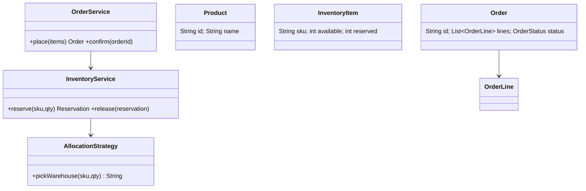

### 4. Main-flow sequence
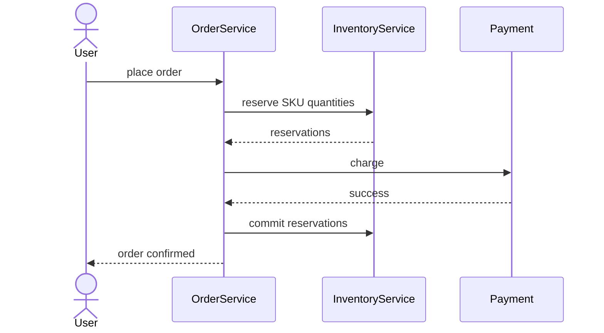

### 5. Design patterns used & why
Strategy for warehouse allocation; Saga for reserve-pay-confirm workflow; Repository for inventory rows.

### 6. Complete, compilable Java code
```java
import java.util.*;
import java.util.concurrent.*;

public class InventoryOrderDemo{
    record Line(String sku,int qty){
    }

    enum Status{
        CREATED,
        CONFIRMED,
        CANCELLED
    }

    record Order(String id,List<Line> lines,Status status){
    }

    static class InventoryService{
        private final Map<String,
        Integer> available=new ConcurrentHashMap<>();
        InventoryService(Map<String,Integer> seed){
            available.putAll(seed);
        }

        synchronized void reserve(List<Line> lines){
            for(Line l:lines) {
                if(available.getOrDefault(l.sku(),0)<l.qty()) {
                    throw new IllegalStateException("no stock "+l.sku());
                }
            }

            for(Line l:lines)available.merge(l.sku(),-l.qty(),Integer::sum);
        }

        synchronized void release(List<Line> lines){
            for(Line l:lines)available.merge(l.sku(),l.qty(),Integer::sum);
        }

        int stock(String sku){
            return available.getOrDefault(sku,0);
        }
    }

    static class OrderService{
        private final InventoryService inv;
        OrderService(InventoryService inv){
            this.inv=inv;
        }

        Order place(List<Line> lines,boolean paymentOk){
            inv.reserve(lines);
            if(!paymentOk){
                inv.release(lines);
                return new Order(UUID.randomUUID().toString(),lines,Status.CANCELLED);
            }

            return new Order(UUID.randomUUID().toString(),lines,Status.CONFIRMED);
        }
    }

    public static void main(String[]a){
        var inv=new InventoryService(Map.of("SKU1",5));
        System.out.println(new OrderService(inv).place(List.of(new Line("SKU1",2)),true));
    }
}
```

### 7. Thread-safety
Use conditional SQL update: `available >= qty`, then decrement. For multiple SKUs lock in sorted SKU order to avoid deadlocks.

### 8. Extensibility
- Backorders and preorders.
- Multi-warehouse allocation strategy.
- Return/refund flow.
- Low-stock events to procurement.

### 9. JUnit 5 test examples
```java
import static org.junit.jupiter.api.Assertions.*;

import java.util.List;
import java.util.Map;
import org.junit.jupiter.api.Test;

class InventoryOrderDemoTest {
    @Test
    void noOversell() {
        var inventory = new InventoryOrderDemo.InventoryService(Map.of("S", 1));
        var orders = new InventoryOrderDemo.OrderService(inventory);
        orders.place(List.of(new InventoryOrderDemo.Line("S", 1)), true);

        assertThrows(IllegalStateException.class,
                () -> orders.place(List.of(new InventoryOrderDemo.Line("S", 1)), true));
    }

    @Test
    void paymentFailureReleasesStock() {
        var inventory = new InventoryOrderDemo.InventoryService(Map.of("S", 2));
        new InventoryOrderDemo.OrderService(inventory).place(
                List.of(new InventoryOrderDemo.Line("S", 1)), false);

        assertEquals(2, inventory.stock("S"));
    }

    @Test
    void successfulOrderConsumesStock() {
        var inventory = new InventoryOrderDemo.InventoryService(Map.of("S", 2));
        new InventoryOrderDemo.OrderService(inventory).place(
                List.of(new InventoryOrderDemo.Line("S", 1)), true);

        assertEquals(1, inventory.stock("S"));
    }
}
```

### 10. Interviewer follow-ups with short answers · Common mistakes
- *Why reserve before payment?* → Prevents selling unavailable stock while payment is in progress.
- *How to handle payment timeout?* → Reservation TTL and release job.
- Mistakes: decrementing after payment only, no compensation, no deadlock ordering.

## 7. Design Shopping Cart + Coupon Engine
Tier 2 · SDE-2 must-know

### 0. Beginner primer

**Problem and mental model:** A cart stores intended purchases; a pricing pipeline calculates item totals,
discounts, tax, and final payable amount. Coupons are rules plus benefits, not `if` statements inside Cart.

**Recognition and flow:** Strategy fits discount calculations; Specification fits composable eligibility
rules; Chain or Pipeline fits ordered adjustments. Load current product prices → validate cart → evaluate
coupon eligibility → resolve stacking order → calculate discount/tax → return an immutable quote. Never
trust stale client totals at checkout. A switch is simpler for two permanent coupon types; a rule engine is
justified only when business users need many changing rules. Cache product reads, version promotion rules,
and preserve the applied-rule audit on the order.

**Responsibility map:**

| Class or interface | Responsibility | Key methods and contract | Relationships |
| --- | --- | --- | --- |
| CartCouponDemo | Demo namespace and executable sample for cart pricing. | main(String[] args) creates a cart and percent coupon, prints the priced total, and propagates validation failures. | Owns item, cart, coupon, discount, validator, and pricing service types. |
| Item | Immutable priced cart line. | Canonical record constructor receives sku, qty, and price; accessors return values; it mutates nothing and performs no validation. | Stored inside Cart. |
| Cart | Immutable cart wrapper with subtotal calculation. | subtotal() returns sum of qty times price across items and mutates nothing; the record constructor stores the provided item list reference. | Read by Validator and PricingService. |
| Coupon | Immutable coupon definition. | Canonical record constructor takes code, minSubtotal, and Discount; accessors return values; it mutates nothing and performs no validation. | Consumed by validators and PricingService. |
| Discount | Pluggable discount calculation contract. | amount(subtotal) receives the current discountable subtotal, returns a discount amount, mutates no shared state, and defines no failure behavior by itself. | Implemented by Percent and Flat, referenced by Coupon. |
| Percent | Percentage discount implementation. | Constructor Percent(pct) stores the percent. amount(subtotal) returns subtotal times pct divided by 100, mutates nothing, and uses integer truncation. | Implements Discount and is held by Coupon. |
| Flat | Fixed-value discount implementation. | Constructor Flat(value) stores the cap. amount(subtotal) returns the smaller of value and subtotal, mutates nothing, and never discounts below zero by itself. | Implements Discount and is held by Coupon. |
| Validator | Coupon eligibility contract. | validate(cart, coupon) returns void when eligible, mutates no shared state, and throws an implementation-specific exception when invalid. | Implemented by MinSubtotalValidator and used by PricingService. |
| MinSubtotalValidator | Enforces coupon minimum subtotal. | validate(cart, coupon) compares Cart.subtotal to coupon.minSubtotal, returns void when eligible, and throws IllegalArgumentException when the cart is too small. | Implements Validator and reads Cart and Coupon. |
| PricingService | Applies validators and discounts to produce the final payable total. | total(cart, coupons) computes subtotal, validates each coupon, accumulates discounts against remaining subtotal, returns at least zero, mutates no service state, and propagates validation failures. | Uses Validator list plus each Coupon's Discount. |
| CartCouponDemoTest | JUnit 5 tests for coupon math and validation. | appliesPercent, flatDiscountIsCappedAtSubtotal, and minimumSubtotalIsValidated create local carts and coupons, return void, and fail through assertions or expected exceptions. | Exercises PricingService, Discount, and Validator implementations. |

### 1. Clarifying questions & requirements
- Cart supports add/remove/update items, price snapshot, coupons, taxes, shipping.
- Coupon rules: min cart value, category, user segment, one-time usage, best discount.
- Multiple discounts may chain in a defined order.

### 2. Entities & relationships
Cart has CartItems; Product has category/price; Coupon has condition and discount strategy; Checkout creates Order.

### 3. Class diagram
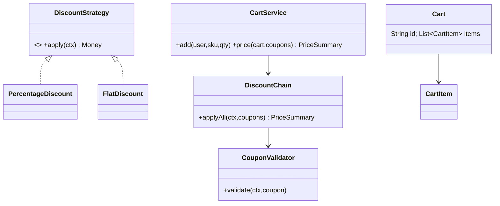

### 4. Main-flow sequence
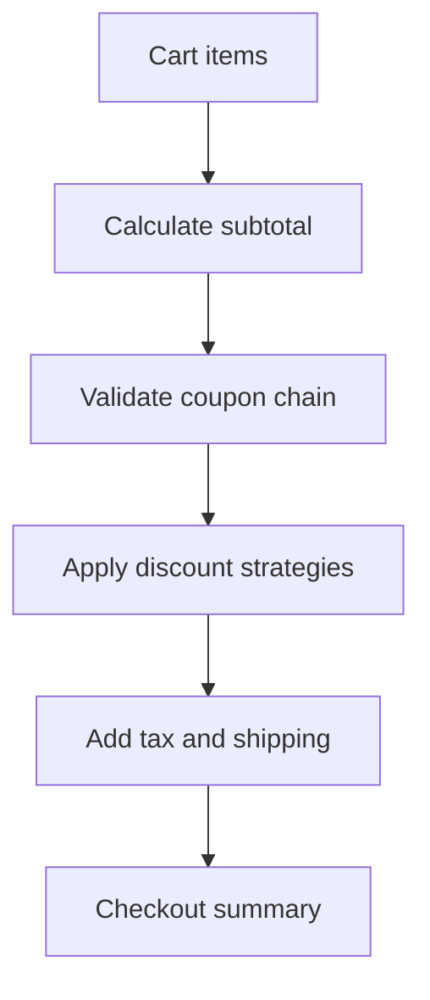

### 5. Design patterns used & why
Strategy for discount calculation; Chain of Responsibility for validators; Specification for coupon eligibility.

### 6. Complete, compilable Java code
```java
import java.util.*;

public class CartCouponDemo{
    record Item(String sku,int qty,long price){
    }

    record Cart(List<Item> items){
        long subtotal(){
            return items.stream().mapToLong(i->i.qty()*i.price()).sum();
        }
    }

    record Coupon(String code,long minSubtotal,Discount discount){
    }

    interface Discount{
        long amount(long subtotal);
    }

    static class Percent implements Discount{
        final int pct;
        Percent(int pct){
            this.pct=pct;
        }

        public long amount(long subtotal){
            return subtotal*pct/100;
        }
    }

    static class Flat implements Discount{
        final long value;
        Flat(long value){
            this.value=value;
        }

        public long amount(long subtotal){
            return Math.min(value,subtotal);
        }
    }

    interface Validator{
        void validate(Cart c,Coupon cp);
    }

    static class MinSubtotalValidator implements Validator{
        public void validate(Cart c,Coupon cp){
            if(c.subtotal()<cp.minSubtotal())throw new IllegalArgumentException("min subtotal");
        }
    }

    static class PricingService{
        private final List<Validator> validators=List.of(new MinSubtotalValidator());
        long total(Cart c,List<Coupon> coupons){
            long sub=c.subtotal(),
            discount=0;
            for(Coupon cp:coupons){
                validators.forEach(v->v.validate(c,cp));
                discount+=cp.discount().amount(sub-discount);
            }

            return Math.max(0,sub-discount);
        }
    }

    public static void main(String[]a){
        var c=new Cart(List.of(new Item("S",2,1000)));
        System.out.println(new PricingService().total(c,List.of(new Coupon("P10",1000,new Percent(10)))));
    }
}
```

### 7. Thread-safety
Cart updates can be per-user synchronized or optimistic-versioned. Coupon redemption must atomically decrement usage and enforce unique `(user_id, coupon_id)` for one-time coupons.

### 8. Extensibility
- Add BOGO, category, bank-card offers.
- Add best-coupon optimizer.
- Add tax by region.
- Add promotion calendar with start/end time.

### 9. JUnit 5 test examples
```java
import static org.junit.jupiter.api.Assertions.*;

import java.util.List;
import org.junit.jupiter.api.Test;

class CartCouponDemoTest {
    @Test
    void appliesPercent() {
        var cart = new CartCouponDemo.Cart(List.of(new CartCouponDemo.Item("A", 1, 1000)));
        var coupon = new CartCouponDemo.Coupon("C", 0, new CartCouponDemo.Percent(10));

        assertEquals(900, new CartCouponDemo.PricingService().total(cart, List.of(coupon)));
    }

    @Test
    void flatDiscountIsCappedAtSubtotal() {
        var cart = new CartCouponDemo.Cart(List.of(new CartCouponDemo.Item("A", 1, 500)));
        var coupon = new CartCouponDemo.Coupon("F", 0, new CartCouponDemo.Flat(1000));

        assertEquals(0, new CartCouponDemo.PricingService().total(cart, List.of(coupon)));
    }

    @Test
    void minimumSubtotalIsValidated() {
        var cart = new CartCouponDemo.Cart(List.of(new CartCouponDemo.Item("A", 1, 500)));
        var coupon = new CartCouponDemo.Coupon("MIN", 1000, new CartCouponDemo.Flat(100));

        assertThrows(IllegalArgumentException.class,
                () -> new CartCouponDemo.PricingService().total(cart, List.of(coupon)));
    }
}
```

### 10. Interviewer follow-ups with short answers · Common mistakes
- *How to support coupon stacking?* → Define deterministic chain order and whether each coupon applies on original or discounted subtotal.
- *How to prevent coupon abuse?* → Usage ledger, idempotency keys, fraud checks.
- Mistakes: hardcoding if-else coupons, using floating money, no validation chain.

## Revision Cheat Sheet
- BookMyShow: lock with TTL, confirm idempotently, DB unique row is final guard.
- Splitwise: store immutable expenses; derive balances; simplify with two heaps.
- Ride booking: matching and pricing are strategies; driver assignment must be atomic.
- Food delivery: state machine prevents illegal order jumps; use events for notifications.
- Booking/calendar: overlap is `start < end2 && start2 < end`; transaction wraps check and insert.
- Inventory: reserve before payment, release on failure, sorted locks for multi-SKU orders.
- Cart/coupons: Strategy calculates discount; Chain validates coupon eligibility.
- Prefer Money in paise/cents, value objects, repositories, and idempotency keys.
- For distributed concurrency, JVM locks are insufficient; use DB constraints or transactional updates.
- Keep driver demos small but prove core behavior.

## Flashcards
- Q: Why does BookMyShow need lock TTL? → A: To release seats abandoned during payment.
- Q: Best DB guard against double booking? → A: Unique `(show_id, seat_id)` booking row or row lock/version check.
- Q: Splitwise simplify algorithm? → A: Match max debtors to max creditors using two heaps.
- Q: Ride matching extension point? → A: `MatchingStrategy`.
- Q: Food delivery lifecycle pattern? → A: State machine/State pattern.
- Q: Correct interval overlap check? → A: `a.start < b.end && b.start < a.end`.
- Q: Inventory oversell prevention? → A: Conditional decrement inside transaction.
- Q: Coupon engine patterns? → A: Strategy plus Chain of Responsibility.
- Q: Why store order item price snapshot? → A: Menu/product price may change later.
- Q: Why avoid double for money? → A: Precision and rounding errors.
- Q: How to make retry safe? → A: Idempotency key and unique request record.
- Q: Where do events help? → A: Notifications, audit, async workflows, reconciliation.
