# 10d · LLD Problems Tier 2 Part 1

SDE-2 machine-coding designs with compact, runnable Java 17 sketches, diagrams, tests, and follow-ups. Use these as interview blueprints: clarify first, code the core flow, then discuss concurrency and extensions.

**Legend:** 🟢 Beginner · 🟡 Intermediate · 🔴 Advanced · ⚫ FAANG · 🔥 = very frequently asked

## Table of Contents
- [1. Design BookMyShow](#1-design-bookmyshow)
- [2. Design Splitwise](#2-design-splitwise)
- [3. Design Ride Booking / Uber](#3-design-ride-booking--uber)
- [4. Design Food Delivery](#4-design-food-delivery)
- [5. Design Hotel / Meeting Room Booking & Calendar](#5-design-hotel--meeting-room-booking--calendar)
- [6. Design Inventory & Order Management](#6-design-inventory--order-management)
- [7. Design Shopping Cart + Coupon Engine](#7-design-shopping-cart--coupon-engine)
- [Revision Cheat Sheet](#revision-cheat-sheet)
- [Flashcards](#flashcards)

## 1. Design BookMyShow
Tier 2 · SDE-2 must-know

### 1. Clarifying questions & requirements
- Cities, movies, theatres, shows, seats; users search shows and book contiguous/selected seats.
- Seat lock expires after a TTL; only locked seats can be confirmed by that user.
- Avoid double booking under concurrent clicks; payment may fail and release seats.
- Scale read-heavy search separately from write-heavy booking.

### 2. Entities & relationships
City 1-* Theatre 1-* Screen 1-* Seat; Movie 1-* Show; Show 1-* ShowSeat; Booking owns booked seats and payment.

### 3. Class diagram
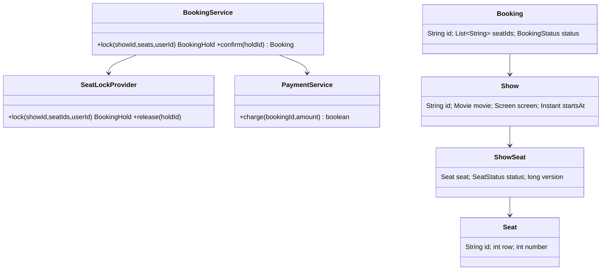

### 4. Main-flow sequence
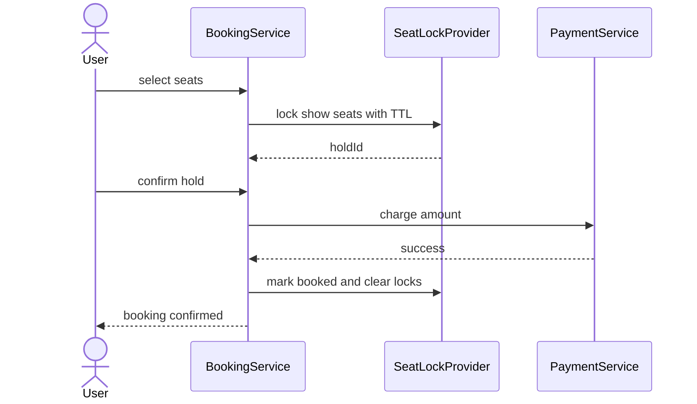

### 5. Design patterns used & why
- Repository for ShowSeat/Booking persistence.
- Strategy for pricing and seat-selection suggestions.
- State for seat lifecycle: AVAILABLE → LOCKED → BOOKED.

### 6. Complete, compilable Java code
```java
import java.time.*;
import java.util.*;
import java.util.concurrent.*;

public class BookMyShowDemo{
    enum SeatStatus{
        AVAILABLE,
        LOCKED,
        BOOKED
    }

    record Hold(String id,String showId,List<String> seats,String user,Instant expiresAt){
    }

    static class SeatLockProvider{
        private final Map<String,
        SeatStatus> seatStatus=new ConcurrentHashMap<>();
        private final Map<String,
        Hold> holds=new ConcurrentHashMap<>();
        private final Duration ttl=Duration.ofMinutes(2);
        SeatLockProvider(Collection<String> seats){
            // Demo keeps valid seat ids outside this snippet; status is tracked per show-seat key.
        }

        synchronized Hold lock(String showId,List<String> seats,String user){
            cleanup();
            for(String s:seats) {
                if(seatStatus.getOrDefault(key(showId,s),SeatStatus.AVAILABLE)!=SeatStatus.AVAILABLE) {
                    throw new IllegalStateException("seat unavailable "+s);
                }
            }

            seats.forEach(s->seatStatus.put(key(showId,s),SeatStatus.LOCKED));
            Hold h=new Hold(
                    UUID.randomUUID().toString(),showId,List.copyOf(seats),user,Instant.now().plus(ttl));
            holds.put(h.id(),h);
            return h;
        }

        synchronized void confirm(String holdId,String user){
            cleanup();
            Hold h=Optional.ofNullable(holds.get(holdId)).orElseThrow();
            if(!h.user().equals(user)||Instant.now().isAfter(h.expiresAt())) {
                throw new IllegalStateException("invalid hold");
            }

            h.seats().forEach(s->seatStatus.put(key(h.showId(),s),SeatStatus.BOOKED));
            holds.remove(holdId);
        }

        synchronized void release(String holdId){
            Hold h=holds.remove(holdId);
            if(h!=null) {
                h.seats().forEach(s -> seatStatus.computeIfPresent(
                        key(h.showId(),s),(k,v) -> v==SeatStatus.LOCKED ? SeatStatus.AVAILABLE : v));
            }
        }

        private void cleanup(){
            Instant now=Instant.now();
            new ArrayList<>(holds.values()).stream()
                    .filter(h -> now.isAfter(h.expiresAt()))
                    .forEach(h -> release(h.id()));
        }

        private String key(String showId,String seatId){
            return showId+":"+seatId;
        }
    }

    static class BookingService{
        private final SeatLockProvider locks;
        BookingService(SeatLockProvider locks){
            this.locks=locks;
        }

        Hold hold(List<String> seats,String user){
            return locks.lock("show1",seats,user);
        }

        String confirm(String holdId,String user){
            locks.confirm(holdId,user);
            return "BOOKED:"+holdId;
        }
    }

    public static void main(String[]a)throws Exception{
        var svc=new BookingService(new SeatLockProvider(List.of("A1","A2")));
        Hold h=svc.hold(List.of("A1"),"u1");
        System.out.println(svc.confirm(h.id(),"u1"));
    }
}
```

### 7. Thread-safety
Use per-show locks or DB transactions on `(show_id, seat_id)` rows. For distributed systems prefer `SELECT ... FOR UPDATE`, optimistic version checks, or unique `booking_seat(show_id, seat_id)` inserts over JVM-only locks.

### 8. Extensibility
- Add seat recommendation with a `SeatSelectionStrategy`.
- Add dynamic pricing with `PricingStrategy`.
- Add outbox events for ticket email/SMS.
- Add Redis locks only with fencing tokens or DB verification.

### 9. JUnit 5 test examples
```java
import static org.junit.jupiter.api.Assertions.*;

import java.util.List;
import org.junit.jupiter.api.Test;

class BookMyShowDemoTest {
    @Test
    void cannotDoubleLock() {
        var provider = new BookMyShowDemo.SeatLockProvider(List.of("A1"));
        provider.lock("s", List.of("A1"), "u1");

        assertThrows(IllegalStateException.class, () -> provider.lock("s", List.of("A1"), "u2"));
    }

    @Test
    void releaseAllowsRelock() {
        var provider = new BookMyShowDemo.SeatLockProvider(List.of("A1"));
        var hold = provider.lock("s", List.of("A1"), "u1");
        provider.release(hold.id());

        assertDoesNotThrow(() -> provider.lock("s", List.of("A1"), "u2"));
    }

    @Test
    void confirmMakesSeatUnavailable() {
        var provider = new BookMyShowDemo.SeatLockProvider(List.of("A1"));
        var hold = provider.lock("s", List.of("A1"), "u1");
        provider.confirm(hold.id(), "u1");

        assertThrows(IllegalStateException.class, () -> provider.lock("s", List.of("A1"), "u2"));
    }
}
```

### 10. Interviewer follow-ups with short answers · Common mistakes
- *How to prevent double booking across servers?* → DB unique constraints/row locks are authoritative; cache locks are only fast-path.
- *What if payment fails?* → Release hold and emit failure event.
- Mistakes: storing seat status only in memory, no lock TTL, not making confirmation idempotent.

## 2. Design Splitwise
Tier 2 · SDE-2 must-know

### 1. Clarifying questions & requirements
- Groups, users, expenses; split equally, exact, or percentage.
- Show balances between users and simplify debts inside a group.
- Validate split totals; support audit history, not destructive balance-only updates.

### 2. Entities & relationships
User belongs to Group; Expense has paidBy, amount, and Split rows; BalanceSheet stores net pairwise balances.

### 3. Class diagram
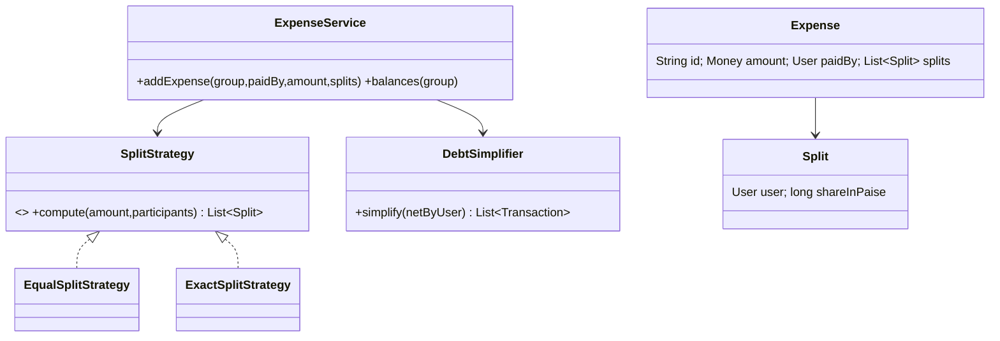

### 4. Main-flow sequence
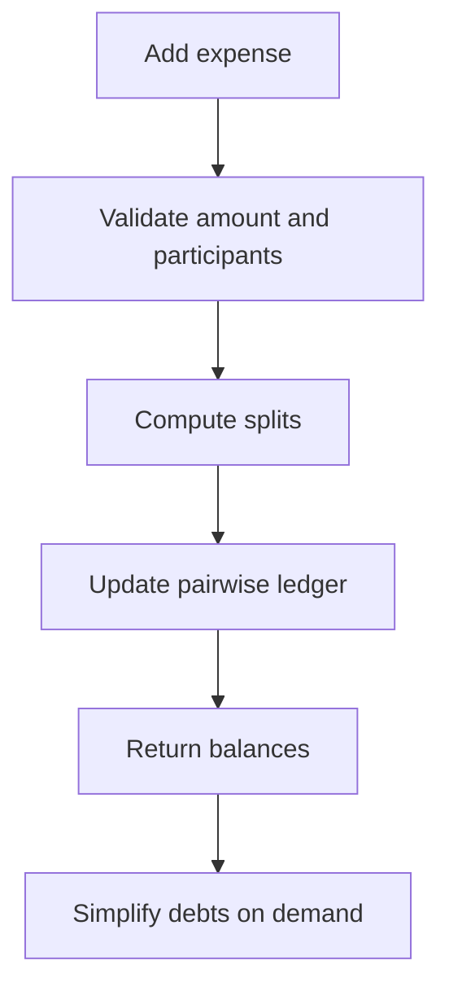

### 5. Design patterns used & why
Strategy for split algorithms; Repository for expenses; Value Object for Money to avoid double precision errors.

### 6. Complete, compilable Java code
```java
import java.util.*;
import java.util.stream.*;

public class SplitwiseDemo{
    record Split(String user,long paise){
    }

    record Txn(String from,String to,long paise){
    }

    interface SplitStrategy{
        List<Split> split(long amount,List<String> users);
    }

    static class EqualSplit implements SplitStrategy{
        public List<Split> split(long amount,List<String> users){
            long q=amount/users.size(),
            r=amount%users.size();
            List<Split> out=new ArrayList<>();
            for(int i=0;i<users.size();i++)out.add(new Split(users.get(i),q+(i<r?1:0)));
            return out;
        }
    }

    static class ExpenseService{
        private final Map<String,
        Long> net=new HashMap<>();
        void add(String paidBy,long amount,List<Split> splits){
            long sum=splits.stream().mapToLong(Split::paise).sum();
            if(sum!=amount)throw new IllegalArgumentException("bad split");
            net.merge(paidBy,amount,Long::sum);
            splits.forEach(s->net.merge(s.user(),-s.paise(),Long::sum));
        }

        List<Txn> simplify(){
            PriorityQueue<Split> cr=new PriorityQueue<>((a,b)->Long.compare(b.paise(),a.paise())),
            db=new PriorityQueue<>((a,b)->Long.compare(b.paise(),a.paise()));
            net.forEach((u,v)->{if(v>0)cr.add(new Split(u,v));else if(v<0)db.add(new Split(u,-v));});
            List<Txn> ans=new ArrayList<>();
            while(!cr.isEmpty()&&!db.isEmpty()){
                Split c=cr.poll(),
                d=db.poll();
                long x=Math.min(c.paise(),d.paise());
                ans.add(new Txn(d.user(),c.user(),x));
                if(c.paise()>x)cr.add(new Split(c.user(),c.paise()-x));
                if(d.paise()>x)db.add(new Split(d.user(),d.paise()-x));
            }
            return ans;
        }
    }

    public static void main(String[]a){
        var svc=new ExpenseService();
        svc.add("A",300,new EqualSplit().split(300,List.of("A","B","C")));
        System.out.println(svc.simplify());
    }
}
```

### 7. Thread-safety
Serialize balance updates per group using a group lock or DB transaction. Ledger insert and balance update must be atomic; idempotency key avoids duplicate expense creation.

### 8. Extensibility
- Add `PercentageSplitStrategy`.
- Add currencies using FX snapshots.
- Add settlements as negative expenses or dedicated payment records.
- Add group-level permissions.

### 9. JUnit 5 test examples
```java
import static org.junit.jupiter.api.Assertions.*;

import java.util.List;
import org.junit.jupiter.api.Test;

class SplitwiseDemoTest {
    @Test
    void simplifies() {
        var service = new SplitwiseDemo.ExpenseService();
        service.add("A", 300, new SplitwiseDemo.EqualSplit().split(300, List.of("A", "B", "C")));

        assertEquals(2, service.simplify().size());
    }

    @Test
    void equalSplitHandlesRemainder() {
        var splits = new SplitwiseDemo.EqualSplit().split(10, List.of("A", "B", "C"));

        assertEquals(List.of(4L, 3L, 3L), splits.stream().map(SplitwiseDemo.Split::paise).toList());
    }

    @Test
    void invalidSplitTotalFails() {
        var service = new SplitwiseDemo.ExpenseService();

        assertThrows(
                IllegalArgumentException.class,
                () -> service.add("A", 100, List.of(new SplitwiseDemo.Split("A", 90))));
    }
}
```

### 10. Interviewer follow-ups with short answers · Common mistakes
- *Why simplify debts?* → Converts many pairwise debts into minimal debtor-to-creditor transfers based on net balances.
- *Why paise not double?* → Exact arithmetic; doubles create rounding bugs.
- Mistakes: mutating historical expenses, ignoring unequal rounding, no audit trail.

## 3. Design Ride Booking / Uber
Tier 2 · SDE-2 must-know

### 1. Clarifying questions & requirements
- Riders request rides; nearby drivers receive offers; driver accepts; trip moves through lifecycle.
- Matching considers distance, rating, vehicle type, driver availability.
- Pricing can be fixed, distance-time, or surge-based.

### 2. Entities & relationships
Rider, Driver, Vehicle, Location, Ride, Fare, Payment; Driver has availability and current location.

### 3. Class diagram
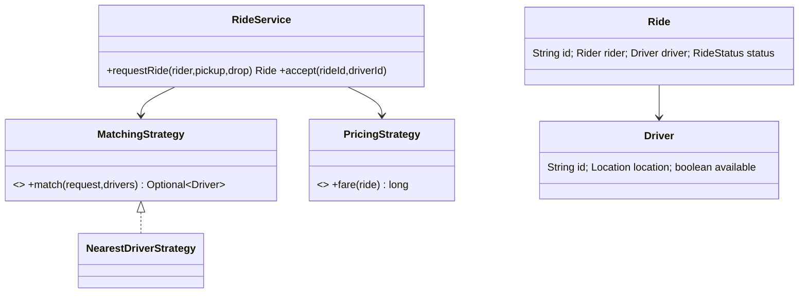

### 4. Main-flow sequence
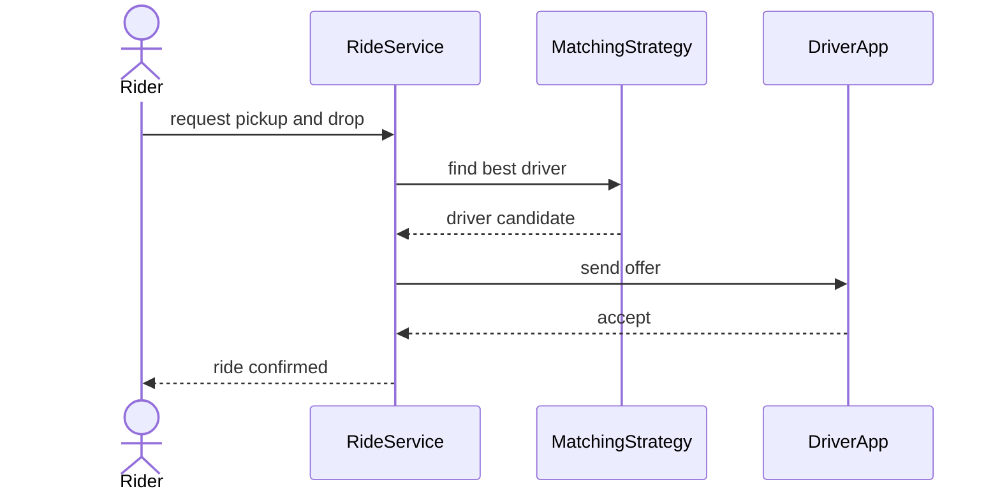

### 5. Design patterns used & why
Strategy for matching/pricing; State for ride status; Observer/EventBus for driver notifications.

### 6. Complete, compilable Java code
```java
import java.util.*;

public class RideBookingDemo{
    record Location(double x,double y){
        double dist(Location o){
            return Math.hypot(x-o.x,y-o.y);
        }
    }

    enum RideStatus{
        REQUESTED,
        ACCEPTED,
        STARTED,
        COMPLETED,
        CANCELLED
    }

    static class Driver{
        final String id;
        Location loc;
        boolean available=true;
        Driver(String id,Location loc){
            this.id=id;
            this.loc=loc;
        }
    }

    record Ride(String id,String rider,Location from,Location to,Driver driver,RideStatus status){
    }

    interface MatchingStrategy{
        Optional<Driver> match(Location pickup,List<Driver> drivers);
    }

    static class Nearest implements MatchingStrategy{
        public Optional<Driver> match(Location p,List<Driver>d){
            return d.stream().filter(x->x.available).min(Comparator.comparingDouble(x->x.loc.dist(p)));
        }
    }

    static class RideService{
        private final List<Driver> drivers;
        private final MatchingStrategy matcher;
        RideService(List<Driver>d,MatchingStrategy m){
            drivers=d;
            matcher=m;
        }

        synchronized Ride request(String rider,Location from,Location to){
            Driver driver=matcher.match(from,drivers).orElseThrow();
            driver.available=false;
            return new Ride(UUID.randomUUID().toString(),rider,from,to,driver,RideStatus.ACCEPTED);
        }
    }

    public static void main(String[]a){
        var svc=new RideService(new ArrayList<>(List.of(new Driver("d1",new Location(0,1)))),new Nearest());
        System.out.println(svc.request("r1",new Location(0,0),new Location(5,5)).driver.id);
    }
}
```

### 7. Thread-safety
Accepting a ride must atomically mark the driver unavailable. Use compare-and-set status or a DB conditional update: `where driver_id=? and status='AVAILABLE'`.

### 8. Extensibility
- Matching: nearest, highest-rated, least-cancelled, pooled ride.
- Pricing: base fare, surge, coupon.
- Dispatch: broadcast offers with timeout.
- Add fraud/risk checks before assignment.

### 9. JUnit 5 test examples
```java
import static org.junit.jupiter.api.Assertions.*;

import java.util.List;
import org.junit.jupiter.api.Test;

class RideBookingDemoTest {
    @Test
    void picksNearest() {
        var far = new RideBookingDemo.Driver("far", new RideBookingDemo.Location(9, 9));
        var near = new RideBookingDemo.Driver("near", new RideBookingDemo.Location(1, 1));
        var service = new RideBookingDemo.RideService(List.of(far, near), new RideBookingDemo.Nearest());

        assertEquals("near", service.request("r", new RideBookingDemo.Location(0, 0),
                new RideBookingDemo.Location(2, 2)).driver.id);
    }

    @Test
    void assignedDriverBecomesUnavailable() {
        var driver = new RideBookingDemo.Driver("d", new RideBookingDemo.Location(0, 0));
        var service = new RideBookingDemo.RideService(List.of(driver), new RideBookingDemo.Nearest());

        service.request("r", new RideBookingDemo.Location(0, 0), new RideBookingDemo.Location(2, 2));

        assertFalse(driver.available);
    }

    @Test
    void unavailableDriversAreSkipped() {
        var driver = new RideBookingDemo.Driver("d", new RideBookingDemo.Location(0, 0));
        driver.available = false;
        var service = new RideBookingDemo.RideService(List.of(driver), new RideBookingDemo.Nearest());

        assertThrows(RuntimeException.class, () -> service.request("r", new RideBookingDemo.Location(0, 0),
                new RideBookingDemo.Location(2, 2)));
    }
}
```

### 10. Interviewer follow-ups with short answers · Common mistakes
- *How to scale geo-search?* → Geohash/H3 buckets plus distance refinement.
- *What if driver ignores offer?* → Expire offer and try next candidate.
- Mistakes: one global synchronized matcher, no ride state validation, no idempotency for retries.

## 4. Design Food Delivery
Tier 2 · SDE-2 must-know

### 1. Clarifying questions & requirements
- Customer browses restaurants/menu, places order, pays, restaurant accepts, delivery partner delivers.
- Track order lifecycle and cancellations/refunds.
- Inventory availability and delivery assignment may be separate services.

### 2. Entities & relationships
Customer, Restaurant, MenuItem, Cart, Order, OrderItem, Payment, DeliveryPartner.

### 3. Class diagram


### 4. Main-flow state diagram
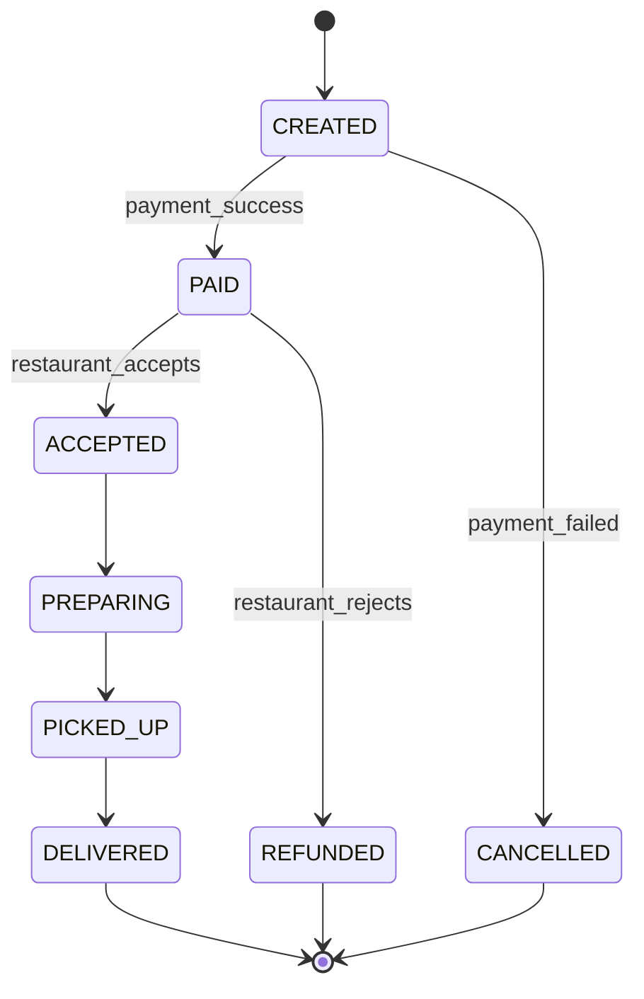

### 5. Design patterns used & why
State for lifecycle, Strategy for delivery assignment, Repository for order persistence, Observer for notifications.

### 6. Complete, compilable Java code
```java
import java.util.*;

public class FoodDeliveryDemo{
    enum Status{
        CREATED,
        PAID,
        ACCEPTED,
        PREPARING,
        PICKED_UP,
        DELIVERED,
        CANCELLED,
        REFUNDED
    }

    record Item(String id,int qty,long price){
    }

    static class Order{
        final String id=UUID.randomUUID().toString();
        final List<Item> items;
        Status status=Status.CREATED;
        Order(List<Item> items){
            this.items=List.copyOf(items);
        }

        long total(){
            return items.stream().mapToLong(i->i.qty()*i.price()).sum();
        }
    }

    static class OrderService{
        private final Map<String,
        Order> orders=new HashMap<>();
        Order place(List<Item> items){
            Order o=new Order(items);
            orders.put(o.id,o);
            return o;
        }

        void transition(String id,Status next){
            Order o=orders.get(id);
            if(!allowed(o.status,next))throw new IllegalStateException(o.status+"->"+next);
            o.status=next;
        }

        private boolean allowed(Status a,Status b){
            return switch(a){
                case CREATED->b==Status.PAID||b==Status.CANCELLED;
                case PAID->b==Status.ACCEPTED||b==Status.REFUNDED;
                case ACCEPTED->b==Status.PREPARING;
                case PREPARING->b==Status.PICKED_UP;
                case PICKED_UP->b==Status.DELIVERED;
                default->false;
            };
        }
    }

    public static void main(String[]a){
        var svc=new OrderService();
        Order o=svc.place(List.of(new Item("biryani",2,25000)));
        svc.transition(o.id,Status.PAID);
        System.out.println(o.total()+":"+o.status);
    }
}
```

### 7. Thread-safety
Order transitions should use optimistic locking on `order.version`. Restaurant menu updates and inventory decrement need transactions or reservation rows.

### 8. Extensibility
- Add scheduled orders and batch delivery.
- Add coupon and surge delivery fees.
- Add restaurant preparation SLA timers.
- Add refund workflow as saga.

### 9. JUnit 5 test examples
```java
import static org.junit.jupiter.api.Assertions.*;

import java.util.List;
import org.junit.jupiter.api.Test;

class FoodDeliveryDemoTest {
    @Test
    void invalidTransitionFails() {
        var service = new FoodDeliveryDemo.OrderService();
        var order = service.place(List.of(new FoodDeliveryDemo.Item("i", 1, 10)));

        assertThrows(IllegalStateException.class,
                () -> service.transition(order.id, FoodDeliveryDemo.Status.DELIVERED));
    }

    @Test
    void validTransitionUpdatesStatus() {
        var service = new FoodDeliveryDemo.OrderService();
        var order = service.place(List.of(new FoodDeliveryDemo.Item("i", 1, 10)));
        service.transition(order.id, FoodDeliveryDemo.Status.PAID);

        assertEquals(FoodDeliveryDemo.Status.PAID, order.status);
    }

    @Test
    void totalUsesQuantityAndPrice() {
        var order = new FoodDeliveryDemo.Order(List.of(new FoodDeliveryDemo.Item("i", 2, 25)));

        assertEquals(50, order.total());
    }
}
```

### 10. Interviewer follow-ups with short answers · Common mistakes
- *How to handle payment success but order write fails?* → Use idempotent order creation and payment callback reconciliation.
- *How to notify users?* → Publish order events; notification service subscribes.
- Mistakes: allowing arbitrary status updates, mixing menu entity with order snapshot, no cancellation policy.

## 5. Design Hotel / Meeting Room Booking & Calendar
Tier 2 · SDE-2 must-know

### 1. Clarifying questions & requirements
- Search available rooms/resources by time range and capacity.
- Create booking only if no overlapping confirmed booking exists.
- Calendar supports recurring meetings and attendee invites as extensions.

### 2. Entities & relationships
Hotel/Office has Rooms; Booking references Room, user, start, end; Calendar stores events and attendees.

### 3. Class diagram
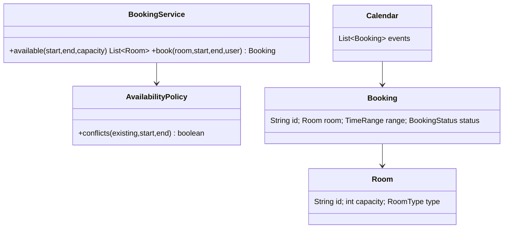

### 4. Main-flow sequence
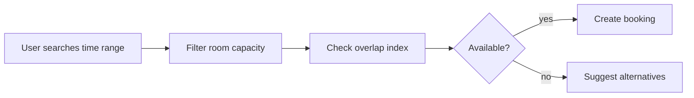

### 5. Design patterns used & why
Specification for filters, Strategy for pricing/availability policy, Value Object for time range.

### 6. Complete, compilable Java code
```java
import java.time.*;
import java.util.*;

public class RoomBookingDemo{
    record Room(String id,int capacity){
    }

    record Range(LocalDateTime start,LocalDateTime end){
        boolean overlaps(Range o){
            return start.isBefore(o.end)&&o.start.isBefore(end);
        }
    }

    record Booking(String id,Room room,Range range,String user){
    }

    static class BookingService{
        private final List<Room> rooms;
        private final List<Booking> bookings=new ArrayList<>();
        BookingService(List<Room> rooms){
            this.rooms=rooms;
        }

        List<Room> available(Range r,int cap){
            return rooms.stream()
                    .filter(x -> x.capacity()>=cap)
                    .filter(x -> bookings.stream()
                            .noneMatch(b -> b.room().equals(x)&&b.range().overlaps(r)))
                    .toList();
        }

        synchronized Booking book(Room room,Range r,String user){
            if(available(r,room.capacity()).stream().noneMatch(room::equals)) {
                throw new IllegalStateException("not available");
            }

            Booking b=new Booking(UUID.randomUUID().toString(),room,r,user);
            bookings.add(b);
            return b;
        }
    }

    public static void main(String[]a){
        Room r=new Room("R1",4);
        var s=new BookingService(List.of(r));
        System.out.println(s.book(
                r,new Range(LocalDateTime.now(),LocalDateTime.now().plusHours(1)),"u").id());
    }
}
```

### 7. Thread-safety
Guard availability check plus insert with one transaction. Add exclusion constraints in PostgreSQL for time ranges or unique bucket locks to prevent race conditions.

### 8. Extensibility
- Recurrence rules with generated occurrences.
- Waitlist and auto-suggest next slot.
- Amenities filter.
- Cancellation policy and partial refunds for hotels.

### 9. JUnit 5 test examples
```java
import static org.junit.jupiter.api.Assertions.*;

import java.time.LocalDateTime;
import java.util.List;
import org.junit.jupiter.api.Test;

class RoomBookingDemoTest {
    @Test
    void overlapRejected() {
        var room = new RoomBookingDemo.Room("R", 2);
        var service = new RoomBookingDemo.BookingService(List.of(room));
        var range = new RoomBookingDemo.Range(LocalDateTime.now(), LocalDateTime.now().plusHours(1));
        service.book(room, range, "u");

        assertThrows(IllegalStateException.class, () -> service.book(room, range, "v"));
    }

    @Test
    void backToBackBookingAllowed() {
        var room = new RoomBookingDemo.Room("R", 2);
        var service = new RoomBookingDemo.BookingService(List.of(room));
        var now = LocalDateTime.now();
        service.book(room, new RoomBookingDemo.Range(now, now.plusHours(1)), "u");

        assertDoesNotThrow(() -> service.book(
                room, new RoomBookingDemo.Range(now.plusHours(1), now.plusHours(2)), "v"));
    }

    @Test
    void capacityFilterWorks() {
        var small = new RoomBookingDemo.Room("S", 2);
        var large = new RoomBookingDemo.Room("L", 8);
        var service = new RoomBookingDemo.BookingService(List.of(small, large));
        var range = new RoomBookingDemo.Range(LocalDateTime.now(), LocalDateTime.now().plusHours(1));

        assertEquals(List.of(large), service.available(range, 5));
    }
}
```

### 10. Interviewer follow-ups with short answers · Common mistakes
- *Overlap formula?* → `start < existingEnd && existingStart < end`.
- *How to support recurring meetings?* → Store RRULE plus materialized occurrences for near-term search.
- Mistakes: using inclusive end incorrectly, check-then-insert race, no timezone handling.

## 6. Design Inventory & Order Management
Tier 2 · SDE-2 must-know

### 1. Clarifying questions & requirements
- Products have SKU inventory in warehouses; orders reserve stock, payment confirms, shipment consumes.
- Avoid overselling; support cancellations and returns.
- Split shipment across warehouses is optional extension.

### 2. Entities & relationships
Product 1-* SKU; Warehouse has InventoryItem; Order has OrderItems and Reservation records.

### 3. Class diagram
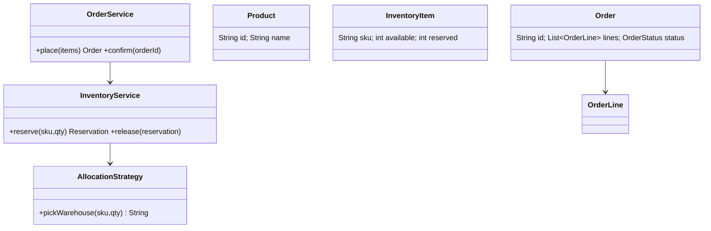

### 4. Main-flow sequence
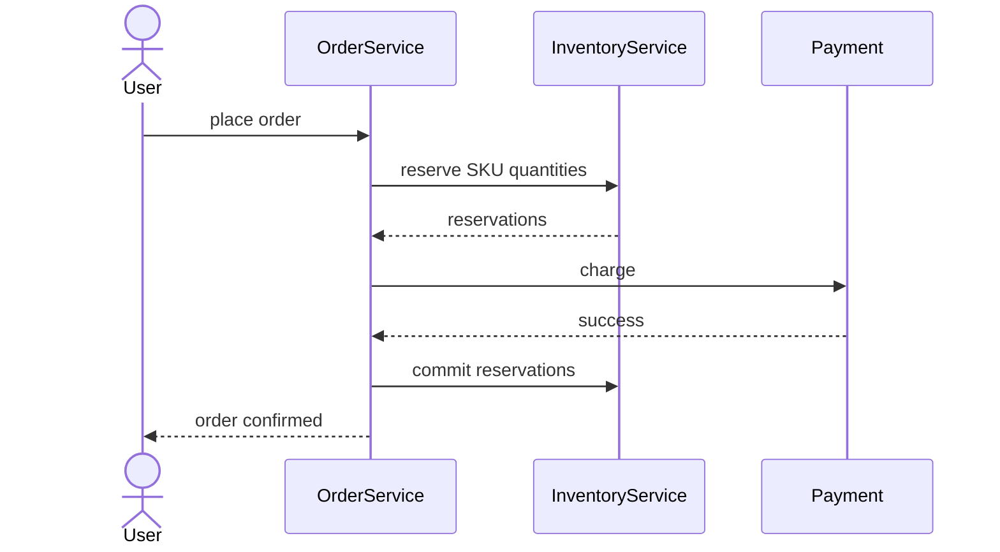

### 5. Design patterns used & why
Strategy for warehouse allocation; Saga for reserve-pay-confirm workflow; Repository for inventory rows.

### 6. Complete, compilable Java code
```java
import java.util.*;
import java.util.concurrent.*;

public class InventoryOrderDemo{
    record Line(String sku,int qty){
    }

    enum Status{
        CREATED,
        CONFIRMED,
        CANCELLED
    }

    record Order(String id,List<Line> lines,Status status){
    }

    static class InventoryService{
        private final Map<String,
        Integer> available=new ConcurrentHashMap<>();
        InventoryService(Map<String,Integer> seed){
            available.putAll(seed);
        }

        synchronized void reserve(List<Line> lines){
            for(Line l:lines) {
                if(available.getOrDefault(l.sku(),0)<l.qty()) {
                    throw new IllegalStateException("no stock "+l.sku());
                }
            }

            for(Line l:lines)available.merge(l.sku(),-l.qty(),Integer::sum);
        }

        synchronized void release(List<Line> lines){
            for(Line l:lines)available.merge(l.sku(),l.qty(),Integer::sum);
        }

        int stock(String sku){
            return available.getOrDefault(sku,0);
        }
    }

    static class OrderService{
        private final InventoryService inv;
        OrderService(InventoryService inv){
            this.inv=inv;
        }

        Order place(List<Line> lines,boolean paymentOk){
            inv.reserve(lines);
            if(!paymentOk){
                inv.release(lines);
                return new Order(UUID.randomUUID().toString(),lines,Status.CANCELLED);
            }

            return new Order(UUID.randomUUID().toString(),lines,Status.CONFIRMED);
        }
    }

    public static void main(String[]a){
        var inv=new InventoryService(Map.of("SKU1",5));
        System.out.println(new OrderService(inv).place(List.of(new Line("SKU1",2)),true));
    }
}
```

### 7. Thread-safety
Use conditional SQL update: `available >= qty`, then decrement. For multiple SKUs lock in sorted SKU order to avoid deadlocks.

### 8. Extensibility
- Backorders and preorders.
- Multi-warehouse allocation strategy.
- Return/refund flow.
- Low-stock events to procurement.

### 9. JUnit 5 test examples
```java
import static org.junit.jupiter.api.Assertions.*;

import java.util.List;
import java.util.Map;
import org.junit.jupiter.api.Test;

class InventoryOrderDemoTest {
    @Test
    void noOversell() {
        var inventory = new InventoryOrderDemo.InventoryService(Map.of("S", 1));
        var orders = new InventoryOrderDemo.OrderService(inventory);
        orders.place(List.of(new InventoryOrderDemo.Line("S", 1)), true);

        assertThrows(IllegalStateException.class,
                () -> orders.place(List.of(new InventoryOrderDemo.Line("S", 1)), true));
    }

    @Test
    void paymentFailureReleasesStock() {
        var inventory = new InventoryOrderDemo.InventoryService(Map.of("S", 2));
        new InventoryOrderDemo.OrderService(inventory).place(
                List.of(new InventoryOrderDemo.Line("S", 1)), false);

        assertEquals(2, inventory.stock("S"));
    }

    @Test
    void successfulOrderConsumesStock() {
        var inventory = new InventoryOrderDemo.InventoryService(Map.of("S", 2));
        new InventoryOrderDemo.OrderService(inventory).place(
                List.of(new InventoryOrderDemo.Line("S", 1)), true);

        assertEquals(1, inventory.stock("S"));
    }
}
```

### 10. Interviewer follow-ups with short answers · Common mistakes
- *Why reserve before payment?* → Prevents selling unavailable stock while payment is in progress.
- *How to handle payment timeout?* → Reservation TTL and release job.
- Mistakes: decrementing after payment only, no compensation, no deadlock ordering.

## 7. Design Shopping Cart + Coupon Engine
Tier 2 · SDE-2 must-know

### 1. Clarifying questions & requirements
- Cart supports add/remove/update items, price snapshot, coupons, taxes, shipping.
- Coupon rules: min cart value, category, user segment, one-time usage, best discount.
- Multiple discounts may chain in a defined order.

### 2. Entities & relationships
Cart has CartItems; Product has category/price; Coupon has condition and discount strategy; Checkout creates Order.

### 3. Class diagram
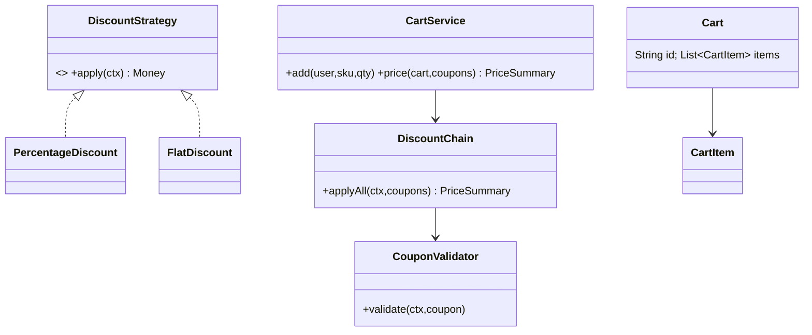

### 4. Main-flow sequence
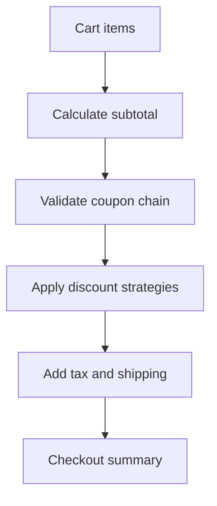

### 5. Design patterns used & why
Strategy for discount calculation; Chain of Responsibility for validators; Specification for coupon eligibility.

### 6. Complete, compilable Java code
```java
import java.util.*;

public class CartCouponDemo{
    record Item(String sku,int qty,long price){
    }

    record Cart(List<Item> items){
        long subtotal(){
            return items.stream().mapToLong(i->i.qty()*i.price()).sum();
        }
    }

    record Coupon(String code,long minSubtotal,Discount discount){
    }

    interface Discount{
        long amount(long subtotal);
    }

    static class Percent implements Discount{
        final int pct;
        Percent(int pct){
            this.pct=pct;
        }

        public long amount(long subtotal){
            return subtotal*pct/100;
        }
    }

    static class Flat implements Discount{
        final long value;
        Flat(long value){
            this.value=value;
        }

        public long amount(long subtotal){
            return Math.min(value,subtotal);
        }
    }

    interface Validator{
        void validate(Cart c,Coupon cp);
    }

    static class MinSubtotalValidator implements Validator{
        public void validate(Cart c,Coupon cp){
            if(c.subtotal()<cp.minSubtotal())throw new IllegalArgumentException("min subtotal");
        }
    }

    static class PricingService{
        private final List<Validator> validators=List.of(new MinSubtotalValidator());
        long total(Cart c,List<Coupon> coupons){
            long sub=c.subtotal(),
            discount=0;
            for(Coupon cp:coupons){
                validators.forEach(v->v.validate(c,cp));
                discount+=cp.discount().amount(sub-discount);
            }

            return Math.max(0,sub-discount);
        }
    }

    public static void main(String[]a){
        var c=new Cart(List.of(new Item("S",2,1000)));
        System.out.println(new PricingService().total(c,List.of(new Coupon("P10",1000,new Percent(10)))));
    }
}
```

### 7. Thread-safety
Cart updates can be per-user synchronized or optimistic-versioned. Coupon redemption must atomically decrement usage and enforce unique `(user_id, coupon_id)` for one-time coupons.

### 8. Extensibility
- Add BOGO, category, bank-card offers.
- Add best-coupon optimizer.
- Add tax by region.
- Add promotion calendar with start/end time.

### 9. JUnit 5 test examples
```java
import static org.junit.jupiter.api.Assertions.*;

import java.util.List;
import org.junit.jupiter.api.Test;

class CartCouponDemoTest {
    @Test
    void appliesPercent() {
        var cart = new CartCouponDemo.Cart(List.of(new CartCouponDemo.Item("A", 1, 1000)));
        var coupon = new CartCouponDemo.Coupon("C", 0, new CartCouponDemo.Percent(10));

        assertEquals(900, new CartCouponDemo.PricingService().total(cart, List.of(coupon)));
    }

    @Test
    void flatDiscountIsCappedAtSubtotal() {
        var cart = new CartCouponDemo.Cart(List.of(new CartCouponDemo.Item("A", 1, 500)));
        var coupon = new CartCouponDemo.Coupon("F", 0, new CartCouponDemo.Flat(1000));

        assertEquals(0, new CartCouponDemo.PricingService().total(cart, List.of(coupon)));
    }

    @Test
    void minimumSubtotalIsValidated() {
        var cart = new CartCouponDemo.Cart(List.of(new CartCouponDemo.Item("A", 1, 500)));
        var coupon = new CartCouponDemo.Coupon("MIN", 1000, new CartCouponDemo.Flat(100));

        assertThrows(IllegalArgumentException.class,
                () -> new CartCouponDemo.PricingService().total(cart, List.of(coupon)));
    }
}
```

### 10. Interviewer follow-ups with short answers · Common mistakes
- *How to support coupon stacking?* → Define deterministic chain order and whether each coupon applies on original or discounted subtotal.
- *How to prevent coupon abuse?* → Usage ledger, idempotency keys, fraud checks.
- Mistakes: hardcoding if-else coupons, using floating money, no validation chain.

## Revision Cheat Sheet
- BookMyShow: lock with TTL, confirm idempotently, DB unique row is final guard.
- Splitwise: store immutable expenses; derive balances; simplify with two heaps.
- Ride booking: matching and pricing are strategies; driver assignment must be atomic.
- Food delivery: state machine prevents illegal order jumps; use events for notifications.
- Booking/calendar: overlap is `start < end2 && start2 < end`; transaction wraps check and insert.
- Inventory: reserve before payment, release on failure, sorted locks for multi-SKU orders.
- Cart/coupons: Strategy calculates discount; Chain validates coupon eligibility.
- Prefer Money in paise/cents, value objects, repositories, and idempotency keys.
- For distributed concurrency, JVM locks are insufficient; use DB constraints or transactional updates.
- Keep driver demos small but prove core behavior.

## Flashcards
- Q: Why does BookMyShow need lock TTL? → A: To release seats abandoned during payment.
- Q: Best DB guard against double booking? → A: Unique `(show_id, seat_id)` booking row or row lock/version check.
- Q: Splitwise simplify algorithm? → A: Match max debtors to max creditors using two heaps.
- Q: Ride matching extension point? → A: `MatchingStrategy`.
- Q: Food delivery lifecycle pattern? → A: State machine/State pattern.
- Q: Correct interval overlap check? → A: `a.start < b.end && b.start < a.end`.
- Q: Inventory oversell prevention? → A: Conditional decrement inside transaction.
- Q: Coupon engine patterns? → A: Strategy plus Chain of Responsibility.
- Q: Why store order item price snapshot? → A: Menu/product price may change later.
- Q: Why avoid double for money? → A: Precision and rounding errors.
- Q: How to make retry safe? → A: Idempotency key and unique request record.
- Q: Where do events help? → A: Notifications, audit, async workflows, reconciliation.
