# 10e · Low-Level Design (LLD) Problems Tier 2 Part 2

More Software Development Engineer level 2 (SDE-2) LLD blueprints for backend machine-coding rounds.
Each section starts with beginner intuition, then follows the interview rhythm: clarify, model, diagram, code
the core, test, and discuss extensions.

**Legend:** 🟢 Beginner · 🟡 Intermediate · 🔴 Advanced · ⚫ FAANG · 🔥 = very frequently asked

**Common terms:** Short Message Service (SMS), Time To Live (TTL), Application Programming Interface
(API), Java Virtual Machine (JVM), Compare-And-Set (CAS), database (DB), and Structured Query Language
(SQL).

## Table of Contents
- [Beginner guide to this file](#beginner-guide-to-this-file)
- [1. Design Notification System](#1-design-notification-system)
- [2. Design Digital Wallet / Payment](#2-design-digital-wallet--payment)
- [3. Design In-Memory Key-Value Store](#3-design-in-memory-key-value-store)
- [4. Design Pub-Sub / Message Queue](#4-design-pub-sub--message-queue)
- [5. Design Task / Job Scheduler](#5-design-task--job-scheduler)
- [6. Design Car Rental](#6-design-car-rental)
- [7. Design Stack Overflow](#7-design-stack-overflow)
- [8. Design Chess](#8-design-chess)
- [Tier 3 Stretch quick designs](#tier-3-stretch-quick-designs)
- [Revision Cheat Sheet](#revision-cheat-sheet)
- [Flashcards](#flashcards)

## Beginner guide to this file

### What this file teaches

This file continues Tier 2 Low-Level Design (LLD) practice with systems that coordinate asynchronous work,
wallet money movement, key-value storage, queues, schedulers, rentals, community content, and game rules. These
show up in interviews because they test whether you can design clean Java contracts while still discussing
retries, idempotency, locks, visibility, and data ownership. In backend jobs, the same ideas appear in messaging,
payments, caches, job workers, rental inventory, forums, and rule engines.

### Mental model

Think of each problem as a control loop: accept intent, record enough state, apply rules, then expose the next
safe action.

- Requests and records capture intent before work is performed.
- Services own workflow decisions and protect shared mutable state.
- Interfaces isolate things that vary, such as notification channels or chess movement rules.
- Queues, schedulers, and stores need clear visibility rules so callers know what has happened.
- Idempotency and locks prevent duplicate money movement, duplicate sends, or conflicting reservations.
- Tests exercise edge cases where a beginner design often breaks: duplicates, expiry, bad acknowledgement, overlap.

### How to think through any question here

1. Identify whether the problem is synchronous, asynchronous, or a mix of both.
2. Name the durable fact you must not lose: notification request, ledger entry, queue offset, reservation, or move.
3. Define each public method as a contract: input, state changed, return value, and failure behavior.
4. Decide where ordering matters, such as wallet locks, message offsets, scheduled due time, or chess turns.
5. Separate pluggable rules behind interfaces when providers, movement rules, or policies can change.
6. Describe retry and duplicate handling before adding extra features.
7. Move from in-memory maps to production storage only after the invariant is clear.

### Pattern recognition cues

| If the question mentions... | Think about... | Why it fits |
| --- | --- | --- |
| Email, Short Message Service (SMS), push, or vendor retries | Channel adapter plus retry policy | Providers vary, but the service contract should stay stable. |
| Wallet transfer or payment | Ledger plus ordered locks | Both balances and ledger entries must change atomically. |
| Key with expiry | Time To Live (TTL) record | Reads must hide expired values, and cleanup can be lazy or background. |
| Subscribers reading messages | Offset per subscriber | Each subscriber advances independently through the same log. |
| Run a task later | Delay queue or due-time table | Jobs are ordered by next execution time rather than insertion time. |
| Rental date range | Interval overlap | Availability is a search over resources that do not overlap existing reservations. |
| Accepting an answer or voting | Entity ownership and invariant | A question can have many answers, but only one accepted answer. |
| Chess move legality | Rule interface plus board state | Each piece owns movement logic while the board enforces occupancy and turn rules. |
| Duplicate request key | Idempotency map or table | A retry should return the same result instead of repeating the side effect. |

### Abbreviations and key terms

| Short form | Expanded form | Plain meaning |
| --- | --- | --- |
| AI | Artificial Intelligence | An optional full chess engine, not required for the LLD exercise. |
| API | Application Programming Interface | A callable boundary between clients, services, or modules. |
| CAS | Compare-And-Set | Atomic update style that changes a value only if it still has the expected value. |
| DB | Database | Durable source of truth for production state and constraints. |
| DLQ | Dead-Letter Queue | Holding area for messages or jobs that failed too many times. |
| FAANG | Facebook, Amazon, Apple, Netflix, Google | Shorthand for large product-company interview style and bar. |
| JUnit | Java unit testing framework | The test library used by the example test sections. |
| JVM | Java Virtual Machine | Runtime for Java bytecode; process-local memory disappears outside one JVM. |
| KV | Key-Value | Store model where callers read and write values by key. |
| KYC | Know Your Customer | Identity and risk checks used in financial systems. |
| LLD | Low-Level Design | Object, class, method, and interaction design for a focused component. |
| LR | Left to Right | Mermaid diagram direction where nodes flow horizontally. |
| SDE-2 | Software Development Engineer level 2 | Mid-level engineering interview expectation with design and trade-off depth. |
| SMS | Short Message Service | Text-message notification channel. |
| SOLID | Single responsibility, Open-closed, Liskov substitution, Interface segregation, Dependency inversion | Design principles often referenced in object-oriented interviews. |
| SQL | Structured Query Language | Relational database query language used for transactional guards. |
| SUV | Sport Utility Vehicle | Vehicle category used in the car-rental example. |
| TD | Top Down | Mermaid diagram direction where nodes flow vertically. |
| TTL | Time To Live | Expiry duration for records, locks, cache entries, or retries. |
| UI | User Interface | Operator or user screen, such as a dead-letter replay screen. |
| UUID | Universally Unique Identifier | Random-looking identifier generated for demo transactions and reservations. |

### Common beginner traps

- Describing retries without saying where the original request is stored durably.
- Updating wallet balances but forgetting the ledger or idempotency key.
- Treating poll as destructive in a queue without a matching acknowledgement model.
- Forgetting that a background thread or scheduler must shut down cleanly in tests and services.
- Checking rental or room availability outside the same transaction as reservation creation.
- Letting one accepted answer, chess turn, or subscriber offset corrupt another user-visible invariant.

### How to study this file

1. Start with the beginner primer and responsibility map for each full Tier 2 problem.
2. Read the short answer after you can explain the main invariant without looking.
3. Trace the main write path in code: what is validated, what state changes, and what is returned.
4. Use the test examples as edge-case prompts, then explain why each assertion matters.
5. Review the flashcards last and turn each answer into a two-minute spoken design pitch.
6. For stretch designs, practice the same pattern verbally even though no responsibility map is required.

### Scalability and production lens

The examples keep state in memory so the class responsibilities stay visible. A production version usually stores
requests, ledgers, reservations, offsets, or jobs in a database or log, then uses workers with retries and
monitoring. Use ordered locks or database transactions for money and reservations, visibility timeouts for queues,
leases for jobs, and audit trails for moderation or game history. Scale reads with caches only after the write
path has a single source of truth.

## 1. Design Notification System
Tier 2 · SDE-2 must-know

### 0. Beginner primer

**Problem and mental model:** Accept a notification request, render content, respect preferences, and deliver
through email, Short Message Service (SMS), push, or chat providers. The request is work; each delivery
attempt is an auditable state transition.

**Recognition and flow:** Strategy/Adapter fits channels, Template Method fits shared send steps, and Outbox
fits reliable asynchronous handoff. Validate/deduplicate → render → enqueue durably → select provider →
send → record success or retry with backoff → dead-letter permanent failure. A synchronous call is simpler
for low-value messages but couples user latency to vendors. Scale workers by channel, enforce per-provider
limits, protect user preferences, and monitor queue age and failure rate.

**Responsibility map:**

| Class or interface | Responsibility | Key methods and contract | Relationships |
| --- | --- | --- | --- |
| NotificationDemo | Demo namespace and executable sample for notification sending. | main(String[] args) creates a Service with an EmailSender, sends one request, prints status, and propagates missing sender failures. | Owns channel, request, result, sender, renderer, and service types. |
| Channel | Supported notification channel marker. | Constants EMAIL and SMS carry no methods or state changes; Service uses them as keys into the sender map. | Referenced by Request and Service. |
| Request | Immutable notification command. | Canonical record constructor takes key, channel, recipient, template, and data; accessors return values; it mutates nothing and performs no validation. | Passed into Service.send. |
| Result | Immutable provider outcome. | Canonical record constructor takes ok and retry flags; accessors return values; it mutates nothing and performs no validation. | Returned by Sender implementations and interpreted by Service. |
| Sender | Provider adapter contract. | send(to, body) receives a recipient and rendered body, returns Result, may perform side effects, and defines provider-specific failure behavior. | Implemented by EmailSender and stored in Service sender map. |
| EmailSender | Demo email provider. | send(to, body) prints the send action, returns successful Result, mutates no stored state, and does not throw explicitly. | Implements Sender and is selected by Channel.EMAIL. |
| Renderer | Template replacement helper. | render(template, data) replaces matching double-brace variables, returns rendered text, mutates no service state, and leaves unmatched placeholders unchanged. | Used by Service before calling Sender. |
| Service | Owns deduplication, rendering, provider selection, and status mapping. | send(request) is synchronized, records the idempotency key, returns DUPLICATE for repeats, renders body, calls the channel sender, returns SENT, RETRY, or FAILED, and may throw NullPointerException if no sender exists. | Depends on Renderer and a map from Channel to Sender; reads Request and Result. |
| NotificationDemoTest | JUnit 5 tests for dedupe, rendering, and retry mapping. | dedupes, rendersTemplateVariables, and retryResultIsSurfaced build local services and senders, return void, and fail through assertions. | Exercises Service, Renderer, Sender, and Result. |

### 1. Clarifying questions & requirements
- Send email/SMS/push/WhatsApp using templates and user preferences.
- Retry transient failures with backoff; dead-letter permanent failures.
- Track status per recipient and channel; dedupe duplicate requests.

### 2. Entities & relationships
NotificationRequest has Template, Recipient, Channel, DeliveryAttempt; ChannelProvider sends message.

### 3. Class diagram
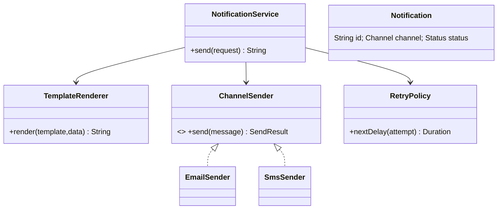

### 4. Main-flow sequence
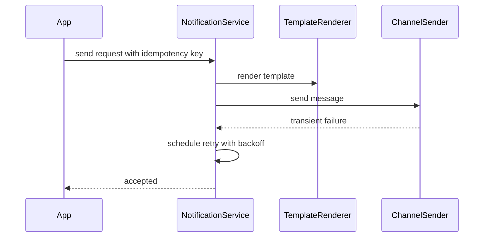

### 5. Design patterns used & why
Strategy/Adapter for channels, Template Method for rendering, Retry policy, Outbox for reliable async sends.

### 6. Complete, compilable Java code
```java

import java.util.*;

public class NotificationDemo{
    enum Channel{
        EMAIL,
        SMS
    }

    record Request(String key,Channel channel,String to,String template,Map<String,String> data){
    }

    record Result(boolean ok,boolean retry){
    }

    interface Sender{
        Result send(String to,String body);
    }

    static class EmailSender implements Sender{
        public Result send(String to,String body){
            System.out.println("email "+to+" "+body);
            return new Result(true,false);
        }
    }

    static class Renderer{
        String render(String t,Map<String,String>d){
            String out=t;
            for(var e:d.entrySet())out=out.replace("{{"+e.getKey()+"}}",e.getValue());
            return out;
        }
    }

    static class Service{
        private final Map<Channel,
        Sender> senders;
        private final Set<String> seen=new HashSet<>();
        private final Renderer renderer=new Renderer();
        Service(Map<Channel,Sender>s){
            senders=s;
        }

        synchronized String send(Request r){
            if(!seen.add(r.key()))return "DUPLICATE";
            String body=renderer.render(r.template(),r.data());
            Result res=senders.get(r.channel()).send(r.to(),body);
            return res.ok()?"SENT":res.retry()?"RETRY":"FAILED";
        }
    }

    public static void main(String[]a){
        var s=new Service(Map.of(Channel.EMAIL,new EmailSender()));
        System.out.println(s.send(
                new Request("k1",Channel.EMAIL,"a@b.com","Hi {{name}}",Map.of("name","Azam"))));
    }
}
```

### 7. Thread-safety
Idempotency key insert must be atomic. Workers should claim pending rows with `FOR UPDATE SKIP LOCKED` or queue visibility timeout.

### 8. Extensibility
- Add priority queues.
- Add user preference and quiet hours.
- Add provider failover.
- Add DLQ replay UI.

### 9. JUnit 5 test examples
```java
import static org.junit.jupiter.api.Assertions.*;

import java.util.Map;
import org.junit.jupiter.api.Test;

class NotificationDemoTest {
    @Test
    void dedupes() {
        var service = new NotificationDemo.Service(Map.of(
                NotificationDemo.Channel.EMAIL,
                (to, body) -> new NotificationDemo.Result(true, false)));
        var request = new NotificationDemo.Request("k", NotificationDemo.Channel.EMAIL, "x", "hi", Map.of());

        assertEquals("SENT", service.send(request));
        assertEquals("DUPLICATE", service.send(request));
    }

    @Test
    void rendersTemplateVariables() {
        var service = new NotificationDemo.Service(Map.of(
                NotificationDemo.Channel.EMAIL,
                (to, body) -> new NotificationDemo.Result(body.equals("Hi Azam"), false)));
        var request = new NotificationDemo.Request(
                "k", NotificationDemo.Channel.EMAIL, "x", "Hi {{name}}", Map.of("name", "Azam"));

        assertEquals("SENT", service.send(request));
    }

    @Test
    void retryResultIsSurfaced() {
        var service = new NotificationDemo.Service(Map.of(
                NotificationDemo.Channel.SMS,
                (to, body) -> new NotificationDemo.Result(false, true)));
        var request = new NotificationDemo.Request("k", NotificationDemo.Channel.SMS, "x", "hi", Map.of());

        assertEquals("RETRY", service.send(request));
    }
}
```

### 10. Interviewer follow-ups with short answers · Common mistakes
- *How are retries safe?* → Idempotency key plus provider message id prevents duplicates.
- *How to handle bad templates?* → Validate at publish time and fail fast.
- Mistakes: synchronous provider call in request path only, no DLQ, no preference checks.

## 2. Design Digital Wallet / Payment
Tier 2 · SDE-2 must-know

### 0. Beginner primer

**Problem and mental model:** Move value between accounts without creating or losing money. A wallet balance
is a projection; immutable double-entry ledger records are the source of truth. Authorization reserves
funds, capture completes movement, and reversal compensates a failed operation.

**Recognition and flow:** Command models payment operations; State models payment lifecycle; Adapter wraps a
gateway; Repository persists wallet and ledger. Validate/idempotency-check → lock accounts in stable order →
verify funds → write equal debit and credit entries → update balances → commit → publish event. Never update
only one wallet. Production requires integer minor units, transactional ledger writes, reconciliation,
limits, fraud controls, and partitioning that preserves atomicity or uses a clearing account.

**Responsibility map:**

| Class or interface | Responsibility | Key methods and contract | Relationships |
| --- | --- | --- | --- |
| WalletDemo | Demo namespace and executable sample for wallet transfer. | main(String[] args) creates wallets, transfers money, prints a balance, and propagates validation or balance failures. | Owns ledger entry, wallet, and service types. |
| Entry | Immutable ledger row. | Canonical record constructor takes transactionId, walletId, and delta; accessors return values; it mutates nothing and performs no validation. | Written by WalletService.doTransfer and returned by ledger(). |
| Wallet | Mutable wallet aggregate with its own lock and balance. | Constructor Wallet(id, balance) initializes id, lock, and balance; it returns no value and throws no explicit exception. | Stored by WalletService and locked during balance reads and transfers. |
| WalletService | Owns wallet creation, idempotent transfer, balance reads, and ledger snapshots. | create(id, balance) stores a wallet and overwrites any existing id. transfer(idempotencyKey, from, to, amount) returns the existing transaction for duplicate keys or creates one through doTransfer. doTransfer validates amount and distinct wallets, locks wallets in id order, mutates both balances and ledger, returns transaction id, and throws IllegalArgumentException or IllegalStateException. balance(id) locks and returns current balance. ledger() returns a copy. requireWallet(id) throws IllegalArgumentException for unknown wallets. | Stores Wallet objects, Entry ledger rows, and idempotency keys. |
| WalletDemoTest | JUnit 5 tests for atomic transfer and idempotency. | transfersAtomically, idempotencyKeyReturnsSameTransaction, and lowBalanceFailsWithoutLedgerEntry use local services, return void, and fail through assertions or expected exceptions. | Exercises WalletService, Wallet, and Entry. |

### 1. Clarifying questions & requirements
- Users add money, transfer, withdraw, view statement.
- Ledger must be immutable and double-entry; balance derived or cached safely.
- External payment callbacks are asynchronous and idempotent.

### 2. Entities & relationships
Wallet has balance; Transaction has LedgerEntries debit/credit; PaymentInstrument funds wallet.

### 3. Class diagram
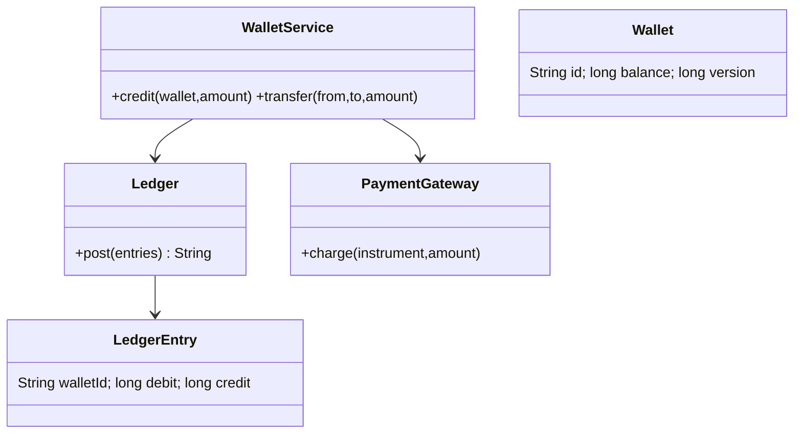

### 4. Main-flow sequence
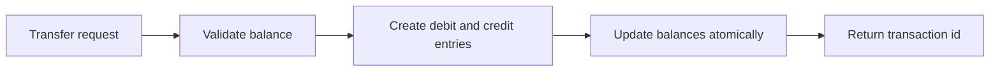

### 5. Design patterns used & why
Command for transaction requests, Repository for ledger, Adapter for payment gateways.

### 6. Complete, compilable Java code
```java
import java.util.ArrayList;
import java.util.Collections;
import java.util.List;
import java.util.Map;
import java.util.UUID;
import java.util.concurrent.ConcurrentHashMap;
import java.util.concurrent.ConcurrentMap;
import java.util.concurrent.locks.ReentrantLock;

public class WalletDemo {
    record Entry(String transactionId, String walletId, long delta) {}

    static class Wallet {
        final String id;
        final ReentrantLock lock = new ReentrantLock();
        long balance;

        Wallet(String id, long balance) {
            this.id = id;
            this.balance = balance;
        }
    }

    static class WalletService {
        private final Map<String, Wallet> wallets = new ConcurrentHashMap<>();
        private final List<Entry> ledger = Collections.synchronizedList(new ArrayList<>());
        private final ConcurrentMap<String, String> idempotency = new ConcurrentHashMap<>();

        void create(String id, long balance) {
            wallets.put(id, new Wallet(id, balance));
        }

        String transfer(String idempotencyKey, String from, String to, long amount) {
            return idempotency.computeIfAbsent(idempotencyKey, key -> doTransfer(from, to, amount));
        }

        private String doTransfer(String from, String to, long amount) {
            if (amount <= 0 || from.equals(to)) {
                throw new IllegalArgumentException("invalid transfer");
            }

            Wallet debit = requireWallet(from);
            Wallet credit = requireWallet(to);
            Wallet first = debit.id.compareTo(credit.id) < 0 ? debit : credit;
            Wallet second = first == debit ? credit : debit;

            first.lock.lock();
            second.lock.lock();
            try {
                if (debit.balance < amount) {
                    throw new IllegalStateException("low balance");
                }

                String transactionId = UUID.randomUUID().toString();
                debit.balance -= amount;
                credit.balance += amount;
                ledger.add(new Entry(transactionId, from, -amount));
                ledger.add(new Entry(transactionId, to, amount));
                return transactionId;
            } finally {
                second.lock.unlock();
                first.lock.unlock();
            }
        }

        long balance(String id) {
            Wallet wallet = requireWallet(id);
            wallet.lock.lock();
            try {
                return wallet.balance;
            } finally {
                wallet.lock.unlock();
            }
        }

        List<Entry> ledger() {
            synchronized (ledger) {
                return List.copyOf(ledger);
            }
        }

        private Wallet requireWallet(String id) {
            Wallet wallet = wallets.get(id);
            if (wallet == null) {
                throw new IllegalArgumentException("unknown wallet: " + id);
            }
            return wallet;
        }
    }

    public static void main(String[] args) {
        WalletService service = new WalletService();
        service.create("A", 100);
        service.create("B", 0);
        service.transfer("request-1", "A", "B", 40);
        System.out.println(service.balance("B"));
    }
}
```

### 7. Thread-safety
Use DB transaction with ordered row locks on both wallets. Never update one wallet without ledger entries in the same transaction.

### 8. Extensibility
- Add holds for pending merchant payments.
- Add KYC limits and risk checks.
- Add multi-currency wallets.
- Add reconciliation job against gateway reports.

### 9. JUnit 5 test examples
```java
import static org.junit.jupiter.api.Assertions.*;

import org.junit.jupiter.api.Test;

class WalletDemoTest {
    @Test
    void transfersAtomically() {
        WalletDemo.WalletService service = new WalletDemo.WalletService();
        service.create("A", 100);
        service.create("B", 0);

        service.transfer("k1", "A", "B", 30);

        assertEquals(70, service.balance("A"));
        assertEquals(30, service.balance("B"));
    }

    @Test
    void idempotencyKeyReturnsSameTransaction() {
        WalletDemo.WalletService service = new WalletDemo.WalletService();
        service.create("A", 100);
        service.create("B", 0);

        String first = service.transfer("k1", "A", "B", 30);
        String retry = service.transfer("k1", "A", "B", 30);

        assertEquals(first, retry);
        assertEquals(70, service.balance("A"));
    }

    @Test
    void lowBalanceFailsWithoutLedgerEntry() {
        WalletDemo.WalletService service = new WalletDemo.WalletService();
        service.create("A", 10);
        service.create("B", 0);

        assertThrows(IllegalStateException.class, () -> service.transfer("k", "A", "B", 30));
        assertTrue(service.ledger().isEmpty());
    }
}
```

### 10. Interviewer follow-ups with short answers · Common mistakes
- *Why double-entry ledger?* → Every debit has matching credit, making reconciliation and audit easier.
- *Callback repeated?* → Store gateway event id and process once.
- Mistakes: mutable transaction history, no idempotency, using floats for money.

## 3. Design In-Memory Key-Value Store
Tier 2 · SDE-2 must-know

### 0. Beginner primer

**Problem and mental model:** Store values by key with `get`, `put`, delete, and optional expiry. The index
finds data; expiry decides visibility; a background cleaner reclaims memory but must not define correctness.

**Recognition and flow:** Strategy fits eviction; Command may support transactions; Observer fits change
notifications only if required. `put` validates and stores value plus expiry/version; `get` checks expiry
before returning; compare-and-set updates only the expected version. A concurrent map alone does not make a
multi-step operation atomic. Scale adds sharding, persistence logs, snapshots, replication, memory quotas,
and clearly documented consistency semantics.

**Responsibility map:**

| Class or interface | Responsibility | Key methods and contract | Relationships |
| --- | --- | --- | --- |
| KeyValueStoreDemo | Demo namespace and executable sample for transactional key-value storage. | main(String[] args) opens a Store, writes inside a transaction, commits, prints a read result, and closes the sweeper through try-with-resources. | Owns record and store types. |
| Rec | Immutable stored value plus optional expiry. | expired() returns true when expiresAt is present and not in the future, mutates nothing, and has no explicit failure path. The record constructor stores value and expiresAt. | Stored in Store data maps and used as the tombstone shape. |
| Store | Owns committed data, per-thread transaction stack, tombstones, expiry, and cleanup. | begin() pushes a new transaction layer. put(key, value, ttl) writes to the current transaction or committed data and computes expiry. delete(key) writes a tombstone in a transaction or removes committed data. get(key) checks transaction layers then committed data, removes expired committed records, returns an Optional string, and hides tombstones and expired records. commit() throws IllegalStateException without a transaction, merges nested changes or applies top-level changes. rollback() throws without a transaction and discards the top layer. close() shuts down the sweeper. | Uses Rec records in committed data and transaction maps; implements AutoCloseable. |
| KeyValueStoreDemoTest | JUnit 5 tests for transaction and expiry behavior. | rollbackHidesWrite, nestedCommitMergesIntoParent, nestedRollbackKeepsParentWrite, and ttlExpiresLazily use local Store instances, return void, and fail through assertions or expected exceptions. | Exercises Store and Rec expiry. |

### 1. Clarifying questions & requirements
- `get`, `put`, `delete`, TTL expiry, transaction begin/commit/rollback.
- Single-node in-memory; optional persistence/snapshot.
- Transaction isolation can be simple copy-on-write per thread.

### 2. Entities & relationships
Store maps key to ValueRecord; TransactionContext stores local writes and deletes.

### 3. Class diagram
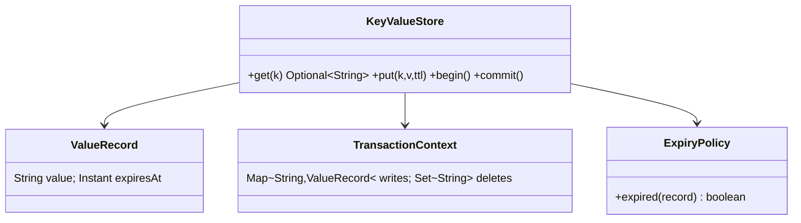

### 4. Main-flow sequence
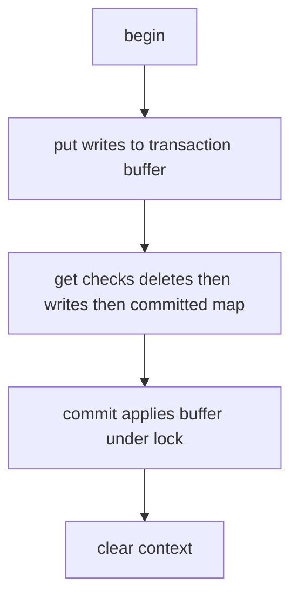

### 5. Design patterns used & why
Memento-like transaction context, Strategy for expiry policy, Command log for persistence extension.

### 6. Complete, compilable Java code
```java
import java.time.Duration;
import java.time.Instant;
import java.util.ArrayDeque;
import java.util.Deque;
import java.util.HashMap;
import java.util.Map;
import java.util.Optional;
import java.util.concurrent.ConcurrentHashMap;
import java.util.concurrent.Executors;
import java.util.concurrent.ScheduledExecutorService;
import java.util.concurrent.TimeUnit;

public class KeyValueStoreDemo {
    record Rec(String value, Instant expiresAt) {
        boolean expired() {
            return expiresAt != null && !Instant.now().isBefore(expiresAt);
        }
    }

    static class Store implements AutoCloseable {
        private static final Rec TOMBSTONE = new Rec(null, null);
        private final Map<String, Rec> data = new ConcurrentHashMap<>();
        private final ThreadLocal<Deque<Map<String, Rec>>> txStack = ThreadLocal.withInitial(ArrayDeque::new);
        private final ScheduledExecutorService sweeper = Executors.newSingleThreadScheduledExecutor(task -> {
            Thread thread = new Thread(task, "kv-expirer");
            thread.setDaemon(true);
            return thread;
        });

        Store() {
            sweeper.scheduleAtFixedRate(this::cleanupExpired, 1, 1, TimeUnit.SECONDS);
        }

        void begin() {
            txStack.get().push(new HashMap<>());
        }

        void put(String key, String value, Duration ttl) {
            Rec rec = new Rec(value, ttl == null ? null : Instant.now().plus(ttl));
            currentTx().ifPresentOrElse(tx -> tx.put(key, rec), () -> data.put(key, rec));
        }

        void delete(String key) {
            currentTx().ifPresentOrElse(tx -> tx.put(key, TOMBSTONE), () -> data.remove(key));
        }

        Optional<String> get(String key) {
            for (Map<String, Rec> tx : txStack.get()) {
                if (tx.containsKey(key)) {
                    return visible(tx.get(key));
                }
            }

            Rec rec = data.get(key);
            if (rec != null && rec.expired()) {
                data.remove(key, rec);
                return Optional.empty();
            }

            return visible(rec);
        }

        synchronized void commit() {
            Deque<Map<String, Rec>> stack = txStack.get();
            if (stack.isEmpty()) {
                throw new IllegalStateException("no transaction");
            }

            Map<String, Rec> child = stack.pop();
            if (!stack.isEmpty()) {
                stack.peek().putAll(child);
                return;
            }

            for (Map.Entry<String, Rec> entry : child.entrySet()) {
                if (entry.getValue() == TOMBSTONE) {
                    data.remove(entry.getKey());
                } else {
                    data.put(entry.getKey(), entry.getValue());
                }
            }

            txStack.remove();
        }

        void rollback() {
            Deque<Map<String, Rec>> stack = txStack.get();
            if (stack.isEmpty()) {
                throw new IllegalStateException("no transaction");
            }

            stack.pop();
            if (stack.isEmpty()) {
                txStack.remove();
            }
        }

        private Optional<Map<String, Rec>> currentTx() {
            Deque<Map<String, Rec>> stack = txStack.get();
            return stack.isEmpty() ? Optional.empty() : Optional.of(stack.peek());
        }

        private Optional<String> visible(Rec rec) {
            if (rec == null || rec == TOMBSTONE || rec.expired()) {
                return Optional.empty();
            }

            return Optional.of(rec.value());
        }

        private void cleanupExpired() {
            data.entrySet().removeIf(entry -> entry.getValue().expired());
        }

        @Override
        public void close() {
            sweeper.shutdownNow();
        }
    }

    public static void main(String[] args) {
        try (Store store = new Store()) {
            store.begin();
            store.put("x", "1", null);
            store.commit();
            System.out.println(store.get("x"));
        }
    }
}
```

### 7. Thread-safety
ConcurrentHashMap is enough for independent operations; commit should be synchronized to atomically publish a transaction batch.

### 8. Extensibility
- Add nested transactions using stack of contexts.
- Add snapshot and append-only log.
- Add eviction policy.
- Add compare-and-set operation.

### 9. JUnit 5 test examples
```java
import static org.junit.jupiter.api.Assertions.*;

import java.time.Duration;
import org.junit.jupiter.api.Test;

class KeyValueStoreDemoTest {
    @Test
    void rollbackHidesWrite() {
        try (KeyValueStoreDemo.Store store = new KeyValueStoreDemo.Store()) {
            store.begin();
            store.put("a", "b", null);
            store.rollback();

            assertTrue(store.get("a").isEmpty());
        }
    }

    @Test
    void nestedCommitMergesIntoParent() {
        try (KeyValueStoreDemo.Store store = new KeyValueStoreDemo.Store()) {
            store.begin();
            store.begin();
            store.put("a", "b", null);
            store.commit();
            store.commit();

            assertEquals("b", store.get("a").orElseThrow());
        }
    }

    @Test
    void nestedRollbackKeepsParentWrite() {
        try (KeyValueStoreDemo.Store store = new KeyValueStoreDemo.Store()) {
            store.begin();
            store.put("a", "parent", null);
            store.begin();
            store.put("a", "child", null);
            store.rollback();
            store.commit();

            assertEquals("parent", store.get("a").orElseThrow());
        }
    }

    @Test
    void ttlExpiresLazily() {
        try (KeyValueStoreDemo.Store store = new KeyValueStoreDemo.Store()) {
            store.put("a", "b", Duration.ofMillis(-1));

            assertTrue(store.get("a").isEmpty());
        }
    }
}
```

### 10. Interviewer follow-ups with short answers · Common mistakes
- *TTL cleanup eager or lazy?* → Lazy on read is simple; background sweeper reduces memory.
- *Isolation level?* → This simple version is read-your-writes, commit is atomic but not serializable for conflicts.
- Mistakes: returning expired values, leaking ThreadLocal, no rollback path.

## 4. Design Pub-Sub / Message Queue
Tier 2 · SDE-2 must-know

### 0. Beginner primer

**Terminology and problem:** Publish-subscribe (Pub-Sub) lets producers write messages to a topic while
independent subscribers consume them. A queue usually distributes work; Pub-Sub gives each subscription its
own logical stream.

**Mental model and flow:** A topic is an append-only log, offsets are bookmarks, and acknowledgment means a
consumer finished processing. Publish → assign stable message identifier and append → dispatch/poll →
handler processes → acknowledge advances offset; failure retries and may dead-letter. Observer is only an
in-process cousin, not a durable replacement. Scale by partitioning topics, ordering within a partition,
applying backpressure, persisting offsets, and making consumers idempotent because at-least-once delivery
can duplicate messages.

**Responsibility map:**

| Class or interface | Responsibility | Key methods and contract | Relationships |
| --- | --- | --- | --- |
| PubSubDemo | Demo namespace and executable sample for topic, poll, and acknowledgement. | main(String[] args) creates a Broker, publishes one message, polls it, prints it, acknowledges it, and propagates Optional.orElseThrow if no message exists. | Owns message, topic, and broker types. |
| Message | Immutable log entry. | Canonical record constructor takes offset and payload; accessors return values; it mutates nothing and performs no validation. | Stored in Topic log and returned by poll methods. |
| Topic | Owns append-only message log and per-subscriber next offset. | publish(payload) is synchronized, appends a Message, returns its offset, and mutates the log. poll(subscriber) is synchronized, returns Optional.empty when caught up or the next Message without advancing state. ack(subscriber, offset) is synchronized, advances only when offset equals the expected next offset, returns void, and ignores wrong acknowledgements. | Used by Broker and stores Message records. |
| Broker | Owns named topics and delegates publish, poll, and ack. | topic(name) is synchronized, creates or returns a Topic. publish(topic, payload), poll(topic, subscriber), and ack(topic, subscriber, offset) delegate to the named Topic and inherit its return and failure behavior. | Stores Topic objects by name. |
| PubSubDemoTest | JUnit 5 tests for subscriber offsets and ordering. | ackAdvancesOnlyThatSubscriber, messagesAreDeliveredInOrder, and wrongAckDoesNotSkipMessage create local brokers, return void, and fail through assertions. | Exercises Broker, Topic, and Message. |

### 1. Clarifying questions & requirements
- Topics, publishers, subscribers; message ordering per topic partition.
- At-least-once delivery; ack advances subscriber offset.
- Backpressure and retention are extensions.

### 2. Entities & relationships
Topic has partitions; Message has offset; Subscription tracks subscriber offset.

### 3. Class diagram
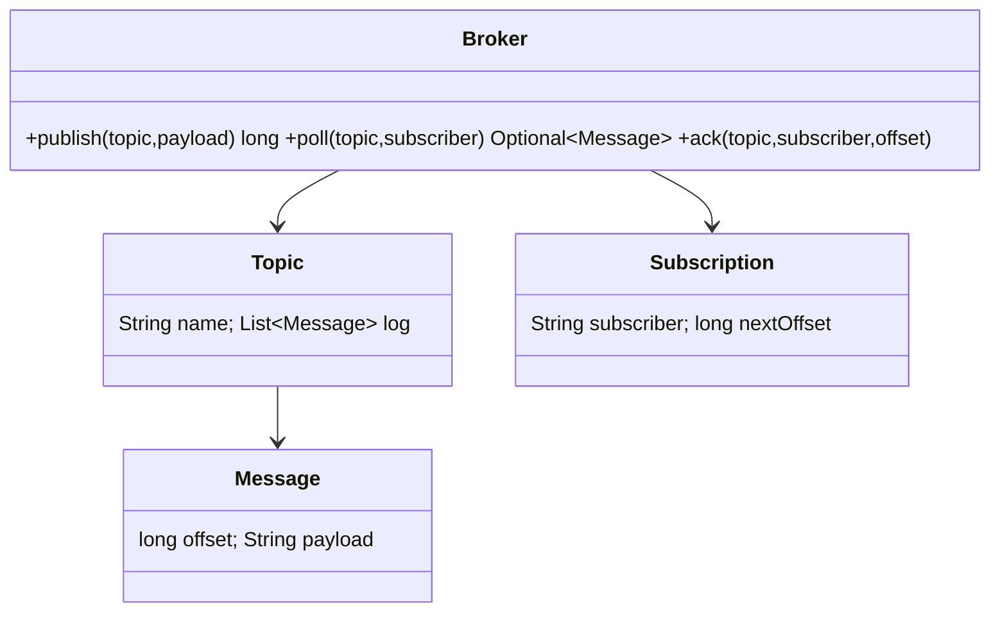

### 4. Main-flow sequence
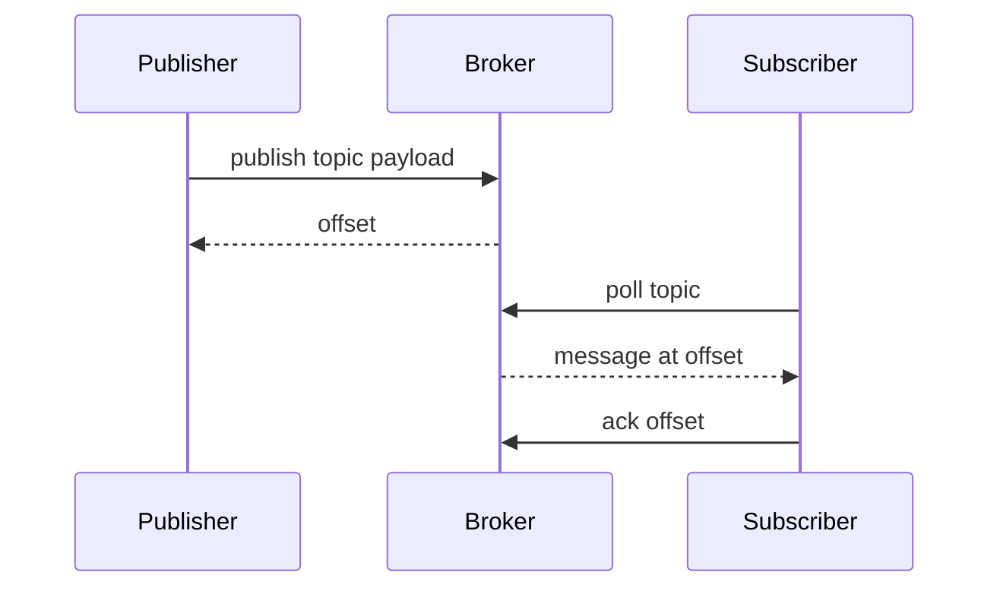

### 5. Design patterns used & why
Observer concept for subscription, Iterator for polling log by offset, Strategy for partitioning.

### 6. Complete, compilable Java code
```java
import java.util.ArrayList;
import java.util.HashMap;
import java.util.List;
import java.util.Map;
import java.util.Optional;

public class PubSubDemo {
    record Message(long offset, String payload) {}

    static class Topic {
        private final List<Message> log = new ArrayList<>();
        private final Map<String, Long> nextOffsetBySubscriber = new HashMap<>();

        synchronized long publish(String payload) {
            long offset = log.size();
            log.add(new Message(offset, payload));
            return offset;
        }

        synchronized Optional<Message> poll(String subscriber) {
            long next = nextOffsetBySubscriber.getOrDefault(subscriber, 0L);
            if (next >= log.size()) {
                return Optional.empty();
            }

            return Optional.of(log.get((int) next));
        }

        synchronized void ack(String subscriber, long offset) {
            long expected = nextOffsetBySubscriber.getOrDefault(subscriber, 0L);
            if (offset == expected) {
                nextOffsetBySubscriber.put(subscriber, offset + 1);
            }
        }
    }

    static class Broker {
        private final Map<String, Topic> topics = new HashMap<>();

        synchronized Topic topic(String name) {
            return topics.computeIfAbsent(name, ignored -> new Topic());
        }

        long publish(String topic, String payload) {
            return topic(topic).publish(payload);
        }

        Optional<Message> poll(String topic, String subscriber) {
            return topic(topic).poll(subscriber);
        }

        void ack(String topic, String subscriber, long offset) {
            topic(topic).ack(subscriber, offset);
        }
    }

    public static void main(String[] args) {
        Broker broker = new Broker();
        broker.publish("orders", "o1");
        Message message = broker.poll("orders", "worker").orElseThrow();
        System.out.println(message);
        broker.ack("orders", "worker", message.offset());
    }
}
```

### 7. Thread-safety
Synchronize append and offset movement per topic/partition. In production, append-only log plus durable offset commits are required.

### 8. Extensibility
- Add partitions and consumer groups.
- Add retention by time/size.
- Add DLQ for poison messages.
- Add visibility timeout for queue semantics.

### 9. JUnit 5 test examples
```java
import static org.junit.jupiter.api.Assertions.*;

import org.junit.jupiter.api.Test;

class PubSubDemoTest {
    @Test
    void ackAdvancesOnlyThatSubscriber() {
        PubSubDemo.Broker broker = new PubSubDemo.Broker();
        broker.publish("t", "a");
        PubSubDemo.Message message = broker.poll("t", "s1").orElseThrow();
        broker.ack("t", "s1", message.offset());

        assertTrue(broker.poll("t", "s1").isEmpty());
        assertEquals("a", broker.poll("t", "s2").orElseThrow().payload());
    }

    @Test
    void messagesAreDeliveredInOrder() {
        PubSubDemo.Broker broker = new PubSubDemo.Broker();
        broker.publish("t", "a");
        broker.publish("t", "b");

        PubSubDemo.Message first = broker.poll("t", "s").orElseThrow();
        broker.ack("t", "s", first.offset());

        assertEquals("b", broker.poll("t", "s").orElseThrow().payload());
    }

    @Test
    void wrongAckDoesNotSkipMessage() {
        PubSubDemo.Broker broker = new PubSubDemo.Broker();
        broker.publish("t", "a");
        broker.ack("t", "s", 99);

        assertEquals("a", broker.poll("t", "s").orElseThrow().payload());
    }
}
```

### 10. Interviewer follow-ups with short answers · Common mistakes
- *Queue vs pub-sub?* → Queue load-balances among consumers; pub-sub gives each subscription its own offset.
- *Exactly-once?* → Usually achieved by idempotent consumers plus transactional outbox, not broker magic.
- Mistakes: deleting message after one subscriber, no ack model, no poison-message strategy.

## 5. Design Task / Job Scheduler
Tier 2 · SDE-2 must-know

### 0. Beginner primer

**Problem and mental model:** Accept one-time or recurring jobs, run them when due, retry failures, and avoid
accidental duplicate execution. The schedule determines *when*; the executor determines *how* work runs.

**Recognition and flow:** Command represents executable work; Strategy fits retry and recurrence; State fits
job lifecycle. Persist job → place next-run time in priority queue/timing wheel → dispatcher claims due job
with lease → worker executes → record success or calculate retry/next occurrence. A local timer is simplest
but loses work on restart. Distributed scheduling needs durable jobs, leader or partition ownership,
leases/fencing, bounded worker queues, idempotent handlers, and monitoring for missed or stuck jobs.

**Responsibility map:**

| Class or interface | Responsibility | Key methods and contract | Relationships |
| --- | --- | --- | --- |
| SchedulerDemo | Demo namespace and executable sample for delayed jobs. | main(String[] args) creates a Scheduler, schedules an immediate Job, runs one due job, and closes worker resources. | Owns Job and Scheduler types. |
| Job | Delayed unit of work. | Constructor Job(id, task, delay) stores id, task, and due time. getDelay(unit) returns remaining delay in the requested TimeUnit and mutates nothing. compareTo(other) orders jobs by remaining delay. Failures come from invalid task input or later task execution, not from the delay methods. | Implemented as Delayed and consumed by DelayQueue in Scheduler. |
| Scheduler | Owns due-job queue, worker pool, dispatcher lifecycle, and test helper execution. | schedule(job) enqueues a Job. start() atomically starts one daemon dispatcher and returns without error if already running. runDueOnce() blocks until one job is due, submits it, waits for completion, and throws task or interruption exceptions through Future.get. queuedJobs() returns queue size. dispatchLoop() continuously submits due jobs and exits on interruption. close() stops running, interrupts dispatcher, and shuts workers down. | Uses a DelayQueue of Job, ExecutorService, AtomicBoolean, and Thread. |
| SchedulerDemoTest | JUnit 5 test for queued and due work. | queuedJobsReflectsPendingWork creates a Scheduler, schedules work, returns void, and fails through assertions if queue behavior changes. | Exercises Scheduler and Job. |

### 1. Clarifying questions & requirements
- Schedule one-time and recurring jobs; execute when due.
- Retry failed jobs with backoff; avoid duplicate execution across workers.
- Jobs have priority, timeout, and status.

### 2. Entities & relationships
Job has trigger, nextRunAt, handler, status; Scheduler owns priority queue and worker pool.

### 3. Class diagram
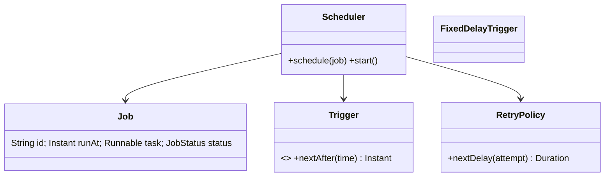

### 4. Main-flow sequence
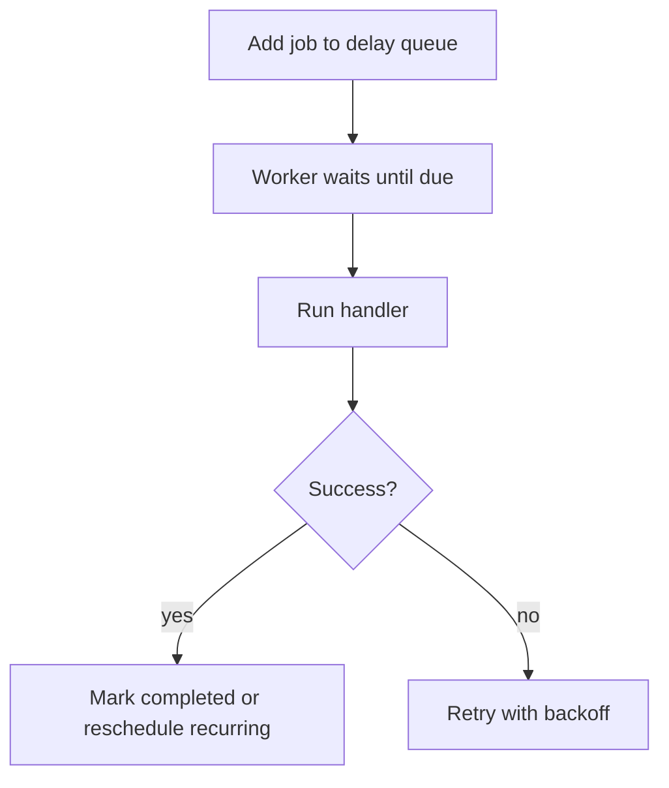

### 5. Design patterns used & why
Command for job task, Strategy for trigger/retry policy, Template for execution lifecycle.

### 6. Complete, compilable Java code
```java
import java.time.Duration;
import java.util.concurrent.DelayQueue;
import java.util.concurrent.Delayed;
import java.util.concurrent.ExecutorService;
import java.util.concurrent.Executors;
import java.util.concurrent.Future;
import java.util.concurrent.TimeUnit;
import java.util.concurrent.atomic.AtomicBoolean;

public class SchedulerDemo {
    static class Job implements Delayed {
        final String id;
        final Runnable task;
        final long dueAtMillis;

        Job(String id, Runnable task, Duration delay) {
            this.id = id;
            this.task = task;
            this.dueAtMillis = System.currentTimeMillis() + delay.toMillis();
        }

        @Override
        public long getDelay(TimeUnit unit) {
            return unit.convert(dueAtMillis - System.currentTimeMillis(), TimeUnit.MILLISECONDS);
        }

        @Override
        public int compareTo(Delayed other) {
            return Long.compare(getDelay(TimeUnit.MILLISECONDS), other.getDelay(TimeUnit.MILLISECONDS));
        }
    }

    static class Scheduler implements AutoCloseable {
        private final DelayQueue<Job> queue = new DelayQueue<>();
        private final ExecutorService workers;
        private final AtomicBoolean running = new AtomicBoolean(false);
        private Thread dispatcher;

        Scheduler(int workerCount) {
            this.workers = Executors.newFixedThreadPool(workerCount);
        }

        void schedule(Job job) {
            queue.add(job);
        }

        void start() {
            if (!running.compareAndSet(false, true)) {
                return;
            }

            dispatcher = new Thread(this::dispatchLoop, "scheduler-dispatcher");
            dispatcher.setDaemon(true);
            dispatcher.start();
        }

        void runDueOnce() throws Exception {
            Job job = queue.take();
            Future<?> future = workers.submit(job.task);
            future.get();
        }

        int queuedJobs() {
            return queue.size();
        }

        private void dispatchLoop() {
            while (running.get()) {
                try {
                    Job job = queue.take();
                    workers.submit(job.task);
                } catch (InterruptedException ex) {
                    Thread.currentThread().interrupt();
                    return;
                }
            }
        }

        @Override
        public void close() {
            running.set(false);
            if (dispatcher != null) {
                dispatcher.interrupt();
            }

            workers.shutdownNow();
        }
    }

    public static void main(String[] args) throws Exception {
        try (Scheduler scheduler = new Scheduler(2)) {
            scheduler.schedule(new Job("j", () -> System.out.println("ran"), Duration.ZERO));
            scheduler.runDueOnce();
        }
    }
}
```

### 7. Thread-safety
DelayQueue is thread-safe. For distributed schedulers, workers claim due jobs using conditional update from `SCHEDULED` to `RUNNING`.

### 8. Extensibility
- Add cron trigger.
- Add retry count and DLQ.
- Add job dependencies.
- Add worker heartbeat and timeout recovery.

### 9. JUnit 5 test examples
```java
import static org.junit.jupiter.api.Assertions.*;

import java.time.Duration;
import java.util.concurrent.atomic.AtomicBoolean;
import java.util.concurrent.atomic.AtomicInteger;
import org.junit.jupiter.api.Test;

class SchedulerDemoTest {
    @Test
    void runsDueJobOnWorkerPool() throws Exception {
        try (SchedulerDemo.Scheduler scheduler = new SchedulerDemo.Scheduler(2)) {
            AtomicBoolean ran = new AtomicBoolean();
            scheduler.schedule(new SchedulerDemo.Job("j", () -> ran.set(true), Duration.ZERO));
            scheduler.runDueOnce();

            assertTrue(ran.get());
        }
    }

    @Test
    void delayQueueOrdersByDueTime() throws Exception {
        try (SchedulerDemo.Scheduler scheduler = new SchedulerDemo.Scheduler(1)) {
            AtomicInteger value = new AtomicInteger();
            scheduler.schedule(new SchedulerDemo.Job("late", () -> value.set(2), Duration.ofMillis(50)));
            scheduler.schedule(new SchedulerDemo.Job("now", () -> value.set(1), Duration.ZERO));
            scheduler.runDueOnce();

            assertEquals(1, value.get());
        }
    }

    @Test
    void queuedJobsReflectsPendingWork() {
        try (SchedulerDemo.Scheduler scheduler = new SchedulerDemo.Scheduler(1)) {
            scheduler.schedule(new SchedulerDemo.Job("j", () -> {}, Duration.ofSeconds(1)));

            assertEquals(1, scheduler.queuedJobs());
        }
    }
}
```

### 10. Interviewer follow-ups with short answers · Common mistakes
- *How to avoid duplicate jobs?* → Atomic claim plus idempotent handler.
- *How to schedule recurring?* → Trigger computes next time after successful execution.
- Mistakes: busy-wait loop, no failure handling, no max retry limit.

## 6. Design Car Rental
Tier 2 · SDE-2 must-know

### 0. Beginner primer

**Problem and mental model:** A customer searches vehicles for a time/location, reserves one, picks it up,
returns it, and pays. `Vehicle` is the asset; `Reservation` claims a time range; `Rental` records actual use.

**Recognition and flow:** State fits reservation/rental lifecycle; Strategy fits pricing and vehicle
selection; Repository hides fleet storage. Search availability → recheck and reserve atomically → authorize
payment → hand over vehicle → inspect return → calculate final charge → close rental. Separating planned
reservation from actual rental handles late pickup/return. Scale by branch/region, index availability,
prevent overlaps transactionally, integrate telematics through adapters, and audit damage/maintenance state.

**Responsibility map:**

| Class or interface | Responsibility | Key methods and contract | Relationships |
| --- | --- | --- | --- |
| CarRentalDemo | Demo namespace and executable sample for vehicle reservation. | main(String[] args) creates a vehicle, reserves it for one day, prints reservation id, and propagates availability failures. | Owns range, vehicle, reservation, and rental service types. |
| Range | Immutable rental date interval. | overlaps(Range other) returns true when ranges intersect and false for back-to-back ranges; it mutates nothing and has no explicit failure path. | Used by RentalService.search and reserve. |
| Vehicle | Immutable rentable resource. | Canonical record constructor receives id and type; accessors return values; it mutates nothing and performs no validation. | Stored by RentalService and referenced by Reservation. |
| Reservation | Immutable rental booking. | Canonical record constructor receives id, vehicle, and range; accessors return values; it mutates nothing and performs no validation. | Created and stored by RentalService. |
| RentalService | Owns type-based search and synchronized reservation creation. | search(type, range) returns vehicles of that type without overlapping reservations and mutates no state. reserve(vehicle, range) is synchronized, verifies the vehicle is still available, stores and returns a Reservation, and throws IllegalStateException when unavailable. | Reads Vehicle list and writes Reservation list. |
| CarRentalDemoTest | JUnit 5 tests for overlap and type filtering. | rejectsOverlap, backToBackRentalAllowed, and searchFiltersByVehicleType create local services and ranges, return void, and fail through assertions or expected exceptions. | Exercises Range and RentalService. |

### 1. Clarifying questions & requirements
- Search cars by location, type, date range; reserve, pay, pickup, return.
- Avoid double booking; inspect damages/fuel and compute late fee.
- Support branches and vehicle inventory.

### 2. Entities & relationships
Branch has Vehicles; Reservation references Vehicle, Customer, TimeRange, Payment, Invoice.

### 3. Class diagram
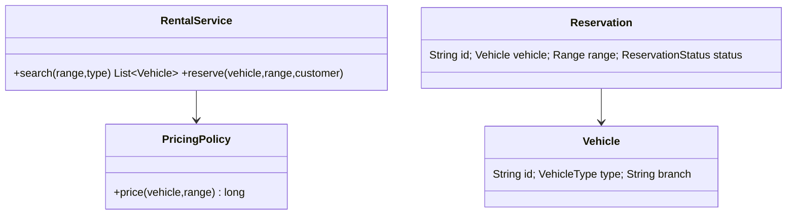

### 4. Main-flow sequence
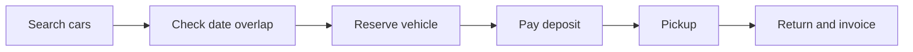

### 5. Design patterns used & why
Strategy for pricing, State for reservation status, Specification for vehicle filters.

### 6. Complete, compilable Java code
```java

import java.time.*;
import java.util.*;

public class CarRentalDemo{
    record Range(LocalDate start,LocalDate end){
        boolean overlaps(Range o){
            return start.isBefore(o.end)&&o.start.isBefore(end);
        }
    }

    record Vehicle(String id,String type){
    }

    record Reservation(String id,Vehicle vehicle,Range range){
    }

    static class RentalService{
        private final List<Vehicle> cars;
        private final List<Reservation> reservations=new ArrayList<>();
        RentalService(List<Vehicle> cars){
            this.cars=cars;
        }

        List<Vehicle> search(String type,Range r){
            return cars.stream()
                    .filter(c -> c.type().equals(type))
                    .filter(c -> reservations.stream()
                            .noneMatch(x -> x.vehicle().equals(c)&&x.range().overlaps(r)))
                    .toList();
        }

        synchronized Reservation reserve(Vehicle v,Range r){
            if(!search(v.type(),r).contains(v))throw new IllegalStateException("unavailable");
            Reservation res=new Reservation(UUID.randomUUID().toString(),v,r);
            reservations.add(res);
            return res;
        }
    }

    public static void main(String[]a){
        var car=new Vehicle("C1","SUV");
        System.out.println(new RentalService(List.of(car))
                .reserve(car,new Range(LocalDate.now(),LocalDate.now().plusDays(1))).id());
    }
}
```

### 7. Thread-safety
Same as room booking: transaction wraps overlap check and insert; add DB constraint where possible.

### 8. Extensibility
- Dynamic pricing by season.
- Add driver/license validation.
- Add damage claim workflow.
- Add one-way branch drop.

### 9. JUnit 5 test examples
```java
import static org.junit.jupiter.api.Assertions.*;

import java.time.LocalDate;
import java.util.List;
import org.junit.jupiter.api.Test;

class CarRentalDemoTest {
    @Test
    void rejectsOverlap() {
        var car = new CarRentalDemo.Vehicle("C", "SEDAN");
        var service = new CarRentalDemo.RentalService(List.of(car));
        var range = new CarRentalDemo.Range(LocalDate.now(), LocalDate.now().plusDays(2));
        service.reserve(car, range);

        assertThrows(IllegalStateException.class, () -> service.reserve(car, range));
    }

    @Test
    void backToBackRentalAllowed() {
        var car = new CarRentalDemo.Vehicle("C", "SEDAN");
        var service = new CarRentalDemo.RentalService(List.of(car));
        LocalDate today = LocalDate.now();
        service.reserve(car, new CarRentalDemo.Range(today, today.plusDays(1)));

        assertDoesNotThrow(() -> service.reserve(
                car, new CarRentalDemo.Range(today.plusDays(1), today.plusDays(2))));
    }

    @Test
    void searchFiltersByVehicleType() {
        var sedan = new CarRentalDemo.Vehicle("S", "SEDAN");
        var suv = new CarRentalDemo.Vehicle("U", "SUV");
        var service = new CarRentalDemo.RentalService(List.of(sedan, suv));
        var range = new CarRentalDemo.Range(LocalDate.now(), LocalDate.now().plusDays(1));

        assertEquals(List.of(suv), service.search("SUV", range));
    }
}
```

### 10. Interviewer follow-ups with short answers · Common mistakes
- *How to model late fee?* → PricingPolicy compares actual return time to expected end.
- *How to handle maintenance?* → Maintenance blocks are reservations by system user.
- Mistakes: no time-range conflict check, no branch separation, no status lifecycle.

## 7. Design Stack Overflow
Tier 2 · SDE-2 must-know

### 0. Beginner primer

**Problem and mental model:** Users ask questions, post answers/comments, vote, tag content, and accept one
answer. Content owns text and lifecycle; votes are separate user-content relationships; reputation is a
derived policy-driven score.

**Recognition and flow:** Strategy fits reputation rules and ranking; Observer/Event Bus fits secondary
notifications; Repository hides storage. Validate user → create content → index for search → accept votes
idempotently → update aggregates/reputation → notify asynchronously. Do not store only a mutable vote count;
preserve one vote per user for audit and correction. Scale reads with caches/search indexes, partition by
content identifier, and moderate through explicit states and events.

**Responsibility map:**

| Class or interface | Responsibility | Key methods and contract | Relationships |
| --- | --- | --- | --- |
| StackOverflowDemo | Demo namespace and executable sample for questions and answers. | main(String[] args) asks a question, adds an answer, accepts it, prints accepted state, and propagates service failures. | Owns answer, question, and service types. |
| Answer | Mutable answer aggregate. | Constructor Answer(body) initializes id, body, zero votes, and accepted=false; it returns no value and throws no explicit exception. | Stored inside Question and mutated by Service.accept and Service.vote. |
| Question | Mutable question aggregate. | Constructor Question(title) initializes id, title, and empty answers list; it returns no value and throws no explicit exception. | Stored by Service and owns Answer objects. |
| Service | Owns question creation, answer creation, acceptance, and voting. | ask(title) creates and stores a Question and returns it. answer(qid, body) creates an Answer, adds it to the question, returns it, and may throw NullPointerException for an unknown qid. accept(qid, aid) marks only the matching answer accepted and unaccepts others; an unknown qid may throw NullPointerException, while an unknown aid unaccepts all answers. vote(qid, aid, delta) adds delta to the matching answer votes and throws NoSuchElementException when the answer is absent. | Stores Question objects and mutates Answer fields. |
| StackOverflowDemoTest | JUnit 5 tests for acceptance and voting. | acceptsOne, acceptingSecondAnswerUnacceptsFirst, and voteUpdatesAnswerScore create local services, return void, and fail through assertions. | Exercises Service, Question, and Answer. |

### 1. Clarifying questions & requirements
- Users ask questions, answer, comment, vote, accept answer, tag questions.
- Reputation changes from accepted answers/upvotes.
- Search by tag/text is an extension.

### 2. Entities & relationships
Question has Answers, Comments, Tags; Vote references user and target; User has reputation.

### 3. Class diagram
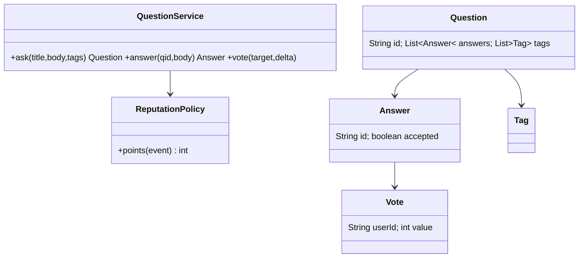

### 4. Main-flow sequence
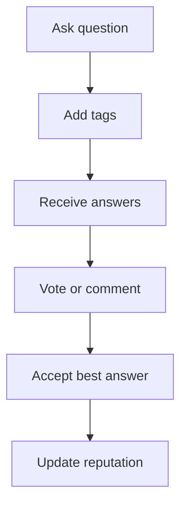

### 5. Design patterns used & why
Strategy for reputation policy, Composite-ish commentable/votable targets, Repository for content.

### 6. Complete, compilable Java code
```java

import java.util.*;

public class StackOverflowDemo{
    static class Answer{
        final String id=UUID.randomUUID().toString();
        final String body;
        int votes;
        boolean accepted;
        Answer(String body){
            this.body=body;
        }
    }

    static class Question{
        final String id=UUID.randomUUID().toString();
        final String title;
        final List<Answer> answers=new ArrayList<>();
        Question(String title){
            this.title=title;
        }
    }

    static class Service{
        private final Map<String,
        Question> qs=new HashMap<>();
        Question ask(String title){
            Question q=new Question(title);
            qs.put(q.id,q);
            return q;
        }

        Answer answer(String qid,String body){
            Answer a=new Answer(body);
            qs.get(qid).answers.add(a);
            return a;
        }

        void accept(String qid,String aid){
            Question q=qs.get(qid);
            q.answers.forEach(x->x.accepted=x.id.equals(aid));
        }

        void vote(String qid,String aid,int delta){
            qs.get(qid).answers.stream().filter(a->a.id.equals(aid)).findFirst().orElseThrow().votes+=delta;
        }
    }

    public static void main(String[]a){
        var s=new Service();
        var q=s.ask("What is SOLID?");
        var ans=s.answer(q.id,"Principles");
        s.accept(q.id,ans.id);
        System.out.println(ans.accepted);
    }
}
```

### 7. Thread-safety
Use unique `(user_id, target_id)` for votes. Accepting answer and reputation update should be transactional.

### 8. Extensibility
- Add badges and moderation.
- Add full-text search.
- Add edit history.
- Add duplicate question linking.

### 9. JUnit 5 test examples
```java
import static org.junit.jupiter.api.Assertions.*;

import org.junit.jupiter.api.Test;

class StackOverflowDemoTest {
    @Test
    void acceptsOne() {
        var service = new StackOverflowDemo.Service();
        var question = service.ask("q");
        var answer = service.answer(question.id, "a");
        service.accept(question.id, answer.id);

        assertTrue(answer.accepted);
    }

    @Test
    void acceptingSecondAnswerUnacceptsFirst() {
        var service = new StackOverflowDemo.Service();
        var question = service.ask("q");
        var first = service.answer(question.id, "a1");
        var second = service.answer(question.id, "a2");
        service.accept(question.id, first.id);
        service.accept(question.id, second.id);

        assertFalse(first.accepted);
        assertTrue(second.accepted);
    }

    @Test
    void voteUpdatesAnswerScore() {
        var service = new StackOverflowDemo.Service();
        var question = service.ask("q");
        var answer = service.answer(question.id, "a");
        service.vote(question.id, answer.id, 1);

        assertEquals(1, answer.votes);
    }
}
```

### 10. Interviewer follow-ups with short answers · Common mistakes
- *How to prevent duplicate votes?* → Vote table unique key per user-target.
- *How to store edits?* → Append `PostRevision` rows; current post points to latest.
- Mistakes: allowing multiple accepted answers, no reputation transaction, no tag normalization.

## 8. Design Chess
Tier 2 · SDE-2 must-know

### 0. Beginner primer

**Problem and mental model:** Two players alternate legal moves until checkmate, draw, or resignation.
`Board` stores positions, each `Piece` generates candidate movement, and `Game` enforces turns/history.
Legality also requires simulating a move to ensure the player’s own king is not left in check.

**Recognition and flow:** Strategy fits player/bot move choice; Command/Memento fits move history and undo;
Factory creates initial pieces. Validate turn and ownership → generate movement candidates → apply move to
a reversible board state → reject if own king is attacked → commit history → update special rights and game
status. Encoding every piece in one switch is simpler initially but grows brittle. Extensions include clocks,
notation, repetition detection, promotion, castling, en passant, bot search, and network-authoritative turns.

**Responsibility map:**

| Class or interface | Responsibility | Key methods and contract | Relationships |
| --- | --- | --- | --- |
| ChessDemo | Demo namespace and executable sample for board moves. | main(String[] args) creates a Game, places a white rook, moves it, prints next turn, and propagates illegal-move failures. | Owns color, position, rule, piece, board, and game types. |
| Color | Player side marker. | Constants WHITE and BLACK carry no methods or state changes; Game toggles between them after a successful move. | Stored in Piece and Game.turn. |
| Pos | Immutable board coordinate. | Canonical record constructor receives row and column; accessors return values; it mutates nothing and performs no validation. | Used as keys in Board map and passed to Rule. |
| Rule | Piece movement validation contract. | ok(board, from, to) receives board and positions, returns true if movement shape is legal, mutates no state, and leaves failure decisions to Board.move. | Implemented by RookRule and stored in Piece. |
| RookRule | Movement rule for a rook. | ok(board, from, to) returns true when row or column is unchanged, mutates nothing, and does not check blockers in this simplified demo. | Implements Rule and is held by Piece. |
| Piece | Mutable-by-reference chess piece descriptor. | Constructor Piece(color, rule) stores color and movement rule; it returns no value and throws no explicit exception. | Stored in Board map and consulted by Board.move. |
| Board | Owns piece placement and legal move enforcement. | put(position, piece) stores or replaces a piece and returns void. at(position) returns the piece or null. move(from, to, turn) validates source, turn, rule, and own-piece capture, mutates the map by moving the piece, returns void, and throws IllegalStateException for illegal moves. | Stores Piece by Pos and calls Piece.rule. |
| Game | Owns turn order over a Board. | move(from, to) delegates to Board.move with current turn, toggles turn only after success, returns void, and propagates Board exceptions. | Contains Board and Color turn. |
| ChessDemoTest | JUnit 5 tests for rook movement and own-piece capture. | rookMovesStraight, rookCannotMoveDiagonally, and cannotCaptureOwnPiece create local games or boards, return void, and fail through assertions or expected exceptions. | Exercises Game, Board, RookRule, Piece, and Color. |

### 1. Clarifying questions & requirements
- Model board, pieces, legal moves, turns, check/checkmate basics.
- Support move validation and game history; full engine AI not required.
- Special moves can be extension: castling, en passant, promotion.

### 2. Entities & relationships
Game has Board, Players, Move history; Board has Pieces; Piece has MoveStrategy.

### 3. Class diagram
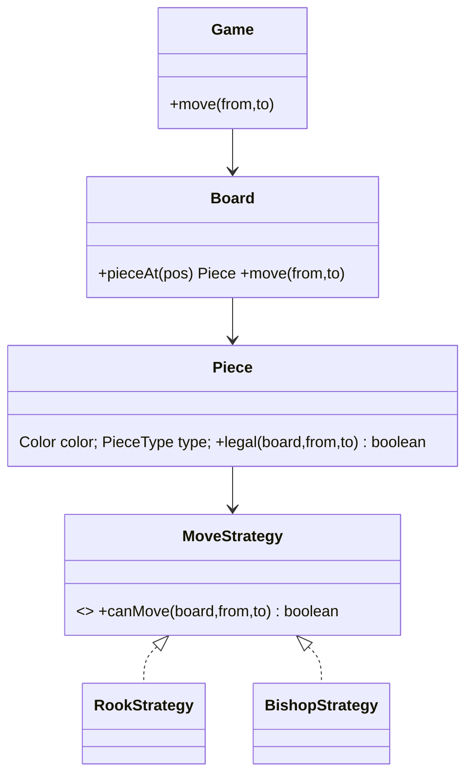

### 4. Main-flow sequence
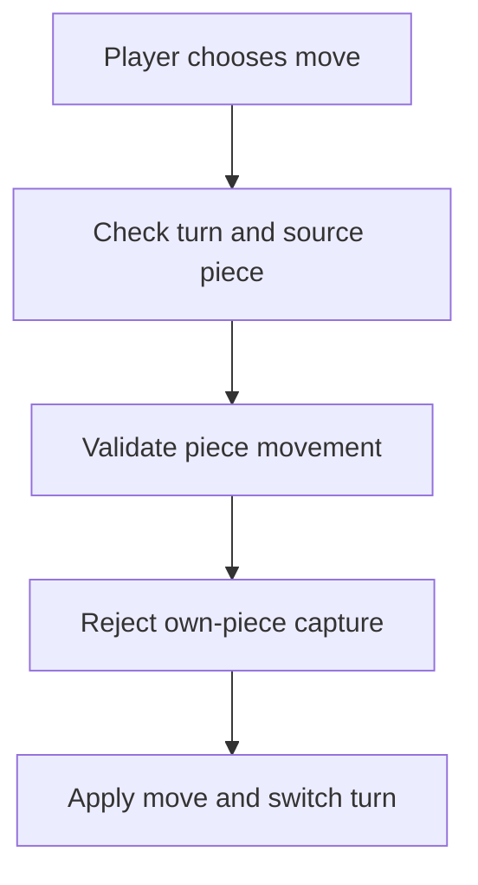

### 5. Design patterns used & why
Strategy for piece movement, State for game status, Command/Memento for move history and undo.

### 6. Complete, compilable Java code
```java

import java.util.*;

public class ChessDemo{
    enum Color{
        WHITE,
        BLACK
    }

    record Pos(int r,int c){
    }

    interface Rule{
        boolean ok(Board b,Pos f,Pos t);
    }

    static class RookRule implements Rule{
        public boolean ok(Board b,Pos f,Pos t){
            return f.r()==t.r()||f.c()==t.c();
        }
    }

    static class Piece{
        final Color color;
        final Rule rule;
        Piece(Color c,Rule r){
            color=c;
            rule=r;
        }
    }

    static class Board{
        private final Map<Pos,
        Piece> m=new HashMap<>();
        void put(Pos p,Piece pc){
            m.put(p,pc);
        }

        Piece at(Pos p){
            return m.get(p);
        }

        void move(Pos f,Pos t,Color turn){
            Piece p=m.get(f);
            if(p==null||p.color!=turn||!p.rule.ok(this,f,t))throw new IllegalStateException("illegal");
            Piece dest=m.get(t);
            if(dest!=null&&dest.color==p.color)throw new IllegalStateException("own piece");
            m.remove(f);
            m.put(t,p);
        }
    }

    static class Game{
        Color turn=Color.WHITE;
        final Board b=new Board();
        void move(Pos f,Pos t){
            b.move(f,t,turn);
            turn=turn==Color.WHITE?Color.BLACK:Color.WHITE;
        }
    }

    public static void main(String[]a){
        var g=new Game();
        g.b.put(new Pos(0,0),new Piece(Color.WHITE,new RookRule()));
        g.move(new Pos(0,0),new Pos(0,5));
        System.out.println(g.turn);
    }
}
```

### 7. Thread-safety
A single game can be protected by one game lock; validate and apply move atomically. Persist move number/version to reject stale client moves.

### 8. Extensibility
- Add specific strategies for all pieces.
- Add check/checkmate validator.
- Add clock timers.
- Add undo/replay with move history.

### 9. JUnit 5 test examples
```java
import static org.junit.jupiter.api.Assertions.*;

import org.junit.jupiter.api.Test;

class ChessDemoTest {
    @Test
    void rookMovesStraight() {
        var game = new ChessDemo.Game();
        game.b.put(new ChessDemo.Pos(0, 0), new ChessDemo.Piece(
                ChessDemo.Color.WHITE, new ChessDemo.RookRule()));
        game.move(new ChessDemo.Pos(0, 0), new ChessDemo.Pos(7, 0));

        assertEquals(ChessDemo.Color.BLACK, game.turn);
    }

    @Test
    void rookCannotMoveDiagonally() {
        var game = new ChessDemo.Game();
        game.b.put(new ChessDemo.Pos(0, 0), new ChessDemo.Piece(
                ChessDemo.Color.WHITE, new ChessDemo.RookRule()));

        assertThrows(IllegalStateException.class,
                () -> game.move(new ChessDemo.Pos(0, 0), new ChessDemo.Pos(1, 1)));
    }

    @Test
    void cannotCaptureOwnPiece() {
        var game = new ChessDemo.Game();
        game.b.put(new ChessDemo.Pos(0, 0), new ChessDemo.Piece(
                ChessDemo.Color.WHITE, new ChessDemo.RookRule()));
        game.b.put(new ChessDemo.Pos(0, 1), new ChessDemo.Piece(
                ChessDemo.Color.WHITE, new ChessDemo.RookRule()));

        assertThrows(IllegalStateException.class,
                () -> game.move(new ChessDemo.Pos(0, 0), new ChessDemo.Pos(0, 1)));
    }
}
```

### 10. Interviewer follow-ups with short answers · Common mistakes
- *Where to put movement logic?* → Piece delegates to strategy; board checks occupancy/path.
- *How to detect checkmate?* → Generate all legal moves for current player; if none removes check, checkmate.
- Mistakes: hardcoding rules in one giant switch, ignoring turn validation, not representing history.

## Tier 3 Stretch quick designs

### A. In-memory File System

**Beginner explanation:** Model folders as Composite nodes containing child files/folders; use one `Node`
interface for common name/path operations. Path resolution walks segments from root, while file nodes own
content and folder nodes own children. Composite is recognizable because clients must treat an individual
file and a tree of folders uniformly. A flat path map is simpler and often better for a small interview
implementation; a tree better supports listing, move, and recursive delete. Production adds permissions,
quotas, persistence, inode-like identifiers, and locking rules.
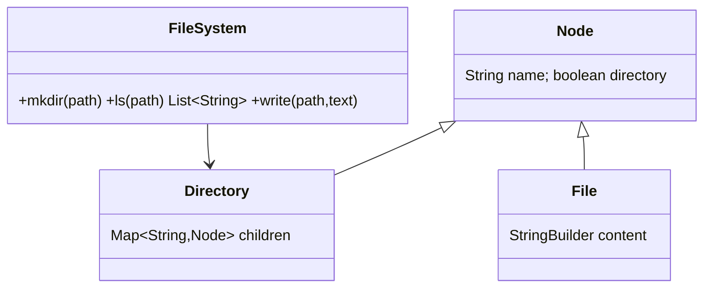
Key classes: `FileSystem`, abstract `Node`, `Directory`, `File`, `PathParser`. Use Composite; protect tree mutations with ReadWriteLock.

### B. Text Editor with Undo/Redo

**Beginner explanation:** Represent each edit as a Command with `execute` and `undo`; keep completed commands
on an undo stack and undone commands on a redo stack. New edits clear redo history. Command is suitable
because requests must be stored and reversed; Memento is an alternative that stores whole snapshots and is
simpler but memory-heavy. Production uses compact operation logs, grouped edits, bounded history, immutable
document pieces, and conflict rules for collaboration.
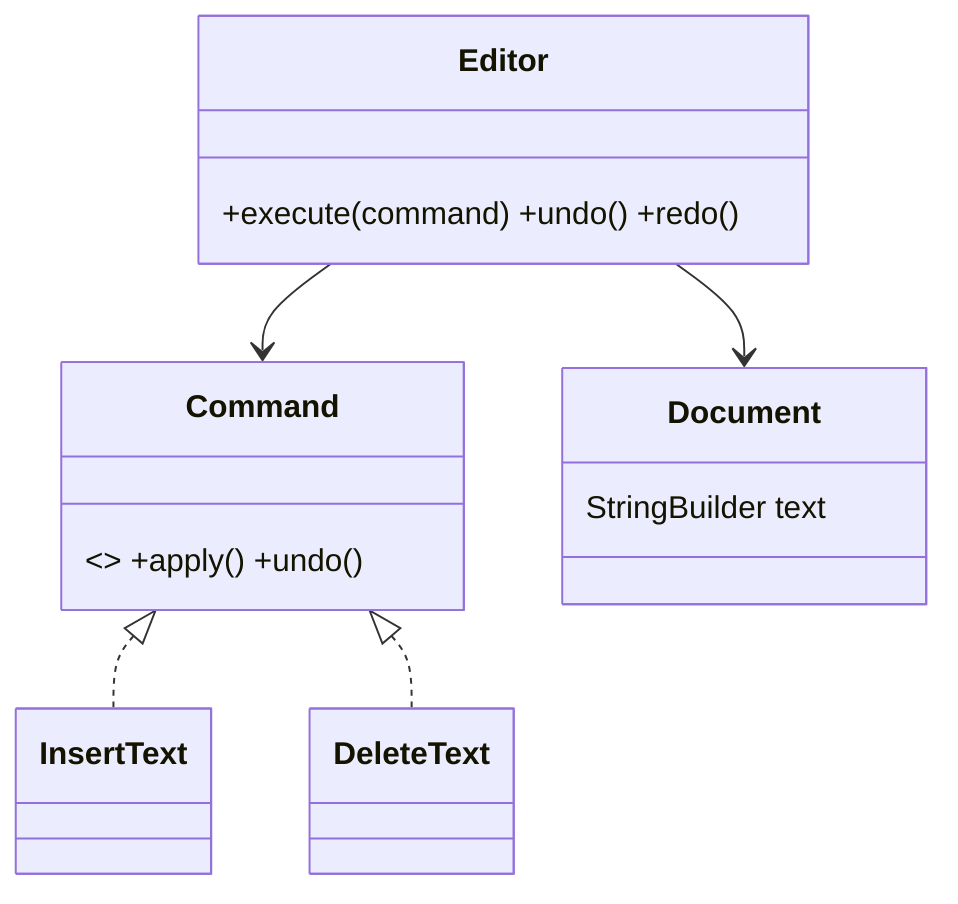
Key classes: `Document`, `Command`, `InsertCommand`, `DeleteCommand`, undo stack, redo stack. Use Command and Memento.

### C. Rule Engine

**Beginner explanation:** A rule combines a condition with an action or result. The engine evaluates ordered
rules against a context and defines whether first match wins or all matches run. Specification is recognized
when boolean rules must compose with `and`, `or`, and `not`; Chain fits ordered stop/continue behavior. A
switch is preferable for a few stable rules. Production needs versioned rules, deterministic priority,
explanations of why a rule matched, sandboxing, and auditability.
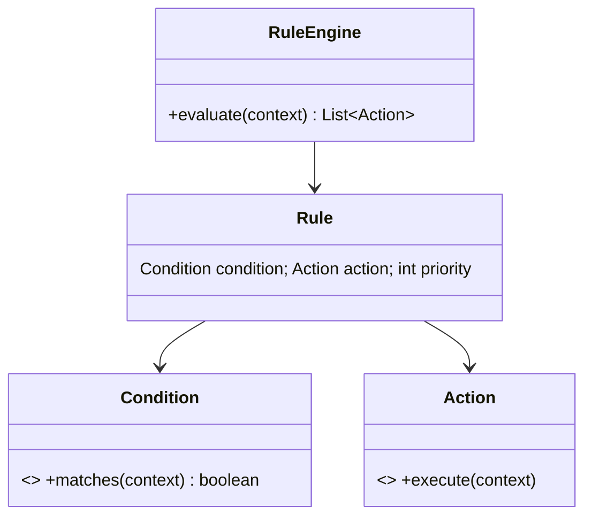
Key classes: `Rule`, `Condition`, `Action`, `FactContext`, `PriorityRuleEngine`. Sort by priority; keep rules data-driven.

### D. Auction

**Beginner explanation:** An auction owns an item, end time, status, and bids; each new bid must exceed the
current valid price and arrive before closure. State models scheduled/open/closed/cancelled; Strategy fits
English, Dutch, or sealed-bid variants; Observer publishes winner notifications. Place-bid flow must lock or
atomically version one auction so simultaneous bids have one order. Production adds money authorization,
anti-sniping rules, idempotency, fraud checks, event history, and partitioning by auction identifier.
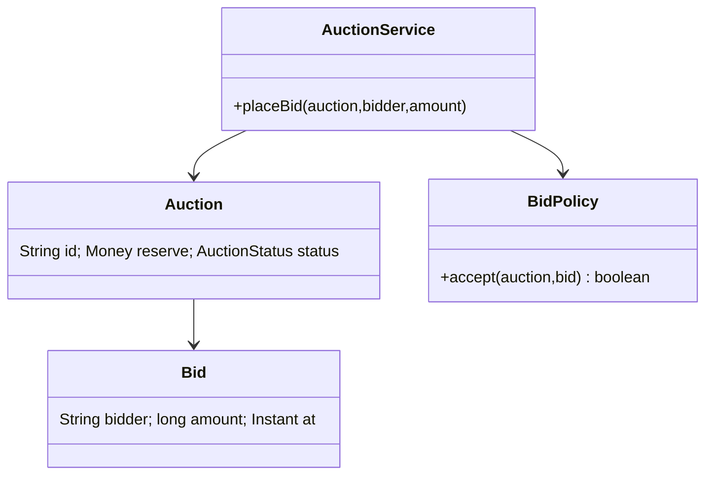
Key classes: `Auction`, `Bid`, `BidPolicy`, `AuctionClock`. Atomic compare-and-set highest bid; anti-sniping extension.

### E. Amazon Locker

**Beginner explanation:** Match a package to one available locker of sufficient size, reserve it, generate a
pickup code, and release it after pickup or expiry. This is resource allocation like Parking Lot, with
Strategy for locker selection and State for available/reserved/occupied/expired. The reservation and locker
state must change atomically. Production adds secure one-time codes, courier/customer authorization,
hardware adapters, expiry jobs, audit, and regional locker indexing.
```mermaid
classDiagram
class LockerService{+assign(package) LockerSlot +pickup(code)}
class Locker{String id; Location location}
class LockerSlot{Size size; SlotStatus status}
class Package{String id; Size size}
class CodeGenerator{+generate() String}
Locker --> LockerSlot
LockerService --> CodeGenerator
LockerService --> Package
```
Key classes: `Locker`, `Slot`, `Package`, `PickupCode`, `AllocationStrategy`. Expire codes and free slots on timeout.

### F. Cricbuzz Live Score

**Beginner explanation:** A scoring command updates the authoritative match state; many viewers subscribe to
derived scorecards and commentary. Command fits ball events, Observer/Pub-Sub fits fan-out, and State fits
match innings/status. Validate and append event → update aggregate → publish update → clients refresh.
Never let fan-out failure corrupt scoring. At scale, keep an append-only event log, snapshot aggregates,
partition by match, use sequence numbers, and serve read models through caches or streaming gateways.
```mermaid
classDiagram
class Match{Team a; Team b; Innings current}
class Innings{List~Over~ overs; Score score}
class BallEvent{int runs; Wicket wicket}
class ScorecardService{+record(ball) +summary()}
Match --> Innings
Innings --> BallEvent
ScorecardService --> Match
```
Key classes: `Match`, `Innings`, `Over`, `Ball`, `Scorecard`, `CommentaryPublisher`. Observer pushes live updates.

### G. Twitter LLD

**Beginner explanation:** Users post, follow, and read a timeline. `Post`, `User`, follow relationships, and
timeline entries have separate responsibilities. Strategy chooses fan-out-on-write, fan-out-on-read, or a
hybrid; Observer/Pub-Sub distributes post events. A simple implementation queries followed users and merges
recent posts. Production partitions by user, ranks timelines, handles celebrities with hybrid fan-out,
deduplicates events, enforces privacy, and stores media outside the post object.
```mermaid
classDiagram
class UserService{+follow(a,b)}
class TweetService{+post(user,text)}
class FeedService{+home(user) List~Tweet~}
class User{String id; Set~String~ following}
class Tweet{String id; String author; Instant at}
FeedService --> TweetService
UserService --> User
TweetService --> Tweet
```
Key classes: `User`, `Tweet`, `FollowGraph`, `FeedService`. Choose fanout-on-write for celebrities carefully; use timelines and pagination.

## Revision Cheat Sheet
- Notifications: channel adapters, templates, retries, DLQ, idempotency.
- Wallet: immutable double-entry ledger; row locks; gateway callbacks idempotent.
- KV store: TTL records, transaction context, lazy expiry plus optional sweeper.
- Pub-sub: append log, subscription offsets, ack for at-least-once delivery.
- Scheduler: delay queue locally, atomic job claiming in distributed mode.
- Car rental: same overlap model as room booking with vehicle lifecycle.
- Stack Overflow: posts, votes, accepted answer, reputation policy.
- Chess: Piece movement as strategies; Game validates turn and state.
- Tier 3: name patterns first; code only the critical operation in interview.
- Avoid global locks and giant if-else blocks; design extension points.

## Flashcards
- Q: Notification retry storage? → A: Durable attempt rows or queue messages with backoff.
- Q: Wallet audit model? → A: Immutable double-entry ledger.
- Q: KV TTL cleanup options? → A: Lazy read cleanup and background sweeper.
- Q: Pub-sub offset owner? → A: Each subscription or consumer group.
- Q: Scheduler local Java primitive? → A: `DelayQueue`.
- Q: Car booking conflict formula? → A: Same interval overlap check.
- Q: Stack Overflow duplicate vote prevention? → A: Unique `(user_id, target_id)`.
- Q: Chess movement extension point? → A: `MoveStrategy` per piece.
- Q: Undo/redo pattern? → A: Command plus Memento.
- Q: Rule engine core abstraction? → A: Condition and Action over facts.
- Q: Auction concurrency guard? → A: Atomic highest-bid update.
- Q: Twitter feed tradeoff? → A: Fanout-on-write vs fanout-on-read.
