# 10e · LLD Problems Tier 2 Part 2

More SDE-2 LLD blueprints for backend machine-coding rounds. Each section keeps the same interview rhythm: clarify, model, diagram, code the core, test, and discuss extensions.

**Legend:** 🟢 Beginner · 🟡 Intermediate · 🔴 Advanced · ⚫ FAANG · 🔥 = very frequently asked

## Table of Contents
- [1. Design Notification System](#1-design-notification-system)
- [2. Design Digital Wallet / Payment](#2-design-digital-wallet--payment)
- [3. Design In-Memory Key-Value Store](#3-design-in-memory-key-value-store)
- [4. Design Pub-Sub / Message Queue](#4-design-pub-sub--message-queue)
- [5. Design Task / Job Scheduler](#5-design-task--job-scheduler)
- [6. Design Car Rental](#6-design-car-rental)
- [7. Design Stack Overflow](#7-design-stack-overflow)
- [8. Design Chess](#8-design-chess)
- [Tier 3 Stretch quick designs](#tier-3-stretch-quick-designs)
- [Revision Cheat Sheet](#revision-cheat-sheet)
- [Flashcards](#flashcards)

## 1. Design Notification System
Tier 2 · SDE-2 must-know

### 1. Clarifying questions & requirements
- Send email/SMS/push/WhatsApp using templates and user preferences.
- Retry transient failures with backoff; dead-letter permanent failures.
- Track status per recipient and channel; dedupe duplicate requests.

### 2. Entities & relationships
NotificationRequest has Template, Recipient, Channel, DeliveryAttempt; ChannelProvider sends message.

### 3. Class diagram


### 4. Main-flow sequence
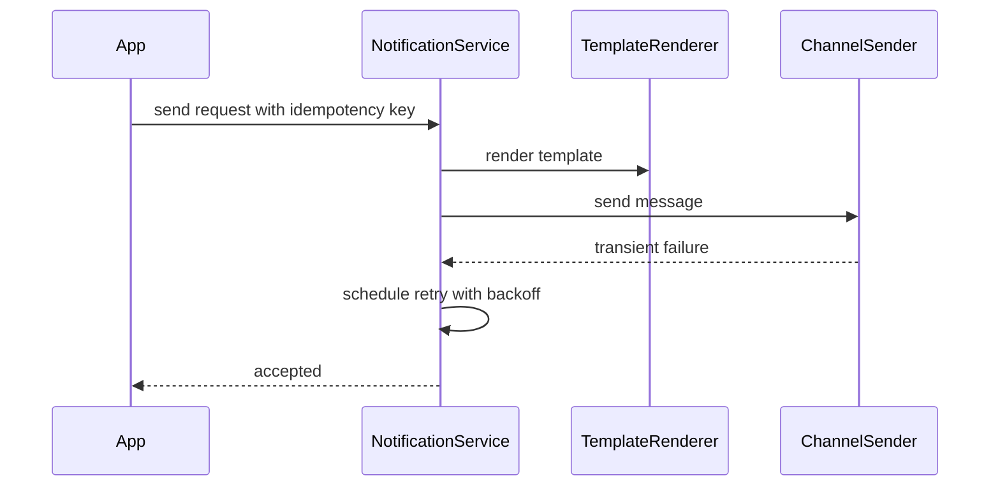

### 5. Design patterns used & why
Strategy/Adapter for channels, Template Method for rendering, Retry policy, Outbox for reliable async sends.

### 6. Complete, compilable Java code
```java

import java.util.*;

public class NotificationDemo{
    enum Channel{
        EMAIL,
        SMS
    }

    record Request(String key,Channel channel,String to,String template,Map<String,String> data){
    }

    record Result(boolean ok,boolean retry){
    }

    interface Sender{
        Result send(String to,String body);
    }

    static class EmailSender implements Sender{
        public Result send(String to,String body){
            System.out.println("email "+to+" "+body);
            return new Result(true,false);
        }
    }

    static class Renderer{
        String render(String t,Map<String,String>d){
            String out=t;
            for(var e:d.entrySet())out=out.replace("{{"+e.getKey()+"}}",e.getValue());
            return out;
        }
    }

    static class Service{
        private final Map<Channel,
        Sender> senders;
        private final Set<String> seen=new HashSet<>();
        private final Renderer renderer=new Renderer();
        Service(Map<Channel,Sender>s){
            senders=s;
        }

        synchronized String send(Request r){
            if(!seen.add(r.key()))return "DUPLICATE";
            String body=renderer.render(r.template(),r.data());
            Result res=senders.get(r.channel()).send(r.to(),body);
            return res.ok()?"SENT":res.retry()?"RETRY":"FAILED";
        }
    }

    public static void main(String[]a){
        var s=new Service(Map.of(Channel.EMAIL,new EmailSender()));
        System.out.println(s.send(
                new Request("k1",Channel.EMAIL,"a@b.com","Hi {{name}}",Map.of("name","Azam"))));
    }
}
```

### 7. Thread-safety
Idempotency key insert must be atomic. Workers should claim pending rows with `FOR UPDATE SKIP LOCKED` or queue visibility timeout.

### 8. Extensibility
- Add priority queues.
- Add user preference and quiet hours.
- Add provider failover.
- Add DLQ replay UI.

### 9. JUnit 5 test examples
```java
import static org.junit.jupiter.api.Assertions.*;

import java.util.Map;
import org.junit.jupiter.api.Test;

class NotificationDemoTest {
    @Test
    void dedupes() {
        var service = new NotificationDemo.Service(Map.of(
                NotificationDemo.Channel.EMAIL,
                (to, body) -> new NotificationDemo.Result(true, false)));
        var request = new NotificationDemo.Request("k", NotificationDemo.Channel.EMAIL, "x", "hi", Map.of());

        assertEquals("SENT", service.send(request));
        assertEquals("DUPLICATE", service.send(request));
    }

    @Test
    void rendersTemplateVariables() {
        var service = new NotificationDemo.Service(Map.of(
                NotificationDemo.Channel.EMAIL,
                (to, body) -> new NotificationDemo.Result(body.equals("Hi Azam"), false)));
        var request = new NotificationDemo.Request(
                "k", NotificationDemo.Channel.EMAIL, "x", "Hi {{name}}", Map.of("name", "Azam"));

        assertEquals("SENT", service.send(request));
    }

    @Test
    void retryResultIsSurfaced() {
        var service = new NotificationDemo.Service(Map.of(
                NotificationDemo.Channel.SMS,
                (to, body) -> new NotificationDemo.Result(false, true)));
        var request = new NotificationDemo.Request("k", NotificationDemo.Channel.SMS, "x", "hi", Map.of());

        assertEquals("RETRY", service.send(request));
    }
}
```

### 10. Interviewer follow-ups with short answers · Common mistakes
- *How are retries safe?* → Idempotency key plus provider message id prevents duplicates.
- *How to handle bad templates?* → Validate at publish time and fail fast.
- Mistakes: synchronous provider call in request path only, no DLQ, no preference checks.

## 2. Design Digital Wallet / Payment
Tier 2 · SDE-2 must-know

### 1. Clarifying questions & requirements
- Users add money, transfer, withdraw, view statement.
- Ledger must be immutable and double-entry; balance derived or cached safely.
- External payment callbacks are asynchronous and idempotent.

### 2. Entities & relationships
Wallet has balance; Transaction has LedgerEntries debit/credit; PaymentInstrument funds wallet.

### 3. Class diagram
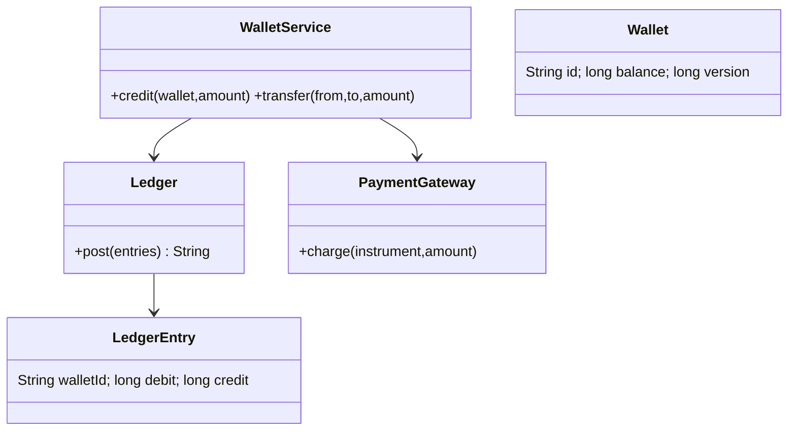

### 4. Main-flow sequence
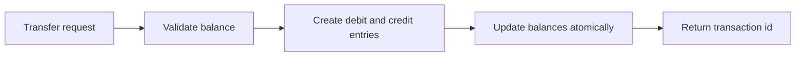

### 5. Design patterns used & why
Command for transaction requests, Repository for ledger, Adapter for payment gateways.

### 6. Complete, compilable Java code
```java
import java.util.ArrayList;
import java.util.Collections;
import java.util.List;
import java.util.Map;
import java.util.UUID;
import java.util.concurrent.ConcurrentHashMap;
import java.util.concurrent.ConcurrentMap;
import java.util.concurrent.locks.ReentrantLock;

public class WalletDemo {
    record Entry(String transactionId, String walletId, long delta) {}

    static class Wallet {
        final String id;
        final ReentrantLock lock = new ReentrantLock();
        long balance;

        Wallet(String id, long balance) {
            this.id = id;
            this.balance = balance;
        }
    }

    static class WalletService {
        private final Map<String, Wallet> wallets = new ConcurrentHashMap<>();
        private final List<Entry> ledger = Collections.synchronizedList(new ArrayList<>());
        private final ConcurrentMap<String, String> idempotency = new ConcurrentHashMap<>();

        void create(String id, long balance) {
            wallets.put(id, new Wallet(id, balance));
        }

        String transfer(String idempotencyKey, String from, String to, long amount) {
            return idempotency.computeIfAbsent(idempotencyKey, key -> doTransfer(from, to, amount));
        }

        private String doTransfer(String from, String to, long amount) {
            if (amount <= 0 || from.equals(to)) {
                throw new IllegalArgumentException("invalid transfer");
            }

            Wallet debit = requireWallet(from);
            Wallet credit = requireWallet(to);
            Wallet first = debit.id.compareTo(credit.id) < 0 ? debit : credit;
            Wallet second = first == debit ? credit : debit;

            first.lock.lock();
            second.lock.lock();
            try {
                if (debit.balance < amount) {
                    throw new IllegalStateException("low balance");
                }

                String transactionId = UUID.randomUUID().toString();
                debit.balance -= amount;
                credit.balance += amount;
                ledger.add(new Entry(transactionId, from, -amount));
                ledger.add(new Entry(transactionId, to, amount));
                return transactionId;
            } finally {
                second.lock.unlock();
                first.lock.unlock();
            }
        }

        long balance(String id) {
            Wallet wallet = requireWallet(id);
            wallet.lock.lock();
            try {
                return wallet.balance;
            } finally {
                wallet.lock.unlock();
            }
        }

        List<Entry> ledger() {
            synchronized (ledger) {
                return List.copyOf(ledger);
            }
        }

        private Wallet requireWallet(String id) {
            Wallet wallet = wallets.get(id);
            if (wallet == null) {
                throw new IllegalArgumentException("unknown wallet: " + id);
            }
            return wallet;
        }
    }

    public static void main(String[] args) {
        WalletService service = new WalletService();
        service.create("A", 100);
        service.create("B", 0);
        service.transfer("request-1", "A", "B", 40);
        System.out.println(service.balance("B"));
    }
}
```

### 7. Thread-safety
Use DB transaction with ordered row locks on both wallets. Never update one wallet without ledger entries in the same transaction.

### 8. Extensibility
- Add holds for pending merchant payments.
- Add KYC limits and risk checks.
- Add multi-currency wallets.
- Add reconciliation job against gateway reports.

### 9. JUnit 5 test examples
```java
import static org.junit.jupiter.api.Assertions.*;

import org.junit.jupiter.api.Test;

class WalletDemoTest {
    @Test
    void transfersAtomically() {
        WalletDemo.WalletService service = new WalletDemo.WalletService();
        service.create("A", 100);
        service.create("B", 0);

        service.transfer("k1", "A", "B", 30);

        assertEquals(70, service.balance("A"));
        assertEquals(30, service.balance("B"));
    }

    @Test
    void idempotencyKeyReturnsSameTransaction() {
        WalletDemo.WalletService service = new WalletDemo.WalletService();
        service.create("A", 100);
        service.create("B", 0);

        String first = service.transfer("k1", "A", "B", 30);
        String retry = service.transfer("k1", "A", "B", 30);

        assertEquals(first, retry);
        assertEquals(70, service.balance("A"));
    }

    @Test
    void lowBalanceFailsWithoutLedgerEntry() {
        WalletDemo.WalletService service = new WalletDemo.WalletService();
        service.create("A", 10);
        service.create("B", 0);

        assertThrows(IllegalStateException.class, () -> service.transfer("k", "A", "B", 30));
        assertTrue(service.ledger().isEmpty());
    }
}
```

### 10. Interviewer follow-ups with short answers · Common mistakes
- *Why double-entry ledger?* → Every debit has matching credit, making reconciliation and audit easier.
- *Callback repeated?* → Store gateway event id and process once.
- Mistakes: mutable transaction history, no idempotency, using floats for money.

## 3. Design In-Memory Key-Value Store
Tier 2 · SDE-2 must-know

### 1. Clarifying questions & requirements
- `get`, `put`, `delete`, TTL expiry, transaction begin/commit/rollback.
- Single-node in-memory; optional persistence/snapshot.
- Transaction isolation can be simple copy-on-write per thread.

### 2. Entities & relationships
Store maps key to ValueRecord; TransactionContext stores local writes and deletes.

### 3. Class diagram
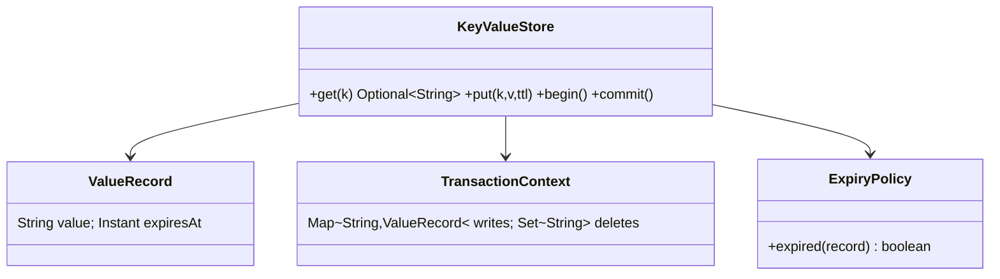

### 4. Main-flow sequence
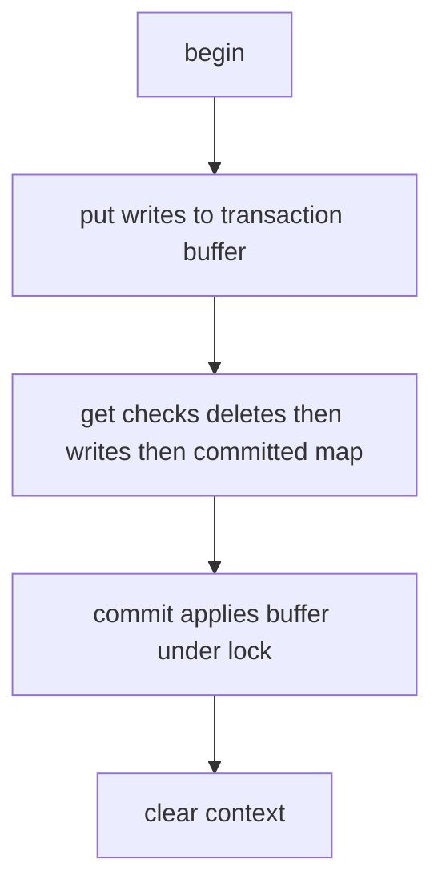

### 5. Design patterns used & why
Memento-like transaction context, Strategy for expiry policy, Command log for persistence extension.

### 6. Complete, compilable Java code
```java
import java.time.Duration;
import java.time.Instant;
import java.util.ArrayDeque;
import java.util.Deque;
import java.util.HashMap;
import java.util.Map;
import java.util.Optional;
import java.util.concurrent.ConcurrentHashMap;
import java.util.concurrent.Executors;
import java.util.concurrent.ScheduledExecutorService;
import java.util.concurrent.TimeUnit;

public class KeyValueStoreDemo {
    record Rec(String value, Instant expiresAt) {
        boolean expired() {
            return expiresAt != null && !Instant.now().isBefore(expiresAt);
        }
    }

    static class Store implements AutoCloseable {
        private static final Rec TOMBSTONE = new Rec(null, null);
        private final Map<String, Rec> data = new ConcurrentHashMap<>();
        private final ThreadLocal<Deque<Map<String, Rec>>> txStack = ThreadLocal.withInitial(ArrayDeque::new);
        private final ScheduledExecutorService sweeper = Executors.newSingleThreadScheduledExecutor(task -> {
            Thread thread = new Thread(task, "kv-expirer");
            thread.setDaemon(true);
            return thread;
        });

        Store() {
            sweeper.scheduleAtFixedRate(this::cleanupExpired, 1, 1, TimeUnit.SECONDS);
        }

        void begin() {
            txStack.get().push(new HashMap<>());
        }

        void put(String key, String value, Duration ttl) {
            Rec rec = new Rec(value, ttl == null ? null : Instant.now().plus(ttl));
            currentTx().ifPresentOrElse(tx -> tx.put(key, rec), () -> data.put(key, rec));
        }

        void delete(String key) {
            currentTx().ifPresentOrElse(tx -> tx.put(key, TOMBSTONE), () -> data.remove(key));
        }

        Optional<String> get(String key) {
            for (Map<String, Rec> tx : txStack.get()) {
                if (tx.containsKey(key)) {
                    return visible(tx.get(key));
                }
            }

            Rec rec = data.get(key);
            if (rec != null && rec.expired()) {
                data.remove(key, rec);
                return Optional.empty();
            }

            return visible(rec);
        }

        synchronized void commit() {
            Deque<Map<String, Rec>> stack = txStack.get();
            if (stack.isEmpty()) {
                throw new IllegalStateException("no transaction");
            }

            Map<String, Rec> child = stack.pop();
            if (!stack.isEmpty()) {
                stack.peek().putAll(child);
                return;
            }

            for (Map.Entry<String, Rec> entry : child.entrySet()) {
                if (entry.getValue() == TOMBSTONE) {
                    data.remove(entry.getKey());
                } else {
                    data.put(entry.getKey(), entry.getValue());
                }
            }

            txStack.remove();
        }

        void rollback() {
            Deque<Map<String, Rec>> stack = txStack.get();
            if (stack.isEmpty()) {
                throw new IllegalStateException("no transaction");
            }

            stack.pop();
            if (stack.isEmpty()) {
                txStack.remove();
            }
        }

        private Optional<Map<String, Rec>> currentTx() {
            Deque<Map<String, Rec>> stack = txStack.get();
            return stack.isEmpty() ? Optional.empty() : Optional.of(stack.peek());
        }

        private Optional<String> visible(Rec rec) {
            if (rec == null || rec == TOMBSTONE || rec.expired()) {
                return Optional.empty();
            }

            return Optional.of(rec.value());
        }

        private void cleanupExpired() {
            data.entrySet().removeIf(entry -> entry.getValue().expired());
        }

        @Override
        public void close() {
            sweeper.shutdownNow();
        }
    }

    public static void main(String[] args) {
        try (Store store = new Store()) {
            store.begin();
            store.put("x", "1", null);
            store.commit();
            System.out.println(store.get("x"));
        }
    }
}
```

### 7. Thread-safety
ConcurrentHashMap is enough for independent operations; commit should be synchronized to atomically publish a transaction batch.

### 8. Extensibility
- Add nested transactions using stack of contexts.
- Add snapshot and append-only log.
- Add eviction policy.
- Add compare-and-set operation.

### 9. JUnit 5 test examples
```java
import static org.junit.jupiter.api.Assertions.*;

import java.time.Duration;
import org.junit.jupiter.api.Test;

class KeyValueStoreDemoTest {
    @Test
    void rollbackHidesWrite() {
        try (KeyValueStoreDemo.Store store = new KeyValueStoreDemo.Store()) {
            store.begin();
            store.put("a", "b", null);
            store.rollback();

            assertTrue(store.get("a").isEmpty());
        }
    }

    @Test
    void nestedCommitMergesIntoParent() {
        try (KeyValueStoreDemo.Store store = new KeyValueStoreDemo.Store()) {
            store.begin();
            store.begin();
            store.put("a", "b", null);
            store.commit();
            store.commit();

            assertEquals("b", store.get("a").orElseThrow());
        }
    }

    @Test
    void nestedRollbackKeepsParentWrite() {
        try (KeyValueStoreDemo.Store store = new KeyValueStoreDemo.Store()) {
            store.begin();
            store.put("a", "parent", null);
            store.begin();
            store.put("a", "child", null);
            store.rollback();
            store.commit();

            assertEquals("parent", store.get("a").orElseThrow());
        }
    }

    @Test
    void ttlExpiresLazily() {
        try (KeyValueStoreDemo.Store store = new KeyValueStoreDemo.Store()) {
            store.put("a", "b", Duration.ofMillis(-1));

            assertTrue(store.get("a").isEmpty());
        }
    }
}
```

### 10. Interviewer follow-ups with short answers · Common mistakes
- *TTL cleanup eager or lazy?* → Lazy on read is simple; background sweeper reduces memory.
- *Isolation level?* → This simple version is read-your-writes, commit is atomic but not serializable for conflicts.
- Mistakes: returning expired values, leaking ThreadLocal, no rollback path.

## 4. Design Pub-Sub / Message Queue
Tier 2 · SDE-2 must-know

### 1. Clarifying questions & requirements
- Topics, publishers, subscribers; message ordering per topic partition.
- At-least-once delivery; ack advances subscriber offset.
- Backpressure and retention are extensions.

### 2. Entities & relationships
Topic has partitions; Message has offset; Subscription tracks subscriber offset.

### 3. Class diagram
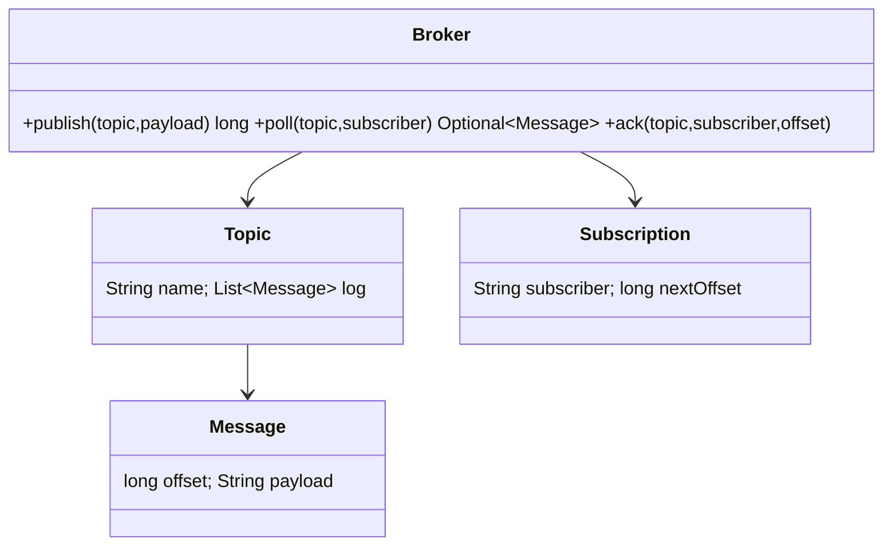

### 4. Main-flow sequence
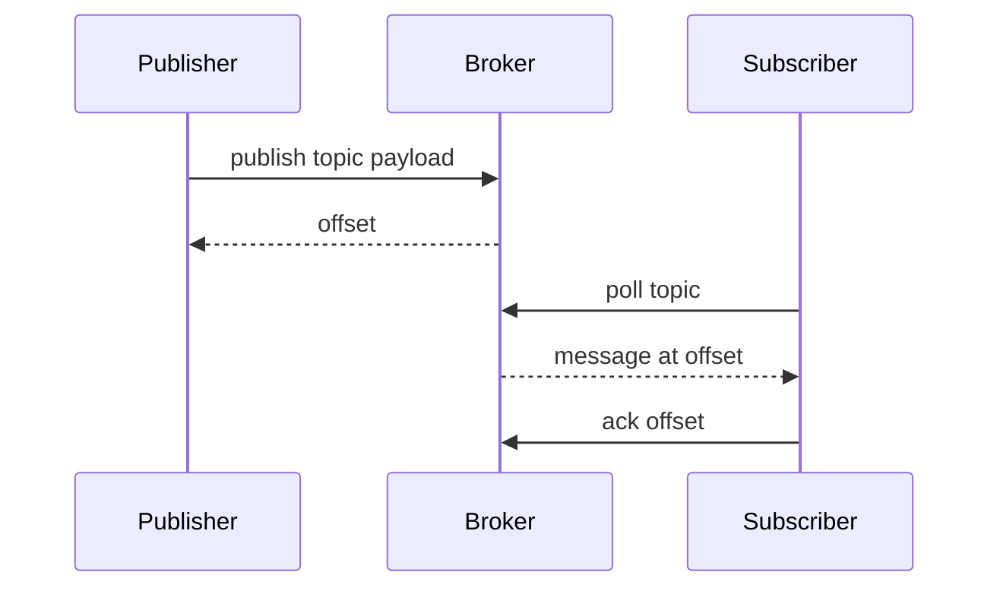

### 5. Design patterns used & why
Observer concept for subscription, Iterator for polling log by offset, Strategy for partitioning.

### 6. Complete, compilable Java code
```java
import java.util.ArrayList;
import java.util.HashMap;
import java.util.List;
import java.util.Map;
import java.util.Optional;

public class PubSubDemo {
    record Message(long offset, String payload) {}

    static class Topic {
        private final List<Message> log = new ArrayList<>();
        private final Map<String, Long> nextOffsetBySubscriber = new HashMap<>();

        synchronized long publish(String payload) {
            long offset = log.size();
            log.add(new Message(offset, payload));
            return offset;
        }

        synchronized Optional<Message> poll(String subscriber) {
            long next = nextOffsetBySubscriber.getOrDefault(subscriber, 0L);
            if (next >= log.size()) {
                return Optional.empty();
            }

            return Optional.of(log.get((int) next));
        }

        synchronized void ack(String subscriber, long offset) {
            long expected = nextOffsetBySubscriber.getOrDefault(subscriber, 0L);
            if (offset == expected) {
                nextOffsetBySubscriber.put(subscriber, offset + 1);
            }
        }
    }

    static class Broker {
        private final Map<String, Topic> topics = new HashMap<>();

        synchronized Topic topic(String name) {
            return topics.computeIfAbsent(name, ignored -> new Topic());
        }

        long publish(String topic, String payload) {
            return topic(topic).publish(payload);
        }

        Optional<Message> poll(String topic, String subscriber) {
            return topic(topic).poll(subscriber);
        }

        void ack(String topic, String subscriber, long offset) {
            topic(topic).ack(subscriber, offset);
        }
    }

    public static void main(String[] args) {
        Broker broker = new Broker();
        broker.publish("orders", "o1");
        Message message = broker.poll("orders", "worker").orElseThrow();
        System.out.println(message);
        broker.ack("orders", "worker", message.offset());
    }
}
```

### 7. Thread-safety
Synchronize append and offset movement per topic/partition. In production, append-only log plus durable offset commits are required.

### 8. Extensibility
- Add partitions and consumer groups.
- Add retention by time/size.
- Add DLQ for poison messages.
- Add visibility timeout for queue semantics.

### 9. JUnit 5 test examples
```java
import static org.junit.jupiter.api.Assertions.*;

import org.junit.jupiter.api.Test;

class PubSubDemoTest {
    @Test
    void ackAdvancesOnlyThatSubscriber() {
        PubSubDemo.Broker broker = new PubSubDemo.Broker();
        broker.publish("t", "a");
        PubSubDemo.Message message = broker.poll("t", "s1").orElseThrow();
        broker.ack("t", "s1", message.offset());

        assertTrue(broker.poll("t", "s1").isEmpty());
        assertEquals("a", broker.poll("t", "s2").orElseThrow().payload());
    }

    @Test
    void messagesAreDeliveredInOrder() {
        PubSubDemo.Broker broker = new PubSubDemo.Broker();
        broker.publish("t", "a");
        broker.publish("t", "b");

        PubSubDemo.Message first = broker.poll("t", "s").orElseThrow();
        broker.ack("t", "s", first.offset());

        assertEquals("b", broker.poll("t", "s").orElseThrow().payload());
    }

    @Test
    void wrongAckDoesNotSkipMessage() {
        PubSubDemo.Broker broker = new PubSubDemo.Broker();
        broker.publish("t", "a");
        broker.ack("t", "s", 99);

        assertEquals("a", broker.poll("t", "s").orElseThrow().payload());
    }
}
```

### 10. Interviewer follow-ups with short answers · Common mistakes
- *Queue vs pub-sub?* → Queue load-balances among consumers; pub-sub gives each subscription its own offset.
- *Exactly-once?* → Usually achieved by idempotent consumers plus transactional outbox, not broker magic.
- Mistakes: deleting message after one subscriber, no ack model, no poison-message strategy.

## 5. Design Task / Job Scheduler
Tier 2 · SDE-2 must-know

### 1. Clarifying questions & requirements
- Schedule one-time and recurring jobs; execute when due.
- Retry failed jobs with backoff; avoid duplicate execution across workers.
- Jobs have priority, timeout, and status.

### 2. Entities & relationships
Job has trigger, nextRunAt, handler, status; Scheduler owns priority queue and worker pool.

### 3. Class diagram
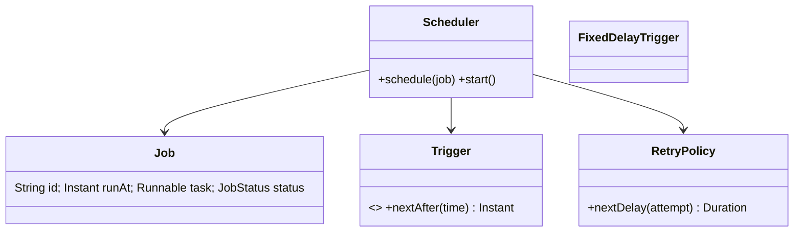

### 4. Main-flow sequence
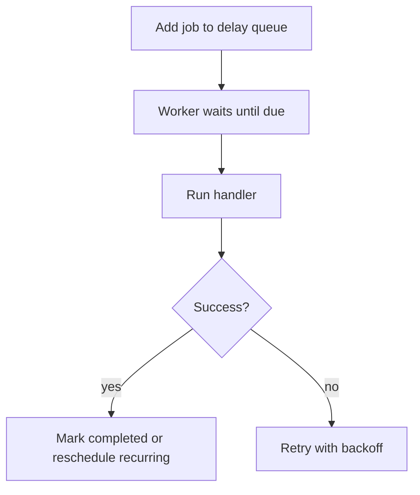

### 5. Design patterns used & why
Command for job task, Strategy for trigger/retry policy, Template for execution lifecycle.

### 6. Complete, compilable Java code
```java
import java.time.Duration;
import java.util.concurrent.DelayQueue;
import java.util.concurrent.Delayed;
import java.util.concurrent.ExecutorService;
import java.util.concurrent.Executors;
import java.util.concurrent.Future;
import java.util.concurrent.TimeUnit;
import java.util.concurrent.atomic.AtomicBoolean;

public class SchedulerDemo {
    static class Job implements Delayed {
        final String id;
        final Runnable task;
        final long dueAtMillis;

        Job(String id, Runnable task, Duration delay) {
            this.id = id;
            this.task = task;
            this.dueAtMillis = System.currentTimeMillis() + delay.toMillis();
        }

        @Override
        public long getDelay(TimeUnit unit) {
            return unit.convert(dueAtMillis - System.currentTimeMillis(), TimeUnit.MILLISECONDS);
        }

        @Override
        public int compareTo(Delayed other) {
            return Long.compare(getDelay(TimeUnit.MILLISECONDS), other.getDelay(TimeUnit.MILLISECONDS));
        }
    }

    static class Scheduler implements AutoCloseable {
        private final DelayQueue<Job> queue = new DelayQueue<>();
        private final ExecutorService workers;
        private final AtomicBoolean running = new AtomicBoolean(false);
        private Thread dispatcher;

        Scheduler(int workerCount) {
            this.workers = Executors.newFixedThreadPool(workerCount);
        }

        void schedule(Job job) {
            queue.add(job);
        }

        void start() {
            if (!running.compareAndSet(false, true)) {
                return;
            }

            dispatcher = new Thread(this::dispatchLoop, "scheduler-dispatcher");
            dispatcher.setDaemon(true);
            dispatcher.start();
        }

        void runDueOnce() throws Exception {
            Job job = queue.take();
            Future<?> future = workers.submit(job.task);
            future.get();
        }

        int queuedJobs() {
            return queue.size();
        }

        private void dispatchLoop() {
            while (running.get()) {
                try {
                    Job job = queue.take();
                    workers.submit(job.task);
                } catch (InterruptedException ex) {
                    Thread.currentThread().interrupt();
                    return;
                }
            }
        }

        @Override
        public void close() {
            running.set(false);
            if (dispatcher != null) {
                dispatcher.interrupt();
            }

            workers.shutdownNow();
        }
    }

    public static void main(String[] args) throws Exception {
        try (Scheduler scheduler = new Scheduler(2)) {
            scheduler.schedule(new Job("j", () -> System.out.println("ran"), Duration.ZERO));
            scheduler.runDueOnce();
        }
    }
}
```

### 7. Thread-safety
DelayQueue is thread-safe. For distributed schedulers, workers claim due jobs using conditional update from `SCHEDULED` to `RUNNING`.

### 8. Extensibility
- Add cron trigger.
- Add retry count and DLQ.
- Add job dependencies.
- Add worker heartbeat and timeout recovery.

### 9. JUnit 5 test examples
```java
import static org.junit.jupiter.api.Assertions.*;

import java.time.Duration;
import java.util.concurrent.atomic.AtomicBoolean;
import java.util.concurrent.atomic.AtomicInteger;
import org.junit.jupiter.api.Test;

class SchedulerDemoTest {
    @Test
    void runsDueJobOnWorkerPool() throws Exception {
        try (SchedulerDemo.Scheduler scheduler = new SchedulerDemo.Scheduler(2)) {
            AtomicBoolean ran = new AtomicBoolean();
            scheduler.schedule(new SchedulerDemo.Job("j", () -> ran.set(true), Duration.ZERO));
            scheduler.runDueOnce();

            assertTrue(ran.get());
        }
    }

    @Test
    void delayQueueOrdersByDueTime() throws Exception {
        try (SchedulerDemo.Scheduler scheduler = new SchedulerDemo.Scheduler(1)) {
            AtomicInteger value = new AtomicInteger();
            scheduler.schedule(new SchedulerDemo.Job("late", () -> value.set(2), Duration.ofMillis(50)));
            scheduler.schedule(new SchedulerDemo.Job("now", () -> value.set(1), Duration.ZERO));
            scheduler.runDueOnce();

            assertEquals(1, value.get());
        }
    }

    @Test
    void queuedJobsReflectsPendingWork() {
        try (SchedulerDemo.Scheduler scheduler = new SchedulerDemo.Scheduler(1)) {
            scheduler.schedule(new SchedulerDemo.Job("j", () -> {}, Duration.ofSeconds(1)));

            assertEquals(1, scheduler.queuedJobs());
        }
    }
}
```

### 10. Interviewer follow-ups with short answers · Common mistakes
- *How to avoid duplicate jobs?* → Atomic claim plus idempotent handler.
- *How to schedule recurring?* → Trigger computes next time after successful execution.
- Mistakes: busy-wait loop, no failure handling, no max retry limit.

## 6. Design Car Rental
Tier 2 · SDE-2 must-know

### 1. Clarifying questions & requirements
- Search cars by location, type, date range; reserve, pay, pickup, return.
- Avoid double booking; inspect damages/fuel and compute late fee.
- Support branches and vehicle inventory.

### 2. Entities & relationships
Branch has Vehicles; Reservation references Vehicle, Customer, TimeRange, Payment, Invoice.

### 3. Class diagram
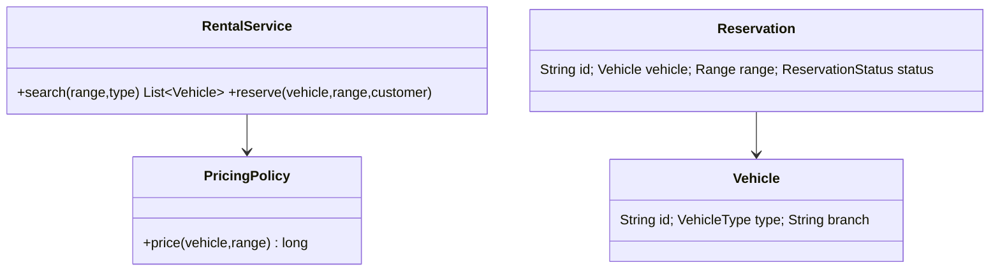

### 4. Main-flow sequence
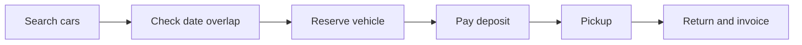

### 5. Design patterns used & why
Strategy for pricing, State for reservation status, Specification for vehicle filters.

### 6. Complete, compilable Java code
```java

import java.time.*;
import java.util.*;

public class CarRentalDemo{
    record Range(LocalDate start,LocalDate end){
        boolean overlaps(Range o){
            return start.isBefore(o.end)&&o.start.isBefore(end);
        }
    }

    record Vehicle(String id,String type){
    }

    record Reservation(String id,Vehicle vehicle,Range range){
    }

    static class RentalService{
        private final List<Vehicle> cars;
        private final List<Reservation> reservations=new ArrayList<>();
        RentalService(List<Vehicle> cars){
            this.cars=cars;
        }

        List<Vehicle> search(String type,Range r){
            return cars.stream()
                    .filter(c -> c.type().equals(type))
                    .filter(c -> reservations.stream()
                            .noneMatch(x -> x.vehicle().equals(c)&&x.range().overlaps(r)))
                    .toList();
        }

        synchronized Reservation reserve(Vehicle v,Range r){
            if(!search(v.type(),r).contains(v))throw new IllegalStateException("unavailable");
            Reservation res=new Reservation(UUID.randomUUID().toString(),v,r);
            reservations.add(res);
            return res;
        }
    }

    public static void main(String[]a){
        var car=new Vehicle("C1","SUV");
        System.out.println(new RentalService(List.of(car))
                .reserve(car,new Range(LocalDate.now(),LocalDate.now().plusDays(1))).id());
    }
}
```

### 7. Thread-safety
Same as room booking: transaction wraps overlap check and insert; add DB constraint where possible.

### 8. Extensibility
- Dynamic pricing by season.
- Add driver/license validation.
- Add damage claim workflow.
- Add one-way branch drop.

### 9. JUnit 5 test examples
```java
import static org.junit.jupiter.api.Assertions.*;

import java.time.LocalDate;
import java.util.List;
import org.junit.jupiter.api.Test;

class CarRentalDemoTest {
    @Test
    void rejectsOverlap() {
        var car = new CarRentalDemo.Vehicle("C", "SEDAN");
        var service = new CarRentalDemo.RentalService(List.of(car));
        var range = new CarRentalDemo.Range(LocalDate.now(), LocalDate.now().plusDays(2));
        service.reserve(car, range);

        assertThrows(IllegalStateException.class, () -> service.reserve(car, range));
    }

    @Test
    void backToBackRentalAllowed() {
        var car = new CarRentalDemo.Vehicle("C", "SEDAN");
        var service = new CarRentalDemo.RentalService(List.of(car));
        LocalDate today = LocalDate.now();
        service.reserve(car, new CarRentalDemo.Range(today, today.plusDays(1)));

        assertDoesNotThrow(() -> service.reserve(
                car, new CarRentalDemo.Range(today.plusDays(1), today.plusDays(2))));
    }

    @Test
    void searchFiltersByVehicleType() {
        var sedan = new CarRentalDemo.Vehicle("S", "SEDAN");
        var suv = new CarRentalDemo.Vehicle("U", "SUV");
        var service = new CarRentalDemo.RentalService(List.of(sedan, suv));
        var range = new CarRentalDemo.Range(LocalDate.now(), LocalDate.now().plusDays(1));

        assertEquals(List.of(suv), service.search("SUV", range));
    }
}
```

### 10. Interviewer follow-ups with short answers · Common mistakes
- *How to model late fee?* → PricingPolicy compares actual return time to expected end.
- *How to handle maintenance?* → Maintenance blocks are reservations by system user.
- Mistakes: no time-range conflict check, no branch separation, no status lifecycle.

## 7. Design Stack Overflow
Tier 2 · SDE-2 must-know

### 1. Clarifying questions & requirements
- Users ask questions, answer, comment, vote, accept answer, tag questions.
- Reputation changes from accepted answers/upvotes.
- Search by tag/text is an extension.

### 2. Entities & relationships
Question has Answers, Comments, Tags; Vote references user and target; User has reputation.

### 3. Class diagram
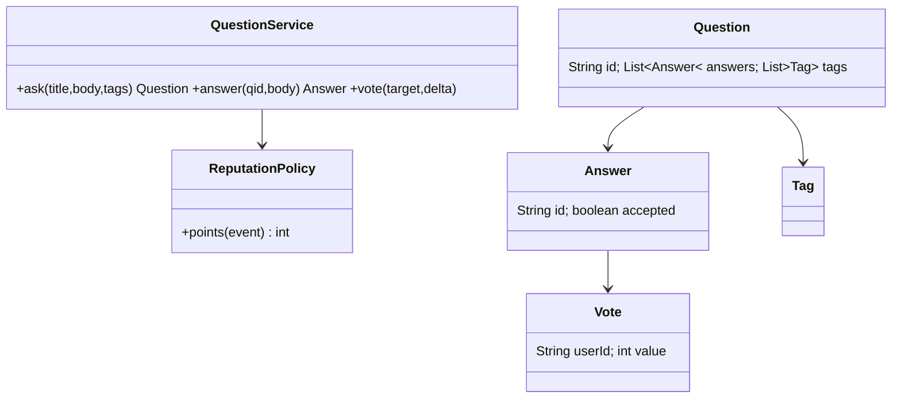

### 4. Main-flow sequence
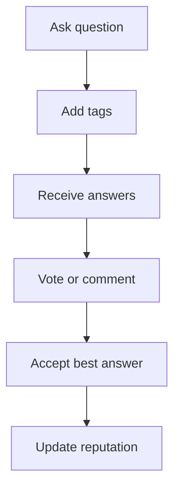

### 5. Design patterns used & why
Strategy for reputation policy, Composite-ish commentable/votable targets, Repository for content.

### 6. Complete, compilable Java code
```java

import java.util.*;

public class StackOverflowDemo{
    static class Answer{
        final String id=UUID.randomUUID().toString();
        final String body;
        int votes;
        boolean accepted;
        Answer(String body){
            this.body=body;
        }
    }

    static class Question{
        final String id=UUID.randomUUID().toString();
        final String title;
        final List<Answer> answers=new ArrayList<>();
        Question(String title){
            this.title=title;
        }
    }

    static class Service{
        private final Map<String,
        Question> qs=new HashMap<>();
        Question ask(String title){
            Question q=new Question(title);
            qs.put(q.id,q);
            return q;
        }

        Answer answer(String qid,String body){
            Answer a=new Answer(body);
            qs.get(qid).answers.add(a);
            return a;
        }

        void accept(String qid,String aid){
            Question q=qs.get(qid);
            q.answers.forEach(x->x.accepted=x.id.equals(aid));
        }

        void vote(String qid,String aid,int delta){
            qs.get(qid).answers.stream().filter(a->a.id.equals(aid)).findFirst().orElseThrow().votes+=delta;
        }
    }

    public static void main(String[]a){
        var s=new Service();
        var q=s.ask("What is SOLID?");
        var ans=s.answer(q.id,"Principles");
        s.accept(q.id,ans.id);
        System.out.println(ans.accepted);
    }
}
```

### 7. Thread-safety
Use unique `(user_id, target_id)` for votes. Accepting answer and reputation update should be transactional.

### 8. Extensibility
- Add badges and moderation.
- Add full-text search.
- Add edit history.
- Add duplicate question linking.

### 9. JUnit 5 test examples
```java
import static org.junit.jupiter.api.Assertions.*;

import org.junit.jupiter.api.Test;

class StackOverflowDemoTest {
    @Test
    void acceptsOne() {
        var service = new StackOverflowDemo.Service();
        var question = service.ask("q");
        var answer = service.answer(question.id, "a");
        service.accept(question.id, answer.id);

        assertTrue(answer.accepted);
    }

    @Test
    void acceptingSecondAnswerUnacceptsFirst() {
        var service = new StackOverflowDemo.Service();
        var question = service.ask("q");
        var first = service.answer(question.id, "a1");
        var second = service.answer(question.id, "a2");
        service.accept(question.id, first.id);
        service.accept(question.id, second.id);

        assertFalse(first.accepted);
        assertTrue(second.accepted);
    }

    @Test
    void voteUpdatesAnswerScore() {
        var service = new StackOverflowDemo.Service();
        var question = service.ask("q");
        var answer = service.answer(question.id, "a");
        service.vote(question.id, answer.id, 1);

        assertEquals(1, answer.votes);
    }
}
```

### 10. Interviewer follow-ups with short answers · Common mistakes
- *How to prevent duplicate votes?* → Vote table unique key per user-target.
- *How to store edits?* → Append `PostRevision` rows; current post points to latest.
- Mistakes: allowing multiple accepted answers, no reputation transaction, no tag normalization.

## 8. Design Chess
Tier 2 · SDE-2 must-know

### 1. Clarifying questions & requirements
- Model board, pieces, legal moves, turns, check/checkmate basics.
- Support move validation and game history; full engine AI not required.
- Special moves can be extension: castling, en passant, promotion.

### 2. Entities & relationships
Game has Board, Players, Move history; Board has Pieces; Piece has MoveStrategy.

### 3. Class diagram
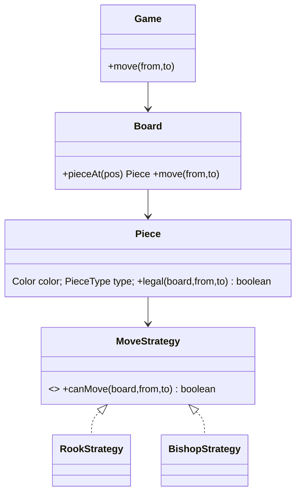

### 4. Main-flow sequence
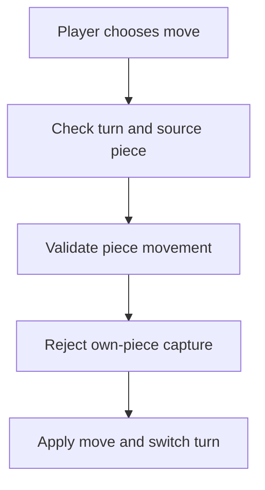

### 5. Design patterns used & why
Strategy for piece movement, State for game status, Command/Memento for move history and undo.

### 6. Complete, compilable Java code
```java

import java.util.*;

public class ChessDemo{
    enum Color{
        WHITE,
        BLACK
    }

    record Pos(int r,int c){
    }

    interface Rule{
        boolean ok(Board b,Pos f,Pos t);
    }

    static class RookRule implements Rule{
        public boolean ok(Board b,Pos f,Pos t){
            return f.r()==t.r()||f.c()==t.c();
        }
    }

    static class Piece{
        final Color color;
        final Rule rule;
        Piece(Color c,Rule r){
            color=c;
            rule=r;
        }
    }

    static class Board{
        private final Map<Pos,
        Piece> m=new HashMap<>();
        void put(Pos p,Piece pc){
            m.put(p,pc);
        }

        Piece at(Pos p){
            return m.get(p);
        }

        void move(Pos f,Pos t,Color turn){
            Piece p=m.get(f);
            if(p==null||p.color!=turn||!p.rule.ok(this,f,t))throw new IllegalStateException("illegal");
            Piece dest=m.get(t);
            if(dest!=null&&dest.color==p.color)throw new IllegalStateException("own piece");
            m.remove(f);
            m.put(t,p);
        }
    }

    static class Game{
        Color turn=Color.WHITE;
        final Board b=new Board();
        void move(Pos f,Pos t){
            b.move(f,t,turn);
            turn=turn==Color.WHITE?Color.BLACK:Color.WHITE;
        }
    }

    public static void main(String[]a){
        var g=new Game();
        g.b.put(new Pos(0,0),new Piece(Color.WHITE,new RookRule()));
        g.move(new Pos(0,0),new Pos(0,5));
        System.out.println(g.turn);
    }
}
```

### 7. Thread-safety
A single game can be protected by one game lock; validate and apply move atomically. Persist move number/version to reject stale client moves.

### 8. Extensibility
- Add specific strategies for all pieces.
- Add check/checkmate validator.
- Add clock timers.
- Add undo/replay with move history.

### 9. JUnit 5 test examples
```java
import static org.junit.jupiter.api.Assertions.*;

import org.junit.jupiter.api.Test;

class ChessDemoTest {
    @Test
    void rookMovesStraight() {
        var game = new ChessDemo.Game();
        game.b.put(new ChessDemo.Pos(0, 0), new ChessDemo.Piece(
                ChessDemo.Color.WHITE, new ChessDemo.RookRule()));
        game.move(new ChessDemo.Pos(0, 0), new ChessDemo.Pos(7, 0));

        assertEquals(ChessDemo.Color.BLACK, game.turn);
    }

    @Test
    void rookCannotMoveDiagonally() {
        var game = new ChessDemo.Game();
        game.b.put(new ChessDemo.Pos(0, 0), new ChessDemo.Piece(
                ChessDemo.Color.WHITE, new ChessDemo.RookRule()));

        assertThrows(IllegalStateException.class,
                () -> game.move(new ChessDemo.Pos(0, 0), new ChessDemo.Pos(1, 1)));
    }

    @Test
    void cannotCaptureOwnPiece() {
        var game = new ChessDemo.Game();
        game.b.put(new ChessDemo.Pos(0, 0), new ChessDemo.Piece(
                ChessDemo.Color.WHITE, new ChessDemo.RookRule()));
        game.b.put(new ChessDemo.Pos(0, 1), new ChessDemo.Piece(
                ChessDemo.Color.WHITE, new ChessDemo.RookRule()));

        assertThrows(IllegalStateException.class,
                () -> game.move(new ChessDemo.Pos(0, 0), new ChessDemo.Pos(0, 1)));
    }
}
```

### 10. Interviewer follow-ups with short answers · Common mistakes
- *Where to put movement logic?* → Piece delegates to strategy; board checks occupancy/path.
- *How to detect checkmate?* → Generate all legal moves for current player; if none removes check, checkmate.
- Mistakes: hardcoding rules in one giant switch, ignoring turn validation, not representing history.

## Tier 3 Stretch quick designs

### A. In-memory File System
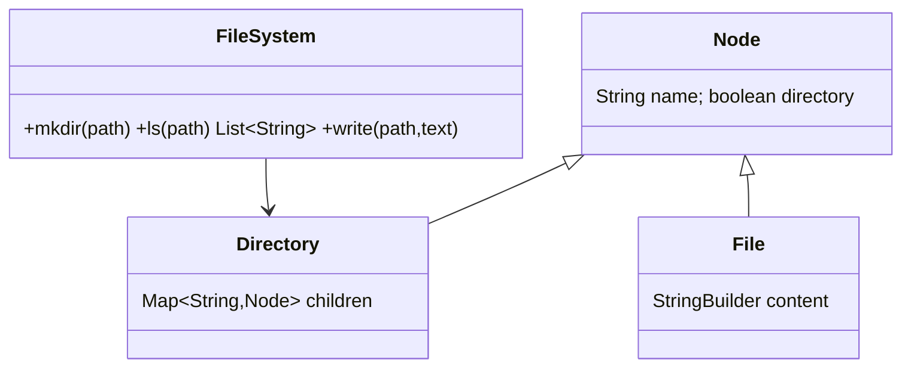
Key classes: `FileSystem`, abstract `Node`, `Directory`, `File`, `PathParser`. Use Composite; protect tree mutations with ReadWriteLock.

### B. Text Editor with Undo/Redo
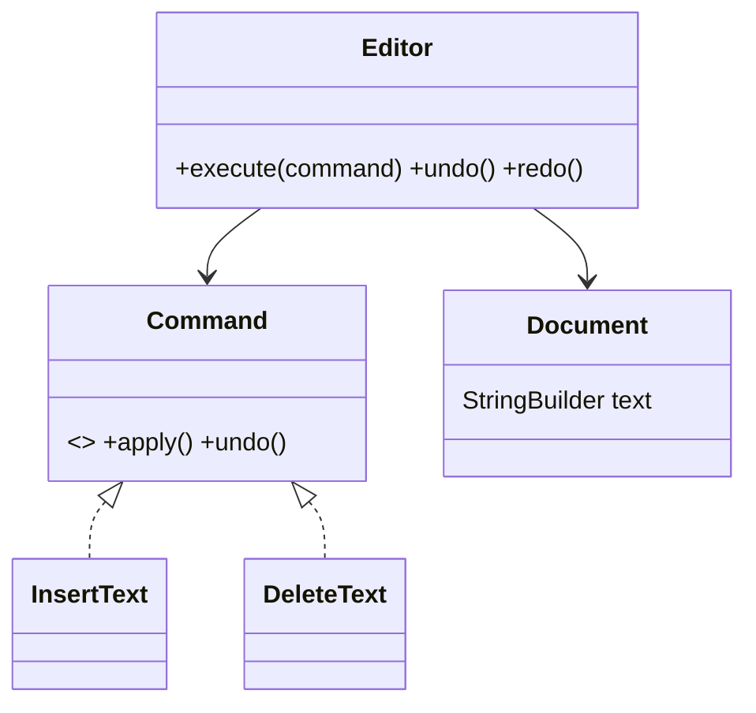
Key classes: `Document`, `Command`, `InsertCommand`, `DeleteCommand`, undo stack, redo stack. Use Command and Memento.

### C. Rule Engine
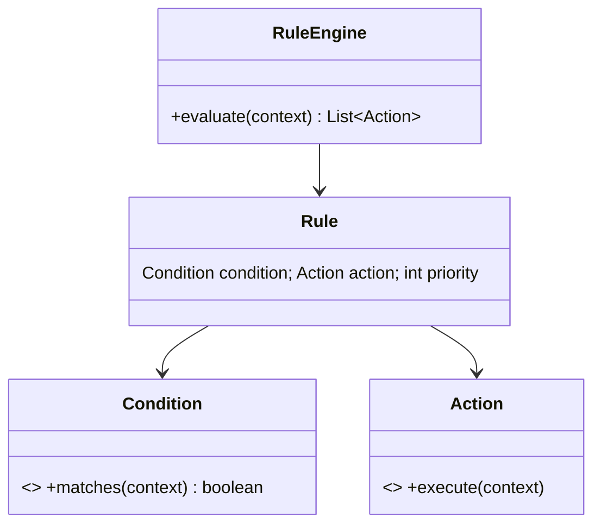
Key classes: `Rule`, `Condition`, `Action`, `FactContext`, `PriorityRuleEngine`. Sort by priority; keep rules data-driven.

### D. Auction
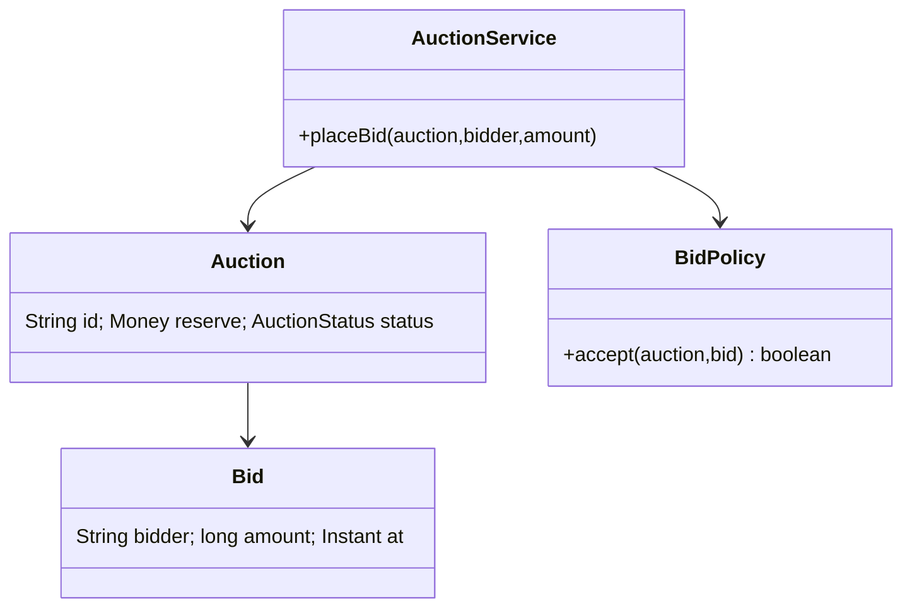
Key classes: `Auction`, `Bid`, `BidPolicy`, `AuctionClock`. Atomic compare-and-set highest bid; anti-sniping extension.

### E. Amazon Locker
```mermaid
classDiagram
class LockerService{+assign(package) LockerSlot +pickup(code)}
class Locker{String id; Location location}
class LockerSlot{Size size; SlotStatus status}
class Package{String id; Size size}
class CodeGenerator{+generate() String}
Locker --> LockerSlot
LockerService --> CodeGenerator
LockerService --> Package
```
Key classes: `Locker`, `Slot`, `Package`, `PickupCode`, `AllocationStrategy`. Expire codes and free slots on timeout.

### F. Cricbuzz Live Score
```mermaid
classDiagram
class Match{Team a; Team b; Innings current}
class Innings{List~Over~ overs; Score score}
class BallEvent{int runs; Wicket wicket}
class ScorecardService{+record(ball) +summary()}
Match --> Innings
Innings --> BallEvent
ScorecardService --> Match
```
Key classes: `Match`, `Innings`, `Over`, `Ball`, `Scorecard`, `CommentaryPublisher`. Observer pushes live updates.

### G. Twitter LLD
```mermaid
classDiagram
class UserService{+follow(a,b)}
class TweetService{+post(user,text)}
class FeedService{+home(user) List~Tweet~}
class User{String id; Set~String~ following}
class Tweet{String id; String author; Instant at}
FeedService --> TweetService
UserService --> User
TweetService --> Tweet
```
Key classes: `User`, `Tweet`, `FollowGraph`, `FeedService`. Choose fanout-on-write for celebrities carefully; use timelines and pagination.

## Revision Cheat Sheet
- Notifications: channel adapters, templates, retries, DLQ, idempotency.
- Wallet: immutable double-entry ledger; row locks; gateway callbacks idempotent.
- KV store: TTL records, transaction context, lazy expiry plus optional sweeper.
- Pub-sub: append log, subscription offsets, ack for at-least-once delivery.
- Scheduler: delay queue locally, atomic job claiming in distributed mode.
- Car rental: same overlap model as room booking with vehicle lifecycle.
- Stack Overflow: posts, votes, accepted answer, reputation policy.
- Chess: Piece movement as strategies; Game validates turn and state.
- Tier 3: name patterns first; code only the critical operation in interview.
- Avoid global locks and giant if-else blocks; design extension points.

## Flashcards
- Q: Notification retry storage? → A: Durable attempt rows or queue messages with backoff.
- Q: Wallet audit model? → A: Immutable double-entry ledger.
- Q: KV TTL cleanup options? → A: Lazy read cleanup and background sweeper.
- Q: Pub-sub offset owner? → A: Each subscription or consumer group.
- Q: Scheduler local Java primitive? → A: `DelayQueue`.
- Q: Car booking conflict formula? → A: Same interval overlap check.
- Q: Stack Overflow duplicate vote prevention? → A: Unique `(user_id, target_id)`.
- Q: Chess movement extension point? → A: `MoveStrategy` per piece.
- Q: Undo/redo pattern? → A: Command plus Memento.
- Q: Rule engine core abstraction? → A: Condition and Action over facts.
- Q: Auction concurrency guard? → A: Atomic highest-bid update.
- Q: Twitter feed tradeoff? → A: Fanout-on-write vs fanout-on-read.
