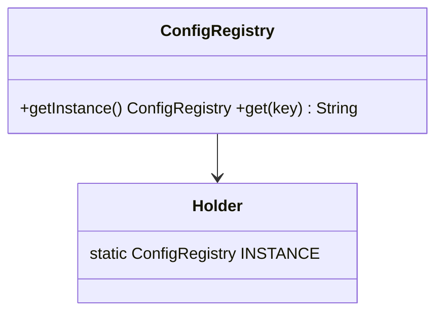
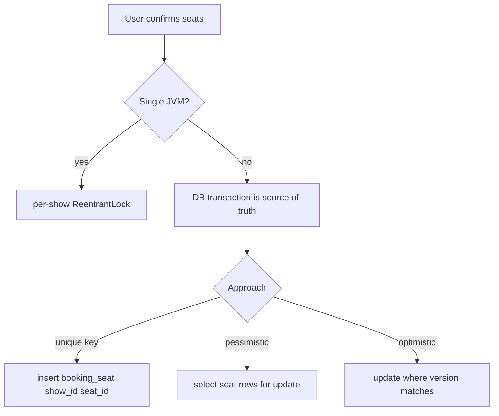
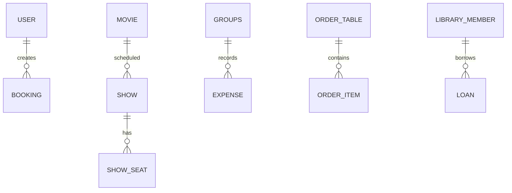

# 10f · Low-Level Design (LLD) Concurrency, Schema Design, and Refactoring

This file is the interview follow-up pack: Java concurrency utilities, schema and Java Persistence API
(JPA) mapping patterns, and code-quality refactoring drills. All Java snippets target Java 17. Read the
beginner map below before the intentionally compact interview implementations.

**Legend:** 🟢 Beginner · 🟡 Intermediate · 🔴 Advanced · ⚫ FAANG · 🔥 = very frequently asked

## Beginner map for this file

Concurrency design is about preserving invariants when multiple threads act at the same time. Schema design
is about preserving the same invariants after data is stored in a relational database. Refactoring is about
making those rules visible, testable, and safe to change.

| Topic | Mental model | Invariant to defend | Primary alternatives |
|---|---|---|---|
| Singleton | One safely published shared object | No thread sees a partially constructed instance | Enum, holder idiom, dependency-injection container |
| Bounded blocking queue | A waiting room with fixed seats | Size remains between zero and capacity | `wait`/`notifyAll`, `Condition`, `ArrayBlockingQueue` |
| LRU cache | Hash index plus recency line | Map and linked list contain the same entries | `LinkedHashMap`, custom list, distributed cache |
| Rate limiter | Tokens refill over elapsed time | A client cannot consume more tokens than available | Token bucket, sliding window, fixed window |
| Connection pool | Borrow and return reusable connections | A connection has at most one borrower | Blocking queue, semaphore, production pool library |
| Thread pool | Workers drain a bounded job queue | Accepted jobs run at most once in this toy model | Java `ExecutorService`, custom workers |
| Seat booking | Competing claims on one resource | A seat has at most one confirmed owner | Lock, optimistic version, database unique constraint |
| Read-write cache | Many readers or one writer | Readers never observe a partial write | `ReadWriteLock`, immutable snapshots, concurrent map |

Short forms used below are expanded again in the table so you can revise without guessing.

### Abbreviations and key terms

| Short form | Expanded form | Plain meaning |
|---|---|---|
| API | Application Programming Interface | A contract that code exposes to callers or tools |
| BIGINT | Big Integer SQL type | Large whole-number column type commonly used for identifiers and cents |
| BOOLEAN | Boolean SQL type | True/false column type, often used for availability flags |
| CAS | Compare-And-Set | Atomic update that succeeds only if the current value still matches the expected value |
| CRUD | Create, Read, Update, Delete | The four basic data operations behind many services |
| DB | Database | Durable storage shared across application instances |
| ER | Entity-Relationship | A diagram or model showing tables/entities and how they connect |
| FAANG | Facebook, Amazon, Apple, Netflix, Google | Shorthand for large product-company interview style |
| INT | Integer SQL type | Whole-number column type for smaller counts and quantities |
| JPA | Java Persistence API | Java specification for mapping objects to relational tables |
| JVM | Java Virtual Machine | Runtime that executes Java bytecode and manages threads and memory visibility |
| LLD | Low-Level Design | Class, method, thread-safety, schema, and refactoring design inside a service |
| LRU | Least Recently Used | Eviction rule that removes the entry not accessed for the longest time |
| REST | Representational State Transfer | Common HTTP style for exposing resources through APIs |
| SDE-1 | Software Development Engineer level 1 | Early-career engineering interview level focused on fundamentals and coding |
| SDE-2 | Software Development Engineer level 2 | Mid-level interview level that expects more trade-off and concurrency depth |
| SMS | Short Message Service | Text-message notification channel |
| SQL | Structured Query Language | Language used to define, query, and update relational tables |
| SRP | Single Responsibility Principle | A class should have one clear reason to change |
| SUV | Sport Utility Vehicle | Vehicle type used in pricing examples |
| TD | Top Down | Mermaid flowchart direction from top to bottom |
| TIMESTAMP | Timestamp SQL type | Date-time column type used for event times and due dates |
| VARCHAR | Variable Character | SQL text column with a configured maximum length |
| Cardinality | Not an abbreviation | How many rows on one side can relate to rows on the other side |
| Constraint | Not an abbreviation | Database rule such as primary key, foreign key, unique, or check |
| Idempotency key | Not an abbreviation | Request identifier that lets retries avoid duplicate side effects |
| Index | Not an abbreviation | Extra lookup structure that speeds reads but adds write cost |
| Invariant | Not an abbreviation | Rule that must remain true despite concurrency, retries, or persistence |
| Optimistic locking | Not an abbreviation | Version-based conflict detection that retries instead of holding a long lock |
| Pessimistic lock | Not an abbreviation | Lock taken before update so competing writers wait |
| Transaction boundary | Not an abbreviation | The group of reads and writes that must commit or roll back together |

### Common beginner traps

- Protecting an invariant only in Java memory when the real race happens across multiple servers and the database.
- Using `if` plus update as two separate steps, which creates check-then-act races under concurrency.
- Adding indexes for every column instead of matching the exact read query and accepting write overhead.
- Treating Java Persistence API (JPA) entities as response objects, which leaks lazy loading and persistence details.
- Forgetting unique constraints for business rules such as one booking per show-seat or one payment per order.
- Swallowing exceptions in refactoring drills and returning success-shaped values that hide operational failures.
- Refactoring to patterns before naming the smell, invariant, and test that prove the move helped.

### How to study this file

1. For each concurrency item, state the shared state, invariant, lock or atomic primitive, and production alternative.
2. For each schema, identify the tables, primary keys, foreign keys, unique constraints, indexes, and transaction boundary.
3. For Java Persistence API mappings, say which annotation protects identity, relationships, lazy loading, and optimistic locking.
4. For refactoring drills, name the smell first, then the smallest move, then the test that should pass afterward.
5. Use the revision cheat sheet for quick recall, then re-implement one concurrency utility and one schema from memory.
6. Practice code review by asking: can two callers break this rule, can retries duplicate it, and can the database enforce it?

### Scalability and production lens

Toy LLD code often runs in one Java Virtual Machine (JVM), so an in-memory lock may appear sufficient. In production,
requests may hit many pods, retry after timeouts, and share one database or cache. Durable invariants therefore need
unique constraints, transactions, version columns, idempotency keys, or distributed primitives such as Redis Lua scripts.
Schema and refactoring answers should show where the single-process boundary ends.

## Table of Contents
- [Beginner map for this file](#beginner-map-for-this-file)
- [Concurrency LLD with full code](#concurrency-lld-with-full-code)
- [Schema design for common LLD systems](#schema-design-for-common-lld-systems)
- [JPA entity mapping examples](#jpa-entity-mapping-examples)
- [Refactoring / code-quality round](#refactoring--code-quality-round)
- [Code review checklist](#code-review-checklist)
- [Revision Cheat Sheet](#revision-cheat-sheet)
- [Flashcards](#flashcards)

## Concurrency LLD with full code

### 1. Thread-safe Singleton
`🟡 Intermediate` `🔥` `Must-know SDE-1`

**Beginner explanation:** The challenge is not merely “one object”; it is safely publishing that object so
every thread sees a fully constructed value. The holder idiom works because Java class initialization is
lazy and synchronized by the Java Virtual Machine. `getInstance` returns the holder’s one instance; the
private constructor prevents ordinary external creation. Prefer dependency injection when callers should
declare and replace the dependency; use Singleton only for truly process-wide identity.

**Why they ask:** checks Java Memory Model, lazy initialization, and over-engineering awareness.

**Short answer:** Prefer enum singleton when you do not need lazy constructor parameters. For lazy initialization, use the initialization-on-demand holder idiom; double-checked locking must use `volatile`.



```java
import java.util.*;
public final class ConfigRegistry {
  private final Map<String,String> values = Map.of("env","dev");
  private ConfigRegistry() {}
  private static class Holder { static final ConfigRegistry INSTANCE = new ConfigRegistry(); }
  public static ConfigRegistry getInstance() { return Holder.INSTANCE; }
  public String get(String key) { return values.get(key); }
  public static void main(String[] args) { System.out.println(ConfigRegistry.getInstance().get("env")); }
}
```

**Follow-ups:** enum singleton is serialization-safe; double-checked locking without `volatile` is broken.

### 2. Bounded Blocking Queue with synchronized/wait-notify
`🔴 Advanced` `🔥` `Must-know SDE-2`

**Beginner explanation:** Producers wait while the queue is full; consumers wait while it is empty. The same
monitor protects the queue and both conditions. `put` changes not-empty state and `take` changes not-full
state, so both notify waiting threads. Always wait in a `while` loop because a wake-up does not guarantee the
condition is now true. Java `ArrayBlockingQueue` is the production alternative; this implementation exists
to demonstrate the invariant `0 <= size <= capacity`.

**Why they ask:** tests producer-consumer, condition waiting, and spurious wakeups.

```java
import java.util.*;
public class SyncBoundedBlockingQueue<T> {
    private final Queue<T> q = new ArrayDeque<>();
    private final int cap;

    public SyncBoundedBlockingQueue(int cap) {
        if (cap <= 0) {
            throw new IllegalArgumentException();
        }
        this.cap = cap;
    }

    public synchronized void put(T item) throws InterruptedException {
        while (q.size() == cap) {
            wait();
        }
        q.add(item);
        notifyAll();
    }

    public synchronized T take() throws InterruptedException {
        while (q.isEmpty()) {
            wait();
        }
        T item = q.remove();
        notifyAll();
        return item;
    }

    public synchronized int size() {
        return q.size();
    }

    public static void main(String[] args) throws Exception {
        var queue = new SyncBoundedBlockingQueue<Integer>(1);
        queue.put(7);
        System.out.println(queue.take());
    }
}
```

**Common mistakes:** using `if` instead of `while`, calling `notify` when many conditions exist, swallowing interrupts.

### 3. Bounded Blocking Queue with ReentrantLock/Condition
`🔴 Advanced` `🔥` `Must-know SDE-2`

**Beginner explanation:** This is the same producer-consumer model with explicit lock and two named waiting
rooms: `notFull` for producers and `notEmpty` for consumers. Named `Condition` objects avoid waking threads
that cannot proceed. Lock in `try/finally`, preserve interruption, and recheck conditions in `while`. Choose
this form when multiple conditions or timed/interruptible lock operations matter; otherwise the standard
blocking queue is clearer.

```java
import java.util.*;
import java.util.concurrent.locks.*;

public class LockBoundedBlockingQueue<T> {
    private final Queue<T> q = new ArrayDeque<>();
    private final int cap;
    private final ReentrantLock lock = new ReentrantLock();
    private final Condition notFull = lock.newCondition();
    private final Condition notEmpty = lock.newCondition();

    public LockBoundedBlockingQueue(int cap) {
        if (cap <= 0) {
            throw new IllegalArgumentException();
        }
        this.cap = cap;
    }

    public void put(T item) throws InterruptedException {
        lock.lock();
        try {
            while (q.size() == cap) {
                notFull.await();
            }
            q.add(item);
            notEmpty.signal();
        } finally {
            lock.unlock();
        }
    }

    public T take() throws InterruptedException {
        lock.lock();
        try {
            while (q.isEmpty()) {
                notEmpty.await();
            }
            T item = q.remove();
            notFull.signal();
            return item;
        } finally {
            lock.unlock();
        }
    }

    public static void main(String[] args) throws Exception {
        var queue = new LockBoundedBlockingQueue<String>(2);
        queue.put("x");
        System.out.println(queue.take());
    }
}
```

**When better than synchronized:** multiple conditions, timed waits, fairness option, interruptible lock acquisition.

### 4. Thread-safe LRU Cache

**Beginner explanation:** Least Recently Used (LRU) needs a map for constant-time lookup and a doubly linked
list for constant-time recency updates. Every mutation must update both structures under one lock, or they
diverge. `get` is a write-like operation because it moves a node. `put` updates/inserts and evicts the tail
when capacity is exceeded. `LinkedHashMap` is simpler when custom concurrency or eviction hooks are not
required.
`🔴 Advanced` `🔥` `Must-know SDE-2`

**Short answer:** combine HashMap + doubly-linked list for O(1), guard both structures with the same lock.

```java
import java.util.*;

public class LruCache<K, V> {
    private final int cap;
    private final Map<K, Node<K, V>> map = new HashMap<>();
    private final Node<K, V> head = new Node<>(null, null);
    private final Node<K, V> tail = new Node<>(null, null);

    static class Node<K, V> {
        K key;
        V value;
        Node<K, V> prev;
        Node<K, V> next;

        Node(K key, V value) {
            this.key = key;
            this.value = value;
        }
    }

    public LruCache(int cap) {
        if (cap <= 0) {
            throw new IllegalArgumentException();
        }
        this.cap = cap;
        head.next = tail;
        tail.prev = head;
    }

    public synchronized V get(K key) {
        Node<K, V> node = map.get(key);
        if (node == null) {
            return null;
        }
        moveFirst(node);
        return node.value;
    }

    public synchronized void put(K key, V value) {
        Node<K, V> node = map.get(key);
        if (node != null) {
            node.value = value;
            moveFirst(node);
            return;
        }

        node = new Node<>(key, value);
        map.put(key, node);
        addFirst(node);
        if (map.size() > cap) {
            Node<K, V> old = tail.prev;
            remove(old);
            map.remove(old.key);
        }
    }

    private void moveFirst(Node<K, V> node) {
        remove(node);
        addFirst(node);
    }

    private void addFirst(Node<K, V> node) {
        node.next = head.next;
        node.prev = head;
        head.next.prev = node;
        head.next = node;
    }

    private void remove(Node<K, V> node) {
        node.prev.next = node.next;
        node.next.prev = node.prev;
    }

    public static void main(String[] args) {
        var cache = new LruCache<Integer, String>(1);
        cache.put(1, "a");
        cache.put(2, "b");
        System.out.println(cache.get(1));
    }
}
```

**Follow-up:** `LinkedHashMap` with `accessOrder=true` is fine if interviewer allows library usage.

### 5. Concurrent Rate Limiter

**Beginner explanation:** Each client owns token count and last-refill time. One atomic critical section must
refill and consume; otherwise two threads can spend the same token. Inject time for tests and use monotonic
elapsed time where possible. Fixed window is simpler, sliding window is more precise, and token bucket
supports controlled bursts. Multiple application instances require a shared atomic data store or gateway.
`🔴 Advanced` `🔥` `Must-know SDE-2`

**Token bucket:** refill by elapsed time; synchronized method is acceptable for a per-user limiter.

```java
public class TokenBucketRateLimiter {
    private final long capacity;
    private final long refillPerSecond;
    private long tokens;
    private long lastNanos;

    public TokenBucketRateLimiter(long capacity, long refillPerSecond) {
        this.capacity = capacity;
        this.refillPerSecond = refillPerSecond;
        this.tokens = capacity;
        this.lastNanos = System.nanoTime();
    }

    public synchronized boolean allow() {
        refill();
        if (tokens == 0) {
            return false;
        }
        tokens--;
        return true;
    }

    private void refill() {
        long now = System.nanoTime();
        long add = (now - lastNanos) * refillPerSecond / 1_000_000_000L;
        if (add > 0) {
            tokens = Math.min(capacity, tokens + add);
            lastNanos = now;
        }
    }

    public static void main(String[] args) {
        var limiter = new TokenBucketRateLimiter(2, 1);
        System.out.println(limiter.allow());
    }
}
```

**Distributed version:** Redis Lua script updates tokens atomically; include user id and route as key.

### 6. Connection Pool

**Beginner explanation:** The pool creates a bounded number of expensive connections, lends one to a caller,
and requires return. A blocking queue naturally represents available connections; borrowed connections are
absent from it. `borrow` may time out, and `release` must reject foreign or double-returned objects. Real
systems should use a mature pool with validation, leak detection, maximum lifetime, health checks, and
metrics rather than this teaching implementation.
`🔴 Advanced` `🔥` `Must-know SDE-2`

```java
import java.util.*;
import java.util.concurrent.*;

public class SimpleConnectionPool<T> implements AutoCloseable {
    private final Semaphore permits;
    private final Deque<T> idle = new ArrayDeque<>();
    private volatile boolean closed;

    public SimpleConnectionPool(Collection<T> connections) {
        if (connections.isEmpty()) {
            throw new IllegalArgumentException("empty pool");
        }
        permits = new Semaphore(connections.size(), true);
        idle.addAll(connections);
    }

    public T borrow(long timeoutMs) throws InterruptedException {
        if (closed) {
            throw new IllegalStateException("closed");
        }
        if (!permits.tryAcquire(timeoutMs, TimeUnit.MILLISECONDS)) {
            throw new RuntimeException("timeout");
        }
        synchronized (idle) {
            if (closed) {
                permits.release();
                throw new IllegalStateException("closed");
            }
            return idle.removeFirst();
        }
    }

    public void release(T connection) {
        if (connection == null || closed) {
            return;
        }
        synchronized (idle) {
            idle.addLast(connection);
        }
        permits.release();
    }

    public void close() {
        closed = true;
        synchronized (idle) {
            idle.clear();
        }
    }

    public static void main(String[] args) throws Exception {
        var pool = new SimpleConnectionPool<>(List.of("c1"));
        String connection = pool.borrow(100);
        pool.release(connection);
        pool.close();
    }
}
```

**Production additions:** health check, max lifetime, leak detection, validation on borrow, metrics.

### 7. Mini Thread Pool like ExecutorService

**Beginner explanation:** Submission places a task in a bounded queue; worker threads repeatedly take and
run tasks. The pool owns workers, acceptance state, queue, and shutdown policy. Define whether shutdown
drains queued work, interrupts workers, and rejects new submissions. The Strategy/Command idea is visible
because each `Runnable` packages work behind one method. Use Java `ExecutorService` in production for richer
failure, cancellation, sizing, and lifecycle behavior.
`🔴 Advanced` `🔥` `Must-know SDE-2`

```java
import java.util.*;
import java.util.concurrent.*;

public class MiniThreadPool implements AutoCloseable {
    private final BlockingQueue<Runnable> queue = new LinkedBlockingQueue<>();
    private final List<Thread> workers = new ArrayList<>();
    private volatile boolean shutdown;

    public MiniThreadPool(int n) {
        for (int i = 0; i < n; i++) {
            Thread worker = new Thread(this::loop, "mini-" + i);
            workers.add(worker);
            worker.start();
        }
    }

    public void submit(Runnable task) {
        if (shutdown) {
            throw new RejectedExecutionException();
        }
        queue.offer(task);
    }

    private void loop() {
        try {
            while (!shutdown || !queue.isEmpty()) {
                Runnable task = queue.poll(100, TimeUnit.MILLISECONDS);
                if (task != null) {
                    runSafely(task);
                }
            }
        } catch (InterruptedException e) {
            Thread.currentThread().interrupt();
        }
    }

    private void runSafely(Runnable task) {
        try {
            task.run();
        } catch (Throwable ignored) {
        }
    }

    public void close() {
        shutdown = true;
    }

    public static void main(String[] args) {
        try (var pool = new MiniThreadPool(2)) {
            pool.submit(() -> System.out.println("job"));
        }
    }
}
```

**Follow-up:** add `Future`, bounded queue, rejection policies, graceful `awaitTermination`.

### 8. Seat booking without double booking

**Beginner explanation:** The invariant is one confirmed booking per show-seat. “Read available, then write
booked” is a check-then-act race unless both occur atomically. A local lock works only in one process.
Across servers, use a database row lock, optimistic version, or unique booking constraint, with the database
as final authority. The service validates input, attempts the atomic claim, charges idempotently, and either
confirms or releases/compensates.
`⚫ FAANG` `🔥` `Must-know SDE-2`



```java
import java.util.*;
import java.util.concurrent.*;
import java.util.concurrent.locks.*;

public class InMemorySeatBooker {
    private final Set<String> booked = ConcurrentHashMap.newKeySet();
    private final Map<String, ReentrantLock> locks = new ConcurrentHashMap<>();

    public boolean book(String showId, List<String> seats) {
        ReentrantLock lock = locks.computeIfAbsent(showId, ignored -> new ReentrantLock());
        lock.lock();
        try {
            for (String seat : seats) {
                if (booked.contains(key(showId, seat))) {
                    return false;
                }
            }
            for (String seat : seats) {
                booked.add(key(showId, seat));
            }
            return true;
        } finally {
            lock.unlock();
        }
    }

    private String key(String showId, String seat) {
        return showId + ":" + seat;
    }

    public static void main(String[] args) {
        var booker = new InMemorySeatBooker();
        System.out.println(booker.book("S", List.of("A1")));
    }
}
```

**Comparison table**

| Approach | Use when | Strength | Weakness |
|---|---|---|---|
| In-memory lock | single JVM demo | simple and fast | fails across servers/restarts |
| DB unique constraint | distributed booking | definitive no double booking | handle duplicate-key exceptions |
| Pessimistic lock | hot rows, strict flow | serializes seat updates | deadlocks/lock waits |
| Optimistic locking | lower contention | no long lock holding | retry on version conflict |

**SQL guard examples**

```sql
-- PostgreSQL/MySQL: unique guard
CREATE TABLE booking_seat(
  booking_id BIGINT NOT NULL,
  show_id BIGINT NOT NULL,
  seat_id BIGINT NOT NULL,
  PRIMARY KEY (booking_id, seat_id),
  UNIQUE (show_id, seat_id)
);

-- optimistic update
UPDATE show_seat
SET status='BOOKED', version=version+1
WHERE show_id=? AND seat_id=? AND status='LOCKED' AND version=?;
```

### 9. ReadWriteLock cache

**Beginner explanation:** Many readers may enter together, but a writer needs exclusive access. The cache
uses the read lock for lookup and write lock for mutation; never mutate a recency structure while holding
only a read lock. This pattern helps only when reads dominate and are long enough to offset lock overhead.
Immutable snapshots or `ConcurrentHashMap` are simpler alternatives for many workloads.
`🔴 Advanced` `🔥` `Must-know SDE-2`

```java
import java.util.*;
import java.util.concurrent.locks.*;

public class ReadWriteCache<K, V> {
    private final Map<K, V> map = new HashMap<>();
    private final ReadWriteLock rw = new ReentrantReadWriteLock();

    public V get(K key) {
        rw.readLock().lock();
        try {
            return map.get(key);
        } finally {
            rw.readLock().unlock();
        }
    }

    public void put(K key, V value) {
        rw.writeLock().lock();
        try {
            map.put(key, value);
        } finally {
            rw.writeLock().unlock();
        }
    }

    public int size() {
        rw.readLock().lock();
        try {
            return map.size();
        } finally {
            rw.readLock().unlock();
        }
    }

    public static void main(String[] args) {
        var cache = new ReadWriteCache<String, Integer>();
        cache.put("x", 1);
        System.out.println(cache.get("x"));
    }
}
```

**When to use:** many reads, few writes, read operations are not mutating. For very high concurrency, prefer `ConcurrentHashMap` unless compound operations require locks.

## Schema design for common LLD systems

### ER overview

**Beginner lens:** The invariant is the business rule that must survive storage, such as one seat cannot be
booked twice. Entity-Relationship (ER) design turns objects into tables, identities into primary keys, references
into foreign keys, and business rules into unique or check constraints. Recognition signal: if two application
instances could race, the database must help. Indexes are not correctness tools; they make common reads fast and
should match query filters and sort order.

Entity-Relationship (ER) design translates object ownership into tables, foreign keys, cardinalities, and
constraints. Start from the same domain invariants used in code, then ask which must be guaranteed even if
two application servers race. Primary keys preserve identity; foreign keys preserve references; unique and
check constraints preserve business rules; indexes speed known queries but increase write cost.


### 1. Parking Lot schema

**Beginner lens:** The invariant is one physical spot per floor label and at most one active ticket occupying
it. `parking_lot`, `floor`, and `spot` form the ownership chain; `vehicle` and `ticket` capture entry/exit
lifecycle. Keys prevent duplicate floors, spots, and plates. The `spot_type,status` index matches available-spot
reads. A real booking transaction must atomically choose a free spot and create or update the ticket; alternatives
include optimistic status updates or row locks.

```sql
-- Standard relational SQL
CREATE TABLE parking_lot(id BIGINT PRIMARY KEY, name VARCHAR(100) NOT NULL);
CREATE TABLE floor(id BIGINT PRIMARY KEY, lot_id BIGINT NOT NULL REFERENCES parking_lot(id), floor_no INT NOT NULL, UNIQUE(lot_id,floor_no));
CREATE TABLE spot(id BIGINT PRIMARY KEY, floor_id BIGINT NOT NULL REFERENCES floor(id), spot_no VARCHAR(20), spot_type VARCHAR(20), status VARCHAR(20), UNIQUE(floor_id,spot_no));
CREATE TABLE vehicle(id BIGINT PRIMARY KEY, plate_no VARCHAR(20) UNIQUE NOT NULL, vehicle_type VARCHAR(20) NOT NULL);
CREATE TABLE ticket(id BIGINT PRIMARY KEY, vehicle_id BIGINT REFERENCES vehicle(id), spot_id BIGINT REFERENCES spot(id), entry_time TIMESTAMP NOT NULL, exit_time TIMESTAMP, status VARCHAR(20), INDEX_ticket_status(status));
CREATE INDEX idx_spot_type_status ON spot(spot_type,status);
```
Keys: `spot(floor_id, spot_no)` prevents duplicate spots; index by `spot_type,status` speeds nearest-free-spot lookup.

### 2. BookMyShow schema

**Beginner lens:** The invariant is one confirmed booking per `(show_id, seat_id)`. Static layout lives in
`theatre`, `screen`, and `seat`; per-show availability lives in `show_seat`; checkout creates `booking` and
`booking_seat`. The unique key is the last line of defense against double booking across servers. Index show
search by movie and time. The transaction boundary is seat lock/update plus booking insert; alternatives are
pessimistic row locks, optimistic versions, or temporary holds with expiry.

```sql
CREATE TABLE movie(id BIGINT PRIMARY KEY, title VARCHAR(200) NOT NULL);
CREATE TABLE theatre(id BIGINT PRIMARY KEY, city VARCHAR(80), name VARCHAR(120));
CREATE TABLE screen(id BIGINT PRIMARY KEY, theatre_id BIGINT REFERENCES theatre(id), name VARCHAR(50));
CREATE TABLE seat(id BIGINT PRIMARY KEY, screen_id BIGINT REFERENCES screen(id), row_no VARCHAR(5), seat_no INT, UNIQUE(screen_id,row_no,seat_no));
CREATE TABLE show(id BIGINT PRIMARY KEY, movie_id BIGINT REFERENCES movie(id), screen_id BIGINT REFERENCES screen(id), starts_at TIMESTAMP, INDEX_show_search(movie_id,starts_at));
CREATE TABLE show_seat(show_id BIGINT, seat_id BIGINT, status VARCHAR(20), version BIGINT DEFAULT 0, PRIMARY KEY(show_id,seat_id));
CREATE TABLE booking(id BIGINT PRIMARY KEY, user_id BIGINT, show_id BIGINT REFERENCES show(id), status VARCHAR(20), amount_cents BIGINT);
CREATE TABLE booking_seat(booking_id BIGINT REFERENCES booking(id), show_id BIGINT, seat_id BIGINT, PRIMARY KEY(booking_id,seat_id), UNIQUE(show_id,seat_id));
```
Critical index: `UNIQUE(show_id, seat_id)` in `booking_seat` prevents double booking even with concurrent app servers.

### 3. Splitwise schema

**Beginner lens:** The invariant is that expense history stays auditable and balances can be recomputed. Keys
on group membership and expense splits prevent duplicate participants for the same group or expense. The query
index on `(group_id, created_at)` supports recent group activity. Do not store only a mutable balance because
edits and settlements become hard to explain. The transaction boundary is creating an expense and all split rows
together; alternatives are derived balance views or cached summaries rebuilt from events.

```sql
CREATE TABLE app_user(id BIGINT PRIMARY KEY, name VARCHAR(100) NOT NULL);
CREATE TABLE groups(id BIGINT PRIMARY KEY, name VARCHAR(100) NOT NULL);
CREATE TABLE group_member(group_id BIGINT REFERENCES groups(id), user_id BIGINT REFERENCES app_user(id), PRIMARY KEY(group_id,user_id));
CREATE TABLE expense(id BIGINT PRIMARY KEY, group_id BIGINT REFERENCES groups(id), paid_by BIGINT REFERENCES app_user(id), amount_cents BIGINT NOT NULL, created_at TIMESTAMP NOT NULL);
CREATE TABLE expense_split(expense_id BIGINT REFERENCES expense(id), user_id BIGINT REFERENCES app_user(id), share_cents BIGINT NOT NULL, PRIMARY KEY(expense_id,user_id));
CREATE TABLE settlement(id BIGINT PRIMARY KEY, group_id BIGINT, from_user BIGINT, to_user BIGINT, amount_cents BIGINT, created_at TIMESTAMP);
CREATE INDEX idx_expense_group_time ON expense(group_id,created_at);
```
Do not overwrite history; balances are derived from `expense` + `expense_split` + `settlement`.

### 4. Food Delivery schema

**Beginner lens:** The invariant is that an order keeps the price and item names the customer accepted, even
if the menu later changes. `customer_order` owns lifecycle and version; `order_item` stores snapshots; `payment`
and `delivery` are one-to-one side effects guarded by unique order keys. Index customer order history for common
reads. The transaction boundary is order plus items before payment; later payment and delivery transitions may be
separate state-machine transactions with idempotency keys.

```sql
CREATE TABLE restaurant(id BIGINT PRIMARY KEY, name VARCHAR(150), status VARCHAR(20));
CREATE TABLE menu_item(id BIGINT PRIMARY KEY, restaurant_id BIGINT REFERENCES restaurant(id), name VARCHAR(120), price_cents BIGINT, available BOOLEAN);
CREATE TABLE customer_order(id BIGINT PRIMARY KEY, customer_id BIGINT, restaurant_id BIGINT REFERENCES restaurant(id), status VARCHAR(30), total_cents BIGINT, version BIGINT DEFAULT 0);
CREATE TABLE order_item(id BIGINT PRIMARY KEY, order_id BIGINT REFERENCES customer_order(id), menu_item_id BIGINT, name_snapshot VARCHAR(120), price_snapshot_cents BIGINT, qty INT);
CREATE TABLE payment(id BIGINT PRIMARY KEY, order_id BIGINT UNIQUE REFERENCES customer_order(id), provider_ref VARCHAR(100) UNIQUE, status VARCHAR(30));
CREATE TABLE delivery(id BIGINT PRIMARY KEY, order_id BIGINT UNIQUE REFERENCES customer_order(id), partner_id BIGINT, status VARCHAR(30));
CREATE INDEX idx_order_customer_time ON customer_order(customer_id,id);
```
Snapshot item name/price because menu changes after order placement.

### 5. Library schema

**Beginner lens:** The invariant is that the physical copy, not just the title, is what gets loaned. `book`
stores bibliographic data, while `book_copy` owns barcode and lendable status. Foreign keys connect loans and
reservations to members and copies. Index copy status to find available copies and member loans for return history.
A checkout transaction should verify member status, copy availability, create the loan, and update copy status
atomically; reservations are an alternative queue when no copy is free.

```sql
CREATE TABLE book(id BIGINT PRIMARY KEY, isbn VARCHAR(30), title VARCHAR(200), author VARCHAR(120));
CREATE TABLE book_copy(id BIGINT PRIMARY KEY, book_id BIGINT REFERENCES book(id), barcode VARCHAR(50) UNIQUE, status VARCHAR(20));
CREATE TABLE library_member(id BIGINT PRIMARY KEY, name VARCHAR(100), status VARCHAR(20));
CREATE TABLE loan(id BIGINT PRIMARY KEY, copy_id BIGINT REFERENCES book_copy(id), member_id BIGINT REFERENCES library_member(id), issued_at TIMESTAMP, due_at TIMESTAMP, returned_at TIMESTAMP);
CREATE TABLE reservation(id BIGINT PRIMARY KEY, book_id BIGINT REFERENCES book(id), member_id BIGINT REFERENCES library_member(id), status VARCHAR(20), created_at TIMESTAMP);
CREATE INDEX idx_copy_status ON book_copy(book_id,status);
CREATE INDEX idx_loan_member ON loan(member_id,returned_at);
```
Book is bibliographic; BookCopy is the physical lendable unit.

## JPA entity mapping examples

**Beginner lens:** Java Persistence API (JPA) mapping must keep object identity, database keys, and transaction
boundaries aligned. The invariant is that a `ShowSeat` row is uniquely identified by both show and seat, while
`@Version` detects concurrent writers. `@OneToMany` with cascade and orphan removal means the order owns its item
lifecycle; lazy many-to-one avoids loading too much data. Recognition signals are composite keys, versioned state
transitions, money snapshots, and avoiding entity leakage from REST responses.

```java
import jakarta.persistence.*;import java.time.*;import java.util.*;
@Entity class ShowSeat {
  @EmbeddedId ShowSeatId id;
  @Enumerated(EnumType.STRING) SeatStatus status;
  @Version long version;
}
@Embeddable class ShowSeatId implements java.io.Serializable { Long showId; Long seatId; }
enum SeatStatus { AVAILABLE, LOCKED, BOOKED }

@Entity class CustomerOrder {
  @Id @GeneratedValue Long id;
  Long customerId;
  @Enumerated(EnumType.STRING) OrderStatus status;
  long totalCents;
  @Version long version;
  @OneToMany(mappedBy="order", cascade=CascadeType.ALL, orphanRemoval=true)
  List<OrderItem> items = new ArrayList<>();
}
@Entity class OrderItem {
  @Id @GeneratedValue Long id;
  @ManyToOne(fetch=FetchType.LAZY) CustomerOrder order;
  Long menuItemId; String nameSnapshot; long priceSnapshotCents; int qty;
}
enum OrderStatus { CREATED, PAID, ACCEPTED, DELIVERED, CANCELLED }
```

**Mapping rules:** use `@Version` for optimistic locking, keep `LAZY` on many-to-one, store money as `long`, avoid exposing entities directly from REST controllers.

## Refactoring / code-quality round

### 1. Long method and magic strings

**Beginner lens:** The smell is hidden domain meaning inside strings, numbers, and one growing method. The
invariant is that price calculation must use valid car types, explicit money units, and one tax rule. The
refactoring move is to replace strings with an enum and extract pricing behind a named policy. Alternatives include
Strategy when pricing variants grow, or a simple helper when there are only two stable cases. Recognition signal:
repeated literals and arithmetic mixed with branching.

**Messy**

```java
double price(String type, int days) {
    if (type.equals("SUV")) {
        return days * 3000 * 1.18;
    }
    return days * 1500 * 1.18;
}
```
**Ideal**

```java
enum CarType { SUV, SEDAN }

interface PricingPolicy {
    long priceCents(CarType type, int days);
}

class DefaultPricingPolicy implements PricingPolicy {
    public long priceCents(CarType type, int days) {
        long base = type == CarType.SUV ? 300_000 : 150_000;
        return Math.round(base * days * 1.18);
    }
}
```
**Explanation:** replaces stringly-typed logic, names money unit, and isolates pricing.

### 2. Duplicate validation in services

**Beginner lens:** The smell is the same validation rule copied in several service methods, so one future change
will miss a path. The invariant is that an email value is valid before it reaches repository or mail code. The move
is to create a value object that validates once at construction. Alternatives are a validator component at
boundaries or Bean Validation for request objects. Recognition signal: identical `if` checks and generic
exceptions before different actions.

**Messy**

```java
void addUser(String email) {
    if (email == null || !email.contains("@")) {
        throw new RuntimeException();
    }
    repo.save(email);
}

void invite(String email) {
    if (email == null || !email.contains("@")) {
        throw new RuntimeException();
    }
    mail.send(email);
}
```
**Ideal**

```java
record EmailAddress(String value) {
    EmailAddress {
        if (value == null || !value.matches("^[^@]+@[^@]+\\.[^@]+$")) {
            throw new IllegalArgumentException("invalid email");
        }
    }
}
```
**Explanation:** value object centralizes validation and improves method signatures.

### 3. Switch explosion for notifications

**Beginner lens:** The smell is a router that must be edited for every new channel, which violates open/closed
design. The invariant is that a requested channel maps to exactly one sender implementing the same contract. The
move is to replace conditionals with an enum-keyed map of strategies. Alternatives are Factory Method for
construction or Chain of Responsibility when handlers decide dynamically. Recognition signal: repeated `if` or
`switch` on type codes such as email and SMS.

**Messy**

```java
void send(String channel, String to, String body) {
    if (channel.equals("EMAIL")) {
        email(to, body);
    } else if (channel.equals("SMS")) {
        sms(to, body);
    }
}
```
**Ideal**

```java
enum Channel { EMAIL, SMS }

interface Sender {
    void send(String to, String body);
}

class NotificationRouter {
    private final Map<Channel, Sender> senders;

    NotificationRouter(Map<Channel, Sender> senders) {
        this.senders = senders;
    }

    void send(Channel channel, String to, String body) {
        senders.get(channel).send(to, body);
    }
}
```
**Explanation:** open for new channels without editing router logic.

### 4. Check-then-act race

**Beginner lens:** The smell is reading shared state, deciding, then writing later without one atomic boundary.
The invariant is that stock never becomes negative. The refactoring move is to put validation and mutation inside
the same lock or database conditional update. Alternatives include optimistic version columns, row locks, or atomic
counters depending on storage. Recognition signal: code that calls `get` twice around an `if`, especially in
inventory, seats, wallets, or rate limits.

**Messy**

```java
if (stock.get(sku) >= qty) {
    stock.put(sku, stock.get(sku) - qty);
}
```
**Ideal**

```java
class Inventory {
    private final Map<String, Integer> stock = new HashMap<>();

    synchronized void reserve(String sku, int qty) {
        int left = stock.getOrDefault(sku, 0);
        if (left < qty) {
            throw new IllegalStateException("out of stock");
        }
        stock.put(sku, left - qty);
    }
}
```
**Explanation:** validation and mutation are atomic; in DB use conditional update.

### 5. Leaky exception handling

**Beginner lens:** The smell is catching every exception and returning a vague false value, which hides
retryability, decline reason, and operational failures. The invariant is that callers know whether payment
succeeded, failed permanently, or can be retried. The move is to model a domain result with explicit fields.
Alternatives are typed exceptions for truly exceptional failures or error codes at service boundaries. Recognition
signal: broad `catch(Exception)` blocks, ignored logs, and callers guessing what happened.

**Messy**

```java
try { gateway.charge(card, amount); } catch(Exception e) { return false; }
```
**Ideal**

```java
sealed interface PaymentResult permits PaymentSuccess, PaymentFailure {}
record PaymentSuccess(String providerRef) implements PaymentResult {}
record PaymentFailure(String code, boolean retryable) implements PaymentResult {}
class PaymentService { PaymentResult charge(){ return new PaymentFailure("DECLINED", false); } }
```
**Explanation:** caller receives actionable domain result instead of hidden failures.

## Code review checklist

**Beginner lens:** Use this checklist as a review of invariants and failure boundaries, not as a style-only
pass. Ask what rule each class protects, which key or constraint enforces it in the database, which index supports
the read path, and where the transaction starts and ends. For refactoring, name the smell before naming the
pattern: duplicate validation, switch explosion, check-then-act race, leaky exception handling, or unclear
money/time units. Recognition signal: any shortcut that works in one demo but breaks under retries, concurrency,
or persistence.

- Naming: domain names over abbreviations; methods are verbs; booleans read like predicates.
- SRP: one class has one reason to change; split pricing, matching, validation, persistence.
- Money/time: use `long cents/paise`, `Instant`, `LocalDate`, and explicit timezone boundaries.
- Errors: domain exceptions or result types; never swallow exceptions silently.
- Validation: validate at boundaries and enforce invariants in constructors/value objects.
- Thread-safety: make check-and-update atomic; avoid exposing mutable collections.
- Persistence: unique constraints for business invariants; indexes match query filters.
- APIs: idempotency keys for retries; avoid returning JPA entities directly.
- Tests: include happy path, boundary, invalid input, concurrency/duplicate cases.
- Observability: log correlation id, business id, and outcome; avoid logging secrets.

## Revision Cheat Sheet
- Use holder or enum singleton; `volatile` is mandatory for double-checked locking.
- `wait()` must be in a `while` loop; prefer Conditions for multiple wait sets.
- LRU requires map and list updates under one lock.
- Token bucket refills from elapsed time; Redis Lua makes it distributed.
- Connection pools need timeout, release, close, validation, and leak detection.
- Thread pool is queue + workers + shutdown policy.
- Seat booking: DB unique key beats JVM lock in distributed systems.
- `ReadWriteLock` helps read-heavy workloads but can be worse than `ConcurrentHashMap`.
- Schema invariants belong in unique constraints, foreign keys, and versions.
- Refactoring interviews reward small domain abstractions and testability.

## Flashcards
- Q: Lazy singleton best idiom? → A: Initialization-on-demand holder.
- Q: Why use `while` around `wait()`? → A: Spurious wakeups and rechecking condition.
- Q: LRU O(1) data structures? → A: HashMap plus doubly-linked list.
- Q: Token bucket state? → A: capacity, tokens, refill rate, last refill time.
- Q: Pool borrow timeout purpose? → A: Prevents callers from blocking forever.
- Q: Distributed seat booking guard? → A: DB unique `(show_id, seat_id)` or row/version lock.
- Q: Optimistic locking column? → A: `version` with conditional update.
- Q: Book vs BookCopy? → A: title metadata vs physical lendable copy.
- Q: Order item price snapshot? → A: Preserves historical order price.
- Q: Common refactoring pattern? → A: replace conditionals with Strategy/Router.
- Q: Best code-review concurrency question? → A: Is check-and-update atomic?
- Q: Why idempotency keys? → A: Safe retries without duplicate side effects.
