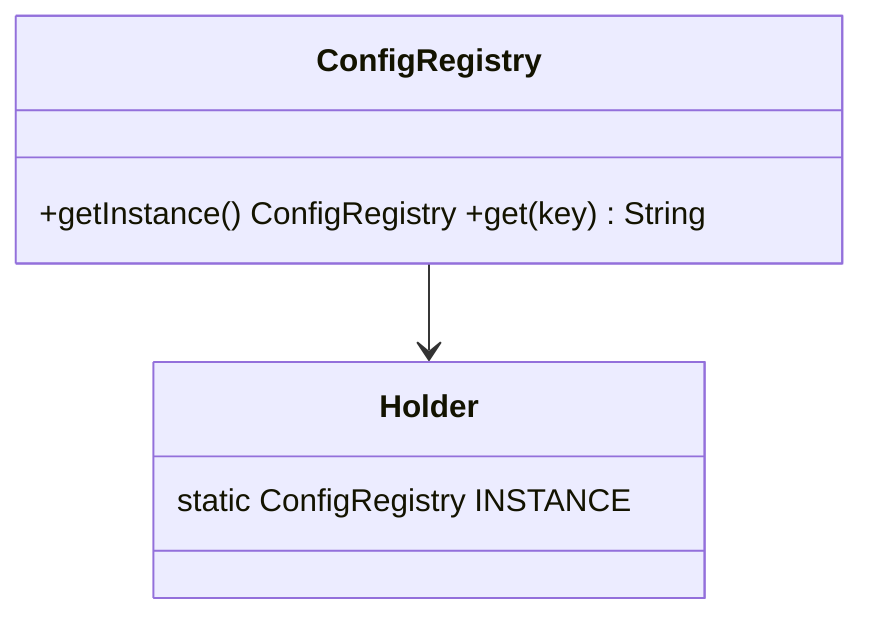
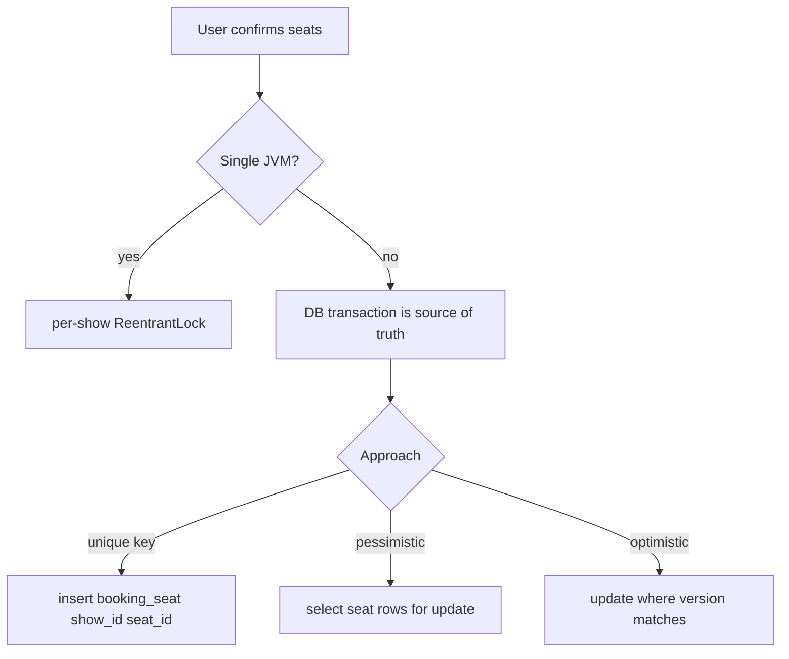
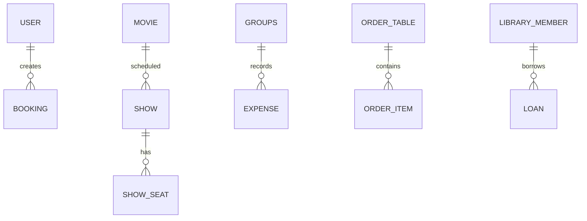

# 10f · LLD Concurrency, Schema Design & Refactoring

This file is the interview follow-up pack: Java concurrency utilities, schema/JPA mapping patterns, and code-quality refactoring drills. All Java snippets target Java 17 and are intentionally compact for machine-coding rounds.

**Legend:** 🟢 Beginner · 🟡 Intermediate · 🔴 Advanced · ⚫ FAANG · 🔥 = very frequently asked

## Table of Contents
- [Concurrency LLD with full code](#concurrency-lld-with-full-code)
- [Schema design for common LLD systems](#schema-design-for-common-lld-systems)
- [JPA entity mapping examples](#jpa-entity-mapping-examples)
- [Refactoring / code-quality round](#refactoring--code-quality-round)
- [Code review checklist](#code-review-checklist)
- [Revision Cheat Sheet](#revision-cheat-sheet)
- [Flashcards](#flashcards)

## Concurrency LLD with full code

### 1. Thread-safe Singleton
`🟡 Intermediate` `🔥` `Must-know SDE-1`

**Why they ask:** checks Java Memory Model, lazy initialization, and over-engineering awareness.

**Short answer:** Prefer enum singleton when you do not need lazy constructor parameters. For lazy initialization, use the initialization-on-demand holder idiom; double-checked locking must use `volatile`.



```java
import java.util.*;
public final class ConfigRegistry {
  private final Map<String,String> values = Map.of("env","dev");
  private ConfigRegistry() {}
  private static class Holder { static final ConfigRegistry INSTANCE = new ConfigRegistry(); }
  public static ConfigRegistry getInstance() { return Holder.INSTANCE; }
  public String get(String key) { return values.get(key); }
  public static void main(String[] args) { System.out.println(ConfigRegistry.getInstance().get("env")); }
}
```

**Follow-ups:** enum singleton is serialization-safe; double-checked locking without `volatile` is broken.

### 2. Bounded Blocking Queue with synchronized/wait-notify
`🔴 Advanced` `🔥` `Must-know SDE-2`

**Why they ask:** tests producer-consumer, condition waiting, and spurious wakeups.

```java
import java.util.*;
public class SyncBoundedBlockingQueue<T> {
    private final Queue<T> q = new ArrayDeque<>();
    private final int cap;

    public SyncBoundedBlockingQueue(int cap) {
        if (cap <= 0) {
            throw new IllegalArgumentException();
        }
        this.cap = cap;
    }

    public synchronized void put(T item) throws InterruptedException {
        while (q.size() == cap) {
            wait();
        }
        q.add(item);
        notifyAll();
    }

    public synchronized T take() throws InterruptedException {
        while (q.isEmpty()) {
            wait();
        }
        T item = q.remove();
        notifyAll();
        return item;
    }

    public synchronized int size() {
        return q.size();
    }

    public static void main(String[] args) throws Exception {
        var queue = new SyncBoundedBlockingQueue<Integer>(1);
        queue.put(7);
        System.out.println(queue.take());
    }
}
```

**Common mistakes:** using `if` instead of `while`, calling `notify` when many conditions exist, swallowing interrupts.

### 3. Bounded Blocking Queue with ReentrantLock/Condition
`🔴 Advanced` `🔥` `Must-know SDE-2`

```java
import java.util.*;
import java.util.concurrent.locks.*;

public class LockBoundedBlockingQueue<T> {
    private final Queue<T> q = new ArrayDeque<>();
    private final int cap;
    private final ReentrantLock lock = new ReentrantLock();
    private final Condition notFull = lock.newCondition();
    private final Condition notEmpty = lock.newCondition();

    public LockBoundedBlockingQueue(int cap) {
        if (cap <= 0) {
            throw new IllegalArgumentException();
        }
        this.cap = cap;
    }

    public void put(T item) throws InterruptedException {
        lock.lock();
        try {
            while (q.size() == cap) {
                notFull.await();
            }
            q.add(item);
            notEmpty.signal();
        } finally {
            lock.unlock();
        }
    }

    public T take() throws InterruptedException {
        lock.lock();
        try {
            while (q.isEmpty()) {
                notEmpty.await();
            }
            T item = q.remove();
            notFull.signal();
            return item;
        } finally {
            lock.unlock();
        }
    }

    public static void main(String[] args) throws Exception {
        var queue = new LockBoundedBlockingQueue<String>(2);
        queue.put("x");
        System.out.println(queue.take());
    }
}
```

**When better than synchronized:** multiple conditions, timed waits, fairness option, interruptible lock acquisition.

### 4. Thread-safe LRU Cache
`🔴 Advanced` `🔥` `Must-know SDE-2`

**Short answer:** combine HashMap + doubly-linked list for O(1), guard both structures with the same lock.

```java
import java.util.*;

public class LruCache<K, V> {
    private final int cap;
    private final Map<K, Node<K, V>> map = new HashMap<>();
    private final Node<K, V> head = new Node<>(null, null);
    private final Node<K, V> tail = new Node<>(null, null);

    static class Node<K, V> {
        K key;
        V value;
        Node<K, V> prev;
        Node<K, V> next;

        Node(K key, V value) {
            this.key = key;
            this.value = value;
        }
    }

    public LruCache(int cap) {
        if (cap <= 0) {
            throw new IllegalArgumentException();
        }
        this.cap = cap;
        head.next = tail;
        tail.prev = head;
    }

    public synchronized V get(K key) {
        Node<K, V> node = map.get(key);
        if (node == null) {
            return null;
        }
        moveFirst(node);
        return node.value;
    }

    public synchronized void put(K key, V value) {
        Node<K, V> node = map.get(key);
        if (node != null) {
            node.value = value;
            moveFirst(node);
            return;
        }

        node = new Node<>(key, value);
        map.put(key, node);
        addFirst(node);
        if (map.size() > cap) {
            Node<K, V> old = tail.prev;
            remove(old);
            map.remove(old.key);
        }
    }

    private void moveFirst(Node<K, V> node) {
        remove(node);
        addFirst(node);
    }

    private void addFirst(Node<K, V> node) {
        node.next = head.next;
        node.prev = head;
        head.next.prev = node;
        head.next = node;
    }

    private void remove(Node<K, V> node) {
        node.prev.next = node.next;
        node.next.prev = node.prev;
    }

    public static void main(String[] args) {
        var cache = new LruCache<Integer, String>(1);
        cache.put(1, "a");
        cache.put(2, "b");
        System.out.println(cache.get(1));
    }
}
```

**Follow-up:** `LinkedHashMap` with `accessOrder=true` is fine if interviewer allows library usage.

### 5. Concurrent Rate Limiter
`🔴 Advanced` `🔥` `Must-know SDE-2`

**Token bucket:** refill by elapsed time; synchronized method is acceptable for a per-user limiter.

```java
public class TokenBucketRateLimiter {
    private final long capacity;
    private final long refillPerSecond;
    private long tokens;
    private long lastNanos;

    public TokenBucketRateLimiter(long capacity, long refillPerSecond) {
        this.capacity = capacity;
        this.refillPerSecond = refillPerSecond;
        this.tokens = capacity;
        this.lastNanos = System.nanoTime();
    }

    public synchronized boolean allow() {
        refill();
        if (tokens == 0) {
            return false;
        }
        tokens--;
        return true;
    }

    private void refill() {
        long now = System.nanoTime();
        long add = (now - lastNanos) * refillPerSecond / 1_000_000_000L;
        if (add > 0) {
            tokens = Math.min(capacity, tokens + add);
            lastNanos = now;
        }
    }

    public static void main(String[] args) {
        var limiter = new TokenBucketRateLimiter(2, 1);
        System.out.println(limiter.allow());
    }
}
```

**Distributed version:** Redis Lua script updates tokens atomically; include user id and route as key.

### 6. Connection Pool
`🔴 Advanced` `🔥` `Must-know SDE-2`

```java
import java.util.*;
import java.util.concurrent.*;

public class SimpleConnectionPool<T> implements AutoCloseable {
    private final Semaphore permits;
    private final Deque<T> idle = new ArrayDeque<>();
    private volatile boolean closed;

    public SimpleConnectionPool(Collection<T> connections) {
        if (connections.isEmpty()) {
            throw new IllegalArgumentException("empty pool");
        }
        permits = new Semaphore(connections.size(), true);
        idle.addAll(connections);
    }

    public T borrow(long timeoutMs) throws InterruptedException {
        if (closed) {
            throw new IllegalStateException("closed");
        }
        if (!permits.tryAcquire(timeoutMs, TimeUnit.MILLISECONDS)) {
            throw new RuntimeException("timeout");
        }
        synchronized (idle) {
            if (closed) {
                permits.release();
                throw new IllegalStateException("closed");
            }
            return idle.removeFirst();
        }
    }

    public void release(T connection) {
        if (connection == null || closed) {
            return;
        }
        synchronized (idle) {
            idle.addLast(connection);
        }
        permits.release();
    }

    public void close() {
        closed = true;
        synchronized (idle) {
            idle.clear();
        }
    }

    public static void main(String[] args) throws Exception {
        var pool = new SimpleConnectionPool<>(List.of("c1"));
        String connection = pool.borrow(100);
        pool.release(connection);
        pool.close();
    }
}
```

**Production additions:** health check, max lifetime, leak detection, validation on borrow, metrics.

### 7. Mini Thread Pool like ExecutorService
`🔴 Advanced` `🔥` `Must-know SDE-2`

```java
import java.util.*;
import java.util.concurrent.*;

public class MiniThreadPool implements AutoCloseable {
    private final BlockingQueue<Runnable> queue = new LinkedBlockingQueue<>();
    private final List<Thread> workers = new ArrayList<>();
    private volatile boolean shutdown;

    public MiniThreadPool(int n) {
        for (int i = 0; i < n; i++) {
            Thread worker = new Thread(this::loop, "mini-" + i);
            workers.add(worker);
            worker.start();
        }
    }

    public void submit(Runnable task) {
        if (shutdown) {
            throw new RejectedExecutionException();
        }
        queue.offer(task);
    }

    private void loop() {
        try {
            while (!shutdown || !queue.isEmpty()) {
                Runnable task = queue.poll(100, TimeUnit.MILLISECONDS);
                if (task != null) {
                    runSafely(task);
                }
            }
        } catch (InterruptedException e) {
            Thread.currentThread().interrupt();
        }
    }

    private void runSafely(Runnable task) {
        try {
            task.run();
        } catch (Throwable ignored) {
        }
    }

    public void close() {
        shutdown = true;
    }

    public static void main(String[] args) {
        try (var pool = new MiniThreadPool(2)) {
            pool.submit(() -> System.out.println("job"));
        }
    }
}
```

**Follow-up:** add `Future`, bounded queue, rejection policies, graceful `awaitTermination`.

### 8. Seat booking without double booking
`⚫ FAANG` `🔥` `Must-know SDE-2`



```java
import java.util.*;
import java.util.concurrent.*;
import java.util.concurrent.locks.*;

public class InMemorySeatBooker {
    private final Set<String> booked = ConcurrentHashMap.newKeySet();
    private final Map<String, ReentrantLock> locks = new ConcurrentHashMap<>();

    public boolean book(String showId, List<String> seats) {
        ReentrantLock lock = locks.computeIfAbsent(showId, ignored -> new ReentrantLock());
        lock.lock();
        try {
            for (String seat : seats) {
                if (booked.contains(key(showId, seat))) {
                    return false;
                }
            }
            for (String seat : seats) {
                booked.add(key(showId, seat));
            }
            return true;
        } finally {
            lock.unlock();
        }
    }

    private String key(String showId, String seat) {
        return showId + ":" + seat;
    }

    public static void main(String[] args) {
        var booker = new InMemorySeatBooker();
        System.out.println(booker.book("S", List.of("A1")));
    }
}
```

**Comparison table**

| Approach | Use when | Strength | Weakness |
|---|---|---|---|
| In-memory lock | single JVM demo | simple and fast | fails across servers/restarts |
| DB unique constraint | distributed booking | definitive no double booking | handle duplicate-key exceptions |
| Pessimistic lock | hot rows, strict flow | serializes seat updates | deadlocks/lock waits |
| Optimistic locking | lower contention | no long lock holding | retry on version conflict |

**SQL guard examples**
```sql
-- PostgreSQL/MySQL: unique guard
CREATE TABLE booking_seat(
  booking_id BIGINT NOT NULL,
  show_id BIGINT NOT NULL,
  seat_id BIGINT NOT NULL,
  PRIMARY KEY (booking_id, seat_id),
  UNIQUE (show_id, seat_id)
);

-- optimistic update
UPDATE show_seat
SET status='BOOKED', version=version+1
WHERE show_id=? AND seat_id=? AND status='LOCKED' AND version=?;
```

### 9. ReadWriteLock cache
`🔴 Advanced` `🔥` `Must-know SDE-2`

```java
import java.util.*;
import java.util.concurrent.locks.*;

public class ReadWriteCache<K, V> {
    private final Map<K, V> map = new HashMap<>();
    private final ReadWriteLock rw = new ReentrantReadWriteLock();

    public V get(K key) {
        rw.readLock().lock();
        try {
            return map.get(key);
        } finally {
            rw.readLock().unlock();
        }
    }

    public void put(K key, V value) {
        rw.writeLock().lock();
        try {
            map.put(key, value);
        } finally {
            rw.writeLock().unlock();
        }
    }

    public int size() {
        rw.readLock().lock();
        try {
            return map.size();
        } finally {
            rw.readLock().unlock();
        }
    }

    public static void main(String[] args) {
        var cache = new ReadWriteCache<String, Integer>();
        cache.put("x", 1);
        System.out.println(cache.get("x"));
    }
}
```

**When to use:** many reads, few writes, read operations are not mutating. For very high concurrency, prefer `ConcurrentHashMap` unless compound operations require locks.

## Schema design for common LLD systems

### ER overview


### 1. Parking Lot schema
```sql
-- Standard relational SQL
CREATE TABLE parking_lot(id BIGINT PRIMARY KEY, name VARCHAR(100) NOT NULL);
CREATE TABLE floor(id BIGINT PRIMARY KEY, lot_id BIGINT NOT NULL REFERENCES parking_lot(id), floor_no INT NOT NULL, UNIQUE(lot_id,floor_no));
CREATE TABLE spot(id BIGINT PRIMARY KEY, floor_id BIGINT NOT NULL REFERENCES floor(id), spot_no VARCHAR(20), spot_type VARCHAR(20), status VARCHAR(20), UNIQUE(floor_id,spot_no));
CREATE TABLE vehicle(id BIGINT PRIMARY KEY, plate_no VARCHAR(20) UNIQUE NOT NULL, vehicle_type VARCHAR(20) NOT NULL);
CREATE TABLE ticket(id BIGINT PRIMARY KEY, vehicle_id BIGINT REFERENCES vehicle(id), spot_id BIGINT REFERENCES spot(id), entry_time TIMESTAMP NOT NULL, exit_time TIMESTAMP, status VARCHAR(20), INDEX_ticket_status(status));
CREATE INDEX idx_spot_type_status ON spot(spot_type,status);
```
Keys: `spot(floor_id, spot_no)` prevents duplicate spots; index by `spot_type,status` speeds nearest-free-spot lookup.

### 2. BookMyShow schema
```sql
CREATE TABLE movie(id BIGINT PRIMARY KEY, title VARCHAR(200) NOT NULL);
CREATE TABLE theatre(id BIGINT PRIMARY KEY, city VARCHAR(80), name VARCHAR(120));
CREATE TABLE screen(id BIGINT PRIMARY KEY, theatre_id BIGINT REFERENCES theatre(id), name VARCHAR(50));
CREATE TABLE seat(id BIGINT PRIMARY KEY, screen_id BIGINT REFERENCES screen(id), row_no VARCHAR(5), seat_no INT, UNIQUE(screen_id,row_no,seat_no));
CREATE TABLE show(id BIGINT PRIMARY KEY, movie_id BIGINT REFERENCES movie(id), screen_id BIGINT REFERENCES screen(id), starts_at TIMESTAMP, INDEX_show_search(movie_id,starts_at));
CREATE TABLE show_seat(show_id BIGINT, seat_id BIGINT, status VARCHAR(20), version BIGINT DEFAULT 0, PRIMARY KEY(show_id,seat_id));
CREATE TABLE booking(id BIGINT PRIMARY KEY, user_id BIGINT, show_id BIGINT REFERENCES show(id), status VARCHAR(20), amount_cents BIGINT);
CREATE TABLE booking_seat(booking_id BIGINT REFERENCES booking(id), show_id BIGINT, seat_id BIGINT, PRIMARY KEY(booking_id,seat_id), UNIQUE(show_id,seat_id));
```
Critical index: `UNIQUE(show_id, seat_id)` in `booking_seat` prevents double booking even with concurrent app servers.

### 3. Splitwise schema
```sql
CREATE TABLE app_user(id BIGINT PRIMARY KEY, name VARCHAR(100) NOT NULL);
CREATE TABLE groups(id BIGINT PRIMARY KEY, name VARCHAR(100) NOT NULL);
CREATE TABLE group_member(group_id BIGINT REFERENCES groups(id), user_id BIGINT REFERENCES app_user(id), PRIMARY KEY(group_id,user_id));
CREATE TABLE expense(id BIGINT PRIMARY KEY, group_id BIGINT REFERENCES groups(id), paid_by BIGINT REFERENCES app_user(id), amount_cents BIGINT NOT NULL, created_at TIMESTAMP NOT NULL);
CREATE TABLE expense_split(expense_id BIGINT REFERENCES expense(id), user_id BIGINT REFERENCES app_user(id), share_cents BIGINT NOT NULL, PRIMARY KEY(expense_id,user_id));
CREATE TABLE settlement(id BIGINT PRIMARY KEY, group_id BIGINT, from_user BIGINT, to_user BIGINT, amount_cents BIGINT, created_at TIMESTAMP);
CREATE INDEX idx_expense_group_time ON expense(group_id,created_at);
```
Do not overwrite history; balances are derived from `expense` + `expense_split` + `settlement`.

### 4. Food Delivery schema
```sql
CREATE TABLE restaurant(id BIGINT PRIMARY KEY, name VARCHAR(150), status VARCHAR(20));
CREATE TABLE menu_item(id BIGINT PRIMARY KEY, restaurant_id BIGINT REFERENCES restaurant(id), name VARCHAR(120), price_cents BIGINT, available BOOLEAN);
CREATE TABLE customer_order(id BIGINT PRIMARY KEY, customer_id BIGINT, restaurant_id BIGINT REFERENCES restaurant(id), status VARCHAR(30), total_cents BIGINT, version BIGINT DEFAULT 0);
CREATE TABLE order_item(id BIGINT PRIMARY KEY, order_id BIGINT REFERENCES customer_order(id), menu_item_id BIGINT, name_snapshot VARCHAR(120), price_snapshot_cents BIGINT, qty INT);
CREATE TABLE payment(id BIGINT PRIMARY KEY, order_id BIGINT UNIQUE REFERENCES customer_order(id), provider_ref VARCHAR(100) UNIQUE, status VARCHAR(30));
CREATE TABLE delivery(id BIGINT PRIMARY KEY, order_id BIGINT UNIQUE REFERENCES customer_order(id), partner_id BIGINT, status VARCHAR(30));
CREATE INDEX idx_order_customer_time ON customer_order(customer_id,id);
```
Snapshot item name/price because menu changes after order placement.

### 5. Library schema
```sql
CREATE TABLE book(id BIGINT PRIMARY KEY, isbn VARCHAR(30), title VARCHAR(200), author VARCHAR(120));
CREATE TABLE book_copy(id BIGINT PRIMARY KEY, book_id BIGINT REFERENCES book(id), barcode VARCHAR(50) UNIQUE, status VARCHAR(20));
CREATE TABLE library_member(id BIGINT PRIMARY KEY, name VARCHAR(100), status VARCHAR(20));
CREATE TABLE loan(id BIGINT PRIMARY KEY, copy_id BIGINT REFERENCES book_copy(id), member_id BIGINT REFERENCES library_member(id), issued_at TIMESTAMP, due_at TIMESTAMP, returned_at TIMESTAMP);
CREATE TABLE reservation(id BIGINT PRIMARY KEY, book_id BIGINT REFERENCES book(id), member_id BIGINT REFERENCES library_member(id), status VARCHAR(20), created_at TIMESTAMP);
CREATE INDEX idx_copy_status ON book_copy(book_id,status);
CREATE INDEX idx_loan_member ON loan(member_id,returned_at);
```
Book is bibliographic; BookCopy is the physical lendable unit.

## JPA entity mapping examples

```java
import jakarta.persistence.*;import java.time.*;import java.util.*;
@Entity class ShowSeat {
  @EmbeddedId ShowSeatId id;
  @Enumerated(EnumType.STRING) SeatStatus status;
  @Version long version;
}
@Embeddable class ShowSeatId implements java.io.Serializable { Long showId; Long seatId; }
enum SeatStatus { AVAILABLE, LOCKED, BOOKED }

@Entity class CustomerOrder {
  @Id @GeneratedValue Long id;
  Long customerId;
  @Enumerated(EnumType.STRING) OrderStatus status;
  long totalCents;
  @Version long version;
  @OneToMany(mappedBy="order", cascade=CascadeType.ALL, orphanRemoval=true)
  List<OrderItem> items = new ArrayList<>();
}
@Entity class OrderItem {
  @Id @GeneratedValue Long id;
  @ManyToOne(fetch=FetchType.LAZY) CustomerOrder order;
  Long menuItemId; String nameSnapshot; long priceSnapshotCents; int qty;
}
enum OrderStatus { CREATED, PAID, ACCEPTED, DELIVERED, CANCELLED }
```

**Mapping rules:** use `@Version` for optimistic locking, keep `LAZY` on many-to-one, store money as `long`, avoid exposing entities directly from REST controllers.

## Refactoring / code-quality round

### 1. Long method and magic strings
**Messy**
```java
double price(String type, int days) {
    if (type.equals("SUV")) {
        return days * 3000 * 1.18;
    }
    return days * 1500 * 1.18;
}
```
**Ideal**
```java
enum CarType { SUV, SEDAN }

interface PricingPolicy {
    long priceCents(CarType type, int days);
}

class DefaultPricingPolicy implements PricingPolicy {
    public long priceCents(CarType type, int days) {
        long base = type == CarType.SUV ? 300_000 : 150_000;
        return Math.round(base * days * 1.18);
    }
}
```
**Explanation:** replaces stringly-typed logic, names money unit, and isolates pricing.

### 2. Duplicate validation in services
**Messy**
```java
void addUser(String email) {
    if (email == null || !email.contains("@")) {
        throw new RuntimeException();
    }
    repo.save(email);
}

void invite(String email) {
    if (email == null || !email.contains("@")) {
        throw new RuntimeException();
    }
    mail.send(email);
}
```
**Ideal**
```java
record EmailAddress(String value) {
    EmailAddress {
        if (value == null || !value.matches("^[^@]+@[^@]+\\.[^@]+$")) {
            throw new IllegalArgumentException("invalid email");
        }
    }
}
```
**Explanation:** value object centralizes validation and improves method signatures.

### 3. Switch explosion for notifications
**Messy**
```java
void send(String channel, String to, String body) {
    if (channel.equals("EMAIL")) {
        email(to, body);
    } else if (channel.equals("SMS")) {
        sms(to, body);
    }
}
```
**Ideal**
```java
enum Channel { EMAIL, SMS }

interface Sender {
    void send(String to, String body);
}

class NotificationRouter {
    private final Map<Channel, Sender> senders;

    NotificationRouter(Map<Channel, Sender> senders) {
        this.senders = senders;
    }

    void send(Channel channel, String to, String body) {
        senders.get(channel).send(to, body);
    }
}
```
**Explanation:** open for new channels without editing router logic.

### 4. Check-then-act race
**Messy**
```java
if (stock.get(sku) >= qty) {
    stock.put(sku, stock.get(sku) - qty);
}
```
**Ideal**
```java
class Inventory {
    private final Map<String, Integer> stock = new HashMap<>();

    synchronized void reserve(String sku, int qty) {
        int left = stock.getOrDefault(sku, 0);
        if (left < qty) {
            throw new IllegalStateException("out of stock");
        }
        stock.put(sku, left - qty);
    }
}
```
**Explanation:** validation and mutation are atomic; in DB use conditional update.

### 5. Leaky exception handling
**Messy**
```java
try { gateway.charge(card, amount); } catch(Exception e) { return false; }
```
**Ideal**
```java
sealed interface PaymentResult permits PaymentSuccess, PaymentFailure {}
record PaymentSuccess(String providerRef) implements PaymentResult {}
record PaymentFailure(String code, boolean retryable) implements PaymentResult {}
class PaymentService { PaymentResult charge(){ return new PaymentFailure("DECLINED", false); } }
```
**Explanation:** caller receives actionable domain result instead of hidden failures.

## Code review checklist

- Naming: domain names over abbreviations; methods are verbs; booleans read like predicates.
- SRP: one class has one reason to change; split pricing, matching, validation, persistence.
- Money/time: use `long cents/paise`, `Instant`, `LocalDate`, and explicit timezone boundaries.
- Errors: domain exceptions or result types; never swallow exceptions silently.
- Validation: validate at boundaries and enforce invariants in constructors/value objects.
- Thread-safety: make check-and-update atomic; avoid exposing mutable collections.
- Persistence: unique constraints for business invariants; indexes match query filters.
- APIs: idempotency keys for retries; avoid returning JPA entities directly.
- Tests: include happy path, boundary, invalid input, concurrency/duplicate cases.
- Observability: log correlation id, business id, and outcome; avoid logging secrets.

## Revision Cheat Sheet
- Use holder or enum singleton; `volatile` is mandatory for double-checked locking.
- `wait()` must be in a `while` loop; prefer Conditions for multiple wait sets.
- LRU requires map and list updates under one lock.
- Token bucket refills from elapsed time; Redis Lua makes it distributed.
- Connection pools need timeout, release, close, validation, and leak detection.
- Thread pool is queue + workers + shutdown policy.
- Seat booking: DB unique key beats JVM lock in distributed systems.
- `ReadWriteLock` helps read-heavy workloads but can be worse than `ConcurrentHashMap`.
- Schema invariants belong in unique constraints, foreign keys, and versions.
- Refactoring interviews reward small domain abstractions and testability.

## Flashcards
- Q: Lazy singleton best idiom? → A: Initialization-on-demand holder.
- Q: Why use `while` around `wait()`? → A: Spurious wakeups and rechecking condition.
- Q: LRU O(1) data structures? → A: HashMap plus doubly-linked list.
- Q: Token bucket state? → A: capacity, tokens, refill rate, last refill time.
- Q: Pool borrow timeout purpose? → A: Prevents callers from blocking forever.
- Q: Distributed seat booking guard? → A: DB unique `(show_id, seat_id)` or row/version lock.
- Q: Optimistic locking column? → A: `version` with conditional update.
- Q: Book vs BookCopy? → A: title metadata vs physical lendable copy.
- Q: Order item price snapshot? → A: Preserves historical order price.
- Q: Common refactoring pattern? → A: replace conditionals with Strategy/Router.
- Q: Best code-review concurrency question? → A: Is check-and-update atomic?
- Q: Why idempotency keys? → A: Safe retries without duplicate side effects.
