# 11a · Production Debugging and Observability

This part teaches production triage from first signal to safe mitigation. It focuses on Java,
Spring Boot, PostgreSQL/MySQL, Kubernetes, JVM evidence, and interview-style runbooks.

**Legend:** 🟢 Beginner · 🟡 Intermediate · 🔴 Advanced · ⚫ FAANG · 🔥 = very frequently asked

## Table of Contents
- [Section 1 · Real Interview Questions](#section-1--real-interview-questions)
  - [Q1. App normally responds in 100 ms, now 4-5 s](#q1-app-normally-responds-in-100-ms-now-4-5-s--how-do-you-investigate-end-to-end)
  - [Q2. API is slow because of the database](#q2-api-is-responding-slowly--how-do-you-investigate-db-side-and-indexes)
  - [Q3. Requests time out but app does not crash](#q3-requests-time-out-but-the-app-is-not-crashing--what-do-you-check)
  - [Q4. Server is up but every request times out with exceptions](#q4-all-requests-time-out-with-exceptions-though-the-server-is-up--how-do-you-debug)
  - [Q5. Shared HashMap works in test and fails in prod](#q5-a-shared-hashmap-across-threads-works-in-test-but-fails-in-prod--explain)
- [Section 2 · Runbooks](#section-2--runbooks)
  - [Q6. High CPU](#q6-runbook-high-cpu-in-a-java-service)
  - [Q7. Memory leak or OutOfMemoryError](#q7-runbook-memory-leak-or-outofmemoryerror)
  - [Q8. GC thrashing](#q8-runbook-gc-thrashing)
  - [Q9. Thread pool exhaustion](#q9-runbook-thread-pool-exhaustion)
  - [Q10. HikariCP pool exhaustion](#q10-runbook-hikaricp-pool-exhaustion)
  - [Q11. Deadlock](#q11-runbook-java-or-database-deadlock)
  - [Q12. Slow queries](#q12-runbook-slow-queries)
  - [Q13. Lock contention](#q13-runbook-lock-contention)
  - [Q14. Replication lag](#q14-runbook-replication-lag-and-read-your-writes-bugs)
  - [Q15. Works locally but fails in prod](#q15-runbook-works-locally-but-fails-in-prod)
  - [Q16. Fails only under load](#q16-runbook-fails-only-under-load)
  - [Q17. Intermittent failures](#q17-runbook-intermittent-failures)
  - [Q18. Third-party LLM API slow or 429](#q18-runbook-third-party-llm-api-is-slow-or-returns-429)
  - [Q19. OOMKilled or CrashLoopBackOff](#q19-runbook-oomkilled-or-crashloopbackoff)
- [Section 3 · Reading Evidence](#section-3--reading-evidence)
  - [Q20. Thread dump anatomy](#q20-how-do-you-read-a-java-thread-dump)
  - [Q21. GC log sample](#q21-how-do-you-read-g1-gc-log-lines)
  - [Q22. Heap histogram](#q22-how-do-you-read-a-heap-histogram)
- [Revision Cheat Sheet](#revision-cheat-sheet)
- [Flashcards](#flashcards)

## Section 1 · Real Interview Questions

### Q1. App normally responds in 100 ms, now 4-5 s — how do you investigate end-to-end?
`🔴 Advanced` `🔥` `Must-know SDE-2`

**Why they ask:** This tests whether you can isolate a latency regression without guessing at one layer.

**Short answer (say this first, 20-40 sec):**
I compare the bad window against a known-good window, then follow one slow request through logs,
metrics, traces, JVM, database, dependencies, and infrastructure. I first ask what changed:
deploy, traffic, data distribution, feature flag, config, dependency, or schema. Then I use APM
span timings to find the slowest component and validate it with thread dumps, GC logs, pool
metrics, DB slow logs, and resource metrics before choosing rollback, scale-out, index, or code fix.

**Detailed answer:**
Start with a time-boxed incident loop: define impact, preserve evidence, mitigate if users are
hurt, and only then perform root cause analysis. Useful commands and queries:

```bash
kubectl get deploy,rs,pod -n prod
kubectl rollout history deploy/email-reply-api -n prod
kubectl top pod -n prod
kubectl logs deploy/email-reply-api -n prod --since=30m | grep -E "ERROR|timeout|slow"
```

Sample trace for one slow `POST /api/reply`:

| Span | Before | Now | Read it as |
|---|---:|---:|---|
| Ingress to app | 8 ms | 10 ms | network is probably not first suspect |
| Controller validation | 4 ms | 5 ms | request parsing is stable |
| Hibernate query `findTemplate` | 25 ms | 3.8 s | slow span is DB-bound |
| Gemini API call | 55 ms | 80 ms | downstream LLM is not the regression |
| JSON serialization | 5 ms | 6 ms | response writing is normal |

Then collect JVM and DB evidence, not just dashboard screenshots:

```bash
jcmd <pid> Thread.print > thread-1.txt
sleep 10; jcmd <pid> Thread.print > thread-2.txt
sleep 10; jcmd <pid> Thread.print > thread-3.txt
jcmd <pid> GC.heap_info
```

PostgreSQL:

```sql
SELECT query, calls, mean_exec_time, rows
FROM pg_stat_statements
ORDER BY mean_exec_time DESC
LIMIT 5;

EXPLAIN (ANALYZE, BUFFERS)
SELECT * FROM email_template WHERE user_id = $1 AND status = 'ACTIVE';
```

If the plan shows a sequential scan on a large table, add or adjust an index only after checking
selectivity and write cost. If thread dumps show many threads waiting on Hikari, inspect Hikari
`active`, `idle`, `pending`, and DB `max_connections`. If GC pauses line up with latency spikes,
read GC logs before tuning heap. If only one AZ or pod is slow, investigate node CPU steal, disk I/O,
DNS, or network path. The answer is strongest when you name mitigation: rollback a bad deploy,
disable a flag, route read traffic away from lagging replica, raise pool only if DB capacity allows,
or add the missing index with `CONCURRENTLY` in PostgreSQL.

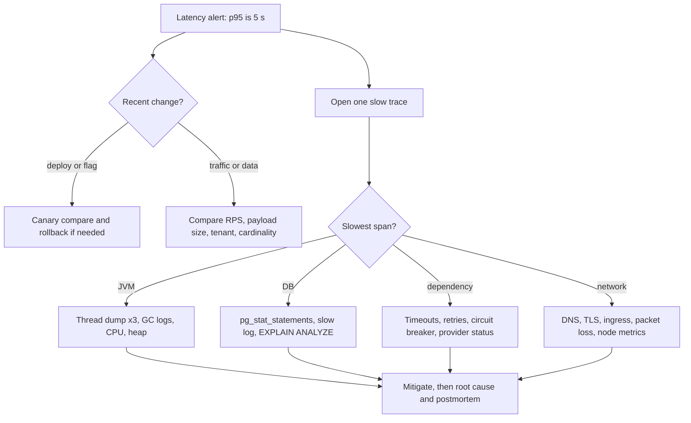

**Common mistakes:**
- Looking only at CPU and missing a slow database span.
- Increasing connection pool size when the database is already saturated.
- Running `EXPLAIN` without `ANALYZE` and ignoring actual row counts.

**Follow-ups:**
- *When would you rollback first?* → When a deploy correlates with impact and rollback is safe.
- *Why take three thread dumps?* → One dump is a snapshot; three show whether threads are stuck or moving.

### Q2. API is responding slowly — how do you investigate DB side and indexes?
`🔴 Advanced` `🔥` `Must-know SDE-2`

**Why they ask:** Interviewers want proof that you can read query evidence, not just say add an index.

**Short answer (say this first, 20-40 sec):**
I identify the exact slow SQL, measure it with database-native stats, read the execution plan,
and check whether the predicate, join order, index order, and row estimates match reality. I fix
with the smallest safe change: rewrite query, add a selective composite index, refresh stats, batch
N+1 access, or remove an unused index that hurts writes.

**Detailed answer:**
For PostgreSQL, enable `pg_stat_statements` and sort by total time and mean time. Total time finds
queries that hurt the system; mean time finds individually bad queries:

```sql
SELECT queryid, calls, round(total_exec_time::numeric, 1) AS total_ms,
       round(mean_exec_time::numeric, 1) AS mean_ms, rows
FROM pg_stat_statements
ORDER BY total_exec_time DESC
LIMIT 10;
```

Bad plan:

```sql
EXPLAIN (ANALYZE, BUFFERS)
SELECT id, subject FROM emails
WHERE user_id = 42 AND status = 'SENT'
ORDER BY created_at DESC
LIMIT 20;
```

```text
Limit  (actual time=1832.118..1832.125 rows=20 loops=1)
  Buffers: shared hit=3812 read=25109
  -> Sort  (actual time=1832.116..1832.119 rows=20 loops=1)
       Sort Key: created_at DESC
       -> Seq Scan on emails
            Filter: user_id = 42 AND status = 'SENT'
            Rows Removed by Filter: 4820191
```

Fix:

```sql
CREATE INDEX CONCURRENTLY idx_emails_user_status_created
ON emails (user_id, status, created_at DESC);
ANALYZE emails;
```

New plan:

```text
Limit  (actual time=2.314..2.345 rows=20 loops=1)
  -> Index Scan using idx_emails_user_status_created on emails
       Index Cond: (user_id = 42 AND status = 'SENT')
```

For MySQL, `type=ALL` in `EXPLAIN` means a full table scan; better values include `ref`, `range`,
or `const` depending on the query. Composite index order matters: equality predicates first,
then range, then ordering can often avoid sort. For `(tenant_id, status, created_at)`, a query by
`tenant_id` and `status` sorted by `created_at` is good; a query only by `status` cannot fully use
the leftmost prefix. Also watch Hibernate N+1:

```properties
spring.jpa.show-sql=true
logging.level.org.hibernate.SQL=DEBUG
logging.level.org.hibernate.orm.jdbc.bind=TRACE
```

If one HTTP request logs `select orders...` followed by 100 `select order_items where order_id=?`,
use `JOIN FETCH`, `@EntityGraph`, DTO projection, or batch fetching.

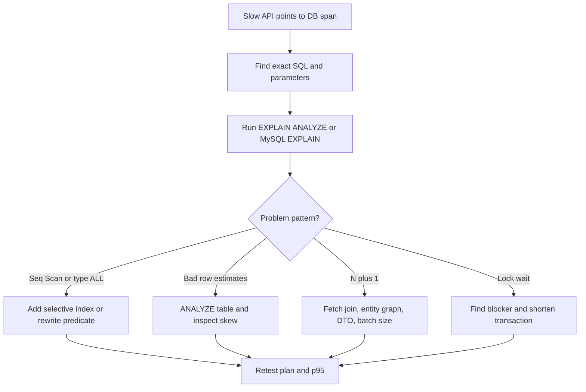

**Common mistakes:**
- Adding indexes for every column and slowing writes.
- Ignoring parameter values; the slow plan may happen only for a large tenant.
- Forgetting to refresh statistics after major data changes.

**Follow-ups:**
- *How do you choose composite index order?* → Equality columns, then range, then sort/group columns.
- *What if the index is unused?* → Check selectivity, stale stats, casts/functions on columns, and leftmost prefix.

### Q3. Requests time out but the app is not crashing — what do you check?
`🔴 Advanced` `🔥` `Must-know SDE-2`

**Why they ask:** This reveals whether you understand saturation, blocked threads, and hidden queues.

**Short answer (say this first, 20-40 sec):**
Timeouts with a live process usually mean work is queued or blocked: servlet threads, DB pool,
locks, GC pauses, downstream calls without timeouts, or a CPU spin. I compare incoming request rate
with active threads, take thread dumps, inspect Hikari pending threads, read GC pause timings, and
verify every outbound client has connect and read timeouts.

**Detailed answer:**
A Spring Boot process can be up while every request times out because the health endpoint runs on
a different path or the container is alive even though worker threads are unavailable. First find
where requests queue: load balancer, Tomcat, executor, Hikari, database, or downstream. Signals:
Tomcat `threads.busy == maxThreads`, Hikari `pending > 0`, GC pauses overlap with timeout windows,
or thread dump frames repeat across dumps. A classic Hikari symptom:

```text
java.sql.SQLTransientConnectionException:
HikariPool-1 - Connection is not available, request timed out after 30000ms.
```

Thread dump excerpt:

```text
"http-nio-8080-exec-47" WAITING on java.util.concurrent.SynchronousQueue$TransferStack
  at com.zaxxer.hikari.pool.HikariPool.getConnection(HikariPool.java:197)
  at com.zaxxer.hikari.HikariDataSource.getConnection(HikariDataSource.java:128)
  at org.hibernate.engine.jdbc.connections.internal.DatasourceConnectionProviderImpl.getConnection

"http-nio-8080-exec-48" WAITING on java.util.concurrent.SynchronousQueue$TransferStack
  at com.zaxxer.hikari.pool.HikariPool.getConnection(HikariPool.java:197)
```

If many request threads are waiting in `HikariPool.getConnection`, do not conclude the pool is too
small immediately. Ask why connections are held: slow SQL, unclosed streams, long transactions,
external API calls inside `@Transactional`, or DB lock waits. If dumps show `RUNNABLE` threads in
the same method with high CPU, suspect an infinite loop or hot code. Java 7 `HashMap` resize could
create a cyclic bucket under concurrent modification and spin forever; Java 8 changed internals but
plain `HashMap` is still unsafe. For downstream calls, configure timeouts:

```java
HttpClient client = HttpClient.newBuilder()
    .connectTimeout(Duration.ofSeconds(2))
    .build();
HttpRequest request = HttpRequest.newBuilder(uri)
    .timeout(Duration.ofSeconds(5))
    .GET()
    .build();
```

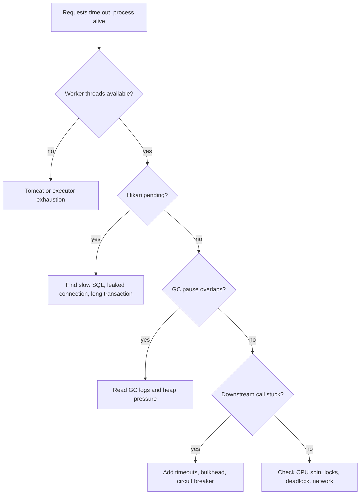

**Common mistakes:**
- Restarting repeatedly without preserving thread dumps.
- Increasing Tomcat threads while the bottleneck is a 10-connection DB pool.
- Treating liveness success as proof that the app is healthy.

**Follow-ups:**
- *How do you prove Hikari is the bottleneck?* → Pending threads plus thread dumps waiting on pool.
- *Why can GC cause timeouts?* → Stop-the-world pauses prevent request threads from making progress.

### Q4. All requests time out with exceptions though the server is up — how do you debug?
`🟡 Intermediate` `🔥` `Must-know SDE-1`

**Why they ask:** This checks whether you distinguish process health from service readiness.

**Short answer (say this first, 20-40 sec):**
I split the problem into reachability, readiness, dependency, and capacity. A server can be up but
unusable due to wrong ingress port, failing readiness, expired TLS, DNS errors, database failover,
pool exhaustion, disk full, file descriptor limits, dependency outage, or rate limiting. I use
client error, load balancer status, app logs, dependency health, and OS limits to narrow it.

**Detailed answer:**
Start outside-in. From a pod or bastion, test DNS, TLS, route, and application:

```bash
curl -vk https://api.example.com/actuator/health/readiness
curl -s -o /dev/null -w "%{http_code} %{time_connect} %{time_starttransfer}\n" \
  https://api.example.com/api/reply
kubectl get ingress,svc,endpoints -n prod
kubectl describe ingress email-reply -n prod
```

If the load balancer reports healthy but clients time out, verify the health check hits a meaningful
readiness endpoint, not only `/actuator/health/liveness`. Readiness should include DB or critical
dependency status only when the service cannot serve without them. Common exception mapping:

| Symptom | Likely area | Evidence |
|---|---|---|
| `UnknownHostException` | DNS or service name | CoreDNS errors, bad config |
| `SSLHandshakeException` | TLS cert, truststore | expiry, wrong SAN, CA rotation |
| `Connection refused` | port or pod not listening | Service targetPort mismatch |
| `Too many open files` | file descriptor leak | `lsof`, `ulimit -n`, JVM logs |
| `No space left on device` | disk full | node/pod filesystem metrics |
| `remaining connection slots are reserved` | DB max connections | DB activity view |
| HTTP 429 | dependency rate limit | provider response headers |

For database failover, Hikari may keep dead sockets until validation fails; set sensible connection
timeout, validation timeout, max lifetime below infrastructure idle timeout, and retry only safe
operations. If all endpoints fail after a deploy, compare environment variables, config maps,
secrets, service ports, and readiness probe paths. Mitigate by rolling back, switching traffic to a
healthy region, raising file descriptors, clearing disk, or disabling a dependent feature.

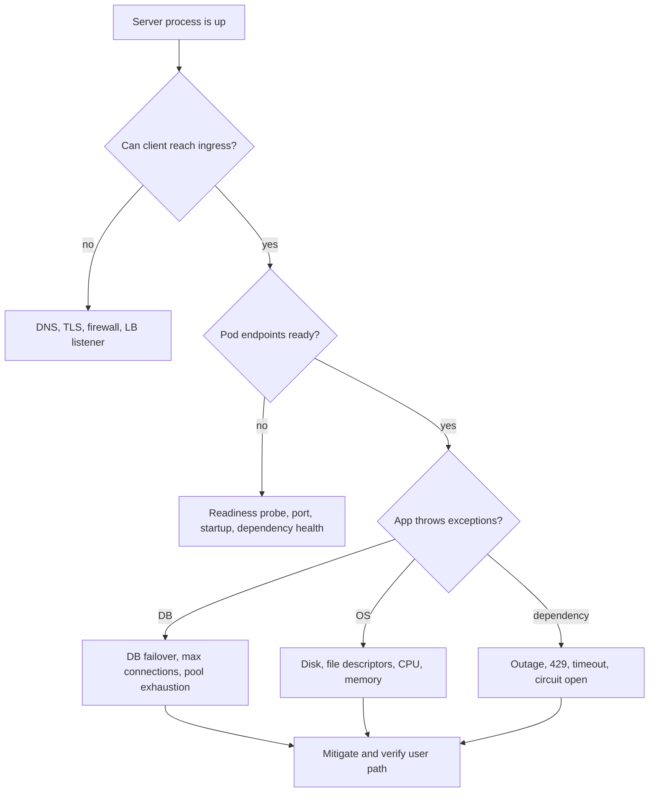

**Common mistakes:**
- Using liveness as a load-balancer health check for user traffic.
- Debugging Spring code before verifying ingress and service target ports.
- Retrying all errors and worsening a dependency outage.

**Follow-ups:**
- *What belongs in readiness?* → Checks required to serve traffic, with strict timeouts.
- *What should liveness prove?* → The process is not permanently wedged and can be restarted.

### Q5. A shared HashMap across threads works in test but fails in prod — explain.
`🟡 Intermediate` `🔥` `Must-know SDE-1`

**Why they ask:** This tests Java concurrency fundamentals and your ability to fix unsafe shared state.

**Short answer (say this first, 20-40 sec):**
`HashMap` is not thread-safe. Concurrent reads and writes can lose updates, expose stale values,
corrupt internal structure, and in old Java 7 resize races could create cyclic buckets that caused
100% CPU infinite loops. Use `ConcurrentHashMap`, immutable snapshots, synchronization, or atomic
methods like `compute` depending on the operation.

**Detailed answer:**
The failure appears in production because real traffic creates interleavings that unit tests rarely
cover. This unsafe counter loses increments because `get`, add, and `put` are separate operations:

```java
Map<String, Integer> counts = new HashMap<>();

void record(String userId) {
    Integer old = counts.get(userId);
    counts.put(userId, old == null ? 1 : old + 1);
}
```

Two threads can both read `old=10` and both write `11`, losing one update. During resize, concurrent
structural modification can corrupt buckets; Java 7 was infamous for a resize race that could create
a linked-list cycle, making `get` loop and burn CPU. Java 8 tree bins changed behavior, but the class
is still not safe for concurrent mutation. Visibility is another issue: without happens-before,
another thread may not see a recently inserted value promptly.

Fix with atomic operations:

```java
private final ConcurrentHashMap<String, LongAdder> counts = new ConcurrentHashMap<>();

public void record(String userId) {
    counts.computeIfAbsent(userId, ignored -> new LongAdder()).increment();
}

public long countFor(String userId) {
    LongAdder adder = counts.get(userId);
    return adder == null ? 0L : adder.sum();
}
```

For cache-like maps, prefer Caffeine with maximum size and expiry; otherwise a fixed
`ConcurrentHashMap` can become a memory leak. If an interview asks for repro, run many threads with
a shared `HashMap` and assert final size or count; it will be flaky, which is the point. Use
`Collections.synchronizedMap` only when coarse locking is acceptable and compound operations are
inside the same synchronized block.

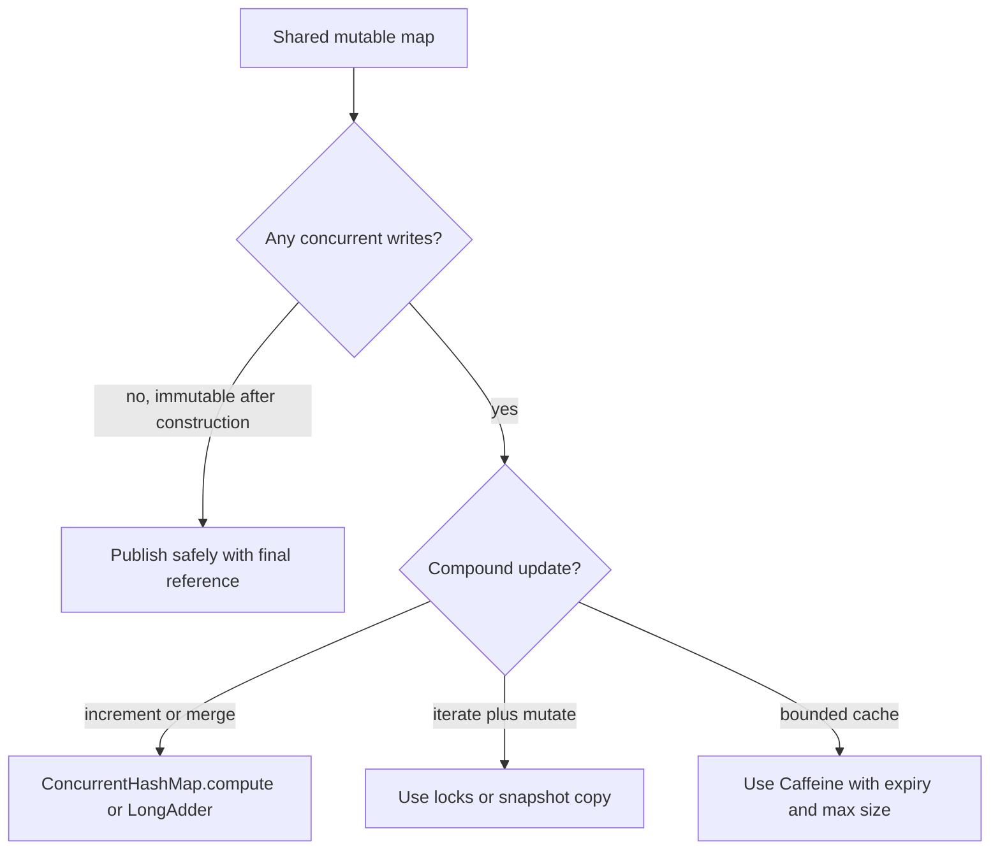

**Common mistakes:**
- Replacing `HashMap` with `ConcurrentHashMap` but keeping non-atomic get-then-put logic.
- Assuming passing tests prove thread safety.
- Using a global map as an unbounded cache.

**Follow-ups:**
- *Is `volatile Map` enough?* → No; it only protects the reference visibility, not map internals.
- *When use `LongAdder` over `AtomicLong`?* → High-contention counters where eventual sum is acceptable.

## Section 2 · Runbooks

### Q6. Runbook: high CPU in a Java service
`🔴 Advanced` `🔥` `Must-know SDE-2`

**Why they ask:** High CPU is common, and good candidates can map an OS thread to Java code quickly.

**Short answer (say this first, 20-40 sec):**
I identify whether CPU is user CPU, system CPU, GC CPU, or a single hot thread. For Java, I use
`top -H` to find the thread ID, convert it to hex, match it to `nid` in `jstack`, and confirm with
repeated dumps or a profiler before changing code.

**Detailed answer:**
Runbook:

| Step | Command | What to decide |
|---|---|---|
| Scope | `kubectl top pod -n prod` | one pod or all pods |
| Process | `top -p <pid>` | Java process or sidecar |
| Thread | `top -H -p <pid>` | one hot thread or many |
| Map | `printf "%x\n" <tid>` | Linux TID to Java `nid` |
| Stack | `jstack -l <pid> | grep -A40 nid=0xabc` | exact Java frame |

Example:

```text
PID    USER  PR  NI  VIRT  RES  SHR S %CPU COMMAND
12352  app   20   0  8.2g  2g   40m R 98.7 java
```

```bash
printf "%x\n" 12352
# 3040
jstack -l 1200 | grep -A35 "nid=0x3040"
```

If the stack points to JSON serialization, regex, compression, cryptography, or a tight loop, fix
the code path or reduce payload. If many GC threads are hot, inspect allocation rate and GC logs.
If system CPU is high, look for TLS handshakes, logging to slow disk, kernel networking, or sidecar
overhead. Always take at least two dumps 10 seconds apart; a hot thread that moves is busy, while a
thread stuck on the same frame may be spinning. For deeper proof use async-profiler:

```bash
./profiler.sh -d 30 -e cpu -f cpu.html <pid>
```

Mitigation can be scaling replicas, disabling an expensive feature flag, reducing log level, or
rolling back. Prevention is load testing hot paths, adding CPU dashboards, and alerting on CPU
saturation plus latency rather than CPU alone.

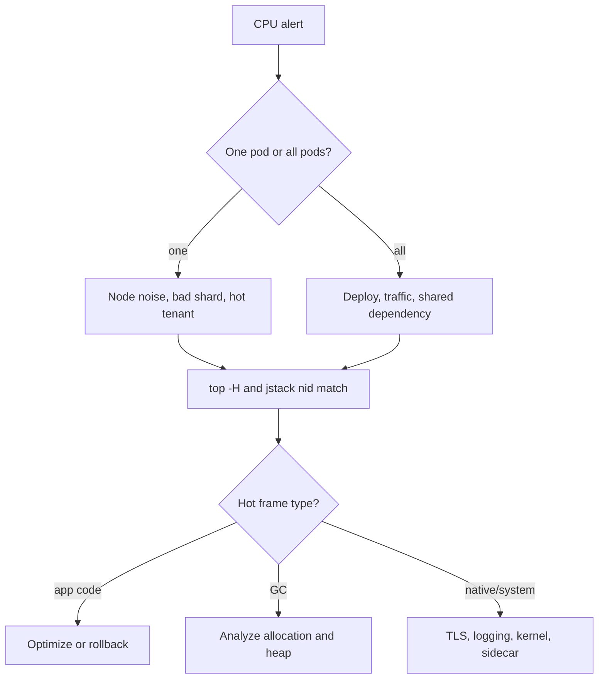

**Common mistakes:**
- Looking at process CPU only and not per-thread CPU.
- Capturing a heap dump first, which can worsen a CPU incident.
- Optimizing code before checking whether the spike follows a deployment.

**Follow-ups:**
- *Why convert TID to hex?* → Java dumps print native thread IDs as hexadecimal `nid`.
- *What if CPU is high but stacks show GC?* → Treat it as allocation or heap pressure, not business logic.

### Q7. Runbook: memory leak or OutOfMemoryError
`🔴 Advanced` `🔥` `Must-know SDE-2`

**Why they ask:** Memory incidents require evidence collection before the process restarts.

**Short answer (say this first, 20-40 sec):**
I distinguish heap, metaspace, direct memory, thread stack, and container OOM. I enable heap dump on
OOM, collect histograms or dumps carefully, analyze retained size in MAT, fix the retention path,
and add limits such as cache eviction, listener cleanup, and bounded queues.

**Detailed answer:**
Prepare production JVMs before an incident:

```bash
-XX:+HeapDumpOnOutOfMemoryError
-XX:HeapDumpPath=/dumps
-XX:+ExitOnOutOfMemoryError
-XX:MaxRAMPercentage=75
```

Do not blindly run a full heap dump on a dying pod if disk is low; it can freeze the process and fill
storage. Start with:

```bash
jcmd <pid> GC.class_histogram
jmap -histo:live <pid> | head -40
```

Example:

```text
 num     #instances         #bytes  class name
   1:       8200000      524800000  [B
   2:       2100000      168000000  java.lang.String
   3:        950000       91200000  com.app.EmailDraft
```

This says many byte arrays and strings exist, but not why they are retained. Load the `.hprof` in
Eclipse MAT and inspect the dominator tree. The key column is retained heap: memory freed if that
object is collected. Common Java leaks are unbounded maps, caches without TTL, static collections,
listeners not deregistered, `ThreadLocal` values in pools, queued tasks faster than consumers,
Hibernate sessions holding entity graphs, and large response bodies buffered in memory. In a Spring
app, a leak after a new feature might be a `ConcurrentHashMap` keyed by user ID with no eviction:

```java
Cache<String, EmailDraft> drafts = Caffeine.newBuilder()
    .maximumSize(100_000)
    .expireAfterWrite(Duration.ofHours(2))
    .recordStats()
    .build();
```

Mitigation is restart or scale if users are impacted; fix is removing the retention path. Prevention
is heap usage alerts, cache metrics, load tests with soak duration, and reviewing every collection
that grows with tenants, requests, or messages.

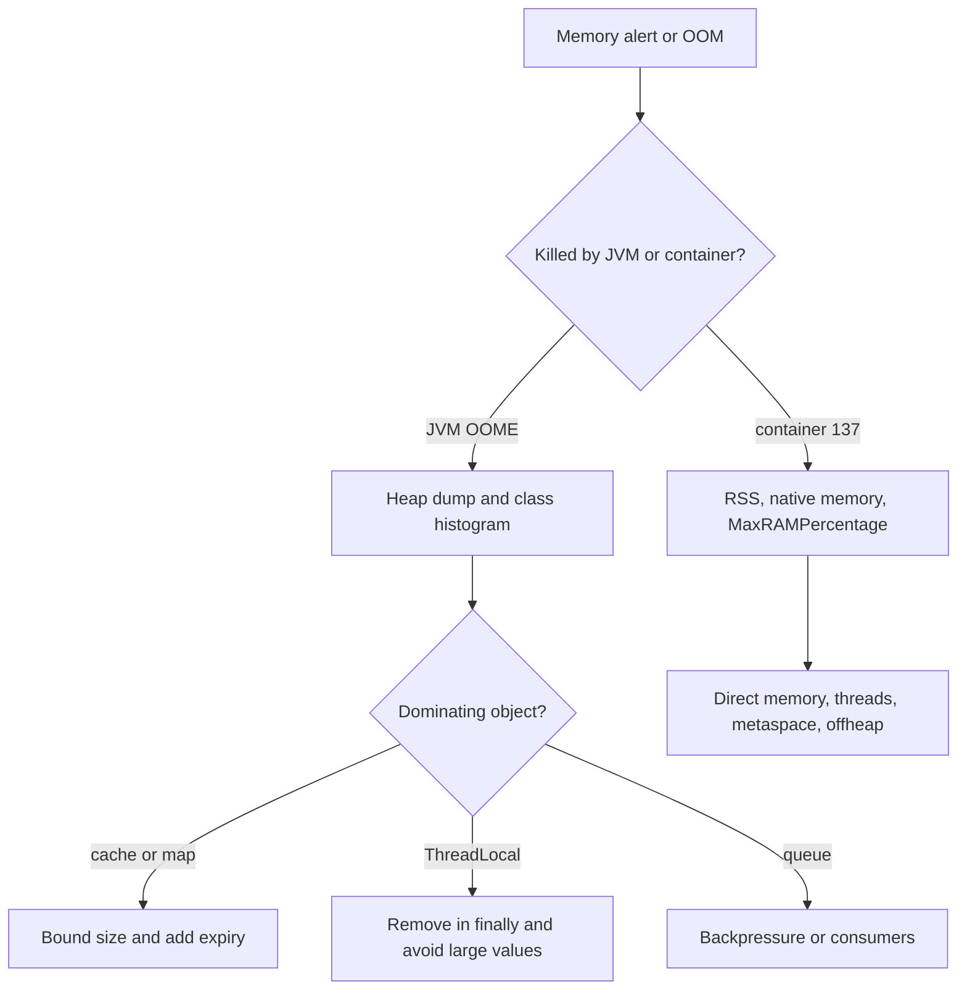

**Common mistakes:**
- Treating high heap after GC as always a leak; it may be legitimate cache warmup.
- Ignoring native memory in containers.
- Keeping heap dumps on the same disk as application logs without capacity planning.

**Follow-ups:**
- *What is retained size?* → Memory that becomes collectible if the selected object is removed.
- *Why use `:live` in `jmap -histo:live`?* → It requests a full GC first, showing live objects.

### Q8. Runbook: GC thrashing
`🔴 Advanced` `🔥` `Must-know SDE-2`

**Why they ask:** GC issues are often misdiagnosed as slow code or slow database.

**Short answer (say this first, 20-40 sec):**
I confirm pauses or high GC CPU using GC logs and `jstat`, then separate allocation pressure from
old-gen retention. If young GC is frequent, reduce allocation; if old gen stays high after full GC,
look for leaks or an undersized heap.

**Detailed answer:**
Useful commands:

```bash
jstat -gcutil <pid> 1000 5
jcmd <pid> GC.heap_info
jcmd <pid> VM.flags
```

Sample:

```text
  S0    S1     E      O      M    CCS   YGC  YGCT  FGC  FGCT   GCT
  0.00 82.1  91.3   88.7  96.2  92.0  750  45.2   12  38.7  83.9
  0.00  0.0  12.0   89.1  96.2  92.0  751  45.4   12  38.7  84.1
```

Read it as: eden fills quickly, young GC count is high, old gen is around 89%, and full GC already
consumed 38.7 seconds. If old gen drops after full GC, heap might be small or traffic bursty; if it
does not drop, retained objects are likely. Enable modern logging:

```bash
-Xlog:gc*,safepoint:file=/logs/gc.log:time,uptime,level,tags
```

Example G1 line:

```text
[12.345s][info][gc] GC(42) Pause Young (Normal) (G1 Evacuation Pause) 2048M->940M(4096M) 38.2ms
```

`2048M->940M` means live data after the pause is 940 MB. Repeated lines with higher after-GC values
show retention growth. Fixes depend on cause: reduce object churn in hot loops, stream large files,
avoid loading entire result sets, use pagination, bound caches, remove accidental object graphs from
sessions, or increase heap only after proving memory is legitimately needed. In containers, set
`MaxRAMPercentage` so Java leaves room for native memory and sidecars.

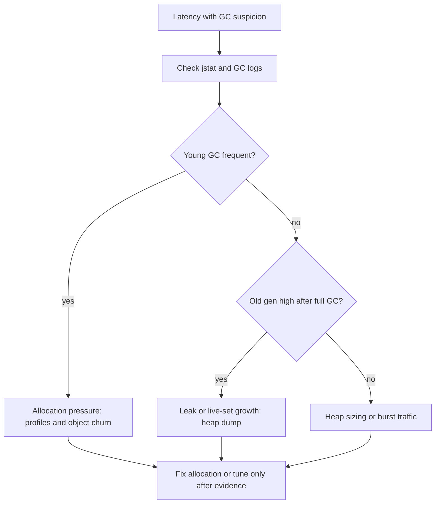

**Common mistakes:**
- Tuning GC flags before understanding allocation and live set.
- Ignoring p99 pause time because average pause looks fine.
- Setting heap equal to container memory and triggering OOMKilled.

**Follow-ups:**
- *What does after-GC heap mean?* → Approximate live set after collectible garbage is removed.
- *Why prefer GC logs over guesses?* → They show exact pause cause, duration, and heap before/after.

### Q9. Runbook: thread pool exhaustion
`🟡 Intermediate` `🔥` `Must-know SDE-1`

**Why they ask:** Most Java web services fail by saturating a bounded executor before crashing.

**Short answer (say this first, 20-40 sec):**
I check whether request threads or async executor threads are all busy, then inspect what they are
doing. If they wait on DB, locks, or downstream I/O, I fix the blocking dependency; if they run CPU
work, I isolate it from request threads and size pools based on workload.

**Detailed answer:**
Tomcat metrics in Spring Boot Actuator are the fastest signal:

```text
tomcat.threads.config.max = 200
tomcat.threads.current = 200
tomcat.threads.busy = 200
http.server.requests p95 = 30s
```

That means all request workers are occupied; new requests queue at the connector or load balancer.
Collect dumps:

```bash
jcmd <pid> Thread.print | grep -E "http-nio|ForkJoinPool|pool-" -A30
```

If many `http-nio-8080-exec-*` threads are `WAITING` on `HikariPool.getConnection`, the DB pool is
the queue. If they are `TIMED_WAITING` inside `SocketInputStream.socketRead0`, a downstream service
is slow or timeout is too high. If your code performs PDF generation, LLM calls, or large exports on
request threads, move it to a bounded worker pool or async job and return `202 Accepted`.

Spring config:

```yaml
server:
  tomcat:
    threads:
      max: 200
    accept-count: 100
management.endpoints.web.exposure.include: health,metrics,prometheus
```

Do not simply raise `maxThreads` from 200 to 1000; it can increase memory, context switching, and DB
pressure. Estimate with Little's Law: concurrency ≈ throughput × latency. If 100 RPS requests spend
500 ms waiting on I/O, about 50 concurrent threads are needed for that path, plus headroom. For CPU
tasks, more threads than cores often hurts. Prevention: expose executor queue depth, active count,
rejected count, and use bulkheads per dependency.

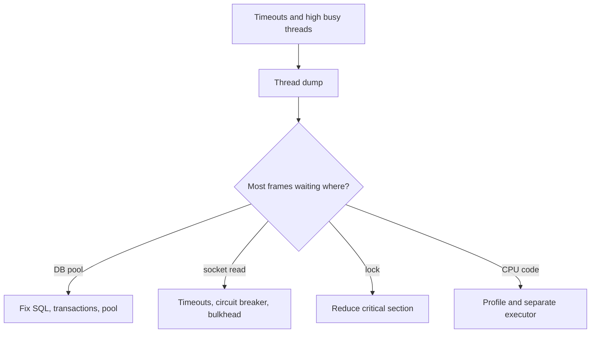

**Common mistakes:**
- Making the request pool huge instead of removing the blocker.
- Sharing one async executor for unrelated slow jobs.
- Missing rejected task counts because only latency is monitored.

**Follow-ups:**
- *What is `accept-count`?* → Backlog for requests waiting when Tomcat worker threads are busy.
- *Why separate pools?* → A slow dependency should not consume all capacity for unrelated endpoints.

### Q10. Runbook: HikariCP pool exhaustion
`🟡 Intermediate` `🔥` `Must-know SDE-1`

**Why they ask:** It connects Spring, transactions, SQL performance, and database capacity.

**Short answer (say this first, 20-40 sec):**
I look at Hikari active, idle, pending, timeout errors, and thread dumps. Pool exhaustion usually
means connections are held too long by slow SQL, long transactions, leaks, or DB locks; increasing
pool size helps only if the database has capacity.

**Detailed answer:**
Symptoms:

```text
HikariPool-1 - Connection is not available, request timed out after 30000ms
```

Metrics:

```text
hikaricp.connections.active = 10
hikaricp.connections.idle = 0
hikaricp.connections.pending = 87
hikaricp.connections.timeout = increasing
```

Interpretation: all connections are checked out and 87 threads are waiting. Next question is why.
Check thread dumps for business code inside transactions and DB queries:

```java
@Transactional
public EmailReply generateReply(Request request) {
    Email email = emailRepository.findById(request.emailId()).orElseThrow();
    String reply = geminiClient.generate(email.body()); // bad inside DB transaction
    email.setReply(reply);
    return mapper.toDto(email);
}
```

Move slow external calls outside the transaction:

```java
public EmailReply generateReply(Request request) {
    Email email = emailRepository.findById(request.emailId()).orElseThrow();
    String reply = geminiClient.generate(email.body());
    return emailService.saveReply(email.getId(), reply);
}
```

Sizing formula is constrained by DB: if PostgreSQL allows 200 connections and you run 10 app pods,
do not set each pool to 50. Reserve connections for migrations, admin, and background jobs. A simple
starting point is `min(DB usable connections / pod count, concurrency needed by DB-bound work)`.
Enable leak detection in non-noisy environments:

```yaml
spring.datasource.hikari.maximum-pool-size: 10
spring.datasource.hikari.connection-timeout: 30000
spring.datasource.hikari.leak-detection-threshold: 20000
```

Prevention is short transactions, query timeouts, DB lock monitoring, no remote I/O inside
transactions, and dashboards for active/idle/pending/timeout.

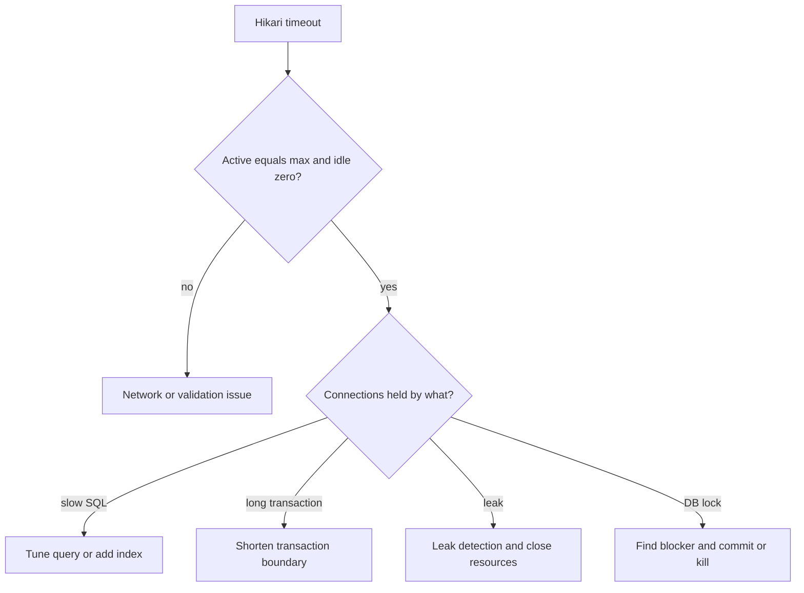

**Common mistakes:**
- Raising pool size without checking database `max_connections`.
- Calling third-party APIs inside `@Transactional`.
- Ignoring pending connection metrics until users see 30-second timeouts.

**Follow-ups:**
- *What does `leakDetectionThreshold` do?* → Logs stack traces for connections held too long.
- *Can pool size be too large?* → Yes; it can overwhelm DB CPU, memory, and lock scheduling.

### Q11. Runbook: Java or database deadlock
`🔴 Advanced` `🔥` `Must-know SDE-2`

**Why they ask:** Deadlocks require reading evidence from both JVM and database systems.

**Short answer (say this first, 20-40 sec):**
For Java, I use `jcmd Thread.print` and look for `Found one Java-level deadlock`. For DB deadlocks,
I read engine-specific lock reports, identify the two transactions and lock order, then enforce a
consistent update order or shorten transactions.

**Detailed answer:**
Java deadlock command:

```bash
jcmd <pid> Thread.print -l
```

Sample:

```text
Found one Java-level deadlock:
"pool-1-thread-1":
  waiting to lock monitor 0x1 (OrderService)
  which is held by "pool-1-thread-2"
"pool-1-thread-2":
  waiting to lock monitor 0x2 (InventoryService)
  which is held by "pool-1-thread-1"
```

This means two threads hold locks in opposite order. Fix by using one lock, ordering locks by key,
reducing synchronized scope, or using database atomic operations. Avoid nested locks around I/O.
For MySQL:

```sql
SHOW ENGINE INNODB STATUS\G
```

Look for `LATEST DETECTED DEADLOCK`, the two transactions, indexes, and statements. For PostgreSQL
lock waits:

```sql
SELECT blocked.pid AS blocked_pid, blocker.pid AS blocker_pid,
       blocked.query AS blocked_query, blocker.query AS blocker_query
FROM pg_stat_activity blocked
JOIN pg_locks bl ON bl.pid = blocked.pid AND NOT bl.granted
JOIN pg_locks kl ON kl.locktype = bl.locktype
 AND kl.database IS NOT DISTINCT FROM bl.database
 AND kl.relation IS NOT DISTINCT FROM bl.relation
 AND kl.page IS NOT DISTINCT FROM bl.page
 AND kl.tuple IS NOT DISTINCT FROM bl.tuple
 AND kl.transactionid IS NOT DISTINCT FROM bl.transactionid
 AND kl.classid IS NOT DISTINCT FROM bl.classid
 AND kl.objid IS NOT DISTINCT FROM bl.objid
 AND kl.objsubid IS NOT DISTINCT FROM bl.objsubid
 AND kl.pid <> bl.pid
JOIN pg_stat_activity blocker ON blocker.pid = kl.pid
WHERE kl.granted;
```

Prevention: update rows in the same order, keep transactions short, index foreign keys, avoid user
think-time inside transactions, set lock timeouts, and retry deadlock victims when operations are
idempotent.

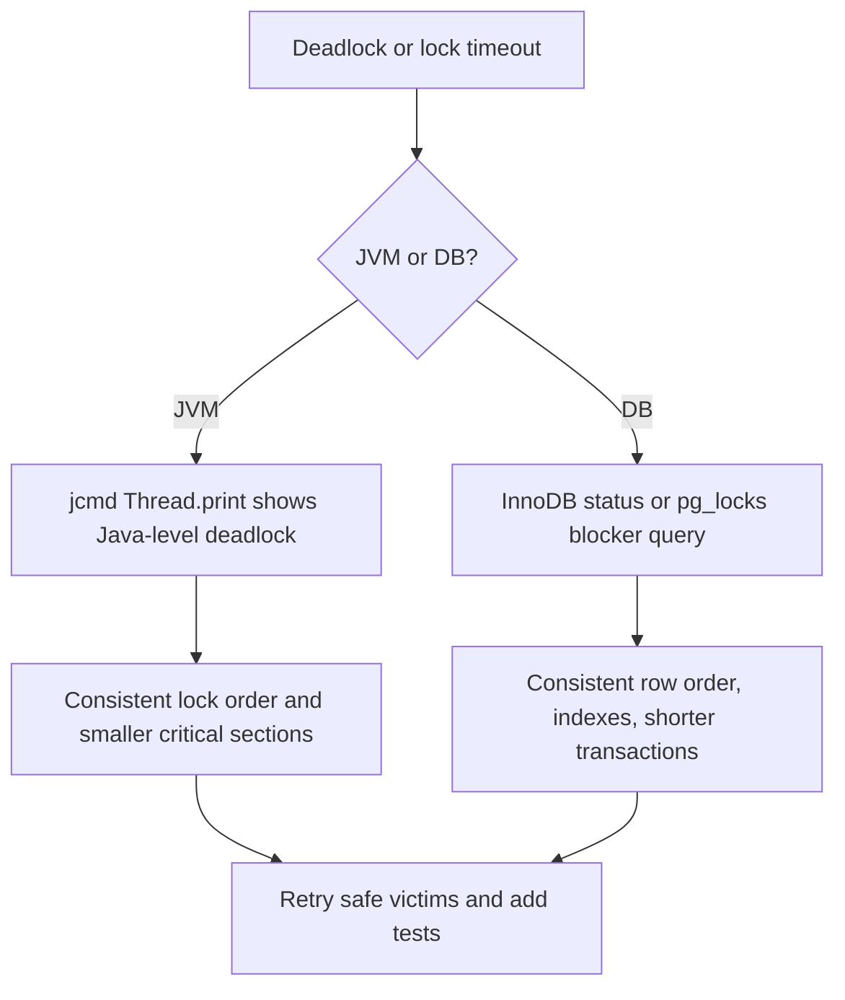

**Common mistakes:**
- Killing random sessions without saving lock evidence.
- Retrying non-idempotent operations without safeguards.
- Forgetting that missing indexes can make updates lock many rows.

**Follow-ups:**
- *Why do databases abort one transaction?* → To break the cycle and allow progress.
- *How do you reduce DB deadlocks?* → Same row order, short transactions, proper indexes, retries.

### Q12. Runbook: slow queries
`🟡 Intermediate` `🔥` `Must-know SDE-1`

**Why they ask:** Backend interviews expect practical query triage, not only SQL syntax.

**Short answer (say this first, 20-40 sec):**
I find the slow query, run an actual execution plan, compare estimated and actual rows, inspect
buffers, locks, and sort/hash operations, then fix the query, index, statistics, or data access
pattern. I verify with before/after latency and plan output.

**Detailed answer:**
For PostgreSQL, turn on slow query logging during controlled windows:

```sql
ALTER SYSTEM SET log_min_duration_statement = '500ms';
SELECT pg_reload_conf();
```

Use `pg_stat_statements` for aggregate view and `EXPLAIN (ANALYZE, BUFFERS)` for one query. Read
plans from inside out: access path, row estimate vs actual rows, loops, buffers, sorts, and joins.
Example diagnosis: `actual rows=200000` where `rows=100` was estimated means stale stats or skew.
`Buffers: shared read=25000` means disk reads; `Sort Method: external merge Disk` means work memory
was insufficient for that sort. MySQL equivalents: slow query log, `EXPLAIN ANALYZE`, `SHOW
PROFILES` in older setups, and performance schema. Fix menu:

| Pattern | Fix |
|---|---|
| full scan on selective predicate | index predicate columns |
| function on column | functional index or avoid wrapping indexed column |
| `LIKE '%term'` | full-text index, trigram, or search service |
| huge offset pagination | keyset pagination |
| N+1 selects | join fetch, projection, batching |
| stale estimates | `ANALYZE`, better statistics, histogram |

Keyset pagination example:

```sql
SELECT id, created_at, subject
FROM emails
WHERE user_id = $1
  AND (created_at, id) < ($2, $3)
ORDER BY created_at DESC, id DESC
LIMIT 50;
```

Prevention is plan regression checks for critical queries, metrics by endpoint and query, index
review during schema changes, and load tests with realistic tenant size.

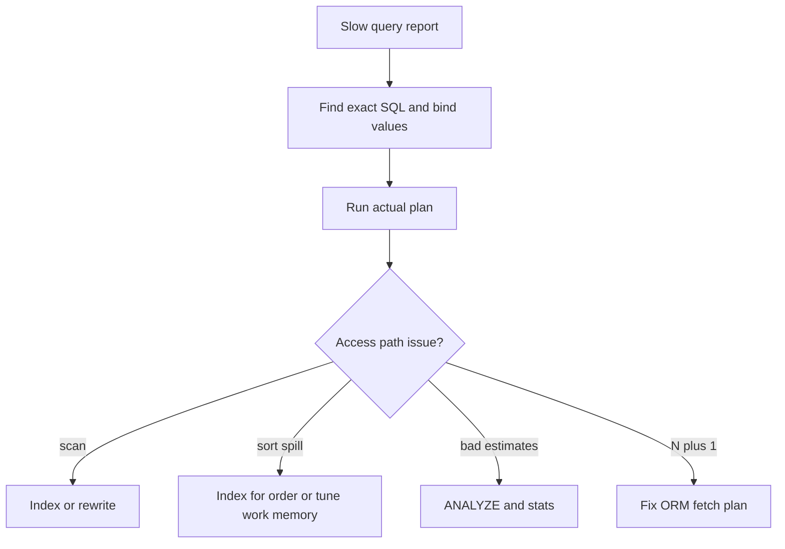

**Common mistakes:**
- Measuring query performance without production-like data volume.
- Adding an index that helps reads but breaks write throughput.
- Ignoring ORM-generated SQL.

**Follow-ups:**
- *Why `BUFFERS` in PostgreSQL?* → It shows cache hits and disk reads behind the timing.
- *What is keyset pagination?* → Page by last seen key instead of large `OFFSET`.

### Q13. Runbook: lock contention
`🔴 Advanced` `🔥` `Must-know SDE-2`

**Why they ask:** Lock contention can look like slow SQL but needs different action.

**Short answer (say this first, 20-40 sec):**
I find blocked sessions, blockers, wait duration, and the exact locked object. Then I decide whether
to kill a blocker, let it finish, add an index, shorten a transaction, split hot rows, or change the
isolation/update pattern.

**Detailed answer:**
PostgreSQL blocker query:

```sql
SELECT now() - blocked.query_start AS blocked_for,
       blocked.pid AS blocked_pid,
       blocker.pid AS blocker_pid,
       blocked.wait_event_type,
       blocked.query AS blocked_query,
       blocker.query AS blocker_query
FROM pg_stat_activity blocked
JOIN pg_blocking_pids(blocked.pid) b(pid) ON true
JOIN pg_stat_activity blocker ON blocker.pid = b.pid
WHERE blocked.wait_event_type = 'Lock';
```

If the blocker is an old idle transaction, it may hold locks while doing nothing:

```sql
SELECT pid, state, xact_start, now() - xact_start AS age, query
FROM pg_stat_activity
WHERE state IN ('idle in transaction', 'active')
ORDER BY xact_start NULLS LAST;
```

In MySQL, `SHOW ENGINE INNODB STATUS\G` and `performance_schema.data_locks` show lock waits. Missing
indexes are a frequent cause: an `UPDATE orders SET status='CANCELLED' WHERE user_id=?` without an
index on `user_id` may scan and lock far more rows than intended. Application fixes include smaller
transactions, updating rows in primary-key order, using optimistic locking with `@Version`, using
`SELECT ... FOR UPDATE SKIP LOCKED` for job queues, and setting `lock_timeout` so callers fail fast
instead of exhausting pools:

```sql
SET LOCAL lock_timeout = '2s';
```

Decision table:

| Evidence | Immediate action | Permanent fix |
|---|---|---|
| idle blocker older than 30 min | terminate after approval | close transactions reliably |
| hot counter row | shard counter | async aggregation |
| missing index | avoid heavy write now | online index |
| queue consumers blocking | skip locked | smaller batches |

**Common mistakes:**
- Treating lock wait time as CPU time.
- Killing blockers without knowing if they are migrations or financial transactions.
- Forgetting foreign-key checks also need indexes.

**Follow-ups:**
- *What is optimistic locking?* → Detect concurrent update with a version column and retry/return conflict.
- *Why can an index reduce locks?* → It narrows the rows scanned and therefore rows touched.

### Q14. Runbook: replication lag and read-your-writes bugs
`🟡 Intermediate` `🔥` `Must-know SDE-1`

**Why they ask:** Modern systems often read from replicas, creating consistency surprises.

**Short answer (say this first, 20-40 sec):**
I check whether stale reads come from a replica behind the primary. The fix is read-your-writes
routing to primary, session consistency tokens, waiting for replica LSN, or avoiding replica reads
for flows that need immediate consistency.

**Detailed answer:**
Symptoms: user creates an email template, refreshes immediately, and does not see it; after seconds
it appears. PostgreSQL lag query on replica:

```sql
SELECT now() - pg_last_xact_replay_timestamp() AS replay_lag;
```

On primary:

```sql
SELECT application_name, state, sync_state,
       pg_wal_lsn_diff(pg_current_wal_lsn(), replay_lsn) AS bytes_lag
FROM pg_stat_replication;
```

MySQL:

```sql
SHOW REPLICA STATUS\G
-- read Seconds_Behind_Source, Replica_IO_Running, Replica_SQL_Running
```

Application fix for read-your-writes:

```java
public EmailTemplate create(CreateTemplateRequest request) {
    EmailTemplate saved = repository.save(mapper.toEntity(request));
    consistencyContext.markPrimaryRequired(Duration.ofSeconds(5));
    return saved;
}
```

Then the routing datasource sends reads to primary for that session or user briefly. Another pattern
is returning the created representation from the write endpoint so the UI does not immediately query
a replica. For asynchronous pipelines, expose status: `PENDING_INDEX`, `VISIBLE`, or `FAILED`.
Prevention includes lag dashboards, alerting on replay delay and bytes lag, canaries that perform
write then read, and clear consistency documentation. Do not blindly make every read hit primary;
that removes scale and may overload the writer.

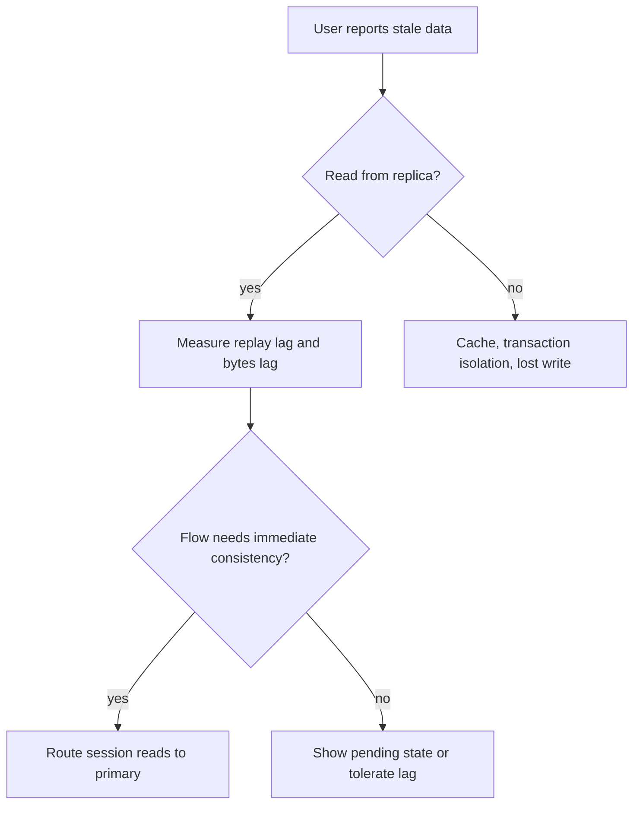

**Common mistakes:**
- Invalidating cache while still reading from a lagging replica.
- Treating replication lag as a frontend bug.
- Sending all traffic to primary permanently after one incident.

**Follow-ups:**
- *What is read-your-writes?* → After writing, the same user can immediately read their write.
- *How can you test it?* → Synthetic create-then-read probe with primary and replica labels.

### Q15. Runbook: works locally but fails in prod
`🟡 Intermediate` `🔥` `Must-know SDE-1`

**Why they ask:** It checks systematic comparison across environment, data, and infrastructure.

**Short answer (say this first, 20-40 sec):**
I compare local and prod across config, profile, secrets, data volume, timezone, charset, network,
permissions, dependency versions, and resource limits. The goal is to reproduce the prod condition
or prove which difference matters.

**Detailed answer:**
Use a checklist rather than blaming the cloud:

| Difference | Example failure |
|---|---|
| profile/config | local uses H2, prod uses PostgreSQL |
| env vars/secrets | missing Gemini API key or wrong base URL |
| data volume | query fine on 100 rows, slow on 50 million |
| timezone | date boundary shifts around midnight |
| charset/collation | emoji or Hindi text fails in MySQL `latin1` |
| network | prod cannot reach third-party due to firewall |
| permissions | service account cannot read Key Vault or S3 |
| container limits | local has 16 GB, pod has 512 MiB |

Commands:

```bash
kubectl describe pod email-reply-api-abc -n prod
kubectl exec -n prod deploy/email-reply-api -- printenv | sort
kubectl logs -n prod deploy/email-reply-api --since=20m
curl -s http://localhost:8080/actuator/env | jq '.activeProfiles'
```

Spring practices: use one artifact promoted through environments, externalized config, profile
specific files committed only for non-secret defaults, and startup validation for required env vars.
For database differences, run the same SQL and plan against prod-like data, not an empty local DB.
For timezone, set:

```yaml
spring.jackson.time-zone: UTC
```

and store instants as UTC. For LLM or email integrations, mock locally but run staging smoke tests
against real network and credentials. The interview answer should end with prevention: parity via
Docker Compose or dev containers, migration tests, seeded realistic datasets, config diff tools,
and deployment smoke checks.

**Common mistakes:**
- Saying only it must be config without naming what to compare.
- Testing against H2 while production uses PostgreSQL-specific behavior.
- Logging secrets while debugging environment variables.

**Follow-ups:**
- *How do you avoid secret leaks while comparing env?* → Print names and presence, not values.
- *Why does data volume matter?* → Plans, indexes, memory, and timeouts change at scale.

### Q16. Runbook: fails only under load
`🔴 Advanced` `🔥` `Must-know SDE-2`

**Why they ask:** Load-only failures require thinking in queues, capacity, and saturation.

**Short answer (say this first, 20-40 sec):**
I reproduce with a controlled load test, increase traffic gradually, and watch latency, errors,
CPU, memory, GC, thread pools, DB pool, downstream calls, and queue depth. The first saturated
resource is the bottleneck; I fix it or add backpressure.

**Detailed answer:**
k6 example:

```javascript
import http from 'k6/http';
import { check, sleep } from 'k6';

export const options = {
  stages: [
    { duration: '2m', target: 50 },
    { duration: '5m', target: 200 },
    { duration: '2m', target: 0 }
  ],
  thresholds: {
    http_req_failed: ['rate<0.01'],
    http_req_duration: ['p(95)<500']
  }
};

export default function () {
  const res = http.post('https://api.example.com/api/reply', JSON.stringify({ text: 'hello' }), {
    headers: { 'Content-Type': 'application/json' }
  });
  check(res, { 'status is 200': r => r.status === 200 });
  sleep(1);
}
```

Correlate the knee in the curve with metrics. If p95 stays flat until 150 RPS and then jumps while
CPU is 40% but Hikari pending grows, the bottleneck is DB connections or SQL. If CPU reaches 90%
and run queue grows, optimize CPU or scale. If errors are 429 from Gemini, apply rate limiting,
bulkheads, retries with jitter, and caching. If queue depth grows unbounded, add backpressure and
bounded queues. Always use production-like data and think time; unrealistic load tests can test only
your test tool.

Decision table:

| Saturated metric | Likely fix |
|---|---|
| CPU high, DB normal | profile CPU, scale pods |
| Hikari pending high | tune SQL, transaction, pool |
| downstream latency high | timeout, circuit breaker, cache |
| GC high | reduce allocation or heap leak |
| LB 5xx before app | ingress, connection limits |

**Common mistakes:**
- Running load from a laptop and measuring laptop bandwidth.
- Testing only average latency and ignoring p95/p99.
- Removing timeouts to make tests pass.

**Follow-ups:**
- *What is saturation?* → A resource is fully utilized and queues grow.
- *Why ramp traffic?* → It reveals the exact point where latency becomes nonlinear.

### Q17. Runbook: intermittent failures
`🟡 Intermediate` `🔥` `Must-know SDE-1`

**Why they ask:** Real incidents are often nondeterministic and need correlation discipline.

**Short answer (say this first, 20-40 sec):**
I group failures by time, endpoint, tenant, pod, node, dependency, and error type. Then I look for
patterns: retries, rate limits, clock skew, partial deployments, flaky network, DNS, connection
reuse, race conditions, and replica lag.

**Detailed answer:**
Intermittent failures are easier when every request has a correlation ID. Search logs for one failed
request and compare to a successful request with same route and tenant:

```bash
kubectl logs -n prod deploy/email-reply-api --since=2h \
  | grep "correlationId=8f4c"
```

Useful grouping questions:

| Group by | Example finding |
|---|---|
| pod | only pods on one node fail |
| tenant | one tenant has huge payloads |
| minute | failures happen during cron or deployment |
| dependency | only Gemini calls fail with 429 |
| request path | one endpoint has a race |
| client version | old frontend sends invalid JSON |

Clock skew causes token validation failures like `JWT expired` or `not yet valid` on only some
nodes. Retry storms produce alternating timeouts and 429s; use bounded retries with jitter and
respect `Retry-After`. Connection reuse bugs appear as occasional `Connection reset by peer` when
load balancers close idle sockets before clients. Race conditions need stress tests or concurrency
tests; logs should include state transitions, not just error messages. Prevention is structured
logging, trace sampling that keeps errors, dependency SLIs, canary deployments, and synthetic
checks that run continuously.

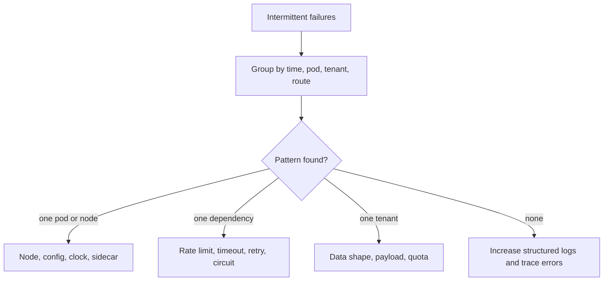

**Common mistakes:**
- Debugging one stack trace without grouping failures.
- Adding unlimited retries and hiding the real cause.
- Forgetting clock skew in distributed auth failures.

**Follow-ups:**
- *What should logs include?* → Correlation ID, route, tenant, status, duration, dependency outcome.
- *Why jitter retries?* → It prevents clients retrying in synchronized waves.

### Q18. Runbook: third-party LLM API is slow or returns 429
`🔴 Advanced` `🔥` `Must-know SDE-2`

**Why they ask:** It connects resilience patterns to a realistic AI Email Reply Assistant backend.

**Short answer (say this first, 20-40 sec):**
I isolate provider latency and rate-limit errors, enforce timeouts, retry only retryable failures
with exponential backoff and jitter, honor `Retry-After`, add circuit breaker and bulkhead, cache
safe responses, and degrade gracefully with a clear user message.

**Detailed answer:**
For a Spring Boot Gemini integration, first separate app latency from provider latency in traces:
`Controller 20 ms`, `DB 15 ms`, `Gemini 4.2 s`. Then configure the HTTP client:

```java
@Bean
WebClient geminiWebClient(WebClient.Builder builder) {
    HttpClient httpClient = HttpClient.create()
        .responseTimeout(Duration.ofSeconds(8))
        .option(ChannelOption.CONNECT_TIMEOUT_MILLIS, 2000);

    return builder.clientConnector(new ReactorClientHttpConnector(httpClient))
        .baseUrl("https://generativelanguage.googleapis.com")
        .build();
}
```

Resilience4j:

```yaml
resilience4j.circuitbreaker.instances.gemini.failure-rate-threshold: 50
resilience4j.circuitbreaker.instances.gemini.sliding-window-size: 20
resilience4j.bulkhead.instances.gemini.max-concurrent-calls: 20
resilience4j.retry.instances.gemini.max-attempts: 3
resilience4j.retry.instances.gemini.wait-duration: 500ms
```

Service code:

```java
@Retry(name = "gemini")
@CircuitBreaker(name = "gemini", fallbackMethod = "fallbackReply")
@Bulkhead(name = "gemini", type = Bulkhead.Type.SEMAPHORE)
public Mono<String> generateReply(EmailPrompt prompt) {
    return webClient.post()
        .uri("/v1beta/models/gemini-pro:generateContent")
        .bodyValue(prompt)
        .retrieve()
        .onStatus(s -> s.value() == 429, r -> r.createException())
        .bodyToMono(String.class);
}
```

Honor `Retry-After` if available; generic retries should be capped and jittered. Cache deterministic
system prompts or template suggestions, but do not cache private email content unless policy allows
and encryption/TTL are defined. Use a fallback such as template-based reply suggestion, not a fake
LLM answer. Alert on provider error rate, latency, open circuit state, and local bulkhead rejections.

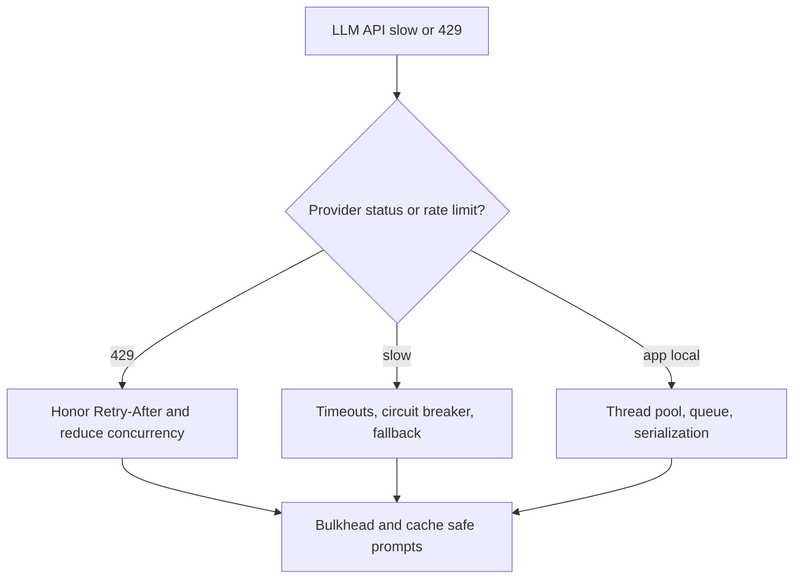

**Common mistakes:**
- Retrying 429 immediately from all pods.
- Letting LLM calls run without read timeouts.
- Caching sensitive prompts without retention and privacy rules.

**Follow-ups:**
- *What is a bulkhead?* → A limit that prevents one dependency from consuming all app capacity.
- *What should fallback return?* → Honest degraded output or retry guidance, not fabricated success.

### Q19. Runbook: OOMKilled or CrashLoopBackOff
`🟡 Intermediate` `🔥` `Must-know SDE-1`

**Why they ask:** Kubernetes incidents require reading pod state, previous logs, and JVM container limits.

**Short answer (say this first, 20-40 sec):**
I check pod events, previous container logs, exit code, restart count, memory limits, probes, and JVM
heap sizing. Exit code 137 usually means the container was killed, often for memory. Crash loops can
also come from bad config, failing startup, or probes that kill a slow-starting app.

**Detailed answer:**
Commands:

```bash
kubectl get pod -n prod
kubectl describe pod email-reply-api-abc -n prod
kubectl logs pod/email-reply-api-abc -n prod --previous
kubectl get events -n prod --sort-by=.lastTimestamp
```

Evidence:

```text
State:          Waiting
Reason:         CrashLoopBackOff
Last State:     Terminated
Reason:         OOMKilled
Exit Code:      137
```

For Java containers, heap is not the only memory. RSS includes heap, metaspace, thread stacks, direct
buffers, JIT, native libraries, and sidecars. If pod limit is 512 MiB and Java chooses too large a
heap, the kernel may kill it before Java throws `OutOfMemoryError`. Set:

```yaml
env:
  - name: JAVA_TOOL_OPTIONS
    value: "-XX:MaxRAMPercentage=70 -XX:+HeapDumpOnOutOfMemoryError"
resources:
  requests:
    memory: "512Mi"
  limits:
    memory: "768Mi"
```

If logs show the app needs 90 seconds to initialize but readiness/liveness starts at 20 seconds,
configure startup probe:

```yaml
startupProbe:
  httpGet:
    path: /actuator/health/liveness
    port: 8080
  failureThreshold: 30
  periodSeconds: 5
```

Fix can be memory limit increase, heap percentage adjustment, leak fix, reducing startup work,
correcting env vars, or probe tuning. Prevention is memory dashboards with restart events,
right-sized limits, heap dumps stored on adequate volume, and staging tests with the same limits.

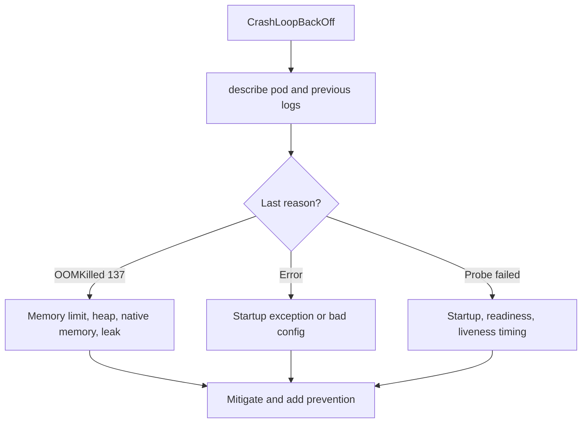

**Common mistakes:**
- Checking only current logs after the container restarted.
- Setting `-Xmx` equal to pod memory limit.
- Using liveness probe for slow dependency checks.

**Follow-ups:**
- *What does exit code 137 mean?* → Process received SIGKILL, commonly from container OOM.
- *Why use startup probe?* → It prevents liveness from killing a slow but healthy startup.

## Section 3 · Reading Evidence

### Q20. How do you read a Java thread dump?
`🟡 Intermediate` `🔥` `Must-know SDE-1`

**Why they ask:** Thread dumps are the fastest way to prove what Java threads are actually doing.

**Short answer (say this first, 20-40 sec):**
I read thread name, state, `nid`, top stack frames, locks held, locks waited on, and whether the
same frames repeat across dumps. I group threads by behavior: runnable CPU, waiting on pool,
blocked on monitor, socket read, parking, GC, and deadlock.

**Detailed answer:**
Anatomy:

```text
"http-nio-8080-exec-31" #87 daemon prio=5 os_prio=0 cpu=1200ms elapsed=60s
   nid=0x2f1a waiting on condition  [0x00007f8a9c3f7000]
   java.lang.Thread.State: WAITING (parking)
    at jdk.internal.misc.Unsafe.park(Native Method)
    at java.util.concurrent.locks.LockSupport.park(LockSupport.java:341)
    at com.zaxxer.hikari.pool.HikariPool.getConnection(HikariPool.java:197)
    at com.zaxxer.hikari.HikariDataSource.getConnection(HikariDataSource.java:128)
```

Read it as: this is a Tomcat request thread, native OS thread `0x2f1a`, not currently consuming CPU,
and it is parked waiting for a DB connection. If 150 similar threads exist, the user-facing timeout
is likely caused by DB pool starvation. States matter: `RUNNABLE` may mean running Java code or
blocked in native socket I/O; read frames. `BLOCKED` means waiting to enter a synchronized monitor.
`WAITING` and `TIMED_WAITING` are often normal for idle workers, but suspicious when request threads
are waiting on a scarce resource. Locks:

```text
- waiting to lock <0x00000007012ab3c0> (a com.app.OrderLock)
- locked <0x00000007012ab3a8> (a com.app.InventoryLock)
```

Use three dumps spaced 10-15 seconds apart. Same top frame across dumps suggests stuck or blocked;
different frames suggest progress. Combine with CPU mapping from `top -H` when diagnosing high CPU.

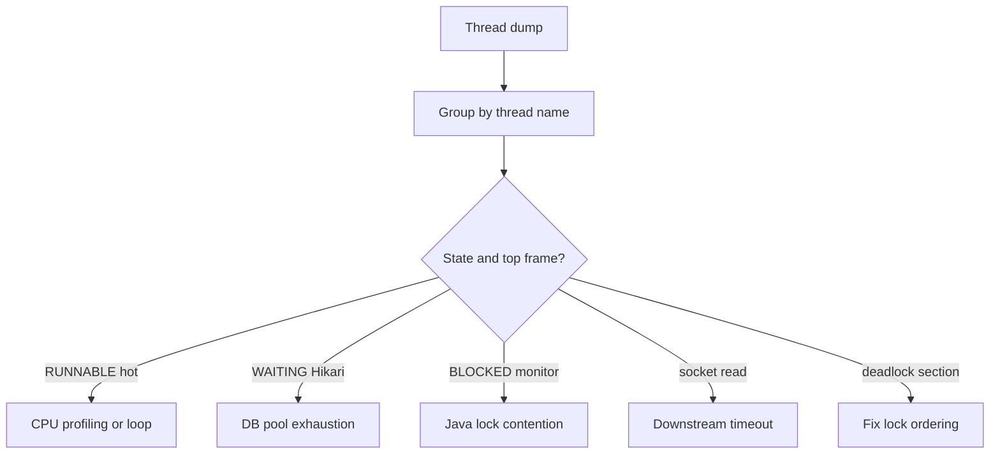

**Common mistakes:**
- Assuming every `WAITING` thread is a problem; idle pools wait normally.
- Reading only one dump and missing whether threads progress.
- Ignoring thread names that identify executors and request pools.

**Follow-ups:**
- *Why is `nid` useful?* → It connects OS-level CPU thread to Java stack.
- *What does `BLOCKED` mean?* → Waiting to acquire a Java monitor lock.

### Q21. How do you read G1 GC log lines?
`🔴 Advanced` `🔥` `Stretch`

**Why they ask:** GC logs are dense, and candidates often misread heap before/after values.

**Short answer (say this first, 20-40 sec):**
I read timestamp, GC ID, pause type, cause, heap before/after/capacity, duration, and whether old
generation live data trends upward. I connect pauses to latency and distinguish normal young GC from
evacuation failures, mixed collections, humongous allocations, or full GC.

**Detailed answer:**
Modern Java:

```bash
-Xlog:gc*,safepoint:file=/logs/gc.log:time,uptime,level,tags
```

Sample:

```text
[2026-09-23T10:15:01.222+0000][123.456s][info][gc,start] GC(91) Pause Young
[2026-09-23T10:15:01.260+0000][123.494s][info][gc,heap]  Eden regions: 180->0(210)
[2026-09-23T10:15:01.260+0000][123.494s][info][gc,heap]  Old regions: 420->438
[2026-09-23T10:15:01.260+0000][123.494s][info][gc] GC(91) Pause Young
  (Normal) (G1 Evacuation Pause) 2400M->1220M(4096M) 38.1ms
```

Interpretation: pause lasted 38.1 ms; heap dropped from 2400 MB to 1220 MB; old regions increased
from 420 to 438 because objects survived and were promoted. A few such pauses are normal. Trouble
starts when pauses align with p99 latency, old regions keep climbing, or lines show:

```text
Pause Full (G1 Compaction Pause) 3900M->3700M(4096M) 2200.0ms
To-space exhausted
Humongous regions: 80->80
```

That means G1 could not evacuate enough memory, humongous objects may fragment the heap, and full
compaction paused for 2.2 seconds. Fix may involve reducing large allocations, streaming payloads,
raising heap, tuning region size only with evidence, or fixing retention. Always compare GC pause
time with request latency timeline; a 30 ms young GC is not the cause of 5-second endpoints.

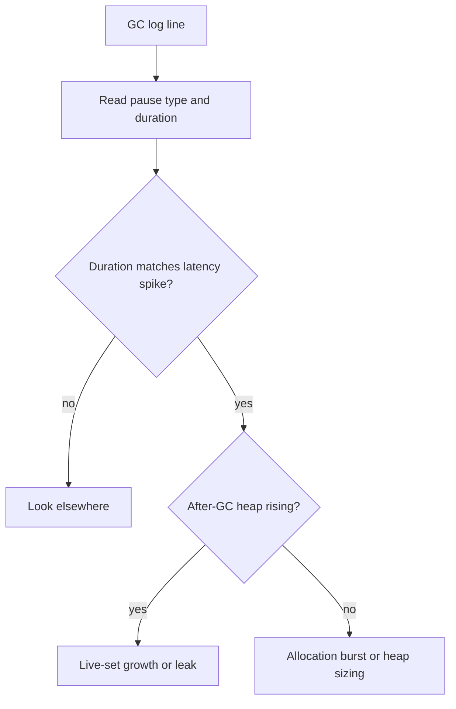

**Common mistakes:**
- Blaming any GC line for latency without timeline correlation.
- Treating heap before-GC as live memory.
- Tuning obscure flags before reducing allocation.

**Follow-ups:**
- *What is a mixed GC?* → G1 collects young regions plus selected old regions.
- *What are humongous objects?* → Large objects allocated in special G1 regions, often big arrays.

### Q22. How do you read a heap histogram?
`🟡 Intermediate` `🔥` `Must-know SDE-1`

**Why they ask:** Histograms are available quickly in incidents and guide deeper heap analysis.

**Short answer (say this first, 20-40 sec):**
A heap histogram lists live instances by class and shallow bytes. I use it to spot suspicious growth
classes, but I do not call it root cause until a heap dump shows who retains those objects.

**Detailed answer:**
Command:

```bash
jcmd <pid> GC.class_histogram
jmap -histo:live <pid> | head -30
```

Sample:

```text
 num     #instances         #bytes  class name
   1:       9500000      608000000  [B
   2:       3100000      248000000  java.lang.String
   3:        480000      115200000  com.app.EmailAttachment
   4:        220000       70400000  java.util.HashMap$Node
```

`[B` means byte arrays; they may come from strings, JSON buffers, file uploads, or HTTP clients.
`HashMap$Node` suggests maps are large, but not which map. Compare histograms over time and after
forced live collection if safe. If `EmailAttachment` grows with each request and never drops, inspect
retention in MAT: dominator tree, incoming references, and path to GC roots. Shallow size is the
object itself; retained size is object plus everything only reachable through it. A single cache
object may have tiny shallow size but huge retained size.

Use histograms as triage:

| Histogram clue | Next step |
|---|---|
| many domain objects | check caches, sessions, queues |
| many byte arrays | inspect payload buffering and direct memory |
| many class metadata objects | metaspace or classloader leak |
| many thread objects | thread leak or unbounded executor |

Do not run `jmap -histo:live` casually on a latency-critical process because it may trigger a full
GC. In Kubernetes, ensure the container has tools or use an ephemeral debug container.

**Common mistakes:**
- Confusing shallow bytes with retained memory.
- Assuming the largest class is the leak owner.
- Taking only one histogram and missing growth rate.

**Follow-ups:**
- *What does `[B` mean?* → Byte array.
- *What proves the leak?* → Retention path from GC roots plus growth over time.

## Revision Cheat Sheet

- Latency triage starts with change history, traces, and the slowest span; then verify with JVM,
  DB, dependency, network, and resource evidence.
- For DB slowness, use `pg_stat_statements`, slow logs, `EXPLAIN (ANALYZE, BUFFERS)`, and actual
  bind values.
- Thread dumps answer what threads are doing now; three dumps show whether they are stuck.
- Hikari exhaustion means active equals max, idle is zero, and pending grows; find why connections
  are held before increasing the pool.
- GC evidence is timeline-based: pause type, duration, heap before/after, and live-set trend.
- Kubernetes `OOMKilled` with exit 137 is not the same as Java `OutOfMemoryError`.
- `HashMap` is unsafe for concurrent mutation; use `ConcurrentHashMap.compute`, `LongAdder`, or
  immutable snapshots.

## Flashcards

- Q → What is the first question in a latency regression?  
  A → What changed: deploy, traffic, data, config, dependency, or infrastructure.
- Q → What does `EXPLAIN ANALYZE` add over `EXPLAIN`?  
  A → Actual timing, rows, and loops from executing the query.
- Q → What Hikari metric shows callers waiting?  
  A → Pending connections.
- Q → Why take multiple thread dumps?  
  A → To see whether threads progress or remain stuck.
- Q → What does Java exit code 137 in Kubernetes suggest?  
  A → SIGKILL, commonly container OOM.
- Q → What is retained heap?  
  A → Memory freed if the selected object were collected.
- Q → What causes read-your-writes bugs?  
  A → Reading from a lagging replica after writing to primary.
- Q → What is the safe fix for get-then-put counters?  
  A → `ConcurrentHashMap.compute` or `LongAdder`.
- Q → What does `type=ALL` in MySQL explain suggest?  
  A → Full table scan.
- Q → Why should LLM retries use jitter?  
  A → To avoid synchronized retry storms.
