# 11b · Production Debugging and Observability

This part continues the study guide with profiling evidence, observability design, alerting,
incident response, and extra interview scenarios for resilient Java backend systems.

**Legend:** 🟢 Beginner · 🟡 Intermediate · 🔴 Advanced · ⚫ FAANG · 🔥 = very frequently asked

## Table of Contents
- [Beginner guide to this file](#beginner-guide-to-this-file)
- [Section 3 · Reading Evidence](#section-3--reading-evidence)
  - [Q23. Flame graph basics](#q23-how-do-you-use-a-flame-graph-to-debug-cpu-or-allocation-hotspots)
  - [Q24. Java Flight Recorder](#q24-what-is-jfr-and-when-would-you-use-it-in-production)
- [Section 4 · Observability](#section-4--observability)
  - [Q25. Three pillars](#q25-explain-the-three-pillars-of-observability)
  - [Q26. Correlation ID and MDC](#q26-how-do-you-implement-correlation-id-logging-with-mdc-in-spring-boot-3)
  - [Q27. Micrometer custom metrics](#q27-how-do-you-add-custom-micrometer-counters-and-timers)
  - [Q28. Prometheus and Grafana](#q28-how-do-prometheus-scraping-and-grafana-dashboards-fit-together)
  - [Q29. OpenTelemetry tracing](#q29-how-does-opentelemetry-tracing-and-context-propagation-work)
  - [Q30. Azure Application Insights](#q30-how-would-you-use-azure-application-insights-for-a-spring-boot-service)
  - [Q31. RED and USE methods](#q31-what-are-red-and-use-methods-and-when-do-you-use-each)
  - [Q32. SLI, SLO, SLA, and error budget](#q32-explain-sli-slo-sla-and-error-budget-with-a-worked-example)
  - [Q33. Alert design](#q33-how-do-you-design-good-production-alerts)
  - [Q34. Incident response flow](#q34-walk-through-an-incident-response-flow)
  - [Q35. Blameless postmortem](#q35-write-a-blameless-postmortem-for-hikari-pool-exhaustion-after-a-deploy)
- [Section 5 · Extra Production Scenarios](#section-5--extra-production-scenarios)
  - [Q36. Logs show nothing but users see errors](#q36-users-see-errors-but-logs-show-nothing--what-now)
  - [Q37. 5xx spike after deployment](#q37-5xx-rate-spikes-after-deployment--how-do-you-debug)
  - [Q38. High p99 but normal average latency](#q38-p99-latency-is-high-but-average-is-normal--what-does-that-mean)
  - [Q39. Queue backlog keeps growing](#q39-queue-backlog-keeps-growing--how-do-you-investigate)
  - [Q40. Duplicate processing](#q40-a-job-or-message-is-processed-twice--how-do-you-make-it-safe)
  - [Q41. Cache incident](#q41-cache-hit-rate-drops-and-db-load-spikes--how-do-you-debug)
  - [Q42. Data corruption or wrong response](#q42-api-returns-wrong-data-for-some-users--how-do-you-debug-safely)
  - [Q43. Logging strategy](#q43-what-should-you-log-in-a-production-spring-boot-api)
  - [Q44. Feature flag rollback](#q44-how-do-feature-flags-help-production-debugging)
  - [Q45. Safe production debugging](#q45-what-are-safe-and-unsafe-ways-to-debug-production)
- [Revision Cheat Sheet](#revision-cheat-sheet)
- [Flashcards](#flashcards)

## Beginner guide to this file

### What this file teaches

This file teaches how to collect trustworthy production evidence and design observability that helps during
incidents. Interviewers ask it because Java backend engineers must explain not only code behavior but also how
they detect, triage, mitigate, and prevent failures in real services. You will see profiling, Java Flight Recorder
(JFR), logs, metrics, traces, alerts, incident response, postmortems, queues, cache failures, data correctness,
feature flags, and safe production debugging.

### Mental model

Think of observability as an aircraft cockpit plus a flight recorder: dashboards show current flight conditions,
traces show the route of one trip, logs explain events, and recordings help reconstruct what happened later.

- Profiling evidence answers where time, allocation, locks, or input/output work is spent.
- Logs, metrics, and traces are complementary: event detail, numeric trend, and request causality.
- Service Level Indicators (SLIs), Service Level Objectives (SLOs), alerts, and error budgets define urgency.
- Incident response turns signals into roles, mitigation, communication, verification, and postmortem learning.
- Extra scenarios teach production judgment: queues, duplicates, caches, wrong data, logging, flags, and safety.

### How to think through any question here

1. Translate the question into a user-impact hypothesis: errors, slow requests, stale data, backlog, or unsafe data.
2. Ask what changed recently: deploy, flag, configuration, telemetry pipeline, traffic shape, data, or dependency.
3. Pick the right signal: golden metrics for symptoms, traces for one request, logs for events, profiles for hot code.
4. Choose targeted evidence: flame graph, JFR recording, thread dump, heap clue, database wait, dependency latency,
   queue age, cache hit rate, or safe read-only query.
5. Mitigate with the smallest reversible action: rollback, feature flag, rate limit, circuit breaker, primary routing,
   worker scale, cache protection, or disabling a risky path.
6. Verify recovery using the same Service Level Indicator or customer-facing metric that showed the incident.
7. Convert root cause into prevention: better telemetry, alert ownership, tests, runbooks, dashboards, rollout policy,
   idempotency, privacy guardrails, or postmortem action items.

### Pattern recognition cues

| If the question mentions... | Think about... | Why it fits |
|---|---|---|
| CPU or allocation hotspot | Flame graph, JFR, widest frames | Profiling shows cost that logs cannot prove |
| low-overhead JVM evidence | JFR event recording | It correlates CPU, allocation, garbage collection, locks, sockets, and exceptions |
| logs, metrics, traces | Three observability pillars | Each answers a different incident question |
| correlation ID or MDC | Request tracking across logs and calls | Thread reuse makes cleanup and propagation important |
| custom metric | Micrometer counter, timer, gauge, low-cardinality tags | Product-specific health needs bounded labels |
| Prometheus or Grafana | Scrape, store, query, dashboard | Prometheus collects time series; Grafana visualizes them |
| OpenTelemetry | Trace IDs, spans, context propagation | Distributed calls need shared trace identity |
| SLI, SLO, SLA, budget | Reliability target and burn rate | These terms turn reliability into measurable policy |
| alert design | Symptom-based, actionable, owned alerts | Good alerts page for user impact, not harmless noise |
| incident response | Mitigate, communicate, timeline, postmortem | Production pressure needs roles and reversible actions |
| queue backlog or duplicates | Throughput, oldest age, idempotency | Reliable systems retry and can process work more than once |
| wrong data or safe debugging | Privacy, blast radius, read-only evidence | Correctness incidents require careful data handling |

### Abbreviations and key terms

| Short form | Expanded form | Plain meaning |
|---|---|---|
| AI | Artificial Intelligence | Model-based software behavior such as generated email replies |
| API | Application Programming Interface | A callable boundary such as an HTTP endpoint or provider method |
| CDN | Content Delivery Network | Edge network that serves or forwards traffic near users |
| CORS | Cross-Origin Resource Sharing | Browser security rule for cross-site API calls |
| CPU | Central Processing Unit | Processor resource consumed by application, system, or JVM work |
| DB | Database | Persistent storage such as PostgreSQL, MySQL, or Redis-backed state |
| DLQ | Dead-Letter Queue | Queue for messages that failed processing after retries |
| DNS | Domain Name System | Name lookup system that maps service names to addresses |
| DTO | Data Transfer Object | Object shaped for moving data across layers or APIs |
| GC | Garbage Collection | JVM process that frees unreachable objects |
| HikariCP | Hikari Connection Pool | JDBC database connection pool used by many Spring Boot apps |
| HTML | Hypertext Markup Language | Browser-readable document format; flame graphs are often HTML files |
| HTTP | Hypertext Transfer Protocol | Request and response protocol used by web APIs |
| I/O | Input/Output | Network, disk, file, or database reads and writes |
| ID | Identifier | Value used to distinguish requests, traces, users, messages, or records |
| INFO | Informational log level | Normal production log level for useful lifecycle events |
| JDBC | Java Database Connectivity | Java API used by applications and drivers to talk to relational databases |
| JDK | Java Development Kit | Java tools and runtime distribution used to build and inspect applications |
| JFR | Java Flight Recorder | Built-in JVM event recorder for production diagnostics |
| JIT | Just-In-Time compiler | JVM compiler that turns hot bytecode into optimized machine code |
| JSON | JavaScript Object Notation | Text format commonly used for API payloads and structured logs |
| JVM | Java Virtual Machine | Runtime that executes Java bytecode and manages memory and threads |
| KQL | Kusto Query Language | Query language used by Azure Application Insights and Azure Monitor logs |
| LB | Load Balancer | Component that routes client traffic to healthy service instances |
| LLM | Large Language Model | Generative model used for text tasks such as reply generation |
| MDC | Mapped Diagnostic Context | Logging context map used to attach fields such as correlation IDs |
| OTel | OpenTelemetry | Vendor-neutral standard for traces, metrics, and logs |
| OTLP | OpenTelemetry Protocol | Protocol used to export telemetry to collectors or backends |
| PII | Personally Identifiable Information | Data that can identify a person and must be protected |
| PromQL | Prometheus Query Language | Query language for Prometheus time-series metrics |
| QA | Quality Assurance | Testing discipline or team focused on validating behavior |
| RED | Rate, Errors, Duration | Service monitoring method for traffic, failures, and latency |
| RSS | Resident Set Size | Physical memory currently used by a process |
| SDE-1 | Software Development Engineer level 1 | Entry-level engineering interview expectation |
| SDE-2 | Software Development Engineer level 2 | Mid-level engineering interview expectation with stronger production judgment |
| SEV | Severity | Incident impact level such as SEV-2 |
| SLA | Service Level Agreement | External reliability promise, often contractual |
| SLI | Service Level Indicator | Measured reliability signal, such as good requests divided by total requests |
| SLO | Service Level Objective | Internal reliability target based on an SLI |
| SQL | Structured Query Language | Language used to query and update relational databases |
| TLS | Transport Layer Security | Encryption protocol for secure network connections |
| TTL | Time To Live | Expiration duration for cache entries or retained values |
| USE | Utilization, Saturation, Errors | Resource monitoring method for capacity and pressure |
| UTC | Coordinated Universal Time | Standard time reference used in logs and incidents |
| W3C | World Wide Web Consortium | Standards group that defines web standards such as traceparent format |
| WAF | Web Application Firewall | Edge protection layer that can block or alter web requests |
| YAML | YAML Ain't Markup Language | Human-readable configuration format used by Kubernetes and Spring |
| Error budget | Allowed unreliability | Amount of failure permitted before reliability work takes priority |
| Flame graph | Sampled stack visualization | Chart where width shows total CPU or allocation cost |
| Idempotency | Safe repeated execution | Property where duplicate calls do not duplicate side effects |

### Common beginner traps

- Treating observability as dashboards only; during incidents you need logs, metrics, traces, and runtime proof.
- Optimizing the tallest flame graph stack instead of the widest costly frame.
- Adding high-cardinality labels such as user ID, raw URL IDs, prompts, or exception messages to metrics.
- Creating alerts for every internal symptom instead of user impact, burn rate, and actionable ownership.
- Forgetting privacy: logs, traces, JFR files, heap dumps, and SQL results can expose sensitive information.
- Scaling consumers, retries, or pools before checking downstream capacity and idempotency.
- Writing postmortems that blame people or contain vague action items with no owner or measurable outcome.

### How to study this file

1. Start each question by saying what evidence source it teaches: profiler, JFR, logs, metrics, traces, or runbook.
2. Use the short answer as your interview opening, then use the detailed answer to add proof and production safety.
3. Convert every scenario into impact, recent change, signal, evidence, mitigation, root cause, and prevention.
4. Drill the flashcards for vocabulary, especially SLI, SLO, SLA, RED, USE, MDC, JFR, and OpenTelemetry.
5. Practice active investigation: invent a failing service and decide which dashboard, query, dump, or profile comes next.
6. For each answer, add one safety note about privacy, reversibility, bounded duration, or blast radius.

### Scalability and production lens

At small scale, you can often inspect one log file or reproduce locally. At production scale, telemetry volume,
cardinality, sampling, retention, cost, privacy, and ownership become part of the design. A scalable observability
story uses bounded labels, correlation IDs, trace sampling that keeps errors, dashboards aligned to Service Level
Indicators, and alerts tied to user impact. A scalable debugging story avoids unbounded queries, live breakpoints,
unsafe data dumps, and blind retries. It favors canaries, feature flags, circuit breakers, idempotency, dead-letter
queues, cache protection, and blameless postmortems with measurable prevention work.

## Section 3 · Reading Evidence

### Q23. How do you use a flame graph to debug CPU or allocation hotspots?
`🔴 Advanced` `🔥` `Stretch`

**Why they ask:** Flame graphs show whether you can move beyond logs into statistically valid profiling.

**Beginner lens:** A flame graph is like a city skyline where width, not height, shows which buildings take the
most land. The key distinction is total sampled cost versus call depth. Recognize this tool when logs say what
happened but not where CPU or allocation time went. Capture the real bad window for a bounded duration, optimize
the widest relevant frame, then verify p95, p99, CPU, allocation rate, and garbage collection before claiming the
fix worked.

**Short answer (say this first, 20-40 sec):**
A flame graph visualizes sampled stack traces. Width means total time or allocation attributed to a
stack; height is call depth. I use async-profiler or JFR to capture a short production-safe profile,
then optimize the widest relevant frames, not the tallest frames.

**Detailed answer:**
CPU profile:

```bash
./profiler.sh -d 30 -e cpu -f cpu.html <pid>
```

Allocation profile:

```bash
./profiler.sh -d 30 -e alloc -f alloc.html <pid>
```

Interpretation rules:

| Visual clue | Meaning |
|---|---|
| wide block | large share of samples; optimize candidate |
| tall tower | deep call chain; not necessarily expensive |
| repeated JSON frames | serialization cost or huge payload |
| regex frame wide | inefficient pattern or catastrophic backtracking |
| logging encoder wide | excessive synchronous logging |
| allocation flame wide | object churn driving GC |

For a Spring Boot email reply API, a CPU flame might show `ObjectMapper.writeValueAsString` wide
because an endpoint returns an entire email history instead of a page. An allocation flame might show
`String.substring`, `byte[]`, and `JsonNode` creation while parsing LLM responses. The fix could be
DTO projection, pagination, streaming, reusing compiled regex, reducing log payloads, or avoiding
unnecessary object copies. Capture during the bad window; an idle profile tells little. Keep profile
duration short, avoid profiling every pod at once, and store the HTML artifact securely because stack
frames can reveal package names and business logic. Verify changes with before/after profiles and
latency metrics.

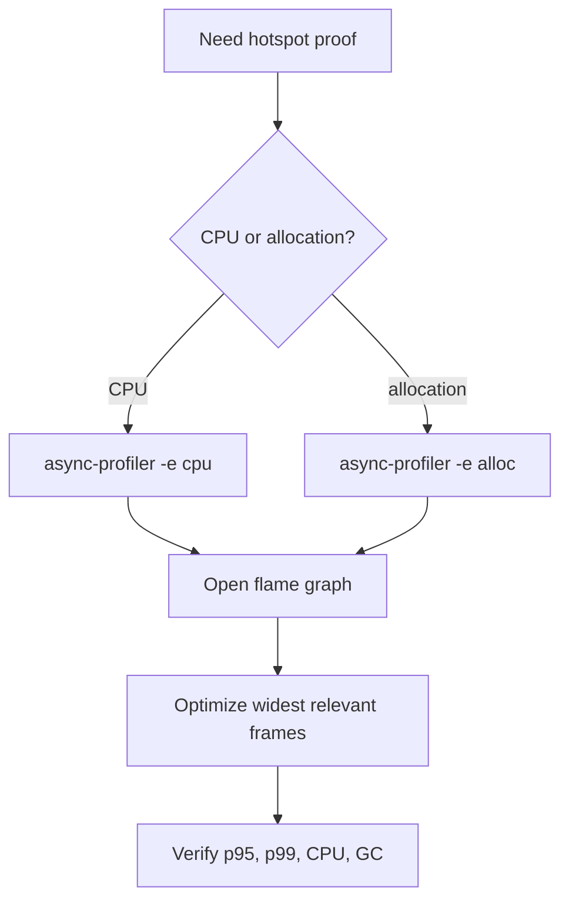

**Common mistakes:**
- Optimizing a tall but narrow stack.
- Profiling a different workload than the incident.
- Ignoring allocation profiles when GC is the real cost.

**Follow-ups:**
- *What does width mean?* → Number of samples in that stack path, so more total cost.
- *Why async-profiler?* → It uses low-overhead sampling and can profile CPU, allocation, locks, and wall time.

### Q24. What is JFR and when would you use it in production?
`🔴 Advanced` `🔥` `Stretch`

**Why they ask:** JFR is a built-in JVM evidence source that is safer than ad-hoc debugging.

**Beginner lens:** Java Flight Recorder is the JVM's aircraft black box. It records time-based events such as CPU,
allocation, garbage collection, locks, socket reads, file I/O, exceptions, and thread activity. Recognize it when
you need low-overhead production evidence but a heap dump or debugger would be too disruptive. The interviewer is
testing whether you can collect a bounded recording, read it with JDK Mission Control, correlate it with traces,
and handle the file as sensitive data.

**Short answer (say this first, 20-40 sec):**
Java Flight Recorder records low-overhead JVM and application events: CPU, allocation, GC, locks,
exceptions, file I/O, socket I/O, and thread activity. I use it when I need a time-correlated view
of JVM behavior without attaching a heavy profiler.

**Detailed answer:**
Start a bounded recording:

```bash
jcmd <pid> JFR.start name=incident settings=profile duration=120s filename=/recordings/incident.jfr
jcmd <pid> JFR.check
jcmd <pid> JFR.dump name=incident filename=/recordings/incident-now.jfr
```

Open the `.jfr` in JDK Mission Control. Useful tabs: method profiling for hot methods, allocation
hot spots, GC pauses, object allocation in new TLAB/outside TLAB, lock instances, socket reads, file
I/O, and exception statistics. JFR is excellent for questions such as: did p99 latency align with
GC pauses, were threads blocked on a monitor, did exception rate explode after a deploy, or did one
dependency create long socket reads? It is less useful when you need database execution plans or
business-level traces; combine it with APM and logs.

Example finding:

```text
Socket Read: 7.8 s total
Host: generativelanguage.googleapis.com
Thread: http-nio-8080-exec-21
Stack: GeminiClient.generate -> WebClient exchange
```

That points to downstream slowness or missing timeout, not CPU. For production, pre-create a writable
recordings volume, document commands, restrict access, and avoid continuous high-detail recordings
unless overhead is tested. Prefer `settings=profile` for short incidents and `settings=default` for
lower overhead continuous recording. The strongest interview answer mentions privacy: recordings may
contain system properties, arguments, hostnames, and stack traces, so handle them as sensitive.

**Common mistakes:**
- Using JFR as a replacement for request tracing.
- Leaving long high-detail recordings running without storage limits.
- Sharing recordings publicly because they are not heap dumps.

**Follow-ups:**
- *How is JFR different from a heap dump?* → JFR is time-based events; heap dump is object graph snapshot.
- *Can JFR help with locks?* → Yes, it records monitor enter and park events when thresholds are met.

## Section 4 · Observability

### Q25. Explain the three pillars of observability.
`🟢 Beginner` `🔥` `Must-know SDE-1`

**Why they ask:** They want to know whether you can choose the right signal during incidents.

**Beginner lens:** Logs, metrics, and traces are three camera angles on the same incident. Logs are the diary,
metrics are the vital signs, and traces are the route map for one request. Recognize the pattern whenever someone
asks how you would know what happened in production. A strong answer says which pillar answers which question,
connects them with correlation IDs, avoids personally identifiable information, and defines golden signals before
the incident rather than after users complain.

**Short answer (say this first, 20-40 sec):**
The three pillars are logs, metrics, and traces. Logs explain what happened in one event, metrics
show numeric trends over time, and traces follow one request across services. Good observability
connects all three with correlation IDs and labels.

**Detailed answer:**
Logs are structured events: request started, validation failed, payment gateway returned 429. They
are best for debugging a specific request or error. Metrics are aggregated numbers: request rate,
error rate, p95 latency, CPU, Hikari active connections. They are best for alerting and trend
analysis. Traces are distributed request timelines: frontend -> API -> DB -> Gemini API. They are
best for finding the slow span and cross-service causality.

| Pillar | Example | Strength | Weakness |
|---|---|---|---|
| logs | `correlationId=abc status=500` | rich detail | expensive and noisy |
| metrics | `http.server.requests p95` | cheap alerting | low detail |
| traces | span waterfall | causality | sampling can miss rare events |

For the AI Email Reply Assistant, a good setup logs `correlationId`, `userId hash`, endpoint, status,
and Gemini outcome; metrics expose `gemini_requests_total`, latency timers, Hikari pool stats, and
HTTP RED metrics; traces show controller, service, repository, and Gemini spans. The key is not to
log everything. Avoid PII such as email body or API keys. Observability is also proactive: define
SLIs before incidents, create dashboards for golden paths, and run synthetic probes.

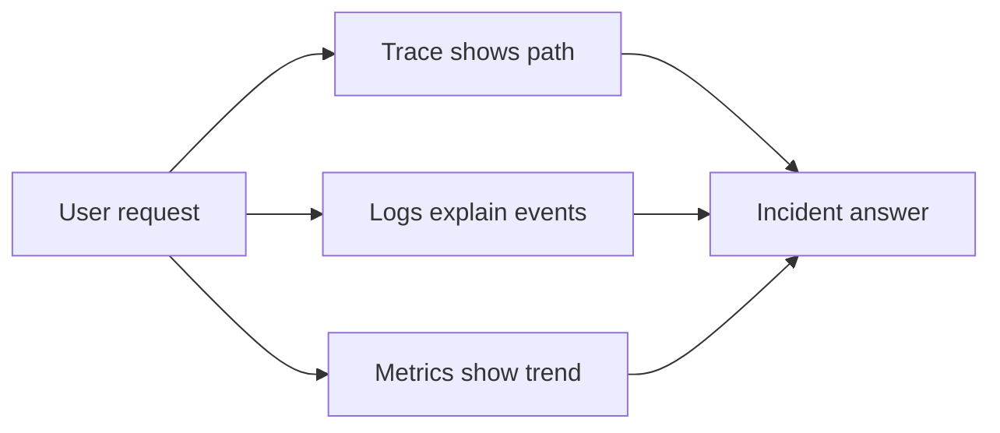

**Common mistakes:**
- Logging sensitive request bodies.
- Alerting on logs only and missing latency degradation.
- Having metrics without labels that identify route or dependency.

**Follow-ups:**
- *Which pillar is best for alerting?* → Metrics, because they are aggregated and cheap.
- *Which pillar finds slow downstream calls?* → Traces, because spans show timing per dependency.

### Q26. How do you implement correlation ID logging with MDC in Spring Boot 3?
`🟡 Intermediate` `🔥` `Must-know SDE-1`

**Why they ask:** Correlation IDs turn scattered logs into a debuggable request story.

**Beginner lens:** A correlation ID is a package tracking number for one request. Mapped Diagnostic Context puts
that number into every log line produced by the current thread. The key distinction is setting the value, returning
it, propagating it, and clearing it because server threads are reused. Recognize this when logs are scattered across
controllers, services, and downstream calls. Production concerns are header validation, asynchronous context
propagation, and never treating the ID as authentication or a place for secrets.

**Short answer (say this first, 20-40 sec):**
I accept an incoming `X-Correlation-ID` or generate one, put it in SLF4J MDC for the request, return
it in the response, propagate it to downstream calls, and clear MDC in a `finally` block to avoid
leaking values between reused threads.

**Detailed answer:**
Spring Boot 3 uses Jakarta Servlet APIs:

```java
import jakarta.servlet.FilterChain;
import jakarta.servlet.ServletException;
import jakarta.servlet.http.HttpServletRequest;
import jakarta.servlet.http.HttpServletResponse;
import org.slf4j.MDC;
import org.springframework.stereotype.Component;
import org.springframework.web.filter.OncePerRequestFilter;

import java.io.IOException;
import java.util.UUID;

@Component
public class CorrelationIdFilter extends OncePerRequestFilter {
    public static final String HEADER = "X-Correlation-ID";

    @Override
    protected void doFilterInternal(
            HttpServletRequest request,
            HttpServletResponse response,
            FilterChain filterChain) throws ServletException, IOException {
        String correlationId = request.getHeader(HEADER);
        if (correlationId == null || correlationId.isBlank()) {
            correlationId = UUID.randomUUID().toString();
        }
        try {
            MDC.put("correlationId", correlationId);
            response.setHeader(HEADER, correlationId);
            filterChain.doFilter(request, response);
        } finally {
            MDC.remove("correlationId");
        }
    }
}
```

Logback pattern:

```xml
<pattern>%d %-5level [%thread] correlationId=%X{correlationId} %logger - %msg%n</pattern>
```

For WebClient propagation:

```java
webClient.mutate()
    .defaultRequest(req -> {
        String id = MDC.get("correlationId");
        if (id != null) {
            req.header(CorrelationIdFilter.HEADER, id);
        }
    })
    .build();
```

In async code, MDC does not automatically cross thread boundaries; use a task decorator or rely on
OpenTelemetry context propagation. Never trust arbitrary huge headers; validate length and allowed
characters. The correlation ID is not an auth token, but it still should not contain user secrets.

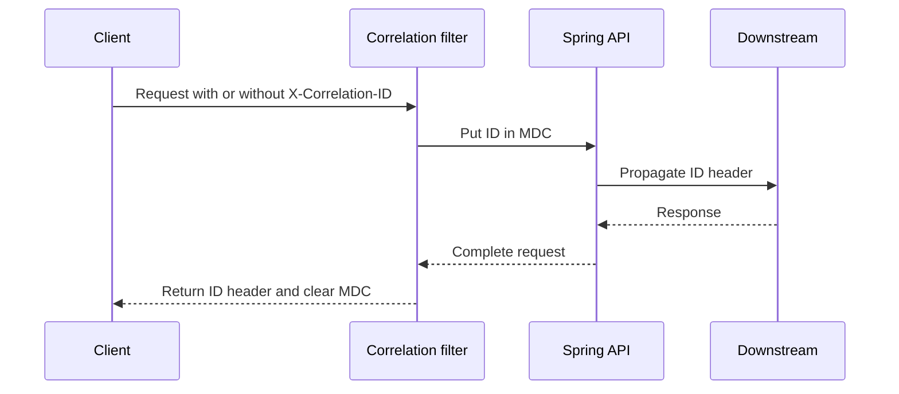

**Common mistakes:**
- Forgetting to clear MDC on pooled request threads.
- Generating a new ID for each downstream call.
- Logging email body or secrets together with the correlation ID.

**Follow-ups:**
- *Does MDC work automatically with Reactor?* → Not reliably; use context propagation support.
- *Should clients send IDs?* → Yes if valid; otherwise generate one at the edge.

### Q27. How do you add custom Micrometer counters and timers?
`🟡 Intermediate` `🔥` `Must-know SDE-1`

**Why they ask:** Custom metrics show product-specific health beyond generic JVM dashboards.

**Beginner lens:** Custom Micrometer metrics are a scoreboard for behavior your generic JVM dashboard cannot see,
such as Gemini calls, generated replies, or queue depth. The mental model is metric type plus bounded tags: counters
only rise, timers measure durations, gauges show current values. Recognize it when the business path needs alerting
or trend analysis. The interviewer is testing cardinality discipline, so use route, outcome, dependency, and status,
not user IDs, prompts, or raw exception messages.

**Short answer (say this first, 20-40 sec):**
I use Micrometer `Counter` for monotonically increasing events and `Timer` for durations. I keep
tag cardinality low, name metrics consistently, and expose them through Actuator Prometheus.

**Detailed answer:**
Example for Gemini API calls in the Email Reply Assistant:

```java
import io.micrometer.core.instrument.Counter;
import io.micrometer.core.instrument.MeterRegistry;
import io.micrometer.core.instrument.Timer;
import org.springframework.stereotype.Service;

import java.time.Duration;

@Service
public class GeminiMetrics {
    private final MeterRegistry registry;

    public GeminiMetrics(MeterRegistry registry) {
        this.registry = registry;
    }

    public void recordCall(String outcome, Duration duration) {
        Counter.builder("gemini.requests.total")
            .tag("outcome", outcome)
            .description("Gemini API requests by outcome")
            .register(registry)
            .increment();

        Timer.builder("gemini.request.duration")
            .tag("outcome", outcome)
            .publishPercentileHistogram()
            .register(registry)
            .record(duration);
    }
}
```

Better for high-throughput paths is to create meters once, not on every request, or use `registry`
with bounded tags. Avoid tags like `userId`, email subject, prompt text, exception message, or URL
with IDs; they create high cardinality and can break Prometheus storage. Good tags are `route`,
`method`, `status`, `dependency`, `outcome`, and maybe `model` if bounded.

Actuator:

```yaml
management:
  endpoints.web.exposure.include: health,metrics,prometheus
  metrics.tags.application: email-reply-api
```

Use counters for events like `replies_generated_total`; use gauges for current values like queue
depth; use timers for latency; use distribution summaries for payload sizes. Define what each metric
means in a dashboard or README so future developers do not misuse it.

**Common mistakes:**
- Adding user IDs as metric tags.
- Using a gauge for a value that should be a counter.
- Measuring only success latency and ignoring failed requests.

**Follow-ups:**
- *What is cardinality?* → Number of unique label combinations for a metric.
- *Why publish histograms?* → To compute server-side percentiles and burn-rate style alerts.

### Q28. How do Prometheus scraping and Grafana dashboards fit together?
`🟢 Beginner` `🔥` `Must-know SDE-1`

**Why they ask:** This is the common metrics stack for Java services in Kubernetes.

**Beginner lens:** Prometheus and Grafana are like a meter reader and a control-room screen. Spring Boot exposes
numbers, Prometheus scrapes and stores them, and Grafana queries Prometheus to display panels. Recognize this when
asked how Java service metrics become dashboards or alerts. The production mental model is pull-based collection,
labels with controlled cardinality, PromQL for rates and percentiles, and secure Actuator endpoints. Grafana does
not magically collect app metrics by itself.

**Short answer (say this first, 20-40 sec):**
Spring Boot exposes metrics at `/actuator/prometheus`; Prometheus scrapes that endpoint and stores
time series; Grafana queries Prometheus to show dashboards and alerts. The app does not push normal
metrics to Grafana.

**Detailed answer:**
Dependencies:

```gradle
implementation 'org.springframework.boot:spring-boot-starter-actuator'
runtimeOnly 'io.micrometer:micrometer-registry-prometheus'
```

Config:

```yaml
management:
  endpoints:
    web:
      exposure:
        include: health,prometheus,metrics
  endpoint:
    health:
      probes:
        enabled: true
```

Prometheus scrape job:

```yaml
scrape_configs:
  - job_name: email-reply-api
    metrics_path: /actuator/prometheus
    static_configs:
      - targets: ['email-reply-api.prod.svc.cluster.local:8080']
```

PromQL examples:

```promql
sum(rate(http_server_requests_seconds_count{status=~"5.."}[5m]))
histogram_quantile(0.95,
  sum(rate(http_server_requests_seconds_bucket{uri="/api/reply"}[5m])) by (le))
sum(hikaricp_connections_pending{pool="HikariPool-1"})
```

Grafana panels should tell a story: traffic, errors, latency, saturation, dependency health, JVM,
DB pool, and business metrics. Dashboards are not alert definitions by themselves; alerts should be
symptom-based and actionable. In Kubernetes, use ServiceMonitor or PodMonitor if the Prometheus
Operator is installed. Protect metrics endpoints because labels can reveal internal route names and
infrastructure.

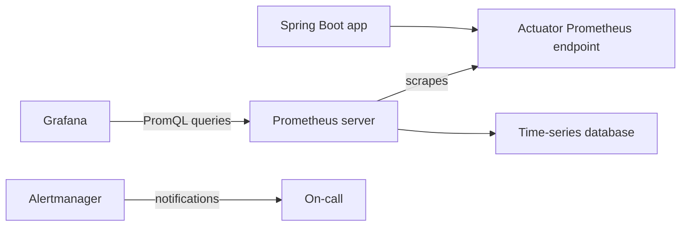

**Common mistakes:**
- Expecting Grafana to collect metrics directly.
- Exposing `/actuator/env` publicly with secrets.
- Building dashboards with averages only and no percentiles.

**Follow-ups:**
- *What is PromQL?* → Prometheus query language for time-series data.
- *Why use `rate()`?* → Counters increase forever; `rate()` converts them into per-second change.

### Q29. How does OpenTelemetry tracing and context propagation work?
`🔴 Advanced` `🔥` `Must-know SDE-2`

**Why they ask:** Distributed systems need traces to connect microservice behavior.

**Beginner lens:** OpenTelemetry tracing is package tracking across microservices. A trace ID ties the whole trip
together, while each span is one timed stop such as controller, database, or HTTP client. Recognize it when a request
crosses services, executors, or Kafka messages and logs alone cannot show causality. The interviewer wants context
propagation: carry headers, avoid creating new traces accidentally, sample intelligently, and keep sensitive prompt
or user data out of span attributes.

**Short answer (say this first, 20-40 sec):**
OpenTelemetry creates spans with trace IDs and parent-child relationships. Context propagation sends
trace headers such as W3C `traceparent` across HTTP, messaging, and async boundaries so downstream
work appears in the same trace.

**Detailed answer:**
In a Spring Boot service, the OpenTelemetry Java agent can auto-instrument controllers, WebClient,
JDBC, and common libraries:

```bash
java -javaagent:/otel/opentelemetry-javaagent.jar \
  -Dotel.service.name=email-reply-api \
  -Dotel.exporter.otlp.endpoint=http://otel-collector:4317 \
  -jar app.jar
```

W3C trace header:

```text
traceparent: 00-4bf92f3577b34da6a3ce929d0e0e4736-00f067aa0ba902b7-01
```

The first long ID is the trace ID shared across all spans; the second is current span ID. If the API
calls the Gemini provider, your trace can include the outbound HTTP client span even if the provider
does not return its internal trace. Add manual spans for business steps:

```java
Span span = tracer.spanBuilder("build-email-prompt").startSpan();
try (Scope ignored = span.makeCurrent()) {
    span.setAttribute("template.type", templateType);
    return promptBuilder.build(email);
} finally {
    span.end();
}
```

Avoid high-cardinality span attributes like full prompt, email body, or user ID. Use hashed tenant
or bounded categories. Sampling matters: keep all errors when possible and sample successes. Context
must cross executor and message boundaries; otherwise traces split. For Kafka, propagate trace
headers in message headers. For Reactor, use instrumentation that bridges context correctly.

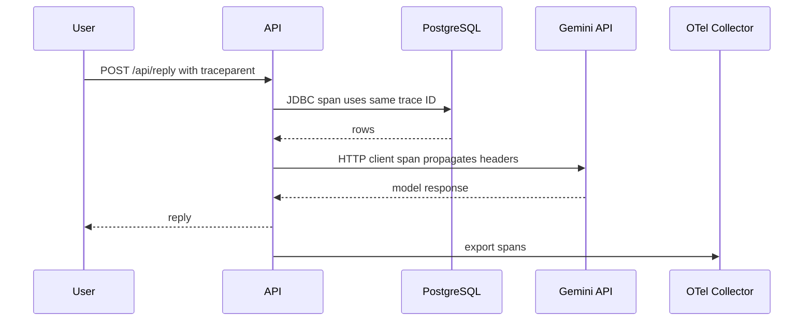

**Common mistakes:**
- Creating new traces for downstream calls instead of propagating context.
- Adding PII as span attributes.
- Sampling away all error traces.

**Follow-ups:**
- *What is a span?* → A timed operation within a trace.
- *What is context propagation?* → Carrying trace identity across process and thread boundaries.

### Q30. How would you use Azure Application Insights for a Spring Boot service?
`🟡 Intermediate` `🔥` `Must-know SDE-1`

**Why they ask:** The candidate profile includes Azure, so they may expect practical cloud observability.

**Beginner lens:** Azure Application Insights is a managed observability backend for requests, dependencies,
exceptions, traces, live metrics, and application maps. Recognize it when the service runs in Azure or the question
asks how to inspect Spring Boot behavior in the portal. The mental model is agent or OpenTelemetry exporter sends
telemetry, then Kusto queries and portal views reveal slow operations. Production concerns are secret-free connection
strings, avoiding duplicate instrumentation, sampling, retention, and privacy.

**Short answer (say this first, 20-40 sec):**
I attach the Application Insights Java agent, set the connection string securely, and use it to see
requests, dependencies, exceptions, traces, live metrics, and application map. I still keep structured
logs, Micrometer metrics, and OpenTelemetry-compatible instrumentation where possible.

**Detailed answer:**
Typical startup:

```bash
java -javaagent:applicationinsights-agent.jar \
  -jar email-reply-api.jar
```

Environment:

```bash
APPLICATIONINSIGHTS_CONNECTION_STRING=InstrumentationKey=...;IngestionEndpoint=...
APPLICATIONINSIGHTS_ROLE_NAME=email-reply-api
```

Do not hard-code the connection string; use environment variables, Kubernetes secrets, or Azure Key
Vault. Application Insights automatically captures incoming HTTP requests, outgoing dependencies
like JDBC and HTTP calls, exceptions, and performance counters. In the portal, use Application Map
to spot a slow dependency, Failures to group exceptions, Performance to inspect p95 by operation,
and Transaction Search to follow a request. Kusto query examples:

```kusto
requests
| where timestamp > ago(1h)
| summarize p95=percentile(duration, 95), failures=countif(success == false)
  by name
| order by p95 desc
```

```kusto
dependencies
| where target contains "generativelanguage"
| summarize p95=percentile(duration, 95), errors=countif(success == false)
  by bin(timestamp, 5m)
```

For custom business events, add attributes carefully and avoid PII. If using OpenTelemetry, prefer a
single telemetry path through Azure Monitor exporter or collector to avoid duplicate spans. Define
sampling rules and retention based on cost and debugging needs.

**Common mistakes:**
- Committing instrumentation keys or connection strings.
- Double-instrumenting with multiple agents and duplicating telemetry.
- Treating portal charts as root cause without request and dependency details.

**Follow-ups:**
- *What is Application Map?* → A dependency graph showing services and calls between them.
- *Can you query telemetry?* → Yes, with Kusto Query Language over requests, dependencies, traces, exceptions.

### Q31. What are RED and USE methods and when do you use each?
`🟢 Beginner` `🔥` `Must-know SDE-1`

**Why they ask:** These methods show disciplined dashboard and alert design.

**Beginner lens:** RED and USE separate symptoms from resources. RED asks how the service feels to users: request
rate, errors, and duration. USE asks whether a resource is under pressure: utilization, saturation, and errors.
Recognize RED for APIs and USE for CPU, memory, HikariCP, disk, network, or queues. In interviews, start with RED
to detect impact, then use USE to diagnose cause. Alert mainly on user-impact symptoms, not every noisy resource
wiggle.

**Short answer (say this first, 20-40 sec):**
RED is for services: Rate, Errors, Duration. USE is for resources: Utilization, Saturation, Errors.
I use RED to monitor user-facing APIs and USE to diagnose CPU, memory, disk, network, thread pools,
and database pools.

**Detailed answer:**
RED examples for `POST /api/reply`:

| RED item | Metric |
|---|---|
| Rate | requests per second |
| Errors | 5xx rate, dependency failures |
| Duration | p50, p95, p99 latency |

USE examples:

| Resource | Utilization | Saturation | Errors |
|---|---|---|---|
| CPU | percent busy | run queue | throttling |
| memory | RSS or heap | OOM events | allocation failures |
| Hikari pool | active/max | pending waiters | timeout count |
| disk | I/O busy | queue length | read/write errors |
| network | bandwidth | packet drops | connection resets |

During an incident, RED tells you user impact: traffic is normal, error rate is 8%, p95 is 4 s. USE
then finds resource pressure: CPU is 40%, Hikari pending is 80, DB CPU is 95%, and lock waits are
high. For an SDE-1 interview, saying both methods and giving examples is enough. For SDE-2, explain
that dashboards should align: top row user-facing RED, next rows dependencies and resource USE, last
row JVM internals. Alert on symptoms from RED; page on resource USE only when it predicts or causes
user impact.

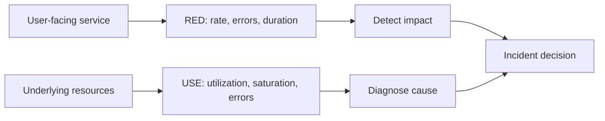

**Common mistakes:**
- Alerting only on CPU and missing user-facing errors.
- Building a dashboard with no saturation signals.
- Using averages instead of percentiles for duration.

**Follow-ups:**
- *Where does Hikari pending fit?* → USE saturation for the DB connection pool.
- *Should every high CPU page?* → No, page when user impact or imminent saturation exists.

### Q32. Explain SLI, SLO, SLA, and error budget with a worked example.
`🟡 Intermediate` `🔥` `Must-know SDE-1`

**Why they ask:** Reliability engineering terms are common in product-company interviews.

**Beginner lens:** Reliability terms are a contract ladder: the Service Level Indicator is the measured score, the
Service Level Objective is the team target, the Service Level Agreement is the customer promise, and the error budget
is the allowed miss. Recognize this when questions include uptime, good requests, or burn rate. The interviewer is
testing whether you can turn telemetry into policy: define good events, calculate allowed failure, alert on fast burn,
and pause risky releases when the budget is nearly gone.

**Short answer (say this first, 20-40 sec):**
An SLI is the measured reliability indicator, an SLO is the internal target, an SLA is a contractual
promise, and an error budget is the allowed unreliability. For 99.9% monthly availability over
30 days, the error budget is about 43.2 minutes.

**Detailed answer:**
Definitions:

| Term | Meaning | Example |
|---|---|---|
| SLI | measured signal | successful requests under 500 ms |
| SLO | internal target | 99.9% of requests are successful |
| SLA | external contract | customer credit if below 99.5% |
| error budget | allowed failure | 0.1% monthly bad time or bad requests |

Worked time-based budget:

```text
30 days = 30 * 24 * 60 = 43,200 minutes
99.9% target means 0.1% may be unavailable
43,200 * 0.001 = 43.2 minutes error budget
```

Request-based SLI is often better for APIs:

```text
SLI = good_requests / total_requests
good = HTTP status not 5xx and latency <= 500 ms
```

If the service handles 10,000,000 monthly requests and SLO is 99.9%, only 10,000 bad requests are
allowed. Error budget policy: if burn is normal, teams can ship features; if budget is nearly gone,
freeze risky launches and prioritize reliability. For burn-rate alerts, page when the service is
burning budget too fast, such as 14.4x budget over 5 minutes and 1 hour for fast burn. Keep SLAs
looser than SLOs so engineering has room to react before contractual impact.

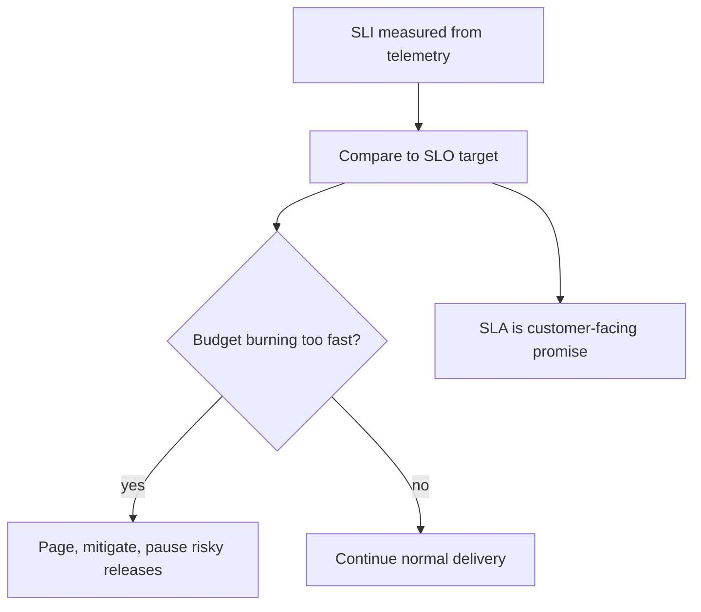

**Common mistakes:**
- Calling every metric an SLI.
- Defining SLOs that cannot be measured from telemetry.
- Making SLA equal to the internal SLO with no safety margin.

**Follow-ups:**
- *Why request-based SLIs?* → They reflect actual user experience better than wall-clock uptime.
- *What is burn rate?* → Speed at which the service consumes its allowed error budget.

### Q33. How do you design good production alerts?
`🟡 Intermediate` `🔥` `Must-know SDE-1`

**Why they ask:** Alert quality affects on-call health and incident response speed.

**Beginner lens:** A good production alert is a smoke alarm, not a notification for every warm toaster. The mental
model is symptom, action, owner, and runbook. Recognize this when asked what should page an on-call engineer. Start
from user impact or error-budget burn, add severity and context, and avoid averages that hide tails. Production-scale
alerts need deduplication, multi-window confirmation, recent deploy links, dashboards, and regular cleanup of noisy
or unactionable rules.

**Short answer (say this first, 20-40 sec):**
Good alerts are symptom-based, actionable, owned, and have runbooks. I page for user impact or fast
error-budget burn, not for every noisy internal metric. I use severity levels, deduplication, and
clear labels.

**Detailed answer:**
Bad alert: `CPU > 80% for 1 minute`. It may be harmless batch work. Better alert:

```promql
(
  sum(rate(http_server_requests_seconds_count{status=~"5.."}[5m]))
  /
  sum(rate(http_server_requests_seconds_count[5m]))
) > 0.02
```

Add duration and route filters so one low-traffic endpoint does not page incorrectly. Burn-rate
alert example for a 99.9% SLO:

```text
Page: 5-minute and 1-hour burn rates are both high.
Ticket: 6-hour burn rate is elevated but not urgent.
```

Alert fields should include service, environment, severity, SLO, current value, dashboard link,
runbook link, recent deploy link, and owner. Use multi-window alerts to reduce noise: a short window
catches fast incidents and a long window confirms it is sustained. Dependency alerts should be tied
to user impact where possible; a provider 429 alert is useful if it affects reply generation, less
useful if the circuit breaker protects users with graceful degradation. Review alerts after incidents
and delete unactionable ones.

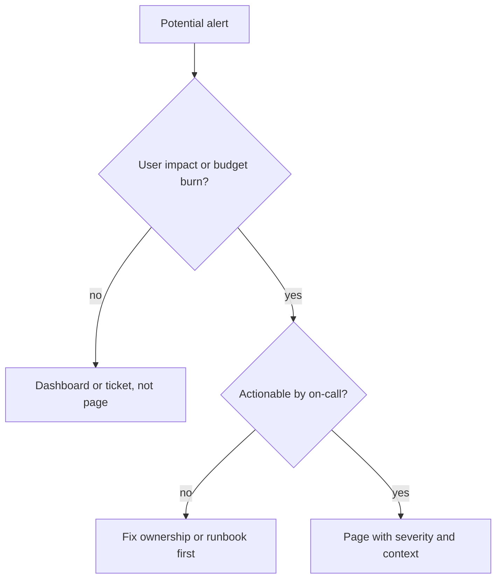

**Common mistakes:**
- Paging on every exception type.
- Alerts without runbooks or owners.
- Using averages that hide p99 latency incidents.

**Follow-ups:**
- *What is alert fatigue?* → On-call ignores alerts because too many are noisy or unactionable.
- *Why symptom-based alerts?* → They match user pain and avoid paging for harmless internal variation.

### Q34. Walk through an incident response flow.
`🟡 Intermediate` `🔥` `Must-know SDE-1`

**Why they ask:** They want calm, structured behavior under production pressure.

**Beginner lens:** Incident response is emergency-room work: stabilize the patient before writing the medical paper.
The key distinction is mitigation during impact versus root cause after recovery. Recognize this when a scenario has
active user pain. State severity, assign roles, keep a timeline, communicate clearly, make reversible changes, and
verify recovery with the original signal. The interviewer is testing calm structure: detect, triage, mitigate,
communicate, resolve, postmortem, and prevent recurrence.

**Short answer (say this first, 20-40 sec):**
I follow detect, triage, mitigate, communicate, resolve, and postmortem. During the incident, the
priority is user impact reduction, not perfect root cause. I assign roles, keep a timeline, and make
safe reversible changes.

**Detailed answer:**
Flow:

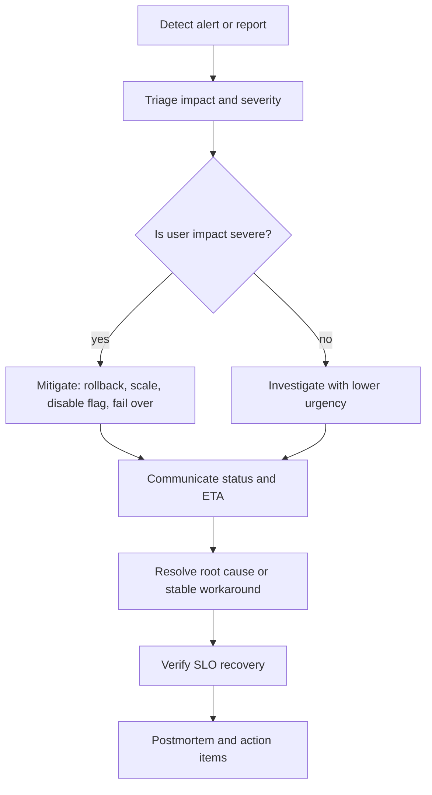

Roles: incident commander coordinates, technical lead investigates, communications lead updates
stakeholders, scribe records timeline. Evidence to capture: alert time, deploys, dashboards, logs,
trace examples, commands run, decisions, mitigation time, and recovery time. Example mitigations:
rollback last deployment, scale pods if CPU-bound, disable an LLM feature flag, route reads to
primary during replica lag, temporarily reduce traffic to a provider, or increase disk if logs filled
the node. Each change should have an owner and expected signal: after rollback, 5xx should drop
within 5 minutes; after index, slow query p95 should improve.

Communication template:

```text
Status: Mitigating elevated p95 latency on email reply generation.
Impact: About 18% of requests exceed 5 seconds in prod.
Action: Rolled back version 1.42.3; monitoring recovery.
Next update: 15 minutes.
```

After recovery, do not stop at human blame. Ask why detection, prevention, and rollback did or did
not work. Convert findings into tests, dashboards, alerts, limits, or safer rollout process.

**Common mistakes:**
- Searching for perfect root cause while users are still impacted.
- Having multiple people make uncoordinated changes.
- Not writing a timeline, causing a weak postmortem.

**Follow-ups:**
- *What is the first priority?* → Reduce user impact safely.
- *Why assign an incident commander?* → To coordinate decisions and prevent chaos.

### Q35. Write a blameless postmortem for Hikari pool exhaustion after a deploy.
`🔴 Advanced` `🔥` `Must-know SDE-2`

**Why they ask:** Postmortems reveal whether you learn from incidents without blaming individuals.

**Beginner lens:** A blameless postmortem is a flight-incident review, not a search for a villain. The mental model
is system learning: impact, timeline, root cause, contributing factors, what helped, what failed, where luck helped,
and owned action items. Recognize it when a production failure has ended and the team needs prevention. Strong answers
use precise language, such as remote I/O inside a transaction held connections, then create measurable actions with
owners, dates, tests, dashboards, or rollout guardrails.

**Short answer (say this first, 20-40 sec):**
A blameless postmortem states impact, timeline, root cause, contributing factors, detection gaps,
what went well, what went poorly, and action items with owners. It focuses on system improvements,
not who made a mistake.

**Detailed answer:**
Template:

```text
Title:
Date and duration:
Severity:
Customer impact:
Detection:
Timeline:
Root cause:
Contributing factors:
What went well:
What went poorly:
Where we got lucky:
Action items:
```

Filled sample:

```text
Title: Hikari pool exhaustion after email reply deploy
Duration: 10:05-10:47 UTC
Severity: SEV-2
Impact: 32% of POST /api/reply requests timed out after 30 seconds.
Detection: p95 latency alert fired 9 minutes after deploy.
Root cause: New code called Gemini API inside a @Transactional method. Each request held a DB
connection while waiting on an external LLM response. At 120 RPS, all 10 pool connections were active
and 80+ request threads waited for a connection.
Contributing factors: No dashboard for Hikari pending connections; load test mocked Gemini with
10 ms latency; code review checklist did not flag remote I/O inside transactions.
What went well: Rollback was available and restored service quickly.
What went poorly: Initial responders increased Tomcat threads, which increased queued work.
Action items:
1. Move Gemini call outside transaction - owner API team - due Friday.
2. Add Hikari pending and timeout alerts - owner platform - due Monday.
3. Add integration load test with 2 s Gemini latency - owner QA - due next sprint.
4. Add review checklist item for @Transactional boundaries - owner tech lead.
```

Blameless language: say "the code path held connections during remote I/O", not "developer forgot".
Prevent recurrence with guardrails: ArchUnit test banning WebClient calls inside transactional
classes, dashboard panels, canary analysis, and lower `connectionTimeout` if faster failure is safer.

**Common mistakes:**
- Writing vague action items like improve monitoring.
- Omitting detection and mitigation timeline.
- Blaming one engineer instead of identifying system gaps.

**Follow-ups:**
- *What makes an action item good?* → Specific owner, due date, measurable outcome.
- *Why mention where we got lucky?* → It exposes risks that did not cause impact this time.

## Section 5 · Extra Production Scenarios

### Q36. Users see errors but logs show nothing — what now?
`🟡 Intermediate` `🔥` `Must-know SDE-1`

**Why they ask:** It tests whether you know gaps between client, edge, and application logging.

**Beginner lens:** No application log does not mean no error; the request may never have entered the application.
Think of mail lost before it reaches the building. Recognize this when users see failures but app logs are empty.
Work outside-in through client, Domain Name System, Content Delivery Network, Web Application Firewall, Transport
Layer Security, ingress, service endpoints, app version, log sampling, and log shipping. Add safe metadata and
correlation IDs rather than noisy or sensitive body logging.

**Short answer (say this first, 20-40 sec):**
I check whether the request reaches the app. Missing app logs can mean the error happens in DNS,
CDN, load balancer, WAF, TLS, ingress, client timeout, sampling, log level, async logging loss, or a
different service version.

**Detailed answer:**
Outside-in evidence:

```bash
curl -vk https://api.example.com/api/reply
kubectl logs -n ingress-nginx deploy/ingress-nginx-controller --since=30m | grep "/api/reply"
kubectl get endpoints -n prod email-reply-api
kubectl logs -n prod deploy/email-reply-api --since=30m | grep "correlationId=abc"
```

If ingress logs show `499`, clients gave up before the app responded. If `502` appears at ingress
but app logs nothing, service endpoints, port mismatch, pod readiness, or upstream connection reset
is likely. If app logs are sampled, disabled, or asynchronous appenders dropped messages during
pressure, check logging configuration and log shipping pipeline. Also verify you are searching the
right environment, namespace, pod version, and time zone. Browser errors may be CORS or mixed
content and never reach backend business logic.

Make the system easier next time: edge injects correlation ID, ingress logs include upstream status
and request ID, app logs request start/end at INFO with route and status, and error traces are always
sampled. Do not add noisy body logging; add safe metadata.

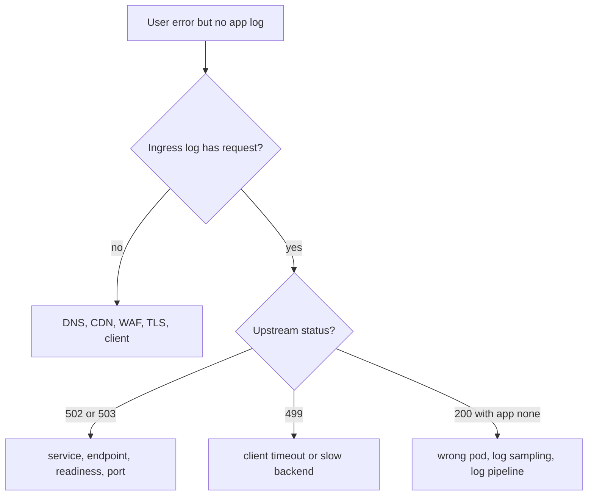

**Common mistakes:**
- Assuming no app logs means no problem.
- Searching logs in local time while systems store UTC.
- Adding request body logs and leaking PII.

**Follow-ups:**
- *What is HTTP 499?* → Common NGINX code for client closed request.
- *What should edge logs include?* → request ID, upstream status, duration, route, backend.

### Q37. 5xx rate spikes after deployment — how do you debug?
`🟡 Intermediate` `🔥` `Must-know SDE-1`

**Why they ask:** Deploy-related triage is a core production skill.

**Beginner lens:** A 5xx spike after deployment is a compare-the-new-batch problem. The key distinction is whether
only new pods, one endpoint, one tenant, config, migration, or data shape changed. Recognize it by aligning error
rate with rollout time and version labels. If impact is high and rollback is safe, mitigate first; then reproduce
with the failing input and add regression tests. Production prevention includes canaries, backward-compatible
migrations, feature flags, and telemetry labeled by version.

**Short answer (say this first, 20-40 sec):**
I compare old and new versions, identify which endpoints and exceptions changed, check config and
migrations, and rollback or disable the feature if impact is high. Then I reproduce using the same
inputs and add a regression test.

**Detailed answer:**
Commands:

```bash
kubectl rollout history deploy/email-reply-api -n prod
kubectl get rs -n prod -l app=email-reply-api
kubectl logs -n prod deploy/email-reply-api --since=20m | grep "ERROR"
kubectl rollout undo deploy/email-reply-api -n prod
```

Useful split:

| Question | Evidence |
|---|---|
| only new pods fail? | metrics by `version` label |
| only one endpoint? | HTTP route error rate |
| startup only? | readiness and migrations |
| data-dependent? | failing request payload shape |
| config-dependent? | env var diff, secret version |

If errors are `NoSuchMethodError`, suspect dependency mismatch. If `column does not exist`, the app
deployed before migration or migration failed. If `NullPointerException` for one tenant, new code
missed a data shape. If 5xx spikes only on canary pods, stop rollout and rollback; if all pods fail
after config change, revert config. Keep version labels in logs, metrics, and traces so you can
compare `v1.42.2` and `v1.42.3`. Prevention: canary deployments, backward-compatible migrations,
feature flags, contract tests, startup checks, and automated rollback criteria.

**Common mistakes:**
- Debugging for an hour instead of rolling back a clearly bad deploy.
- Deploying schema-breaking migrations and app code in the wrong order.
- Missing version labels in telemetry.

**Follow-ups:**
- *When not to rollback?* → When rollback risks data loss or incompatible schema; then use feature flag or hotfix.
- *What is a canary?* → Small traffic slice receives new version before full rollout.

### Q38. p99 latency is high but average is normal — what does that mean?
`🟡 Intermediate` `🔥` `Must-know SDE-1`

**Why they ask:** Tail latency matters more than averages in user-facing systems.

**Beginner lens:** High p99 with normal average means most users are fine but the slowest few are suffering badly.
It is like one traffic lane being blocked while the average road speed still looks acceptable. Recognize this when
percentiles disagree with averages. Break the tail down by route, tenant, pod, dependency, payload, lock wait, garbage
collection pause, retry, or queue. The interviewer wants histogram thinking and production concern for tail users,
not comfort from the mean.

**Short answer (say this first, 20-40 sec):**
It means most requests are fast but a small percentage are very slow. I investigate tail-specific
causes: lock waits, GC pauses, cold caches, slow tenants, retries, noisy neighbors, queueing,
replica lag, and dependency outliers.

**Detailed answer:**
Average hides tails:

```text
99 requests = 100 ms
1 request = 10,000 ms
average = about 199 ms, but p99 = 10 seconds
```

Break p99 down by route, method, status, tenant size, pod, node, dependency, and payload size:

```promql
histogram_quantile(0.99,
  sum(rate(http_server_requests_seconds_bucket[5m])) by (le, uri))
```

Common causes:

| Tail cause | Evidence |
|---|---|
| GC pause | p99 spike aligns with GC log pause |
| lock wait | DB wait events and blocked sessions |
| queueing | thread pool or Hikari pending grows |
| cold cache | first request after deploy slow |
| noisy tenant | high payload or data volume for one tenant |
| retries | one user request creates multiple dependency calls |

Fix depends on cause: add cache warming, reduce critical sections, tune slow tenant query, isolate
heavy tenants, enforce timeouts, use hedging carefully, or separate pools. For interviews, emphasize
that p99 is a distribution property; you need histograms, not averages. Also ensure your metrics
bucket boundaries cover high latencies; otherwise p99 may be inaccurate.

**Common mistakes:**
- Saying average is fine and closing the incident.
- Looking at service-level p99 only and not per-route p99.
- Forgetting retries can multiply tail latency.

**Follow-ups:**
- *Why are histograms needed?* → Percentiles require latency distribution, not just sums and counts.
- *What is coordinated omission?* → Load test issue where pauses reduce request generation and hide latency.

### Q39. Queue backlog keeps growing — how do you investigate?
`🟡 Intermediate` `🔥` `Must-know SDE-1`

**Why they ask:** Queues are common in production and fail through backlog, retries, and poison messages.

**Beginner lens:** A queue backlog is a conveyor belt with items arriving faster than workers can finish them, or
one bad item blocking a lane. Recognize it when backlog, oldest message age, retries, or dead-letter count grows.
Compare enqueue rate, consume rate, handler duration, dependency latency, and partition lag. Mitigate with safe
consumer scaling, rate limits, dead-lettering poison messages, or dependency fixes. Before retries and scaling,
make processing idempotent and check downstream capacity.

**Short answer (say this first, 20-40 sec):**
I compare enqueue rate, consume rate, processing latency, consumer errors, retry rate, and oldest
message age. A growing backlog means producers are faster than consumers or consumers are stuck on
slow dependencies, locks, poison messages, or insufficient capacity.

**Detailed answer:**
Key metrics:

| Metric | Meaning |
|---|---|
| backlog size | messages waiting |
| oldest message age | user-visible delay |
| consume rate | throughput of workers |
| retry or dead-letter rate | processing failures |
| handler duration | slow work per message |

Commands depend on technology. For Kafka:

```bash
kafka-consumer-groups --bootstrap-server broker:9092 \
  --describe --group email-reply-worker
```

Read `LAG` by partition; one partition with huge lag may indicate a hot key or stuck consumer.
For RabbitMQ, check ready/unacked messages and consumer count. In code, make handlers idempotent
before increasing consumers; otherwise retries can duplicate side effects. If LLM calls are slow,
add bulkheads and rate limits. If poison messages fail repeatedly, move them to DLQ with reason and
correlation ID. If database writes are bottleneck, batch safely or tune SQL. Alert on oldest message
age rather than backlog count alone because 1,000 messages may be harmless for a fast queue but bad
for a low-volume user workflow.

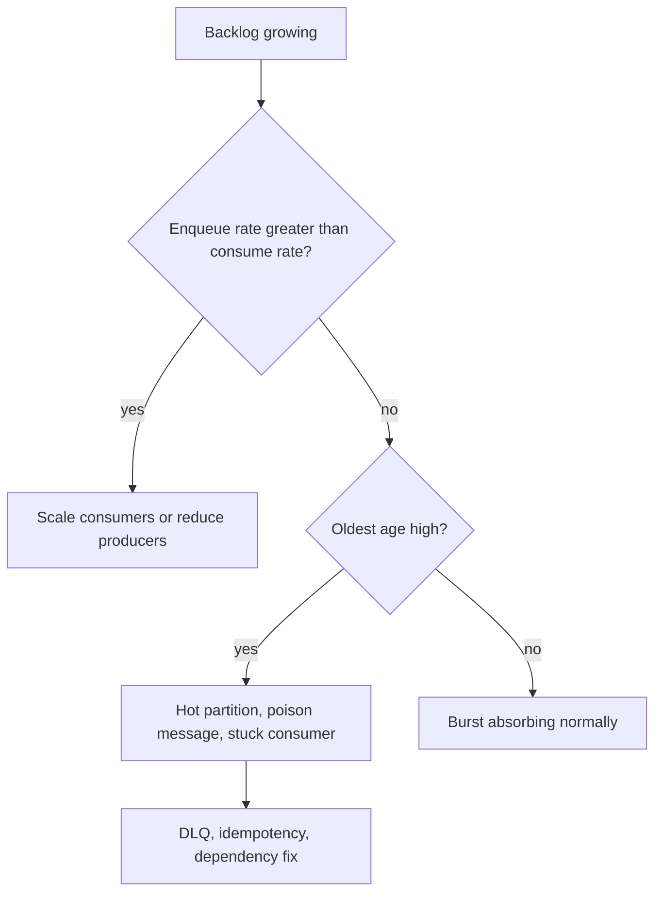

**Common mistakes:**
- Scaling consumers before ensuring downstream DB/API can handle more load.
- Ignoring poison messages that block ordered partitions.
- Alerting on queue length without considering message age.

**Follow-ups:**
- *Why idempotency before retries?* → Retried messages can repeat side effects.
- *What is a DLQ?* → Dead-letter queue for messages that cannot be processed after attempts.

### Q40. A job or message is processed twice — how do you make it safe?
`🟡 Intermediate` `🔥` `Must-know SDE-1`

**Why they ask:** At-least-once delivery is the default in many reliable systems.

**Beginner lens:** Duplicate processing is like paying the same invoice twice unless the accounting system checks
the invoice number. The key distinction is delivery guarantee versus side-effect safety: many systems are at-least-once,
so handlers must be idempotent. Recognize it when jobs, messages, retries, or client requests can repeat. Use durable
idempotency keys, unique constraints, processed-message tables, conditional updates, and transactions that record the
business effect and duplicate marker together.

**Short answer (say this first, 20-40 sec):**
I assume duplicates can happen and make handlers idempotent. Use idempotency keys, unique
constraints, processed-message tables, conditional updates, and transaction boundaries that record
the side effect and message processing together.

**Detailed answer:**
Example table:

```sql
CREATE TABLE processed_message (
  message_id text PRIMARY KEY,
  processed_at timestamptz NOT NULL DEFAULT now()
);
```

Handler pattern:

```java
@Transactional
public void handle(EmailGeneratedEvent event) {
    int inserted = jdbc.update("""
        INSERT INTO processed_message(message_id)
        VALUES (?)
        ON CONFLICT DO NOTHING
        """, event.messageId());

    if (inserted == 0) {
        return; // duplicate
    }

    emailRepository.markGenerated(event.emailId(), event.reply());
}
```

This works because the duplicate marker and business update commit in the same transaction. For API
requests, clients send `Idempotency-Key`; the server stores key, request hash, status, and response.
If the same key arrives with same request, return stored response; if the payload differs, return
409 conflict. For external side effects like charging a card or calling an LLM billing endpoint,
prefer provider idempotency keys if available. Exactly-once is usually a combination of at-least-once
delivery plus idempotent processing, not magic. Also design retries with backoff and DLQ so permanent
failures do not loop forever.

**Common mistakes:**
- Believing Kafka or RabbitMQ removes all duplicates.
- Checking for duplicates outside the transaction and racing.
- Using timestamps as idempotency keys.

**Follow-ups:**
- *What is at-least-once delivery?* → Message is delivered one or more times until acknowledged.
- *Where store idempotency state?* → Durable store with unique constraint.

### Q41. Cache hit rate drops and DB load spikes — how do you debug?
`🟡 Intermediate` `🔥` `Must-know SDE-1`

**Why they ask:** Caching incidents connect performance, consistency, and failure modes.

**Beginner lens:** A cache hit-rate drop is like a team losing its shared notebook and asking the database every
time. Recognize it when cache misses rise with database CPU, latency, or Redis evictions. Test hypotheses: key format
changed, TTLs expired together, eviction, node failure, deploy bypassed cache, or serialization changed. Mitigate by
rollback, rate limiting, stale reads where safe, single-flight request coalescing, or TTL jitter. Avoid clearing caches
during peak traffic.

**Short answer (say this first, 20-40 sec):**
I check whether keys changed, TTL expired together, cache nodes failed, eviction increased, traffic
shifted, serialization changed, or a deploy bypassed the cache. Then I protect the DB with
rate-limits, request coalescing, stale reads, or rollback.

**Detailed answer:**
Signals:

```text
cache.hit.rate drops from 92% to 20%
redis_evicted_keys increases
db CPU rises from 35% to 95%
GET /template p95 rises from 80 ms to 2 s
```

Investigate:

```bash
redis-cli INFO stats
redis-cli INFO memory
redis-cli --scan --pattern "template:*" | head
```

Failure patterns:

| Pattern | Evidence | Fix |
|---|---|---|
| key format changed | old and new prefixes differ | rollback or dual-read |
| cache stampede | many misses for same key | single-flight, locks, jitter TTL |
| eviction | `evicted_keys` rising | memory, maxmemory policy, smaller values |
| TTL herd | many keys expire at once | randomize TTL |
| Redis slow | high latency | inspect Redis CPU/network |

Spring Cache example with Caffeine for local bounded cache:

```java
@Cacheable(cacheNames = "templates", key = "#userId + ':' + #status")
public List<Template> findTemplates(long userId, String status) {
    return repository.findByUserIdAndStatus(userId, status);
}
```

Prevention: cache hit-rate dashboards by cache name, Redis memory and evictions, key naming tests,
TTL jitter, fallback to stale data for read-heavy non-critical data, and load tests with cold cache.
Be careful with stale data for security or billing decisions.

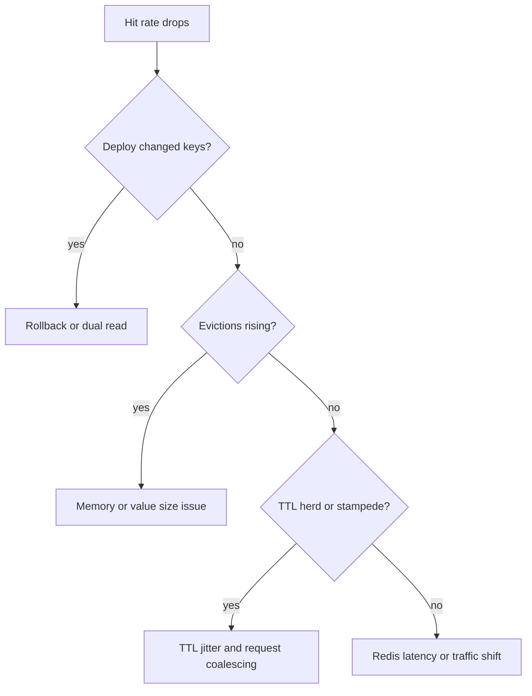

**Common mistakes:**
- Clearing the entire cache during peak traffic.
- Using cache for correctness-critical authorization without fallback design.
- Ignoring eviction metrics.

**Follow-ups:**
- *What is cache stampede?* → Many callers miss and recompute the same key simultaneously.
- *Why TTL jitter?* → It prevents mass expiration at the same moment.

### Q42. API returns wrong data for some users — how do you debug safely?
`🔴 Advanced` `🔥` `Must-know SDE-2`

**Why they ask:** Correctness incidents require caution because debugging can expose or damage data.

**Beginner lens:** Wrong data is a correctness and possibly privacy incident, so debug with gloves on. First classify
whether the value is stale, missing, duplicated, or belongs to another user. Recognize high severity when tenant or
user boundaries may be crossed. Preserve evidence with correlation IDs and safe identifiers, check recent changes,
authorization predicates, cache keys, replica reads, migrations, and races. Mitigate blast radius, avoid logging
personally identifiable information, and repair data only with reviewed, reversible scripts.

**Short answer (say this first, 20-40 sec):**
I preserve evidence, limit blast radius, identify affected users and time window, check recent
deploys and data changes, verify authorization and query predicates, and avoid logging sensitive
data. If there is data exposure, I escalate as a security/privacy incident.

**Detailed answer:**
First classify: wrong value, stale value, another user's data, duplicate, missing row, or formatting
issue. Another user's data is highest severity. Use correlation ID and safe identifiers:

```sql
SELECT id, user_id, status, updated_at
FROM email_template
WHERE id = $1;
```

Do not dump email body or personal content into chat or logs. Check common causes:

| Cause | Evidence |
|---|---|
| missing tenant predicate | SQL lacks `tenant_id` or `user_id` |
| cache key bug | key uses template ID but not user ID |
| replica stale | primary has new value, replica old |
| bad migration | rows transformed incorrectly |
| race | concurrent update lost |
| timezone | date range includes wrong day |

Example bad cache key:

```java
@Cacheable(cacheNames = "template", key = "#templateId") // bad if IDs collide by tenant
TemplateDto getTemplate(long tenantId, long templateId) { ... }
```

Fix:

```java
@Cacheable(cacheNames = "template", key = "#tenantId + ':' + #templateId")
TemplateDto getTemplate(long tenantId, long templateId) { ... }
```

Mitigation can include disabling cache, routing reads to primary, rolling back, blocking affected
endpoint, or running a carefully reviewed repair script. Repair scripts should be transactional,
backed up, reviewed, and first run as `SELECT` to show affected rows.

**Common mistakes:**
- Logging raw PII while debugging.
- Running UPDATE fixes without a WHERE clause preview.
- Treating cross-user data exposure as a normal bug.

**Follow-ups:**
- *What is blast radius?* → Scope of affected users, tenants, records, and time window.
- *How do you repair data?* → Back up, write reviewed transaction, dry-run select, execute, verify.

### Q43. What should you log in a production Spring Boot API?
`🟢 Beginner` `🔥` `Must-know SDE-1`

**Why they ask:** Logging is easy to overdo and hard to fix after an incident.

**Beginner lens:** Production logs are a flight log, not a copy of every passenger's luggage. Log enough structured
metadata to reconstruct behavior: correlation ID, route, status, duration, dependency result, version, and safe user
or tenant category. Recognize this when asked how to debug without leaking data. The interviewer is testing judgment:
INFO for useful lifecycle events, WARN for recoverable concerns, ERROR for failures, errors sampled carefully, and no
secrets, tokens, prompts, email bodies, or huge payloads.

**Short answer (say this first, 20-40 sec):**
Log structured, actionable metadata: correlation ID, route, status, duration, dependency outcome,
safe user or tenant identifier, and error category. Do not log secrets, tokens, passwords, API keys,
full email content, or large payloads.

**Detailed answer:**
Good request completion log:

```json
{
  "level": "INFO",
  "message": "request completed",
  "correlationId": "8f4c",
  "method": "POST",
  "route": "/api/reply",
  "status": 200,
  "durationMs": 183,
  "dependency": "gemini",
  "dependencyStatus": "success"
}
```

Good error log:

```java
log.warn("Gemini rate limited correlationId={} retryAfterSeconds={} route={}",
    correlationId, retryAfterSeconds, route);
```

Bad log:

```java
log.info("Prompt={}, apiKey={}", promptText, apiKey);
```

Use JSON logs if your platform supports it; they are easier to query than free text. Log at INFO for
important lifecycle events and request summaries, WARN for recoverable problems needing attention,
ERROR for failed operations requiring investigation, DEBUG for local details disabled in production.
Sampling can reduce volume, but keep errors and security events. Add version, pod, environment, and
trace ID fields automatically. Retention should match compliance and debugging needs. Redaction
should be centralized; do not rely on every developer remembering to mask secrets.

**Common mistakes:**
- Logging full request and response bodies.
- Logging every loop iteration at INFO.
- Throwing away correlation IDs in exception handlers.

**Follow-ups:**
- *Why structured logs?* → They support reliable filtering, grouping, and dashboards.
- *What is log sampling?* → Keeping a representative subset to reduce volume while preserving signals.

### Q44. How do feature flags help production debugging?
`🟡 Intermediate` `🔥` `Must-know SDE-1`

**Why they ask:** Flags are a practical mitigation tool when rollback is slow or risky.

**Beginner lens:** A feature flag is a circuit switch for code paths that are already deployed. The key distinction
is disabling behavior without redeploying versus rolling back the whole artifact. Recognize flags in canary rollout,
kill switch, tenant allowlist, or experiment questions. During incidents, compare metrics by flag variant and disable
the risky path if it correlates with errors. Production concerns are safe defaults, audit trail, ownership, expiry,
testing both on and off paths, and not bypassing security checks.

**Short answer (say this first, 20-40 sec):**
Feature flags let you disable or limit risky behavior without redeploying. They help with canaries,
kill switches, tenant allowlists, gradual rollout, and isolating whether a new path caused an
incident.

**Detailed answer:**
Example:

```java
public EmailReply generate(EmailRequest request) {
    if (featureFlags.isEnabled("gemini-rewrite-v2", request.tenantId())) {
        return newGeminiFlow.generate(request);
    }
    return stableTemplateFlow.generate(request);
}
```

Operational uses:

| Flag type | Use |
|---|---|
| release flag | ship dark code before enabling |
| experiment flag | compare behavior for a small cohort |
| ops flag | disable expensive dependency path |
| permission flag | enable only for beta tenants |

During an incident, if `gemini-rewrite-v2` correlates with 429s or latency, turn it off for all
tenants while keeping the rest of the deploy. Flags must be observable: telemetry should include
flag name and variant in bounded tags or logs. They must also be governed: default safe values,
audit trail, ownership, expiry date, and tests for both on/off paths. Otherwise flags become hidden
complexity. Do not use flags to bypass security checks casually; a misconfigured flag can become a
security incident.

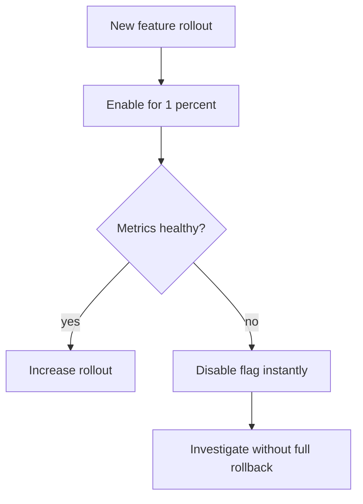

**Common mistakes:**
- Leaving old flags forever.
- Not testing the disabled path.
- Using unbounded user IDs as metric tags for flag variants.

**Follow-ups:**
- *What is a kill switch?* → An ops flag that quickly disables a risky feature.
- *Why expire flags?* → To avoid permanent branching complexity.

### Q45. What are safe and unsafe ways to debug production?
`🟡 Intermediate` `🔥` `Must-know SDE-1`

**Why they ask:** Strong engineers protect users and data while investigating.

**Beginner lens:** Safe production debugging is like a doctor using non-invasive tests before surgery. Start with
read-only, scoped, audited evidence: logs, metrics, traces, thread dumps, short profiles, and limited SELECT queries.
Recognize unsafe moves such as live breakpoints, secret logging, broad data dumps, unbounded queries, or unreviewed
writes. If a change is required, make it small, reversible, approved, monitored, and documented. The interviewer is
testing whether you protect users and data while investigating.

**Short answer (say this first, 20-40 sec):**
Safe debugging is read-only first, scoped, audited, reversible, privacy-aware, and performed through
approved tools. Unsafe debugging includes changing data without backup, logging secrets, attaching
heavy tools blindly, running unbounded queries, or testing fixes directly on users.

**Detailed answer:**
Safe actions:

| Action | Guardrail |
|---|---|
| read logs and metrics | avoid PII, use correlation IDs |
| run SELECT queries | limit rows, use replica if appropriate |
| take thread dumps | low impact, repeat carefully |
| profile briefly | bounded duration, one pod first |
| rollback | verify compatibility and impact |
| feature flag disable | audit change and monitor |

Unsafe actions:

```sql
UPDATE users SET plan = 'FREE'; -- no WHERE, catastrophic
SELECT * FROM emails;           -- dumps sensitive content
```

Better:

```sql
BEGIN;
SELECT id, plan FROM users WHERE id = $1 FOR UPDATE;
-- reviewed single-row change here if approved
ROLLBACK; -- or COMMIT only after approval
```

For Java, avoid taking heap dumps if the disk is almost full or dump contains sensitive data without
handling policy. Avoid remote debugging breakpoints in production because stopping a thread can
freeze request processing and cause timeouts. Use canaries, staging reproduction, dark launches, and
read-only diagnostics first. If production data must be inspected, minimize fields, hash identifiers,
and follow access controls. Every mitigation should have a rollback plan and an expected metric that
confirms success.

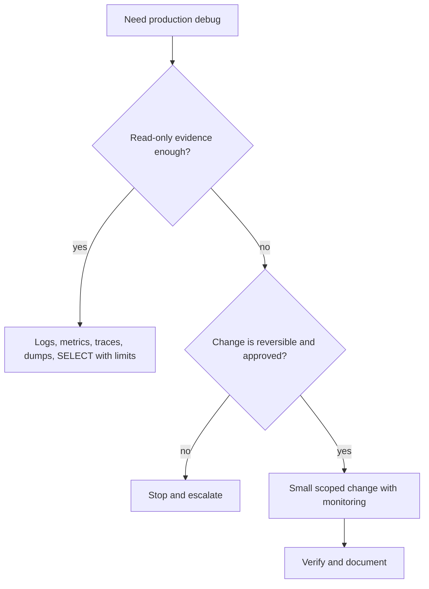

**Common mistakes:**
- Copying production data to personal machines.
- Running broad queries during peak traffic.
- Forgetting to clean up debug log levels or flags.

**Follow-ups:**
- *Why avoid remote breakpoints?* → They can pause production threads and create an outage.
- *What is the safest first move?* → Read-only telemetry with correlation IDs and time bounds.

## Revision Cheat Sheet

- Flame graphs: optimize wide frames, not tall frames; capture the real workload for a bounded time.
- JFR records low-overhead JVM events: CPU, allocation, GC, locks, socket I/O, exceptions.
- Logs explain events, metrics alert on trends, traces connect request causality.
- MDC correlation IDs must be set, propagated, returned, and cleared.
- Micrometer tags must be low-cardinality; never tag by user ID or raw prompt.
- Prometheus scrapes `/actuator/prometheus`; Grafana queries Prometheus.
- OpenTelemetry uses trace IDs, span IDs, and `traceparent` propagation.
- RED monitors services; USE diagnoses resources.
- 99.9% over 30 days gives 43.2 minutes of error budget.
- Good alerts are symptom-based, actionable, owned, and connected to runbooks.
- Incident response prioritizes mitigation before perfect root cause.
- Blameless postmortems produce owned, measurable prevention actions.

## Flashcards

- Q → What does flame graph width mean?  
  A → Total samples or cost in that stack path.
- Q → What does JFR record?  
  A → JVM time-series events such as CPU, allocation, GC, locks, I/O, exceptions.
- Q → Name the three observability pillars.  
  A → Logs, metrics, traces.
- Q → Why clear MDC?  
  A → Threads are reused, so old correlation IDs can leak into new requests.
- Q → Give a bad metric tag.  
  A → User ID, raw URL with IDs, email subject, exception message.
- Q → What is RED?  
  A → Rate, Errors, Duration for services.
- Q → What is USE?  
  A → Utilization, Saturation, Errors for resources.
- Q → 99.9% monthly budget over 30 days equals what downtime?  
  A → 43.2 minutes.
- Q → What is a burn-rate alert?  
  A → Alert based on how quickly error budget is being consumed.
- Q → What is a blameless postmortem?  
  A → Incident review focused on system improvements, not individual blame.
- Q → What does `traceparent` carry?  
  A → Trace ID, span ID, version, and trace flags.
- Q → Why alert on oldest queue message age?  
  A → It maps better to user delay than raw backlog count.
- Q → What is a kill switch?  
  A → Feature flag that disables a risky path quickly.
- Q → What is unsafe production debugging?  
  A → Unapproved writes, secret logging, heavy tools, unbounded queries, live breakpoints.
- Q → What should every incident action item have?  
  A → Owner, due date, and measurable completion.
