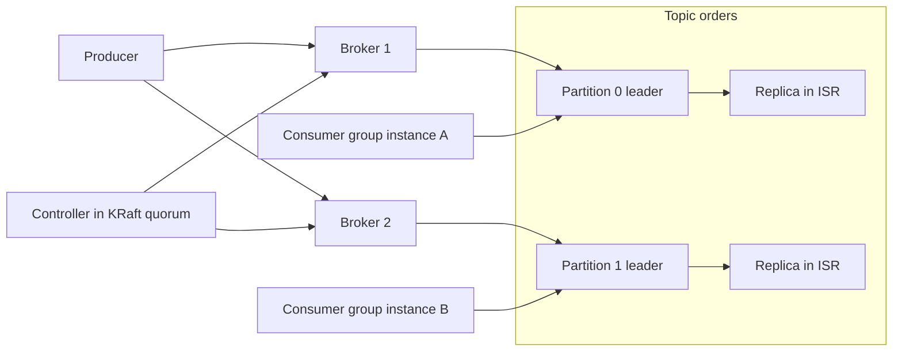
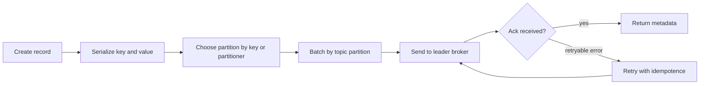
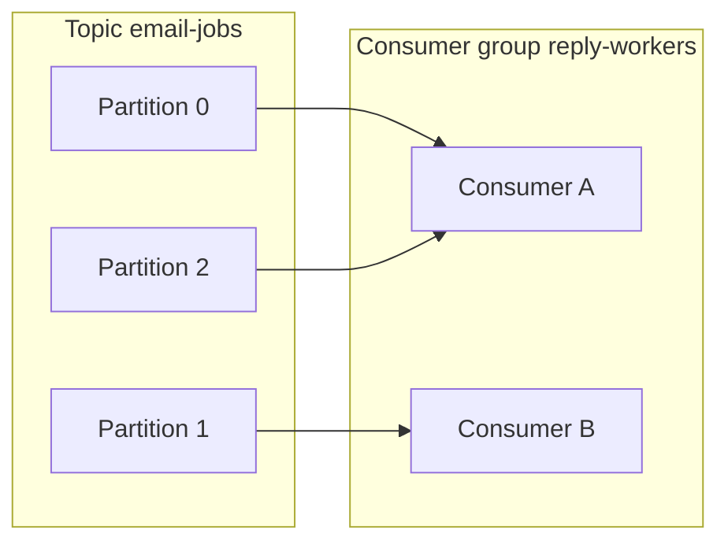
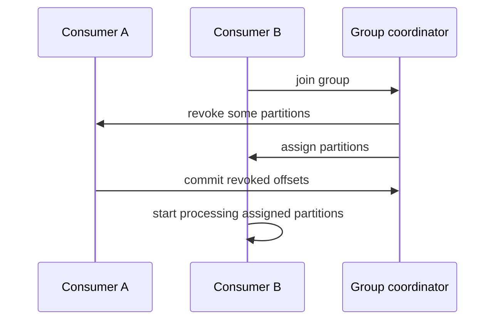
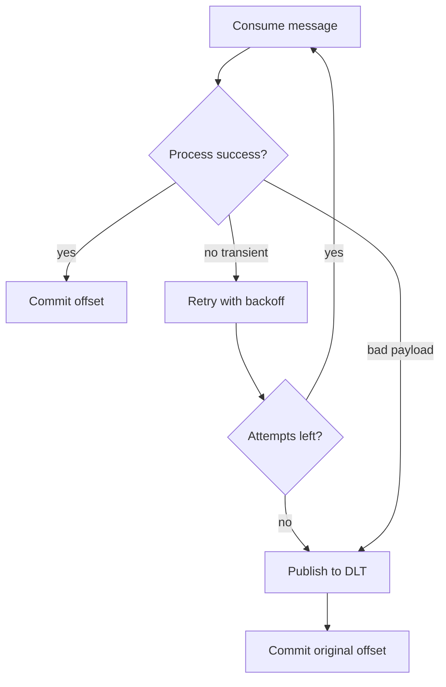
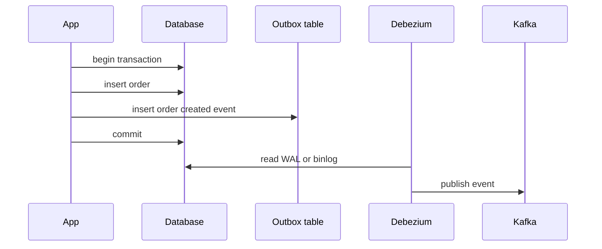
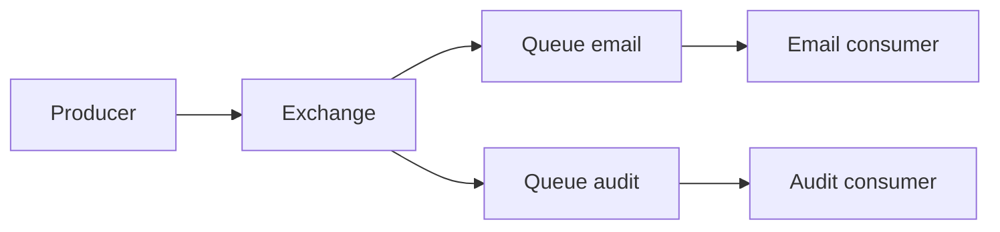
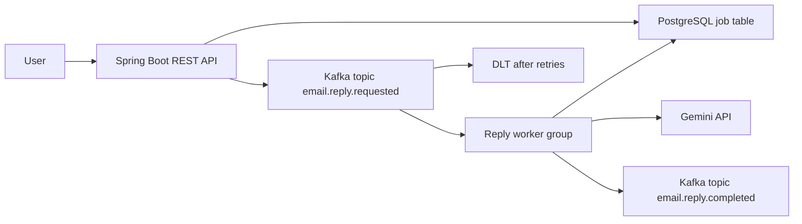

# 12 · Messaging: Kafka & RabbitMQ

Messaging systems decouple services, smooth traffic spikes, and enable event-driven backends. This guide covers Kafka, RabbitMQ, delivery guarantees, Spring Kafka, production debugging, and a project idea for async email reply generation.

🟢 Beginner · 🟡 Intermediate · 🔴 Advanced · ⚫ FAANG · 🔥 = very frequently asked

## Table of Contents
- [Messaging fundamentals](#messaging-fundamentals)
- [Kafka architecture](#kafka-architecture)
- [Producers](#producers)
- [Consumers, offsets, and rebalancing](#consumers-offsets-and-rebalancing)
- [Delivery semantics and reliability](#delivery-semantics-and-reliability)
- [RabbitMQ and cloud queues](#rabbitmq-and-cloud-queues)
- [Spring Kafka and schemas](#spring-kafka-and-schemas)
- [Production scenarios](#production-scenarios)
- [Project idea: async email reply generation with Kafka](#project-idea-async-email-reply-generation-with-kafka)
- [Revision Cheat Sheet](#revision-cheat-sheet)
- [Flashcards](#flashcards)

## Messaging fundamentals

### Q1. Why do we need message queues?
`🟢 Beginner` `🔥` `Must-know SDE-1`

**Why they ask:** Tests whether you understand async system design.

**Short answer (say this first, 20-40 sec):**
Queues decouple producers from consumers, absorb traffic spikes, enable retries, and improve user-facing latency by moving slow work to background workers. They also make workflows more resilient when downstream services are temporarily unavailable.

**Detailed answer:**
- Use cases: email sending, payment callbacks, report generation, notification fanout, audit events, LLM generation jobs.
- Benefits: buffering, backpressure, retry, independent scaling, failure isolation.
- Costs: eventual consistency, duplicates, ordering complexity, operational overhead.

**Common mistakes:**
- Using async messaging when the user needs an immediate consistent answer.
- Forgetting idempotency because queues can redeliver.

**Follow-ups:**
- *Does a queue make work faster?* → Not necessarily; it improves responsiveness and resilience by moving work off the request path.
- *What is backpressure?* → Slowing or buffering producers when consumers cannot keep up.

### Q2. Compare synchronous and asynchronous communication.
`🟢 Beginner` `🔥` `Must-know SDE-1`

**Why they ask:** Backend design often starts with this trade-off.

**Short answer (say this first, 20-40 sec):**
Synchronous calls wait for an immediate response and are simpler for request/response flows. Asynchronous messaging returns quickly and processes work later, improving decoupling but introducing eventual consistency.

**Detailed answer:**
| Aspect | Sync REST/gRPC | Async queue/log |
|---|---|---|
| Latency to user | waits for downstream | can return quickly |
| Coupling | high temporal coupling | lower temporal coupling |
| Failure | caller sees failure | retry/DLQ possible |
| Consistency | easier immediate consistency | eventual consistency |
| Complexity | simpler | offsets, retries, idempotency |

**Common mistakes:**
- Making every operation async and confusing the user experience.
- Ignoring timeout and retry policies in sync calls.

**Follow-ups:**
- *When sync is better?* → User needs immediate validation or result.
- *When async is better?* → Slow, retryable, non-critical, or bursty work.

### Q3. Queue vs pub/sub vs log: what is the difference?
`🟢 Beginner` `🔥` `Must-know SDE-1`

**Why they ask:** Kafka and RabbitMQ use different mental models.

**Short answer (say this first, 20-40 sec):**
A queue usually delivers each message to one consumer. Pub/sub broadcasts each message to subscribers. A log stores ordered records that consumers read at their own offsets.

**Detailed answer:**
| Model | Delivery | Example | Best for |
|---|---|---|---|
| Queue | one worker handles message | RabbitMQ work queue, SQS | tasks/jobs |
| Pub/Sub | many subscribers get copy | RabbitMQ fanout, Redis Pub/Sub | notifications |
| Log | retained ordered records | Kafka topic partition | event streams/replay |

**Common mistakes:**
- Expecting RabbitMQ queue consumers to all receive the same message.
- Expecting Kafka records to disappear after one consumer reads them.

**Follow-ups:**
- *Kafka is queue or log?* → A distributed append-only log with consumer groups that can behave like queues.
- *RabbitMQ is log?* → No, it is a broker optimized for routing and queues.

### Q4. What problems does Kafka solve well?
`🟢 Beginner` `🔥` `Must-know SDE-1`

**Why they ask:** Tests tool selection.

**Short answer (say this first, 20-40 sec):**
Kafka is good for high-throughput durable event streams, replayable events, multiple independent consumers, and ordered processing within partitions.

**Detailed answer:**
- Good: activity events, order events, logs, analytics pipelines, CDC, event-driven microservices.
- Less ideal: tiny low-ops systems, strict per-message routing, request/reply RPC, delayed jobs without extra tooling.
- Kafka keeps records by retention, not by whether a consumer read them.

**Common mistakes:**
- Using Kafka for simple one-off background jobs when a queue is enough.
- Expecting global ordering across a topic.

**Follow-ups:**
- *Why replay matters?* → New consumers can rebuild state from historical events.
- *Kafka vs database table poller?* → Kafka scales and decouples consumers better.

## Kafka architecture

### Q5. Draw and explain Kafka architecture.
`🟡 Intermediate` `🔥` `Must-know SDE-1`

**Why they ask:** Architecture vocabulary is foundational.

**Short answer (say this first, 20-40 sec):**
Kafka has producers writing records to topic partitions on brokers. Each partition has a leader and replicas. Consumers read partitions as part of consumer groups, and a controller manages metadata and leadership.

**Detailed answer:**

- Broker stores partitions; topic is logical stream; partition is ordered log.
- ISR means in-sync replicas eligible for safe leader election.

**Common mistakes:**
- Saying topic has one global order.
- Confusing consumer group with topic.

**Follow-ups:**
- *What is broker?* → Kafka server storing partitions.
- *What is controller?* → Node/quorum managing metadata and leader elections.

### Q6. What are topics, partitions, replicas, leaders, and ISR?
`🟡 Intermediate` `🔥` `Must-know SDE-1`

**Why they ask:** These terms appear in every Kafka interview.

**Short answer (say this first, 20-40 sec):**
A topic is split into partitions. Each partition is an ordered log with one leader and zero or more follower replicas. ISR is the set of replicas caught up enough to be considered in sync.

**Detailed answer:**
- Producer writes to partition leader.
- Followers replicate from leader.
- If leader fails, an ISR follower can become leader.
- Replication factor protects availability; partitions provide parallelism.

**Common mistakes:**
- More partitions always better; too many increase overhead and rebalancing cost.
- Assuming replicas increase consumer parallelism; partitions do.

**Follow-ups:**
- *Max consumers in one group?* → Effective parallelism is bounded by partition count.
- *What if ISR shrinks?* → Durability risk increases; `acks=all` may fail if minimum ISR is not met.

### Q7. KRaft vs ZooKeeper: what changed?
`🔴 Advanced` `Stretch`

**Why they ask:** Modern Kafka removed ZooKeeper dependency.

**Short answer (say this first, 20-40 sec):**
Older Kafka used ZooKeeper for metadata and controller election. KRaft stores metadata in Kafka's own Raft-based quorum, simplifying operations and improving scalability.

**Detailed answer:**
- ZooKeeper mode: external ZooKeeper ensemble stores cluster metadata.
- KRaft mode: Kafka controllers maintain metadata log using Raft.
- New Kafka deployments generally prefer KRaft, but interviews mainly require understanding controller and metadata roles.

**Common mistakes:**
- Saying ZooKeeper stores topic data; brokers store data.
- Treating KRaft as a producer/consumer API change.

**Follow-ups:**
- *Does KRaft change partitions?* → No, topic/partition model remains.
- *Why remove ZooKeeper?* → Fewer moving parts and Kafka-native metadata management.

### Q8. How does Kafka achieve durability?
`🟡 Intermediate` `🔥` `Must-know SDE-1`

**Why they ask:** Durability settings affect data loss.

**Short answer (say this first, 20-40 sec):**
Kafka writes records to disk logs and replicates partitions across brokers. Durability depends on replication factor, `acks`, `min.insync.replicas`, and producer retries/idempotence.

**Detailed answer:**
- `acks=all` waits for leader and required in-sync replicas.
- `min.insync.replicas=2` with RF=3 tolerates one broker failure while maintaining safer writes.
- Unclean leader election can trade consistency for availability and may lose data.

**Common mistakes:**
- Assuming `acks=1` means replicated.
- Using RF=1 for important data.

**Follow-ups:**
- *What is log segment?* → Kafka stores partition logs in segment files.
- *Does Kafka fsync every message?* → Not normally; OS page cache and batching are used.

## Producers

### Q9. Explain the Kafka producer flow.
`🟡 Intermediate` `🔥` `Must-know SDE-1`

**Why they ask:** Producer configs are frequent interview topics.

**Short answer (say this first, 20-40 sec):**
The producer serializes a record, chooses a partition, batches records, sends to the partition leader, waits for configured acknowledgments, and retries if needed.

**Detailed answer:**

- Key determines partition if provided.
- Batching improves throughput at cost of small latency.

**Common mistakes:**
- Assuming send is always synchronous.
- Ignoring serialization compatibility.

**Follow-ups:**
- *What metadata is returned?* → Topic, partition, offset, timestamp.
- *What if no key?* → Producer distributes records by partitioner, often sticky batching behavior.

### Q10. Explain producer `acks=0`, `acks=1`, and `acks=all`.
`🟡 Intermediate` `🔥` `Must-know SDE-1`

**Why they ask:** Acks define durability-latency trade-offs.

**Short answer (say this first, 20-40 sec):**
`acks=0` does not wait for broker acknowledgment. `acks=1` waits for leader only. `acks=all` waits for all required in-sync replicas and is safest with proper `min.insync.replicas`.

**Detailed answer:**
| Setting | Waits for | Risk | Use |
|---|---|---|---|
| `0` | no ack | high loss | metrics where loss is fine |
| `1` | leader write | loss if leader dies before replication | moderate durability |
| `all` | ISR requirement | safest but higher latency | important events |

**Common mistakes:**
- Using `acks=all` with RF=1 and assuming high durability.
- Ignoring `min.insync.replicas`.

**Follow-ups:**
- *Common safe config?* → RF=3, `acks=all`, `min.insync.replicas=2`, idempotence enabled.
- *Does `acks=all` guarantee consumer processed it?* → No, only broker persistence acknowledgment.

### Q11. What are producer retries and idempotent producer?
`🟡 Intermediate` `🔥` `Must-know SDE-1`

**Why they ask:** Retries can create duplicates without idempotence.

**Short answer (say this first, 20-40 sec):**
Retries resend failed batches. Idempotent producer attaches producer IDs and sequence numbers so Kafka can deduplicate retried records within a producer session.

**Detailed answer:**
- Enable `enable.idempotence=true` for safer retries.
- With idempotence, Kafka preserves order per partition for in-flight batches within configured limits.
- Idempotence prevents producer retry duplicates, not all business-level duplicates.

**Common mistakes:**
- Thinking idempotent producer makes the whole consumer workflow exactly once.
- Disabling retries to avoid duplicates and losing availability.

**Follow-ups:**
- *What about consumer duplicates?* → Use idempotent consumers/dedupe table.
- *What are retryable errors?* → Temporary leader changes, network errors, not serialization bugs.

### Q12. How do batching, `linger.ms`, and compression affect producers?
`🟡 Intermediate` `Must-know SDE-1`

**Why they ask:** Producer throughput is controlled by batching.

**Short answer (say this first, 20-40 sec):**
Kafka batches records per topic-partition. `linger.ms` waits briefly to accumulate a larger batch. Compression reduces network/storage cost but adds CPU.

**Detailed answer:**
- Larger batches improve throughput and compression ratio.
- `linger.ms=5` may greatly improve throughput with small latency cost.
- Compression options include gzip, snappy, lz4, and zstd depending on environment.

**Common mistakes:**
- Setting `linger.ms` too high for low-latency APIs.
- Ignoring batch size and memory under high throughput.

**Follow-ups:**
- *What is sticky partitioning?* → For null keys, producer may stick to a partition briefly for better batching.
- *Compression where applied?* → Producer compresses batches; brokers store compressed batches.

### Q13. How does key-based partitioning work?
`🟡 Intermediate` `🔥` `Must-know SDE-1`

**Why they ask:** Partitioning controls ordering and load distribution.

**Short answer (say this first, 20-40 sec):**
If a key is provided, Kafka hashes the key to choose a partition, so records with the same key go to the same partition and preserve order relative to that key.

**Detailed answer:**
- Use `userId`, `orderId`, or `conversationId` when per-entity ordering matters.
- Bad keys can create hot partitions if one key is extremely popular.
- Changing partition count can change key-to-partition mapping for future records.

**Common mistakes:**
- Using random keys and expecting per-user ordering.
- Using one constant key and sending all traffic to one partition.

**Follow-ups:**
- *Global ordering?* → Only possible with one partition, which limits throughput.
- *How handle hot key?* → Split key, relax ordering, or aggregate downstream.

## Consumers, offsets, and rebalancing

### Q14. Explain consumer groups and partition assignment.
`🟡 Intermediate` `🔥` `Must-know SDE-1`

**Why they ask:** This is the most important consumer concept.

**Short answer (say this first, 20-40 sec):**
Consumers with the same group ID share partitions. Each partition is assigned to at most one consumer in a group at a time, enabling parallel processing while preserving partition order.

**Detailed answer:**

- Max active consumers in one group is bounded by partitions.
- Different groups each get their own copy logically through independent offsets.

**Common mistakes:**
- Expecting two consumers in the same group to both receive every record.
- Adding more consumers than partitions and expecting more throughput.

**Follow-ups:**
- *What if 5 consumers and 3 partitions?* → 2 consumers are idle.
- *How broadcast to services?* → Use different consumer group IDs.

### Q15. What are Kafka offsets?
`🟢 Beginner` `🔥` `Must-know SDE-1`

**Why they ask:** Offsets define what was consumed.

**Short answer (say this first, 20-40 sec):**
An offset is a monotonically increasing position of a record within a partition. Consumers commit offsets to remember progress.

**Detailed answer:**
- Offset is partition-local, not topic-global.
- Committed offset usually means next record to read, depending on client semantics.
- Kafka stores consumer offsets in internal topic `__consumer_offsets`.

**Common mistakes:**
- Calling offset a message ID globally unique across topic.
- Committing before processing and then losing messages on crash.

**Follow-ups:**
- *Can consumers seek?* → Yes, they can seek to earlier/later offsets if retained.
- *What is lag?* → Difference between latest offset and committed/current consumer offset.

### Q16. Auto commit vs manual commit: what changes?
`🟡 Intermediate` `🔥` `Must-know SDE-1`

**Why they ask:** Commit strategy controls delivery semantics.

**Short answer (say this first, 20-40 sec):**
Auto commit periodically commits offsets regardless of business processing details. Manual commit lets the app commit only after processing succeeds, usually giving safer at-least-once behavior.

**Detailed answer:**
| Strategy | Commit timing | Failure implication |
|---|---|---|
| Auto commit | periodic poll-based | may lose messages if committed before processing finishes |
| Manual before processing | early | at-most-once risk |
| Manual after processing | after success | at-least-once, duplicates possible |

**Common mistakes:**
- Auto commit with slow processing and assuming no loss.
- Manual commit before DB transaction commits.

**Follow-ups:**
- *When commit after DB write?* → After transaction commits successfully.
- *Duplicate risk?* → Crash after processing before commit causes reprocessing.

### Q17. Explain at-most-once and at-least-once with offsets.
`🟡 Intermediate` `🔥` `Must-know SDE-1`

**Why they ask:** Delivery semantics are fundamental.

**Short answer (say this first, 20-40 sec):**
At-most-once commits before processing, so messages may be lost but not retried. At-least-once processes before committing, so messages are not lost but can be duplicated.

**Detailed answer:**
- At-most-once: commit offset → process → crash means message lost.
- At-least-once: process → commit offset → crash before commit means duplicate processing.
- Most systems choose at-least-once plus idempotent consumer.

**Common mistakes:**
- Claiming Kafka consumers never see duplicates.
- Forgetting external side effects like email sending.

**Follow-ups:**
- *How handle duplicates?* → Idempotency keys or dedupe table.
- *What about exactly-once?* → Limited to Kafka transactional pipelines unless external systems are coordinated.

### Q18. What is rebalancing?
`🟡 Intermediate` `🔥` `Must-know SDE-1`

**Why they ask:** Rebalances cause pauses and duplicate work.

**Short answer (say this first, 20-40 sec):**
Rebalancing reassigns partitions among consumers when group membership or topic partitions change. During rebalance, consumers may pause, revoke partitions, and resume with new assignments.

**Detailed answer:**

- Causes: consumer start/stop, missed heartbeats, max poll interval exceeded, partition changes.
- Commit offsets before partition revoke.

**Common mistakes:**
- Long processing without polling, causing rebalance storms.
- Not handling partition revoke callbacks.

**Follow-ups:**
- *What is cooperative sticky?* → Incremental assignment strategy that reduces full stop-the-world revokes.
- *How reduce rebalances?* → Tune heartbeats, `max.poll.interval.ms`, and processing model.

### Q19. What is cooperative sticky assignment?
`🔴 Advanced` `Stretch`

**Why they ask:** Modern Kafka consumers use it to reduce disruption.

**Short answer (say this first, 20-40 sec):**
Cooperative sticky assignment tries to keep existing partition ownership and moves only necessary partitions incrementally, reducing pause time compared with eager rebalancing.

**Detailed answer:**
- Sticky: minimize partition movement.
- Cooperative: revoke subsets rather than all partitions at once.
- Useful for stateful consumers and high-throughput systems.

**Common mistakes:**
- Assuming it removes all rebalancing.
- Mixing incompatible assignors during rolling upgrades without care.

**Follow-ups:**
- *Eager rebalance?* → Consumers revoke all partitions then rejoin.
- *Why stateful consumers care?* → Moving partitions may require cache/state reload.

### Q20. What is consumer lag and how do you debug it?
`🟡 Intermediate` `🔥` `Must-know SDE-1`

**Why they ask:** Lag is the most common Kafka production symptom.

**Short answer (say this first, 20-40 sec):**
Consumer lag is how far a consumer is behind the latest produced offset. Debug producer spikes, slow processing, insufficient partitions/consumers, downstream slowness, errors, and rebalances.

**Detailed answer:**
- Metrics: records lag max, consume rate, process latency, poll interval, rebalance count, error rate.
- Fixes: scale consumers up to partition count, optimize processing, batch DB writes, increase partitions carefully, add backpressure.
- Check one partition lagging: likely hot key or poison pill.

**Common mistakes:**
- Adding consumers beyond partition count.
- Ignoring downstream DB/API bottleneck.

**Follow-ups:**
- *Can lag be okay?* → Yes for batch workloads with known SLA.
- *Hot partition fix?* → Better key design or split hot entity.

### Q21. What ordering guarantees does Kafka provide?
`🟡 Intermediate` `🔥` `Must-know SDE-1`

**Why they ask:** Ordering is frequently misunderstood.

**Short answer (say this first, 20-40 sec):**
Kafka guarantees order within a single partition, not across partitions. To preserve per-entity order, use the same key so related records go to the same partition.

**Detailed answer:**
- Consumer processes records from a partition in offset order unless app parallelizes internally.
- Retries and multiple in-flight requests can affect producer ordering if idempotence/configs are wrong.
- Global order requires one partition, limiting scalability.

**Common mistakes:**
- Assuming topic-wide order.
- Parallelizing records from the same key without sequencing.

**Follow-ups:**
- *Order by user?* → Key by user ID.
- *Order broken after increasing partitions?* → New key mapping may change for future records.

## Delivery semantics and reliability

### Q22. What is exactly-once semantics in Kafka?
`🔴 Advanced` `Stretch`

**Why they ask:** It is often oversold.

**Short answer (say this first, 20-40 sec):**
Kafka exactly-once combines idempotent producers and transactions so consume-process-produce pipelines can commit output records and input offsets atomically. It does not automatically make external databases or email APIs exactly once.

**Detailed answer:**
- Producer transactions write to output topics and commit consumed offsets together.
- Consumers use `read_committed` to avoid uncommitted transactional records.
- External side effects still require idempotency/dedupe.

**Common mistakes:**
- Saying exactly-once means no duplicates anywhere.
- Applying Kafka EOS to non-transactional REST/email calls.

**Follow-ups:**
- *When useful?* → Kafka Streams or consume-transform-produce pipelines.
- *External DB?* → Use DB transaction plus idempotency/outbox patterns.

### Q23. How do you implement an idempotent consumer with a dedupe table?
`🟡 Intermediate` `🔥` `Must-know SDE-1`

**Why they ask:** At-least-once consumers need duplicate protection.

**Short answer (say this first, 20-40 sec):**
Give each event a unique ID. In the same DB transaction as the business update, insert that event ID into a dedupe table with a unique constraint. If insert fails, skip duplicate processing.

**Detailed answer:**
```sql
-- PostgreSQL
CREATE TABLE processed_message (
  consumer_name text NOT NULL,
  message_id text NOT NULL,
  processed_at timestamptz NOT NULL DEFAULT now(),
  PRIMARY KEY (consumer_name, message_id)
);
```
```java
@Transactional
public void handle(OrderCreated event) {
    int inserted = jdbc.update("""
        INSERT INTO processed_message(consumer_name, message_id)
        VALUES (?, ?) ON CONFLICT DO NOTHING
        """, "email-worker", event.eventId());
    if (inserted == 0) return;
    emailRepository.save(EmailJob.from(event));
}
```
- Commit Kafka offset after the DB transaction succeeds.

**Common mistakes:**
- Dedupe insert outside the business transaction.
- Using non-unique or missing event IDs.

**Follow-ups:**
- *How long keep dedupe rows?* → At least as long as max replay/retention window, then archive/delete.
- *Redis dedupe?* → Good for temporary dedupe; DB is stronger for durable side effects.

### Q24. Design retries and DLQ flow.
`🟡 Intermediate` `🔥` `Must-know SDE-1`

**Why they ask:** Real consumers fail on bad data and temporary outages.

**Short answer (say this first, 20-40 sec):**
Retry transient failures with backoff. After max attempts, publish the record with error metadata to a dead-letter topic/queue for inspection and replay.

**Detailed answer:**

- Include original topic, partition, offset, error, stack category, and timestamp in DLT headers.

**Common mistakes:**
- Infinite retry blocking a partition.
- DLQ without alerting or replay tooling.

**Follow-ups:**
- *Retry topic vs in-memory retry?* → Retry topics avoid blocking consumer threads for long delays.
- *Should DLT commit original?* → Usually yes after safely publishing to DLT.

### Q25. What is a poison pill message?
`🟢 Beginner` `🔥` `Must-know SDE-1`

**Why they ask:** Poison pills can stop an entire partition.

**Short answer (say this first, 20-40 sec):**
A poison pill is a message that always fails processing, often due to bad schema, invalid data, or impossible business state. It must be skipped, fixed, or sent to DLQ after bounded retries.

**Detailed answer:**
- Symptoms: same offset fails repeatedly, lag grows on one partition.
- Fix: classify non-retryable errors, publish to DLT, alert, and build replay tooling.
- Schema validation at producer can prevent many poison pills.

**Common mistakes:**
- Retrying forever.
- Committing offset before preserving failed record elsewhere.

**Follow-ups:**
- *How identify?* → Logs show same topic-partition-offset failing.
- *Can one poison pill block order?* → Yes, especially when partition order must be preserved.

### Q26. Explain the Outbox pattern and CDC with Debezium.
`🔴 Advanced` `🔥` `Must-know SDE-1`

**Why they ask:** Outbox solves DB update plus event publish consistency.

**Short answer (say this first, 20-40 sec):**
Write business data and an outbox event in the same DB transaction. Debezium CDC reads the committed outbox row from the database log and publishes it to Kafka.

**Detailed answer:**

- Prevents dual-write bug where DB commit succeeds but Kafka publish fails.
- Consumer still needs idempotency because CDC/event delivery can duplicate.

**Common mistakes:**
- Publishing to Kafka inside DB transaction and assuming atomicity.
- Not cleaning outbox rows after successful CDC.

**Follow-ups:**
- *Why Debezium?* → It reads DB transaction logs reliably.
- *Alternative?* → Transactional polling publisher, but CDC is often cleaner.

### Q27. Compare Kafka, RabbitMQ, Azure Service Bus, and SQS.
`🟡 Intermediate` `🔥` `Must-know SDE-1`

**Why they ask:** Tool selection matters in system design.

**Short answer (say this first, 20-40 sec):**
Kafka is a durable event log, RabbitMQ is a flexible routing broker, Azure Service Bus is managed enterprise messaging, and SQS is a simple managed AWS queue.

**Detailed answer:**
| System | Model | Strength | Typical use |
|---|---|---|---|
| Kafka | partitioned log | throughput, replay, ecosystem | event streams, analytics, CDC |
| RabbitMQ | exchanges and queues | routing, work queues, protocols | task queues, request routing |
| Azure Service Bus | managed queues/topics | enterprise features, sessions, DLQ | Azure apps, commands/events |
| SQS | managed queue | simplicity, scale, low ops | background jobs on AWS |

**Common mistakes:**
- Choosing Kafka only because it is popular.
- Expecting RabbitMQ to retain replayable history like Kafka.

**Follow-ups:**
- *Which for one email job queue?* → RabbitMQ, SQS, or Service Bus is often simpler.
- *Which for replayable order events?* → Kafka.

## RabbitMQ and cloud queues

### Q28. Explain RabbitMQ exchanges.
`🟡 Intermediate` `🔥` `Must-know SDE-1`

**Why they ask:** RabbitMQ routing is exchange-based.

**Short answer (say this first, 20-40 sec):**
Producers publish to an exchange. The exchange routes messages to queues based on exchange type, binding, and routing key.

**Detailed answer:**

- Direct: exact routing key match.
- Topic: pattern match like `order.*` or `order.#`.
- Fanout: broadcast to bound queues.
- Headers: route by headers instead of key.

**Common mistakes:**
- Publishing directly to a queue conceptually; producers publish to exchanges.
- No bindings, so messages are unroutable.

**Follow-ups:**
- *Default exchange?* → Direct exchange with empty name routes to queue by queue name.
- *What is binding?* → Rule connecting exchange to queue.

### Q29. Direct vs topic vs fanout vs headers exchange?
`🟢 Beginner` `🔥` `Must-know SDE-1`

**Why they ask:** It is the core RabbitMQ interview table.

**Short answer (say this first, 20-40 sec):**
Direct uses exact key, topic uses wildcard pattern, fanout broadcasts to all bound queues, and headers routes using message headers.

**Detailed answer:**
| Exchange | Routing rule | Example |
|---|---|---|
| Direct | exact key | `email.created` |
| Topic | wildcard key | `email.*`, `order.#` |
| Fanout | all bound queues | notifications broadcast |
| Headers | header match | `x-match=all`, region and type |

**Common mistakes:**
- Using fanout when only one worker should process a job.
- Overusing headers exchange when topic keys are simpler.

**Follow-ups:**
- *Which for logs by severity?* → Direct or topic.
- *Which for all services notified?* → Fanout.

### Q30. Kafka vs RabbitMQ: when choose which?
`🟡 Intermediate` `🔥` `Must-know SDE-1`

**Why they ask:** Most system design rounds ask trade-offs.

**Short answer (say this first, 20-40 sec):**
Choose Kafka for high-throughput replayable event streams and multiple consumers. Choose RabbitMQ for flexible routing, command queues, lower-latency task distribution, and simpler worker queues.

**Detailed answer:**
- Kafka: retention-based log, partition ordering, replay, analytics/CDC ecosystem.
- RabbitMQ: exchanges, routing keys, per-message acknowledgments, queue semantics.
- Kafka scales by partitions; RabbitMQ scales by queues/consumers and broker topology.

**Common mistakes:**
- Saying Kafka is always better.
- Ignoring replay requirements.

**Follow-ups:**
- *Email job queue?* → RabbitMQ/SQS/Service Bus often simpler; Kafka also works if event platform already exists.
- *Event sourcing?* → Kafka is usually closer fit.

## Spring Kafka and schemas

### Q31. Show a Spring Kafka producer.
`🟡 Intermediate` `🔥` `Must-know SDE-1`

**Why they ask:** Java backend roles expect framework usage.

**Short answer (say this first, 20-40 sec):**
Use `KafkaTemplate` to send keyed events. The key controls partitioning, and the send result gives topic, partition, and offset.

**Detailed answer:**
```java
import java.util.concurrent.CompletableFuture;
import org.springframework.kafka.core.KafkaTemplate;
import org.springframework.kafka.support.SendResult;
import org.springframework.stereotype.Service;

@Service
class EmailJobProducer {
    private final KafkaTemplate<String, EmailReplyRequested> kafkaTemplate;

    EmailJobProducer(KafkaTemplate<String, EmailReplyRequested> kafkaTemplate) {
        this.kafkaTemplate = kafkaTemplate;
    }

    CompletableFuture<SendResult<String, EmailReplyRequested>> requestReply(EmailReplyRequested event) {
        return kafkaTemplate.send("email.reply.requested", event.userId(), event);
    }
}
```
- Configure serializers explicitly, commonly String key plus JSON/Avro value.
- Add callbacks/observability for failed sends.

**Common mistakes:**
- Null key when per-user ordering is required.
- Fire-and-forget sends for critical events without error handling.

**Follow-ups:**
- *What key for email replies?* → User ID or email thread ID depending on required ordering.
- *What does send return?* → Future containing record metadata.

### Q32. Show a Spring Kafka consumer with manual ack.
`🟡 Intermediate` `🔥` `Must-know SDE-1`

**Why they ask:** Consumers need correct commit timing.

**Short answer (say this first, 20-40 sec):**
Process the event, commit database work, then acknowledge the Kafka offset. This gives at-least-once semantics.

**Detailed answer:**
```java
import org.springframework.kafka.annotation.KafkaListener;
import org.springframework.kafka.support.Acknowledgment;
import org.springframework.stereotype.Service;
import org.springframework.transaction.annotation.Transactional;

@Service
class EmailReplyConsumer {
    private final EmailReplyService service;

    EmailReplyConsumer(EmailReplyService service) {
        this.service = service;
    }

    @KafkaListener(topics = "email.reply.requested", groupId = "reply-workers")
    @Transactional
    public void consume(EmailReplyRequested event, Acknowledgment ack) {
        service.generateAndStoreReply(event);
        ack.acknowledge();
    }
}
```
- Configure listener ack mode to manual/manual immediate as appropriate.
- Ensure DB transaction commits before acknowledging in real code; transaction synchronization may be needed.

**Common mistakes:**
- Acknowledging before side effects succeed.
- No idempotency for duplicate events.

**Follow-ups:**
- *What if service throws?* → No ack; error handler retry/DLT should handle.
- *Why transaction note?* → Method-level transaction and ack timing must be coordinated.

### Q33. Configure Spring Kafka error handler and DLT.
`🔴 Advanced` `🔥` `Must-know SDE-1`

**Why they ask:** Production consumers need bounded retries.

**Short answer (say this first, 20-40 sec):**
Use `DefaultErrorHandler` with backoff and `DeadLetterPublishingRecoverer` to publish failed records to a DLT after retries.

**Detailed answer:**
```java
import org.apache.kafka.common.TopicPartition;
import org.springframework.context.annotation.Bean;
import org.springframework.kafka.core.KafkaTemplate;
import org.springframework.kafka.listener.DefaultErrorHandler;
import org.springframework.kafka.listener.DeadLetterPublishingRecoverer;
import org.springframework.util.backoff.FixedBackOff;

@Bean
DefaultErrorHandler kafkaErrorHandler(KafkaTemplate<Object, Object> template) {
    DeadLetterPublishingRecoverer recoverer = new DeadLetterPublishingRecoverer(
            template,
            (record, ex) -> new TopicPartition(record.topic() + ".DLT", record.partition()));
    DefaultErrorHandler handler = new DefaultErrorHandler(recoverer, new FixedBackOff(1000L, 3L));
    handler.addNotRetryableExceptions(IllegalArgumentException.class);
    return handler;
}
```
- DLT should include alerts and replay workflow.
- Use non-retryable classification for bad payloads.

**Common mistakes:**
- Infinite retries on poison pills.
- DLT exists but nobody monitors it.

**Follow-ups:**
- *Why same partition for DLT?* → Helps preserve debugging context.
- *Backoff type?* → Fixed for simple cases; exponential for transient downstream failures.

### Q34. What is Schema Registry and why use it?
`🟡 Intermediate` `Must-know SDE-1`

**Why they ask:** Event contracts must evolve safely.

**Short answer (say this first, 20-40 sec):**
Schema Registry stores event schemas and enforces compatibility between producers and consumers, commonly with Avro, Protobuf, or JSON Schema.

**Detailed answer:**
- Prevents breaking changes like removing required fields.
- Compatibility modes: backward, forward, full, and transitive variants.
- Producers send schema ID plus payload; consumers fetch schema to deserialize.

**Common mistakes:**
- Treating JSON events as schema-free forever.
- Renaming fields without compatibility planning.

**Follow-ups:**
- *Backward compatibility?* → New consumers can read old data or old consumers can read new depending on mode definition; be precise for chosen registry.
- *Simple alternative?* → Versioned DTOs and contract tests for smaller systems.

### Q35. Explain retention and compaction.
`🟡 Intermediate` `🔥` `Must-know SDE-1`

**Why they ask:** Kafka storage is retention-based, not delete-on-read.

**Short answer (say this first, 20-40 sec):**
Retention deletes old log segments by time or size. Compaction keeps the latest value per key, useful for changelog-like topics.

**Detailed answer:**
- Time retention: keep events for, say, 7 days.
- Size retention: delete when topic exceeds configured storage.
- Compaction: for each key, retain latest record and tombstones for deletes.

**Common mistakes:**
- Thinking messages disappear after consumption.
- Using compacted topics without stable keys.

**Follow-ups:**
- *Can compacted topic also have retention?* → Yes, delete and compact policies can be combined.
- *Use case for compaction?* → User profile latest-state changelog.

### Q36. What observability do Kafka systems need?
`🟡 Intermediate` `Must-know SDE-1`

**Why they ask:** Messaging issues are hard without metrics.

**Short answer (say this first, 20-40 sec):**
Track producer errors/latency, broker health, consumer lag, processing latency, rebalances, DLT count, retry count, and end-to-end event age.

**Detailed answer:**
- Producer: send rate, error rate, retries, batch size, request latency.
- Consumer: lag, poll duration, processing time, commit latency, rebalances.
- Business: jobs created, jobs completed, failed jobs, DLT backlog.

**Common mistakes:**
- Alerting only on broker CPU.
- No trace/correlation ID across async boundaries.

**Follow-ups:**
- *Most useful first alert?* → Consumer lag or event age breaching SLA.
- *How trace async?* → Propagate correlation ID in headers.

## Production scenarios

### Q37. Scenario: consumer lag keeps growing. What is your checklist?
`🟡 Intermediate` `🔥` `Must-know SDE-1`

**Why they ask:** Lag growth is the most common Kafka incident.

**Short answer (say this first, 20-40 sec):**
Compare produce rate vs consume rate, inspect processing latency, downstream dependencies, errors, rebalances, partition skew, and consumer count vs partition count.

**Detailed answer:**
- If all partitions lag: consumers too slow or downstream dependency slow.
- If one partition lags: hot key, poison pill, or skew.
- Fix with batching, scaling to partition count, optimizing DB/API calls, or repartitioning.

**Common mistakes:**
- Adding consumers beyond partition count.
- Ignoring a slow database called by consumer.

**Follow-ups:**
- *Immediate mitigation?* → Pause producers, add workers if partitions allow, or shed non-critical work.
- *Long-term?* → Capacity planning and lag SLA alerts.

### Q38. Scenario: duplicate messages are processed. What do you do?
`🟡 Intermediate` `🔥` `Must-know SDE-1`

**Why they ask:** Duplicates are normal in at-least-once systems.

**Short answer (say this first, 20-40 sec):**
Do not try to eliminate every broker duplicate. Make consumers idempotent using event IDs, unique constraints, dedupe tables, and safe side effects.

**Detailed answer:**
- Check crash after DB commit before offset commit.
- Add dedupe table in same transaction as business change.
- For external APIs, use idempotency keys where supported.

**Common mistakes:**
- Assuming Kafka bug because a duplicate appeared.
- Dedupe only in memory, lost after restart.

**Follow-ups:**
- *Producer duplicate?* → Enable idempotent producer.
- *Consumer duplicate?* → Dedupe/idempotent processing.

### Q39. Scenario: rebalance storm occurs. How do you fix it?
`🔴 Advanced` `Stretch`

**Why they ask:** Rebalances cause pauses and duplicates.

**Short answer (say this first, 20-40 sec):**
Find why consumers leave the group: missed heartbeats, processing longer than `max.poll.interval.ms`, crashes, deploy churn, or unstable network. Tune configs and processing model.

**Detailed answer:**
- Increase `max.poll.interval.ms` for long processing or move work to worker pool carefully.
- Use cooperative sticky assignor.
- Reduce rolling deployment churn and ensure graceful shutdown commits offsets.

**Common mistakes:**
- Raising timeouts blindly while poison processing still blocks.
- Not checking consumer logs for poll interval violations.

**Follow-ups:**
- *Symptom?* → Frequent partition revoke/assign and lag spikes.
- *Graceful shutdown?* → Stop polling, finish records, commit, leave group.

### Q40. Scenario: messages are lost. How do you investigate?
`🟡 Intermediate` `🔥` `Must-know SDE-1`

**Why they ask:** Message loss is usually configuration or commit timing.

**Short answer (say this first, 20-40 sec):**
Check producer acks/retries/idempotence, broker replication/ISR, topic retention, consumer commit timing, and whether records went to DLT or were filtered by code.

**Detailed answer:**
- Producer: `acks=0/1`, send callback ignored, serialization failure, retries exhausted.
- Broker: RF=1, unclean leader election, retention too short.
- Consumer: auto commit before processing, committing after failed processing.

**Common mistakes:**
- Calling a skipped/filtered message lost without checking logs and DLT.
- No correlation ID to trace event lifecycle.

**Follow-ups:**
- *Safer producer config?* → RF=3 topic, `acks=all`, idempotence, retries, `min.insync.replicas=2`.
- *Safer consumer config?* → Manual commit after successful durable processing.

### Q41. Scenario: ordering is broken for a user. What happened?
`🟡 Intermediate` `🔥` `Must-know SDE-1`

**Why they ask:** Ordering bugs are common in partitioned systems.

**Short answer (say this first, 20-40 sec):**
Likely records for the same user went to different partitions, processing was parallelized incorrectly, retries changed order, or partition count/key strategy changed.

**Detailed answer:**
- Verify producer key is stable user/thread/order ID.
- Ensure consumer does not process same-key records concurrently out of order.
- Check producer idempotence and max in-flight settings for old clients/configs.

**Common mistakes:**
- Null key while expecting per-user ordering.
- Increasing partitions without considering key mapping changes.

**Follow-ups:**
- *Need global ordering?* → Use one partition or sequence in storage; trade throughput.
- *Per-thread email ordering?* → Key by thread ID.

### Q42. Scenario: consumer is stuck on one message.
`🟡 Intermediate` `🔥` `Must-know SDE-1`

**Why they ask:** Poison pills block partitions.

**Short answer (say this first, 20-40 sec):**
Identify the topic-partition-offset, classify the exception, and after bounded retries send the record to DLT so the partition can continue.

**Detailed answer:**
- Bad schema or validation error is non-retryable.
- Downstream timeout is retryable with backoff.
- Preserve original record and error headers in DLT.

**Common mistakes:**
- Infinite retry in the listener thread.
- Manually skipping offset without storing failed payload.

**Follow-ups:**
- *How replay?* → Fix code/data, then consume DLT with a replay tool.
- *What alert?* → Same offset failing repeatedly or DLT count increase.

### Q43. Scenario: producer throughput is too low. What do you tune?
`🔴 Advanced` `Stretch`

**Why they ask:** Producer performance requires batching and broker awareness.

**Short answer (say this first, 20-40 sec):**
Tune batching, linger, compression, async sends, partition count, broker capacity, and key distribution. Measure before and after.

**Detailed answer:**
- Increase `batch.size` and modest `linger.ms`.
- Enable compression like lz4/zstd if CPU allows.
- Avoid synchronous send per request unless required.
- Ensure enough partitions and no hot key.

**Common mistakes:**
- Calling `.get()` on every send future in request path.
- One partition for high-throughput topic.

**Follow-ups:**
- *Latency trade-off?* → Larger batches and linger improve throughput but add wait time.
- *Compression trade-off?* → Less network/storage, more CPU.

### Q44. Scenario: DLT is growing. What is your operational response?
`🟡 Intermediate` `Must-know SDE-1`

**Why they ask:** DLQs require ownership and replay.

**Short answer (say this first, 20-40 sec):**
Alert, classify errors, stop bad producers if needed, fix schema/business bug, and replay safely with idempotent consumers after validation.

**Detailed answer:**
- Group DLT messages by exception type, producer version, schema version, and event type.
- Build tooling to inspect, replay, or discard with audit trail.
- Track DLT age and count as SLO indicators.

**Common mistakes:**
- Treating DLT as a trash can.
- Replaying without fixing root cause.

**Follow-ups:**
- *Can DLT replay duplicate?* → Yes; consumers must remain idempotent.
- *Who owns DLT?* → The service owning the consumer/business process.

### Q45. When should you not use Kafka?
`🟢 Beginner` `🔥` `Must-know SDE-1`

**Why they ask:** Good engineers avoid unnecessary complexity.

**Short answer (say this first, 20-40 sec):**
Avoid Kafka when a simple synchronous call, database transaction, cron job, or managed queue solves the problem with less operational cost.

**Detailed answer:**
- Not ideal for tiny apps with one worker and no replay need.
- Not ideal for strict request/reply low-latency RPC.
- Not ideal when team cannot operate brokers, schemas, lag, and DLQs.

**Common mistakes:**
- Choosing Kafka for resume value only.
- Ignoring data retention cost.

**Follow-ups:**
- *Alternative for async email jobs?* → RabbitMQ, SQS, Azure Service Bus, or Redis Streams.
- *When upgrade to Kafka?* → Multiple consumers, replay, high throughput, event history, or CDC needs.

## Project idea: async email reply generation with Kafka

### Q46. Design async email reply generation with Kafka for the AI Email Reply Assistant.
`🟡 Intermediate` `🔥` `Must-know SDE-1`

**Why they ask:** It connects Kafka to a realistic portfolio project.

**Short answer (say this first, 20-40 sec):**
The REST API accepts a reply request, stores a job, publishes `EmailReplyRequested`, and returns `202 Accepted`. A worker consumes the event, calls Gemini, stores the reply, and publishes completion or failure events.

**Detailed answer:**

```java
public record EmailReplyRequested(String eventId, String userId, String emailId, String tone) {}

@PostMapping("/api/replies")
public ResponseEntity<JobResponse> create(@RequestBody ReplyRequest request) {
    EmailJob job = jobService.createPendingJob(request);
    producer.requestReply(new EmailReplyRequested(
            UUID.randomUUID().toString(), request.userId(), request.emailId(), request.tone()));
    return ResponseEntity.accepted().body(new JobResponse(job.id(), "PENDING"));
}
```
Resume bullet: `Built an asynchronous email reply generation pipeline with Spring Boot and Kafka, returning 202 responses, processing Gemini calls in worker consumers, and handling retries through a dead-letter topic.`

**Common mistakes:**
- Returning success before storing a durable job or event.
- No idempotency for duplicate request or duplicate Kafka event.

**Follow-ups:**
- *How does UI get result?* → Poll job status, WebSocket/SSE, or notification event.
- *How protect Gemini quota?* → Redis rate limiter before worker calls.

## Revision Cheat Sheet

- Queues decouple producers and consumers, buffer spikes, enable retries, and introduce eventual consistency.
- Sync waits for response; async returns quickly and processes later.
- Queue delivers to one worker; pub/sub broadcasts; log retains ordered records for replay.
- Kafka topics split into partitions; partitions have leaders, replicas, and ISR.
- KRaft replaces ZooKeeper with Kafka-managed Raft metadata quorum.
- Producer flow: serialize, partition, batch, send to leader, wait for acks, retry.
- `acks=0` no wait, `acks=1` leader only, `acks=all` waits for ISR requirement.
- Idempotent producer deduplicates producer retries, not business duplicates.
- Key-based partitioning gives per-key ordering and can create hot partitions.
- Consumer group parallelism is bounded by partition count.
- Offsets are positions within partitions; manual commit after processing gives at-least-once.
- Rebalancing reassigns partitions; cooperative sticky reduces disruption.
- Kafka ordering is per partition, not topic-wide.
- Exactly-once mainly applies to Kafka transactional pipelines, not external side effects automatically.
- Idempotent consumers need event IDs and dedupe tables/unique constraints.
- Retries need backoff and DLT for poison pills.
- Outbox plus Debezium avoids DB/Kafka dual-write inconsistency.
- RabbitMQ exchanges route messages to queues: direct, topic, fanout, headers.
- Schema Registry enforces compatible event evolution.
- Retention deletes old records; compaction keeps latest record per key.
- Production scenarios: lag, duplicates, rebalance storms, message loss, broken ordering, stuck consumers.

## Flashcards

- Q → Why use a queue? A → Decoupling, buffering, retries, and background processing.
- Q → Kafka topic vs partition? A → Topic is logical stream; partition is ordered log shard.
- Q → What is ISR? A → In-sync replicas eligible for safe leader election.
- Q → `acks=all` means? A → Wait for all required in-sync replicas, based on broker config.
- Q → Idempotent producer prevents what? A → Duplicate records from producer retries within a session.
- Q → Consumer group rule? A → One partition is assigned to at most one consumer in a group.
- Q → At-least-once risk? A → Duplicate processing.
- Q → At-most-once risk? A → Message loss.
- Q → Kafka ordering guarantee? A → Within a partition only.
- Q → Poison pill? A → Message that repeatedly fails and blocks progress.
- Q → DLQ purpose? A → Store failed messages after bounded retries for inspection and replay.
- Q → Outbox pattern? A → DB row and event row in one transaction, later published to Kafka.
- Q → RabbitMQ fanout? A → Broadcast to all bound queues.
- Q → Retention vs compaction? A → Delete old records vs keep latest per key.
- Q → Email project bullet? A → Async Spring Boot Kafka pipeline for Gemini reply generation with retries and DLT.
