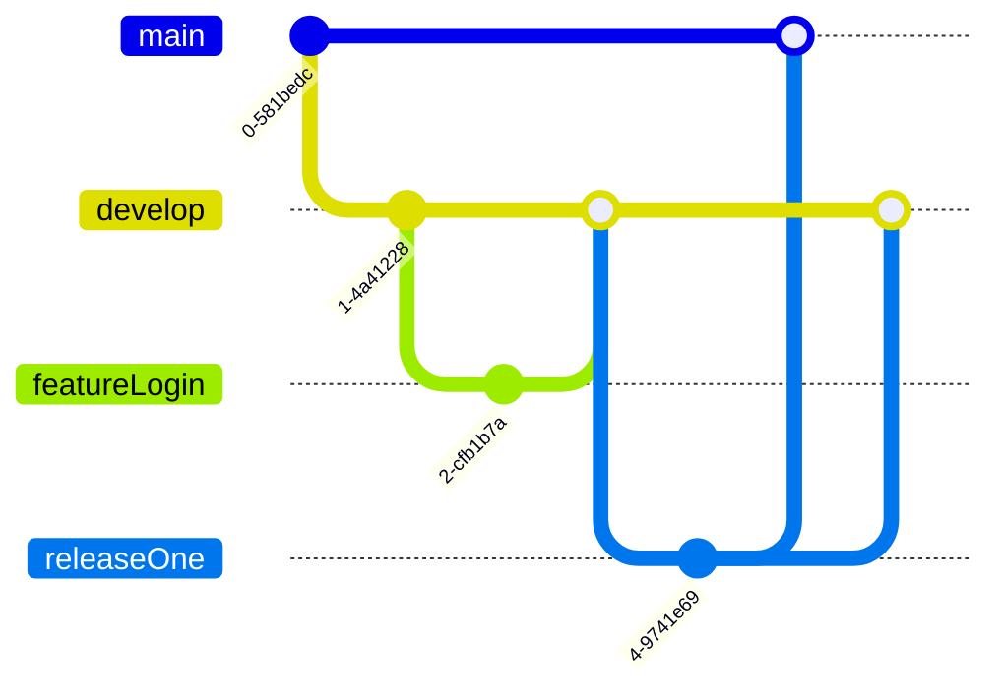
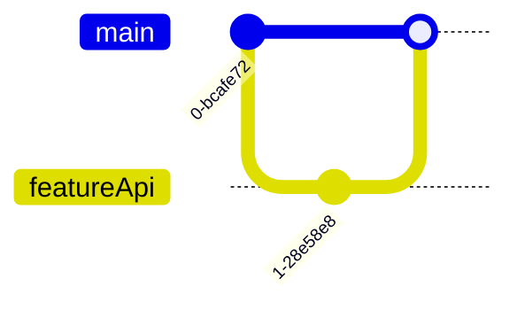
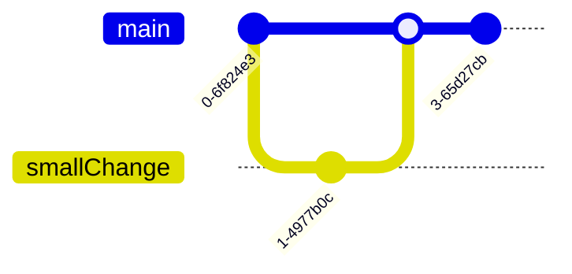
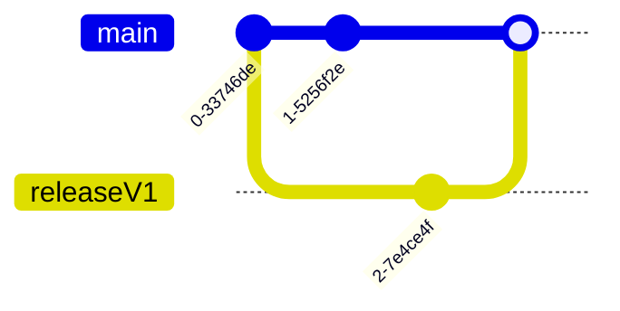
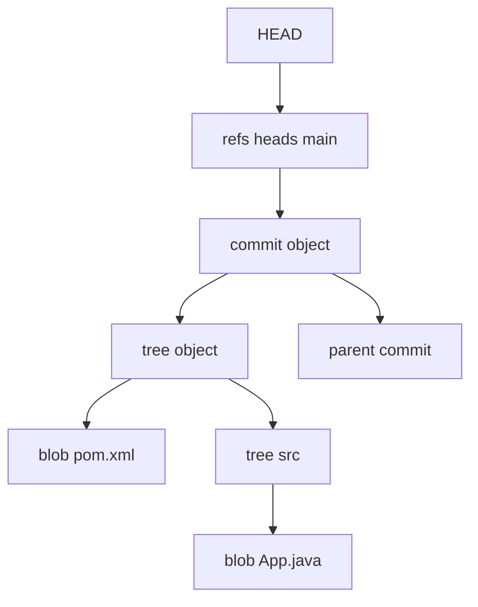
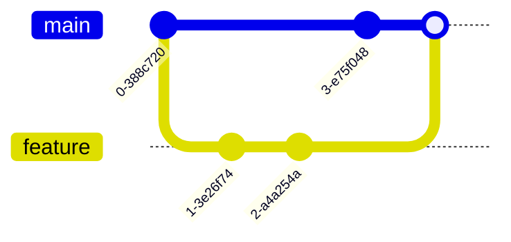
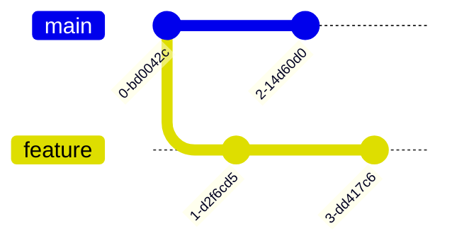
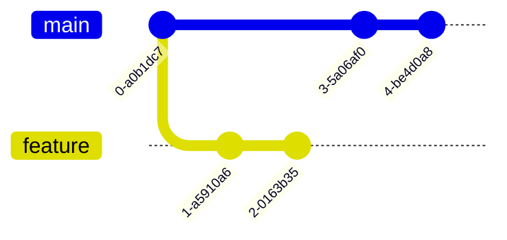
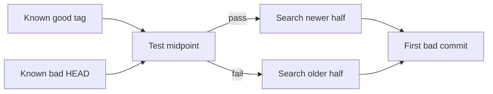

# 13a · Git, GitHub, and CI/CD

This part covers Git fundamentals, branching strategy, repository governance, and day-to-day source
control recovery scenarios. It is written for SDE-1/SDE-2 backend interviews where the interviewer
wants practical command fluency, not definitions.

**Legend:** 🟢 Beginner · 🟡 Intermediate · 🔴 Advanced · ⚫ FAANG · 🔥 = very frequently asked

## Table of Contents
- [Beginner guide to this file](#beginner-guide-to-this-file)
- [Section 1 · Branching and GitHub governance](#section-1--branching-and-github-governance)
- [Section 2 · Git internals and core workflows](#section-2--git-internals-and-core-workflows)
- [Section 3 · High-pressure Git scenarios](#section-3--high-pressure-git-scenarios)
- [Revision Cheat Sheet](#revision-cheat-sheet)
- [Flashcards](#flashcards)

## Beginner guide to this file

### What this file teaches
This file teaches how Git, GitHub, and continuous integration and continuous delivery or deployment (CI/CD)
connect in a real backend team: developers create commits on branches, open pull requests, protect the main
line, and recover safely when history or working files go wrong. Interviewers ask these questions because a
Java backend engineer must ship changes without breaking teammates, losing work, leaking secrets, or making
production rollback harder.

### Mental model
Think of a repository as a shared lab notebook: commits are signed pages, branches are bookmarks, pull
requests are review packets, and CI/CD is the lab safety checklist before a page becomes official.

- Commits store snapshots of the project; branches and tags are references that point to important snapshots.
- `HEAD` is your current bookmark, so many recovery commands start by finding where `HEAD` or a branch pointed.
- Merging, rebasing, squashing, reverting, and resetting all move or create history in different ways.
- Pull requests, CODEOWNERS, required checks, and branch protection turn team rules into repository gates.
- Conflict resolution means preserving both intents, then proving the combined code still builds and tests.
- Recovery tools such as reflog, stash, worktree, bisect, and tags help you inspect or restore repository state.

### How to think through any question here
1. Identify the repository state first: working tree, staging area, local branch, remote branch, or protected main.
2. Ask whether history is shared; if teammates already pulled it, prefer additive repair such as revert.
3. Name the pointer being moved: `HEAD`, a branch reference, a tag, or a remote-tracking reference.
4. Choose the safest command for the scope: stash for temporary work, branch for isolation, revert for shared undo,
   or rebase/reset only when rewriting is acceptable.
5. For pull request and branch-protection questions, describe the human flow: branch, commit, push, open pull
   request, review, checks, merge, and release.
6. For conflict questions, inspect both sides, keep the required behavior from each, run focused tests, and commit
   the resolved result.
7. For secrets, lost commits, or broken main, stop further damage first, preserve evidence, rotate credentials when
   needed, and recover from references or logs.

### Pattern recognition cues
| If the question mentions... | Think about... | Why it fits |
|---|---|---|
| Branching model or release cadence | GitFlow, GitHub Flow, trunk-based development, release branches | The right branch shape depends on deployment frequency and support needs. |
| Protected `main` or reviewer rules | Branch protection, rulesets, required status checks, CODEOWNERS | Governance questions test how code is kept safe before merge. |
| Objects, snapshots, or hashes | Blob, tree, commit, tag, and content-addressed storage | Git behavior is easier when you know commits point to snapshots and parents. |
| Clean pull request history | Interactive rebase, squash, fixup, and force-with-lease | This is history rewriting, so the shared-history risk must be addressed. |
| Undoing a shared change | Revert instead of reset | Revert adds a new commit and does not surprise teammates. |
| Lost branch, detached HEAD, or hard reset | Reflog, remote refs, pull request refs, and backup branches | Git often retains recent commits even after the visible branch pointer moved. |
| Conflicting files | Merge or rebase conflict resolution plus tests | The interviewer wants safe intent preservation, not just deleting markers. |
| Ignored files or generated output | `.gitignore`, already tracked files, and repository hygiene | Ignore rules prevent future tracking but do not remove existing tracked files. |
| Secret committed to GitHub | Rotate, remove from history, invalidate tokens, and audit | Deleting the file is not enough because history and forks may still contain it. |
| Bug introduced somewhere in history | `git bisect` with a repeatable test | Binary search over commits turns a vague regression into a specific change. |

### Abbreviations and key terms
| Short form | Expanded form | Plain meaning |
|---|---|---|
| AI | Artificial Intelligence | Software capability that automates reasoning or pattern-based tasks. |
| API | Application Programming Interface | A contract that lets one piece of software call another. |
| BFG | BFG Repo-Cleaner | A tool for removing large files or secrets from Git history. |
| CI | Continuous Integration | Automatically building and testing every change before it is trusted. |
| CI/CD | Continuous Integration and Continuous Delivery or Deployment | The path from code change to validated artifact and, sometimes, production. |
| CODEOWNERS | Code Owners file | GitHub file that requests required reviewers for matching paths. |
| FAANG | Facebook, Amazon, Apple, Netflix, Google | Shorthand for large product-company interview style. |
| GC | Garbage Collection | Git cleanup that eventually removes unreachable objects. |
| HEAD | Current Git checkout pointer | The commit or branch your working tree is currently based on. |
| IDE | Integrated Development Environment | Editor plus project, build, and debugging support. |
| JAR | Java Archive | Packaged Java application or library file. |
| OIDC | OpenID Connect | Token-based identity protocol often used instead of long-lived secrets. |
| PR | Pull Request | Review request that proposes branch changes for merge. |
| SDE-1 | Software Development Engineer level 1 | Entry-level software engineering role. |
| SDE-2 | Software Development Engineer level 2 | Engineer expected to work with more independence and system judgment. |
| WIP | Work in Progress | Incomplete changes that are not ready for normal review. |
| Branch | Movable Git reference | A name that points to the latest commit in a line of work. |
| Commit | Git snapshot | A saved project state with metadata and parent links. |
| Ref | Reference | A readable name such as a branch or tag that points to an object. |
| Remote | Shared repository location | Usually `origin`, the server copy used for collaboration. |
| Tag | Named release reference | Usually an immutable name for a release commit. |

### Common beginner traps
- Treating Git commands as magic instead of asking which pointer or file state each command changes.
- Using `reset --hard` or force push on shared branches without checking whether others depend on the history.
- Thinking a merge conflict is solved by choosing one side wholesale, instead of preserving both intended changes.
- Forgetting that ignored files already tracked by Git remain tracked until removed from the index.
- Believing a deleted branch means commits vanished immediately; reflog, remotes, and pull requests may still help.
- Fixing a leaked secret only by deleting the file, instead of rotating credentials and cleaning history when needed.

### How to study this file
1. Read each short answer first and say it aloud in under 40 seconds so you can lead with a clear interview answer.
2. Then read the detailed answer and draw the repository flow: local branch, remote branch, pull request, protected
   main, and any recovery pointer involved.
3. For every command, write what changes: working tree, index, commit graph, branch reference, tag, or remote ref.
4. Use the flashcards for spaced recall, but practice active scenarios such as wrong branch, lost commit, and bad
   merge without looking at notes.
5. Rehearse one production angle for each topic: reviewability, rollback, audit, secret exposure, or CI gate impact.

### Scalability and production lens
Toy Git answers focus on one developer and one branch. Production repository flows add many engineers,
protected branches, required checks, CODEOWNERS, release branches, incident rollback, and audit trails. The
safest answer is often not the shortest command; it is the command plus coordination, proof through tests, and
a rollback path.


## Section 1 · Branching and GitHub governance

### Q1. What branching strategies are available in GitHub and how can you configure branch protection rules?
`🟡 Intermediate` `🔥` `Must-know SDE-1`

**Why they ask:** They want to know whether you can keep team delivery fast without letting unsafe code reach production.

**Beginner lens:** Think of a branching strategy as traffic design for repository work: GitFlow uses
several lanes, GitHub Flow uses one short feature lane into main, trunk-based development keeps everyone
close to main, and release branches preserve supported versions. The interviewer is testing whether you
can match branch shape to delivery speed and protect the important reference with pull request review,
required checks, CODEOWNERS, and merge queue so CI/CD can trust what reaches production.

**Short answer (say this first, 20-40 sec):**
Common strategies are GitFlow, GitHub Flow, trunk-based development, and release branching. GitHub
does not force one model; it gives branches, pull requests, branch protection rules, rulesets, CODEOWNERS,
merge queue, required checks, and approval gates so a team can encode its chosen workflow.

**Detailed answer:**
Use GitFlow when releases are planned and long-lived; use GitHub Flow for small services that deploy often;
use trunk-based development when CI is strong and branches are short-lived; use release branches when a
stable production line needs hotfixes while main keeps moving. GitFlow:



GitHub Flow:



Trunk-based:



Release branching:



Configure **branch protection** at `Settings -> Branches -> Add branch protection rule`: target `main`;
enable "Require a pull request before merging"; set approvals to `2`; enable "Dismiss stale pull request
approvals"; enable "Require review from Code Owners"; enable required checks such as `maven-verify`,
`codeql`, and `docker-build`; choose "Require branches to be up to date"; require signed commits;
require linear history; block force pushes and deletions; optionally enable merge queue. For newer centralized
control, use `Settings -> Rules -> Rulesets -> New ruleset`, target branches by pattern like `main` and
`release/*`, then add the same rules with bypass lists restricted to release managers or GitHub Apps.

Sample `CODEOWNERS`:

```text
*                       @org/backend-leads
/src/main/java/security/ @org/security-reviewers
/.github/workflows/     @org/devops-team
```

**Common mistakes:**
- Choosing GitFlow for a service that deploys ten times a day, creating unnecessary merge debt.
- Allowing administrators or everyone on the team to bypass required checks.
- Requiring CODEOWNERS without committing a valid `CODEOWNERS` file in `.github/`, root, or `docs/`.

**Follow-ups:**
- *Branch protection or rulesets?* → Branch protection is per repository and older; rulesets can be layered,
  targeted more flexibly, and managed consistently across repositories.
- *When use merge queue?* → Use it when many PRs pass alone but may break main when merged together.

## Section 2 · Git internals and core workflows

### Q2. How does Git store data internally?
`🟡 Intermediate` `🔥` `Must-know SDE-1`

**Why they ask:** Git recovery, rebasing, and merge behavior make sense only if you understand objects and refs.

**Beginner lens:** Git is like a warehouse of labeled snapshots, not a folder of loose diffs. Blobs store
file contents, trees group names and modes, commits point to trees and parents, and refs such as branches
point to commits. Recognize this topic when commands mention HEAD, refs, object IDs, rebasing, or
recovery, because the interviewer wants proof that you know which pointer moves and why history rewriting
creates new commit hashes.

**Short answer (say this first, 20-40 sec):**
Git is a content-addressed object database. File contents are blobs, directories are trees, commits point
to trees and parents, branches are movable refs, and `HEAD` tells Git which commit or branch is currently
checked out.

**Detailed answer:**
A Git commit is not a diff; it is a snapshot plus metadata. A blob stores bytes of a file, a tree stores file
names, modes, and object IDs, and a commit stores the top tree, parent commit IDs, author, committer, and
message. Object IDs are hashes, so changing one file changes its blob, its parent tree, and every commit
that references that tree. A branch like `refs/heads/main` is a tiny file containing the latest commit hash.
`HEAD` usually contains `ref: refs/heads/main`; in detached HEAD it contains a raw commit hash. You can
inspect objects with:

```powershell
git cat-file -t HEAD
# commit
git cat-file -p HEAD
# tree 9b3...
# parent 41a...
# author Mohd ...
# commit message
git ls-tree HEAD
# 100644 blob a1b2... pom.xml
# 040000 tree c3d4... src
```



This model explains why `reflog` can recover "lost" work: commits remain in the object database until
garbage collection prunes unreachable objects. It also explains why branches are cheap; creating one just
creates another ref pointing at an existing commit.

**Common mistakes:**
- Thinking a branch contains files; it only points to a commit snapshot.
- Believing deleted commits instantly disappear; unreachable objects usually survive long enough to recover.
- Confusing the working tree, index, and committed snapshot.

**Follow-ups:**
- *What is the index?* → The index, or staging area, is the next tree Git will write when you commit.
- *Why are merges fast?* → Git compares commit graphs and trees instead of copying entire repositories.

### Q3. What is the difference between merge, rebase, and squash merge?
`🟡 Intermediate` `🔥` `Must-know SDE-1`

**Why they ask:** Teams expect you to keep history readable without breaking collaboration.

**Beginner lens:** Merge, rebase, and squash are three ways to combine branch work into history. A merge
is like stapling two timelines together, rebase is replaying your commits on a newer base, and squash is
summarizing many commits into one. Use merge when preserving branch context matters, rebase for a clean
feature branch before review, and squash when the pull request story matters more than individual
work-in-progress commits.

**Short answer (say this first, 20-40 sec):**
Merge preserves the true branch topology, rebase rewrites commits onto a new base to make history linear,
and squash merge combines many commits into one new commit. Use merge for shared branch history, rebase
for local cleanup, and squash when the PR should appear as one logical change.

**Detailed answer:**
Merge creates a commit with two parents unless it can fast-forward. It is safe for shared branches because
existing commit IDs remain unchanged:



Rebase copies feature commits and places the copies on top of the new base. The content may be equivalent,
but hashes change, so never rebase public commits other people may have based work on:



Squash merge discards the PR's internal commit boundaries and creates one commit on the target branch:



Interview-ready rule: merge when auditability of the branch matters, rebase before opening a PR or while
your branch is private, and squash when commits are noisy like `fix lint`, `try again`, and `address review`.
In GitHub settings you can allow or disable merge commits, squash merging, and rebase merging per repository.

**Common mistakes:**
- Rebasing a shared branch and force-pushing without coordination.
- Squashing a long-lived feature branch where individual commits were useful rollback points.
- Saying rebase is "better" without considering audit and collaboration.

**Follow-ups:**
- *What is a fast-forward merge?* → The target ref simply moves forward because it is an ancestor of the source.
- *Why does rebase cause conflicts again?* → Each replayed commit is applied separately against a new base.

### Q4. How do you use interactive rebase to clean commits before a pull request?
`🟡 Intermediate` `🔥` `Must-know SDE-1`

**Why they ask:** Reviewers value candidates who can turn messy local work into a coherent reviewable story.

**Beginner lens:** Interactive rebase is a controlled history editor for local or coordinated commits.
Imagine taking sticky notes off a board, reordering them, combining duplicates, rewriting titles, then
pinning them back with new IDs. The interviewer is checking whether you can clean a pull request without
losing changes: fetch the target, rebase, pick commands such as reword, squash, or fixup, run tests, then
push with --force-with-lease only when safe.

**Short answer (say this first, 20-40 sec):**
Use `git rebase -i` while the branch is still private. Mark commits as `pick`, `reword`, `squash`, `fixup`,
or `drop`, resolve conflicts if any, run tests, then push normally or `--force-with-lease` if the branch
already exists remotely.

**Detailed answer:**
Suppose your branch has five local commits and two are noisy. Start from the merge base with main:

```powershell
git fetch origin
git rebase -i origin/main
```

Editor example:

```text
pick 1a2b3c4 add email reply endpoint
reword 2b3c4d5 add validation for tone field
fixup 3c4d5e6 fix typo
squash 4d5e6f7 add tests for invalid request
drop 5e6f7g8 debug print
```

After saving, Git replays commits in order. If a conflict appears:

```powershell
git status
# both modified: src/main/java/com/app/EmailController.java
code src/main/java/com/app/EmailController.java
git add src/main/java/com/app/EmailController.java
git rebase --continue
mvn verify
git push --force-with-lease origin feature/email-reply
```

`--force-with-lease` is safer than `--force` because it refuses to overwrite remote work you have not seen.
Use `git rebase --abort` if the cleanup becomes risky. In an interview, mention that interactive rebase is
for local/private history; after teammates pull the branch, prefer new commits or coordinate explicitly.

**Common mistakes:**
- Using `git push --force` and accidentally deleting a teammate's remote commits.
- Reordering commits that depend on each other without rerunning tests.
- Squashing away a useful commit that isolated a risky schema migration.

**Follow-ups:**
- *What is `fixup` vs `squash`?* → Both combine commits; `squash` lets you edit the message, `fixup` discards it.
- *How do you edit an older commit?* → Mark it `edit`, amend it, then continue the rebase.

### Q5. What is cherry-pick and when should you avoid it?
`🟢 Beginner` `🔥` `Must-know SDE-1`

**Why they ask:** Hotfix workflows often require moving one change without merging an entire branch.

**Beginner lens:** Cherry-pick copies one commit patch to another branch, like photocopying one page from
a notebook instead of moving the whole notebook. It applies when a hotfix or small change is needed in
another release line, but it can duplicate history and create later conflicts. The key distinction is
targeted reuse versus normal merge flow; mention avoiding it for long feature branches or when
dependencies are hidden.

**Short answer (say this first, 20-40 sec):**
`git cherry-pick` copies the patch introduced by an existing commit and creates a new commit on the current
branch. It is useful for hotfixes and selective backports, but overusing it can duplicate history and make
future merges more confusing.

**Detailed answer:**
If a bug fix landed on `main` and must also go to `release/1.2`, cherry-pick just that commit:

```powershell
git fetch origin
git switch release/1.2
git pull --ff-only
git cherry-pick a1b2c3d
# [release/1.2 9f8e7d6] Fix null tone handling
git push origin release/1.2
```

If conflicts occur, resolve files, stage them, and run `git cherry-pick --continue`. Use `git cherry-pick
--abort` to return to the pre-pick state. For multiple commits, pass a range carefully:

```powershell
git cherry-pick oldBase..newTip
```

The new commit has a different hash because its parent is different. For audit-heavy backports, use `-x`
to append `(cherry picked from commit ...)` to the message. Avoid cherry-picking a large feature branch
instead of merging; you will copy many commits without preserving their relationship, and later merges may
show confusing duplicates.

**Common mistakes:**
- Cherry-picking only the code commit but not the database migration or test commit it depends on.
- Using a range with the wrong boundary and copying too much.
- Forgetting to run the same CI checks on the target release branch.

**Follow-ups:**
- *Can cherry-pick preserve the original hash?* → No; parent history changes, so the commit object hash changes.
- *What does `-x` do?* → It records the source commit hash in the new commit message for traceability.

### Q6. What is the difference between revert and reset?
`🟡 Intermediate` `🔥` `Must-know SDE-1`

**Why they ask:** Safe production rollback requires knowing which commands rewrite history and which do not.

**Beginner lens:** Revert and reset both sound like undo, but they solve different social problems. Revert
adds a new commit that negates earlier changes, so shared history stays safe; reset moves a branch pointer
and may rewrite history. When the question says pushed, shared, protected, or production, think revert.
When it says local mistaken commit, think reset modes and explain what happens to commits, index, and
working tree.

**Short answer (say this first, 20-40 sec):**
`git revert` creates a new commit that undoes earlier changes, so it is safe for shared branches. `git reset`
moves the current branch pointer and can change the index and working tree, so it is mainly for local cleanup.

**Detailed answer:**

| Command | Moves branch ref | Changes index | Changes working tree | Safe after push? | Typical use |
|---|---:|---:|---:|---:|---|
| `git revert abc123` | No, adds new commit | Yes | Yes | Yes | Undo production change |
| `git reset --soft HEAD~1` | Yes | No | No | Usually no | Recommit with new message |
| `git reset --mixed HEAD~1` | Yes | Yes | No | Usually no | Unstage and edit files |
| `git reset --hard HEAD~1` | Yes | Yes | Yes | Dangerous | Throw away local work |

Example safe rollback:

```powershell
git switch main
git pull --ff-only
git revert 7e6d5c4
git push origin main
```

Example local cleanup:

```powershell
git reset --soft HEAD~1
git commit -m "Add validated email reply endpoint"
```

In interviews, say "revert for public history, reset for private history." Also mention merge commits:
`git revert -m 1 <merge-sha>` tells Git to keep parent 1, usually the mainline branch, and undo the merged side.
If you accidentally reset, `git reflog` may still show the old commit.

**Common mistakes:**
- Running `reset --hard` to roll back production and then force-pushing `main`.
- Reverting a merge commit without specifying `-m`.
- Assuming revert deletes the old commit; it adds another commit.

**Follow-ups:**
- *Which reset is default?* → `git reset` defaults to `--mixed`.
- *Can revert be reverted?* → Yes, reverting the revert reapplies the original change.

### Q7. How does reflog help recover lost commits?
`🟡 Intermediate` `🔥` `Must-know SDE-1`

**Why they ask:** Real developers eventually reset, rebase, or delete the wrong thing and must recover calmly.

**Beginner lens:** Reflog is Git's local movement diary for references such as HEAD and branches. If a
branch, reset, rebase, or detached checkout seems to lose work, the commit may still be in the reflog even
though no normal branch names it. Interviewers are testing calm recovery: stop destructive commands,
inspect reflog, create a rescue branch at the good hash, then compare and test before pushing anything.

**Short answer (say this first, 20-40 sec):**
Reflog records where local refs and `HEAD` pointed over time. If a commit becomes unreachable after reset,
rebase, or branch deletion, you can find its hash in `git reflog` and create a branch or reset back to it.

**Detailed answer:**
Example: you ran `git reset --hard HEAD~3` on the wrong branch. First stop making new destructive changes,
then inspect the reflog:

```powershell
git reflog --date=local
# b7c2a10 HEAD@{0}: reset: moving to HEAD~3
# e41d9ab HEAD@{1}: commit: Add Redis cache for replies
# 91ac004 HEAD@{2}: commit: Add pgvector migration
git switch -c rescue e41d9ab
git log --oneline -3
# e41d9ab Add Redis cache for replies
# 91ac004 Add pgvector migration
```

If the branch was deleted:

```powershell
git reflog show feature/email-reply
# or inspect all HEAD movement
git reflog
git branch feature/email-reply e41d9ab
```

Reflog is local; your teammate's clone has a different reflog. It is also time-limited by garbage collection,
so recover immediately. For remote branches, GitHub may show branch restore options after a PR is closed,
but locally `reflog` is the fastest tool. After rescue, run tests and compare with `git diff old..new`.

**Common mistakes:**
- Looking only at `git log`, which hides unreachable commits.
- Waiting days or weeks until garbage collection prunes objects.
- Assuming reflog is shared through `git push`; it is not.

**Follow-ups:**
- *Does reflog exist on remote?* → Not in the normal clone-facing way; it is local implementation state.
- *How do you keep a recovered commit?* → Create a branch or tag pointing to it before GC can prune it.

### Q8. How do stash, worktree, and temporary commits differ?
`🟢 Beginner` `🔥` `Must-know SDE-1`

**Why they ask:** Context switching without losing work is a daily engineering skill.

**Beginner lens:** Stash, worktree, and temporary commits are three ways to park unfinished work. Stash is
a quick drawer inside one worktree, worktree is a second checkout for another branch, and temporary
commits are visible Git history that can be amended or reset later. Recognize this when the scenario asks
you to switch tasks safely; choose based on reviewability, testability, and whether another branch must
run at the same time.

**Short answer (say this first, 20-40 sec):**
`git stash` stores uncommitted changes on a stack, `git worktree` checks out another branch in another
directory, and a temporary commit records work in normal history. Stash is quick, worktree is clean for
parallel tasks, and temporary commits are easiest to review and recover.

**Detailed answer:**
Use stash when you are mid-change and must quickly pull a hotfix:

```powershell
git stash push -u -m "WIP email validation"
git switch main
git pull --ff-only
git switch feature/email
git stash pop
```

`-u` includes untracked files, which matters for new tests. Stash entries are commits under the hood, but
they are easy to forget. List and inspect them:

```powershell
git stash list
# stash@{0}: On feature/email: WIP email validation
git stash show -p stash@{0}
```

Use worktree when two branches must be active simultaneously:

```powershell
git worktree add ..\chief-hotfix release/1.2
cd ..\chief-hotfix
mvn verify
```

Use a temporary commit when work is meaningful and should survive tooling:

```powershell
git add .
git commit -m "WIP validate Gemini request"
```

Before PR, clean it with interactive rebase. For interview scenarios, prefer worktree over constantly stashing
if you need to run builds in both branches.

**Common mistakes:**
- Stashing without `-u` and losing track of new untracked files.
- Applying a stash to the wrong branch and creating unnecessary conflicts.
- Creating worktrees from dirty repositories without understanding they share the same object database.

**Follow-ups:**
- *What is `stash pop` vs `apply`?* → `pop` applies then drops on success; `apply` keeps the stash entry.
- *Can worktrees use the same branch?* → Git prevents the same branch being checked out in two worktrees.

### Q9. How do you use git bisect to find the commit that introduced a bug?
`🟡 Intermediate` `🔥` `Must-know SDE-2`

**Why they ask:** Bisect shows systematic debugging instead of randomly scanning recent commits.

**Beginner lens:** Git bisect is binary search over repository history. Instead of guessing which commit
introduced a regression, you mark one known good commit and one bad commit, then let Git choose middle
commits while you run a repeatable test. The interviewer is checking debugging discipline: define a
reliable pass/fail signal, avoid noisy manual judgment, and finish by inspecting the culprit commit and
validating the fix.

**Short answer (say this first, 20-40 sec):**
`git bisect` performs a binary search between a known good and known bad commit. You mark each tested commit
as good or bad, or automate it with a test script, and Git identifies the first bad commit.

**Detailed answer:**
Manual walkthrough:

```powershell
git bisect start
git bisect bad HEAD
git bisect good v1.4.0
# Git checks out a midpoint
mvn -q -Dtest=EmailReplyServiceTest test
git bisect bad
# another midpoint
mvn -q -Dtest=EmailReplyServiceTest test
git bisect good
# first bad commit: 8f1c2ab Add cache key normalization
git bisect reset
```

Automated version uses exit code `0` for good and non-zero for bad:

```powershell
git bisect start HEAD v1.4.0
git bisect run mvn -q -Dtest=EmailReplyServiceTest test
```

For flaky tests, do not trust one run; wrap the command so it retries or validates logs. If a commit cannot
be tested because it does not compile, use `git bisect skip`. The result should be confirmed by inspecting
the diff and writing or updating a regression test. A strong interview answer says "bisect finds correlation;
I still verify the root cause."



**Common mistakes:**
- Starting bisect without a reliable test or reproduction command.
- Forgetting `git bisect reset` and staying on a detached commit.
- Calling the first bad commit the root cause without reading it.

**Follow-ups:**
- *Can bisect run scripts?* → Yes, any command whose exit code tells good or bad works.
- *What about nondeterministic bugs?* → Use repeated runs, logs, or narrower deterministic assertions.

### Q10. How do you resolve merge conflicts correctly?
`🟢 Beginner` `🔥` `Must-know SDE-1`

**Why they ask:** Conflict resolution tests whether you preserve both intent and build correctness.

**Beginner lens:** A merge conflict means Git could not safely combine two edits, not that one side must
be deleted. Treat it like two developers changed the same paragraph in a design document: read both
intents, inspect context, edit the final file deliberately, run tests, and commit the resolution.
Interviewers look for process: identify conflict markers, understand ours versus theirs, avoid blind
checkout, and verify behavior after resolving.

**Short answer (say this first, 20-40 sec):**
Fetch the latest base, reproduce the conflict, inspect both sides, edit to the intended final code, run tests,
stage the resolved files, and continue the merge or rebase. Do not blindly choose "ours" or "theirs."

**Detailed answer:**
During merge:

```powershell
git fetch origin
git switch feature/email
git merge origin/main
# CONFLICT (content): Merge conflict in src/main/java/.../EmailService.java
git status
```

Conflict markers:

```java
<<<<<<< HEAD
return geminiClient.reply(request.text(), request.tone());
=======
return replyClient.generate(request.text(), request.tone(), request.language());
>>>>>>> origin/main
```

Resolve by understanding both changes:

```java
return replyClient.generate(request.text(), request.tone(), request.language());
```

Then:

```powershell
git add src/main/java/com/app/EmailService.java
mvn -q -Dtest=EmailServiceTest test
git merge --continue
```

During rebase, use `git rebase --continue` instead. `--ours` and `--theirs` differ conceptually in merge vs
rebase because rebase replays your commit onto the new base; explain this carefully if asked. For generated
files, regenerate rather than manually editing. For lockfiles, use package manager commands where possible.

**Common mistakes:**
- Removing conflict markers but accidentally deleting one side's behavior.
- Resolving compile conflicts without running focused tests.
- Using "accept incoming" for every file because it makes Git quiet.

**Follow-ups:**
- *How do you abort?* → `git merge --abort` or `git rebase --abort`.
- *How reduce conflicts?* → Keep branches small, rebase frequently, and avoid huge formatting-only changes.

### Q11. What is detached HEAD and is it dangerous?
`🟢 Beginner` `🔥` `Must-know SDE-1`

**Why they ask:** Candidates often panic when Git says they are not on a branch.

**Beginner lens:** Detached HEAD means your current checkout points directly to a commit instead of a
branch name. It is like reading a book page without placing a bookmark; new commits can exist, but no
branch will remember them unless you create one. Recognize this when Git warns about detached HEAD after
checking out a hash or tag. The safe flow is create a branch before important work, or recover recent
commits from reflog.

**Short answer (say this first, 20-40 sec):**
Detached HEAD means `HEAD` points directly to a commit instead of a branch ref. It is safe for inspection,
but if you commit there, create a branch or tag before switching away or the commit may become hard to find.

**Detailed answer:**
You enter detached HEAD by checking out a commit or tag:

```powershell
git switch --detach v1.3.0
git status
# HEAD detached at v1.3.0
```

This is useful for building an old release, bisecting, or reading history. The danger appears if you commit:

```powershell
git commit -am "Experiment with timeout"
# [detached HEAD 31ab9d2] Experiment with timeout
```

No branch moves to `31ab9d2`. Save it:

```powershell
git switch -c experiment-timeout
```

Or later recover with:

```powershell
git reflog
git branch experiment-timeout 31ab9d2
```

Internally, `.git\HEAD` contains a hash instead of `ref: refs/heads/main`. In interviews, say detached HEAD
is not an error state; it is a pointer mode. The rule is simple: inspect freely, but branch before doing real work.

**Common mistakes:**
- Committing in detached HEAD and then switching branches without recording the commit hash.
- Treating detached HEAD as repository corruption.
- Trying to push detached HEAD without specifying a destination ref.

**Follow-ups:**
- *Can you push from detached HEAD?* → Yes, `git push origin HEAD:refs/heads/new-branch`, but creating a branch is clearer.
- *Why does bisect detach HEAD?* → It checks out arbitrary commits that are not branch tips.

### Q12. What is the difference between fetch and pull?
`🟢 Beginner` `🔥` `Must-know SDE-1`

**Why they ask:** Safe synchronization requires knowing when your working branch changes.

**Beginner lens:** Fetch and pull differ in how much they change your workspace. Fetch updates
remote-tracking refs like checking the server notice board; pull fetches and then merges or rebases into
your current branch. Interviewers ask this to see if you avoid surprises: fetch when you want to inspect
or compare, pull when you intentionally want to integrate remote work, and know the team policy for merge
versus rebase.

**Short answer (say this first, 20-40 sec):**
`git fetch` downloads remote refs and objects without changing your current branch. `git pull` is `fetch`
plus an integration step, usually merge or rebase, so it can modify your branch and working tree.

**Detailed answer:**
Use fetch when you want to inspect before integrating:

```powershell
git fetch origin
git log --oneline --graph --decorate HEAD..origin/main
git diff HEAD..origin/main -- pom.xml
```

Use pull when you are ready to update:

```powershell
git pull --ff-only origin main
```

`--ff-only` is excellent for `main` because it refuses to create an unexpected merge commit. On feature
branches, teams may prefer:

```powershell
git pull --rebase origin main
```

That fetches `origin/main` and rebases local commits on top. Configuration examples:

```powershell
git config --global pull.ff only
git config --global pull.rebase true
```

Mention remote-tracking branches: `origin/main` is your local record of the remote's `main`, updated by
fetch. It is not the actual remote branch. Strong workflow: fetch, inspect, then merge/rebase intentionally,
especially before force-pushing or resolving production hotfixes.

**Common mistakes:**
- Running plain `git pull` and creating unnecessary merge commits on a clean feature branch.
- Thinking `origin/main` updates automatically without fetch.
- Pulling with uncommitted work and mixing sync conflicts with local edits.

**Follow-ups:**
- *What is `pull --rebase`?* → It fetches then replays local commits over the fetched upstream.
- *Why use `--ff-only`?* → It protects main from accidental merge commits caused by divergent history.

### Q13. How should you write and debug a .gitignore file?
`🟢 Beginner` `🔥` `Must-know SDE-1`

**Why they ask:** Bad ignore rules lead to committed secrets, build artifacts, and noisy pull requests.

**Beginner lens:** .gitignore is a future-tracking filter, not a delete button for files already
committed. It applies when generated files, IDE metadata, logs, build outputs, or local secrets keep
appearing in status. The interviewer is testing repository hygiene: write specific patterns, understand
negation and directory rules, use check-ignore for debugging, and remove already tracked files with git rm
--cached instead of expecting ignore rules to rewrite history.

**Short answer (say this first, 20-40 sec):**
`.gitignore` prevents untracked files from being added. Use project-specific patterns for build outputs,
IDE files, logs, and local environment files, and remember it does not stop tracking files already committed.

**Detailed answer:**
Example for a Spring Boot project:

```gitignore
target/
.mvn/wrapper/maven-wrapper.jar
*.log
.env
.env.*
!.env.example
.idea/
*.iml
.vscode/
!.vscode/extensions.json
node_modules/
```

If a file is already tracked, ignoring it is not enough:

```powershell
git rm --cached .env
git commit -m "Stop tracking local environment file"
```

Debug rules with:

```powershell
git check-ignore -v .env.local
# .gitignore:4:.env.* .env.local
```

Rules are evaluated by directory. A leading slash anchors to the directory containing that `.gitignore`;
`target/` ignores directories named target below that file; `!` re-includes a path, but parent directories
must not themselves be excluded invisibly. In enterprise repositories, combine `.gitignore` with secret
scanning and pre-commit hooks because ignore files are preventive, not detection controls.

**Common mistakes:**
- Committing `.env` once and assuming `.gitignore` removes it from history.
- Ignoring the entire `.vscode/` folder when useful shared settings should be kept.
- Using broad patterns like `*.json` and accidentally hiding important configuration.

**Follow-ups:**
- *Where put global ignores?* → Use `git config --global core.excludesfile <path>` for OS/editor noise.
- *Can ignore tracked files?* → Not directly; remove from index with `git rm --cached`.

### Q14. How do Git tags and semantic versioning work together?
`🟢 Beginner` `🔥` `Must-know SDE-1`

**Why they ask:** Releases need immutable names that humans and pipelines can understand.

**Beginner lens:** Tags are stable names for important commits, and semantic versioning explains what a
release number promises. Think of a tag as a label on a sealed artifact: v1.4.2 points to the exact source
used to build it. The interviewer wants the flow from commit to release: choose version meaning, create
annotated tag, build and publish artifact, and avoid moving release tags because deployment and rollback
depend on trust.

**Short answer (say this first, 20-40 sec):**
Tags name specific commits, while semantic versioning communicates compatibility as `MAJOR.MINOR.PATCH`.
Use annotated tags for releases, push them explicitly, and let CI build artifacts from the tag commit.

**Detailed answer:**
Semantic versioning convention: increment MAJOR for breaking API changes, MINOR for backward-compatible
features, and PATCH for backward-compatible bug fixes. Annotated tag example:

```powershell
git switch main
git pull --ff-only
git tag -a v1.4.2 -m "Release v1.4.2"
git push origin v1.4.2
git show v1.4.2
```

Annotated tags are full Git objects with tagger, date, message, and optional signature; lightweight tags
are just refs. Release pipelines often trigger on:

```yaml
on:
  push:
    tags:
      - "v*.*.*"
```

For Maven/Spring Boot artifacts, stamp the same version into the JAR, Docker image, and deployment:

```text
ghcr.io/org/email-reply:v1.4.2
ghcr.io/org/email-reply:1.4
```

Never move a public release tag casually; consumers may have already deployed it. If a tag is wrong, delete
with explicit communication and usually publish a new patch version instead.

**Common mistakes:**
- Building a release from a branch tip after tagging a different commit.
- Reusing `latest` as the only production image identifier.
- Moving public tags without notifying downstream users.

**Follow-ups:**
- *Annotated or lightweight?* → Annotated for releases, lightweight for local temporary markers.
- *What is a pre-release?* → Versions like `1.5.0-rc.1` indicate release candidates before stable.

### Q15. What are Git hooks and where do they fit in a team workflow?
`🟡 Intermediate` `🔥` `Must-know SDE-1`

**Why they ask:** Hooks prevent avoidable mistakes before code reaches CI, but they must not replace server checks.

**Beginner lens:** Git hooks are scripts that run at repository events, like a checklist before commit or
push. Local hooks help developers catch formatting or tests early, while server-side or CI checks are the
enforceable team gate. Recognize this when the question mentions pre-commit, pre-push, commit message
policy, or automation. A strong answer says hooks improve feedback but branch protection and CI must
enforce rules centrally.

**Short answer (say this first, 20-40 sec):**
Git hooks are scripts that run at lifecycle points such as pre-commit, commit-msg, pre-push, and server-side
receive. Use them for fast local checks, but enforce critical policy in GitHub branch protection or CI.

**Detailed answer:**
Local hooks live in `.git\hooks`, so they are not versioned by default. Teams often version hook scripts
under a folder like `.githooks` and configure:

```powershell
git config core.hooksPath .githooks
```

Example `.githooks\pre-commit`:

```sh
#!/bin/sh
mvn -q -DskipTests compile || exit 1
git diff --cached --name-only | grep -E '\.env$' && {
  echo "Do not commit environment files"
  exit 1
}
```

Example `commit-msg` convention:

```sh
#!/bin/sh
grep -Eq '^(feat|fix|docs|test|refactor|chore): .+' "$1" || {
  echo "Use Conventional Commit format"
  exit 1
}
```

Hooks are bypassable with flags like `--no-verify`, so use them for developer feedback, not security gates.
For non-bypassable checks, configure GitHub required status checks, secret scanning, signed commits, and
protected branches. Server-side hooks exist on self-hosted Git servers, but GitHub repositories normally
use Actions, rulesets, and apps for policy.

**Common mistakes:**
- Assuming local hooks automatically install for every clone.
- Running slow full test suites on every commit and causing developers to bypass hooks.
- Putting secrets into hook scripts.

**Follow-ups:**
- *Can hooks be version controlled?* → Yes, store scripts in the repo and set `core.hooksPath`.
- *Are hooks enough for compliance?* → No, enforce compliance on the remote with protected rules and CI.

### Q16. Monorepo or polyrepo: how do you decide?
`🟡 Intermediate` `🔥` `Must-know SDE-2`

**Why they ask:** Repository layout affects ownership, CI cost, dependency changes, and release coordination.

**Beginner lens:** Monorepo versus polyrepo is about how teams organize ownership, dependency changes, and
release flow. A monorepo is one shared city map, making cross-service refactors easier but requiring
strong tooling; polyrepo is separate maps per service, giving autonomy but making coordinated changes
harder. Interviewers test trade-off thinking: build time, visibility, permissions, versioning, CI
isolation, shared libraries, and how many teams must change together.

**Short answer (say this first, 20-40 sec):**
A monorepo keeps many services or libraries in one repository; a polyrepo splits them across repositories.
Choose monorepo for atomic cross-project changes and shared tooling, and polyrepo for independent ownership,
separate release cadence, and smaller blast radius.

**Detailed answer:**

| Dimension | Monorepo | Polyrepo |
|---|---|---|
| Cross-service change | One atomic PR can update API and consumers | Requires coordinated PRs |
| CI | Needs path filters and caching to avoid huge builds | Smaller per-repo pipelines |
| Ownership | CODEOWNERS and folders define boundaries | Repository permissions define boundaries |
| Discoverability | Easier global search and standards | Easier mental model per service |
| Versioning | Can use lockstep or internal module versions | Natural independent versions |

For a Java backend organization, monorepo works well when services share libraries, database migration
patterns, and deployment templates. Configure GitHub Actions with path filters:

```yaml
on:
  pull_request:
    paths:
      - "email-service/**"
      - ".github/workflows/email.yml"
```

Polyrepo works when teams deploy independently, use different compliance boundaries, or need smaller
permissions. A practical answer is not "one is best"; mention tooling. Monorepos need sparse checkout,
partial clone, build graph tools, and CODEOWNERS. Polyrepos need dependency update bots, API compatibility
tests, and release notes across repos.

**Common mistakes:**
- Choosing monorepo without investing in selective CI.
- Choosing polyrepo and then manually synchronizing shared library versions by chat.
- Treating repository structure as a substitute for clear service ownership.

**Follow-ups:**
- *How control monorepo reviews?* → Use CODEOWNERS per folder and required owner reviews.
- *How share code in polyrepo?* → Publish versioned packages or libraries, not copy-paste source.

## Section 3 · High-pressure Git scenarios

### Q17. You pushed a secret to GitHub. What exact steps do you take?
`🔴 Advanced` `🔥` `Must-know SDE-2`

**Why they ask:** Secret incidents test security judgment; rewriting history is not enough.

**Beginner lens:** A pushed secret is a security incident, not just a Git cleanup task. The mental model
is that every clone, log, fork, and CI system may already have the credential. Recognize it when the
question says token, key, password, or secret reached GitHub. The flow is stop usage, rotate or revoke,
remove from history if needed, force-push with coordination, audit access, add scanning, and document
impact.

**Short answer (say this first, 20-40 sec):**
First rotate or revoke the secret because it is already exposed. Then remove it from the latest code and
history with `git filter-repo` or BFG, force-push with coordination, invalidate caches, and rely on GitHub
secret scanning plus audit follow-up.

**Detailed answer:**
Correct order matters. Do not start with Git commands. If the Gemini API key for the AI Email Reply Assistant
was pushed, revoke it in the provider console and create a new key. Then:

```powershell
git switch main
git pull --ff-only
git rm --cached .env
notepad .gitignore
git commit -m "Remove committed environment file"
```

For history, prefer `git filter-repo`:

```powershell
git filter-repo --path .env --invert-paths
git push --force-with-lease --all origin
git push --force-with-lease --tags origin
```

BFG alternative:

```powershell
bfg --delete-files .env
git reflog expire --expire=now --all
git gc --prune=now --aggressive
git push --force-with-lease --all origin
```

Notify the team to re-clone or hard reset, close exposed PRs, and check GitHub `Security -> Secret scanning`.
If the secret reached CI logs or container images, rotate those too. Use GitHub Actions secrets, OIDC, or
runtime environment variables going forward. History cleanup reduces accidental future exposure; rotation
is what actually protects the account.

**Common mistakes:**
- Only deleting the file in a new commit while the secret remains in history.
- Rewriting history before rotating, leaving attackers time to use the key.
- Force-pushing without telling teammates, causing divergent branches.

**Follow-ups:**
- *Should you use `reset` for this?* → No; reset may remove the latest commit but not all historical copies.
- *What if it is a production credential?* → Treat it as an incident: revoke, audit usage, and document impact.

### Q18. How do you undo the last three pushed commits safely?
`🟡 Intermediate` `🔥` `Must-know SDE-1`

**Why they ask:** They want a production-safe answer that preserves public history.

**Beginner lens:** Undoing pushed commits safely usually means adding a repair commit, not rewriting
public history. If the last three commits reached a shared branch, revert creates new commits that cancel
them while preserving an auditable timeline. Only use reset and force-with-lease for a private or
explicitly coordinated branch. The interviewer is testing whether you protect teammates and production
references before choosing a powerful command.

**Short answer (say this first, 20-40 sec):**
On a shared branch, use `git revert` to create new undo commits. For the last three pushed commits, revert
the range, test, and push; avoid reset plus force-push unless the branch is private and coordinated.

**Detailed answer:**
Safe shared-branch sequence:

```powershell
git switch main
git pull --ff-only
git log --oneline -5
# a3c1111 bad cache change
# b2d2222 wrong migration
# c1e3333 risky config
git revert --no-commit HEAD~3..HEAD
mvn verify
git commit -m "Revert last three production commits"
git push origin main
```

`--no-commit` stages the combined inverse patch so you get one rollback commit. If one of the three commits
is a merge commit, revert it separately with `-m 1`. If the branch is your own feature branch and nobody
else depends on it, you may use:

```powershell
git reset --hard HEAD~3
git push --force-with-lease origin feature/my-work
```

In an interview, state your decision criterion: public protected branch means revert; private branch means
reset may be acceptable. After revert, verify the deployed artifact version and monitor logs because source
rollback and production rollback are related but not identical.

**Common mistakes:**
- Force-pushing `main` and breaking every teammate's clone.
- Reverting a range without checking whether it includes merge commits.
- Forgetting tests because "revert should be safe"; inverse patches can conflict or break assumptions.

**Follow-ups:**
- *Can a revert conflict?* → Yes, if later changes modified the same lines.
- *How make three separate revert commits?* → Run `git revert HEAD~3..HEAD` without `--no-commit`.

### Q19. How do you recover a deleted branch?
`🟢 Beginner` `🔥` `Must-know SDE-1`

**Why they ask:** Branch deletion is common after PR cleanup, and recovery should be quick.

**Beginner lens:** A deleted branch is often just a missing name, not missing work. Branches are
references pointing to commits; the commits can remain reachable through reflog, remotes, pull requests,
tags, CI logs, or teammates. Recognize this when someone deletes feature or release branches. The safe
flow is find the last commit hash, recreate the branch there, push if needed, and verify it matches the
expected pull request diff.

**Short answer (say this first, 20-40 sec):**
Find the last commit the branch pointed to, then create a new branch at that commit. Use GitHub's restore
button for recently deleted PR branches or local `reflog` if the branch existed in your clone.

**Detailed answer:**
If GitHub shows "Restore branch" on a merged or closed PR, use it. Locally:

```powershell
git reflog show feature/payment
# e41d9ab feature/payment@{0}: commit: Add payment validation
git branch feature/payment e41d9ab
git switch feature/payment
git push -u origin feature/payment
```

If the local branch ref is gone, inspect HEAD reflog:

```powershell
git reflog --date=iso
# e41d9ab HEAD@{2026-09-20}: checkout: moving from feature/payment to main
git switch -c feature/payment e41d9ab
```

If a teammate has it:

```powershell
git fetch teammate feature/payment:feature/payment
```

If only the remote-tracking ref exists:

```powershell
git branch feature/payment origin/feature/payment
```

The key is preserving the commit by creating a ref. Once a branch points to the commit, it is safe from normal
garbage collection. After recovery, compare against the PR diff to ensure you restored the expected tip.

**Common mistakes:**
- Recreating a branch at `main` and thinking its old commits will appear automatically.
- Waiting until local unreachable commits are pruned.
- Recovering the wrong commit because branch names in reflog are not read carefully.

**Follow-ups:**
- *What if no reflog exists?* → Ask teammates, check CI logs, PR commits, forks, or backup mirrors.
- *Does deleting a branch delete commits?* → Only the ref is removed; commits survive while reachable elsewhere or until GC.

### Q20. You committed to the wrong branch. How do you move the work?
`🟢 Beginner` `🔥` `Must-know SDE-1`

**Why they ask:** This tests practical use of branches, reset, and cherry-pick without losing code.

**Beginner lens:** Committing to the wrong branch means the changes are useful but attached to the wrong
reference. Think of moving a package from the wrong delivery truck to the right one: create or switch to
the correct branch at the current commit, then move the mistaken branch pointer back if needed.
Interviewers look for safety: identify whether the commit was pushed, preserve the work first, and avoid
hard reset until the rescue branch exists.

**Short answer (say this first, 20-40 sec):**
Create the correct branch at the current commit, then move the original branch back if needed. If the commit
was already pushed to a shared branch, use revert or coordinate rather than silently rewriting history.

**Detailed answer:**
Local unpushed case: you accidentally committed on `main`.

```powershell
git status
git switch -c feature/email-reply
git switch main
git reset --hard origin/main
git switch feature/email-reply
```

Now your work is on `feature/email-reply` and local `main` is clean. If there were multiple commits:

```powershell
git switch -c feature/email-reply
git switch main
git reset --hard HEAD~3
```

If `main` was already pushed, avoid history rewrite:

```powershell
git switch -c feature/email-reply HEAD
git switch main
git revert <wrong-commit-sha>
git push origin main
git push -u origin feature/email-reply
```

Alternative cherry-pick path:

```powershell
git switch -c feature/email-reply origin/main
git cherry-pick <wrong-commit-sha>
```

Explain that the safest method depends on whether anyone else has seen the wrong commit. Private mistake:
reset is fine. Public protected branch: revert and preserve audit trail.

**Common mistakes:**
- Resetting `main` after pushing and force-pushing over teammates' work.
- Creating the new branch after resetting, losing the easy pointer to the commit.
- Forgetting to push the corrected feature branch with upstream tracking.

**Follow-ups:**
- *What if changes are uncommitted?* → `git switch -c correct-branch` usually carries them with you if no conflicts.
- *Why branch before reset?* → The branch keeps a ref to the commit you are about to remove from the wrong branch.

## Revision Cheat Sheet
- Branching models: GitFlow for scheduled releases, GitHub Flow for continuous delivery, trunk-based for
  short-lived branches with strong CI, release branches for supported production lines.
- Protect `main` with PR reviews, stale approval dismissal, CODEOWNERS, required checks, signed commits,
  linear history, force-push/deletion blocks, and merge queue where concurrency is high.
- Git stores snapshots as blob, tree, commit, and tag objects; branches are refs and `HEAD` is the current pointer.
- Merge preserves topology, rebase rewrites private commits, squash creates one logical target-branch commit.
- Revert public history; reset private history only when safe.
- Reflog is local recovery for moved refs; create a branch at recovered commits.
- Stash is quick WIP storage; worktree is cleaner for parallel branches; temporary commits are easiest to recover.
- Use `git bisect run` when a reliable failing test can identify the first bad commit.
- Never fix leaked secrets only with Git history rewriting: rotate first, then purge history.

## Flashcards
- Q: What is a branch? → A movable ref pointing to a commit.
- Q: What does `HEAD` usually contain? → A symbolic ref such as `ref: refs/heads/main`.
- Q: Public rollback command? → `git revert <sha>`.
- Q: Private local cleanup command? → `git reset --soft|--mixed|--hard`.
- Q: Safer force push? → `git push --force-with-lease`.
- Q: Secret pushed first action? → Rotate or revoke the secret immediately.
- Q: Check ignored rule source? → `git check-ignore -v <path>`.
- Q: Recover after reset? → `git reflog`, then `git branch rescue <sha>`.
- Q: Tag releases with? → Annotated tags such as `git tag -a v1.4.2`.
- Q: Merge queue solves what? → PRs that pass separately but break when merged concurrently.
- Q: Stash untracked files? → `git stash push -u -m "message"`.
- Q: Bisect automation command? → `git bisect run <test-command>`.
