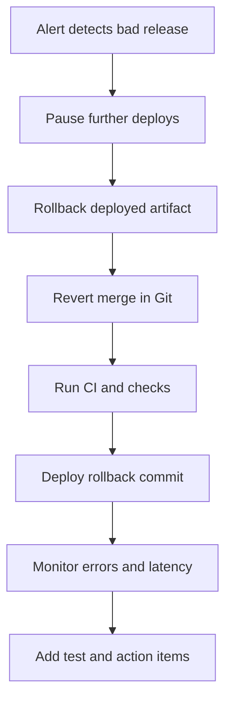
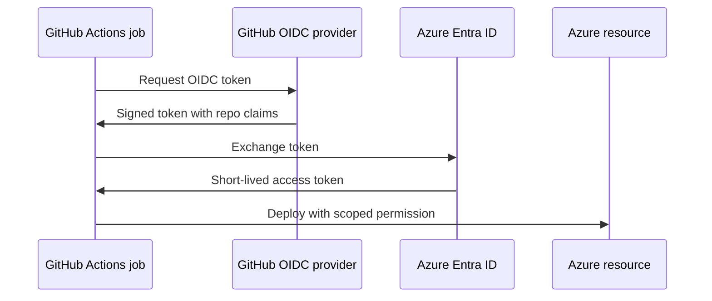
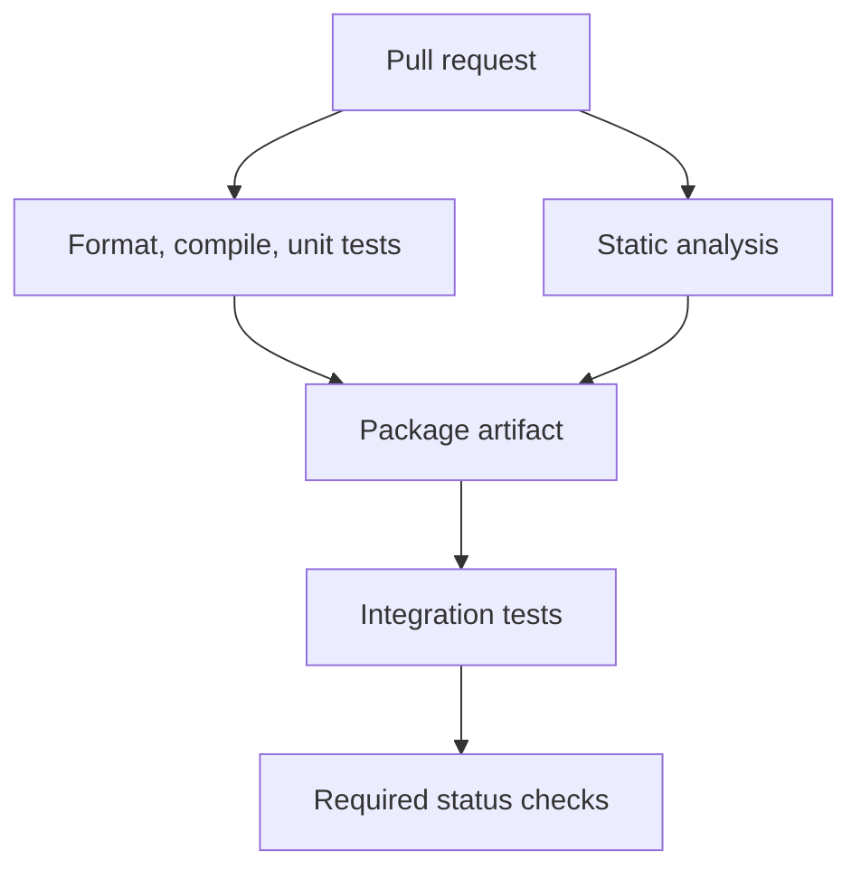
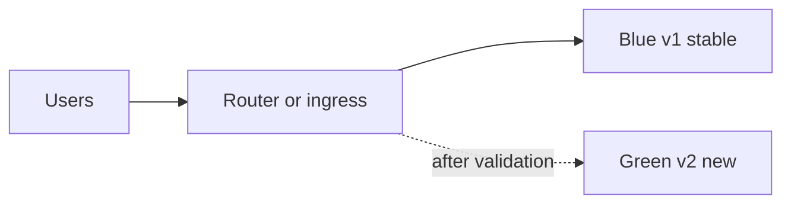
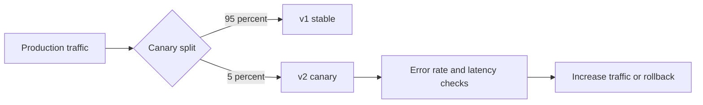
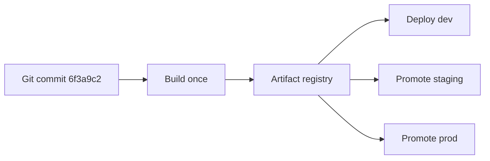
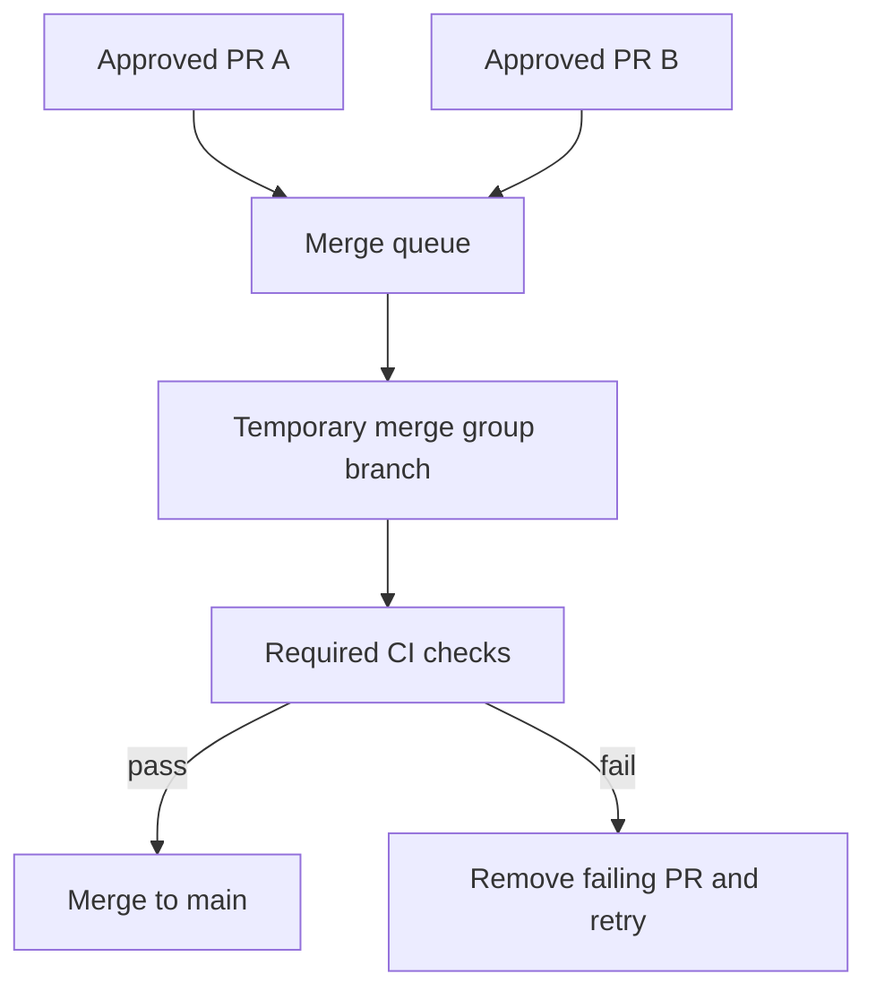
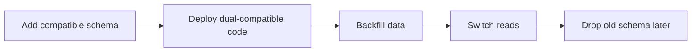

# 13b · Git, GitHub, and CI/CD

This part continues the Git scenario bank and then moves into CI/CD design with GitHub Actions, secure
deployment, dependency automation, and release strategies. The examples use Java 21, Maven, Spring Boot,
GitHub Container Registry, and production-style approvals.

**Legend:** 🟢 Beginner · 🟡 Intermediate · 🔴 Advanced · ⚫ FAANG · 🔥 = very frequently asked

## Table of Contents
- [Section 3 · High-pressure Git scenarios](#section-3--high-pressure-git-scenarios)
- [Section 4 · CI/CD fundamentals and GitHub Actions](#section-4--cicd-fundamentals-and-github-actions)
- [Section 5 · Deployment strategy, security, and artifacts](#section-5--deployment-strategy-security-and-artifacts)
- [Revision Cheat Sheet](#revision-cheat-sheet)
- [Flashcards](#flashcards)

## Section 3 · High-pressure Git scenarios

### Q21. How do you split a large commit into smaller reviewable commits?
`🟡 Intermediate` `🔥` `Must-know SDE-1`

**Why they ask:** A large mixed commit makes review, rollback, and ownership much harder.

**Short answer (say this first, 20-40 sec):**
If the commit is local, reset it while keeping changes in the working tree, then stage hunks into focused
commits. If it is older, use interactive rebase with `edit`, reset that commit, split it, and continue.

**Detailed answer:**
Latest local commit:

```powershell
git reset --mixed HEAD~1
git add -p src/main/java/com/app/EmailController.java
git commit -m "Add email reply REST endpoint"
git add -p src/main/java/com/app/GeminiClient.java
git commit -m "Add Gemini client integration"
git add src/test/java/com/app/*
git commit -m "Add email reply tests"
mvn verify
```

Older commit:

```powershell
git rebase -i origin/main
# mark the large commit as edit
git reset --mixed HEAD~1
git add -p
git commit -m "First logical part"
git add -p
git commit -m "Second logical part"
git rebase --continue
```

`git add -p` lets you stage hunks interactively; use `s` to split a hunk further. The end state should be
commits that each build or at least tell a logical story: API contract, implementation, tests, migration.
If the original commit was pushed and shared, coordinate and push with `--force-with-lease`; otherwise prefer
new cleanup commits rather than surprising reviewers.

**Common mistakes:**
- Splitting into arbitrary file-based commits that do not compile independently.
- Forgetting tests after rewriting commit boundaries.
- Force-pushing a reviewed branch without warning reviewers.

**Follow-ups:**
- *What if one hunk contains two changes?* → Use `git add -p`, choose split, or edit the patch manually.
- *Should every commit compile?* → Ideally yes for bisectability, though some teams allow PR-level correctness.

### Q22. How do you squash commits before opening a pull request?
`🟢 Beginner` `🔥` `Must-know SDE-1`

**Why they ask:** They want clean PR history without losing the ability to work incrementally.

**Short answer (say this first, 20-40 sec):**
Use interactive rebase against the target branch and mark noisy commits as `squash` or `fixup`. Then run
tests and push the rewritten branch with `--force-with-lease` if it already exists remotely.

**Detailed answer:**
Workflow:

```powershell
git fetch origin
git switch feature/email-reply
git rebase -i origin/main
```

Editor:

```text
pick 111aaaa add controller
fixup 222bbbb fix import
squash 333cccc add validation tests
fixup 444dddd spotless formatting
```

After save, Git may open another editor for the combined message. Use a message that explains the final
change, not every experiment:

```text
feat: add AI email reply endpoint

- validate tone and email content
- call Gemini client through service layer
- cover invalid request cases
```

Then:

```powershell
mvn verify
git push --force-with-lease origin feature/email-reply
```

Alternative: let GitHub squash merge the PR and keep branch commits messy. That is acceptable for small
branches, but local squash helps reviewers if there are twenty "fix test" commits. Do not squash after
review if reviewers are relying on commit-by-commit history unless the team expects it.

**Common mistakes:**
- Squashing against stale `main` and then needing another conflict-heavy rebase.
- Using `--force` instead of `--force-with-lease`.
- Creating a vague final message like "changes".

**Follow-ups:**
- *Squash locally or in GitHub?* → Locally improves review history; GitHub squash keeps PR workflow simple.
- *Can you undo a bad squash?* → Usually yes through `git reflog` if done locally.

### Q23. How do you revert a merge commit with `-m 1`?
`🔴 Advanced` `🔥` `Must-know SDE-2`

**Why they ask:** Merge rollback is a common production incident step and `-m` is often misunderstood.

**Short answer (say this first, 20-40 sec):**
A merge commit has multiple parents, so Git needs the mainline parent to keep. `git revert -m 1 <merge-sha>`
usually keeps the target branch parent and creates a new commit that undoes the merged branch changes.

**Detailed answer:**
Inspect the merge:

```powershell
git show --no-patch --pretty=raw 9abc123
# parent 1111111
# parent 2222222
git log --oneline --graph --decorate -5
```

If parent 1 is `main` before the PR and parent 2 is the feature branch:

```powershell
git switch main
git pull --ff-only
git revert -m 1 9abc123
mvn verify
git push origin main
```

`-m 1` means "treat parent 1 as the line we are keeping." The revert commit does not delete the merge
commit; it applies the inverse of the changes introduced by the other side. If you later want to re-merge
the same feature, Git may consider it already merged, so you may need to revert the revert or create a new
branch with new commits. Always identify parents before running the command; parent numbering changes if
the merge direction was unusual.

**Common mistakes:**
- Running `git revert <merge-sha>` without `-m` and getting an error.
- Guessing parent number without reading `git show --pretty=raw`.
- Expecting a later identical PR to merge cleanly without considering the revert.

**Follow-ups:**
- *What is parent 1 normally?* → The branch you were on when the merge commit was created.
- *How reapply later?* → Revert the revert commit or make new commits with the desired changes.

### Q24. Production broke after a bad merge. What is your rollback plan?
`🔴 Advanced` `🔥` `Must-know SDE-2`

**Why they ask:** They are checking whether you separate Git rollback, deployment rollback, and incident control.

**Short answer (say this first, 20-40 sec):**
Stabilize production first: pause rollout or roll back to the last known good artifact. Then revert the bad
merge in Git, run CI, deploy the rollback artifact, monitor metrics, and perform root-cause follow-up.

**Detailed answer:**
A safe sequence:

```powershell
# identify deployed version and bad merge
git log --oneline --merges -5
git show --no-patch --pretty=raw <merge-sha>

# source rollback
git switch main
git pull --ff-only
git revert -m 1 <merge-sha>
mvn verify
git push origin main
```

Deployment rollback may be faster than source rollback. In Kubernetes:

```powershell
kubectl rollout undo deployment/email-reply-api -n prod
kubectl rollout status deployment/email-reply-api -n prod
```

In GitHub Actions, redeploy the previous immutable image tag, not `latest`. After service recovery, create
or link an incident ticket, add a regression test, and check why CI did not catch the issue. Use feature
flags for risky behavior so rollback can be `disable flag` instead of `redeploy`. Communicate status:
impact, mitigation, current version, owner, and next update time.



**Common mistakes:**
- Spending thirty minutes rewriting Git while production remains down.
- Redeploying `latest` and not knowing which image is running.
- Skipping the regression test after rollback.

**Follow-ups:**
- *Rollback vs roll forward?* → Roll back when safe previous artifact exists; roll forward for data migrations that cannot go backward.
- *How do flags help?* → They decouple code deployment from behavior activation.

### Q25. How do you sync your fork with the upstream repository?
`🟢 Beginner` `🔥` `Must-know SDE-1`

**Why they ask:** Fork workflows are common in open-source and enterprise contribution models.

**Short answer (say this first, 20-40 sec):**
Add the original repository as `upstream`, fetch it, update your local main from upstream, push your fork,
then rebase or merge feature branches on the updated base.

**Detailed answer:**
One-time setup:

```powershell
git remote -v
git remote add upstream https://github.com/original/chief.git
git fetch upstream
```

Update fork main:

```powershell
git switch main
git fetch upstream
git merge --ff-only upstream/main
git push origin main
```

Update feature branch:

```powershell
git switch feature/email-reply
git rebase main
mvn verify
git push --force-with-lease origin feature/email-reply
```

If your fork's default branch has diverged because you committed there, create a feature branch for that
work first, then reset fork main to upstream only if safe. In GitHub UI, "Sync fork" performs similar work
for simple cases. In interviews, mention remote names: `origin` is your fork; `upstream` is the source repo.
Do not open PRs from a stale branch if CI failures are caused by old base code.

**Common mistakes:**
- Pulling from `origin/main` and thinking it includes upstream changes.
- Rebasing a branch other contributors are using without coordination.
- Merging upstream into feature repeatedly and creating noisy history.

**Follow-ups:**
- *Should you rebase or merge feature branch?* → Rebase for clean private branches; merge if shared.
- *How list remotes?* → `git remote -v`.

### Q26. You accidentally committed a large file. How do you fix it and when use Git LFS?
`🟡 Intermediate` `🔥` `Must-know SDE-1`

**Why they ask:** Large blobs slow clones and often break repository hosting limits.

**Short answer (say this first, 20-40 sec):**
If the large file is only in the latest local commit, remove it from the index and amend. If it was pushed
or appears in history, rewrite history with `git filter-repo` or BFG. Use Git LFS for legitimate large
binary assets that must be versioned.

**Detailed answer:**
Latest local commit:

```powershell
git rm --cached data\sample-model.bin
notepad .gitignore
git add .gitignore
git commit --amend
```

Already in history:

```powershell
git filter-repo --path data/sample-model.bin --invert-paths
git push --force-with-lease --all origin
git push --force-with-lease --tags origin
```

Use Git LFS when the file is needed but should not be stored as a normal blob:

```powershell
git lfs install
git lfs track "*.onnx"
git add .gitattributes model\reply-ranker.onnx
git commit -m "Track model binaries with Git LFS"
```

LFS stores pointer files in Git and binary content in LFS storage. It is good for models, videos, and design
assets, but not for generated build artifacts that can be recreated. For secrets, do not use LFS; rotate and
purge as a security incident.

**Common mistakes:**
- Removing a large file only from the latest commit while old history still contains it.
- Putting dependency caches or `target/` output into LFS instead of ignoring them.
- Forgetting teammates must re-clone or clean after history rewrite.

**Follow-ups:**
- *Does LFS make clones smaller?* → Yes for normal clone metadata, but checked-out LFS files still download when needed.
- *Can GitHub block large files?* → Yes, hosting providers enforce size warnings and limits.

### Q27. You accidentally ran `git reset --hard`. How do you recover?
`🟡 Intermediate` `🔥` `Must-know SDE-1`

**Why they ask:** They want calm recovery steps after destructive local commands.

**Short answer (say this first, 20-40 sec):**
If the lost work was committed, recover it through `git reflog`. If it was only uncommitted, Git may not
have a full copy; check IDE local history, stash, backups, or filesystem recovery.

**Detailed answer:**
Committed work recovery:

```powershell
git reflog --date=local
# 0a1b2c3 HEAD@{1}: commit: Add HPA manifest
git switch -c rescue-reset 0a1b2c3
git diff main..rescue-reset
```

If reset moved a branch:

```powershell
git reset --hard HEAD@{1}
```

Use this only after reading the reflog entry. If uncommitted files were destroyed, Git cannot always recover
them because `reset --hard` overwrites the working tree and index. Check whether you had stashed:

```powershell
git stash list
```

Then inspect IDE local history, editor backups, or cloud sync version history. The prevention answer is
important: commit WIP before risky operations, use `git status` before reset, prefer `git reset --mixed` if
you only meant to unstage, and use `git clean -n` before deleting untracked files.

**Common mistakes:**
- Running more destructive commands before checking reflog.
- Assuming uncommitted work is always recoverable from Git.
- Resetting to `HEAD@{1}` blindly without checking which operation it represents.

**Follow-ups:**
- *Does reflog track uncommitted changes?* → No, it tracks ref movement; uncommitted changes are not commits.
- *How preview clean?* → `git clean -nd` previews untracked deletions.

### Q28. How do you resolve a rebase conflict safely?
`🟡 Intermediate` `🔥` `Must-know SDE-1`

**Why they ask:** Rebase conflicts are common when keeping PR branches current.

**Short answer (say this first, 20-40 sec):**
During rebase, resolve one replayed commit at a time, stage fixed files, run focused tests when possible,
and continue with `git rebase --continue`. Abort if the result becomes unclear.

**Detailed answer:**
Sequence:

```powershell
git fetch origin
git switch feature/email-reply
git rebase origin/main
# CONFLICT (content): src/main/java/com/app/EmailService.java
git status
```

Inspect context:

```powershell
git diff
git show REBASE_HEAD --stat
```

Resolve the file, then:

```powershell
git add src/main/java/com/app/EmailService.java
mvn -q -Dtest=EmailServiceTest test
git rebase --continue
```

If another conflict appears, repeat. To skip the current commit only when it is truly obsolete:

```powershell
git rebase --skip
```

To abandon:

```powershell
git rebase --abort
```

Remember that in a rebase, "ours" usually refers to the new base and "theirs" to the commit being replayed,
which surprises people used to merges. After a successful rebase, run the full relevant suite and push with
`--force-with-lease` because commit hashes changed.

**Common mistakes:**
- Using `--skip` to escape conflicts and silently dropping required work.
- Forgetting that rebase changes commit hashes.
- Accepting one side without reading the replayed commit.

**Follow-ups:**
- *How see the commit being replayed?* → `git show REBASE_HEAD`.
- *When abort?* → Abort when you cannot confidently preserve intent.

## Section 4 · CI/CD fundamentals and GitHub Actions

### Q29. What stages should a CI/CD pipeline contain?
`🟡 Intermediate` `🔥` `Must-know SDE-1`

**Why they ask:** Backend engineers must understand how code becomes a safe production artifact.

**Short answer (say this first, 20-40 sec):**
A solid pipeline checks out code, restores dependencies, compiles, runs unit and integration tests, performs
static and security analysis, packages an immutable artifact, publishes it, deploys through controlled
environments, and verifies the rollout.

**Detailed answer:**


For a Spring Boot service, `mvn verify` should run tests and quality gates before Docker build. Build once,
promote the same artifact, and tag images with the Git SHA and semantic version. Do not rebuild separately
for staging and production because source or dependencies may drift. CI answers should include failure
behavior: stop on test failure, upload reports, block merging through required checks, and notify owners.
CD answers should include approvals, rollback, environment-specific configuration, and observability.

**Common mistakes:**
- Deploying code that was not tested as the same artifact.
- Putting secrets directly in workflow YAML.
- Treating CI success as production success without smoke tests and monitoring.

**Follow-ups:**
- *CI vs CD?* → CI validates every change; CD delivers validated artifacts to environments.
- *Why immutable artifacts?* → They make rollback and audit possible because the deployed bits are known.

### Q30. Show a full GitHub Actions workflow for a Spring Boot service.
`🔴 Advanced` `🔥` `Must-know SDE-2`

**Why they ask:** YAML fluency reveals whether you have actually wired build, security, image, and deployment.

**Short answer (say this first, 20-40 sec):**
Use separate jobs for verify, CodeQL, image build, and deployment. Cache Maven dependencies, use Java 21,
publish JaCoCo reports, push Docker images to GHCR with immutable tags, and protect production with a
GitHub Environment approval.

**Detailed answer:**

```yaml
name: spring-boot-ci-cd

on:
  pull_request:
    branches: [main]
  push:
    branches: [main]
    tags: ["v*.*.*"]

permissions:
  contents: read
  packages: write
  security-events: write
  id-token: write

env:
  IMAGE_NAME: ghcr.io/${{ github.repository }}/email-reply-api

jobs:
  verify:
    runs-on: ubuntu-latest
    steps:
      - uses: actions/checkout@v4
      - uses: actions/setup-java@v4
        with:
          distribution: temurin
          java-version: "21"
          cache: maven
      - name: Build and test
        run: mvn -B verify
      - name: Upload JaCoCo report
        uses: actions/upload-artifact@v4
        with:
          name: jacoco-report
          path: target/site/jacoco/

  codeql:
    runs-on: ubuntu-latest
    permissions:
      contents: read
      security-events: write
    steps:
      - uses: actions/checkout@v4
      - uses: github/codeql-action/init@v3
        with:
          languages: java-kotlin
      - uses: actions/setup-java@v4
        with:
          distribution: temurin
          java-version: "21"
          cache: maven
      - run: mvn -B -DskipTests package
      - uses: github/codeql-action/analyze@v3

  image:
    needs: [verify, codeql]
    if: github.event_name == 'push'
    runs-on: ubuntu-latest
    steps:
      - uses: actions/checkout@v4
      - uses: docker/login-action@v3
        with:
          registry: ghcr.io
          username: ${{ github.actor }}
          password: ${{ secrets.GITHUB_TOKEN }}
      - uses: docker/metadata-action@v5
        id: meta
        with:
          images: ${{ env.IMAGE_NAME }}
          tags: |
            type=sha,prefix=sha-
            type=ref,event=tag
      - uses: docker/build-push-action@v6
        with:
          context: .
          push: true
          tags: ${{ steps.meta.outputs.tags }}
          labels: ${{ steps.meta.outputs.labels }}

  deploy-prod:
    needs: image
    if: startsWith(github.ref, 'refs/tags/v')
    runs-on: ubuntu-latest
    environment:
      name: production
      url: https://email-reply.example.com
    steps:
      - name: Deploy immutable image
        run: |
          echo "Deploy $IMAGE_NAME:${GITHUB_REF_NAME}"
          echo "Use az webapp config container set or kubectl set image here"
```

Configure `production` under `Settings -> Environments` with required reviewers. In real Azure deployments,
prefer OIDC login instead of long-lived cloud credentials.

**Common mistakes:**
- Running deployment on pull requests from forks with secrets exposed.
- Rebuilding the JAR inside the deploy job instead of promoting the built image.
- Giving `GITHUB_TOKEN` broad permissions at workflow level when only one job needs them.

**Follow-ups:**
- *Why `mvn -B`?* → Batch mode avoids interactive prompts and makes CI logs cleaner.
- *Why tag with SHA?* → It points to exactly one source revision and supports rollback.

### Q31. How do GitHub Actions secrets and OIDC differ?
`🔴 Advanced` `🔥` `Must-know SDE-2`

**Why they ask:** Modern CI/CD security avoids long-lived cloud credentials whenever possible.

**Short answer (say this first, 20-40 sec):**
GitHub Actions secrets store encrypted values and inject them at runtime. OIDC lets GitHub request short-lived
cloud credentials from Azure or AWS based on repository, branch, environment, and workflow claims.

**Detailed answer:**
Secrets are simple:

```yaml
env:
  GEMINI_API_KEY: ${{ secrets.GEMINI_API_KEY }}
```

They are appropriate for third-party tokens that cannot use federation, but they must be rotated and are
dangerous in forked PR contexts. OIDC removes stored cloud passwords. GitHub issues an identity token to
the job; Azure validates claims such as repository and branch, then returns a short-lived access token:

```yaml
permissions:
  id-token: write
  contents: read

steps:
  - uses: azure/login@v2
    with:
      client-id: ${{ vars.AZURE_CLIENT_ID }}
      tenant-id: ${{ vars.AZURE_TENANT_ID }}
      subscription-id: ${{ vars.AZURE_SUBSCRIPTION_ID }}
```

Protect OIDC with environment approvals and federated credential conditions. Do not echo secrets, do not
put them in Docker build args, and do not pass production secrets to PR workflows. For the AI Email Reply
Assistant, the Gemini key belongs in a runtime secret store or GitHub environment secret, not in source,
image layers, or workflow logs.



**Common mistakes:**
- Storing cloud client secrets when OIDC federation is available.
- Printing environment variables during debugging.
- Allowing any branch or workflow to assume production deployment identity.

**Follow-ups:**
- *Are GitHub secrets encrypted?* → Yes at rest, but exposed to jobs that are allowed to read them.
- *Why environment secrets?* → They can require reviewers and differ by staging or production.

### Q32. How do you configure Dependabot for Maven, Docker, and GitHub Actions?
`🟡 Intermediate` `🔥` `Must-know SDE-1`

**Why they ask:** Dependency hygiene is part of secure software delivery.

**Short answer (say this first, 20-40 sec):**
Add `.github/dependabot.yml` with ecosystems for Maven, Docker, and GitHub Actions. Set schedule, reviewers,
labels, grouping where useful, and keep updates small enough for CI and review.

**Detailed answer:**

```yaml
version: 2
updates:
  - package-ecosystem: maven
    directory: "/"
    schedule:
      interval: weekly
    labels: ["dependencies", "java"]
    reviewers: ["org/backend-leads"]
    groups:
      spring-boot:
        patterns:
          - "org.springframework.boot:*"

  - package-ecosystem: docker
    directory: "/"
    schedule:
      interval: weekly
    labels: ["dependencies", "docker"]

  - package-ecosystem: github-actions
    directory: "/"
    schedule:
      interval: weekly
    labels: ["dependencies", "ci"]
```

Dependabot creates PRs; branch protection then forces tests, CodeQL, and reviews. For vulnerable dependencies,
GitHub also raises Dependabot alerts if dependency graph is enabled. Do not auto-merge major upgrades without
tests because Spring Boot, Hibernate, or PostgreSQL drivers can change behavior. For a backend service, add
integration tests around serialization, database migrations, and security filters so dependency PRs are
meaningful rather than blind version bumps.

**Common mistakes:**
- Enabling Dependabot but having no required CI checks.
- Grouping unrelated major upgrades into one risky PR.
- Ignoring action updates even though CI actions execute with repository permissions.

**Follow-ups:**
- *Dependabot vs CodeQL?* → Dependabot finds vulnerable dependencies; CodeQL analyzes code patterns.
- *Can Dependabot update Docker base images?* → Yes, with the Docker ecosystem and Dockerfile directory.

### Q33. How should pull request checks be designed for fast feedback?
`🟡 Intermediate` `🔥` `Must-know SDE-2`

**Why they ask:** Slow pipelines create developer friction and encourage bypassing quality gates.

**Short answer (say this first, 20-40 sec):**
Run fast deterministic checks early, parallelize independent jobs, cache dependencies, and reserve expensive
integration or deployment checks for later stages or changed paths.

**Detailed answer:**
Good PR pipeline design:



For Maven, cache dependencies through `actions/setup-java` and avoid downloading the world every job. Split
jobs by purpose only if they can run in parallel; too many tiny jobs add overhead. Use path filters in a
monorepo so documentation-only changes do not build every service. Upload test reports and coverage even
on failure:

```yaml
- name: Upload test reports
  if: always()
  uses: actions/upload-artifact@v4
  with:
    name: surefire-reports
    path: target/surefire-reports/
```

Make only meaningful checks required. If an optional flaky check blocks merging, engineers lose trust. For
database services, run Testcontainers or a service container on PRs when schema behavior is touched.

**Common mistakes:**
- Putting deployment credentials in PR jobs.
- Running slow end-to-end suites before basic compile errors are caught.
- Marking flaky jobs required without fixing the flakiness.

**Follow-ups:**
- *How speed Maven builds?* → Use dependency cache, module selection, and avoid unnecessary integration tests.
- *What artifacts help debugging?* → Test reports, coverage, logs, and built JAR metadata.

## Section 5 · Deployment strategy, security, and artifacts

### Q34. Compare rolling, blue-green, canary, and feature-flag deployments.
`🔴 Advanced` `🔥` `Must-know SDE-2`

**Why they ask:** Release strategy affects downtime, risk, cost, and rollback speed.

**Short answer (say this first, 20-40 sec):**
Rolling replaces instances gradually, blue-green switches traffic between two full environments, canary
sends a small percentage to the new version first, and feature flags enable behavior independently of deploys.

**Detailed answer:**

| Strategy | How it works | Best for | Rollback |
|---|---|---|---|
| Rolling | Replace pods or VMs batch by batch | Standard stateless services | Roll back deployment |
| Blue-green | Run blue and green stacks, switch router | Near-zero downtime releases | Switch traffic back |
| Canary | Send 1%, 5%, 25%, then 100% traffic | Risky changes needing metrics | Stop and route back |
| Feature flags | Deploy code dark, enable behavior later | Product experiments and kill switches | Disable flag |





For Spring Boot, readiness probes must pass before traffic shifts. Database migrations are the hardest part:
prefer backward-compatible expand-and-contract migrations so old and new versions can run together. Feature
flags should be stored in a managed system or config service, audited, and cleaned up after rollout.

**Common mistakes:**
- Calling a deployment blue-green while both versions share incompatible database changes.
- Canarying without metrics or automatic stop conditions.
- Leaving old feature flags forever and increasing code complexity.

**Follow-ups:**
- *Which is cheapest?* → Rolling usually uses least extra capacity; blue-green often doubles capacity temporarily.
- *Which is fastest rollback?* → Feature flag disable or blue-green traffic switch can be fastest.

### Q35. How should artifacts and versions be managed in CI/CD?
`🟡 Intermediate` `🔥` `Must-know SDE-1`

**Why they ask:** Artifact discipline is what makes deployments reproducible.

**Short answer (say this first, 20-40 sec):**
Build once, assign immutable versions, store artifacts in a registry, and promote the same artifact through
environments. Use Git SHA, semantic version tags, SBOMs, checksums, and release notes for traceability.

**Detailed answer:**
For a Java service, artifacts may include the JAR, Docker image, coverage report, SBOM, and deployment
manifest. Example tags:

```text
ghcr.io/org/email-reply-api:sha-6f3a9c2
ghcr.io/org/email-reply-api:v1.8.0
email-reply-api-1.8.0.jar
```

The anti-pattern is rebuilding in every environment. Instead:



For Maven, set project version intentionally and publish build metadata. For containers, sign images if the
organization supports it and scan vulnerabilities before production. Keep provenance: which commit, workflow
run, actor, dependency versions, and image digest. In rollback, deploy by digest or immutable tag, not branch
name. Retention policies should keep enough artifacts to investigate incidents without paying forever.

**Common mistakes:**
- Deploying `latest` to production with no digest recorded.
- Rebuilding from source during rollback.
- Publishing artifacts before tests complete.

**Follow-ups:**
- *Tag or digest for Kubernetes?* → Digest is most immutable; tag plus recorded digest is common.
- *What is SBOM?* → A software bill of materials listing components and versions.

### Q36. What are required status checks and how do they interact with branch protection?
`🟡 Intermediate` `🔥` `Must-know SDE-1`

**Why they ask:** GitHub governance is only effective when CI checks are correctly required.

**Short answer (say this first, 20-40 sec):**
Required status checks are named CI results that must pass before merging into protected branches. Branch
protection or rulesets bind those checks to `main`, optionally requiring the branch to be up to date first.

**Detailed answer:**
In `Settings -> Branches -> Branch protection rules -> main`, enable "Require status checks to pass before
merging." Select exact checks like:

```text
verify
codeql
image
integration-tests
```

If "Require branches to be up to date" is enabled, GitHub requires the PR head to include the latest base
branch before checks count. That catches breakage caused by interactions with newer main. Merge queue can
replace manual update churn by testing a temporary queue branch that combines pending PRs. In rulesets,
configure equivalent requirements under `Settings -> Rules -> Rulesets`, add branch targets, and define
bypass actors sparingly. For monorepos, be careful with path-filtered workflows: if a required workflow is
skipped and does not report success, PRs can be stuck. Use a lightweight always-running required check or
GitHub's recommended patterns for skipped workflows.

**Common mistakes:**
- Requiring a check name that changed after renaming a workflow job.
- Allowing admins to bypass checks by default.
- Making a path-filtered job required without handling skipped paths.

**Follow-ups:**
- *Status check vs check run?* → GitHub displays both; branch protection requires named successful results.
- *Why up-to-date branch?* → It tests the PR against the current base, not yesterday's base.

### Q37. What is a GitHub merge queue?
`🔴 Advanced` `🔥` `Stretch`

**Why they ask:** High-throughput repositories need protection from "green alone, red together" merges.

**Short answer (say this first, 20-40 sec):**
Merge queue serializes or batches approved PRs, creates temporary combined branches, runs required checks,
and merges only combinations that pass. It reduces broken main when many PRs merge concurrently.

**Detailed answer:**
Without a queue, PR A and PR B can both pass against `main`, but B may fail after A lands. Merge queue tests
the actual merge candidate:



Configure through repository rulesets or branch protection for eligible branches, then require PRs to enter
the queue instead of direct merge. CI workflows must listen to `merge_group` events in addition to
`pull_request`:

```yaml
on:
  pull_request:
  merge_group:
```

Use it for busy repositories with expensive main breakage. It may slow tiny teams because every merge waits
for queued validation. Keep required checks deterministic and reasonably fast; a flaky required check can
block the entire queue.

**Common mistakes:**
- Enabling merge queue but not adding `merge_group` trigger, so checks never run.
- Keeping flaky tests required and stalling all merges.
- Using bypass too broadly and defeating the queue.

**Follow-ups:**
- *Does queue replace reviews?* → No, PR approvals and code owners still apply before queueing.
- *Can it batch PRs?* → Yes, depending on configuration and repository plan/features.

### Q38. How do you deploy with environment approvals in GitHub Actions?
`🟡 Intermediate` `🔥` `Must-know SDE-2`

**Why they ask:** Production deploys often require human approval and environment-specific secrets.

**Short answer (say this first, 20-40 sec):**
Define a GitHub Environment such as `production`, add required reviewers and secrets, and reference that
environment in the deployment job. The job pauses until approval before accessing environment secrets.

**Detailed answer:**
Repository setup: `Settings -> Environments -> New environment -> production`. Add required reviewers, wait
timer if desired, deployment branch restrictions, and environment secrets like `APP_SERVICE_NAME`. Workflow:

```yaml
deploy-production:
  needs: image
  runs-on: ubuntu-latest
  if: startsWith(github.ref, 'refs/tags/v')
  environment:
    name: production
    url: https://email-reply.example.com
  permissions:
    id-token: write
    contents: read
  steps:
    - uses: azure/login@v2
      with:
        client-id: ${{ vars.AZURE_CLIENT_ID }}
        tenant-id: ${{ vars.AZURE_TENANT_ID }}
        subscription-id: ${{ vars.AZURE_SUBSCRIPTION_ID }}
    - name: Deploy image
      run: |
        az webapp config container set \
          --name "${{ vars.APP_SERVICE_NAME }}" \
          --resource-group "${{ vars.RESOURCE_GROUP }}" \
          --container-image-name "${{ needs.image.outputs.image }}"
```

Use environments to separate staging and production credentials. For regulated teams, require different
reviewers from the PR author. Approvals should gate deployment, not basic CI verification.

**Common mistakes:**
- Storing production secrets as repository-wide secrets available to all workflows.
- Triggering production deploys from every push to main with no approval.
- Forgetting branch restrictions for the production environment.

**Follow-ups:**
- *When are environment secrets available?* → After the job is approved and starts.
- *Can environments show URLs?* → Yes, the deployment URL appears in GitHub UI.

### Q39. How do you handle database migrations in CI/CD?
`🔴 Advanced` `🔥` `Must-know SDE-2`

**Why they ask:** Many safe application rollbacks fail because schema changes were not backward compatible.

**Short answer (say this first, 20-40 sec):**
Use versioned migrations, test them in CI, and design production changes as expand-and-contract. Add nullable
columns first, deploy compatible code, backfill, then remove old columns in a later release.

**Detailed answer:**
With Flyway or Liquibase, migrations live in source control:

```text
V2026_09_23_001__add_reply_language.sql
V2026_09_24_001__backfill_reply_language.sql
```

PostgreSQL example:

```sql
ALTER TABLE email_reply ADD COLUMN language varchar(16);
UPDATE email_reply SET language = 'en' WHERE language IS NULL;
ALTER TABLE email_reply ALTER COLUMN language SET DEFAULT 'en';
```

Do not combine "rename column and deploy code that only reads new column" in one irreversible step. Safer:
add new column, write both old and new if needed, backfill, read new, then drop old after all running versions
are updated. CI should run migrations against an empty database and a representative previous schema. In
Kubernetes rolling deploys, old and new pods overlap, so schema must support both. Rollback plans must state
whether the database change is reversible.



**Common mistakes:**
- Dropping or renaming columns in the same release that first changes application code.
- Running migrations manually without audit or repeatability.
- Assuming application rollback automatically rolls back data.

**Follow-ups:**
- *Should migrations run in app startup?* → Acceptable for small services, but controlled migration jobs are safer at scale.
- *How test rollback?* → Practice restoring previous artifact against migrated schema in staging.

### Q40. What is the difference between GitHub Actions artifacts, caches, and packages?
`🟡 Intermediate` `🔥` `Must-know SDE-1`

**Why they ask:** Misusing storage types causes slow builds, missing reports, or unreproducible releases.

**Short answer (say this first, 20-40 sec):**
Artifacts are workflow outputs like test reports, caches speed future runs with dependency data, and packages
are versioned distributable artifacts such as container images or libraries.

**Detailed answer:**

| Type | Purpose | Example | Retention mindset |
|---|---|---|---|
| Artifact | Pass or inspect workflow output | JaCoCo report, JAR from run | Keep for debugging and audit |
| Cache | Speed repeated builds | Maven repository cache | Can be deleted and rebuilt |
| Package | Published deliverable | GHCR Docker image | Versioned release asset |

Artifact:

```yaml
- uses: actions/upload-artifact@v4
  with:
    name: jacoco-report
    path: target/site/jacoco/
```

Cache through setup-java:

```yaml
- uses: actions/setup-java@v4
  with:
    distribution: temurin
    java-version: "21"
    cache: maven
```

Package publish to GHCR uses Docker login and build-push actions. Do not deploy from a cache; caches are
mutable optimization. Do not use artifacts as a long-term container registry. A production deployment should
reference a package tag or digest, while a failed PR investigation might download artifacts containing logs
and reports.

**Common mistakes:**
- Treating cache hits as correctness requirements.
- Letting artifacts expire before release audits need them.
- Publishing images without immutable tags.

**Follow-ups:**
- *Can artifacts pass between jobs?* → Yes, upload in one job and download in another.
- *Can caches be poisoned?* → Poor key design can restore wrong data; use lockfile or OS-specific keys.

## Revision Cheat Sheet
- Split commits with `git reset --mixed` and `git add -p`; squash noisy history with interactive rebase.
- Public rollback uses `git revert`, including `git revert -m 1 <merge>` for merge commits.
- Deployment rollback and Git rollback are different; restore the last known good artifact first if production is down.
- Sync forks with `upstream`, then update feature branches by rebase or merge according to sharing.
- Use Git LFS for legitimate large binaries, not secrets or generated build output.
- Pipeline flow: compile, test, analyze, package, publish, deploy, verify.
- GitHub Actions for Java should use setup-java 21, Maven cache, `mvn verify`, CodeQL, GHCR publishing, and protected environments.
- Prefer OIDC for cloud deployment credentials; secrets are runtime values, not source or image content.
- Deployment strategies: rolling for normal stateless services, blue-green for fast traffic switch, canary for risk-based rollout, flags for behavior control.
- Build once and promote immutable artifacts tagged by SHA, semantic version, and ideally digest.

## Flashcards
- Q: Split latest commit? → `git reset --mixed HEAD~1`, then `git add -p`.
- Q: Revert merge commit keeping mainline parent? → `git revert -m 1 <merge-sha>`.
- Q: Sync fork remote name? → Usually `upstream` for the original repository.
- Q: Recover from bad hard reset? → Use `git reflog` if the work was committed.
- Q: CI command for Maven verification? → `mvn -B verify`.
- Q: GitHub trigger for merge queue? → `merge_group`.
- Q: Safer cloud auth than stored secrets? → OIDC federation.
- Q: Production deploy approval feature? → GitHub Environments with required reviewers.
- Q: Container registry in GitHub? → GHCR, `ghcr.io`.
- Q: Artifact vs cache? → Artifact is output; cache is rebuildable speed optimization.
- Q: Best image rollback identifier? → Immutable digest or SHA tag.
- Q: Database migration pattern? → Expand, deploy compatible code, backfill, contract later.
