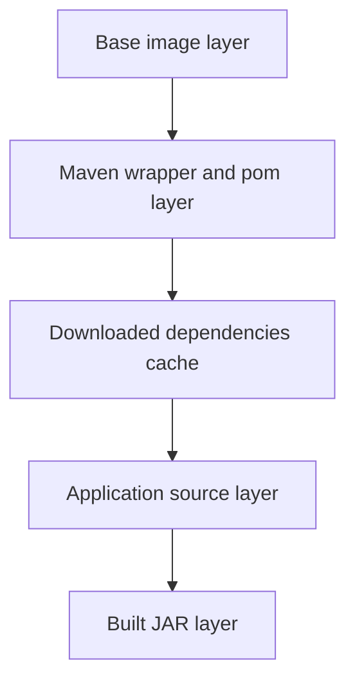
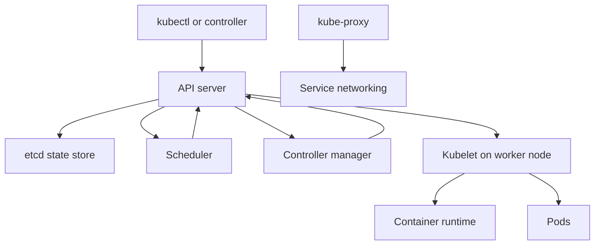

# 14a · Docker, Kubernetes, and Cloud

This part focuses on container fundamentals, production-grade Dockerfiles, Docker Compose, JVM behavior in
containers, debugging, and the first half of Kubernetes. Examples are tied to a Spring Boot AI Email Reply
Assistant using PostgreSQL with pgvector, Redis, and a Gemini API key supplied securely at runtime.

**Legend:** 🟢 Beginner · 🟡 Intermediate · 🔴 Advanced · ⚫ FAANG · 🔥 = very frequently asked

## Table of Contents
- [Beginner guide to this file](#beginner-guide-to-this-file)
- [Section 1 · Docker fundamentals](#section-1--docker-fundamentals)
- [Section 2 · Production Docker for Spring Boot](#section-2--production-docker-for-spring-boot)
- [Section 3 · Docker Compose and debugging](#section-3--docker-compose-and-debugging)
- [Section 4 · Kubernetes foundations](#section-4--kubernetes-foundations)
- [Revision Cheat Sheet](#revision-cheat-sheet)
- [Flashcards](#flashcards)

## Beginner guide to this file

### What this file teaches

This file teaches how a Java backend application moves from source code to a running service: build a Docker
image, run one or more containers, connect databases and caches, then hand the same packaged application to
Kubernetes. Interviewers ask these topics because production backend work is not only writing controllers and
repositories; it is also understanding why the service starts, finds configuration, connects through networking,
keeps data outside the container, survives restarts, and rolls out safely.

### Mental model

Think of deployment like sending a food truck to a city. The recipe is your code, the packed truck is the image,
the open truck serving customers is the container, and Kubernetes is the city operations team that parks trucks,
checks health, replaces broken trucks, and routes customers to them.

- Image: the read-only package containing the Java runtime, application artifact, and startup metadata.
- Container: a running process created from an image with its own writable layer, network view, and limits.
- Layer: a reusable build step, so stable dependencies should be copied before frequently changing source code.
- Network: the path containers and Pods use to reach each other by name, port, Service, or ingress rule.
- Storage: persistent data belongs in volumes, databases, or managed services, not inside a disposable container.
- Control loop: Kubernetes repeatedly compares desired state with actual state and repairs drift.

### How to think through any question here

1. Start with the deployment flow: code becomes a build artifact, artifact becomes an image, image becomes a
   container, and containers become Pods behind Services.
2. Decide what must be baked into the image and what must be supplied at runtime, especially configuration and
   secrets.
3. Separate disposable compute from durable state: logs, caches, databases, and uploads need explicit storage or
   external services.
4. Trace the network path: browser or caller to load balancer, ingress, Service, Pod port, and downstream database
   or cache.
5. Ask how the platform detects failure: process exit, probe failure, resource pressure, or missing dependency.
6. Explain the control loop: desired replicas, actual Pods, scheduling, health checks, rollout, and rollback.
7. Add production safeguards: resource requests, limits, image scanning, least privilege, observability, and
   repeatable continuous integration and delivery.

### Pattern recognition cues

| If the question mentions... | Think about... | Why it fits |
|---|---|---|
| Image versus container | Package versus running process | Most Docker reasoning starts with this distinction. |
| Slow Docker builds | Layer order, build context, and cache invalidation | Copying source too early destroys useful dependency cache. |
| Secrets or API keys | Runtime injection, Secret stores, and avoiding image history | Anything baked into an image can spread through registries and caches. |
| Compose services cannot connect | Service names, networks, ports, and readiness | Compose gives internal DNS names, but startup order is not readiness. |
| Data disappears after restart | Volumes, bind mounts, and managed databases | Container writable layers are temporary by design. |
| Java memory in containers | JVM container awareness, requests, limits, and OOM risk | The Java Virtual Machine must fit inside container memory limits. |
| Kubernetes keeps recreating Pods | Desired state, ReplicaSets, Deployments, and health probes | Control loops replace failed or outdated Pods. |
| Exposing a service | ClusterIP, NodePort, LoadBalancer, Ingress, and DNS | Different Service types solve different traffic paths. |
| Rollout or rollback | Deployment strategy, readiness, and revision history | Kubernetes only shifts traffic safely when new Pods become ready. |
| Autoscaling | Metrics, requests, Horizontal Pod Autoscaler, and cold starts | Scaling depends on measured load and enough cluster capacity. |

### Abbreviations and key terms

| Short form | Expanded form | Plain meaning |
|---|---|---|
| AI | Artificial Intelligence | Software that uses models or algorithms to perform tasks that seem intelligent. |
| AKS | Azure Kubernetes Service | Microsoft's managed Kubernetes service. |
| API | Application Programming Interface | A contract that lets one program call another program. |
| ARG | Argument | A Docker build-time variable available while building an image. |
| CI | Continuous Integration | Automatically building and testing changes after code is pushed. |
| CI/CD | Continuous Integration and Continuous Delivery or Deployment | The pipeline that builds, tests, publishes, and releases software. |
| CLI | Command-Line Interface | A tool operated by typed commands, such as docker or kubectl. |
| CMD | Command | Docker metadata for the default command a container runs. |
| CNAME | Canonical Name | A Domain Name System alias from one host name to another. |
| CPU | Central Processing Unit | Compute capacity used by a process or container. |
| CSI | Container Storage Interface | The Kubernetes plug-in standard for storage providers. |
| CVE | Common Vulnerabilities and Exposures | A public identifier for a known security vulnerability. |
| DNS | Domain Name System | The naming system that turns service names into network addresses. |
| ENV | Environment | A Docker runtime environment variable stored in image metadata or set at run time. |
| FAANG | Facebook, Amazon, Apple, Netflix, Google | A shorthand for large product-company interview style. |
| GC | Garbage Collection | Automatic memory cleanup by the Java Virtual Machine. |
| GHCR | GitHub Container Registry | GitHub's registry for storing container images. |
| HPA | Horizontal Pod Autoscaler | A Kubernetes controller that changes Pod replica count from metrics. |
| HTTP | Hypertext Transfer Protocol | The common protocol used by web clients and services. |
| HTTPS | Hypertext Transfer Protocol Secure | HTTP protected with Transport Layer Security encryption. |
| IDE | Integrated Development Environment | A coding tool such as IntelliJ IDEA or Visual Studio Code. |
| IP | Internet Protocol | The addressing protocol used to route network packets. |
| JAR | Java Archive | A packaged Java application or library file. |
| JDK | Java Development Kit | Tools and runtime needed to compile and build Java code. |
| JRE | Java Runtime Environment | Runtime needed to run Java applications. |
| JSON | JavaScript Object Notation | A text format commonly used for configuration and APIs. |
| JVM | Java Virtual Machine | The runtime that executes Java bytecode. |
| KEDA | Kubernetes Event-Driven Autoscaling | A scaler that can react to queues, events, and external metrics. |
| L4 | Layer 4 | Transport-layer networking such as Transmission Control Protocol ports. |
| LB | Load Balancer | A component that spreads traffic across healthy backends. |
| NAT | Network Address Translation | Rewriting network addresses so traffic can move between networks. |
| NGINX | Engine X | A common web server, reverse proxy, and ingress controller. |
| OOM | Out Of Memory | A condition where a process exceeds available memory and may be killed. |
| OS | Operating System | The system software that manages processes, files, and networking. |
| PID | Process Identifier | A number identifying a running process; PID 1 is the first process in a container. |
| QoS | Quality of Service | Kubernetes Pod classification based on requests and limits. |
| RBAC | Role-Based Access Control | Permissions assigned through roles and bindings. |
| SBOM | Software Bill of Materials | A list of components included in a software artifact or image. |
| SDE-1 | Software Development Engineer level 1 | Entry-level software engineering role. |
| SDE-2 | Software Development Engineer level 2 | Mid-level software engineering role. |
| SIGKILL | Signal Kill | A forced operating-system signal that immediately stops a process. |
| SIGTERM | Signal Terminate | A graceful termination signal a process can handle before shutdown. |
| TCP | Transmission Control Protocol | A reliable transport protocol used by many services. |
| TLS | Transport Layer Security | Encryption used to protect network traffic. |
| URL | Uniform Resource Locator | A web address. |
| VCS | Version Control System | A tool such as Git that stores code history. |
| VPA | Vertical Pod Autoscaler | A Kubernetes component that recommends or changes Pod resource sizes. |
| YAML | YAML Ain't Markup Language | A human-readable configuration format used by Kubernetes. |
| entrypoint | Container startup program | The executable Docker starts as the main container process. |
| layer | Image filesystem step | A reusable filesystem change produced by a Docker build instruction. |
| probe | Health check | A Kubernetes test that decides whether a container is alive, ready, or started. |
| registry | Image repository service | A place such as GitHub Container Registry where images are pushed and pulled. |
| rollout | Controlled release | Replacing old Pods with new Pods while keeping the service available. |

### Common beginner traps

- Saying containers are tiny virtual machines instead of isolated processes created from images.
- Putting passwords, API keys, or local environment files into the image or build context.
- Treating Docker Compose startup order as proof that PostgreSQL, Redis, or the API is ready.
- Debugging Kubernetes by checking only the Pod and forgetting Events, Service selectors, and container logs.
- Setting CPU and memory limits without understanding how Java heap, native memory, and probes interact.
- Exposing every service with a public load balancer instead of using internal Services and ingress routing.
- Forgetting that rolling updates depend on readiness probes; traffic can reach broken Pods without them.

### How to study this file

1. Read each short answer until you can say the deployment flow aloud in 30 seconds.
2. Use the detailed answer to draw the concrete path from image build to container run to Kubernetes Pod.
3. Turn every Dockerfile, Compose file, and Kubernetes manifest into a checklist: build, configure, connect,
   secure, observe, and recover.
4. Practice the flashcards after each section, but always add one real example from the email reply service.
5. For active practice, intentionally break one thing at a time: bad port, missing Secret, failing probe, wrong
   Service selector, or too-low memory limit.
6. Revisit the cheat sheet last and explain why each command helps diagnose a specific layer of the stack.

### Scalability and production lens

A toy deployment can run one container on a laptop with a hard-coded environment variable and manual restarts.
A production deployment uses a versioned image in a registry, injects configuration and secrets at runtime, runs
multiple Pods with resource requests, exposes them through Services and ingress, stores state in managed
databases or volumes, and lets Kubernetes control loops replace unhealthy Pods. Scaling also changes the answer:
you must consider cache warmup, connection pools, probe timing, graceful shutdown, image vulnerability scanning,
centralized logs, metrics, rollbacks, and whether the cluster has enough nodes for the requested replicas.

## Section 1 · Docker fundamentals

### Q1. What is the difference between a Docker image and a container?
`🟢 Beginner` `🔥` `Must-know SDE-1`

**Why they ask:** This is the base mental model for every Docker deployment question.

**Beginner lens:** An image is like a sealed lunchbox recipe: it contains the files, Java runtime, and startup instructions. A container is someone opening that lunchbox and actually eating from it, meaning a live process with a temporary writable layer, environment variables, networking, and limits. Interviewers are testing whether you know deployment starts from an immutable package but production state must live elsewhere. In a real flow, build the image, push it to a registry, run a container or Pod from that image, inject configuration, and recreate it when the image changes.

**Short answer (say this first, 20-40 sec):**
An image is an immutable packaged filesystem plus metadata. A container is a running instance of an image
with its own writable layer, process namespace, network namespace, environment, and resource limits.

**Detailed answer:**
Think of an image as a class and a container as an object instance, but with operating-system isolation.
An image for the AI Email Reply Assistant may contain a JRE, the Spring Boot application, and an entrypoint.
When you run it, Docker creates a container with a writable layer for logs or temporary files, connects it
to a network, injects environment variables such as `GEMINI_API_KEY`, and starts PID 1.

```powershell
docker build -t email-reply-api:dev .
docker run --rm -p 8080:8080 `
  -e GEMINI_API_KEY=replace-at-runtime `
  email-reply-api:dev
docker ps
# CONTAINER ID   IMAGE                 PORTS                    NAMES
# a12bc34d56ef   email-reply-api:dev   0.0.0.0:8080->8080/tcp   upbeat_api
```

Deleting a container does not delete the image. Rebuilding an image does not automatically update already
running containers; you must recreate them. Store application state in databases, volumes, or external
services, not in the container writable layer.

**Common mistakes:**
- Treating containers as lightweight virtual machines and SSHing into them for permanent changes.
- Baking runtime secrets into the image.
- Expecting a running container to update after `docker build`.

**Follow-ups:**
- *Is a container immutable?* → The image is immutable; the running container has a temporary writable layer.
- *What is PID 1?* → The first process in the container; its signal handling affects graceful shutdown.

### Q2. How do Docker layers and build cache work?
`🟡 Intermediate` `🔥` `Must-know SDE-1`

**Why they ask:** Good Dockerfiles build faster and produce repeatable artifacts.

**Beginner lens:** Layers are like transparent sheets stacked to make the final image. Docker can reuse an unchanged sheet, so stable steps such as installing dependencies should appear before volatile source code. The key distinction is build-time filesystem history versus runtime container state. Recognize this question when builds are slow, images are huge, or continuous integration keeps downloading Maven dependencies. The practical flow is copy dependency descriptors, cache dependency download, copy source, build the Java Archive (JAR), then copy only runtime output into the final image.

**Short answer (say this first, 20-40 sec):**
Each Dockerfile instruction creates a layer or metadata step. Docker reuses cached layers when the instruction
and files it depends on have not changed, so copy dependency manifests before frequently changing source code.

**Detailed answer:**
For Maven, copying `pom.xml` before `src` lets dependency download cache survive code edits:

```dockerfile
FROM eclipse-temurin:21-jdk AS build
WORKDIR /workspace
COPY mvnw pom.xml ./
COPY .mvn .mvn
RUN ./mvnw -B -q dependency:go-offline
COPY src src
RUN ./mvnw -B package -DskipTests
```

If you instead `COPY . .` before dependency download, every source edit invalidates the dependency layer.
Layer order should go from least frequently changing to most frequently changing: base image, OS packages,
dependency descriptors, source, build command. Cache is content-based for copied files, not just timestamp.



Use `.dockerignore` to keep `target/`, `.git/`, and secrets out of build context; otherwise unrelated files
can invalidate cache and leak data to the daemon. In CI, BuildKit cache exporters can persist cache across runs.

**Common mistakes:**
- Copying the whole repository before resolving dependencies.
- Letting `.git` and `target` enter the build context.
- Using `latest` base images without controlling rebuild timing.

**Follow-ups:**
- *Does `RUN apt-get update` cache forever?* → It can; combine update and install, and rebuild intentionally.
- *What invalidates a `COPY` layer?* → Changes in any file included by that `COPY` instruction.

### Q3. What should a good `.dockerignore` contain?
`🟢 Beginner` `🔥` `Must-know SDE-1`

**Why they ask:** Build context mistakes cause slow builds and accidental secret exposure.

**Beginner lens:** .dockerignore is the packing list for what Docker is not allowed to send into the build context. Think of it like excluding personal papers before shipping a box to a warehouse. The interviewer wants you to connect performance and security: fewer files mean faster builds, less cache invalidation, and less chance of leaking .env files, Git history, or generated artifacts. When a build behaves differently in continuous integration, check whether local target files, secrets, or editor folders accidentally entered the context.

**Short answer (say this first, 20-40 sec):**
`.dockerignore` excludes files from the build context before Docker sends them to the daemon. Ignore build
outputs, VCS metadata, IDE files, local environment files, logs, and large datasets not needed to build.

**Detailed answer:**
Example for a Spring Boot repository:

```dockerignore
.git
.github
.idea
.vscode
target
*.log
.env
.env.*
!.env.example
node_modules
coverage
Dockerfile*
docker-compose*.yml
README.md
```

Be careful with excluding `Dockerfile` or Compose files if your build process actually copies them for
documentation; otherwise it is usually fine. The critical entries are `.env`, `.git`, and `target`. `.env`
may contain the Gemini API key; `.git` can include secret history; `target` makes context huge and may hide
whether the Dockerfile really builds from source. Verify context size:

```powershell
docker build --progress=plain -t email-reply-api:dev .
# transferring context: 45.2kB
```

`.dockerignore` syntax is similar to `.gitignore` but evaluated by Docker for build context only. It does
not stop files from being copied if they are generated inside the image during `RUN`.

**Common mistakes:**
- Assuming `.gitignore` automatically applies to Docker builds.
- Sending `.env` to the build context and then relying on not copying it.
- Ignoring `mvnw` or `.mvn` and breaking reproducible builds.

**Follow-ups:**
- *Does `.dockerignore` affect runtime mounts?* → No, it only affects build context.
- *Why ignore `target`?* → Build inside the image should be clean and cache-controlled.

### Q4. What is the difference between `ARG` and `ENV`?
`🟢 Beginner` `🔥` `Must-know SDE-1`

**Why they ask:** Misusing build-time and runtime configuration often leaks secrets.

**Beginner lens:** ARG is a build-time knob; ENV is runtime configuration stored in the image metadata or supplied when the container starts. A useful analogy is a factory setting versus a switch on the finished product. Use ARG for non-secret build choices, such as a version label, and ENV for values the application reads at startup, such as Spring profiles. The interviewer is testing whether you avoid putting secrets into either Dockerfile history or final image metadata. In production, inject secrets through orchestrator mechanisms, not ARG or baked ENV values.

**Short answer (say this first, 20-40 sec):**
`ARG` is available only during image build unless copied into `ENV`. `ENV` becomes part of the image metadata
and is available at container runtime, so neither should be used for sensitive secrets.

**Detailed answer:**
Example:

```dockerfile
ARG APP_VERSION=dev
ENV SPRING_PROFILES_ACTIVE=prod
LABEL org.opencontainers.image.version=$APP_VERSION
```

Build:

```powershell
docker build --build-arg APP_VERSION=1.4.0 -t email-reply-api:1.4.0 .
docker inspect email-reply-api:1.4.0
```

Use `ARG` for non-secret build choices such as application version, optional module, or package mirror. Use
`ENV` for safe defaults such as `SERVER_PORT=8080` or `JAVA_TOOL_OPTIONS=-XX:MaxRAMPercentage=75`. Do not
pass `GEMINI_API_KEY` as `ARG`; build args may appear in build history or provenance. Do not bake it as
`ENV`; it becomes visible through image inspection or derived images. Inject secrets at runtime through
orchestrator secrets, environment variables from a secure store, or mounted files.

**Common mistakes:**
- Treating `ARG` as secret because it disappears after build stages.
- Setting production credentials with `ENV` in the Dockerfile.
- Expecting `ARG` values to be available when the container starts.

**Follow-ups:**
- *Can `ENV` use `ARG`?* → Yes, but then the value persists in the final image.
- *Where put runtime config?* → In deployment manifests, secret stores, or environment-specific config.

### Q5. How should secrets be handled in Docker for the Gemini API key?
`🟡 Intermediate` `🔥` `Must-know SDE-1`

**Why they ask:** Container images are widely copied, so secret leakage becomes severe.

**Beginner lens:** A secret is not just a string; it is a value whose copies must be controlled. Treat the Gemini Application Programming Interface (API) key like a house key: do not glue it to the Docker image, place it in Git, or print it in logs. The mental model is runtime retrieval, not build-time packaging. In a deployment flow, the image is generic, the container receives a reference or mounted secret when it starts, and rotation happens outside the image. Interviewers listen for least privilege, auditability, and safe failure behavior.

**Short answer (say this first, 20-40 sec):**
Never put the Gemini API key in the Dockerfile, image layers, Compose file committed to Git, or build args.
Inject it at runtime from an environment variable, Docker secret, Kubernetes Secret, Azure Key Vault, or
GitHub Actions environment secret.

**Detailed answer:**
Local development:

```powershell
docker run --rm -p 8080:8080 `
  --env-file .env.local `
  email-reply-api:dev
```

`.env.local` must be ignored and never committed. Docker Swarm secret style:

```powershell
printf "actual-key" | docker secret create gemini_api_key -
```

Compose can reference an external secret:

```yaml
services:
  app:
    image: email-reply-api:dev
    secrets:
      - gemini_api_key
secrets:
  gemini_api_key:
    external: true
```

BuildKit secret for private dependency download, not for application runtime:

```dockerfile
RUN --mount=type=secret,id=maven_settings,target=/root/.m2/settings.xml \
    ./mvnw -B package -DskipTests
```

```powershell
docker build --secret id=maven_settings,src=.m2\settings.xml .
```

If a key was built into an image, rotate it. Deleting the image locally is not enough because registry layers
and CI logs may still contain it.

**Common mistakes:**
- Using `ARG GEMINI_API_KEY` during build.
- Committing `.env` beside `docker-compose.yml`.
- Logging the full environment in startup diagnostics.

**Follow-ups:**
- *Is base64 encryption?* → No, base64 is encoding; use a real secret store and access controls.
- *Can Spring read env vars?* → Yes, map `${GEMINI_API_KEY}` in configuration or read through properties.

### Q6. What is the difference between `CMD` and `ENTRYPOINT`?
`🟢 Beginner` `🔥` `Must-know SDE-1`

**Why they ask:** Startup command design affects overridability, signal handling, and production operations.

**Beginner lens:** ENTRYPOINT is the main executable the container is meant to run; CMD is the default argument list that can be overridden. Think of ENTRYPOINT as choosing the app and CMD as choosing the default mode. This matters when containers need predictable startup in Kubernetes but still allow local debugging or alternate commands. The interviewer is checking whether you can design images that behave consistently under docker run, Compose, and Pods. In production, pair this with correct signal handling so the Java process shuts down gracefully on rollout.

**Short answer (say this first, 20-40 sec):**
`ENTRYPOINT` defines the executable that normally always runs. `CMD` provides default arguments that can be
overridden at `docker run` time. Use exec form to ensure signals reach the Java process.

**Detailed answer:**
Recommended pattern:

```dockerfile
ENTRYPOINT ["java"]
CMD ["-jar", "/app/app.jar"]
```

Or for fixed app startup:

```dockerfile
ENTRYPOINT ["java", "-jar", "/app/app.jar"]
```

Exec form is important. Shell form like `ENTRYPOINT java -jar app.jar` starts a shell as PID 1, which can
handle signals poorly. Kubernetes sends SIGTERM before killing pods; Java must receive it so Spring Boot can
stop accepting traffic and close resources. Override examples:

```powershell
docker run email-reply-api:dev --spring.profiles.active=local
docker run --entrypoint sh email-reply-api:dev
```

Use `ENTRYPOINT` for the stable executable and `CMD` for defaults. For debug shells, overriding entrypoint
is acceptable locally, but production images should not rely on manual shell fixes.

**Common mistakes:**
- Using shell form and then wondering why graceful shutdown fails.
- Putting environment-specific config into the startup command instead of deployment config.
- Assuming `docker run image echo hi` overrides entrypoint; it overrides CMD arguments.

**Follow-ups:**
- *Can both be used together?* → Yes, CMD becomes default arguments to ENTRYPOINT.
- *Why PID 1 matters?* → It receives signals and handles orphaned child processes.

## Section 2 · Production Docker for Spring Boot

### Q7. Write a production multi-stage Dockerfile for Spring Boot.
`🔴 Advanced` `🔥` `Must-know SDE-2`

**Why they ask:** A production Dockerfile reveals build cache, runtime hardening, health checks, and Java knowledge.

**Beginner lens:** A multi-stage Dockerfile is a clean assembly line: one stage has heavy build tools, and the final stage contains only what is needed to run. The key distinction is build environment versus runtime environment. Recognize this when the question asks for smaller images, fewer vulnerabilities, or repeatable Java builds. A production flow compiles and tests in the build stage, extracts or copies the artifact, runs as a non-root user in the runtime stage, sets sane Java options, and lets configuration arrive from the orchestrator.

**Short answer (say this first, 20-40 sec):**
Use a JDK build stage and a smaller JRE runtime stage. Resolve dependencies before copying source, extract
Spring Boot layers with layertools, run as a non-root user, expose the service port, and add a health check.

**Detailed answer:**

```dockerfile
# syntax=docker/dockerfile:1.7
FROM eclipse-temurin:21-jdk AS build
WORKDIR /workspace
COPY mvnw pom.xml ./
COPY .mvn .mvn
RUN ./mvnw -B -q dependency:go-offline
COPY src src
RUN ./mvnw -B package -DskipTests
RUN java -Djarmode=layertools -jar target/*.jar extract --destination layers

FROM eclipse-temurin:21-jre AS runtime
WORKDIR /app
RUN groupadd --system app && useradd --system --gid app app
COPY --from=build /workspace/layers/dependencies/ ./
COPY --from=build /workspace/layers/spring-boot-loader/ ./
COPY --from=build /workspace/layers/snapshot-dependencies/ ./
COPY --from=build /workspace/layers/application/ ./
ENV JAVA_TOOL_OPTIONS="-XX:MaxRAMPercentage=75 -XX:+ExitOnOutOfMemoryError"
EXPOSE 8080
USER app
HEALTHCHECK --interval=30s --timeout=3s --start-period=40s --retries=3 \
  CMD wget -qO- http://127.0.0.1:8080/actuator/health/readiness || exit 1
ENTRYPOINT ["java", "org.springframework.boot.loader.launch.JarLauncher"]
```

Spring Boot 3 uses the `org.springframework.boot.loader.launch.JarLauncher` package. Health check requires
Actuator and the readiness endpoint exposed. Some minimal JRE images may not include `wget`; then either
install a tiny client, use a distroless-compatible probe at orchestration level, or rely on Kubernetes probes.

**Common mistakes:**
- Running the app as root.
- Copying a locally built `target/*.jar` instead of building inside the image.
- Using a health check endpoint that requires authentication.

**Follow-ups:**
- *Why layertools?* → It separates stable dependency layers from frequently changing application classes.
- *Why skip tests in Docker build?* → CI should run tests before image build; avoid duplicating expensive checks.

### Q8. How do Spring Boot layered JARs improve container rebuilds?
`🟡 Intermediate` `🔥` `Must-know SDE-1`

**Why they ask:** Java images can be large; layering improves CI speed and registry efficiency.

**Beginner lens:** A layered Spring Boot Java Archive (JAR) separates stable dependencies from frequently changing application classes. It is like storing pantry staples on one shelf and today's meal on another, so changing the meal does not require repacking the whole pantry. Interviewers are testing whether you understand Docker cache at the application packaging level, not only Dockerfile lines. In continuous delivery, dependency layers can be reused across commits while the thin application layer changes, making image pushes, pulls, and rollouts faster.

**Short answer (say this first, 20-40 sec):**
Spring Boot can split an executable JAR into dependency, loader, snapshot-dependency, and application layers.
Docker then reuses unchanged dependency layers when only application code changes.

**Detailed answer:**
Spring Boot's layered JAR metadata is produced by the Maven or Gradle plugin. Extract it:

```powershell
java -Djarmode=layertools -jar target/email-reply-api.jar list
# dependencies
# spring-boot-loader
# snapshot-dependencies
# application
java -Djarmode=layertools -jar target/email-reply-api.jar extract
```

Dockerfile ordering copies stable layers first:

```dockerfile
COPY --from=build /workspace/layers/dependencies/ ./
COPY --from=build /workspace/layers/spring-boot-loader/ ./
COPY --from=build /workspace/layers/snapshot-dependencies/ ./
COPY --from=build /workspace/layers/application/ ./
```

If you change `EmailReplyController`, only the application layer changes. If you change `pom.xml`, dependency
layers change. This improves local rebuilds, CI cache hits, and registry pushes because unchanged layers are
already present. It also makes image scanning clearer because third-party libraries are separated from app
classes, though scanners usually inspect the final filesystem anyway.

**Common mistakes:**
- Copying the fat JAR as one layer and invalidating everything per code change.
- Forgetting Spring Boot version differences in the launcher class.
- Expecting layering to reduce runtime memory; it mainly affects image distribution and build cache.

**Follow-ups:**
- *Does layering replace multi-stage builds?* → No, use both: build in one stage and run extracted layers in another.
- *What changes dependency layer?* → Dependency version changes, plugin output changes, or `pom.xml` changes.

### Q9. How do you make Java container memory settings safe?
`🟡 Intermediate` `🔥` `Must-know SDE-2`

**Why they ask:** JVM memory defaults can cause OOMKilled containers if not tuned.

**Beginner lens:** The Java Virtual Machine (JVM) sees memory differently from a simple native process because heap is only part of total memory. Think of container memory as an apartment budget: heap, metaspace, threads, direct buffers, and the operating-system page cache all pay rent. The interviewer wants to hear that requests and limits must match measured behavior, not guesses. In production, set heap as a percentage or explicit size, leave headroom, watch Out Of Memory (OOM) kills, and align Kubernetes probes so slow garbage collection is not mistaken for death.

**Short answer (say this first, 20-40 sec):**
Modern Java is container-aware, but you should still set memory limits and configure heap as a percentage
with `-XX:MaxRAMPercentage`. Leave space for metaspace, thread stacks, direct buffers, and native memory.

**Detailed answer:**
Java 10+ detects cgroup limits; Java 8 support depends on update level and flags. For Java 21:

```dockerfile
ENV JAVA_TOOL_OPTIONS="-XX:MaxRAMPercentage=75 -XX:InitialRAMPercentage=25 \
  -XX:+ExitOnOutOfMemoryError"
```

Kubernetes resources:

```yaml
resources:
  requests:
    cpu: "250m"
    memory: "512Mi"
  limits:
    cpu: "1"
    memory: "1Gi"
```

If limit is `1Gi` and max heap is 75%, heap can grow around 768Mi, leaving roughly 256Mi for non-heap. For
high-thread apps, Netty, large TLS buffers, or heavy class loading, reduce percentage. Exit on OOM lets the
orchestrator restart the container instead of limping. Investigate memory with heap dumps only if storage
and privacy are handled; dumps may contain user data or prompts.

**Common mistakes:**
- Setting `-Xmx` equal to the container memory limit.
- Omitting memory limits and letting pods consume node memory unpredictably.
- Ignoring non-heap memory when diagnosing exit code 137.

**Follow-ups:**
- *What is exit code 137?* → Usually SIGKILL, commonly from cgroup OOM kill.
- *What is exit code 143?* → SIGTERM, often normal orchestrator shutdown.

### Q10. How can image size be reduced, and what are Alpine or distroless caveats?
`🟡 Intermediate` `🔥` `Must-know SDE-1`

**Why they ask:** Smaller images improve transfer time and attack surface, but unsafe minimalism hurts debugging.

**Beginner lens:** Image size is about what every node must pull, scan, store, and start. Smaller images are useful, but the mental model is compatibility first, minimalism second. Alpine can change native library behavior, and distroless removes shells and package managers, which affects debugging. Recognize this question when someone asks about startup time, vulnerability count, or registry bandwidth. A safe production flow chooses a trusted base image, copies only runtime artifacts, runs as non-root, scans for Common Vulnerabilities and Exposures (CVE), and keeps a debugging strategy.

**Short answer (say this first, 20-40 sec):**
Use multi-stage builds, smaller runtime bases, `.dockerignore`, layered JAR extraction, and remove unnecessary
tools. Alpine and distroless can be useful, but Alpine uses musl libc and distroless lacks a shell.

**Detailed answer:**
Practical reductions:

```dockerfile
FROM eclipse-temurin:21-jdk AS build
# build JAR
FROM eclipse-temurin:21-jre AS runtime
# copy only runtime artifacts
```

Other options: use `jlink` to build a custom runtime, choose a slim JRE image, avoid package managers in the
final stage, and do not copy source, Maven cache, tests, or `target` directory. Distroless images reduce shell
and package attack surface:

```dockerfile
FROM gcr.io/distroless/java21-debian12
COPY --from=build /workspace/app.jar /app/app.jar
ENTRYPOINT ["java", "-jar", "/app/app.jar"]
```

Caveats: no shell for `docker exec sh`, harder ad-hoc debugging, and health checks needing shell tools will
fail. Alpine can be smaller but musl differences may affect native libraries, DNS behavior, fonts, or performance.
For a Java service, Temurin JRE slim is often a balanced default; move to distroless when observability is mature.

**Common mistakes:**
- Optimizing image size before fixing build context and dependency cache.
- Installing debug tools in production final images and forgetting to remove them.
- Assuming Alpine is always safer or faster.

**Follow-ups:**
- *Does smaller image mean less memory?* → Not necessarily; image size and runtime memory are different.
- *How debug distroless?* → Use logs, ephemeral debug containers in Kubernetes, or a separate debug image.

## Section 3 · Docker Compose and debugging

### Q11. Write a Docker Compose file for Spring Boot, PostgreSQL with pgvector, and Redis.
`🔴 Advanced` `🔥` `Must-know SDE-2`

**Why they ask:** Compose shows whether you can run a realistic local dependency stack.

**Beginner lens:** Compose is a small local environment blueprint, not a full production orchestrator. Think of it as a rehearsal stage where the API, PostgreSQL, and Redis can find each other by service name. The interviewer is testing whether you understand service wiring: networks, ports, environment variables, volumes, and health checks. A concrete flow is create a shared network, start databases with persistent volumes, wait for health, start the Spring Boot container with connection URLs, then expose only the API port to the host.

**Short answer (say this first, 20-40 sec):**
Define app, PostgreSQL pgvector, and Redis services on one network. Add health checks, persistent volumes,
runtime environment variables, and `depends_on` with health conditions so the app starts after dependencies.

**Detailed answer:**

```yaml
services:
  app:
    build: .
    image: email-reply-api:local
    ports:
      - "8080:8080"
    environment:
      SPRING_DATASOURCE_URL: jdbc:postgresql://postgres:5432/emaildb
      SPRING_DATASOURCE_USERNAME: email
      SPRING_DATASOURCE_PASSWORD: email_pw
      SPRING_DATA_REDIS_HOST: redis
      GEMINI_API_KEY: ${GEMINI_API_KEY}
    depends_on:
      postgres:
        condition: service_healthy
      redis:
        condition: service_healthy

  postgres:
    image: pgvector/pgvector:pg16
    environment:
      POSTGRES_DB: emaildb
      POSTGRES_USER: email
      POSTGRES_PASSWORD: email_pw
    volumes:
      - pgdata:/var/lib/postgresql/data
    healthcheck:
      test: ["CMD-SHELL", "pg_isready -U email -d emaildb"]
      interval: 10s
      timeout: 5s
      retries: 5

  redis:
    image: redis:7-alpine
    command: ["redis-server", "--appendonly", "yes"]
    volumes:
      - redisdata:/data
    healthcheck:
      test: ["CMD", "redis-cli", "ping"]
      interval: 10s
      timeout: 3s
      retries: 5

volumes:
  pgdata:
  redisdata:
```

Use `.env` locally but never commit real `GEMINI_API_KEY`. `depends_on` health condition helps startup order,
but the application should still retry database connections because dependencies can restart later.

**Common mistakes:**
- Using `localhost` from the app container to reach Postgres; service name `postgres` is the hostname.
- Committing real passwords in Compose files intended for Git.
- Believing `depends_on` guarantees the database remains available forever.

**Follow-ups:**
- *Where enable pgvector extension?* → Run `CREATE EXTENSION vector;` through migration or init script.
- *Does Compose equal Kubernetes?* → No, Compose is local orchestration; Kubernetes has controllers and desired state.

### Q12. What are Docker volumes and bind mounts?
`🟢 Beginner` `🔥` `Must-know SDE-1`

**Why they ask:** State management is a key container concept.

**Beginner lens:** Storage is the boundary between disposable containers and durable data. A volume is Docker-managed storage; a bind mount maps a specific host path into the container. The analogy is renting a storage locker versus cutting a door directly into your house. Interviewers ask this to see if you know where database files, logs, and development source changes should live. In production, prefer managed databases or controlled volumes; do not rely on a container writable layer because it disappears when the container is removed.

**Short answer (say this first, 20-40 sec):**
Volumes are Docker-managed persistent storage. Bind mounts map a host path into a container. Use volumes for
database data and bind mounts for local development source or config.

**Detailed answer:**
Volume:

```powershell
docker volume create pgdata
docker run -v pgdata:/var/lib/postgresql/data postgres:16
```

Bind mount:

```powershell
docker run --rm -v ${PWD}\config:/app/config email-reply-api:dev
```

Volumes are portable across host path layout and managed by Docker; inspect them with `docker volume inspect`.
Bind mounts expose exact host files, so they are convenient for live development but can create permission
and OS path issues. In Compose, named volumes preserve PostgreSQL data across container recreation:

```yaml
volumes:
  pgdata:
services:
  postgres:
    volumes:
      - pgdata:/var/lib/postgresql/data
```

Do not store critical data only in a disposable container layer. For production Kubernetes, use Persistent
Volumes and managed databases rather than local Docker volumes.

**Common mistakes:**
- Deleting a container and expecting database data to remain without a volume.
- Bind-mounting over application directories and hiding files baked into the image.
- Using host-specific absolute paths in team Compose files.

**Follow-ups:**
- *List volumes?* → `docker volume ls`.
- *Remove unused volumes?* → `docker volume prune`, but check data carefully first.

### Q13. How do Docker networks work in Compose?
`🟢 Beginner` `🔥` `Must-know SDE-1`

**Why they ask:** Many local container bugs are actually hostname and network misunderstandings.

**Beginner lens:** Compose networking gives services a private neighborhood where containers can call each other by service name. The important distinction is internal container-to-container ports versus host-published ports. Recognize this when a Spring Boot container cannot reach PostgreSQL through localhost: inside the API container, localhost means the API container itself, not the database. The deployment flow is service name to Domain Name System (DNS) resolution, DNS to container Internet Protocol (IP) address, and container port to the target process.

**Short answer (say this first, 20-40 sec):**
Compose creates a default bridge network where services can reach each other by service name. Host port
publishing is only needed for access from your machine, not for service-to-service traffic.

**Detailed answer:**
In Compose, the app reaches PostgreSQL at `postgres:5432`, not `localhost:5432`. Inside the app container,
`localhost` means the app container itself. Example Spring datasource:

```yaml
environment:
  SPRING_DATASOURCE_URL: jdbc:postgresql://postgres:5432/emaildb
```

Port mapping:

```yaml
ports:
  - "8080:8080"
```

This exposes app port 8080 to the host. PostgreSQL does not need a host port if only the app container uses
it; you may add `"5432:5432"` for local tools like DBeaver, but avoid collisions. Inspect:

```powershell
docker network ls
docker network inspect chief_default
docker compose exec app getent hosts postgres
```

Custom networks can separate frontend, backend, and database traffic, but for most local development a
single default network is enough.

**Common mistakes:**
- Configuring container-to-container URLs with `localhost`.
- Publishing every database/cache port unnecessarily.
- Assuming Compose service names exist outside the Docker network.

**Follow-ups:**
- *Can two Compose projects share a network?* → Yes, create an external network and attach both.
- *What is bridge network?* → A virtual network on one Docker host using NAT and service discovery.

### Q14. How do you debug a failing Docker container?
`🟡 Intermediate` `🔥` `Must-know SDE-1`

**Why they ask:** Production support starts with reading container state and logs quickly.

**Beginner lens:** Debugging a container is a layered investigation: image, startup command, environment, filesystem, network, resources, then application logs. Think like an airport checklist before blaming the pilot. The interviewer wants a systematic flow, not random commands. Start with container status and exit code, read logs, inspect environment and mounts, run the image with a simpler command if available, test downstream connectivity, and confirm resource limits. In production, prefer observable logs and metrics because shells may be unavailable in minimal images.

**Short answer (say this first, 20-40 sec):**
Check container status, logs, exit code, environment, ports, health checks, and recent events. Use `exec`
only if the container is running; use `inspect` for stopped containers.

**Detailed answer:**
Command sequence:

```powershell
docker ps -a
docker logs --tail 200 email-reply-api
docker inspect email-reply-api --format '{{.State.ExitCode}}'
docker inspect email-reply-api --format '{{json .State.Health}}'
docker inspect email-reply-api --format '{{json .Config.Env}}'
docker port email-reply-api
```

If running:

```powershell
docker exec -it email-reply-api sh
```

If no shell exists, use logs or rebuild a debug image. Exit codes: `137` usually means SIGKILL, often memory
limit; `143` means SIGTERM, often normal stop or orchestrator termination; `1` is generic application error.
For Spring Boot, look for failed datasource URL, missing `GEMINI_API_KEY`, port binding errors, or actuator
health failures. Compose adds:

```powershell
docker compose ps
docker compose logs -f app
docker compose config
```

`docker compose config` renders interpolated environment values, but avoid printing secrets in shared logs.

**Common mistakes:**
- Trying to `exec` into a container that already exited.
- Debugging app code before checking missing environment variables.
- Ignoring health check failures because the process is still running.

**Follow-ups:**
- *What does 137 mean?* → SIGKILL; investigate OOM and memory limits.
- *How see restart policy?* → `docker inspect` under `HostConfig.RestartPolicy`.

### Q15. How do you troubleshoot Docker image pull and registry issues?
`🟡 Intermediate` `🔥` `Must-know SDE-1`

**Why they ask:** CI/CD and Kubernetes frequently fail before the application even starts.

**Beginner lens:** An image pull is a supply-chain path: name resolution, authentication, authorization, tag or digest lookup, download, and local storage. The mental model is package delivery from registry to node. Interviewers test whether you can distinguish wrong image names from missing credentials, platform mismatch, rate limits, or registry outage. In production, use immutable tags or digests, grant least-privilege pull access, scan images, and make continuous delivery publish before rollout. If Kubernetes cannot pull, Pods will never reach application startup.

**Short answer (say this first, 20-40 sec):**
Verify image name, tag, registry authentication, platform architecture, and network access. Pull manually
from the same environment and prefer immutable tags or digests.

**Detailed answer:**
Commands:

```powershell
docker pull ghcr.io/org/email-reply-api:sha-6f3a9c2
docker image inspect ghcr.io/org/email-reply-api:sha-6f3a9c2
docker login ghcr.io
docker manifest inspect ghcr.io/org/email-reply-api:sha-6f3a9c2
```

Common problems: tag was never pushed, registry is private, token lacks `read:packages`, wrong repository
case, image built only for `linux/amd64` while running on `arm64`, or corporate network blocks registry
access. In GitHub Actions, ensure `packages: write` for push and appropriate package visibility for pull.
In Kubernetes, use `imagePullSecrets` or managed identity integration depending on registry. Avoid deploying
`latest`; if the pull succeeds on one node and fails on another, check node architecture and registry rate limits.

**Common mistakes:**
- Confusing Docker Hub names with GHCR names.
- Pushing `email-reply-api:dev` locally and expecting the cluster to see it.
- Forgetting private package permissions after moving a repository to an organization.

**Follow-ups:**
- *How prove exact image?* → Use digest, e.g. `image@sha256:...`.
- *What is multi-arch build?* → A manifest list pointing to images for different CPU architectures.

## Section 4 · Kubernetes foundations

### Q16. Explain Kubernetes architecture.
`🟡 Intermediate` `🔥` `Must-know SDE-1`

**Why they ask:** You need to know who stores desired state, schedules pods, and runs containers.

**Beginner lens:** Kubernetes is a desired-state machine. You submit objects that say what should exist, and controllers keep checking reality until it matches. The control plane is the operations office; nodes are the machines running workloads. Interviewers want more than a component list: explain API server, scheduler, controllers, etcd, kubelet, and container runtime as one loop. A deployment flow is apply Deployment, scheduler picks nodes, kubelets start Pods, controllers replace failures, and Services route traffic to ready endpoints.

**Short answer (say this first, 20-40 sec):**
The control plane exposes the API server, stores state in etcd, schedules pods, and runs controllers. Worker
nodes run kubelet, kube-proxy, and a container runtime to keep pods matching the desired state.

**Detailed answer:**



The API server is the front door; every `kubectl apply` writes desired state through it. etcd is the strongly
consistent key-value store for cluster state. The scheduler assigns unscheduled pods to nodes based on
resources, constraints, taints, and affinity. Controllers reconcile desired and actual state: Deployment
controller creates ReplicaSets, ReplicaSet controller creates Pods, node controller notices node health.
Kubelet runs on each node and starts containers through containerd or another runtime. kube-proxy programs
network rules for Services.

**Common mistakes:**
- Thinking `kubectl` directly starts containers on nodes.
- Calling etcd a relational database.
- Ignoring controllers and describing Kubernetes as only a scheduler.

**Follow-ups:**
- *What happens if scheduler dies?* → Existing pods keep running; new unscheduled pods wait.
- *What is reconciliation?* → Controllers continuously move actual state toward desired state.

### Q17. What is a Pod?
`🟢 Beginner` `🔥` `Must-know SDE-1`

**Why they ask:** Pod is the smallest deployable unit in Kubernetes.

**Beginner lens:** A Pod is the smallest deployable unit in Kubernetes, usually one application container plus optional helper containers. Think of it as one apartment where containers share the same network address and can share volumes. The key distinction is Pod versus container: Kubernetes schedules Pods, not individual containers directly. Recognize this when sidecars, health probes, shared temporary files, or localhost communication appear. In a Spring Boot flow, the API container runs in a Pod, receives configuration, exposes a port, and is replaced rather than repaired manually.

**Short answer (say this first, 20-40 sec):**
A Pod is one or more containers that share network namespace, storage volumes, and lifecycle. Usually one
application container runs per pod, with optional sidecars for supporting behavior.

**Detailed answer:**
Minimal pod:

```yaml
apiVersion: v1
kind: Pod
metadata:
  name: email-reply-api
spec:
  containers:
    - name: app
      image: ghcr.io/org/email-reply-api:sha-6f3a9c2
      ports:
        - containerPort: 8080
```

Containers in the same pod share `localhost`; a sidecar proxy can call the app at `localhost:8080`. Pods are
ephemeral; if a node dies, the pod is replaced by a controller, not resurrected with the same identity unless
using StatefulSet semantics. You normally do not create naked pods in production; use Deployments, Jobs, or
StatefulSets so controllers handle replacement. Pod IPs are not stable enough for clients, so expose pods
through Services.

**Common mistakes:**
- Deploying a standalone Pod for production and wondering why it is not recreated.
- Putting unrelated services into one pod because they communicate.
- Depending on pod IPs directly from clients.

**Follow-ups:**
- *When use multiple containers in one pod?* → Sidecars such as log shippers, service mesh proxies, or adapters.
- *Do pod containers share filesystem?* → Only through explicitly mounted volumes, not by default.

### Q18. What are ReplicaSet and Deployment?
`🟢 Beginner` `🔥` `Must-know SDE-1`

**Why they ask:** This is the standard way stateless services run in Kubernetes.

**Beginner lens:** A ReplicaSet maintains a count of matching Pods; a Deployment manages ReplicaSets and rollout history. The analogy is a staffing plan: ReplicaSet keeps three workers on shift, Deployment changes the uniform and swaps workers gradually. Interviewers are testing control-loop thinking and safe release mechanics. In practice, you create a Deployment, it creates a ReplicaSet, the ReplicaSet creates Pods, readiness probes decide when new Pods receive traffic, and rollback returns to a previous ReplicaSet if the new version fails.

**Short answer (say this first, 20-40 sec):**
A ReplicaSet keeps a specified number of matching pods running. A Deployment manages ReplicaSets and provides
declarative rolling updates, rollback history, and scaling for stateless applications.

**Detailed answer:**
Deployment example:

```yaml
apiVersion: apps/v1
kind: Deployment
metadata:
  name: email-reply-api
spec:
  replicas: 3
  selector:
    matchLabels:
      app: email-reply-api
  template:
    metadata:
      labels:
        app: email-reply-api
    spec:
      containers:
        - name: app
          image: ghcr.io/org/email-reply-api:sha-6f3a9c2
```

When you change the image, the Deployment creates a new ReplicaSet and gradually scales it up while scaling
the old one down. The selector must match the pod template labels; if not, the Deployment may not manage
its pods correctly. Use Deployments for stateless Spring Boot APIs; keep PostgreSQL in a managed database
or StatefulSet if self-hosted. Rollback:

```powershell
kubectl rollout history deployment/email-reply-api
kubectl rollout undo deployment/email-reply-api
```

**Common mistakes:**
- Editing ReplicaSets directly instead of the Deployment.
- Mismatching selector and template labels.
- Running stateful databases as Deployments without stable identity or storage planning.

**Follow-ups:**
- *Can Deployment scale to zero?* → Yes, set replicas to 0.
- *Who creates pods?* → Deployment creates ReplicaSets; ReplicaSets create Pods.

### Q19. What are Kubernetes Service types?
`🟢 Beginner` `🔥` `Must-know SDE-1`

**Why they ask:** Services decouple clients from changing pod IPs.

**Beginner lens:** A Service is a stable front door for changing Pods. Pods come and go, but the Service name and virtual address remain steady. The key distinction is audience: ClusterIP for inside the cluster, NodePort for node-level exposure, LoadBalancer for a cloud load balancer, and ExternalName for a Domain Name System alias. Interviewers want you to trace traffic. The flow is caller hits Service, Service selects ready Pod endpoints by labels, kube-proxy or equivalent routes traffic, and Pods can be replaced without clients changing addresses.

**Short answer (say this first, 20-40 sec):**
A Service gives stable virtual networking over selected pods. Types include ClusterIP for internal access,
NodePort for node-level exposure, LoadBalancer for cloud load balancers, and ExternalName for DNS aliasing.

**Detailed answer:**
ClusterIP example:

```yaml
apiVersion: v1
kind: Service
metadata:
  name: email-reply-api
spec:
  type: ClusterIP
  selector:
    app: email-reply-api
  ports:
    - port: 80
      targetPort: 8080
```

Service types:

| Type | Scope | Use case |
|---|---|---|
| ClusterIP | Inside cluster | Service-to-service calls |
| NodePort | Each node IP and static port | Simple demos or special networking |
| LoadBalancer | Cloud external LB | Public TCP/HTTP entry without Ingress |
| ExternalName | DNS CNAME | Alias external service |

The selector chooses pods by labels. If selector labels do not match, endpoints are empty and traffic fails.
For HTTP routing across many services, use Ingress or Gateway API rather than one LoadBalancer per service.

**Common mistakes:**
- Setting `port` and `targetPort` backwards.
- Debugging app code when Service has no endpoints.
- Using NodePort as default production exposure in cloud environments.

**Follow-ups:**
- *Check endpoints?* → `kubectl get endpoints email-reply-api`.
- *Can Services load balance?* → Yes, kube-proxy or dataplane routes to ready endpoints.

### Q20. What is Ingress?
`🟡 Intermediate` `🔥` `Must-know SDE-1`

**Why they ask:** Most HTTP services enter Kubernetes through Ingress or a gateway.

**Beginner lens:** Ingress is Hypertext Transfer Protocol (HTTP) routing into the cluster, usually by host or path. Think of it as the building receptionist who sends /api to one Service and /admin to another. The distinction is Ingress rules versus the Ingress controller that actually implements them. Recognize this when many web services need one public endpoint, Transport Layer Security (TLS), or path-based routing. A production flow is DNS to load balancer, load balancer to controller, controller to Service, Service to ready Pods.

**Short answer (say this first, 20-40 sec):**
Ingress defines HTTP and HTTPS routing rules from outside the cluster to Services. It requires an Ingress
controller such as NGINX, Azure Application Gateway Ingress Controller, or a cloud load balancer controller.

**Detailed answer:**
Example:

```yaml
apiVersion: networking.k8s.io/v1
kind: Ingress
metadata:
  name: email-reply-api
spec:
  ingressClassName: nginx
  rules:
    - host: email-reply.example.com
      http:
        paths:
          - path: /
            pathType: Prefix
            backend:
              service:
                name: email-reply-api
                port:
                  number: 80
```

Ingress is only a resource definition; the controller watches it and configures actual proxy/load balancer
infrastructure. TLS is usually configured with a Secret containing a certificate or via cert-manager. For
Azure AKS, common choices include NGINX Ingress Controller or Application Gateway Ingress Controller. For
newer designs, Gateway API provides more expressive routing, but Ingress remains widely asked and used.

**Common mistakes:**
- Creating Ingress without installing an Ingress controller.
- Sending traffic to Service port 8080 when the Service exposes port 80.
- Forgetting DNS must point to the external load balancer.

**Follow-ups:**
- *Ingress vs Service LoadBalancer?* → Ingress routes HTTP by host/path; LoadBalancer exposes one service at L4.
- *Where store TLS cert?* → Kubernetes Secret, often managed by cert-manager.

### Q21. ConfigMap vs Secret: what is the difference?
`🟡 Intermediate` `🔥` `Must-know SDE-1`

**Why they ask:** Configuration and secret handling are frequent production mistakes.

**Beginner lens:** ConfigMaps hold non-sensitive configuration; Secrets hold sensitive configuration but still need careful handling. The mental model is public settings versus locked settings, although Kubernetes Secret values are only encoded unless encryption and access controls are configured. Interviewers ask this to see whether you separate image content from runtime configuration. In a deployment flow, the same image runs in dev and prod while ConfigMaps change feature flags and Secrets provide passwords or API keys through environment variables or mounted files.

**Short answer (say this first, 20-40 sec):**
ConfigMaps store non-sensitive configuration, while Secrets store sensitive values with different handling
and access controls. Kubernetes Secret data is base64-encoded by default, not automatically encrypted in use.

**Detailed answer:**
ConfigMap:

```yaml
apiVersion: v1
kind: ConfigMap
metadata:
  name: email-reply-config
data:
  SPRING_PROFILES_ACTIVE: prod
  REDIS_HOST: redis
```

Secret:

```yaml
apiVersion: v1
kind: Secret
metadata:
  name: email-reply-secrets
type: Opaque
stringData:
  GEMINI_API_KEY: replace-through-secret-manager
```

Use them in a Deployment:

```yaml
envFrom:
  - configMapRef:
      name: email-reply-config
  - secretRef:
      name: email-reply-secrets
```

`stringData` is convenient for manifests before the API server stores base64 data. In production, use Azure
Key Vault with Secrets Store CSI Driver or External Secrets instead of committing Secret YAML. Enable etcd
encryption at rest and restrict RBAC because anyone who can read Secrets can usually decode them.

**Common mistakes:**
- Saying base64 is encryption.
- Committing real Secret manifests to Git.
- Giving broad `get secrets` RBAC to application teams or service accounts.

**Follow-ups:**
- *Do env var secret changes restart pods?* → Not automatically; rollout restart or use mounted volumes with app reload support.
- *Can ConfigMap hold JSON?* → Yes, as string data or file-like keys.

### Q22. Explain liveness, readiness, and startup probes.
`🟡 Intermediate` `🔥` `Must-know SDE-1`

**Why they ask:** Probe mistakes cause traffic to broken pods or restart healthy slow-starting apps.

**Beginner lens:** Probes are Kubernetes health questions asked at different moments. Startup asks whether the app has finished booting, readiness asks whether it should receive traffic, and liveness asks whether it is stuck and must restart. Think of opening a restaurant: construction complete, accepting customers, and still functioning. Interviewers are testing whether you avoid killing slow-starting Java services or routing traffic too early. In production, probe endpoints should reflect dependencies carefully, because bad probes can cause outages during rollouts.

**Short answer (say this first, 20-40 sec):**
Readiness decides whether a pod receives traffic, liveness decides whether it should be restarted, and startup
protects slow-starting containers before liveness begins. Use Spring Boot Actuator health groups.

**Detailed answer:**
Spring Boot properties:

```properties
management.endpoint.health.probes.enabled=true
management.endpoints.web.exposure.include=health,info,prometheus
```

Deployment snippet:

```yaml
livenessProbe:
  httpGet:
    path: /actuator/health/liveness
    port: 8080
  periodSeconds: 10
  failureThreshold: 3
readinessProbe:
  httpGet:
    path: /actuator/health/readiness
    port: 8080
  periodSeconds: 5
  failureThreshold: 2
startupProbe:
  httpGet:
    path: /actuator/health/liveness
    port: 8080
  periodSeconds: 5
  failureThreshold: 24
```

Do not put every dependency in liveness; if PostgreSQL is temporarily down, restarting all app pods can make
the incident worse. Readiness can include database connectivity if the app cannot serve without it. Startup
is useful for JVM warmup, migrations, or first-time cache initialization. Tune thresholds based on measured
startup time, not guesses.

**Common mistakes:**
- Using the same deep dependency check for liveness and readiness.
- Setting initial delays too short and causing CrashLoopBackOff.
- Protecting slow startup with huge liveness delay instead of startup probe.

**Follow-ups:**
- *What happens when readiness fails?* → Pod stays running but is removed from Service endpoints.
- *What happens when liveness fails?* → Kubelet restarts the container.

### Q23. What are Kubernetes requests, limits, and QoS classes?
`🟡 Intermediate` `🔥` `Must-know SDE-2`

**Why they ask:** Resource settings determine scheduling, cost, performance, and eviction behavior.

**Beginner lens:** Requests reserve scheduling capacity; limits cap usage; Quality of Service (QoS) is Kubernetes's priority classification during resource pressure. The analogy is booking a hotel room versus being told the maximum number of guests allowed. Interviewers want you to connect scheduling and reliability. If requests are too low, Pods may land on crowded nodes; if limits are too low, Java can be killed. Production sizing should use metrics, leave JVM headroom, and avoid copying arbitrary numbers across services.

**Short answer (say this first, 20-40 sec):**
Requests are guaranteed scheduling amounts; limits are maximum allowed usage. QoS classes are Guaranteed,
Burstable, and BestEffort, influencing eviction priority under node pressure.

**Detailed answer:**
Example:

```yaml
resources:
  requests:
    cpu: "250m"
    memory: "512Mi"
  limits:
    cpu: "1"
    memory: "1Gi"
```

The scheduler uses requests to place pods. CPU limit throttles; memory limit can kill the container with
OOMKilled. QoS:

| QoS | Requirement | Eviction priority |
|---|---|---|
| Guaranteed | Every container has equal CPU and memory request=limit | Last |
| Burstable | At least one request or limit, not all equal | Middle |
| BestEffort | No requests or limits | First |

For Spring Boot, set memory request based on normal observed usage and limit with JVM percentage settings.
Avoid very low CPU limits because Java startup and GC can be throttled. Monitor actual usage and adjust;
requests that are too high waste cluster capacity, while requests too low cause noisy neighbors.

**Common mistakes:**
- Setting memory limit without tuning JVM heap.
- Leaving requests empty and causing unpredictable scheduling.
- Treating CPU limit as guaranteed CPU; request is the scheduling guarantee.

**Follow-ups:**
- *What is `250m` CPU?* → One quarter of a CPU core.
- *What causes OOMKilled?* → Container exceeded memory cgroup limit or node memory pressure killed it.

### Q24. What is Horizontal Pod Autoscaler and how do you configure it?
`🔴 Advanced` `🔥` `Must-know SDE-2`

**Why they ask:** Autoscaling is a standard cloud-native production topic.

**Beginner lens:** The Horizontal Pod Autoscaler (HPA) changes the number of Pod replicas based on metrics. Think of adding checkout counters when the line gets long. The important distinction is horizontal scaling, which adds Pods, versus vertical scaling, which gives a Pod more CPU or memory. Interviewers test whether you know scaling needs metrics, resource requests, and cluster capacity. A production flow is expose metrics, set requests, define min and max replicas, scale Pods, and ensure databases, caches, and connection pools can handle the extra clients.

**Short answer (say this first, 20-40 sec):**
HPA adjusts pod replica count based on metrics such as CPU, memory, or custom metrics. It requires resource
requests and a metrics pipeline, commonly metrics-server for CPU and memory.

**Detailed answer:**

```yaml
apiVersion: autoscaling/v2
kind: HorizontalPodAutoscaler
metadata:
  name: email-reply-api
spec:
  scaleTargetRef:
    apiVersion: apps/v1
    kind: Deployment
    name: email-reply-api
  minReplicas: 2
  maxReplicas: 10
  metrics:
    - type: Resource
      resource:
        name: cpu
        target:
          type: Utilization
          averageUtilization: 70
```

Check:

```powershell
kubectl get hpa
kubectl describe hpa email-reply-api
kubectl top pods
```

HPA calculates desired replicas from current usage divided by requested resources. If requests are missing,
CPU utilization targets cannot work correctly. For APIs dominated by external Gemini latency, CPU may not
reflect load; request rate, queue depth, or p95 latency custom metrics may be better. HPA scales pods, not
nodes; cluster autoscaler may be needed to add nodes when pods cannot schedule.

**Common mistakes:**
- Forgetting to install metrics-server.
- Setting max replicas too low for incidents or too high for database capacity.
- Autoscaling on CPU for an I/O-bound service with slow external calls.

**Follow-ups:**
- *HPA vs VPA?* → HPA changes replicas; VPA recommends or changes pod resource requests.
- *Does HPA scale to zero?* → Native HPA generally does not; KEDA can scale event-driven workloads to zero.

### Q25. How do rolling updates and rollback work in Kubernetes?
`🟡 Intermediate` `🔥` `Must-know SDE-1`

**Why they ask:** Deployments are only safe if you understand surge, unavailable pods, and rollback commands.

**Beginner lens:** A rolling update replaces old Pods with new Pods gradually, while rollback returns to an earlier revision. The mental model is changing tires while the car keeps moving: only safe if each new tire is checked before taking load. Interviewers care about readiness probes, max unavailable, max surge, and revision history. In a deployment flow, the new ReplicaSet creates Pods, readiness admits them to the Service, old Pods terminate gracefully, and rollback reselects the previous ReplicaSet if errors or metrics look bad.

**Short answer (say this first, 20-40 sec):**
A Deployment rolling update creates a new ReplicaSet and gradually replaces old pods. `maxSurge` controls
extra pods above desired replicas, `maxUnavailable` controls how many can be down, and rollback restores a
previous ReplicaSet revision.

**Detailed answer:**
Deployment strategy:

```yaml
strategy:
  type: RollingUpdate
  rollingUpdate:
    maxSurge: 1
    maxUnavailable: 0
```

Commands:

```powershell
kubectl set image deployment/email-reply-api `
  app=ghcr.io/org/email-reply-api:sha-9abc123
kubectl rollout status deployment/email-reply-api
kubectl rollout history deployment/email-reply-api
kubectl rollout undo deployment/email-reply-api
kubectl rollout undo deployment/email-reply-api --to-revision=3
```

With replicas `3`, `maxSurge: 1` allows up to 4 pods during rollout, and `maxUnavailable: 0` keeps at least
3 available if readiness probes work. If readiness is wrong, Kubernetes may send traffic too early. Rollback
changes the pod template back; it does not undo database migrations or external side effects. Use immutable
image tags or digests so rollout history points to real artifacts.

**Common mistakes:**
- Using `latest`, making rollback ambiguous.
- Setting `maxUnavailable: 1` on a single-replica critical service.
- Assuming rollback reverses database changes.

**Follow-ups:**
- *Pause rollout?* → `kubectl rollout pause deployment/name`.
- *Resume rollout?* → `kubectl rollout resume deployment/name`.

## Revision Cheat Sheet
- Image is a packaged template; container is a running instance with a writable layer.
- Optimize Docker cache by copying `pom.xml` before `src`; keep build context small with `.dockerignore`.
- Never bake Gemini or cloud secrets into images; inject at runtime from secret stores.
- Use multi-stage Spring Boot Dockerfiles, JRE runtime, non-root user, layertools, and health checks.
- Java containers need memory limits plus `MaxRAMPercentage`; leave non-heap headroom.
- Compose service names are DNS names; use `postgres`, not `localhost`, from app containers.
- Kubernetes control plane stores desired state through API server and etcd; controllers reconcile it.
- Use Deployments for stateless Spring Boot APIs, Services for stable networking, and Ingress for HTTP routing.
- ConfigMap is non-secret config; Secret is sensitive but base64 is not encryption.
- Readiness gates traffic, liveness restarts, startup protects slow boot.
- Requests drive scheduling; limits cap usage; HPA depends on metrics and requests.

## Flashcards
- Q: Docker image vs container? → Image is immutable package; container is running instance.
- Q: Best cache order for Maven Dockerfile? → Copy `pom.xml` and wrapper before `src`.
- Q: Where put Gemini API key? → Runtime secret, not Dockerfile or image layer.
- Q: `CMD` vs `ENTRYPOINT`? → ENTRYPOINT executable; CMD default args.
- Q: Compose hostname for Postgres service? → `postgres`.
- Q: Exit code 137? → Usually SIGKILL from OOM.
- Q: Kubernetes smallest deployable unit? → Pod.
- Q: Deployment manages what? → ReplicaSets and rolling updates.
- Q: ClusterIP use? → Internal stable service access.
- Q: Base64 Secret data safe? → No, it is encoding, not encryption.
- Q: Readiness failure effect? → Pod removed from Service endpoints.
- Q: HPA scales what? → Replica count of a target such as Deployment.
