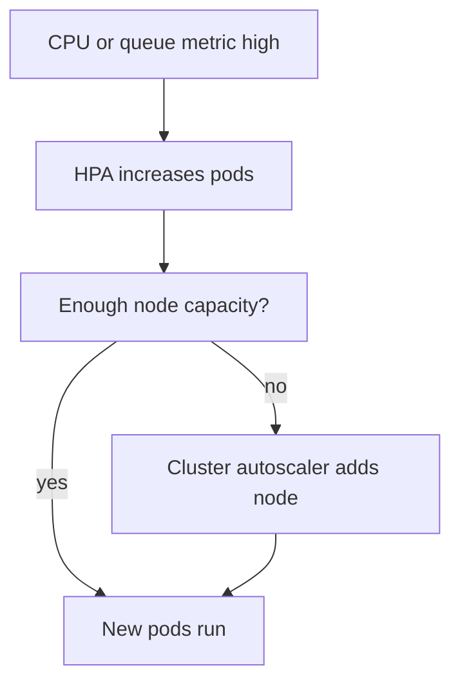

# 14b · Docker, Kubernetes, and Cloud

This part completes Kubernetes workloads, production manifests, debugging playbooks, and Azure-first cloud
interview preparation with AWS equivalents. The examples continue the Spring Boot AI Email Reply Assistant
and distinguish must-know SDE-1 material from stretch topics.

**Legend:** 🟢 Beginner · 🟡 Intermediate · 🔴 Advanced · ⚫ FAANG · 🔥 = very frequently asked

## Table of Contents
- [Section 4 · Kubernetes workloads and security](#section-4--kubernetes-workloads-and-security)
- [Section 5 · Kubernetes production manifests and debugging](#section-5--kubernetes-production-manifests-and-debugging)
- [Section 6 · Cloud fundamentals with Azure first](#section-6--cloud-fundamentals-with-azure-first)
- [Revision Cheat Sheet](#revision-cheat-sheet)
- [Flashcards](#flashcards)

## Section 4 · Kubernetes workloads and security

### Q26. StatefulSet vs Deployment: when do you use each?
`🟡 Intermediate` `🔥` `Must-know SDE-2`

**Why they ask:** Stateful services need identity and storage guarantees that stateless APIs do not.

**Short answer (say this first, 20-40 sec):**
Use Deployment for stateless replicated services where any pod can replace any other. Use StatefulSet for
workloads needing stable network identity, ordered rollout, and stable per-pod storage.

**Detailed answer:**

| Feature | Deployment | StatefulSet |
|---|---|---|
| Pod names | Random ReplicaSet names | Stable names like `db-0`, `db-1` |
| Storage | Usually shared or external | Stable PersistentVolumeClaim per pod |
| Rollout | Flexible rolling updates | Ordered by ordinal by default |
| Use case | Spring Boot REST API | Kafka, ZooKeeper, some databases |

The AI Email Reply Assistant API should be a Deployment because instances are interchangeable and state lives
in PostgreSQL, Redis, or external services. PostgreSQL itself is usually better as Azure Database for PostgreSQL;
if self-hosted in Kubernetes for learning, use an operator or StatefulSet with PersistentVolumes, backups, and
careful failover. StatefulSet does not magically make databases highly available; it provides primitives for
identity and storage. A headless Service often supports stable DNS such as `postgres-0.postgres`.

**Common mistakes:**
- Running stateless APIs as StatefulSets "just in case."
- Assuming StatefulSet handles backups, replication, and failover automatically.
- Running databases as Deployments with ephemeral storage.

**Follow-ups:**
- *What is stable pod identity?* → A predictable ordinal name and DNS identity across rescheduling.
- *What is headless Service?* → A Service with `clusterIP: None` that returns pod DNS records directly.

### Q27. What are DaemonSet, Job, and CronJob?
`🟢 Beginner` `🔥` `Must-know SDE-1`

**Why they ask:** Kubernetes has workload types beyond Deployments.

**Short answer (say this first, 20-40 sec):**
DaemonSet runs one pod on each matching node, Job runs finite work to completion, and CronJob creates Jobs
on a schedule. Use the workload type that matches lifecycle, not one Deployment for everything.

**Detailed answer:**
DaemonSet use cases: log agents, node monitoring, CNI components, security agents. Job use cases: one-time
database migration, batch embedding generation, or report export. CronJob use cases: nightly cleanup, periodic
cache warmup, or scheduled data validation.

```yaml
apiVersion: batch/v1
kind: CronJob
metadata:
  name: cleanup-old-replies
spec:
  schedule: "0 2 * * *"
  jobTemplate:
    spec:
      template:
        spec:
          restartPolicy: OnFailure
          containers:
            - name: cleanup
              image: ghcr.io/org/email-reply-api:sha-6f3a9c2
              command: ["java", "-jar", "/app/tools.jar", "cleanup"]
```

Do not use CronJob for latency-sensitive always-on APIs. Set concurrency policy, history limits, and deadlines
for production CronJobs so a stuck run does not pile up. Jobs should be idempotent when possible because
retries can happen.

**Common mistakes:**
- Running scheduled work inside every API pod and duplicating execution.
- Forgetting `restartPolicy` for Jobs.
- Letting CronJobs overlap without considering data consistency.

**Follow-ups:**
- *Stop overlapping CronJobs?* → Set `concurrencyPolicy: Forbid`.
- *DaemonSet on selected nodes?* → Use node selectors, affinity, and tolerations.

### Q28. What are namespaces and how should they be used?
`🟢 Beginner` `🔥` `Must-know SDE-1`

**Why they ask:** Namespaces are the first boundary for organizing Kubernetes resources.

**Short answer (say this first, 20-40 sec):**
Namespaces partition names and policies inside a cluster. Use them for environments, teams, or applications,
combined with RBAC, resource quotas, network policies, and naming standards.

**Detailed answer:**
Create and use:

```powershell
kubectl create namespace email-prod
kubectl config set-context --current --namespace=email-prod
kubectl get pods -n email-prod
```

Namespace manifest:

```yaml
apiVersion: v1
kind: Namespace
metadata:
  name: email-prod
  labels:
    environment: production
    owner: backend
```

Namespaces do not create hard security isolation by themselves. A user with cluster-admin can see everything,
and pods may communicate across namespaces unless NetworkPolicies restrict traffic. Use quotas:

```yaml
apiVersion: v1
kind: ResourceQuota
metadata:
  name: compute-quota
  namespace: email-prod
spec:
  hard:
    requests.cpu: "8"
    requests.memory: 16Gi
```

For interviews, mention separate clusters may still be needed for strong production isolation, compliance,
or blast-radius reduction.

**Common mistakes:**
- Treating namespaces as security boundaries without RBAC and network policy.
- Deploying production and development into one namespace.
- Forgetting `-n` and debugging the wrong namespace.

**Follow-ups:**
- *Are node resources namespaced?* → No, nodes and PersistentVolumes are cluster-scoped.
- *Can Services call across namespaces?* → Yes, use DNS like `svc.namespace.svc.cluster.local`.

### Q29. Explain Kubernetes RBAC basics.
`🟡 Intermediate` `🔥` `Must-know SDE-2`

**Why they ask:** Production clusters require least privilege for users and service accounts.

**Short answer (say this first, 20-40 sec):**
RBAC grants permissions with Roles or ClusterRoles and attaches them with RoleBindings or ClusterRoleBindings.
Give service accounts only the verbs and resources they need in the smallest scope.

**Detailed answer:**
Read-only Role for pods:

```yaml
apiVersion: v1
kind: ServiceAccount
metadata:
  name: email-viewer
  namespace: email-prod
---
apiVersion: rbac.authorization.k8s.io/v1
kind: Role
metadata:
  name: pod-reader
  namespace: email-prod
rules:
  - apiGroups: [""]
    resources: ["pods", "pods/log"]
    verbs: ["get", "list", "watch"]
---
apiVersion: rbac.authorization.k8s.io/v1
kind: RoleBinding
metadata:
  name: email-viewer-pod-reader
  namespace: email-prod
subjects:
  - kind: ServiceAccount
    name: email-viewer
    namespace: email-prod
roleRef:
  kind: Role
  name: pod-reader
  apiGroup: rbac.authorization.k8s.io
```

Check permissions:

```powershell
kubectl auth can-i get pods --as system:serviceaccount:email-prod:email-viewer -n email-prod
```

Use ClusterRole for cluster-scoped resources or reusable rules, but bind it with RoleBinding when only one
namespace needs access. Avoid giving apps permissions to read all Secrets.

**Common mistakes:**
- Using ClusterRoleBinding when a namespaced RoleBinding is enough.
- Granting `*` verbs on `*` resources to application service accounts.
- Forgetting that `pods/exec` and `secrets` are sensitive permissions.

**Follow-ups:**
- *Role vs ClusterRole?* → Role is namespaced; ClusterRole can be cluster-scoped or reused across namespaces.
- *How test access?* → `kubectl auth can-i`.

## Section 5 · Kubernetes production manifests and debugging

### Q30. Show full Deployment, Service, HPA, and Ingress YAML for the Spring Boot app.
`🔴 Advanced` `🔥` `Must-know SDE-2`

**Why they ask:** This combines images, config, secrets, probes, resources, networking, and autoscaling.

**Short answer (say this first, 20-40 sec):**
Use a Deployment with non-root security context, ConfigMap/Secret environment, probes, and resource settings;
a ClusterIP Service; an HPA; and an Ingress pointing host/path traffic to the Service.

**Detailed answer:**

```yaml
apiVersion: apps/v1
kind: Deployment
metadata:
  name: email-reply-api
  labels:
    app: email-reply-api
spec:
  replicas: 3
  selector:
    matchLabels:
      app: email-reply-api
  strategy:
    type: RollingUpdate
    rollingUpdate:
      maxSurge: 1
      maxUnavailable: 0
  template:
    metadata:
      labels:
        app: email-reply-api
    spec:
      securityContext:
        runAsNonRoot: true
      containers:
        - name: app
          image: ghcr.io/org/email-reply-api:sha-6f3a9c2
          imagePullPolicy: IfNotPresent
          ports:
            - containerPort: 8080
          env:
            - name: SPRING_PROFILES_ACTIVE
              value: prod
            - name: GEMINI_API_KEY
              valueFrom:
                secretKeyRef:
                  name: email-reply-secrets
                  key: GEMINI_API_KEY
          readinessProbe:
            httpGet:
              path: /actuator/health/readiness
              port: 8080
            periodSeconds: 5
            failureThreshold: 2
          livenessProbe:
            httpGet:
              path: /actuator/health/liveness
              port: 8080
            periodSeconds: 10
            failureThreshold: 3
          startupProbe:
            httpGet:
              path: /actuator/health/liveness
              port: 8080
            periodSeconds: 5
            failureThreshold: 24
          resources:
            requests:
              cpu: "250m"
              memory: "512Mi"
            limits:
              cpu: "1"
              memory: "1Gi"
---
apiVersion: v1
kind: Service
metadata:
  name: email-reply-api
spec:
  type: ClusterIP
  selector:
    app: email-reply-api
  ports:
    - name: http
      port: 80
      targetPort: 8080
---
apiVersion: autoscaling/v2
kind: HorizontalPodAutoscaler
metadata:
  name: email-reply-api
spec:
  scaleTargetRef:
    apiVersion: apps/v1
    kind: Deployment
    name: email-reply-api
  minReplicas: 3
  maxReplicas: 12
  metrics:
    - type: Resource
      resource:
        name: cpu
        target:
          type: Utilization
          averageUtilization: 70
---
apiVersion: networking.k8s.io/v1
kind: Ingress
metadata:
  name: email-reply-api
spec:
  ingressClassName: nginx
  rules:
    - host: email-reply.example.com
      http:
        paths:
          - path: /
            pathType: Prefix
            backend:
              service:
                name: email-reply-api
                port:
                  number: 80
```

In production add TLS, NetworkPolicy, PodDisruptionBudget, topology spread, and external secret integration.

**Common mistakes:**
- Selector labels not matching pod template labels.
- Missing resource requests, making HPA CPU utilization invalid.
- Putting real Gemini key directly in YAML.

**Follow-ups:**
- *Why ClusterIP behind Ingress?* → Ingress handles external HTTP routing; Service gives stable internal endpoint.
- *Why startup probe?* → It prevents liveness from killing slow JVM startup.

### Q31. How do you debug OOMKilled pods?
`🟡 Intermediate` `🔥` `Must-know SDE-2`

**Why they ask:** Memory incidents are common in JVM services on Kubernetes.

**Short answer (say this first, 20-40 sec):**
Confirm the pod was OOMKilled, inspect limits and usage, check JVM heap settings, review logs before death,
and adjust memory, heap percentage, leaks, or traffic patterns based on evidence.

**Detailed answer:**
Commands:

```powershell
kubectl get pod email-reply-api-abc123 -n prod
kubectl describe pod email-reply-api-abc123 -n prod
# Last State: Terminated
# Reason: OOMKilled
# Exit Code: 137
kubectl logs email-reply-api-abc123 -n prod --previous --tail=200
kubectl top pod email-reply-api-abc123 -n prod
kubectl get deployment email-reply-api -n prod -o yaml
```

Check whether `JAVA_TOOL_OPTIONS` sets `MaxRAMPercentage`. If memory limit is `512Mi` and heap can consume
most of it, native memory may push the container over the limit. If OOM happens after specific requests,
look for large prompt payloads, unbounded response buffering, image/file processing, or cache growth. If
OOM happens during startup, CPU throttling or classpath scanning plus low memory may be involved. Fix can
be code-level leak removal, request limits, cache caps, higher memory request/limit, or lower heap percentage.

**Common mistakes:**
- Only increasing limits without finding whether memory grows unbounded.
- Looking at current logs instead of `--previous` after restart.
- Setting `-Xmx` equal to the memory limit.

**Follow-ups:**
- *What metric confirms restarts?* → `kubectl get pod` restart count and container last state.
- *Should you take heap dumps?* → Yes when safe, but protect sensitive data and storage.

### Q32. How do you debug CrashLoopBackOff?
`🟡 Intermediate` `🔥` `Must-know SDE-1`

**Why they ask:** CrashLoopBackOff is one of the most common Kubernetes support states.

**Short answer (say this first, 20-40 sec):**
CrashLoopBackOff means the container repeatedly exits and Kubernetes is backing off restarts. Read previous
logs, describe the pod, check events, environment, probes, command, and dependent services.

**Detailed answer:**
Command sequence:

```powershell
kubectl get pods -n prod
kubectl describe pod email-reply-api-abc123 -n prod
kubectl logs email-reply-api-abc123 -n prod --previous
kubectl get events -n prod --sort-by=.lastTimestamp
kubectl describe deployment email-reply-api -n prod
```

Common Spring Boot causes: missing `GEMINI_API_KEY`, invalid datasource URL, failed Flyway migration, port
already in use inside container, bad JVM option, or liveness probe killing startup too early. If logs say
`Config data resource does not exist`, check mounted ConfigMaps. If logs are empty, the process may fail
before logging; inspect image entrypoint and command:

```powershell
kubectl get pod email-reply-api-abc123 -n prod -o jsonpath="{.spec.containers[0].command}"
```

Do not keep deleting pods manually; fix the Deployment template or config so the controller creates healthy pods.

**Common mistakes:**
- Reading only current logs after the container already restarted.
- Scaling replicas up before fixing the crash cause.
- Disabling probes permanently instead of tuning them.

**Follow-ups:**
- *What does BackOff mean?* → Kubernetes is delaying restarts to avoid tight crash loops.
- *How temporarily stop impact?* → Roll back deployment or scale down bad version if safe.

### Q33. How do you debug ImagePullBackOff?
`🟢 Beginner` `🔥` `Must-know SDE-1`

**Why they ask:** Image pull failures are frequent during first deployments and CI/CD changes.

**Short answer (say this first, 20-40 sec):**
Describe the pod and read events. Verify image name, tag, registry access, pull secret, network, and CPU
architecture. The container has not started yet, so app logs will not help.

**Detailed answer:**
Commands:

```powershell
kubectl describe pod email-reply-api-abc123 -n prod
# Failed to pull image "ghcr.io/org/email-reply-api:sha-6f3a9c2"
kubectl get secret ghcr-pull-secret -n prod
kubectl get serviceaccount default -n prod -o yaml
docker pull ghcr.io/org/email-reply-api:sha-6f3a9c2
```

Fix examples:

```powershell
kubectl create secret docker-registry ghcr-pull-secret `
  --docker-server=ghcr.io `
  --docker-username=<user> `
  --docker-password=<token> `
  -n prod
kubectl patch serviceaccount default -n prod `
  -p '{"imagePullSecrets":[{"name":"ghcr-pull-secret"}]}'
```

For Azure Container Registry with AKS, attach ACR to AKS or use managed identity. Check that the image was
pushed by CI and package visibility allows the cluster. If the message says `manifest unknown`, the tag is wrong.

**Common mistakes:**
- Searching application logs even though the image never ran.
- Using a local-only image tag in a remote cluster.
- Forgetting image pull permissions after making the registry private.

**Follow-ups:**
- *What is ErrImagePull vs ImagePullBackOff?* → Initial pull error vs repeated pull failure with backoff.
- *How avoid mutable tag confusion?* → Deploy immutable SHA tags or digests.

### Q34. How do you debug Pending pods?
`🟡 Intermediate` `🔥` `Must-know SDE-1`

**Why they ask:** Pending pods show scheduling failures, not application bugs.

**Short answer (say this first, 20-40 sec):**
Describe the pod and read scheduler events. Common causes are insufficient CPU or memory, taints without
tolerations, node selectors or affinity mismatch, unbound PVCs, or quota limits.

**Detailed answer:**
Commands:

```powershell
kubectl describe pod email-reply-api-abc123 -n prod
# 0/3 nodes are available: 3 Insufficient memory
kubectl get nodes
kubectl describe node aks-nodepool-123
kubectl get quota -n prod
kubectl get pvc -n prod
```

If insufficient resources, lower requests only if they were overestimated or add capacity through cluster
autoscaler/node pool scaling. If taints block scheduling:

```powershell
kubectl describe node gpu-node
# Taints: workload=gpu:NoSchedule
```

Add toleration only if the pod belongs there:

```yaml
tolerations:
  - key: workload
    operator: Equal
    value: gpu
    effect: NoSchedule
```

For PVC issues, storage class or volume provisioning may be broken. For quota, namespace hard limits may
reject new requested resources. Pending means the pod has no node; `kubectl logs` normally has nothing useful.

**Common mistakes:**
- Debugging container startup before the pod is scheduled.
- Removing resource requests to force scheduling and causing node pressure.
- Adding broad tolerations that place normal apps on special nodes.

**Follow-ups:**
- *Who schedules pods?* → The Kubernetes scheduler assigns pods to nodes.
- *What does unbound PVC mean?* → Required storage was not provisioned or bound yet.

### Q35. Service is not reachable. How do you debug selector mismatch and networking?
`🟡 Intermediate` `🔥` `Must-know SDE-1`

**Why they ask:** Service issues are often label or port mapping mistakes.

**Short answer (say this first, 20-40 sec):**
Check Service selector, pod labels, endpoints, targetPort, readiness, and in-cluster DNS. If endpoints are
empty, the Service is not selecting ready pods.

**Detailed answer:**
Commands:

```powershell
kubectl get svc email-reply-api -n prod -o yaml
kubectl get pods -n prod --show-labels
kubectl get endpoints email-reply-api -n prod
kubectl describe svc email-reply-api -n prod
kubectl run curl-test -n prod --rm -it --image=curlimages/curl -- sh
```

Inside test pod:

```sh
curl -v http://email-reply-api/actuator/health
nslookup email-reply-api
```

If Service selector is `app: email-api` but pods have `app: email-reply-api`, endpoints are empty. If endpoints
exist but calls fail, check Service `port` to pod `targetPort`, NetworkPolicy, app binding address, and
readiness. Spring Boot must listen on `0.0.0.0`, not only `127.0.0.1`, inside the container. For Ingress,
also check controller logs, DNS, TLS, and backend Service port.

**Common mistakes:**
- Looking at Ingress before checking Service endpoints.
- Confusing Service port 80 with container port 8080.
- Forgetting failed readiness removes pods from endpoints.

**Follow-ups:**
- *What command shows labels?* → `kubectl get pods --show-labels`.
- *What if endpoints are present?* → Test target port, NetworkPolicy, app logs, and DNS.

### Q36. What is a PodDisruptionBudget and when is it useful?
`🔴 Advanced` `🔥` `Stretch`

**Why they ask:** Availability during voluntary disruptions is a production-readiness topic.

**Short answer (say this first, 20-40 sec):**
A PodDisruptionBudget limits how many matching pods can be voluntarily unavailable during operations like
node drain or cluster upgrades. It does not protect against involuntary crashes or node failures.

**Detailed answer:**
Example:

```yaml
apiVersion: policy/v1
kind: PodDisruptionBudget
metadata:
  name: email-reply-api
spec:
  minAvailable: 2
  selector:
    matchLabels:
      app: email-reply-api
```

If the Deployment has three replicas, this PDB allows one voluntary disruption at a time. During AKS node
upgrade or `kubectl drain`, Kubernetes respects the PDB and avoids evicting too many healthy pods. For a
single-replica service, `minAvailable: 1` can block drains; instead increase replicas or accept downtime.
PDB works best with readiness probes, multiple replicas, and topology spread. It is not a substitute for
resource limits, HPA, or multi-zone design.

**Common mistakes:**
- Setting strict PDBs on single-replica apps and blocking maintenance.
- Expecting PDB to prevent OOMKilled or application crashes.
- Forgetting selector labels and applying the PDB to no pods.

**Follow-ups:**
- *Voluntary disruption examples?* → Node drain, cluster upgrade, manual eviction.
- *Involuntary examples?* → Hardware failure, kernel panic, OOM kill.

### Q37. What are taints, tolerations, node selectors, and affinity?
`🔴 Advanced` `🔥` `Stretch`

**Why they ask:** Scheduling control matters for dedicated nodes, GPUs, compliance, and reliability.

**Short answer (say this first, 20-40 sec):**
Node selectors and affinity attract pods to suitable nodes. Taints repel pods unless they have matching
tolerations. Use them to control placement without hardcoding node names.

**Detailed answer:**
Node selector:

```yaml
nodeSelector:
  workload: backend
```

Toleration:

```yaml
tolerations:
  - key: dedicated
    operator: Equal
    value: backend
    effect: NoSchedule
```

Affinity is more expressive:

```yaml
affinity:
  podAntiAffinity:
    preferredDuringSchedulingIgnoredDuringExecution:
      - weight: 100
        podAffinityTerm:
          labelSelector:
            matchLabels:
              app: email-reply-api
          topologyKey: kubernetes.io/hostname
```

Use anti-affinity or topology spread so replicas do not all land on one node. Taints are good for GPU nodes,
system nodes, or dedicated expensive pools. Toleration allows scheduling but does not force it; combine with
node affinity if the pod should actually prefer that pool.

**Common mistakes:**
- Adding tolerations and expecting pods to choose those nodes automatically.
- Hardcoding node names, making upgrades difficult.
- Over-constraining scheduling and causing Pending pods.

**Follow-ups:**
- *Taint effect `NoSchedule`?* → New pods without toleration are not scheduled there.
- *Preferred vs required affinity?* → Preferred is soft; required must be satisfied.

### Q38. What are Helm and Kustomize?
`🔴 Advanced` `⚫ FAANG` `Stretch`

**Why they ask:** Real teams need repeatable manifest packaging and environment overlays.

**Short answer (say this first, 20-40 sec):**
Helm templates Kubernetes resources as versioned charts with values. Kustomize overlays and patches plain
YAML without templating. Both help manage repeated manifests across environments.

**Detailed answer:**
Helm chart structure:

```text
Chart.yaml
values.yaml
templates/deployment.yaml
templates/service.yaml
```

Install:

```powershell
helm upgrade --install email-reply ./chart `
  --namespace prod `
  --values values-prod.yaml
```

Kustomize structure:

```text
base/deployment.yaml
base/service.yaml
overlays/prod/kustomization.yaml
overlays/staging/kustomization.yaml
```

Apply:

```powershell
kubectl apply -k overlays/prod
```

Use Helm when you need packaged reusable charts, dependency management, and release history. Use Kustomize
when you prefer raw Kubernetes YAML with environment-specific patches. Avoid over-templating; rendered YAML
should be inspectable in CI with `helm template` or `kubectl kustomize`.

**Common mistakes:**
- Hiding complex logic in templates that nobody can review.
- Applying charts without checking rendered manifests.
- Duplicating entire environment directories instead of small overlays.

**Follow-ups:**
- *Does kubectl support Kustomize?* → Yes, through `kubectl apply -k`.
- *How debug Helm output?* → `helm template` and `helm lint`.

### Q39. What are NetworkPolicies?
`🔴 Advanced` `⚫ FAANG` `Stretch`

**Why they ask:** Cluster-internal traffic needs least-privilege controls, not just perimeter security.

**Short answer (say this first, 20-40 sec):**
NetworkPolicy controls pod ingress and egress based on labels, namespaces, and ports. It requires a CNI plugin
that enforces policies; otherwise the YAML may have no effect.

**Detailed answer:**
Allow only Ingress controller traffic to the app:

```yaml
apiVersion: networking.k8s.io/v1
kind: NetworkPolicy
metadata:
  name: email-reply-ingress-only
  namespace: prod
spec:
  podSelector:
    matchLabels:
      app: email-reply-api
  policyTypes: ["Ingress"]
  ingress:
    - from:
        - namespaceSelector:
            matchLabels:
              name: ingress-nginx
      ports:
        - protocol: TCP
          port: 8080
```

By default, pods are usually non-isolated and can receive traffic. Once a policy selects a pod for ingress,
only allowed ingress is accepted. Egress policies can restrict calls to PostgreSQL, Redis, and external APIs,
but DNS and cloud endpoints need careful allow rules. On AKS, verify the chosen network plugin supports
NetworkPolicy enforcement.

**Common mistakes:**
- Applying NetworkPolicy on a CNI that does not enforce it.
- Blocking DNS egress and breaking all service discovery.
- Selecting no pods because labels do not match.

**Follow-ups:**
- *Default deny pattern?* → Create a policy selecting pods with no ingress or egress rules, then add allows.
- *Layer 7 policy?* → Native NetworkPolicy is L3/L4; use service mesh or gateway for L7.

## Section 6 · Cloud fundamentals with Azure first

### Q40. Compare Azure services with AWS equivalents.
`🟢 Beginner` `🔥` `Must-know SDE-1`

**Why they ask:** They want cloud vocabulary transfer across providers.

**Short answer (say this first, 20-40 sec):**
Cloud concepts are similar across providers: compute, containers, functions, storage, databases, messaging,
identity, and monitoring. Azure names differ from AWS names, but design tradeoffs are comparable.

**Detailed answer:**

| Capability | Azure | AWS equivalent |
|---|---|---|
| VM compute | Virtual Machines | EC2 |
| Managed web app | App Service | Elastic Beanstalk or App Runner |
| Kubernetes | AKS | EKS |
| Serverless functions | Azure Functions | Lambda |
| Object storage | Blob Storage | S3 |
| PostgreSQL | Azure Database for PostgreSQL | RDS for PostgreSQL |
| NoSQL | Cosmos DB | DynamoDB |
| Queue and pub/sub | Service Bus | SQS and SNS |
| Event streaming | Event Hubs | Kinesis |
| Secrets | Key Vault | Secrets Manager |
| Workload identity | Managed Identity | IAM Roles |
| Monitoring | Azure Monitor and App Insights | CloudWatch |

For interviews, explain concepts before names. Example: "For the AI Email Reply Assistant, I could deploy
the container to Azure App Service for simpler operations, or AKS when I need Kubernetes control. PostgreSQL
with pgvector maps to Azure Database for PostgreSQL; secrets belong in Key Vault; logs and traces go to
Application Insights."

**Common mistakes:**
- Memorizing service names without explaining what problem they solve.
- Comparing App Service directly to EC2; App Service is more managed PaaS.
- Forgetting identity and monitoring in cloud architecture answers.

**Follow-ups:**
- *Azure S3 equivalent?* → Blob Storage.
- *Azure IAM role equivalent?* → Managed Identity plus RBAC role assignments.

### Q41. Explain IaaS, PaaS, SaaS, and serverless.
`🟢 Beginner` `🔥` `Must-know SDE-1`

**Why they ask:** Service model choice affects control, responsibility, and speed.

**Short answer (say this first, 20-40 sec):**
IaaS gives virtual infrastructure, PaaS gives managed application platforms, SaaS gives finished software,
and serverless runs code without managing servers directly while scaling by demand.

**Detailed answer:**

| Model | You manage | Provider manages | Example |
|---|---|---|---|
| IaaS | OS, runtime, app, patches | Hardware and virtualization | Azure VM |
| PaaS | App and config | OS, runtime platform, scaling options | Azure App Service |
| SaaS | Usage and data config | Complete application | Microsoft 365 |
| Serverless | Function code and triggers | Server fleet and event scaling | Azure Functions |

For a Spring Boot API, IaaS means installing Java, configuring Nginx, patching OS, and setting up monitoring
on a VM. PaaS App Service lets you deploy a JAR or container and configure scale, identity, and environment
variables. AKS is managed Kubernetes: Azure manages control plane, but you still manage workloads, node pools,
upgrades, and cluster policies. Serverless is excellent for event-driven tasks, but long-running JVM cold
start, connection pooling, and execution limits must be considered.

**Common mistakes:**
- Calling all cloud "serverless" because servers are hidden.
- Choosing IaaS when PaaS meets requirements with less operational burden.
- Ignoring shared responsibility for security and patching.

**Follow-ups:**
- *Where does AKS fit?* → Managed Kubernetes; between IaaS and PaaS operationally.
- *Is serverless always cheaper?* → No, steady high traffic may be cheaper on provisioned services.

### Q42. What are the 12-factor app principles most relevant to Spring Boot?
`🟡 Intermediate` `🔥` `Must-know SDE-1`

**Why they ask:** Cloud-native apps must be deployable, configurable, and observable across environments.

**Short answer (say this first, 20-40 sec):**
The most relevant principles are one codebase, explicit dependencies, config in environment, backing services
as attached resources, build-release-run separation, stateless processes, logs as streams, and disposability.

**Detailed answer:**
Applied to the AI Email Reply Assistant:

| Principle | Practical Spring Boot action |
|---|---|
| Config | Read Gemini key, database URL, Redis host from environment or secret store |
| Dependencies | Maven `pom.xml` locks declared dependencies |
| Backing services | Treat PostgreSQL, Redis, and Gemini API as attached resources |
| Build-release-run | Build image once, promote tags across environments |
| Processes | Keep API stateless; store data in PostgreSQL and cache in Redis |
| Logs | Write structured logs to stdout for Docker/Kubernetes collection |
| Disposability | Graceful SIGTERM handling and readiness probes |

Example config:

```yaml
spring:
  datasource:
    url: ${SPRING_DATASOURCE_URL}
gemini:
  api-key: ${GEMINI_API_KEY}
```

This avoids hardcoded environment differences. In interviews, mention that 12-factor is guidance, not a
complete architecture; security, observability, and data migrations still need explicit design.

**Common mistakes:**
- Putting environment-specific YAML files with secrets into the image.
- Storing session state in local memory and then scaling horizontally.
- Writing logs only to files inside the container.

**Follow-ups:**
- *Why stateless processes?* → Any instance can be replaced or scaled without losing user state.
- *What is build-release-run?* → Build artifact once, combine with config for release, then run it.

### Q43. How would you deploy Spring Boot to Azure App Service?
`🟡 Intermediate` `🔥` `Must-know SDE-1`

**Why they ask:** App Service is a common simpler alternative to Kubernetes.

**Short answer (say this first, 20-40 sec):**
Create an App Service Plan and Web App, configure Java or container runtime, set environment variables and
Key Vault references, connect PostgreSQL/Redis, deploy through GitHub Actions, and monitor with App Insights.

**Detailed answer:**
Container-based outline:

```powershell
az group create --name rg-email-prod --location eastus
az appservice plan create --name plan-email-prod `
  --resource-group rg-email-prod --is-linux --sku P1v3
az webapp create --name email-reply-prod `
  --resource-group rg-email-prod `
  --plan plan-email-prod `
  --deployment-container-image-name ghcr.io/org/email-reply-api:sha-6f3a9c2
az webapp config appsettings set `
  --name email-reply-prod `
  --resource-group rg-email-prod `
  --settings SPRING_PROFILES_ACTIVE=prod
```

Use Managed Identity for Key Vault access instead of storing secrets directly where possible. GitHub Actions
can deploy after environment approval with OIDC Azure login. App Service handles load balancing, TLS, custom
domains, basic autoscale, slots, and logs with less Kubernetes complexity. Use deployment slots for blue-green:
deploy to staging slot, warm it, then swap.

**Common mistakes:**
- Treating App Service filesystem as durable application storage.
- Putting secrets in workflow YAML instead of app settings or Key Vault references.
- Forgetting health check path and startup timeout for Spring Boot.

**Follow-ups:**
- *When choose App Service?* → When you want managed web hosting without Kubernetes operations.
- *What are deployment slots?* → Separate live environments that can be warmed and swapped.

### Q44. How would you deploy Spring Boot to AKS?
`🔴 Advanced` `🔥` `Must-know SDE-2`

**Why they ask:** AKS tests container orchestration, identity, registry, manifests, and operations.

**Short answer (say this first, 20-40 sec):**
Build and push the image to a registry, create or use an AKS cluster, configure identity and secrets, apply
Kubernetes manifests, expose through Ingress, then monitor rollouts, logs, metrics, and autoscaling.

**Detailed answer:**
High-level Azure flow:

```powershell
az group create --name rg-email-aks --location eastus
az acr create --name emaileplyacr --resource-group rg-email-aks --sku Standard
az aks create --resource-group rg-email-aks --name aks-email-prod `
  --node-count 3 --enable-managed-identity --attach-acr emaileplyacr
az aks get-credentials --resource-group rg-email-aks --name aks-email-prod
kubectl create namespace prod
kubectl apply -n prod -f k8s\
kubectl rollout status deployment/email-reply-api -n prod
```

Use Azure Database for PostgreSQL and Azure Cache for Redis rather than running stateful dependencies in
cluster unless there is a strong reason. Use Key Vault CSI Driver or workload identity for secrets. Install
Ingress controller, cert-manager if needed, metrics-server for HPA, and Azure Monitor Container Insights.
AKS gives portability and control but requires node upgrades, cluster policies, manifest management, network
design, and on-call Kubernetes expertise.

**Common mistakes:**
- Moving to AKS for one simple app with no team capacity to operate Kubernetes.
- Running databases in AKS without backup and restore planning.
- Using static cloud credentials in Kubernetes Secrets instead of workload identity.

**Follow-ups:**
- *AKS vs App Service?* → AKS offers orchestration control; App Service offers simpler managed hosting.
- *How expose AKS HTTP?* → Ingress controller plus Service and DNS.

### Q45. App Service vs AKS: tradeoffs?
`🟡 Intermediate` `🔥` `Must-know SDE-2`

**Why they ask:** Good engineers choose platforms based on requirements, not hype.

**Short answer (say this first, 20-40 sec):**
App Service is simpler and more managed for web APIs. AKS gives Kubernetes control, portability, custom
networking, and complex workload support, but costs more operationally.

**Detailed answer:**

| Dimension | Azure App Service | AKS |
|---|---|---|
| Operational effort | Low | Medium to high |
| Deployment unit | Code, JAR, or container | Kubernetes manifests and images |
| Scaling | App Service autoscale | HPA, cluster autoscaler, KEDA |
| Networking | Managed ingress and TLS features | Full Kubernetes networking choices |
| Workloads | Web apps and APIs | APIs, workers, sidecars, custom controllers |
| Team skill needed | Azure web app basics | Kubernetes operations |

For the AI Email Reply Assistant, App Service is a strong first production choice: Spring Boot API, managed
TLS, environment config, deployment slots, and easy scaling. AKS is justified if the product needs multiple
microservices, service mesh, advanced rollout, custom sidecars, private networking patterns, or standardized
Kubernetes across teams. Mention total cost: AKS may save per-app platform limits but adds cluster and people
cost.

**Common mistakes:**
- Choosing AKS just because Docker is involved.
- Choosing App Service when you need Kubernetes-native sidecars or custom controllers.
- Ignoring team operational maturity.

**Follow-ups:**
- *Can App Service run containers?* → Yes, Linux App Service can run custom containers.
- *Can AKS be cheaper?* → Sometimes at scale, but include operations and idle node capacity.

### Q46. How does cloud autoscaling work?
`🟡 Intermediate` `🔥` `Must-know SDE-1`

**Why they ask:** Scaling decisions affect reliability and cost.

**Short answer (say this first, 20-40 sec):**
Autoscaling adjusts capacity based on metrics, schedules, or events. App Service scales instances; AKS HPA
scales pods, cluster autoscaler scales nodes, and serverless platforms scale executions.

**Detailed answer:**
Azure App Service autoscale can add instances when CPU or HTTP queue length crosses thresholds. AKS has layers:
HPA changes Deployment replicas, cluster autoscaler adds nodes when pods cannot schedule, and KEDA can scale
event-driven workloads based on queues. Example decision chain:



For the email reply service, CPU may be low while Gemini latency is high, so scale on request rate, concurrency,
or queue depth if asynchronous. Autoscaling must respect downstream limits: PostgreSQL connections, Redis
capacity, and Gemini API rate limits. Set min instances for cold-start-sensitive APIs and max instances to
control cost and protect dependencies.

**Common mistakes:**
- Scaling only on CPU for I/O-bound services.
- Setting max replicas higher than database connection capacity.
- Forgetting scale-in can terminate pods; graceful shutdown must work.

**Follow-ups:**
- *HPA vs cluster autoscaler?* → HPA adds pods; cluster autoscaler adds nodes.
- *What is scale to zero?* → Reducing instances to none, common in serverless or KEDA event workloads.

### Q47. What are regions, availability zones, and disaster recovery?
`🟡 Intermediate` `🔥` `Must-know SDE-1`

**Why they ask:** Availability design depends on failure domains.

**Short answer (say this first, 20-40 sec):**
A region is a geographic cloud area; availability zones are separate datacenters within a region. High
availability uses multiple zones, while disaster recovery often uses another region with backup and failover.

**Detailed answer:**
Azure example: deploy App Service or AKS across zones where supported, use zone-redundant Azure Database for
PostgreSQL if required, store backups with geo-redundancy, and place front door or traffic manager in front
for regional failover. Terms:

| Term | Meaning | Example design |
|---|---|---|
| Region | Geographic area | East US, Central India |
| Availability Zone | Independent datacenter in region | Zone 1, 2, 3 |
| HA | Survive local component failure | Multi-zone replicas |
| DR | Recover from regional disaster | Secondary region and backups |
| RTO | Time to restore service | 30 minutes |
| RPO | Data loss window | 5 minutes |

For SDE interviews, avoid over-engineering every student project as multi-region active-active. State the
business requirement first: user impact, RTO/RPO, data consistency, and budget. Multi-region databases add
latency and conflict complexity.

**Common mistakes:**
- Saying availability zone and region are the same.
- Replicating compute but forgetting database backups.
- Designing active-active without addressing data consistency.

**Follow-ups:**
- *What is RTO?* → Maximum acceptable recovery time.
- *What is RPO?* → Maximum acceptable data loss measured in time.

### Q48. What cloud cost basics should a backend engineer know?
`🟢 Beginner` `🔥` `Must-know SDE-1`

**Why they ask:** Cost-aware engineering is expected even for junior backend roles.

**Short answer (say this first, 20-40 sec):**
Major cost drivers are compute size and uptime, storage volume and transactions, network egress, managed
database tier, logs/metrics ingestion, and idle overprovisioned resources.

**Detailed answer:**
Cost checklist:

| Area | Cost risk | Control |
|---|---|---|
| Compute | Oversized instances or always-on dev apps | Right-size and schedule shutdown |
| AKS | Idle nodes and over-requested pods | Tune requests and autoscale |
| Database | High tier, storage, backups, replicas | Pick tier based on workload |
| Storage | Large objects and snapshots | Lifecycle policies |
| Network | Cross-region or internet egress | Keep chatty services close |
| Observability | Verbose logs and high-cardinality metrics | Sampling and retention |

For a Spring Boot service, do not request 4 CPU and 8Gi memory because "Java is heavy" without measurement.
Use Azure Cost Management budgets and alerts, tags like `owner`, `environment`, and `cost-center`, and separate
dev/test from production SKUs. Cost optimization must not remove redundancy blindly; compare savings against
availability requirements.

**Common mistakes:**
- Forgetting logs can become expensive at high volume.
- Leaving test AKS clusters running over weekends.
- Reducing database tier before checking performance impact.

**Follow-ups:**
- *What is egress?* → Data leaving a cloud network or region, often billable.
- *How allocate costs?* → Use tags, resource groups, budgets, and per-service dashboards.

### Q49. How do managed identity and Key Vault improve secret handling in Azure?
`🟡 Intermediate` `🔥` `Must-know SDE-2`

**Why they ask:** Cloud-native security avoids static credentials in code and pipelines.

**Short answer (say this first, 20-40 sec):**
Managed Identity gives Azure resources an identity without stored passwords. Key Vault stores secrets, keys,
and certificates with access policies or RBAC, so apps retrieve secrets securely at runtime.

**Detailed answer:**
For App Service, enable system-assigned managed identity, grant it Key Vault secret get permission, and use
Key Vault references in app settings:

```text
GEMINI_API_KEY=@Microsoft.KeyVault(SecretUri=https://kv-email.vault.azure.net/secrets/gemini-api-key/)
```

For AKS, use workload identity or Secrets Store CSI Driver to mount Key Vault secrets into pods without
long-lived service principal secrets. Benefits: centralized rotation, audit logs, least privilege, and no
secret values in container images or GitHub Actions YAML. Still design application reload behavior; if a
secret rotates, pods may need restart or a dynamic config mechanism. Limit who can read secrets; logging a
retrieved secret is still a leak.

**Common mistakes:**
- Storing Key Vault client secrets as Kubernetes Secrets when workload identity is available.
- Granting broad vault access to every app.
- Assuming Key Vault prevents leaks if the application prints the secret.

**Follow-ups:**
- *AWS equivalent?* → IAM roles plus Secrets Manager or Parameter Store.
- *Can GitHub Actions use Azure without secret?* → Yes, with OIDC federated credentials.

### Q50. What advanced cloud-native topics are worth knowing as stretch goals?
`🔴 Advanced` `⚫ FAANG` `Stretch`

**Why they ask:** Stretch topics show growth direction, but you should mark them separately from fundamentals.

**Short answer (say this first, 20-40 sec):**
After mastering Docker, Kubernetes basics, and Azure deployment, learn service mesh, GitOps, progressive
delivery, OpenTelemetry, policy-as-code, supply-chain security, and event-driven autoscaling.

**Detailed answer:**
Stretch map:

| Topic | What it adds | Tool examples |
|---|---|---|
| GitOps | Cluster state reconciled from Git | Argo CD, Flux |
| Service mesh | mTLS, retries, traffic splitting | Istio, Linkerd |
| Progressive delivery | Automated canary analysis | Argo Rollouts, Flagger |
| OpenTelemetry | Vendor-neutral traces and metrics | OTel SDK, collectors |
| Policy as code | Guardrails before deploy | Gatekeeper, Kyverno |
| Supply-chain security | Provenance and signatures | SBOM, SLSA, cosign |
| Event autoscaling | Scale on queues/events | KEDA |

Do not lead an SDE-1 answer with these unless asked; first show you can write correct Dockerfiles, Kubernetes
Deployments, probes, Services, and cloud deployment steps. For a resume project, one realistic stretch is:
"I would add OpenTelemetry tracing from Spring Boot to Azure Monitor and use Key Vault with workload identity
for the Gemini API key."

**Common mistakes:**
- Name-dropping service mesh before understanding Services and Ingress.
- Adding GitOps without clear ownership and rollback process.
- Treating SBOM generation as a complete security program.

**Follow-ups:**
- *What is GitOps in one line?* → Git is the desired state source, and a controller reconciles the cluster.
- *What is service mesh in one line?* → A data-plane proxy layer plus control plane for service communication policy.

## Revision Cheat Sheet
- Deployment for stateless APIs; StatefulSet for stable identity and storage; DaemonSet for node-wide agents.
- Namespaces organize resources but need RBAC, quotas, and NetworkPolicies for stronger boundaries.
- RBAC = Role or ClusterRole plus Binding; avoid broad secret permissions.
- Production Kubernetes manifests need image tags, probes, resources, secret references, Service, Ingress, and HPA.
- Debug OOMKilled with `describe`, `logs --previous`, limits, usage, and JVM heap settings.
- Debug CrashLoopBackOff with previous logs, events, command, env, probes, and dependencies.
- Debug ImagePullBackOff through pod events, registry tag, pull secret, and image permissions.
- Debug Pending through scheduler events: insufficient resources, taints, affinity, PVC, or quota.
- App Service is simpler PaaS for Spring Boot APIs; AKS is powerful but operationally heavier.
- Azure equivalents: Blob/S3, AKS/EKS, Functions/Lambda, Key Vault/Secrets Manager, Monitor/CloudWatch.
- 12-factor apps keep config outside code, are stateless, log to stdout, and build once/promote artifacts.
- Cost basics: compute uptime, database tier, storage, egress, logs, and idle capacity.

## Flashcards
- Q: Deployment or StatefulSet for Spring Boot API? → Deployment.
- Q: Workload running one pod per node? → DaemonSet.
- Q: Kubernetes least privilege system? → RBAC.
- Q: Check service endpoints? → `kubectl get endpoints <service>`.
- Q: CrashLoopBackOff key log command? → `kubectl logs <pod> --previous`.
- Q: ImagePullBackOff means? → The image could not be pulled before container start.
- Q: Pending pod first command? → `kubectl describe pod <pod>`.
- Q: Azure Kubernetes service? → AKS.
- Q: Azure object storage? → Blob Storage.
- Q: Azure secret store? → Key Vault.
- Q: App Service best for? → Managed web apps and APIs.
- Q: AKS best for? → Kubernetes control and complex container platforms.
- Q: RTO means? → Maximum acceptable recovery time.
- Q: RPO means? → Maximum acceptable data loss window.
- Q: GitOps tool examples? → Argo CD and Flux.
