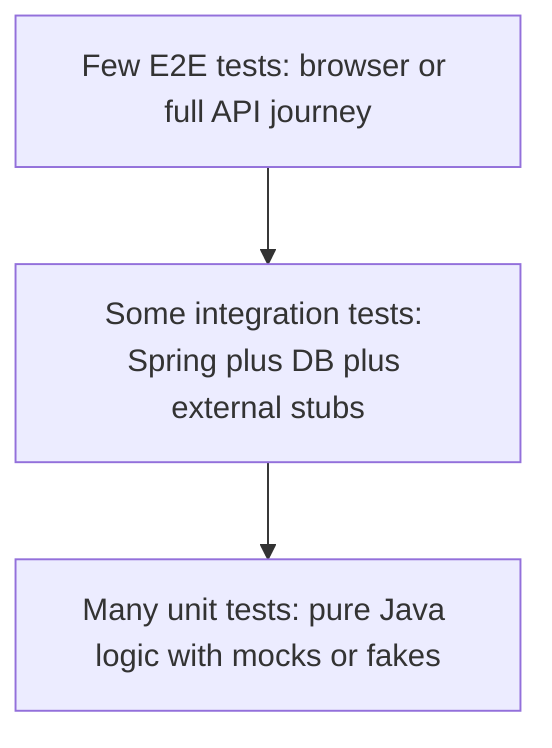
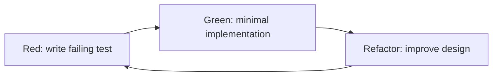
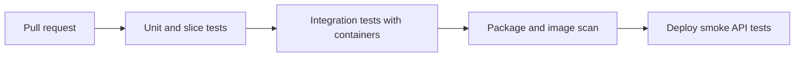

# 15 · Testing

Testing interviews check whether you can ship backend code safely, not whether you know annotations by memory. This guide focuses on Java 17, JUnit 5, Mockito, Spring Boot, Testcontainers, WireMock, Postman, and practical trade-offs for backend systems such as an AI Email Reply Assistant.

**Legend:** 🟢 Beginner · 🟡 Intermediate · 🔴 Advanced · ⚫ FAANG · 🔥 = very frequently asked

## Table of Contents
- [Beginner guide to this file](#beginner-guide-to-this-file)
- [Testing Strategy](#testing-strategy)
- [JUnit 5](#junit-5)
- [Mockito](#mockito)
- [Spring Boot Test Slices](#spring-boot-test-slices)
- [Containers, Contracts, and External APIs](#containers-contracts-and-external-apis)
- [Reliability, Postman, TDD, and Coverage](#reliability-postman-tdd-and-coverage)
- [Revision Cheat Sheet](#revision-cheat-sheet)
- [Flashcards](#flashcards)

## Beginner guide to this file

### What this file teaches
This file teaches how to prove backend code works before users or other services depend on it. Interviews ask
testing questions because production quality is not only about writing features; it is about choosing the right
level of test, isolating risky boundaries, and keeping Continuous Integration (CI) trustworthy. The real skill is
to design tests that are fast enough for daily work, realistic enough to catch integration bugs, and readable enough
that the next engineer can maintain them.

### Mental model
Think of a test suite as airport security. Small checks happen at every gate, deeper checks happen for suspicious
bags, and only a few full drills test the whole airport. You want layered confidence, not one slow checkpoint for
everything.

- Test pyramid: many cheap unit checks, some integration checks, and few full end-to-end journeys.
- Test doubles: stand-ins that replace expensive, slow, or unpredictable collaborators.
- Integration testing: prove real boundaries such as Spring wiring, database queries, JSON, and containers.
- Contract testing: prove two services agree on request and response expectations without running everything.
- Flaky tests: tests that sometimes fail without a product bug, usually due to time, order, randomness, or networks.
- Test design: choose inputs, boundaries, assertions, and setup so a failure points to one clear behavior.

### How to think through any question here
1. Name the risk: pure logic, framework wiring, database behavior, external service, or deployed journey.
2. Choose the lowest test layer that catches that risk with enough confidence.
3. Decide what must be real and what can be replaced by a dummy, stub, fake, mock, or spy.
4. Use Arrange, Act, Assert so setup, behavior, and verification are easy to read.
5. Cover the happy path, important edge cases, and the most likely failure path.
6. Remove nondeterminism: control time, randomness, test data, ports, and network responses.
7. Place tests in the delivery pipeline so fast checks run early and slower checks run at the right gate.

### Pattern recognition cues
| If the question mentions... | Think about... | Why it fits |
|---|---|---|
| Fast feedback or suite shape | Test pyramid | It balances speed, confidence, and maintenance cost. |
| One class or business rule | Unit test | The dependency graph can be replaced so behavior is isolated. |
| Spring wiring, JSON, SQL, or migrations | Integration test or slice test | The framework or real dependency is part of the risk. |
| Mock, spy, fake, stub, or dummy | Test double choice | Each double solves a different isolation problem. |
| API compatibility between services | Contract testing | Provider and consumer expectations can be checked independently. |
| Random CI failures | Flaky test causes | Time, order, shared state, and networks make tests nondeterministic. |
| Coverage percentage | Coverage as a signal, not proof | Executed lines do not guarantee meaningful assertions. |
| External Application Programming Interface (API) | WireMock, stubs, or contracts | Live third-party calls are slow, costly, and unreliable in tests. |
| PostgreSQL, Redis, or broker behavior | Testcontainers | Disposable real services catch differences hidden by mocks. |
| New REST endpoint | Validation, status, serialization, security, and persistence | Endpoints fail at boundaries, not only inside service logic. |

### Abbreviations and key terms
| Short form | Expanded form | Plain meaning |
|---|---|---|
| AI | Artificial Intelligence | Software behavior that uses model-based reasoning or generation. |
| API | Application Programming Interface | A callable contract such as an HTTP endpoint or Java interface. |
| APPLICATION_JSON | Application JSON media type | Spring constant for a JSON request or response body. |
| CI | Continuous Integration | Automated build and test checks run when code changes. |
| CLI | Command-Line Interface | A tool run from a terminal, such as Newman. |
| CSV | Comma-Separated Values | Text format often used for parameterized test inputs. |
| DB | Database | Persistent data store such as PostgreSQL, MySQL, Redis, or H2. |
| DTO | Data Transfer Object | Object shaped for input or output instead of domain behavior. |
| E2E | End-to-End | A test that exercises a complete user or service journey. |
| FAANG | Facebook, Amazon, Apple, Netflix, and Google | Shorthand for large product-company interview style. |
| H2 | H2 database | Lightweight in-memory relational database often used in tests. |
| HTML | HyperText Markup Language | Markup returned by web pages or reports. |
| HTTP | Hypertext Transfer Protocol | The protocol used for web requests and responses. |
| JPA | Java Persistence API | Java standard for object-relational persistence. |
| JPQL | Java Persistence Query Language | Entity-oriented query language used with JPA. |
| JSON | JavaScript Object Notation | Common text format for API bodies. |
| JVM | Java Virtual Machine | Runtime that executes Java bytecode. |
| LLM | Large Language Model | Model class used for text generation, such as reply drafting. |
| MVC | Model-View-Controller | Web pattern used by Spring MVC controllers and tests. |
| OS | Operating System | The platform running the tests and application. |
| PER_CLASS | Per-class test instance lifecycle | JUnit option that reuses one test class instance for all methods. |
| PR | Pull Request | Proposed code change reviewed before merging. |
| RANDOM_PORT | Random server port | Spring Boot test option that starts the app on an available port. |
| REST | Representational State Transfer | HTTP API style based on resources and standard methods. |
| SAST | Static Application Security Testing | Security analysis performed on source code without running it. |
| SDE-1 | Software Development Engineer level 1 | Entry-level engineering interview expectation. |
| SDE-2 | Software Development Engineer level 2 | Mid-level expectation with broader ownership. |
| SLA | Service-Level Agreement | Expected reliability or latency target for a service. |
| SQL | Structured Query Language | Language for relational database queries. |
| TDD | Test-Driven Development | Red-green-refactor workflow where tests guide code design. |
| TTL | Time To Live | Expiration duration for cached or temporary data. |
| UI | User Interface | Visual or interactive surface used by people. |
| URL | Uniform Resource Locator | Web address for an endpoint or page. |
| JaCoCo | Java Code Coverage | Tool that reports which Java bytecode was executed by tests. |
| JUnit | Java unit testing framework | The main framework used to write and run Java tests. |
| Mockito | Mocking toolkit for Java | Library for creating mocks, spies, stubs, and interaction checks. |
| Newman | Postman command-line runner | Tool that runs Postman collections in automation. |
| Testcontainers | Disposable container test library | Starts real dependencies such as PostgreSQL or Redis for tests. |
| WireMock | HTTP stubbing server | Tool for testing real HTTP clients without calling live services. |

### Common beginner traps
- Writing mostly end-to-end tests and then accepting slow, brittle feedback.
- Mocking the database or HTTP layer when the actual risk is mapping, serialization, or configuration.
- Verifying internal method calls instead of externally visible behavior.
- Treating coverage as a quality score instead of asking whether important assertions exist.
- Letting tests depend on real time, random order, local ports, or live third-party services.
- Using one giant fixture that makes failures hard to understand.
- Adding retries around flaky tests before finding the nondeterministic cause.

### How to study this file
1. Read the short answer and decide which layer of the test pyramid the question is about.
2. Use the beginner lens note to state the risk and the correct boundary before reading the detailed answer.
3. For each code sample, label Arrange, Act, and Assert in your own words.
4. Turn the common mistakes into mini design reviews of your own project tests.
5. Practice by adding one unit test, one Spring slice test, one Testcontainers test, and one contract-style check.
6. Use flashcards for quick recall only after you can explain why a test belongs at a specific layer.

### Scalability and production lens
A small project can run every test locally and still feel fast. A production service needs staged feedback: unit
and slice tests on every change, heavier container or contract suites at merge gates, and a few end-to-end smoke
checks after deployment. Keep slow tests quarantined by purpose, publish useful failure logs, remove shared state,
and track flaky-test fixes like product bugs because unreliable CI trains teams to ignore real failures.

## Testing Strategy

### Q1. What is the test pyramid, and why do backend teams use it?
`🟢 Beginner` `🔥` `Must-know SDE-1`

**Why they ask:** It reveals whether you balance speed, confidence, and maintenance cost.

**Beginner lens:** The test pyramid is a budget model for confidence. Unit tests are cheap smoke alarms in
every room, integration tests inspect real wiring, and end-to-end tests are full fire drills. Interviewers
want to know whether you avoid both extremes: slow all-system tests for every case and fast mocks that miss
real bugs. Use it whenever speed, flakiness, and confidence trade-offs appear.

**Short answer (say this first, 20-40 sec):**
The test pyramid says most tests should be fast unit tests, fewer should be integration tests, and very few should be full end-to-end tests. As tests go up the pyramid they become more realistic but slower, flakier, and harder to debug. Backend teams use it to get quick feedback without losing confidence in database, HTTP, and deployment behavior.

**Detailed answer:**

- Unit: validates one class or function in milliseconds.
- Integration: validates wiring with real framework pieces, database, cache, serialization, migrations.
- E2E: validates user journey across services and infrastructure.
- For the AI Email Reply Assistant: unit-test tone selection logic, integration-test REST plus mocked Gemini, and keep one smoke E2E test for the deployed flow.

**Common mistakes:**
- Having mostly E2E tests and waiting minutes for basic feedback.
- Mocking everything and never testing SQL, JSON, or Spring configuration.
- Treating coverage percentage as proof of correctness.

**Follow-ups:**
- *Can the pyramid become a trophy?* → Yes. Many service teams use more API/component tests than UI E2E tests, but still keep fast tests at the base.
- *Where do contract tests fit?* → Between integration and E2E; they verify service expectations without running all services together.

### Q2. How do unit, integration, and E2E tests differ?
`🟢 Beginner` `🔥` `Must-know SDE-1`

**Why they ask:** Most backend bugs come from testing at the wrong boundary.

**Beginner lens:** Unit, integration, and end-to-end tests differ by boundary, not by annotation. A unit
test checks one behavior with neighbors replaced; an integration test checks real pieces working together;
an end-to-end test checks the complete journey. The interviewer is testing whether you choose the cheapest
layer that catches the risk. For database or serialization bugs, unit tests alone are the wrong tool.

**Short answer (say this first, 20-40 sec):**
Unit tests isolate one behavior, integration tests verify multiple real components together, and E2E tests validate a complete user or API flow. Unit tests are fastest and best for edge cases; integration tests catch wiring and persistence issues; E2E tests catch environment and cross-service issues.

**Detailed answer:**
| Type | Scope | Example | Pros | Cons |
|---|---|---|---|---|
| Unit | One class | `EmailReplyService` with mocked Gemini client | Fast, precise | Can miss wiring bugs |
| Integration | App slice or external resource | Controller + JSON + security + Testcontainers PostgreSQL | Realistic | Slower |
| E2E | Whole system | Send request from frontend to deployed backend | Highest confidence | Slow, flaky, costly |

**Common mistakes:**
- Calling a test unit when it loads Spring and a database.
- Using E2E tests for every validation branch.
- Not asserting observable behavior.

**Follow-ups:**
- *Should unit tests hit the database?* → No; use integration tests for DB behavior.
- *Should all bugs get E2E tests?* → No; add the lowest-level test that would have caught the bug.

### Q3. What makes a good test case?
`🟢 Beginner` `🔥` `Must-know SDE-1`

**Why they ask:** They want maintainable tests, not just green tests.

**Beginner lens:** A good test is a clear experiment: prepare one situation, do one action, and check one
meaningful outcome. Think of it as a lab note another engineer can rerun. Interviewers look for determinism,
readable names, focused assertions, and useful failures. If a test needs time, randomness, or large
fixtures, control those inputs so the failure points to product behavior rather than test noise.

**Short answer (say this first, 20-40 sec):**
A good test is deterministic, isolated, readable, fast enough for its layer, and asserts behavior that matters to users or callers. It should fail for one clear reason and use Arrange-Act-Assert structure.

**Detailed answer:**
- Arrange: build inputs and dependencies.
- Act: call one behavior.
- Assert: verify output, state change, or interaction at a meaningful boundary.
- Use clear names: `generatesFormalReplyWhenToneIsProfessional`.
- Keep test data minimal; avoid giant fixtures unless testing parsing.

**Common mistakes:**
- Multiple unrelated assertions in one test.
- Relying on current time, random IDs, or external network.
- Testing private methods instead of public behavior.

**Follow-ups:**
- *How do you test time?* → Inject `Clock` and use `Clock.fixed(...)`.
- *How do you test randomness?* → Inject a seeded generator or strategy.

### Q4. How would you decide what to test for a new REST endpoint?
`🟡 Intermediate` `🔥` `Must-know SDE-1`

**Why they ask:** It checks practical judgment around risk.

**Beginner lens:** For a new REST endpoint, treat the endpoint like a border checkpoint. Test the request
format, validation, authorization, service rule, persistence effect, and error response. Interviewers want
risk-based thinking, not a giant checklist. Put pure business branches in unit tests, HTTP status and JSON
in controller slice tests, and database or external-service behavior in integration tests with real or
stubbed boundaries.

**Short answer (say this first, 20-40 sec):**
I test validation, happy path, important error paths, authorization, serialization format, and persistence or external-service boundaries. I start with unit tests for logic, add slice tests for HTTP behavior, and add integration tests for database or broker behavior.

**Detailed answer:**
- Controller: status codes, JSON fields, validation errors.
- Service: business rules and fallback behavior.
- Repository: queries, indexes assumptions, constraints.
- Security: unauthorized, forbidden, allowed role.
- External APIs: timeout, retry, malformed response.

**Common mistakes:**
- Testing only the happy path.
- Ignoring validation and authorization.
- Hitting live third-party APIs in CI.

**Follow-ups:**
- *What if deadline is tight?* → Cover highest-risk happy path and one failure path, then add more after stabilization.
- *Should tests mirror implementation classes?* → Not always; mirror behavior and risk.

### Q5. What is the difference between a fake, stub, mock, spy, and dummy?
`🟡 Intermediate` `🔥` `Must-know SDE-1`

**Why they ask:** Misusing test doubles causes brittle tests.

**Beginner lens:** Test doubles are stand-ins on a movie set. A dummy just fills a chair, a stub says canned
lines, a fake is a small working prop, a mock checks whether an interaction happened, and a spy watches a
real actor. Interviewers test vocabulary plus judgment. Choose the simplest double that expresses the
behavior; too many mocks make tests brittle and implementation-shaped.

**Short answer (say this first, 20-40 sec):**
A dummy is passed but unused, a stub returns predefined answers, a fake is a lightweight working implementation, a mock verifies interactions, and a spy wraps a real object while allowing selective stubbing or verification.

**Detailed answer:**
| Double | Meaning | Example |
|---|---|---|
| Dummy | Required but unused | `new AuditContext("test")` |
| Stub | Canned response | Gemini client returns fixed text |
| Fake | Simplified working impl | in-memory repository |
| Mock | Interaction verification | verify mail sender called once |
| Spy | Real object plus observation | spy mapper but stub one method |

**Common mistakes:**
- Using mocks where a fake would be simpler.
- Verifying every getter and internal call.
- Spying complex objects with side effects.

**Follow-ups:**
- *When prefer fake over mock?* → When behavior is stateful and easy to implement in memory.
- *Are mocks bad?* → No; they are useful at expensive or unstable boundaries.

## JUnit 5

### Q6. What are the common JUnit 5 lifecycle annotations?
`🟢 Beginner` `🔥` `Must-know SDE-1`

**Why they ask:** You need basic test structure fluency.

**Beginner lens:** JUnit lifecycle annotations are the setup and cleanup schedule around each experiment.
The key distinction is once per class versus before every test method. Recognize this when shared state,
expensive setup, or test isolation is discussed. Interviewers want you to avoid order dependence: keep
mutable data per test with `@BeforeEach`, and reserve `@BeforeAll` for truly shared, read-only or expensive
setup.

**Short answer (say this first, 20-40 sec):**
JUnit 5 uses `@BeforeAll`, `@BeforeEach`, `@Test`, `@AfterEach`, and `@AfterAll`. By default each test method gets a new test instance, so non-static shared setup must go in `@BeforeEach` unless using `@TestInstance(PER_CLASS)`.

**Detailed answer:**
```java
import org.junit.jupiter.api.*;

class EmailReplyServiceTest {
    @BeforeAll static void startSuite() { }
    @BeforeEach void setUp() { }
    @Test void generatesReply() { }
    @AfterEach void cleanUp() { }
    @AfterAll static void stopSuite() { }
}
```
- `@BeforeAll` is usually static.
- `@DisplayName` improves reports.
- `@Disabled` should include a reason and not hide broken tests forever.

**Common mistakes:**
- Sharing mutable state across tests.
- Doing expensive setup in every unit test.
- Assuming test execution order.

**Follow-ups:**
- *How to run setup once without static?* → Use `@TestInstance(TestInstance.Lifecycle.PER_CLASS)`.
- *What is Jupiter?* → The JUnit 5 programming and extension model.

### Q7. How do JUnit 5 assertions and `assertThrows` work?
`🟢 Beginner` `🔥` `Must-know SDE-1`

**Why they ask:** Exceptions and assertions are daily testing tools.

**Beginner lens:** Assertions are the test's measuring instruments, and `assertThrows` is the instrument for
expected failures. Instead of catching exceptions manually, you place the risky call inside a block and
assert the exact exception and useful details. Interviewers check whether failures are precise. Avoid broad
exception types and vague `notNull` assertions when an exact value, message, or error code matters.

**Short answer (say this first, 20-40 sec):**
JUnit assertions check expected outcomes, and `assertThrows` verifies that a block throws a specific exception type. It returns the exception so you can assert the message or fields.

**Detailed answer:**
```java
import static org.junit.jupiter.api.Assertions.*;
import org.junit.jupiter.api.Test;

class ValidationTest {
    @Test void rejectsBlankPrompt() {
        IllegalArgumentException ex = assertThrows(
            IllegalArgumentException.class,
            () -> new EmailReplyService(null).reply("", "formal")
        );
        assertTrue(ex.getMessage().contains("prompt"));
    }
}
```
- Use `assertAll` for related assertions.
- Prefer exact values over vague `notNull` checks.

**Common mistakes:**
- Catching exceptions manually and forgetting to fail.
- Asserting only exception type when message or error code matters.
- Overusing broad `Exception.class`.

**Follow-ups:**
- *What if no exception is expected?* → Let the test fail naturally if one is thrown.
- *How to assert timeout?* → Use `assertTimeout` or `assertTimeoutPreemptively` carefully.

### Q8. How does `@ParameterizedTest` help?
`🟡 Intermediate` `🔥` `Must-know SDE-1`

**Why they ask:** It checks clean coverage of input variations.

**Beginner lens:** A parameterized test is one recipe run with many ingredients. It is ideal when the
behavior is the same but inputs vary: validation cases, enum mappings, boundaries, and parsing. Interviewers
want you to reduce duplication without hiding intent. Keep each row focused, name cases clearly, and avoid
stuffing unrelated scenarios into one table just because the annotation makes it easy.

**Short answer (say this first, 20-40 sec):**
`@ParameterizedTest` runs the same test logic with multiple inputs. It reduces duplication for validation, parsing, boundary, and mapping tests.

**Detailed answer:**
```java
import static org.junit.jupiter.api.Assertions.assertEquals;
import org.junit.jupiter.params.ParameterizedTest;
import org.junit.jupiter.params.provider.CsvSource;

class ToneMapperTest {
    @ParameterizedTest(name = "{0} maps to {1}")
    @CsvSource({"formal, PROFESSIONAL", "friendly, FRIENDLY", "short, CONCISE"})
    void mapsTone(String input, String expected) {
        assertEquals(expected, ToneMapper.map(input).name());
    }
}
```
- Sources: `@ValueSource`, `@CsvSource`, `@MethodSource`, `@EnumSource`, `@NullAndEmptySource`.
- Great for edge cases and equivalence classes.

**Common mistakes:**
- Packing too much unrelated behavior into one parameterized test.
- Hard-to-read CSV values with commas and quotes.
- Not naming cases, making failures unclear.

**Follow-ups:**
- *When use `@MethodSource`?* → For complex objects or computed arguments.
- *Can parameterized tests use null?* → Yes, with `@NullSource` or method sources.

### Q9. What is `@Nested` in JUnit 5?
`🟡 Intermediate` `Medium` `Must-know SDE-1`

**Why they ask:** It tests whether you organize scenarios clearly.

**Beginner lens:** `@Nested` organizes tests like chapters under one feature. Each nested class describes a
context, such as when an external service succeeds or fails. The interviewer is checking readability and
scenario design. Use it when groups share setup and tell a story, but avoid deep nesting that makes names
long and state confusing. Isolation still matters for every test method.

**Short answer (say this first, 20-40 sec):**
`@Nested` groups tests by context inside an outer test class. It improves readability when the same class has different states, such as valid input, invalid input, and external API failure.

**Detailed answer:**
```java
import org.junit.jupiter.api.Nested;
import org.junit.jupiter.api.Test;

class EmailReplyServiceTest {
    @Nested class WhenGeminiSucceeds {
        @Test void returnsReply() { }
    }
    @Nested class WhenGeminiFails {
        @Test void returnsFallbackOrThrowsDomainException() { }
    }
}
```
- Nested classes can have their own `@BeforeEach`.
- Good for Given-When-Then structure.

**Common mistakes:**
- Deep nesting that hides test names.
- Reusing mutable state across nested contexts.
- Using nesting instead of extracting helper methods.

**Follow-ups:**
- *Can nested classes be static?* → JUnit nested test classes are usually non-static.
- *Does nesting change isolation?* → Each test still has lifecycle behavior; avoid assumptions.

### Q10. How do you test timeouts and performance-sensitive code?
`🟡 Intermediate` `Medium` `Must-know SDE-1`

**Why they ask:** Backend code often has SLA and retry concerns.

**Beginner lens:** Timeout tests are about logic under time pressure, not benchmarking the Java Virtual
Machine (JVM). The safe mental model is to control the clock or fake the slow collaborator instead of
sleeping and hoping. Interviewers want you to avoid flaky performance tests in unit suites. Put strict
latency checks in stable performance tests, and keep unit timeouts generous or deterministic.

**Short answer (say this first, 20-40 sec):**
Use deterministic unit tests for timeout logic by injecting clocks, schedulers, or clients with configured delays. Avoid flaky micro-benchmarks in unit tests; keep strict performance tests separate and stable.

**Detailed answer:**
```java
import static org.junit.jupiter.api.Assertions.assertTimeout;
import java.time.Duration;

assertTimeout(Duration.ofMillis(200), () -> service.reply("hello", "formal"));
```
- `assertTimeout` waits for completion; `assertTimeoutPreemptively` runs on another thread and may break thread-local transactions.
- For retries, use fake clients and virtual schedulers where possible.
- For real latency, use load/performance tools outside unit tests.

**Common mistakes:**
- Setting very tight timeouts that fail on CI.
- Measuring JVM warmup-sensitive code with unit tests.
- Using `Thread.sleep` blindly.

**Follow-ups:**
- *How to test scheduled code?* → Extract logic and trigger it directly; use test scheduler for timing.
- *How to test database performance?* → Use integration/load tests with realistic data volume.

### Q11. What are JUnit 5 extensions?
`🔴 Advanced` `Medium` `Stretch`

**Why they ask:** Extensions power Mockito, Spring, and custom test infrastructure.

**Beginner lens:** JUnit extensions are plug-in hooks into the test lifecycle. They can create mocks, start
Spring support, inject parameters, or run setup and cleanup. Recognize this when annotations like
`@ExtendWith` appear. Interviewers test whether you know modern JUnit 5 composition replaces the old
single-runner style. Use existing extensions first, and avoid custom extensions that hide important test
behavior.

**Short answer (say this first, 20-40 sec):**
JUnit 5 extensions hook into the test lifecycle for dependency injection, setup, teardown, conditions, and exception handling. `@ExtendWith(MockitoExtension.class)` and Spring's testing support are common examples.

**Detailed answer:**
```java
import org.junit.jupiter.api.extension.ExtendWith;
import org.mockito.junit.jupiter.MockitoExtension;

@ExtendWith(MockitoExtension.class)
class ServiceTest { }
```
- Extension points include before/after callbacks, parameter resolution, and test execution conditions.
- Prefer existing extensions unless custom infrastructure is repeated across many tests.

**Common mistakes:**
- Mixing incompatible runners from JUnit 4 and JUnit 5.
- Hiding too much setup inside custom extensions.
- Using Spring extension for tests that do not need Spring.

**Follow-ups:**
- *JUnit 4 runner vs JUnit 5 extension?* → JUnit 4 had one runner; JUnit 5 supports multiple extensions.
- *Mockito extension benefit?* → Initializes mocks and enforces stricter stubbing.

## Mockito

### Q12. What is the difference between a Mockito mock and spy?
`🟢 Beginner` `🔥` `Must-know SDE-1`

**Why they ask:** This is a common source of accidental real calls.

**Beginner lens:** A mock is an empty actor that performs only scripted behavior; a spy is a real actor
wearing a microphone. The danger with spies is that real methods can run during stubbing or verification.
Interviewers ask this because accidental real calls cause flaky or slow tests. Use mocks for dependencies,
fakes for simple stateful behavior, and spies only for safe partial observation.

**Short answer (say this first, 20-40 sec):**
A mock has no real behavior unless stubbed. A spy wraps a real object, so unstubbed methods call real code. Use mocks for dependencies and spies rarely for partial observation of simple, safe objects.

**Detailed answer:**
```java
import static org.mockito.Mockito.*;

GeminiClient mockClient = mock(GeminiClient.class);
when(mockClient.generate("hi")).thenReturn("hello");

ToneMapper mapper = spy(new ToneMapper());
doReturn("PROFESSIONAL").when(mapper).normalize("formal");
```
- With spies, prefer `doReturn(...).when(spy).method()` to avoid calling the real method during stubbing.

**Common mistakes:**
- Spying repositories, HTTP clients, or objects with real side effects.
- Assuming a mock calls real methods.
- Overusing spies to test private implementation details.

**Follow-ups:**
- *Can mocks return defaults?* → Yes: null, zero, false, empty collections depending on type and settings.
- *When use spy?* → Rarely, for legacy code or partial behavior on safe objects.

### Q13. How do `when(...).thenReturn(...)` and `doReturn(...).when(...)` differ?
`🟡 Intermediate` `🔥` `Must-know SDE-1`

**Why they ask:** It prevents spy and void-stubbing errors.

**Beginner lens:** `when(...).thenReturn(...)` scripts a normal mock call, while `doReturn(...).when(...)`
avoids calling the real method during stubbing. That distinction matters for spies and for methods with side
effects. The interviewer is checking whether you understand Mockito execution, not syntax trivia. If the
real method would hit a network, database, or throw before stubbing, use the `doReturn` style.

**Short answer (say this first, 20-40 sec):**
`when(...).thenReturn(...)` is the usual style for mocks. `doReturn`, `doThrow`, and `doAnswer` are safer for spies and required for void methods because they avoid calling the real method during stubbing.

**Detailed answer:**
```java
when(client.generate("input")).thenReturn("reply");

doReturn("reply").when(spyClient).generate("input");
doThrow(new IOException("down")).when(auditSink).write(any());
```
- Use argument matchers consistently: either all raw values or all matchers.
- `thenThrow`, `thenAnswer`, `thenCallRealMethod` cover different stubs.

**Common mistakes:**
- Calling real spy method while stubbing.
- Mixing `any()` with raw values in one invocation.
- Stubbing methods not used by the test under strict stubs.

**Follow-ups:**
- *How to stub consecutive calls?* → `thenReturn(first, second)`.
- *How to stub by computed answer?* → Use `thenAnswer(invocation -> ...)`.

### Q14. What do `verify`, `times`, `never`, and `verifyNoMoreInteractions` do?
`🟢 Beginner` `🔥` `Must-know SDE-1`

**Why they ask:** Interaction testing is useful but easy to overdo.

**Beginner lens:** Verification checks collaboration, like confirming a message was actually sent to the
mail room. It is useful at boundaries where the output is an interaction, such as publishing an event or
sending email. Interviewers also want restraint: verifying every internal call makes tests fragile. Prefer
state or returned-value assertions unless the interaction itself is the business behavior.

**Short answer (say this first, 20-40 sec):**
`verify` checks that a mocked dependency was called as expected. Use it for meaningful side effects such as publishing an event or calling a payment gateway, not for every internal method call.

**Detailed answer:**
```java
verify(client).generate(any());
verify(auditService, times(1)).recordSuccess(any());
verify(mailSender, never()).send(any());
verifyNoMoreInteractions(mailSender);
```
- Prefer state/output assertions first.
- Verify interactions at external boundaries.

**Common mistakes:**
- Verifying every call order and making refactors painful.
- Using `verifyNoMoreInteractions` globally in every test.
- Ignoring the returned value and testing only calls.

**Follow-ups:**
- *How to verify order?* → Use `InOrder`, only when order is externally meaningful.
- *How to verify async calls?* → Use Awaitility or Mockito timeout with caution.

### Q15. What is the difference between `@Mock`, `@MockBean`, and `@MockitoBean`?
`🟡 Intermediate` `🔥` `Must-know SDE-1`

**Why they ask:** Spring Boot test annotations changed and confusion is common.

**Beginner lens:** `@Mock` creates a Mockito object inside the test; Spring mock annotations replace beans
inside a Spring test context. The mental model is local prop versus swapping a real part in the running
application wiring. Interviewers ask because Spring Boot versions changed annotation names. Use plain
`@Mock` for unit tests and Spring bean replacement only when the Spring context is the thing under test.

**Short answer (say this first, 20-40 sec):**
`@Mock` is a plain Mockito mock in a unit test. `@MockBean` replaces or adds a bean in the Spring application context in older Spring Boot tests. In Spring Boot 3.4+, `@MockBean` is deprecated in favor of Spring Framework's `@MockitoBean` for context-level Mockito beans.

**Detailed answer:**
```java
@ExtendWith(MockitoExtension.class)
class UnitTest {
    @Mock GeminiClient client;
}

@WebMvcTest(EmailReplyController.class)
class ControllerTest {
    @org.springframework.test.context.bean.override.mockito.MockitoBean
    EmailReplyService service;
}
```
- Use `@Mock` for fast non-Spring tests.
- Use context bean replacement only when testing Spring wiring or MVC slices.
- Boot 3.4 deprecates `@MockBean`; many existing codebases still use it.

**Common mistakes:**
- Loading Spring only to use a mock.
- Using `@Mock` and expecting Spring to inject it.
- Mixing old and new annotations without checking Spring Boot version.

**Follow-ups:**
- *Does `@MockitoBean` make tests slower?* → It can, because it changes the Spring test context.
- *What if my project is Boot 3.3?* → Use `@MockBean`; `@MockitoBean` may not be available.

### Q16. How does `ArgumentCaptor` work?
`🟡 Intermediate` `🔥` `Must-know SDE-1`

**Why they ask:** Captors verify constructed objects sent to collaborators.

**Beginner lens:** `ArgumentCaptor` is a net placed at a collaborator boundary to inspect what your code
sent out. It is useful when the object is built inside the method, so you cannot assert it directly
beforehand. Interviewers check whether you can verify meaningful data without over-verifying calls. Capture
event payloads, requests, or emails, then assert business fields rather than every incidental property.

**Short answer (say this first, 20-40 sec):**
`ArgumentCaptor` captures the actual argument passed to a mock so you can assert its fields. It is useful when the service builds a request, event, or entity internally.

**Detailed answer:**
```java
import static org.mockito.Mockito.verify;
import static org.junit.jupiter.api.Assertions.assertEquals;
import org.mockito.ArgumentCaptor;

ArgumentCaptor<GeminiRequest> captor = ArgumentCaptor.forClass(GeminiRequest.class);
service.generateReply("Thanks", "friendly");
verify(client).generate(captor.capture());
assertEquals("friendly", captor.getValue().tone());
```
- Use captors for output objects sent to dependencies.
- For simple arguments, `eq(...)` may be enough.

**Common mistakes:**
- Capturing every argument instead of using clear matchers.
- Asserting implementation-only fields.
- Reusing captors across tests.

**Follow-ups:**
- *Captor vs custom matcher?* → Captor is clearer for multiple assertions; matcher is concise for one condition.
- *Can captor capture multiple calls?* → Yes, use `getAllValues()`.

### Q17. How do you stub void methods in Mockito?
`🟡 Intermediate` `🔥` `Must-know SDE-1`

**Why they ask:** Void methods are common for audit, mail, and event senders.

**Beginner lens:** Void methods still have behavior: they may send an email, write an audit event, or throw
on failure. Since they return nothing, tests either verify the interaction or stub an exception.
Interviewers want Mockito fluency around `doThrow`, `doNothing`, and verification. Use it at side-effect
boundaries, but do not turn every void helper into an interaction test.

**Short answer (say this first, 20-40 sec):**
Use the `doNothing`, `doThrow`, or `doAnswer` family for void methods. Then verify the call or assert behavior after the exception.

**Detailed answer:**
```java
doNothing().when(auditService).recordSuccess(any());
doThrow(new RuntimeException("audit down")).when(auditService).recordFailure(any());

doAnswer(invocation -> {
    AuditEvent event = invocation.getArgument(0);
    assert event.type().equals("EMAIL_REPLY");
    return null;
}).when(auditService).recordSuccess(any());
```
- Most void methods on mocks do nothing by default.
- Explicit stubbing is useful for exceptions or custom answers.

**Common mistakes:**
- Writing `when(voidMethod()).then...`, which does not compile.
- Testing only that a log method ran.
- Letting audit failures hide the business assertion.

**Follow-ups:**
- *How to verify no void call?* → `verify(mock, never()).method(any())`.
- *How to ignore void method?* → Do nothing; mocks already ignore it.

### Q18. What are Mockito strict stubs?
`🔴 Advanced` `Medium` `Stretch`

**Why they ask:** Strictness catches dead setup and copy-paste tests.

**Beginner lens:** Strict stubs are Mockito's cleanup inspector. They fail when you prepared a stub the test
never used, which often means copy-paste setup or a behavior change. Interviewers ask because strictness
keeps tests honest. If a stub is truly shared and optional, mark it lenient sparingly; otherwise delete
unused setup so the test only describes the behavior it exercises.

**Short answer (say this first, 20-40 sec):**
Strict stubs fail tests when you stub a method that is not used or when arguments do not match. This keeps tests clean and reveals setup that no longer reflects behavior.

**Detailed answer:**
- `MockitoExtension` uses strict behavior by default in modern Mockito JUnit integration.
- Use `lenient()` only for shared setup that is genuinely optional.
```java
lenient().when(featureFlags.enabled("x")).thenReturn(true);
```
- Better fix is usually to move stubbing into the specific test.

**Common mistakes:**
- Marking all stubs lenient to silence failures.
- Huge shared setup blocks.
- Stubbing methods before deciding the behavior under test.

**Follow-ups:**
- *Why did strict stubs fail after refactor?* → The code no longer calls the stubbed method or calls it with different arguments.
- *Is lenient bad?* → Not always, but it should be rare.

### Q19. What are common mocking pitfalls?
`🟡 Intermediate` `🔥` `Must-know SDE-1`

**Why they ask:** Over-mocked tests give false confidence.

**Beginner lens:** Mocking pitfalls usually come from testing how code is written instead of what it
promises. Too many mocks turn a test into a fragile wiring diagram. Interviewers want you to spot
over-specification, deep stubs, real calls from spies, and mocks replacing simple values. Prefer public
behavior assertions, fakes for small stateful stores, and integration tests for framework or database
behavior.

**Short answer (say this first, 20-40 sec):**
Common pitfalls are over-mocking, testing implementation details, mocking value objects, ignoring real serialization or database behavior, and stubbing too broadly. Mocks should isolate unstable or expensive dependencies, not replace the system under test.

**Detailed answer:**
- Prefer real objects for simple mappers and value classes.
- Avoid verifying private helper behavior through collaborator calls.
- Use integration tests for JPA queries, transaction boundaries, JSON mapping, and Spring security filters.
- Do not mock the class under test.

**Common mistakes:**
- `when(service.method()).thenReturn(...)` in a service test.
- Tests that pass after deleting real logic.
- Mocking collections, DTOs, and entities.

**Follow-ups:**
- *How do you know a test is over-mocked?* → It breaks on harmless refactors but misses user-visible bugs.
- *What replaces mocks?* → Fakes, real objects, Testcontainers, WireMock, contract tests.

## Spring Boot Test Slices

### Q20. When should you use `@SpringBootTest`?
`🟡 Intermediate` `🔥` `Must-know SDE-1`

**Why they ask:** Full context tests are useful but expensive.

**Beginner lens:** `@SpringBootTest` starts a broad Spring application context, like rehearsing with the
whole cast. It gives high wiring confidence but costs time and can hide slow setup. Interviewers want cost
awareness: use it when cross-cutting configuration, full bean wiring, or real startup behavior matters. For
controller or repository details, narrower slice tests are usually faster and clearer.

**Short answer (say this first, 20-40 sec):**
Use `@SpringBootTest` when you need the full Spring application context: real wiring, configuration properties, security, transactions, messaging, or multiple layers together. Do not use it for simple service logic that can be unit-tested.

**Detailed answer:**
```java
@SpringBootTest
class ApplicationSmokeTest {
    @Test void contextLoads() { }
}
```
- Good for smoke tests and integration paths.
- Combine with Testcontainers for real DB integration.
- Use `webEnvironment = RANDOM_PORT` for real HTTP server tests.

**Common mistakes:**
- Using full context for every controller test.
- Mocking so many beans that the full context adds little value.
- Depending on environment-specific config.

**Follow-ups:**
- *Why is it slow?* → It starts the application context and many beans.
- *How does Spring cache contexts?* → Similar test configurations reuse cached contexts.

### Q21. How does `@WebMvcTest` differ from `@SpringBootTest`?
`🟡 Intermediate` `🔥` `Must-know SDE-1`

**Why they ask:** MVC slice tests are common in Java backend interviews.

**Beginner lens:** `@WebMvcTest` is a controller-stage rehearsal, while `@SpringBootTest` is a full-service
rehearsal. The slice checks routing, validation, JSON, filters, and exception mapping without loading every
bean. Interviewers test whether you can isolate web behavior and mock service dependencies. Use a full
context only when interactions across many Spring layers are part of the risk.

**Short answer (say this first, 20-40 sec):**
`@WebMvcTest` loads only the MVC layer, such as controllers, filters, JSON mapping, validation, and `MockMvc`. Service dependencies are mocked. It is faster than `@SpringBootTest` and ideal for status codes and request-response contracts.

**Detailed answer:**
```java
@WebMvcTest(EmailReplyController.class)
class EmailReplyControllerMvcTest {
    @Autowired MockMvc mvc;
    @org.springframework.test.context.bean.override.mockito.MockitoBean
    EmailReplyService service;

    @Test void returnsReply() throws Exception {
        when(service.reply("hi", "formal")).thenReturn("Hello");
        mvc.perform(post("/api/reply")
                .contentType(MediaType.APPLICATION_JSON)
                .content("{\"message\":\"hi\",\"tone\":\"formal\"}"))
           .andExpect(status().isOk())
           .andExpect(jsonPath("$.reply").value("Hello"));
    }
}
```
- Use `@MockBean` instead of `@MockitoBean` on Boot versions before 3.4.
- It does not load repositories or service beans by default.

**Common mistakes:**
- Expecting real service logic to run in `@WebMvcTest`.
- Forgetting security configuration if filters are enabled.
- Asserting only HTTP 200 and not response body.

**Follow-ups:**
- *Can it test validation?* → Yes, with request DTO validation and `MockMvc` assertions.
- *Can it test Jackson mapping?* → Yes, MVC slice includes JSON conversion.

### Q22. What does `@DataJpaTest` test?
`🟡 Intermediate` `🔥` `Must-know SDE-1`

**Why they ask:** Backend developers must verify queries and mappings.

**Beginner lens:** `@DataJpaTest` checks the persistence slice: entities, repositories, mappings, queries,
and transaction rollback. It is the right tool when the risk is SQL shape, constraints, or Java Persistence
API behavior. Interviewers want you to separate repository correctness from service logic. Pair it with
Testcontainers when the actual database dialect matters, because H2 can hide PostgreSQL or MySQL
differences.

**Short answer (say this first, 20-40 sec):**
`@DataJpaTest` loads JPA repositories, entities, and related persistence configuration. It is used to test mappings, JPQL/native queries, constraints, and transaction behavior, often with Testcontainers instead of an in-memory database.

**Detailed answer:**
```java
@DataJpaTest
class UserRepositoryTest {
    @Autowired UserRepository repository;

    @Test void findsByEmail() {
        repository.save(new User(null, "a@x.com"));
        assertTrue(repository.findByEmail("a@x.com").isPresent());
    }
}
```
- In-memory H2 can differ from PostgreSQL/MySQL syntax.
- Prefer real PostgreSQL Testcontainers for native queries, JSON, indexes, or constraints.

**Common mistakes:**
- Testing custom PostgreSQL SQL on H2 only.
- Not flushing before checking constraint failures.
- Using repository tests for business logic.

**Follow-ups:**
- *Are tests transactional?* → Yes, typically rolled back after each test.
- *How to test migrations?* → Use Flyway/Liquibase integration tests with real DB.

### Q23. How do you choose between unit, slice, and full Spring tests?
`🟡 Intermediate` `🔥` `Must-know SDE-1`

**Why they ask:** It checks cost-aware design of test suites.

**Beginner lens:** Choosing unit, slice, or full Spring tests is like choosing microscope, subsystem bench,
or full vehicle test. Start with the smallest tool that includes the risky boundary. Business rule only:
unit. Controller serialization: web slice. Repository query: data slice. Multiple real beans and
infrastructure: full integration. Interviewers test whether you can keep the suite fast without losing
confidence.

**Short answer (say this first, 20-40 sec):**
Use unit tests for logic, slice tests for framework boundaries, and full Spring tests for cross-layer wiring. Choose the smallest test that can catch the bug you care about.

**Detailed answer:**
| Need | Test type |
|---|---|
| Pure service rule | JUnit + Mockito |
| HTTP status, JSON, validation | `@WebMvcTest` |
| JPA query and constraints | `@DataJpaTest` |
| DB + service + REST together | `@SpringBootTest` + Testcontainers |
| Deployed journey | E2E/API smoke |

**Common mistakes:**
- Defaulting to `@SpringBootTest` for everything.
- Having only unit tests and missing config bugs.
- Duplicating the same assertion at every layer.

**Follow-ups:**
- *Which tests run in PR?* → Fast unit and key integration tests; long E2E may run nightly or gated.
- *How to reduce Spring test time?* → Reuse context configs and avoid unnecessary mocks/profiles.

## Containers, Contracts, and External APIs

### Q24. How do you use Testcontainers for PostgreSQL and Redis?
`🔴 Advanced` `🔥` `Stretch`

**Why they ask:** Real dependency tests catch environment-specific bugs.

**Beginner lens:** Testcontainers gives each test suite a disposable real dependency, like renting a fresh
PostgreSQL or Redis instance for rehearsal. It fits when dialect, migrations, indexes, transactions, or
cache behavior matter. Interviewers ask because in-memory substitutes can lie. Keep containers shared per
suite when possible, seed minimal data, and remember they are integration tests, so they belong in the
slower layer.

**Short answer (say this first, 20-40 sec):**
Testcontainers starts disposable Docker containers during tests. For PostgreSQL and Redis, it gives realistic integration tests without relying on shared databases or local developer setup.

**Detailed answer:**
```java
@Testcontainers
@SpringBootTest
class PersistenceIntegrationTest {
    @Container
    static PostgreSQLContainer<?> postgres = new PostgreSQLContainer<>("postgres:16-alpine")
            .withDatabaseName("app").withUsername("test").withPassword("test");

    @Container
    static GenericContainer<?> redis = new GenericContainer<>("redis:7-alpine")
            .withExposedPorts(6379);

    @DynamicPropertySource
    static void properties(DynamicPropertyRegistry registry) {
        registry.add("spring.datasource.url", postgres::getJdbcUrl);
        registry.add("spring.datasource.username", postgres::getUsername);
        registry.add("spring.datasource.password", postgres::getPassword);
        registry.add("spring.data.redis.host", redis::getHost);
        registry.add("spring.data.redis.port", () -> redis.getMappedPort(6379));
    }
}
```
- Requires Docker in CI.
- Keep containers static per class for speed.
- Use it for database dialect, constraints, Redis TTL, and cache serialization.

**Common mistakes:**
- Using fixed ports causing CI conflicts.
- Running containers for pure unit tests.
- Forgetting to configure dynamic properties before Spring context starts.

**Follow-ups:**
- *Why not H2?* → H2 differs from PostgreSQL in SQL dialect and behavior.
- *Can Testcontainers run in CI?* → Yes, if Docker is available and permitted.

### Q25. How do you test external APIs with WireMock?
`🟡 Intermediate` `🔥` `Must-know SDE-1`

**Why they ask:** Backend services often depend on payment, LLM, or notification APIs.

**Beginner lens:** WireMock is a programmable fake HTTP server. Your real client still sends Hypertext
Transfer Protocol requests, but the response is controlled and local. This fits third-party APIs, model
calls, timeouts, and malformed responses. Interviewers want you to avoid live network calls in CI while
still testing serialization, headers, status codes, retries, and error mapping at the real HTTP boundary.

**Short answer (say this first, 20-40 sec):**
WireMock runs a local HTTP stub server. Tests configure expected requests and responses, so code exercises real HTTP serialization, status handling, timeouts, and error mapping without calling the live external API.

**Detailed answer:**
```java
@WireMockTest(httpPort = 8089)
class GeminiClientTest {
    @Test void mapsSuccessfulResponse() {
        stubFor(post(urlEqualTo("/v1/models/gemini:generateContent"))
            .willReturn(okJson("{\"text\":\"Sure reply\"}")));

        GeminiClient client = new GeminiClient("http://localhost:8089", "test-key");
        assertEquals("Sure reply", client.generate("hello"));

        verify(postRequestedFor(urlEqualTo("/v1/models/gemini:generateContent")));
    }
}
```
- Stub success, 4xx, 5xx, timeout, malformed JSON.
- Keep secrets fake in tests.

**Common mistakes:**
- Calling real APIs from CI.
- Stubbing only happy path.
- Not verifying request body or headers when contract matters.

**Follow-ups:**
- *WireMock vs Mockito?* → WireMock tests real HTTP boundary; Mockito tests Java calls.
- *How to test timeout?* → Add fixed delay and configure short client timeout.

### Q26. Show a full unit test for an EmailReplyController and service with a mocked Gemini client.
`🟡 Intermediate` `🔥` `Must-know SDE-1`

**Why they ask:** This ties your Spring Boot and AI Email Reply project to testing fundamentals.

**Beginner lens:** This full controller and service test is a miniature map of boundaries. The controller
test should prove HTTP shape; the service test should prove business behavior with a mocked Gemini client.
Interviewers use this to see whether you can connect project experience to test design. Keep assertions on
observable behavior, and do not let a unit test accidentally start Spring or call a live model.

**Short answer (say this first, 20-40 sec):**
I would unit-test service behavior with a mocked Gemini client and MVC-test controller behavior with a mocked service. The service test validates business logic; the controller test validates HTTP JSON mapping and status codes.

**Detailed answer:**
```java
record ReplyRequest(String message, String tone) { }
record ReplyResponse(String reply) { }
interface GeminiClient { String generate(String prompt); }

class EmailReplyService {
    private final GeminiClient client;
    EmailReplyService(GeminiClient client) { this.client = client; }
    String reply(String message, String tone) {
        if (message == null || message.isBlank()) throw new IllegalArgumentException("message required");
        String prompt = "Write a " + tone + " email reply to: " + message;
        return client.generate(prompt);
    }
}

@RestController
@RequestMapping("/api/replies")
class EmailReplyController {
    private final EmailReplyService service;
    EmailReplyController(EmailReplyService service) { this.service = service; }
    @PostMapping
    ReplyResponse create(@RequestBody ReplyRequest request) {
        return new ReplyResponse(service.reply(request.message(), request.tone()));
    }
}
```
```java
@ExtendWith(MockitoExtension.class)
class EmailReplyServiceTest {
    @Mock GeminiClient client;
    @InjectMocks EmailReplyService service;

    @Test void buildsPromptAndReturnsGeminiReply() {
        when(client.generate(contains("formal"))).thenReturn("Thank you for reaching out.");
        assertEquals("Thank you for reaching out.", service.reply("Need update", "formal"));
        verify(client).generate(contains("Need update"));
    }
}

@WebMvcTest(EmailReplyController.class)
class EmailReplyControllerTest {
    @Autowired MockMvc mvc;
    @org.springframework.test.context.bean.override.mockito.MockitoBean EmailReplyService service;

    @Test void returnsGeneratedReply() throws Exception {
        when(service.reply("Need update", "formal")).thenReturn("Thanks, I will check.");
        mvc.perform(post("/api/replies")
                .contentType(MediaType.APPLICATION_JSON)
                .content("{\"message\":\"Need update\",\"tone\":\"formal\"}"))
           .andExpect(status().isOk())
           .andExpect(jsonPath("$.reply").value("Thanks, I will check."));
    }
}
```
- Use `@MockBean` instead of `@MockitoBean` for Boot 3.3 and older.
- Real projects should add validation and exception handler tests.

**Common mistakes:**
- Testing the controller with real Gemini calls.
- Only checking status code.
- Duplicating service tests inside controller tests.

**Follow-ups:**
- *Where test prompt quality?* → Unit-test prompt builder deterministically; evaluate LLM quality separately with golden datasets.
- *How test Gemini failure?* → Mock client exception and assert fallback or mapped error response.

### Q27. What is contract testing?
`🔴 Advanced` `Medium` `Stretch`

**Why they ask:** It checks microservice/API compatibility thinking.

**Beginner lens:** Contract testing is a shared checklist between service consumer and provider. Instead of
running all services together, both sides verify the same request and response promise. It applies when
teams deploy independently and Application Programming Interfaces evolve. Interviewers test microservice
compatibility thinking: contracts catch breaking field, status, and schema changes earlier than end-to-end
suites, but they do not replace a few smoke tests.

**Short answer (say this first, 20-40 sec):**
Contract testing verifies that a provider API and its consumers agree on requests and responses. It is lighter than full E2E because each side validates the contract independently.

**Detailed answer:**
- Consumer-driven contract: consumer defines expectations; provider verifies it satisfies them.
- Tools: Pact, Spring Cloud Contract.
- Use for APIs between teams or services where accidental schema changes are risky.
- Example: frontend or notification service expects `reply` field from Email Reply API.

**Common mistakes:**
- Treating contracts as full business tests.
- Not publishing/verifying contracts in CI.
- Allowing providers to change response fields without consumer checks.

**Follow-ups:**
- *Contract vs OpenAPI?* → OpenAPI documents schema; contract tests execute expectations.
- *When not needed?* → Small monolith or one team can rely on integration tests and OpenAPI checks.

## Reliability, Postman, TDD, and Coverage

### Q28. How do you test async or concurrent code?
`🔴 Advanced` `🔥` `Stretch`

**Why they ask:** Concurrency bugs are common and flaky tests are dangerous.

**Beginner lens:** Async and concurrent tests need controlled waiting, not wishful sleeps. Think of the test
as waiting for a specific signal: message consumed, future completed, row updated, or event published.
Interviewers want you to avoid flaky timing. Use latches, await utilities, deterministic executors,
idempotent assertions, and timeouts that fail clearly. Also test race-prone logic with repeated or
stress-style checks outside unit suites.

**Short answer (say this first, 20-40 sec):**
Avoid sleeps; use synchronization primitives, futures, latches, Awaitility, or virtual schedulers. Test outcomes and invariants under controlled concurrency, and keep timing margins CI-friendly.

**Detailed answer:**
```java
await().atMost(Duration.ofSeconds(2))
       .untilAsserted(() -> verify(notificationService).send(any()));
```
- Use `CountDownLatch` to coordinate threads.
- Use thread-safe test fixtures.
- Run repeated tests only to expose races, not as the only correctness proof.
- For Java virtual threads, still test shared-state synchronization.

**Common mistakes:**
- `Thread.sleep(1000)` everywhere.
- Assuming local timing equals CI timing.
- Ignoring memory visibility and atomicity.

**Follow-ups:**
- *How test CompletableFuture?* → Return completed futures or use time-bounded `get`/Awaitility.
- *How find race conditions?* → Stress tests, code review, synchronization design, and deterministic latches.

### Q29. Explain TDD and the red-green-refactor cycle.
`🟢 Beginner` `Medium` `Must-know SDE-1`

**Why they ask:** They want to see disciplined incremental development.

**Beginner lens:** Test-Driven Development is a steering loop: red describes the missing behavior, green
proves the smallest implementation, and refactor improves shape without changing behavior. Interviewers are
not asking for dogma; they want incremental thinking. It is most useful when requirements are clear enough
to express as examples. Avoid writing tests after the code and pretending they drove the design.

**Short answer (say this first, 20-40 sec):**
TDD means writing a failing test first, implementing the simplest code to pass, then refactoring while keeping tests green. It is most useful for clear business rules, algorithms, validation, and bug fixes.

**Detailed answer:**

- Start with expected behavior.
- Keep cycles small.
- Not every exploratory task needs strict TDD.

**Common mistakes:**
- Writing tests after code and calling it TDD.
- Refactoring while tests are red.
- Over-designing before the first passing test.

**Follow-ups:**
- *Is TDD mandatory?* → No, but it is valuable when behavior is known.
- *How use TDD for a bug?* → First write a regression test that fails on the bug.

### Q30. What are Postman collections, environments, and test scripts?
`🟢 Beginner` `🔥` `Must-know SDE-1`

**Why they ask:** Postman is on the resume and used in backend teams.

**Beginner lens:** Postman collections are saved API scenarios, environments hold variable values, and
scripts assert responses. The mental model is a portable manual test that can become automated. Interviewers
ask because backend teams need repeatable smoke and regression checks. Keep secrets out of collections, make
environment values explicit, and remember Postman tests are higher-level API checks, not replacements for
unit or integration tests.

**Short answer (say this first, 20-40 sec):**
A collection groups API requests, an environment stores variables like base URL and token, and test scripts assert response behavior using JavaScript. Together they document and validate API behavior.

**Detailed answer:**
```javascript
pm.test("status is 200", function () {
  pm.response.to.have.status(200);
});
pm.test("reply is present", function () {
  const json = pm.response.json();
  pm.expect(json.reply).to.be.a("string").and.not.empty;
});
pm.environment.set("replyId", pm.response.json().id);
```
- Use pre-request scripts to fetch tokens or generate data.
- Keep secrets in protected variables, not exported JSON.
- Collections can be run manually or in CI with Newman.

**Common mistakes:**
- Hardcoding localhost URLs and tokens.
- No assertions beyond visual inspection.
- Exporting environments with real secrets.

**Follow-ups:**
- *Collection vs environment variable?* → Collection variable is scoped to collection; environment changes per target environment.
- *Can Postman replace unit tests?* → No; it complements code-level tests.

### Q31. How do you run Postman tests in CI with Newman?
`🟡 Intermediate` `Medium` `Must-know SDE-1`

**Why they ask:** API checks must be automated, not manual.

**Beginner lens:** Newman is the command-line runner that turns Postman collections into CI checks. It fits
when you already have API smoke tests and want them to run after build or deployment. Interviewers test
automation maturity: manual clicking is not enough. Keep the suite small and deterministic, inject
environment values securely, publish reports, and avoid depending on shared mutable data between requests.

**Short answer (say this first, 20-40 sec):**
Newman is Postman's CLI runner. CI can start the app, run a collection against a test environment, and fail the build if scripts fail.

**Detailed answer:**
```bash
newman run EmailReply.postman_collection.json \
  --environment ci.postman_environment.json \
  --env-var baseUrl=http://localhost:8080 \
  --reporters cli,junit \
  --reporter-junit-export newman-results.xml
```
- Use CI secrets for tokens.
- Run smoke API suites after deployment.
- Keep data cleanup idempotent.

**Common mistakes:**
- Running against shared prod data.
- Not failing CI on failed assertions.
- Depending on request order without documenting it.

**Follow-ups:**
- *Where store collections?* → Version control, with secrets excluded.
- *What about dynamic auth?* → Use pre-request scripts or CI-provided tokens.

### Q32. What is JaCoCo and what are coverage myths?
`🟡 Intermediate` `🔥` `Must-know SDE-1`

**Why they ask:** They want balanced quality thinking.

**Beginner lens:** JaCoCo measures which bytecode ran, not whether the assertions were meaningful. Coverage
is like a map of visited streets, not proof that every house was inspected. Interviewers want a balanced
answer: use coverage to find untested areas, but judge test quality by risks, assertions, and
mutation-worthy behavior. High coverage with weak assertions can still miss important bugs.

**Short answer (say this first, 20-40 sec):**
JaCoCo measures Java bytecode coverage such as lines, branches, and instructions. Coverage shows what ran, not whether behavior was correctly asserted, so high coverage does not guarantee quality.

**Detailed answer:**
- Useful metrics: branch coverage for conditionals, missed lines for dead paths.
- Set reasonable thresholds for critical modules.
- Use coverage reports to find gaps, not as a vanity target.
- Mutation testing can reveal weak assertions but costs more.

**Common mistakes:**
- Chasing 100% coverage blindly.
- Excluding hard code instead of testing it.
- Counting generated code and DTOs as meaningful coverage.

**Follow-ups:**
- *What is good coverage?* → Depends on risk; critical domain code deserves high branch coverage.
- *Can covered code still be wrong?* → Yes, if assertions are weak or wrong.

### Q33. What causes flaky tests and how do you fix them?
`🟡 Intermediate` `🔥` `Must-know SDE-1`

**Why they ask:** Flakiness destroys trust in CI.

**Beginner lens:** A flaky test is an unreliable smoke alarm: sometimes it screams without fire, so people
stop trusting alarms. Causes usually include real time, order dependence, shared state, random data, ports,
threads, or live services. Interviewers want a root-cause mindset, not just retries. Reproduce, isolate the
nondeterminism, control the dependency, and quarantine only while fixing so CI remains trustworthy.

**Short answer (say this first, 20-40 sec):**
Flaky tests pass or fail without code changes due to timing, shared state, ordering, external dependencies, randomness, or environment differences. Fix by making tests isolated, deterministic, time-bounded, and independent of real networks.

**Detailed answer:**
| Cause | Fix |
|---|---|
| Time and sleeps | Inject clock, Awaitility |
| Shared DB state | Clean data, transactions, unique IDs |
| Test order dependency | No order assumptions |
| External API | WireMock or fake server |
| Random data | Seed or assert properties |
| Parallel tests | Thread-safe fixtures |

**Common mistakes:**
- Rerunning until green without root cause.
- Disabling tests permanently.
- Using longer sleeps instead of synchronization.

**Follow-ups:**
- *What if only CI fails?* → Compare Java version, OS, timezone, resources, parallelism, and env variables.
- *Should flaky tests block merges?* → Yes, but prioritize fast diagnosis and quarantine only with owner and deadline.

### Q34. How do you test error handling and exception mapping in Spring?
`🟡 Intermediate` `Medium` `Must-know SDE-1`

**Why they ask:** APIs need predictable failures, not stack traces.

**Beginner lens:** Error-handling tests prove the API fails in a predictable contract, not with a stack
trace surprise. Think of exception mapping as a translation desk from Java failures to HTTP status and JSON
body. Interviewers expect validation errors, domain errors, and unexpected errors to be tested at the
controller or integration layer. Assert status, error code, message shape, and that sensitive internals are
not leaked.

**Short answer (say this first, 20-40 sec):**
Use MVC tests to trigger validation and service exceptions, then assert status code, error body, and content type. Keep exception mapping in `@ControllerAdvice` and test it through HTTP behavior.

**Detailed answer:**
```java
@RestControllerAdvice
class ApiExceptionHandler {
    @ExceptionHandler(IllegalArgumentException.class)
    ResponseEntity<Map<String, String>> badRequest(IllegalArgumentException ex) {
        return ResponseEntity.badRequest().body(Map.of("error", ex.getMessage()));
    }
}

mvc.perform(post("/api/replies").contentType(MediaType.APPLICATION_JSON).content("{}"))
   .andExpect(status().isBadRequest())
   .andExpect(jsonPath("$.error").exists());
```
- Assert public error contract, not internal stack trace.
- Include negative tests for malformed JSON and validation failures.

**Common mistakes:**
- Letting exceptions return default HTML error pages.
- Asserting exact stack traces.
- Not testing 4xx and 5xx separately.

**Follow-ups:**
- *Where test global advice?* → MVC slice or full integration test.
- *Should errors include internal details?* → No; expose safe messages and correlation IDs.

### Q35. How would you design a CI test strategy for a Spring Boot service?
`🔴 Advanced` `Medium` `Stretch`

**Why they ask:** SDE-2-style interviews test ownership of delivery pipelines.

**Beginner lens:** A CI test strategy is a traffic-control plan for feedback. Put fastest checks at every
commit, realistic but slower checks at merge gates, and a few smoke checks after deployment. Interviewers at
mid level want ownership thinking: classify suites by risk, runtime, and flakiness; publish useful reports;
block on reliable failures; and track flaky-test repair as engineering work, not noise.

**Short answer (say this first, 20-40 sec):**
Run fast unit and slice tests on every PR, targeted integration tests with Testcontainers for persistence and external boundaries, and smoke/E2E tests after deployment. Fail fast, publish reports, and keep long or flaky tests out of the critical path until fixed.

**Detailed answer:**

- Cache dependencies; do not cache mutable test data.
- Separate build, test, package, deploy stages.
- Publish JUnit, JaCoCo, and Newman reports.
- Use branch protection for critical suites.

**Common mistakes:**
- Only running tests locally.
- Hiding flaky tests instead of fixing them.
- Running costly E2E suites before fast failures.

**Follow-ups:**
- *Where run security tests?* → Dependency scan and basic SAST in CI; deeper scans scheduled or gated.
- *What if Testcontainers is slow?* → Reuse containers carefully, reduce scope, and keep pure unit tests separate.

## Revision Cheat Sheet
- Test pyramid: many unit, some integration, few E2E.
- Unit tests isolate logic; integration tests verify real boundaries; E2E validates full journeys.
- JUnit 5 essentials: lifecycle annotations, assertions, `assertThrows`, parameterized tests, nested tests, extensions.
- Mockito essentials: mock vs spy, stubbing, `verify`, `ArgumentCaptor`, void methods, strict stubs.
- `@Mock` is plain Mockito; `@MockBean` is older Boot context replacement; `@MockitoBean` is Boot 3.4 plus Spring Framework replacement.
- `@WebMvcTest` for controller JSON/status/validation; `@DataJpaTest` for repositories; `@SpringBootTest` for full context.
- Testcontainers catches database/cache dialect and config bugs.
- WireMock tests real HTTP clients without live external APIs.
- Contract tests protect provider-consumer compatibility.
- Avoid sleeps in async tests; use latches, futures, Awaitility, and injected clocks.
- Postman plus Newman automates API smoke/regression tests.
- JaCoCo coverage shows execution, not correctness.
- Flaky tests usually come from time, state, order, network, randomness, or parallelism.

## Flashcards
- Q: What is the test pyramid? → A: Many fast unit tests, fewer integration tests, very few E2E tests.
- Q: Unit vs integration? → A: Unit isolates one behavior; integration verifies multiple real components together.
- Q: What does `assertThrows` return? → A: The thrown exception for further assertions.
- Q: When use `@ParameterizedTest`? → A: Same logic across many inputs or edge cases.
- Q: Mock vs spy? → A: Mock has stubbed behavior only; spy calls real methods unless stubbed.
- Q: `@Mock` vs `@MockitoBean`? → A: Plain Mockito mock vs Spring context bean override.
- Q: Why strict stubs? → A: Catch unused or mismatched stubbing.
- Q: When use `@WebMvcTest`? → A: Controller, JSON, validation, MVC filter behavior.
- Q: Why Testcontainers? → A: Real DB/cache behavior in disposable containers.
- Q: Why WireMock? → A: Test real HTTP client behavior without live external APIs.
- Q: What is contract testing? → A: Executable provider-consumer API expectations.
- Q: Main flaky-test fixes? → A: Isolate state, remove sleeps, fake external dependencies, control time/randomness.
- Q: What does JaCoCo not prove? → A: Correct assertions or absence of bugs.
- Q: Newman use? → A: Run Postman collections in CI.
- Q: Best interview line? → A: Use the smallest test that gives confidence for the risk.
