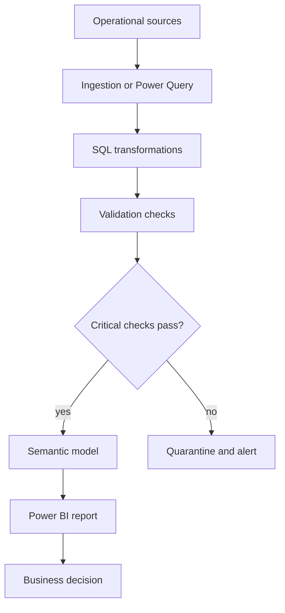
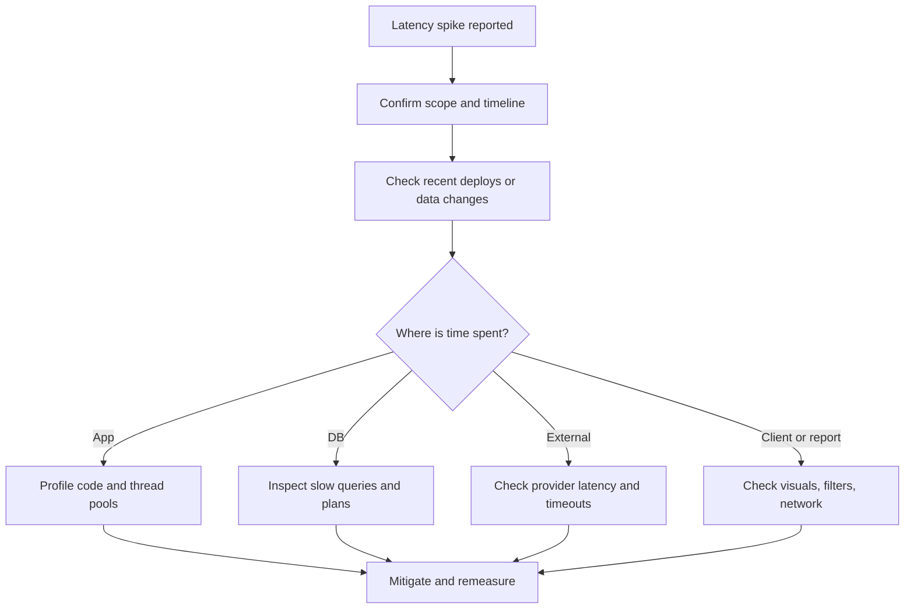
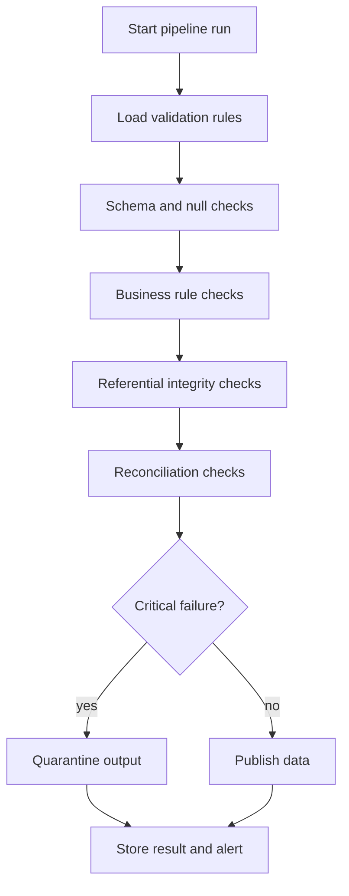
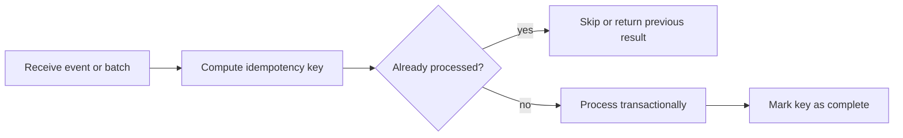
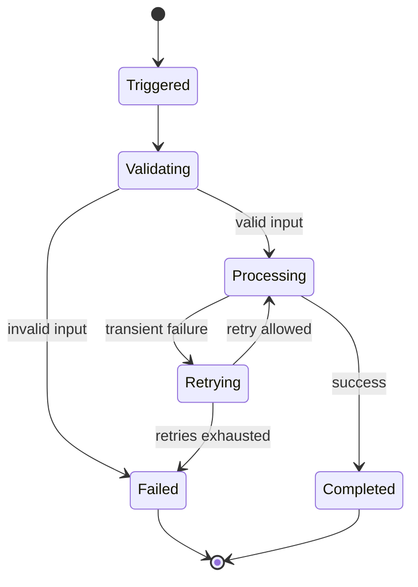
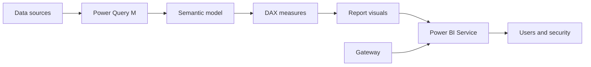
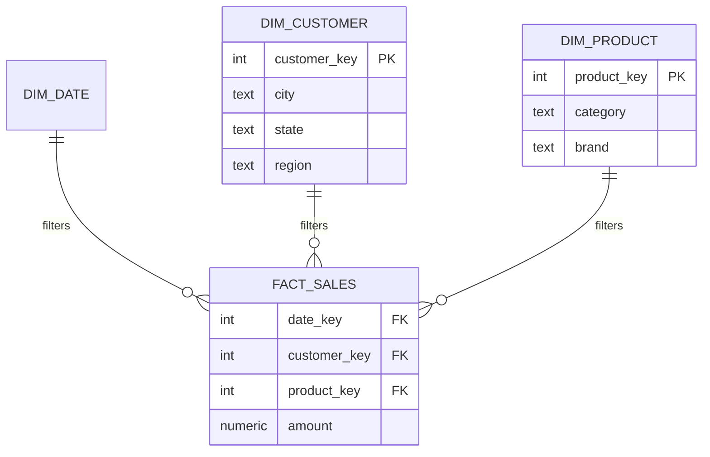
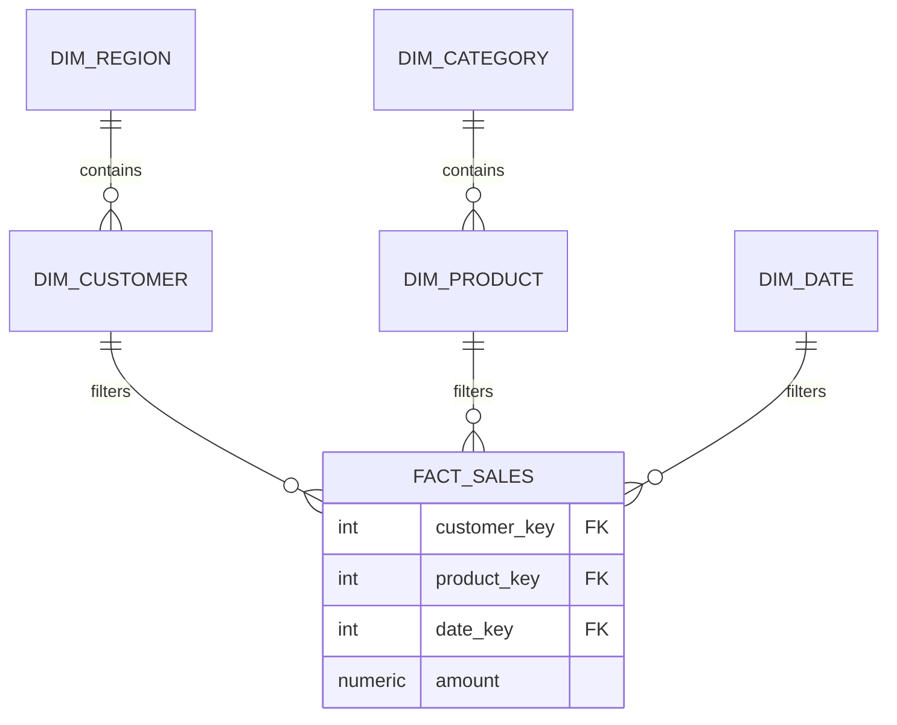
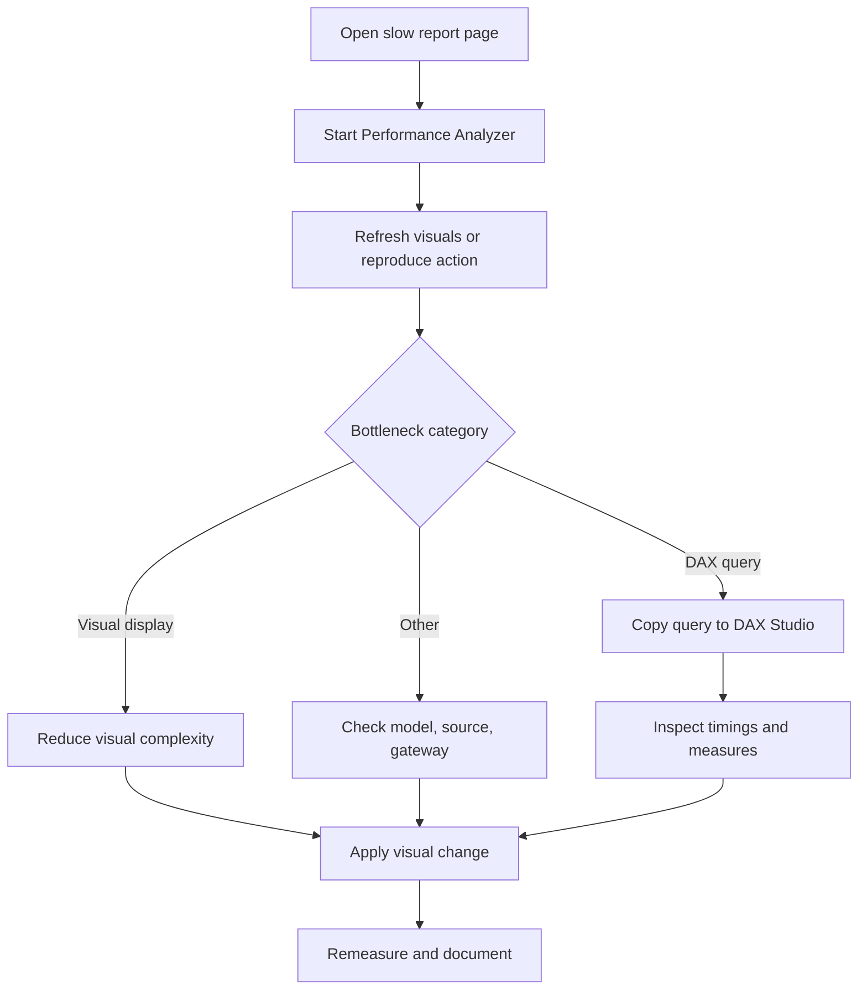
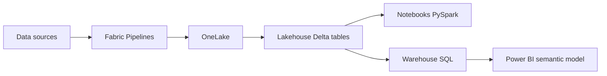

# 18 · Power BI, Microsoft Fabric, and Data Engineering for Backend Interviews

This guide prepares Mohd Azam Ansari to discuss MAQ Software's SQL, Power BI, Fabric, Power Automate, and validation work while applying for Java backend SDE roles. About 60% is transferable backend value; about 40% covers Power BI/Fabric concepts you must defend because they appear on the resume.

**Table of Contents**
- [Beginner guide to this file](#beginner-guide-to-this-file)
- [STAR Stories for Resume Work Bullets](#star-stories-for-resume-work-bullets)
- [Transferable SQL, Validation, Automation, and Backend-Fit Questions](#transferable-sql-validation-automation-and-backend-fit-questions)
- [Power BI and Fabric Concept Questions](#power-bi-and-fabric-concept-questions)
- [Revision Cheat Sheet](#revision-cheat-sheet)
- [Flashcards](#flashcards)

🟢 Beginner · 🟡 Intermediate · 🔴 Advanced · ⚫ FAANG · 🔥 = very frequently asked

> Replace every `[placeholder]` with verified facts before interviews. Do not invent dashboards, clients, internal table names, incidents, or exact metrics.

## Beginner guide to this file

### What this file teaches

This file teaches how data work becomes backend interview evidence: Structured Query Language (SQL) tuning,
validation, automation, Microsoft Power BI where Business Intelligence (BI) means reporting and analytics,
Microsoft Fabric, semantic models, and Data Analysis Expressions (DAX). Interviewers ask these topics to see
whether a learner can defend resume claims with verified evidence, explain how data moves from source
systems to reports, and translate that work into Java backend reliability, Application Programming Interface
(API) performance, and production ownership without inventing metrics or responsibilities.

### Mental model

Think of the platform as a restaurant: source systems are suppliers, pipelines are the kitchen line,
validation checks are food safety, the semantic model is the menu, DAX measures are recipes, and reports are
the served dishes. Backend transfer happens when you explain the same discipline as reliable APIs and
databases.
- Data sources provide raw facts; ingestion and Extract, Transform, Load (ETL) or Extract, Load, Transform
(ELT) move them safely.
- SQL tuning and indexes reduce the cost of finding, joining, and grouping rows before reports or APIs wait
on them.
- Validation, reconciliation, and idempotency protect correctness when data or workflows rerun.
- Semantic models, relationships, and DAX define how business questions become reusable measures.
- Power BI and Fabric choices trade freshness, performance, cost, security, and operational complexity.
- Every resume claim needs before/after evidence, tool output, stakeholder checks, or a clear placeholder to
verify.

### How to think through any question here

1. Name the concept in plain language before using the product term, such as saying a semantic model is the
shared meaning layer for reports.
2. State the data grain, source, transformation, and consumer so the interviewer can see the end-to-end
flow.
3. Separate measured facts from placeholders; use verified before/after timings, row counts, checks, or say
what must be verified.
4. Find the bottleneck or risk: query plan, model design, DAX context, refresh path, security rule, or
workflow retry.
5. Explain the fix with one concrete mechanism, then explain how you proved the output stayed correct.
6. Map the lesson to backend engineering: latency, data contracts, observability, idempotency, privacy, or
reliability.
7. Close with a trade-off, such as faster reads versus slower writes, fresher data versus source load, or
automation versus manual approval.

### Pattern recognition cues

| If the question mentions... | Think about... | Why it fits |
|---|---|---|
| 70% improvement or a slow dashboard | Baseline, bottleneck, exact change, and verified before/after proof | Metrics are defensible only when the same workload is measured fairly. |
| Indexes, execution plans, or sargability | Predicate shape, join columns, row estimates, and write cost | SQL performance depends on how easily the engine can find rows. |
| Validation, reconciliation, or data defects | Nulls, duplicates, missing keys, freshness, totals, and alerts | Reports and APIs are trusted only when bad data is caught early. |
| Idempotency, retries, or automation | Correlation keys, upserts, safe reruns, and failure notifications | Production workflows fail and retry, so duplicate side effects must be controlled. |
| ETL, ELT, pipelines, or backend transfer | Where transformation runs and how data moves between systems | This connects data engineering flow to API and database design. |
| Semantic model, relationships, or star schema | Facts, dimensions, grain, cardinality, and reusable measures | The model defines how business users query data consistently. |
| DAX, CALCULATE, or filter context | Current filter set, row context, and context transition | DAX answers change when the evaluation context changes. |
| Import, DirectQuery, or Direct Lake | Storage mode, freshness, performance, source load, and capacity | Power BI and Fabric performance starts with where queries execute. |
| Fabric Lakehouse, Warehouse, OneLake, or Delta | Storage, tables, notebooks, pipelines, and SQL endpoints | Fabric questions test whether you know the roles of each platform piece. |
| Privacy, Row-Level Security, or Object-Level Security | Least privilege, role testing, masking, and auditability | Data products can leak information unless access is enforced below the visual layer. |
| Backend resume rewrite | Transferable impact, verified facts, and honest scope | The goal is to translate data work, not pretend it was a backend-only project. |

### Abbreviations and key terms

| Short form | Expanded form | Plain meaning |
|---|---|---|
| ABS | Absolute value function | SQL or DAX function that returns distance from zero. |
| ACID | Atomicity, Consistency, Isolation, Durability | Database transaction guarantees that protect correctness. |
| AI | Artificial Intelligence | Software that assists with reasoning, generation, or prediction. |
| ALL | DAX ALL function | Removes filters from a column or table when calculating a measure. |
| API | Application Programming Interface | Contract a backend exposes for other software to call. |
| BI | Business Intelligence | Reporting and analytics used to support decisions. |
| CALCULATE | DAX CALCULATE function | Evaluates an expression after changing filter context. |
| CI | Continuous Integration | Automated build and test checks run after code changes. |
| CPU | Central Processing Unit | Processor time consumed by queries, refreshes, or services. |
| DAX | Data Analysis Expressions | Formula language used for Power BI measures and calculated logic. |
| DB | Database | System that stores and queries structured data. |
| Direct Lake | Microsoft Fabric Direct Lake mode | Reads Delta tables from OneLake without traditional import in many scenarios. |
| DirectQuery | Power BI DirectQuery mode | Leaves data in the source and queries it live. |
| ELT | Extract, Load, Transform | Load data first, then transform it in the destination platform. |
| ER | Entity Relationship | Diagram style showing tables/entities and relationships. |
| ETL | Extract, Transform, Load | Transform data before loading it into the target system. |
| FAANG | Facebook, Amazon, Apple, Netflix, Google | Shorthand for large product-company interview style. |
| FILTER | DAX FILTER function | Returns rows that match a condition for later calculation. |
| FK | Foreign Key | Column that points to a primary key in another table. |
| ID | Identifier | Value that uniquely names a row, user, request, or object. |
| JDBC | Java Database Connectivity | Java API for connecting to relational databases. |
| JPA | Java Persistence API | Java standard for mapping objects to relational data. |
| JWT | JSON Web Token | Signed token commonly used for authentication claims. |
| Lakehouse | Lakehouse architecture | Storage pattern combining data lake files with table-like analytics. |
| MAQ | MAQ Software | Employer name in the resume context, not a technical claim by itself. |
| ML | Machine Learning | Algorithms that learn patterns from data. |
| OLS | Object-Level Security | Power BI security that hides tables or columns from roles. |
| OneLake | Microsoft Fabric OneLake | Tenant-wide storage layer for Fabric data. |
| ORM | Object Relational Mapping | Technique that maps Java objects to relational tables. |
| PK | Primary Key | Column or columns that uniquely identify a table row. |
| Query folding | Source-side query translation | Power Query pushes transformations back to the data source. |
| RED | Rate, Errors, Duration | Service-health metric set often used for APIs. |
| REST | Representational State Transfer | Common style for HTTP APIs. |
| RLS | Row-Level Security | Rules that restrict which rows a user can see. |
| SDE | Software Development Engineer | Engineering role level used in interviews and resumes. |
| Semantic model | Shared business meaning layer | Tables, relationships, measures, and security used by reports. |
| SLA | Service-Level Agreement | Reliability or response-time promise to users or stakeholders. |
| SQL | Structured Query Language | Language for querying relational databases. |
| STAR | Situation, Task, Action, Result | Interview structure for explaining experience with evidence. |
| Star schema | Fact and dimension model | Analytics model centered on facts with descriptive dimensions. |
| SUMX | DAX iterator SUMX | Evaluates an expression row by row and then sums the results. |
| USERPRINCIPALNAME | DAX USERPRINCIPALNAME function | Returns the signed-in user identity for security logic. |
| VALUES | DAX VALUES function | Returns distinct visible values in the current filter context. |
| VertiPaq | Power BI columnar storage engine | Compressed in-memory engine behind Import-model performance. |
| Warehouse | Relational analytics warehouse | SQL-friendly store for curated reporting tables. |

### Common beginner traps

- Repeating the 70% or 90% numbers without verified before/after measurements, tool names, and equal test
conditions.
- Explaining Power BI visuals but skipping the source data, semantic model grain, relationships, and DAX
context.
- Treating SQL tuning as guesswork instead of using an execution plan, actual timings, and correctness
checks.
- Claiming ownership of internal systems, clients, dashboards, or incidents that have not been verified.
- Confusing Import, DirectQuery, and Direct Lake, then choosing based on buzzwords instead of freshness and
workload.
- Forgetting security: report filters are not a substitute for tested Row-Level Security or backend
authorization.
- Failing to translate data experience into backend language such as APIs, latency, idempotency,
observability, and contracts.

### How to study this file

1. Read the short answer first and say it aloud in 30 seconds without adding unverified facts.
2. Use the detailed answer to draw the flow: source, SQL or pipeline, validation, semantic model, DAX,
report, and user.
3. Replace every placeholder with verified evidence or mark it as unknown; never memorize a made-up metric.
4. Convert each flashcard into one example from your own work, then one backend analogy.
5. Practice follow-ups by explaining the trade-off and the proof you would show, such as a plan, count, log,
or timing.
6. Once a week, retell one STAR story and one Power BI/Fabric concept as if the interviewer has never used
those tools.

### Scalability and production lens

Toy reports can run from one table with manual checks, but production data systems need repeatable
ingestion, safe retries, partitioning, observability, access control, lineage, and rollback plans. For
interview answers, explain what changes as data volume, users, or freshness needs grow: indexes may hurt
writes, DirectQuery can overload sources, DAX iterators can become expensive, incremental refresh needs
reliable dates, and automation needs alerts plus human approval for risky steps.

## STAR Stories for Resume Work Bullets

| Resume bullet | STAR story with placeholders |
|---|---|
| Optimized complex SQL queries and semantic data models, improving dashboard and query performance by 70%. | **Situation:** `[dashboard/report/query]` was slow, taking `[before]` for `[interaction/refresh/query]`. **Task:** reduce latency without changing business output. **Action:** analyzed `[Performance Analyzer/DAX Studio/SQL plan]`, found `[bottleneck]`, added `[index]`, rewrote `[query/DAX]`, and optimized `[model table/relationship/column]`. **Result:** improved from `[before]` to `[after]`, a `[70% or exact]` improvement, validated by `[tool/check]`. |
| Automated repetitive workflows using Power Automate, reducing manual effort by 90%. | **Situation:** `[workflow]` required `[manual steps/hours]` every `[frequency]`. **Task:** automate repeatable steps while preserving approvals and auditability. **Action:** built a flow with `[trigger]`, `[conditions]`, `[connectors]`, retry/error branches, and owner notifications. **Result:** reduced effort from `[before]` to `[after]`, approximately `[90% or exact]`, with `[remaining manual review]`. |
| Implemented data validation and integrity checks that reduced downstream reporting defects. | **Situation:** Reports could be affected by `[nulls/duplicates/missing keys/freshness/reconciliation mismatch]`. **Task:** catch defects before publication. **Action:** implemented `[SQL checks/pipeline checks/model checks]`, logged failures, and alerted `[owner/channel]`. **Result:** prevented `[defect example]`, reduced defects by `[number/%]`, and improved trust in `[report/process]`. |



## Transferable SQL, Validation, Automation, and Backend-Fit Questions

### Q1. You improved dashboard and query performance by 70%. Walk me through exactly what changed.
`🟡 Intermediate` `🔥` `Must-know SDE-1`

**Why they ask:** Metrics must be measurable and technically defensible.

**Beginner lens:** A performance claim is like a stopwatch comparison: it only means something if the start,
finish, and route are the same. The interviewer is testing whether the 70% number came from verified
evidence, not memory. Name the report or query, the bottleneck, the exact change, and the tool or check that
proved both speed and output correctness; use placeholders until the real before/after values are verified.

**Short answer (say this first, 20-40 sec):**
I would explain the specific report or query, the baseline, the bottleneck, the change, and the final measurement. The safe template is: `[query/report]` improved from `[before]` to `[after]` after I changed `[index/query/model/DAX]`, verified with `[tool]`. If the metric was approximate, I should rewrite it with exact before/after numbers.

**Detailed answer:**
- Measurement formula: `(before - after) / before × 100`.
- Compare same filters, same report page, similar data volume, and repeated runs.
- Possible changes:
  - added composite index,
  - made predicate sargable,
  - reduced `SELECT *`,
  - removed high-cardinality columns,
  - optimized DAX measure,
  - reduced visual count.

**Common mistakes:**
- Saying "70%" without before/after.
- Mixing refresh time, visual time, and SQL time.
- Not proving output correctness.

**Follow-ups:**
- *What tool measured it?* → "Use `[Performance Analyzer/DAX Studio/EXPLAIN ANALYZE]`; fill the real tool."
- *How did you verify correctness?* → Compare row counts, totals, sample records, and stakeholder-approved outputs.

### Q2. Which SQL indexes would you add for a slow backend/report query?
`🟡 Intermediate` `🔥` `Must-know SDE-1`

**Why they ask:** Indexing is core for backend and BI performance.

**Beginner lens:** An index is like a library catalog for rows: it helps the database jump to likely matches
instead of reading every page. Look for filters, joins, grouping, and ordering because those are the paths
the query repeatedly travels. The interviewer is testing whether you balance faster reads against slower
writes and extra storage, and whether you verify with an execution plan rather than adding indexes blindly.

**Short answer (say this first, 20-40 sec):**
I choose indexes from query predicates, joins, grouping, and ordering. A good composite index usually starts with equality filters, then range/order columns, and optionally includes projected columns. I verify with an execution plan and actual timing, not intuition.

**Detailed answer:**
```sql
-- PostgreSQL example
CREATE INDEX idx_orders_customer_created
ON orders (customer_id, created_at DESC)
INCLUDE (status, total_amount);

EXPLAIN (ANALYZE, BUFFERS)
SELECT status, SUM(total_amount)
FROM orders
WHERE customer_id = $1
  AND created_at >= $2
GROUP BY status;
```
- Composite index column order matters.
- Covering indexes reduce table lookups.
- Indexes increase storage and write cost.

**Common mistakes:**
- Indexing every column.
- Ignoring selectivity.
- Not checking whether the optimizer uses the index.

**Follow-ups:**
- *What if writes become slow?* → Drop unused indexes, use partial indexes, batch writes, or separate read replicas.
- *What is a partial index?* → An index on only rows matching a predicate.

### Q3. How do you read an execution plan at a junior-to-mid level?
`🟡 Intermediate` `🔥` `Must-know SDE-1`

**Why they ask:** They want evidence-based performance reasoning.

**Beginner lens:** An execution plan is the database engine route map. Do not stare only at the final cost;
compare estimated rows with actual rows, look for large scans, expensive joins, sorts, spills, and high
buffer reads. This applies whenever a SQL query or report is slow. The production habit is to capture the
plan before and after, then prove the result set did not change.

**Short answer (say this first, 20-40 sec):**
I look for table scans on large tables, wrong row estimates, expensive joins, sorts, hash operations, and high actual time or buffer reads. Then I map the bottleneck to a query or index change. I always compare actual plan before and after.

**Detailed answer:**
- Important plan signals:
  - sequential scan on large table,
  - nested loop with many rows,
  - sort spilling to disk,
  - estimated rows very different from actual rows,
  - high shared buffer reads.
- Fix options:
  - update statistics,
  - add/select better index,
  - rewrite predicate,
  - reduce selected columns,
  - change join order by query rewrite if needed.

**Common mistakes:**
- Looking only at estimated cost.
- Ignoring actual rows.
- Changing schema without proving the bottleneck.

**Follow-ups:**
- *Why can estimates be wrong?* → Stale stats, skewed data, correlated columns, or complex predicates.
- *What is `EXPLAIN ANALYZE`?* → It runs the query and reports actual execution details.

### Q4. Give an example of making a query sargable.
`🟢 Beginner` `🔥` `Must-know SDE-1`

**Why they ask:** It is a common SQL tuning concept.

**Beginner lens:** Sargable means the search condition can use an index, like looking under the right
alphabet tab instead of scanning the whole book. Wrapping an indexed column in a function often hides the
searchable value. Recognize this in date filters, case-insensitive search, and range queries. The safer flow
is to rewrite the predicate, then confirm the plan uses the intended index.

**Short answer (say this first, 20-40 sec):**
A sargable predicate can use an index efficiently. Avoid wrapping indexed columns in functions in the `WHERE` clause. Use ranges or precomputed columns instead.

**Detailed answer:**
```sql
-- Bad: function applied to indexed column
WHERE DATE(created_at) = DATE '2026-09-23';

-- Better: range condition can use index on created_at
WHERE created_at >= TIMESTAMP '2026-09-23 00:00:00'
  AND created_at <  TIMESTAMP '2026-09-24 00:00:00';
```
- In backend APIs, this prevents slow queries as data grows.
- In reports, it reduces refresh or visual query time.

**Common mistakes:**
- Applying `LOWER(column)` without functional index.
- Using leading wildcard `LIKE '%abc'` and expecting normal index use.
- Not considering time zones for date ranges.

**Follow-ups:**
- *What if case-insensitive search is needed?* → Use normalized column, functional index, or DB-specific case-insensitive type.
- *What if users filter by local date?* → Convert boundaries carefully using user time zone.

### Q5. How do you validate that optimization did not change results?
`🟡 Intermediate` `🔥` `Must-know SDE-1`

**Why they ask:** Correctness beats speed.

**Beginner lens:** Optimization is not complete until the answer is still the same. Treat the old and new
outputs like two bank statements: totals, counts, samples, and edge rows should reconcile unless the
requirement changed. Interviewers test whether you protect correctness while improving speed. Use verified
row counts, checksums, stakeholder-approved totals, or regression queries instead of saying it looked fine.

**Short answer (say this first, 20-40 sec):**
I compare old and new outputs using counts, sums, row-level differences, and key business scenarios. If output differs, I investigate whether the old result was wrong or my rewrite introduced a bug. I only call it optimized after correctness and performance both pass.

**Detailed answer:**
```sql
-- Standard reconciliation pattern
SELECT 'old' AS version, COUNT(*) AS rows, SUM(amount) AS total_amount FROM old_result
UNION ALL
SELECT 'new' AS version, COUNT(*) AS rows, SUM(amount) AS total_amount FROM new_result;

-- Find missing keys
SELECT key FROM old_result
EXCEPT
SELECT key FROM new_result;
```
- Validate edge cases: nulls, late data, filters, duplicate keys.
- Save evidence: screenshots, query output, or test logs if allowed.

**Common mistakes:**
- Benchmarking only speed.
- Checking only one happy path.
- Not involving business definitions.

**Follow-ups:**
- *What if old and new differ by one row?* → Investigate; small differences can signal serious logic bugs.
- *What if old query was wrong?* → Document business approval for corrected logic.

### Q6. How does SQL tuning transfer to backend API engineering?
`🟢 Beginner` `🔥` `Must-know SDE-1`

**Why they ask:** Your current work is BI-heavy; they need backend relevance.

**Beginner lens:** SQL tuning transfers to backend work because an API often spends most of its time waiting
for the database. The mental model is request to service to query to response; a slow query makes the whole
API slow. Recognize this when endpoints filter, sort, paginate, or join data. Explain the same evidence
loop: measure, inspect plan, change query or index, test correctness.

**Short answer (say this first, 20-40 sec):**
Backend APIs are often only as fast as their database queries. SQL tuning teaches me to measure latency, inspect plans, design indexes, paginate results, and protect p95 performance. That directly applies to Java services using JDBC/JPA or repositories.

**Detailed answer:**
- Backend mapping:
  - report query latency → API DB latency,
  - model filters → API query parameters,
  - semantic model correctness → domain model correctness,
  - refresh SLA → batch job SLA.
- Example API rule: never return unbounded lists; use keyset pagination for large ordered data.

**Common mistakes:**
- Saying ORM means SQL no longer matters.
- Optimizing Java code while DB query dominates.
- Ignoring connection pool limits.

**Follow-ups:**
- *What is keyset pagination?* → Use last seen sort key instead of large offset.
- *What is N+1?* → One query for parent rows and one query per child relation.

### Q7. How would you investigate an API or report going from 100 ms to 5 s?
`🟡 Intermediate` `🔥` `Must-know SDE-1`

**Why they ask:** This is a common production scenario.

**Beginner lens:** A sudden jump from milliseconds to seconds is a triage problem, not a guessing game.
Trace the path from user action to API, database, model, DAX, visual, and network until one segment explains
most of the delay. The interviewer wants structured isolation. Compare recent changes, data volume, plan
shifts, refresh state, and logs before proposing a fix.

**Short answer (say this first, 20-40 sec):**
I would confirm scope, compare before/after metrics, check recent changes, inspect logs/traces, identify whether time is in app, DB, network, or external calls, then mitigate safely. I would not randomly add indexes before finding the bottleneck. The same diagnostic mindset applies to Power BI and backend APIs.

**Detailed answer:**


**Common mistakes:**
- Fixing before measuring.
- Not checking data volume growth.
- Ignoring p95/p99 tail latency.

**Follow-ups:**
- *What if only one customer is affected?* → Check tenant-specific data size, permissions, filters, and network.
- *What if DB CPU is high?* → Find top queries, locks, missing indexes, and recent load changes.

### Q8. Design a data validation system for reports or backend pipelines.
`🔴 Advanced` `🔥` `Must-know SDE-1`

**Why they ask:** Data correctness is transferable system design.

**Beginner lens:** A validation system is a quality gate on the data highway. It checks whether rows are
complete, unique, fresh, related correctly, and reconciled before consumers trust them. Recognize this when
the question mentions report defects or pipeline correctness. A good design separates rules, severity,
logging, alerting, and quarantine, then uses verified examples instead of claiming every defect was
eliminated.

**Short answer (say this first, 20-40 sec):**
I would define rules as metadata, run checks at ingestion, transformation, and serving layers, store results per pipeline run, and alert owners based on severity. Critical failures block publishing; warnings notify but do not block. The system must be idempotent and auditable.

**Detailed answer:**

- Rule examples: `not_null`, `unique`, `foreign_key_exists`, `amount >= 0`, freshness SLA, source-target sum match.
- Result table fields: run ID, rule ID, status, failed count, sample rows, timestamp.

**Common mistakes:**
- Only checking nulls.
- No audit history.
- No owner for alerts.

**Follow-ups:**
- *How avoid noisy alerts?* → Severity, thresholds, deduplication, and owner routing.
- *Where block data?* → Before serving/publishing if critical checks fail.

### Q9. Give SQL examples for data-quality checks.
`🟡 Intermediate` `🔥` `Must-know SDE-1`

**Why they ask:** They want implementation, not theory.

**Beginner lens:** SQL data-quality checks are queries that deliberately look for bad rows, not business
insights. Start with the output grain: one row per duplicate key, missing reference, null field, or failed
reconciliation. The interviewer tests whether you know where to use WHERE, GROUP BY, HAVING, and joins. Use
real table names only after verification; otherwise describe placeholders and the rule.

**Short answer (say this first, 20-40 sec):**
Common checks include null keys, duplicates, referential integrity, freshness, and reconciliation. I would run them per batch or pipeline run and store results. The exact checks depend on the business rules.

**Detailed answer:**
```sql
-- Duplicate business keys
SELECT order_id, COUNT(*) AS cnt
FROM fact_orders
GROUP BY order_id
HAVING COUNT(*) > 1;

-- Missing dimension references
SELECT f.customer_id, COUNT(*) AS bad_rows
FROM fact_orders f
LEFT JOIN dim_customer d ON d.customer_id = f.customer_id
WHERE d.customer_id IS NULL
GROUP BY f.customer_id;

-- Freshness breach
SELECT MAX(updated_at) AS latest_source_time
FROM source_orders
HAVING MAX(updated_at) < now() - INTERVAL '2 hours';
```

**Common mistakes:**
- No threshold for acceptable variance.
- Not storing failed samples.
- Checking after users already consumed data.

**Follow-ups:**
- *What is reconciliation?* → Comparing source and target counts/sums to catch missing or duplicated data.
- *What is a critical check?* → A failure that makes data unsafe to publish.

### Q10. What is idempotency in pipelines and workflows?
`🟡 Intermediate` `🔥` `Must-know SDE-1`

**Why they ask:** Idempotency is essential for retries.

**Beginner lens:** Idempotency means a rerun is safe, like pressing an elevator button twice without
creating two elevators. Pipelines and workflows need it because retries, network failures, and manual
replays happen. Recognize it when a process writes records, sends messages, or triggers approvals. Use
stable keys, upserts, checkpoints, and duplicate detection so retries do not create duplicate side effects.

**Short answer (say this first, 20-40 sec):**
Idempotency means running the same operation multiple times produces the same final result. In pipelines, rerunning a batch should not duplicate rows or send duplicate notifications. Use idempotency keys, upserts, checkpoints, and durable statuses.

**Detailed answer:**

```sql
INSERT INTO processed_batches (batch_id, status)
VALUES ($1, 'PROCESSING')
ON CONFLICT (batch_id) DO NOTHING;
```

**Common mistakes:**
- Retrying without unique keys.
- Using timestamps as unique identifiers.
- No handling for partially completed work.

**Follow-ups:**
- *How handle partial failure?* → Track states and retry from a checkpoint or use transactions.
- *What is upsert?* → Insert new row or update existing row on key conflict.

### Q11. How would you design an automated workflow with retries and alerts?
`🟡 Intermediate` `🔥` `Must-know SDE-1`

**Why they ask:** Your Power Automate bullet maps to backend orchestration.

**Beginner lens:** An automated workflow is a conveyor belt with sensors and alarms. Triggers start work,
actions transform or notify, retries handle temporary failures, and alerts bring in humans when automation
cannot decide safely. The interviewer is testing production judgment: classify transient versus permanent
failures, make each step idempotent, preserve audit history, and avoid hiding failed work behind silent
success.

**Short answer (say this first, 20-40 sec):**
I would define a trigger, validate input, execute actions, retry transient failures with backoff, record status, and alert an owner when retries are exhausted. Non-retryable business errors should fail fast. The workflow should be idempotent so retries do not create duplicates.

**Detailed answer:**


**Common mistakes:**
- Retrying bad input.
- No dead-letter or failure owner.
- No idempotency.

**Follow-ups:**
- *What is exponential backoff?* → Retry delays increase after each failure.
- *What should be logged?* → Correlation ID, state, error code, timing; avoid sensitive data.

### Q12. How did Power Automate reduce manual effort by 90%?
`🟢 Beginner` `🔥` `Must-know SDE-1`

**Why they ask:** They challenge the metric.

**Beginner lens:** The 90% manual-effort claim must be defended like any other metric: count the original
steps or time, count the remaining manual review, and show how the flow changed. Power Automate is only the
mechanism. Explain the trigger, conditions, connectors, retries, approvals, and evidence. If the exact
number is not verified, keep it as a placeholder instead of overstating ownership.

**Short answer (say this first, 20-40 sec):**
The safe answer is to quantify time or steps. For example, `[workflow]` previously took `[X minutes]` per run and ran `[N]` times per week; after automation, humans spent `[Y minutes]` on review/exception handling. That gives the percentage reduction.

**Detailed answer:**
- Formula: `(manual_before - manual_after) / manual_before × 100`.
- Include remaining manual approvals.
- Include failure-handling effort if frequent.
- If you do not know exact numbers, use `[placeholder]` and update the resume.

**Common mistakes:**
- Treating automated runtime as human time saved.
- Ignoring failed-run recovery.
- Not knowing frequency.

**Follow-ups:**
- *What if the flow fails?* → Retry transient failures, alert owner, and support replay.
- *How do you avoid duplicate approvals?* → Use a unique business key and status check.

### Q13. Why move from BI to backend engineering?
`🟢 Beginner` `🔥` `Must-know SDE-1`

**Why they ask:** They need motivation and fit.

**Beginner lens:** Moving from BI to backend is a translation story, not an apology. BI work teaches data
correctness, performance, user impact, and production communication; backend work applies those habits to
APIs, services, databases, and reliability. The interviewer is testing motivation and scope honesty. Say
what you actually did, what transfers, and what backend skills you are deliberately building next.

**Short answer (say this first, 20-40 sec):**
BI gave me strong exposure to SQL performance, data correctness, and business impact, but I want to build the services and APIs that power such systems. Backend engineering lets me work deeper on system design, reliability, APIs, databases, and scalable product features. I am preparing with Java, Spring Boot, REST projects, and testing.

**Detailed answer:**
- Positive framing:
  - "I value my BI experience."
  - "It made me performance- and correctness-oriented."
  - "I want broader ownership of API behavior and backend systems."
- Mention project proof: AI Email Reply Assistant and planned Spring Boot project.

**Common mistakes:**
- Saying BI is less technical.
- Sounding like you are escaping current work.
- No backend preparation evidence.

**Follow-ups:**
- *How does BI make you better?* → Strong SQL, performance measurement, data modeling, validation mindset.
- *What gaps are you closing?* → JPA, Redis, Kafka, JWT, tests, CI, deployment.

### Q14. How does BI experience make you a better backend engineer?
`🟢 Beginner` `🔥` `Must-know SDE-1`

**Why they ask:** They want transferable value.

**Beginner lens:** BI experience helps backend engineering when you focus on consumers and contracts.
Reports break when data definitions drift; APIs break when response contracts drift. Semantic-model thinking
maps to domain modeling, validation maps to service invariants, and performance tuning maps to latency work.
Avoid claiming unverified backend ownership; explain the verified habits that make you safer on backend
systems.

**Short answer (say this first, 20-40 sec):**
BI taught me to think from the user's data-consumption perspective, measure performance, and protect data correctness. Backend APIs also need fast queries, accurate data, clear contracts, and reliable workflows. That background helps me build services that are not just functional but trustworthy and measurable.

**Detailed answer:**
| BI skill | Backend equivalent |
|---|---|
| Report latency tuning | API p95 latency tuning |
| Semantic model design | Domain/read model design |
| Data validation | Input validation and invariants |
| Refresh monitoring | Job monitoring and SLAs |
| Power Automate | Event-driven workflow automation |

**Common mistakes:**
- Apologizing for BI.
- Not connecting to backend examples.
- Ignoring Spring Boot project.

**Follow-ups:**
- *What is one backend habit from BI?* → Measure before optimizing.
- *What is one data habit from backend?* → Use contracts and tests to protect correctness.

### Q15. Explain ETL vs ELT and which you used.
`🟢 Beginner` `🔥` `Must-know SDE-1`

**Why they ask:** It is foundational data engineering vocabulary.

**Beginner lens:** ETL and ELT differ by where transformation happens. ETL cleans and shapes data before
loading; ELT loads raw data first and transforms inside the destination platform. Recognize the question as
a data-flow and ownership check. State which pattern you actually used only if verified, then explain why
the chosen location made sense for cost, scale, tooling, and governance.

**Short answer (say this first, 20-40 sec):**
ETL means extract, transform, then load into the target. ELT means extract, load raw data first, then transform inside the warehouse/lakehouse. Modern cloud data platforms often prefer ELT because storage is cheap and compute can transform at scale.

**Detailed answer:**
- ETL: transformation happens before loading target.
- ELT: raw or lightly processed data lands first; SQL/Spark transforms later.
- Use ETL when target cannot handle raw data or governance requires pre-cleaning.
- Use ELT for auditability, reprocessing, and scalable transformations.

**Common mistakes:**
- Treating one as always better.
- Not considering governance and data sensitivity.
- No replay strategy.

**Follow-ups:**
- *Where does validation run?* → Both before loading critical data and after transformations.
- *How does this map to backend?* → Batch jobs, event processing, and read-model construction.

### Q16. How would you design an idempotent ETL or ELT pipeline?
`🔴 Advanced` `Must-know SDE-1`

**Why they ask:** It tests reliability beyond BI tools.

**Beginner lens:** An idempotent ETL or ELT pipeline is designed so reprocessing a batch does not corrupt
totals or duplicate rows. Think of labeled boxes moving through checkpoints. Use source keys, batch
identifiers, watermarks, staging tables, merge or upsert logic, and validation after load. The interviewer
is testing whether you design for retries and partial failures, not just the happy path.

**Short answer (say this first, 20-40 sec):**
Use deterministic batch IDs, staging tables, upserts/merge, checkpoints, and atomic publish steps. Rerunning the same batch should not duplicate rows or publish partial output. Store pipeline run metadata and validation results.

**Detailed answer:**
```sql
-- PostgreSQL-style upsert
INSERT INTO target_orders (order_id, status, amount, updated_at)
SELECT order_id, status, amount, updated_at
FROM staging_orders
WHERE batch_id = $1
ON CONFLICT (order_id)
DO UPDATE SET
  status = EXCLUDED.status,
  amount = EXCLUDED.amount,
  updated_at = EXCLUDED.updated_at;
```
- Staging isolates raw load.
- Validation checks run before publish.
- Publish by partition swap or status flag when possible.

**Common mistakes:**
- Appending every run.
- No unique keys.
- Publishing before validation.

**Follow-ups:**
- *What is a checkpoint?* → Stored progress marker for safe resume.
- *What is atomic publish?* → Users see either old complete data or new complete data, not partial data.

### Q17. What metrics would you track for data and backend reliability?
`🟡 Intermediate` `Must-know SDE-1`

**Why they ask:** Monitoring mindset matters.

**Beginner lens:** Reliability metrics are dashboard instruments, not resume decoration. For data systems,
track freshness, completeness, duplicate rate, reconciliation differences, refresh duration, failures, and
alert response; for backend systems, track latency, errors, throughput, and saturation. The interviewer
wants practical observability. Do not invent numbers; say which metrics should be captured and fill exact
values only from verified evidence.

**Short answer (say this first, 20-40 sec):**
For backend, track request rate, error rate, p95 latency, saturation, and downstream failures. For data, track freshness, completeness, duplicate count, reconciliation variance, validation failures, and pipeline duration. Metrics need alerts with owners and run IDs.

**Detailed answer:**
- Backend: RED metrics: rate, errors, duration.
- Data: freshness, volume, schema drift, rule failures.
- Automation: run success rate, retry count, failure reason.
- BI: refresh duration, visual query time, model size.

**Common mistakes:**
- Tracking dashboards no one owns.
- No alert thresholds.
- Alerting on symptoms without context.

**Follow-ups:**
- *What is alert fatigue?* → Too many low-value alerts causing ignored incidents.
- *What is an SLA?* → Expected service level such as freshness by 8 AM or p95 below 300 ms.

### Q18. How do you explain a SQL tuning story using STAR?
`🟢 Beginner` `🔥` `Must-know SDE-1`

**Why they ask:** Behavioral and technical loops combine.

**Beginner lens:** A STAR story is a clean evidence chain: situation, task, action, result. For SQL tuning,
the story should move from a slow query or report to the measured bottleneck, the exact index or rewrite,
and the verified outcome. The interviewer is testing whether you can communicate impact without
exaggeration. Use placeholders until before/after timing and correctness checks are confirmed.

**Short answer (say this first, 20-40 sec):**
Situation: `[report/query]` was slow. Task: reduce time while preserving output. Action: measured with `[tool]`, found `[bottleneck]`, implemented `[fix]`, and validated results. Result: improved from `[before]` to `[after]`.

**Detailed answer:**
- Keep it under two minutes.
- Include one technical detail: index column order, sargable rewrite, or model optimization.
- Include one correctness check.
- Include one lesson learned.

**Common mistakes:**
- Spending all time on business context.
- No technical detail.
- No result measurement.

**Follow-ups:**
- *What did you personally do?* → State exact analysis and implementation tasks.
- *What would you do differently?* → Add automated regression benchmarks and documentation.

### Q19. What is a safe answer when you do not know exact internal details?
`🟢 Beginner` `🔥` `Must-know SDE-1`

**Why they ask:** Honesty is better than fabrication.

**Beginner lens:** A safe unknown-detail answer protects confidentiality and credibility. The mental model
is a zoomed-out map: describe the type of source, check, model, or workflow without naming private clients,
tables, or incidents. This applies when you cannot remember or disclose exact internals. Interviewers prefer
honest boundaries plus a clear method over invented specifics.

**Short answer (say this first, 20-40 sec):**
I should say what I know, mark what I would verify, and avoid inventing internal facts. For example: "I worked on the query/model layer; deployment details were handled by `[team]`. I would verify `[detail]` in our docs before giving an exact answer." This keeps trust.

**Detailed answer:**
- Use:
  - "My direct work was..."
  - "The team-level system was..."
  - "I would need to verify..."
  - "A likely approach is..."
- Do not disclose confidential internal data.

**Common mistakes:**
- Guessing table names or client data.
- Overclaiming ownership.
- Saying "I do not know" without explaining how you would find out.

**Follow-ups:**
- *Will this hurt me?* → No; precise honesty usually helps.
- *How to prepare?* → Replace placeholders with non-confidential verified examples.

### Q20. How would you rewrite BI work for a Java backend resume?
`🟢 Beginner` `Must-know SDE-1`

**Why they ask:** Resume fit and communication.

**Beginner lens:** Rewriting BI work for a Java backend resume means translating impact into
backend-relevant language while preserving truth. A semantic model can become data modeling experience, SQL
tuning can become query-performance work, and validation can become data-integrity checks. The interviewer
is testing scope honesty. Keep Power BI or Fabric context where relevant and do not relabel report ownership
as service ownership unless verified.

**Short answer (say this first, 20-40 sec):**
I would keep BI work but emphasize SQL optimization, data correctness, automation, and measurable reliability. I would avoid tool-heavy wording that sounds like a BI-only role. I would add backend projects with Java, JPA, Redis, tests, and CI to balance the resume.

**Detailed answer:**
- Rewrite:
  - "Optimized SQL query latency from `[before]` to `[after]` using indexing and execution-plan analysis."
  - "Built validation checks that blocked `[defect]` before report publication."
  - "Automated workflow with retries, alerts, and idempotent status handling."

**Common mistakes:**
- Removing MAQ work entirely.
- Listing every Power BI feature above Java backend work.
- Keeping unsupported keywords.

**Follow-ups:**
- *Should Power BI stay?* → Yes, but under engineering impact.
- *What should be above certifications?* → Projects and work bullets.

### Q21. How would you handle data privacy in reports and backend systems?
`🟡 Intermediate` `Must-know SDE-1`

**Why they ask:** Data systems often include sensitive information.

**Beginner lens:** Data privacy is the habit of showing each user only what they are allowed to see. In
reports, that may involve Row-Level Security, masking, and role testing; in backend systems, authorization,
validation, and audit logs do similar work. Recognize privacy questions when data is sensitive, personal, or
role-dependent. Production answers must include verification, not just UI hiding.

**Short answer (say this first, 20-40 sec):**
I would apply least privilege, row-level restrictions, masking where needed, secure secret handling, and avoid unnecessary logging of sensitive data. In backend systems, the same ideas become authorization, access control, audit logs, and safe retention. Privacy must be designed, not added later.

**Detailed answer:**
- Controls:
  - role-based access,
  - RLS or API authorization checks,
  - column masking,
  - encryption in transit/at rest,
  - audit trails,
  - retention limits.

**Common mistakes:**
- Assuming report users can see all data.
- Logging raw sensitive fields.
- No access reviews.

**Follow-ups:**
- *RLS vs API auth?* → RLS filters data in model/database; API auth controls service access and operations.
- *What is least privilege?* → Give users only access required for their role.

### Q22. How would you design reconciliation between source and report?
`🟡 Intermediate` `Must-know SDE-1`

**Why they ask:** It tests data correctness engineering.

**Beginner lens:** Reconciliation is comparing two versions of truth, like matching a bank ledger to a
statement. First define the grain: per day, account, customer, product, or report total. Then compare
counts, sums, missing keys, and tolerated rounding differences. Interviewers test whether you can prove
reports match sources. Use verified source names and thresholds only when you have them.

**Short answer (say this first, 20-40 sec):**
I would compare source and target counts, sums, distinct keys, and freshness for the same business date or batch. Results should be stored with run ID and thresholds. Critical mismatches should block publish or alert owners.

**Detailed answer:**
```sql
SELECT
  s.business_date,
  s.source_count,
  t.target_count,
  s.source_amount,
  t.target_amount,
  ABS(s.source_amount - t.target_amount) AS amount_diff
FROM source_daily_summary s
JOIN target_daily_summary t
  ON t.business_date = s.business_date
WHERE ABS(s.source_amount - t.target_amount) > 0.01;
```

**Common mistakes:**
- Comparing different date windows.
- No tolerance for rounding when appropriate.
- No owner for mismatches.

**Follow-ups:**
- *What if late-arriving data exists?* → Use watermarks, grace periods, and correction runs.
- *What if source is wrong?* → Escalate; target cannot magically fix source truth.

### Q23. What is a good answer to "Tell me about a production issue" if you cannot disclose details?
`🟢 Beginner` `Must-know SDE-1`

**Why they ask:** They want incident learning and ownership.

**Beginner lens:** A confidential production-issue answer should be anonymized but concrete. Use the STAR
structure with placeholders: a report, pipeline, or query had a symptom; you investigated with logs, plans,
checks, or stakeholders; you fixed or escalated safely; and you learned a prevention step. The interviewer
is testing ownership and judgment, not secret details or inflated heroics.

**Short answer (say this first, 20-40 sec):**
I can describe the class of issue without confidential data: `[slow refresh/schema change/validation failure/flow failure]`. I should explain detection, impact, mitigation, root cause, and prevention. If I did not own a production incident, I should say I supported or learned from it rather than exaggerating.

**Detailed answer:**
- Safe structure:
  - "A report/pipeline experienced `[issue type]`."
  - "We detected it via `[alert/user report/log]`."
  - "My role was `[analysis/fix/validation]`."
  - "Prevention was `[check/test/monitoring]`."

**Common mistakes:**
- Sharing confidential client details.
- Claiming ownership you did not have.
- No prevention step.

**Follow-ups:**
- *What did you learn?* → "Add validation/monitoring earlier and document rollback steps."
- *How would backend handle it?* → "Tracing, metrics, alerts, runbooks, rollback."

## Power BI and Fabric Concept Questions

### Q24. Explain Power BI architecture end to end.
`🟢 Beginner` `🔥` `Must-know SDE-1`

**Why they ask:** You list Power BI and must explain your work context.

**Beginner lens:** Power BI architecture is a data journey: sources feed Power Query or ingestion, a
semantic model defines tables, relationships, measures, and security, and visuals query that model. The
interviewer is checking whether you understand where performance and correctness problems can occur. Explain
each layer plainly and tie evidence to the layer you actually worked on.

**Short answer (say this first, 20-40 sec):**
Power BI typically has data sources, Power Query for extraction/transformation, a semantic model with relationships and DAX measures, report visuals, and Power BI Service for sharing, refresh, security, and gateways. Performance can be affected at each layer. My work touched `[SQL/model/report/refresh]` layers.

**Detailed answer:**

- Power Query: shape data before model.
- Semantic model: tables, relationships, measures.
- Service: sharing, refresh, workspaces, RLS, gateways.

**Common mistakes:**
- Calling a report the whole Power BI system.
- Ignoring semantic model.
- Not knowing gateway role.

**Follow-ups:**
- *What is a gateway?* → Bridge for Power BI Service to access on-premises data.
- *Where is DAX used?* → Measures, calculated columns/tables, and queries over the model.

### Q25. Star schema vs snowflake schema: explain with ER diagrams.
`🟡 Intermediate` `🔥` `Must-know SDE-1`

**Why they ask:** Data modeling is central to Power BI and transferable DB design.

**Beginner lens:** A star schema is like a central receipt table surrounded by descriptive lookup tables; a
snowflake schema splits some descriptions into more normalized tables. The key distinction is simplicity and
query speed versus normalization and storage discipline. Recognize this when the question mentions fact
tables, dimensions, joins, or report performance. Always state the grain before drawing relationships.

**Short answer (say this first, 20-40 sec):**
A star schema has a central fact table connected directly to denormalized dimensions. A snowflake schema normalizes dimensions into sub-dimensions. Star is usually simpler and faster for BI; snowflake reduces redundancy but adds joins.

**Detailed answer:**



**Common mistakes:**
- Making all tables bi-directional.
- One big flat table with repeated high-cardinality data.
- Not distinguishing facts from dimensions.

**Follow-ups:**
- *Fact table?* → Numeric events at a grain, such as one order line per row.
- *Dimension table?* → Descriptive attributes used for filtering/grouping.

### Q26. Compare Import, DirectQuery, and Direct Lake.
`🟡 Intermediate` `🔥` `Must-know SDE-1`

**Why they ask:** It is core Power BI/Fabric knowledge.

**Beginner lens:** Import, DirectQuery, and Direct Lake are three ways Power BI reaches data: copy it in,
query it live, or read Fabric lake tables more directly. The interviewer is testing freshness and
performance trade-offs. Choose based on data volume, refresh needs, source load, capacity, and model
features. Do not claim a mode was used on your project unless verified.

**Short answer (say this first, 20-40 sec):**
Import copies data into Power BI's in-memory model and is usually fastest. DirectQuery leaves data in the source and queries it live, which improves freshness but depends on source performance. Direct Lake in Fabric reads Delta tables from OneLake with a more direct path, aiming for large-data performance without traditional import.

**Detailed answer:**
| Mode | Data location | Strength | Trade-off |
|---|---|---|---|
| Import | VertiPaq in-memory model | Fast reports, compression | Scheduled refresh and model size limits |
| DirectQuery | Source system | Near real-time and no import copy | Source load, slower visuals, modeling limits |
| Direct Lake | Fabric OneLake Delta tables | Large data with reduced duplication | Requires Fabric/Delta setup and has feature considerations |

**Common mistakes:**
- Saying DirectQuery is always faster because it is live.
- Ignoring source load.
- Confusing Direct Lake with DirectQuery.

**Follow-ups:**
- *When choose Import?* → Most dashboards where refresh latency is acceptable.
- *When choose DirectQuery?* → Very large or near-real-time data where source can handle queries.

### Q27. What is VertiPaq and why is it fast?
`🟡 Intermediate` `🔥` `Must-know SDE-1`

**Why they ask:** Power BI performance depends on model storage.

**Beginner lens:** VertiPaq is fast because it stores columns separately and compresses repeated values,
like keeping one compact list per field instead of whole rows. It works especially well with low-cardinality
columns and star schemas. Recognize this in Import-model performance questions. The production concern is
model design: high-cardinality columns, unnecessary detail, and complex measures can still slow reports.

**Short answer (say this first, 20-40 sec):**
VertiPaq is Power BI's in-memory columnar storage engine for Import models. It stores columns separately, compresses repeated values efficiently, and scans only needed columns. It performs best with low-cardinality columns and well-designed star schemas.

**Detailed answer:**
- Columnar storage: read only columns used by a query.
- Dictionary/value encoding compresses repeated values.
- High-cardinality columns like unique IDs or timestamps compress poorly.
- Removing unused columns reduces memory and refresh cost.

**Common mistakes:**
- Keeping raw high-cardinality columns in the model.
- Using calculated columns unnecessarily.
- Assuming more columns are harmless.

**Follow-ups:**
- *Why star schema helps?* → Clear filtering paths and smaller dimensions improve query behavior.
- *What hurts compression?* → Unique strings, timestamps to millisecond precision, unnecessary IDs.

### Q28. Explain DAX CALCULATE with an example.
`🟡 Intermediate` `🔥` `Must-know SDE-1`

**Why they ask:** CALCULATE is fundamental DAX.

**Beginner lens:** CALCULATE is the DAX tool for asking the same measure under a changed filter set. Imagine
moving a spotlight before counting what is visible. The interviewer is testing the difference between SQL
filtering and DAX filter context. Explain the base measure, the filter change, and the expected result; then
verify with simple slices before using it in a complex report.

**Short answer (say this first, 20-40 sec):**
`CALCULATE` evaluates an expression under a modified filter context. It can add, replace, or remove filters. It is central because most business measures are aggregations under specific conditions.

**Detailed answer:**
```DAX
Total Sales =
SUM ( Sales[Amount] )

Sales West =
CALCULATE (
    [Total Sales],
    Customer[Region] = "West"
)

Sales All Regions =
CALCULATE (
    [Total Sales],
    ALL ( Customer[Region] )
)
```
- First measure sums current filter context.
- `Sales West` adds/replaces region filter.
- `ALL` removes region filter.

**Common mistakes:**
- Thinking CALCULATE loops rows by itself.
- Not understanding filter replacement.
- Using calculated columns instead of measures.

**Follow-ups:**
- *What is filter context?* → Active filters from visuals, slicers, relationships, and DAX.
- *What does ALL do?* → Removes filters from specified table/column.

### Q29. Explain row context, filter context, and context transition.
`🔴 Advanced` `🔥` `Must-know SDE-1`

**Why they ask:** This is a common DAX deep-dive.

**Beginner lens:** Row context is the current row, filter context is the active slice of data, and context
transition is when a row context becomes filters for a measure. Think of a spreadsheet row versus a report
slicer. Recognize this in calculated columns, iterators, and CALCULATE questions. The common trap is
expecting a measure to behave like a SQL expression without considering context.

**Short answer (say this first, 20-40 sec):**
Filter context is the set of filters affecting a calculation. Row context means DAX is evaluating an expression for a current row, like in calculated columns or iterators. Context transition happens when `CALCULATE` converts row context into filter context.

**Detailed answer:**
```DAX
Sales Amount =
SUM ( Sales[Amount] )

High Value Sales =
SUMX (
    FILTER ( Sales, Sales[Amount] > 1000 ),
    Sales[Amount]
)
```
- `SUMX` creates row context as it iterates rows.
- Measures are evaluated in filter context.
- `CALCULATE` inside row context can transition current row values into filters.

**Common mistakes:**
- Confusing row context with a table row selected in a visual.
- Forgetting iterators create row context.
- Overusing calculated columns.

**Follow-ups:**
- *What is SUMX?* → Iterator that evaluates an expression row by row and sums results.
- *Why context transition matters?* → It changes how measures evaluate inside row-based expressions.

### Q30. What workflow do Performance Analyzer and DAX Studio support?
`🟡 Intermediate` `🔥` `Must-know SDE-1`

**Why they ask:** Your resume mentions Performance Analyzer.

**Beginner lens:** Performance Analyzer and DAX Studio are evidence tools. Performance Analyzer shows which
report visuals spend time on DAX queries, visuals, or other work; DAX Studio helps inspect and time the
generated DAX. The interviewer is testing an investigation workflow: measure, isolate the slow visual or
query, optimize, rerun under similar conditions, and validate the numbers.

**Short answer (say this first, 20-40 sec):**
Performance Analyzer helps identify whether time is spent in DAX query, visual display, or other overhead. DAX Studio gives deeper visibility into DAX queries and timings. The workflow is record, identify bottleneck, inspect query/model, change one thing, and remeasure.

**Detailed answer:**


**Common mistakes:**
- Guessing the bottleneck.
- Changing multiple things at once.
- Not documenting before/after.

**Follow-ups:**
- *What if visual display dominates?* → Reduce visuals, custom visuals, conditional formatting, interactions.
- *What if DAX dominates?* → Optimize measures, model relationships, and filter context.

### Q31. What is query folding and why does it matter?
`🟡 Intermediate` `🔥` `Must-know SDE-1`

**Why they ask:** It affects Power Query performance.

**Beginner lens:** Query folding means Power Query can push transformations back to the source, like asking
the database to chop vegetables before sending them to the kitchen. It matters because source engines are
often better at filtering and joining large data. Recognize this when transformations run slowly. Check
which step breaks folding and verify with native query or tool support.

**Short answer (say this first, 20-40 sec):**
Query folding means Power Query translates transformation steps back to the source system, such as SQL, so filtering and aggregation happen at the source. It matters because pushing work to the database can reduce data movement and refresh time. Some transformations break folding.

**Detailed answer:**
- Foldable: filter rows, select columns, simple joins, group by depending on source.
- May break folding: custom functions, row-by-row operations, unsupported transformations.
- Backend analogy: push filtering to database instead of loading all rows into app memory.

**Common mistakes:**
- Loading all data then filtering locally.
- Not checking whether folding still happens.
- Assuming every M step folds.

**Follow-ups:**
- *How check folding?* → In Power Query, use query folding indicators or native query view where available.
- *Why source matters?* → Folding depends on connector/source capabilities.

### Q32. Explain incremental refresh, partitions, and aggregations.
`🔴 Advanced` `Must-know SDE-1`

**Why they ask:** It tests scalable report refresh design.

**Beginner lens:** Incremental refresh, partitions, and aggregations are scale tools. Instead of rereading
every historical row, partitions let you refresh recent slices, while aggregations answer summary questions
from smaller precomputed tables. The interviewer is testing data-volume thinking. You must choose reliable
date columns, handle late-arriving data, and prove summary answers match detailed data.

**Short answer (say this first, 20-40 sec):**
Incremental refresh updates only recent data instead of reloading the full history. It typically partitions data by date. Aggregations store summarized data to answer common queries faster while keeping detail data available for drill-down.

**Detailed answer:**
- Incremental refresh needs a reliable date column.
- Partitions allow old data to stay unchanged while recent data refreshes.
- Aggregations can reduce scan volume for common groupings.
- Backend analogy: process deltas instead of recomputing all data.

**Common mistakes:**
- No date column suitable for partitioning.
- Changing historical data without refresh policy.
- Aggregations not matching query patterns.

**Follow-ups:**
- *What is late-arriving data?* → Old-period records arriving after the partition window.
- *How handle it?* → Refresh a rolling window or correction partitions.

### Q33. Explain Row-Level Security in Power BI.
`🟡 Intermediate` `🔥` `Must-know SDE-1`

**Why they ask:** Security is essential for reports and backend systems.

**Beginner lens:** Row-Level Security is not a visual filter; it is a model rule that limits rows for a user
or role. Think of it as a locked filing cabinet drawer for each audience. Recognize it when departments,
regions, customers, or managers should see different data. Test as each role, include backend authorization
where needed, and avoid claiming security from screenshots alone.

**Short answer (say this first, 20-40 sec):**
RLS restricts rows visible to a user based on roles or user identity. In Power BI, you define filters on tables, publish the model, and assign users/groups to roles. It is similar to backend authorization filtering, but implemented in the semantic model.

**Detailed answer:**
```DAX
-- Example role filter on SalesRegion table
SalesRegion[UserEmail] = USERPRINCIPALNAME()
```
- Static RLS: fixed role filters.
- Dynamic RLS: filter based on logged-in user.
- Test roles before publishing.

**Common mistakes:**
- Assuming hiding visuals is security.
- Not testing as role.
- Broken relationships causing data leakage.

**Follow-ups:**
- *RLS vs object-level security?* → RLS filters rows; OLS hides tables/columns.
- *Backend equivalent?* → Add tenant/user filters in every data access path.

### Q34. Explain Microsoft Fabric Lakehouse, Warehouse, OneLake, Delta, Notebooks, and Pipelines.
`🟡 Intermediate` `🔥` `Must-know SDE-1`

**Why they ask:** Fabric is on your resume.

**Beginner lens:** Fabric is a platform made of roles: OneLake stores data, Lakehouse works well with files
and Delta tables, Warehouse gives relational SQL analytics, Notebooks run code, and Pipelines orchestrate
movement. The interviewer tests whether you can place each piece in the flow. Explain it as backend
architecture: storage, compute, transformation, orchestration, and consumption.

**Short answer (say this first, 20-40 sec):**
Fabric is an integrated analytics platform. OneLake is the unified storage layer, Lakehouse stores files/tables often in Delta format, Warehouse provides relational SQL analytics, Notebooks run Spark/Python transformations, and Pipelines orchestrate data movement and tasks. I should state exactly which parts I used at MAQ.

**Detailed answer:**

- Delta tables support ACID-like table operations on data lake storage.
- Warehouse is SQL-first analytics.
- Lakehouse supports files plus tables for analytics/ML workloads.

**Common mistakes:**
- Saying Fabric is only Power BI.
- Confusing Lakehouse and Warehouse.
- Claiming use of Notebooks/Pipelines if not used.

**Follow-ups:**
- *What is OneLake?* → Fabric's unified data lake storage layer.
- *What is Delta?* → Open table format with transaction log for reliable lake tables.

### Q35. Direct Lake versus Import: when would you choose each?
`🔴 Advanced` `Stretch`

**Why they ask:** Direct Lake is a Fabric-specific concept.

**Beginner lens:** Direct Lake versus Import is mainly about where the model reads data and how much refresh
copying you want. Import is predictable and often fast after refresh; Direct Lake can reduce duplication and
improve freshness on Fabric data. Recognize this as a workload trade-off question. Discuss volume, latency,
capacity, security, feature limits, and verified project facts.

**Short answer (say this first, 20-40 sec):**
Choose Import for broad compatibility, fast in-memory performance, and simpler refresh when data size fits. Choose Direct Lake when using Fabric Delta tables and needing large-data access with less duplication than import. The final choice depends on feature support, performance testing, governance, and data freshness needs.

**Detailed answer:**
- Import:
  - mature features,
  - compressed VertiPaq model,
  - scheduled refresh.
- Direct Lake:
  - data stays in OneLake Delta,
  - reduces duplication,
  - good for large Fabric-centered data.
- Always benchmark with representative reports.

**Common mistakes:**
- Saying Direct Lake replaces all modes.
- Not considering feature limitations.
- No performance test.

**Follow-ups:**
- *Is Direct Lake same as DirectQuery?* → No; DirectQuery sends live queries to source, Direct Lake reads Delta data through Fabric architecture.
- *What if report is small?* → Import may be simplest and fastest.

### Q36. What are Dataflows Gen2 and how are they different from Pipelines?
`🟡 Intermediate` `Stretch`

**Why they ask:** Fabric tooling can be confusing.

**Beginner lens:** Dataflows Gen2 and Pipelines solve different parts of the journey. Dataflows focus on
reusable low-code transformations; Pipelines orchestrate activities such as copying, running notebooks, and
scheduling steps. The interviewer is testing whether you separate transformation logic from workflow
control. In production, combine them with monitoring, retries, ownership, and clear failure handling.

**Short answer (say this first, 20-40 sec):**
Dataflows Gen2 are low-code data preparation experiences based on Power Query, used to transform and load data. Pipelines orchestrate activities like copy, notebook execution, and workflow sequencing. Dataflows transform data; pipelines orchestrate broader processes.

**Detailed answer:**
- Dataflow Gen2:
  - Power Query transformations,
  - reusable data prep,
  - load to destinations.
- Pipeline:
  - copy activities,
  - scheduling,
  - dependencies,
  - notebook/dataflow execution.
- In backend terms: transformer versus orchestrator.

**Common mistakes:**
- Treating every Fabric item as the same.
- Using a pipeline for row-level transformation when dataflow/notebook is better.
- No scheduling/monitoring plan.

**Follow-ups:**
- *When use Notebook?* → Custom PySpark/Python logic or complex transformations.
- *When use Warehouse?* → SQL analytics and relational modeling.

### Q37. Explain Power Automate triggers, actions, retries, and approvals.
`🟢 Beginner` `🔥` `Must-know SDE-1`

**Why they ask:** You claim workflow automation.

**Beginner lens:** Power Automate workflows follow a simple chain: a trigger starts the flow, actions do
work, conditions branch, retries handle temporary problems, and approvals bring humans into risky decisions.
Recognize this when the task mentions manual processes or notifications. The production concern is safe
reruns, audit trails, clear owners, and alerts when automation cannot complete.

**Short answer (say this first, 20-40 sec):**
A trigger starts the flow, actions perform work, conditions branch logic, retries handle transient failures, and approvals involve humans when decisions are needed. A reliable flow also needs error handling, status tracking, and alerts. This is similar to an event-driven backend workflow.

**Detailed answer:**
- Trigger examples: scheduled, item created, email received, manual button.
- Actions: call API, send email/Teams message, update record, create approval.
- Retry policy: transient connector/API failures.
- Approval: human decision step with audit trail.

**Common mistakes:**
- No failure branch.
- No duplicate protection.
- Assuming approvals always complete quickly.

**Follow-ups:**
- *How handle timeout?* → Escalate, expire, or retry based on business rule.
- *How measure effort saved?* → Before/after human time or steps.

### Q38. Write a DAX measure and explain why it is efficient or inefficient.
`🟡 Intermediate` `Must-know SDE-1`

**Why they ask:** DAX claims need basic coding ability.

**Beginner lens:** A DAX measure is efficient when it lets the engine filter and aggregate with minimal
row-by-row work. Think of asking the warehouse for a total instead of opening every box yourself. Recognize
risk in iterators over large tables, high-cardinality columns, and complex context changes. Use DAX Studio
or simple test visuals to verify performance and correctness.

**Short answer (say this first, 20-40 sec):**
A simple measure like `SUM(Sales[Amount])` is efficient because it uses columnar aggregation. Iterators like `SUMX` are useful but can be slower if they scan many rows with complex expressions. Prefer simple measures and model design before complex DAX.

**Detailed answer:**
```DAX
Total Sales =
SUM ( Sales[Amount] )

Discounted Sales =
SUMX (
    Sales,
    Sales[Quantity] * Sales[UnitPrice] * ( 1 - Sales[DiscountPct] )
)
```
- `SUM` is straightforward column aggregation.
- `SUMX` iterates row by row; needed when expression is per row.
- If `Sales[LineAmount]` exists and is reliable, summing it may be faster.

**Common mistakes:**
- Using iterators unnecessarily.
- Creating calculated columns for everything.
- Not considering model grain.

**Follow-ups:**
- *When use SUMX?* → When the expression must be evaluated per row before aggregation.
- *What is measure grain?* → The level of detail at which the calculation is meaningful.

### Q39. What is composite modeling in Power BI?
`🔴 Advanced` `Stretch`

**Why they ask:** It tests beyond beginner Power BI.

**Beginner lens:** Composite modeling mixes storage modes or model sources, which can be powerful but
tricky. The mental model is one report asking questions across both cached and live data. Recognize this
when Import, DirectQuery, or multiple semantic models are combined. Discuss relationship behavior, security,
performance, refresh, and whether the complexity is worth the business need.

**Short answer (say this first, 20-40 sec):**
Composite models combine tables from different storage modes or sources, such as Import and DirectQuery. They can balance speed and freshness, but increase complexity around relationships, performance, and limitations. Use them only when the requirements justify it.

**Detailed answer:**
- Example: Import dimensions and DirectQuery large fact table.
- Pros: faster dimensions, fresher fact.
- Cons: more complex query plans, source load, relationship constraints.
- Test with representative report interactions.

**Common mistakes:**
- Mixing modes without understanding performance.
- Too many DirectQuery visuals.
- Not checking relationship behavior.

**Follow-ups:**
- *What is dual mode?* → A table can behave as Import or DirectQuery depending on query context.
- *Backend analogy?* → Combining cached reference data with live transactional reads.

### Q40. How do Power BI concepts map to backend system design?
`🟢 Beginner` `🔥` `Must-know SDE-1`

**Why they ask:** This closes the BI-to-SDE loop.

**Beginner lens:** Power BI concepts map to backend design when you focus on contracts and flow. Sources
resemble upstream services, pipelines resemble batch jobs, semantic models resemble shared domain contracts,
DAX measures resemble reusable business logic, and reports resemble clients. The interviewer is testing
transferability. Keep the mapping honest: explain what you learned and what backend implementation still
requires.

**Short answer (say this first, 20-40 sec):**
Power BI concepts map naturally to backend design: semantic models are read models, DAX measures are computed business logic, RLS is authorization filtering, refresh is batch processing, and query tuning is API/database performance. This experience helps me build backend systems that serve correct and fast data.

**Detailed answer:**
| Power BI/Fabric concept | Backend equivalent |
|---|---|
| Semantic model | Read model or domain projection |
| DAX measure | Business calculation/service method |
| RLS | Authorization and tenant filtering |
| Incremental refresh | Delta processing |
| Data validation | Invariants and contract tests |
| Performance Analyzer | Profiling and tracing |
| Pipeline | Batch job or workflow orchestration |

**Common mistakes:**
- Treating BI as unrelated.
- Overstating Power BI as backend development.
- Not mentioning Java/Spring work.

**Follow-ups:**
- *What is your backend proof?* → Spring Boot email project plus planned production-style backend project.
- *What is your differentiator?* → Strong SQL, performance, and correctness mindset.

## Revision Cheat Sheet

- Always explain the 70% metric with before, after, tool, scope, and calculation.
- SQL tuning transfers directly to API latency, p95 reliability, and database cost.
- Indexes are trade-offs: read speed versus write/storage overhead.
- Validate optimized outputs with counts, sums, diffs, and business rules.
- Data validation should be rule-based, auditable, severity-based, and alertable.
- Automation must include retries, failure handling, idempotency, and monitoring.
- BI-to-backend story: performance, data correctness, SQL, automation, and user impact.
- Power BI architecture: sources → Power Query → semantic model → DAX → reports → service/gateway.
- Star schema is usually preferred for BI; snowflake normalizes dimensions.
- Import is in-memory; DirectQuery is live source querying; Direct Lake uses Fabric/Delta/OneLake path.
- VertiPaq is columnar, compressed, and sensitive to high-cardinality columns.
- CALCULATE modifies filter context; row context and filter context are different.
- Query folding pushes transformations to the source.
- Incremental refresh processes deltas; RLS filters rows by role/user.
- Fabric: OneLake storage, Lakehouse Delta tables, Warehouse SQL, Notebooks, Pipelines.

## Flashcards

- Q → What is Power BI architecture? A → Sources, Power Query, semantic model, DAX, reports, service, gateway/security.
- Q → Star schema? A → Fact table linked to denormalized dimensions.
- Q → Snowflake schema? A → Dimensions normalized into sub-dimensions.
- Q → Import mode? A → Data copied into VertiPaq in-memory model.
- Q → DirectQuery? A → Power BI queries the source live.
- Q → Direct Lake? A → Fabric mode reading Delta data from OneLake architecture.
- Q → VertiPaq? A → Power BI's in-memory columnar engine.
- Q → CALCULATE? A → Evaluates an expression under modified filter context.
- Q → Row context? A → Current row evaluation context, common in calculated columns/iterators.
- Q → Query folding? A → Power Query transformations pushed to source.
- Q → Incremental refresh? A → Refresh only changed/recent partitions.
- Q → RLS? A → Row-level filters based on role/user.
- Q → Idempotent pipeline? A → Rerunning does not duplicate or corrupt output.
- Q → BI-to-backend transfer? A → SQL performance, correctness, validation, automation, and measurement.
- Q → Safest metric answer? A → State before, after, measurement tool, scope, and calculation.
