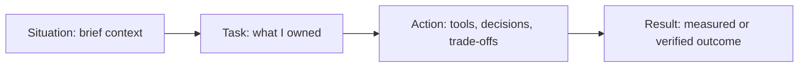

# 19 · HR and Behavioral Round

This guide turns Mohd Azam Ansari's resume into speakable HR and behavioral answers for Java backend interviews. Keep facts honest: use verified resume claims and replace every `[placeholder]` before the interview.

**Table of Contents**
- [Beginner guide to this file](#beginner-guide-to-this-file)
- [How to use this guide](#how-to-use-this-guide)
- [STAR method](#star-method)
- [Tell me about yourself](#q1-tell-me-about-yourself)
- [Behavioral question bank](#behavioral-question-bank)
- [Story Bank](#story-bank)
- [Story × Question matrix](#story--question-matrix)
- [Amazon 16 Leadership Principles](#amazon-16-leadership-principles)
- [Other company culture screens](#other-company-culture-screens)
- [Special HR answers](#special-hr-answers)
- [Red-flag phrases to avoid](#red-flag-phrases-to-avoid)
- [Revision Cheat Sheet](#revision-cheat-sheet)
- [Flashcards](#flashcards)

🟢 Beginner · 🟡 Intermediate · 🔴 Advanced · ⚫ FAANG · 🔥 = very frequently asked

**Accuracy note:** Do not invent facts. Resume-backed material: MAQ Software SQL/semantic-model optimization with indexing, query tuning, Performance Analyzer, Power Automate automation, data validation; Lafz RAG with LangChain, PostgreSQL/pgvector, NVIDIA 2048-dim embeddings, Nemotron; AI Email Reply Assistant with Spring Boot, Gemini, Docker, JSON, exception handling, env-var secrets.

## Beginner guide to this file

### What this file teaches

This file teaches how to turn verified experience into clear Human Resources (HR) and behavioral answers for
Software Development Engineer level 1 (SDE-1) and level 2 (SDE-2) interviews. Interviewers ask these
questions because teamwork, judgment, honesty, and communication predict how a backend engineer behaves when
systems fail, requirements change, or stakeholders disagree. In real backend work, the same skill shows up when
you explain a Structured Query Language (SQL) performance fix, defend an Application Programming Interface
(API) trade-off, or report a risk without hiding facts.

### Mental model

Think of behavioral interviewing like presenting evidence in a case file: the story is not a speech, it is proof
that a specific behavior happened.

- Situation, Task, Action, Result (STAR) is the evidence format: context, ownership, choices, and outcome.
- The rubric is the competency being tested, such as ownership, learning, conflict handling, or reliability.
- A story bank is reusable raw material; one verified story can answer several question types.
- Proof beats polish: use measured results, validation steps, or honest placeholders instead of invented wins.
- Level signal changes the depth: SDE-1 shows learning and execution; SDE-2 adds scope and trade-offs.
- Business Intelligence (BI), Retrieval-Augmented Generation (RAG), and backend project stories all work if you
  connect them to performance, correctness, APIs, or user impact.

### How to think through any question here

1. Identify the competency: ownership, conflict, learning, quality, leadership, motivation, or logistics.
2. Choose one verified story from the story bank; do not force an impressive but untrue example.
3. Shape it with STAR: keep Situation and Task short, make Action specific, and make Result honest.
4. Name the engineering judgment: measurement, trade-off, validation, communication, or follow-through.
5. Add the lesson learned and how you would repeat or improve it in a backend team.
6. Adapt depth to level: SDE-1 emphasizes fundamentals; SDE-2 emphasizes ambiguity, ownership, and risk.
7. Prepare two follow-ups: exact contribution and proof of result.

### Pattern recognition cues

| If the question mentions... | Think about... | Why it fits |
|---|---|---|
| Achievement or impact | A measured SQL, automation, or project improvement | The interviewer wants proof, not adjectives |
| Conflict, disagreement, or pushback | Respectful evidence plus commit behavior | They are testing maturity under tension |
| Failure, mistake, or weakness | Ownership, fix, and prevention | Honest recovery matters more than perfection |
| Ambiguity or learning quickly | Breaking a vague problem into experiments | Backend work often starts with incomplete requirements |
| Deadline, pressure, or priorities | Scope control, communication, and validation | They want reliability when time is limited |
| Feedback or mentoring | Listening, documentation, and behavior change | Strong teams improve through feedback loops |
| Security, privacy, or correctness | Safe handling, least exposure, and verification | Backend systems protect user and business data |
| Why backend or why hire you | Role fit backed by APIs, data, and performance | Motivation should connect to the target job |
| Compensation, notice, or gaps | Clear facts and professional boundaries | Logistics questions punish overpromising |

### Abbreviations and key terms

| Short form | Expanded form | Plain meaning |
|---|---|---|
| A/B | A/B test | Comparing two variants to see which works better |
| AI | Artificial Intelligence | Software behavior that appears to reason, generate, or classify |
| API | Application Programming Interface | Contract used by software components to talk to each other |
| BI | Business Intelligence | Reporting and analytics used for business decisions |
| BS | Bullshit | Informal phrase meaning vague or dishonest talk; avoid using it in interviews |
| CGPA | Cumulative Grade Point Average | Academic score across semesters |
| CSE | Computer Science and Engineering | Degree branch focused on computing fundamentals |
| CTC | Cost to Company | Total annual compensation budgeted by an employer |
| DB | Database | Organized storage for application data |
| DTO | Data Transfer Object | Object shaped for moving data between layers or services |
| ETA | Estimated Time of Arrival | Expected completion or arrival time |
| FAANG | Facebook/Meta, Amazon, Apple, Netflix, Google | Shorthand for large selective technology-company loops |
| GenAI | Generative Artificial Intelligence | AI that creates text, code, images, or similar output |
| HR | Human Resources | Recruiting, people operations, and employment-process team |
| HTTP | Hypertext Transfer Protocol | Web protocol used by APIs and browsers |
| IC | Individual Contributor | Engineer role without direct people-management responsibility |
| ID | Identifier | Value used to uniquely refer to a record or object |
| JSON | JavaScript Object Notation | Common text format for API request and response bodies |
| JUnit | Java Unit | Java testing framework name, not an abbreviation in daily use |
| LLM | Large Language Model | AI model trained to process and generate language |
| LR | Leadership Principle | Culture principle or rubric item, especially in Amazon-style prep |
| MAQ | MAQ Software | Employer name used in the resume context; verify details before quoting |
| NVIDIA | NVIDIA Corporation | Hardware and AI-platform company name used in project stack context |
| pgvector | PostgreSQL vector extension | Extension for storing and searching embeddings in PostgreSQL |
| PostgreSQL | PostgreSQL database | Relational database often used by backend services |
| Qn. | Question number | Numbered interview question heading |
| RAG | Retrieval-Augmented Generation | AI pattern that retrieves facts before generating an answer |
| REST | Representational State Transfer | API style based on resources and HTTP methods |
| S1-S10 | Story identifiers 1 through 10 | Labels for reusable behavioral examples in this guide |
| SDE | Software Development Engineer | Engineering role title used by many companies |
| SQL | Structured Query Language | Language for querying relational databases |
| STAR | Situation, Task, Action, Result | Behavioral-answer structure |
| UI | User Interface | What a user sees and interacts with |

### Common beginner traps

- Memorizing scripts so tightly that the answer sounds fake or ignores the question asked.
- Giving a result without explaining your own actions and decision points.
- Quoting metrics, timelines, salary, or company facts that are not verified.
- Treating BI work as unrelated instead of mapping it to performance, correctness, and data systems.
- Hiding mistakes instead of showing ownership, recovery, and prevention.
- Using the same story for every answer without changing the competency being highlighted.

### How to study this file

1. Read the short answer first so you know the one-sentence target for each question.
2. Read the detailed answer and mark the STAR pieces: Situation, Task, Action, and Result.
3. Fill placeholders only with verified resume facts, notes, commits, screenshots, or documents.
4. Convert each answer into a 90-second spoken version and a 2-minute follow-up version.
5. Use flashcards to test recall, then do active practice with a timer and record weak spots.
6. After each mock, update the story bank so repeated mistakes become the next practice focus.
7. Apply two rules to every Coach's note: keep facts verified and leave `[placeholder]` values until you can
   prove a metric, date, or scope; for Software Development Engineer level 1 (SDE-1), emphasize learning and
   execution, while for SDE-2 add ownership, trade-offs, and measurable impact.

## How to use this guide

- Memorize 8-10 story shapes, not 45 scripts.
- Keep most answers near 2 minutes: context briefly, actions deeply, result honestly.
- Quote numbers only if you can verify them from notes, screenshots, commits, or documents.
- Bridge BI/Fabric to backend through performance, correctness, data systems, APIs, and reliability.

## STAR method

Use this ratio: **Situation 15% · Task 15% · Action 45% · Result 25%**.

### Q1. Tell me about yourself
`🟢 Beginner` `🔥` `Must-know SDE-1`

**Why they ask:** They want a concise story connecting education, work, projects, and target role.

**Coach's note:** Interviewers evaluate role fit, clarity, and whether your story points toward backend
engineering. Use Situation, Task, Action, Result (STAR): current context, target backend task, verified
actions from work or projects, and honest direction. Beginner mistake: turning the answer into a resume
recital or adding unverified achievements.

**Short answer (say this first, 20-40 sec):**
I am Mohd Azam Ansari, a B.Tech CSE student at Galgotias University and an Associate Software Engineer at MAQ Software. My work focuses on SQL and semantic-model optimization, Power Automate workflows, and data validation. My projects show backend depth through Spring Boot APIs and RAG with pgvector, and I am targeting Java backend roles where I can build reliable APIs and data-intensive services.

**Detailed answer:**
Use a 4-part arc: profile, MAQ impact, backend/AI projects, target role. In 30 seconds, say current role plus backend goal. In 60 seconds, add CGPA 8.63, Java/Spring Boot, SQL, PostgreSQL, Docker, Azure/Fabric, LangChain/RAG. In 2 minutes, add one MAQ impact and one project: "I optimized query/model performance and built Lafz plus an AI Email Reply Assistant, so my direction is backend systems with strong data correctness."

**Common mistakes:**
- Reciting the resume line by line.
- Treating BI/Fabric as unrelated instead of performance/correctness evidence.
- Overclaiming production-scale backend ownership from personal projects.

**Follow-ups:**
- *Why backend?* → BI work taught me performance and correctness; backend lets me build the APIs and services behind that reliability.
- *Which project best represents you?* → Lafz for RAG/data depth, or AI Email Reply Assistant for Java/Spring backend alignment.

## Behavioral question bank

### Q2. Tell me about your biggest achievement.
`🟡 Intermediate` `🔥` `Must-know SDE-1`

**Why they ask:** They check whether you connect effort to measurable engineering impact.

**Coach's note:** Interviewers evaluate whether your achievement has engineering impact and your own
contribution is clear. Use Situation, Task, Action, Result (STAR): problem context, your responsibility, the
tuning or validation actions, and the verified result. Beginner mistake: quoting a big number without
measurement method or ownership.

**Short answer (say this first, 20-40 sec):**
My strongest achievement is improving a real reporting workflow by finding performance bottlenecks, tuning SQL/semantic-model behavior, and validating that the optimized output stayed correct.

**Detailed answer:**
Signals: ownership, measurable impact, correctness. Structure: slow workflow → measurements → tuning → validation → result. Use **S1** because the resume has a verified up-to-70% improvement claim. Time: ~2 min. **STAR sample:** At MAQ Software, a `[Power BI dashboard/report]` backed by `[SQL tables/semantic model]` was slow. I measured it with Performance Analyzer and query timings, reviewed joins/filters/columns, recommended or applied indexes, tuned SQL/model logic, and rechecked totals against source data. I will quote `[before] → [after]` only after verifying the exact numbers.

**Common mistakes:**
- Choosing an achievement with no result or personal contribution.
- Saying "I improved everything" without naming the workflow.
- Quoting 70% without explaining measurement.

**Follow-ups:**
- *What was your exact contribution?* → Measurement, SQL/model analysis, tuning, and validation.
- *How did you prove success?* → Before/after timings plus matched totals or sampled records.

### Q3. Tell me about a time you improved performance.
`🟡 Intermediate` `🔥` `Must-know SDE-1`

**Why they ask:** Performance stories reveal debugging depth and measurement discipline.

**Coach's note:** Interviewers evaluate measurement discipline and performance-debugging depth. Use Situation,
Task, Action, Result (STAR): slow workflow, bottleneck task, SQL or model actions, and before-after
validation. Beginner mistake: saying performance improved without naming the bottleneck, tool, or correctness
check.

**Short answer (say this first, 20-40 sec):**
I improved performance by measuring the bottleneck first, then tuning SQL, indexes, and semantic-model behavior, and finally validating both speed and data correctness.

**Detailed answer:**
Signals: evidence before optimization, database thinking, safe rollout. Structure: symptom → metric → root cause → minimal change → verification. Use **S1** because it is real MAQ SQL/Fabric/Power BI work. Time: ~2 min. **STAR sample:** In a MAQ reporting workflow, `[report name]` had slow dashboard/query response. I used Performance Analyzer to separate visual time from query/model time, inspected SQL joins and filters, reduced unnecessary data movement, and checked indexing opportunities. After each controlled change, I reran timings and data validation. The resume-level result is up to 70% faster performance; exact figures stay `[placeholder]` until verified.

**Common mistakes:**
- Adding indexes without identifying the bottleneck.
- Ignoring correctness after tuning.
- Making many changes at once.

**Follow-ups:**
- *What if an index slows writes?* → Weigh read benefit against write/storage cost and use it only where query frequency justifies it.
- *What did Performance Analyzer show?* → It helped separate visual/rendering delay from query/model delay.

### Q4. Tell me about a time you automated a repetitive task.
`🟡 Intermediate` `🔥` `Must-know SDE-1`

**Why they ask:** They want bias for action, leverage, and reliability improvement.

**Coach's note:** Interviewers evaluate initiative, leverage, and whether automation reduced repeat work
safely. Use Situation, Task, Action, Result (STAR): manual process, owned automation task, steps automated,
and verified time or error reduction. Beginner mistake: calling automation successful without handling
exceptions or human review points.

**Short answer (say this first, 20-40 sec):**
I automated a repeated business workflow with Power Automate after mapping manual steps, identifying exceptions, and adding checks so failures stayed visible.

**Detailed answer:**
Signals: initiative, process thinking, safe automation. Structure: repeated pain → stable rules → flow → exception handling → saved effort. Use **S2** because the resume states 90% manual-effort reduction. Time: ~2 min. **STAR sample:** At MAQ, `[workflow]` required manual follow-ups and checks. I listed each step, identified triggers, approvals/notifications, and failure cases, then built a Power Automate flow. Missing fields or ambiguous cases went to `[owner/team]` instead of being hidden. I tested success and failure samples. Result: resume-level 90% effort reduction; fill `[hours before]`, `[hours after]`, `[exceptions]`.

**Common mistakes:**
- Automating before understanding exceptions.
- Claiming "fully automated" when approvals still exist.
- Forgetting testing or handoff.

**Follow-ups:**
- *How did you choose what to automate?* → Stable, repeated steps with clear inputs and predictable outcomes.
- *What did you leave manual?* → Ambiguous exceptions needing human judgment.

### Q5. Tell me about a time you handled data quality issues.
`🟡 Intermediate` `🔥` `Must-know SDE-1`

**Why they ask:** Backend systems fail if data is fast but wrong.

**Coach's note:** Interviewers evaluate quality ownership and care for data correctness. Use Situation, Task,
Action, Result (STAR): bad data context, validation responsibility, checks added, and impact on users or
reports. Beginner mistake: blaming data sources instead of explaining detection, fix, and prevention.

**Short answer (say this first, 20-40 sec):**
I handled data quality by defining invariants, checking nulls/duplicates/totals/date ranges, reconciling with source data, and clarifying unclear rules.

**Detailed answer:**
Signals: correctness, user trust, edge-case thinking. Structure: risk → rules → checks → reconciliation → prevention. Use **S3** because it matches MAQ validation work. Time: ~2 min. **STAR sample:** At MAQ, `[report/dataset]` needed stronger checks before stakeholders relied on it. I added checks for required-field nulls, duplicate keys, date mismatches, and totals that should match source queries. For unclear rules, I prepared sample records and asked for explicit confirmation. Result: fewer downstream reporting defects per resume; fill `[issue caught]`, `[stakeholder]`, `[rule]`.

**Common mistakes:**
- Saying "I checked data" without naming checks.
- Treating unclear rules as blockers.
- Validating only visuals, not source logic.

**Follow-ups:**
- *What validation did you use?* → Totals reconciliation and duplicate/null checks.
- *How did you handle unclear rules?* → Show examples and get sign-off.

### Q6. Tell me about a time you learned something new quickly.
`🟡 Intermediate` `🔥` `Must-know SDE-1`

**Why they ask:** SDE growth depends on learning speed and self-direction.

**Coach's note:** Interviewers evaluate learning speed and humility when facing unfamiliar technology. Use
Situation, Task, Action, Result (STAR): unknown topic, delivery need, learning actions, and usable outcome.
Beginner mistake: claiming instant mastery instead of explaining resources, experiments, and remaining limits.

**Short answer (say this first, 20-40 sec):**
When building Lafz, I learned RAG by breaking it into embeddings, vector storage, retrieval, prompt construction, and evaluation, then integrating each piece.

**Detailed answer:**
Signals: structured learning and delivery. Structure: unknown tech → plan → spikes → integration → result. Use **S6/S4** because Lafz is a concrete RAG project. Time: ~2 min. **STAR sample:** For Lafz, LangChain, pgvector, 2048-dimensional embeddings, and Nemotron were new. I split the work into embedding prompts, storing vectors in PostgreSQL/pgvector, running Top-K similarity search, adding retrieved chunks to prompts, and testing output quality. I proved each piece before wiring the full flow. Result: working RAG project with sub-second retrieval; verify `[timeline]`, `[dataset size]`, `[hardest bug]`.

**Common mistakes:**
- Saying only "I watched tutorials."
- Pretending there was no learning curve.
- Confusing embeddings, vector DB, and LLM generation.

**Follow-ups:**
- *How did you know retrieval was relevant?* → I inspected Top-K chunks for sample prompts.
- *What would you improve now?* → Add evaluation data and p50/p95 latency tracking.

### Q7. Tell me about a time you dealt with ambiguity.
`🟡 Intermediate` `🔥` `Must-know SDE-1`

**Why they ask:** Product engineering often starts with incomplete requirements.

**Coach's note:** Interviewers evaluate how you structure ambiguity without freezing. Use Situation, Task,
Action, Result (STAR): unclear requirement, your task, assumptions or experiments, and the decision reached.
Beginner mistake: pretending everything was clear or waiting passively for instructions.

**Short answer (say this first, 20-40 sec):**
I handle ambiguity by making assumptions explicit, creating examples, asking targeted questions, and choosing reversible steps.

**Detailed answer:**
Signals: judgment, communication, progress under uncertainty. Structure: ambiguous ask → assumptions → examples → decision → validation. Use **S7**, or **S4** if using a project example. Time: ~2 min. **STAR sample:** In a MAQ reporting change, `[metric/filter/business rule]` was not fully defined and could change the output meaning. I wrote assumptions, created a sample output, showed how two interpretations changed numbers, and asked the stakeholder to confirm. I proposed a phased change to validate quickly. Result: `[final decision]`, avoiding `[risk]`.

**Common mistakes:**
- Waiting silently for perfect requirements.
- Making assumptions without documenting them.
- Calling the stakeholder unclear instead of explaining trade-offs.

**Follow-ups:**
- *What if no one answers?* → Proceed with a documented reversible assumption and flag the risk.
- *How do you avoid over-clarifying?* → Ask only questions that change correctness or implementation.

### Q8. Tell me about a time you pushed back on a requirement.
`🟡 Intermediate` `🔥` `Must-know SDE-1`

**Why they ask:** They test respectful backbone, not stubbornness.

**Coach's note:** Interviewers evaluate respectful backbone and risk communication. Use Situation, Task,
Action, Result (STAR): requested change, your responsibility, evidence-based pushback, and final aligned
result. Beginner mistake: sounding negative or refusing without alternatives.

**Short answer (say this first, 20-40 sec):**
I push back with evidence and alternatives: explain the risk, show examples, recommend a safer option, and commit after the decision.

**Detailed answer:**
Signals: risk awareness, collaboration, backbone. Structure: request → risk → evidence → alternative → alignment. Use **S7** because data/reporting requirements can be risky when rules are unclear. Time: ~2 min. **STAR sample:** A stakeholder asked for `[change]`, but I saw a risk that `[metric/output]` would be misleading. I prepared a before/after example, explained affected totals or segments, and suggested confirming the rule or releasing in phases. I kept the discussion about correctness. Result: `[decision]`; after that, I supported the agreed path.

**Common mistakes:**
- Saying "I refused" without alternatives.
- Making the disagreement personal.
- Continuing to resist after the decision.

**Follow-ups:**
- *What if they choose the risky option?* → Document risk, add safeguards, and execute professionally.
- *How do you push back as a junior?* → Use facts, examples, and questions rather than authority.

### Q9. Tell me about a time you missed or almost missed a deadline.
`🟡 Intermediate` `🔥` `Must-know SDE-1`

**Why they ask:** They want transparency and recovery behavior under pressure.

**Coach's note:** Interviewers evaluate deadline ownership and early risk reporting. Use Situation, Task,
Action, Result (STAR): deadline context, your task, recovery actions, and final delivery or lesson. Beginner
mistake: hiding the risk until the deadline is already missed.

**Short answer (say this first, 20-40 sec):**
When a deadline is at risk, I communicate early, split must-have from nice-to-have, ask for help or clarification, and deliver the highest-value part first.

**Detailed answer:**
Signals: ownership, early escalation, prioritization. Structure: deadline risk → cause → communication → rescope → prevention. Use **S8** with a real bounded example. Time: ~2 min. **STAR sample:** On `[task/project]`, `[dependency/ambiguity/bug]` appeared late and put the timeline at risk. I flagged it early, separated must-have work from polish, shared a revised ETA, and focused on the part needed for `[release/demo/report]`. I kept validation in scope. Result: `[outcome]`; learning: raise unknowns earlier.

**Common mistakes:**
- Solving it only by "working all night."
- Blaming estimates or teammates.
- Hiding risk until the deadline passes.

**Follow-ups:**
- *Did you miss the original date?* → State truthfully; emphasize communication and recovery.
- *How do you estimate now?* → Include uncertainty, dependencies, and validation time.

### Q10. Tell me about a time you received critical feedback.
`🟡 Intermediate` `🔥` `Must-know SDE-1`

**Why they ask:** They assess coachability and emotional maturity.

**Coach's note:** Interviewers evaluate coachability and behavior change after feedback. Use Situation, Task,
Action, Result (STAR): feedback situation, improvement task, action taken, and result in later work. Beginner
mistake: defending yourself instead of showing what changed.

**Short answer (say this first, 20-40 sec):**
I treat feedback as input to improve: clarify examples, convert it into actions, and follow up to show the change.

**Detailed answer:**
Signals: humility, learning loop, visible improvement. Structure: feedback → clarification → action plan → proof. Use **S10** or a real college/work feedback example. Time: ~2 min. **STAR sample:** In `[work/project]`, I got feedback that `[handoff/documentation/status]` was not clear enough. I asked what was confusing, added setup notes, examples, expected outputs, and a validation checklist, then shared it with `[person/team]`. I updated it from their questions. Result: fewer repeated clarifications and smoother handoff.

**Common mistakes:**
- Using fake feedback like "I work too hard."
- Sounding defensive.
- Not showing what changed afterward.

**Follow-ups:**
- *Was the feedback fair?* → It showed where my communication could be clearer.
- *How do you ask for feedback?* → I ask for one specific improvement after delivery or review.

### Q11. Tell me about a conflict with a teammate.
`🟡 Intermediate` `🔥` `Must-know SDE-1`

**Why they ask:** Collaboration matters more than being technically right once.

**Coach's note:** Interviewers evaluate conflict maturity and team-first problem solving. Use Situation, Task,
Action, Result (STAR): conflict context, shared task, communication actions, and resolved decision. Beginner
mistake: making the teammate the villain instead of focusing on facts and alignment.

**Short answer (say this first, 20-40 sec):**
I handle conflict by returning to the shared goal, comparing facts and trade-offs, and agreeing on the next step without making it personal.

**Detailed answer:**
Signals: maturity, communication, shared ownership. Structure: disagreement → goal → evidence → compromise → result. Use **S7** for technical/requirement disagreement or **S10** for handoff friction. Time: ~2 min. **STAR sample:** During `[project/task]`, a teammate preferred `[approach A]`, while I worried about `[risk]`. I asked for their reasoning, showed my concern with a small example, compared effort/risk/validation, and we agreed on `[chosen approach]`. I supported the decision even if it was not my first preference.

**Common mistakes:**
- Describing the teammate as incompetent.
- Winning the argument but losing trust.
- Skipping final alignment.

**Follow-ups:**
- *What if the teammate was right?* → I acknowledge it and update my reasoning.
- *How do you prevent repeat conflict?* → Clarify ownership and acceptance criteria earlier.

### Q12. Tell me about a time you disagreed with your manager.
`🟡 Intermediate` `🔥` `Must-know SDE-1`

**Why they ask:** They want respectful backbone and ability to commit.

**Coach's note:** Interviewers evaluate judgment when authority and evidence differ. Use Situation, Task,
Action, Result (STAR): manager decision, your concern, respectful evidence, and commit-after-decision outcome.
Beginner mistake: arguing to win rather than to reduce risk.

**Short answer (say this first, 20-40 sec):**
I share evidence, recommend a safer option, listen to context I may not know, and commit to the final decision.

**Detailed answer:**
Signals: judgment, respect, low ego. Structure: direction → concern → evidence → discussion → commit. Use **S7** while keeping tone positive. Time: ~2 min. **STAR sample:** In `[MAQ task]`, the proposed direction was `[change]`, and I was concerned about `[data correctness/performance risk]`. I prepared a short example showing output or timing impact, suggested `[alternative]`, and asked if there was business context I was missing. Decision: `[decision]`. I aligned and implemented safely with validation.

**Common mistakes:**
- Criticizing the manager.
- Avoiding disagreement completely.
- Refusing to commit after the decision.

**Follow-ups:**
- *Did your suggestion win?* → State truthfully; the key is evidence and alignment.
- *How do you disagree remotely?* → Write context, options, risks, and recommendation concisely.

### Q13. Tell me about a time you showed leadership without authority.
`🟡 Intermediate` `🔥` `Must-know SDE-1`

**Why they ask:** SDEs lead through ownership before title.

**Coach's note:** Interviewers evaluate leadership without a title, especially ownership and influence. Use
Situation, Task, Action, Result (STAR): team need, self-assigned task, enabling action, and team result.
Beginner mistake: equating leadership only with managing people.

**Short answer (say this first, 20-40 sec):**
I lead without authority by structuring unclear work, documenting decisions, and helping others move faster.

**Detailed answer:**
Signals: initiative, communication, team leverage. Structure: team friction → initiative → docs/coordination → result. Use **S10** because documentation/handoff is realistic junior leadership. Time: ~2 min. **STAR sample:** In `[team/project]`, people repeatedly asked about `[workflow/API/report setup]`. I created a short guide with setup steps, examples, constraints, and validation checks, shared it with `[person/team]`, asked for corrections, and updated repeated questions. Result: easier handoff/onboarding for `[team/person]`.

**Common mistakes:**
- Equating leadership only with managing people.
- Taking credit for the whole team.
- Creating docs too large to use.

**Follow-ups:**
- *How did you get adoption?* → I made it practical: examples, checklist, and links in the normal workflow.
- *What leadership skill are you improving?* → Prioritization and clearer written communication.

### Q14. Tell me about a time you worked in a team.
`🟡 Intermediate` `🔥` `Must-know SDE-1`

**Why they ask:** They verify coordination, not only individual coding.

**Coach's note:** Interviewers evaluate collaboration, reliability, and how you divide work. Use Situation,
Task, Action, Result (STAR): team context, your responsibility, coordination actions, and shared outcome.
Beginner mistake: saying teamwork was good without describing communication or handoff.

**Short answer (say this first, 20-40 sec):**
I work well in teams by clarifying interfaces, giving status early, documenting assumptions, and making handoff easy.

**Detailed answer:**
Signals: reliability, communication, ownership boundaries. Structure: shared goal → your role → coordination → outcome. Use **S5** frontend/backend integration or **S10**. Time: ~2 min. **STAR sample:** For the AI Email Reply Assistant, I aligned backend behavior with frontend expectations. I defined JSON request/response shape, handled error responses consistently, tested with `[Postman/JUnit]`, and kept Gemini API keys in environment variables. When the frontend expected different fields, I adjusted the contract instead of making integration fragile. Result: end-to-end email reply flow.

**Common mistakes:**
- Saying only "I did my part."
- Ignoring contracts between components.
- Claiming team success as only yours.

**Follow-ups:**
- *How do you handle blocked teammates?* → Share context, examples, and unblock the interface they depend on.
- *How do you report status?* → Progress, blockers, next step, and ETA.

### Q15. Tell me about a time you made a data-driven decision.
`🟡 Intermediate` `🔥` `Must-know SDE-1`

**Why they ask:** They want evidence-based choices instead of opinions.

**Coach's note:** Interviewers evaluate whether you use evidence instead of opinion. Use Situation, Task,
Action, Result (STAR): decision context, data needed, analysis actions, and result of choosing with evidence.
Beginner mistake: mentioning data without explaining source quality or validation.

**Short answer (say this first, 20-40 sec):**
I used timing and validation data to decide where to optimize first, rather than guessing from dashboard symptoms.

**Detailed answer:**
Signals: metrics, prioritization, unbiased reasoning. Structure: options → data collected → decision → validation. Use **S1** because Performance Analyzer/query timings are concrete. Time: ~2 min. **STAR sample:** A `[report/dashboard]` was slow, but the cause could be visuals, SQL, or semantic model logic. I used Performance Analyzer and query timings to compare components. The data pointed to `[bottleneck]`, so I focused on `[indexing/query tuning/model cleanup]`. I reran timings and validation checks to confirm the decision.

**Common mistakes:**
- Calling a decision data-driven without naming the data.
- Optimizing a low-impact area first.
- Ignoring data that contradicts your assumption.

**Follow-ups:**
- *What if data is incomplete?* → State assumptions and run a small experiment.
- *What metric mattered most?* → User-visible load/query time plus correctness.

### Q16. Tell me about a failure.
`🟡 Intermediate` `🔥` `Must-know SDE-1`

**Why they ask:** They assess ownership, learning, and risk control.

**Coach's note:** Interviewers evaluate accountability and learning from failure. Use Situation, Task, Action,
Result (STAR): failure context, your responsibility, corrective actions, and prevention. Beginner mistake:
choosing a fake failure or blaming external constraints only.

**Short answer (say this first, 20-40 sec):**
I choose a bounded failure, take responsibility, explain the fix, and show the guardrail I added afterward.

**Detailed answer:**
Signals: self-awareness, accountability, prevention. Structure: failure → impact → action → prevention. Use **S8** for estimation/deadline or **S9** for missed error case. Time: ~2 min. **STAR sample:** In `[project/task]`, I underestimated `[integration/testing/data validation]` and realized late that `[issue]` could affect quality. I informed `[person/team]`, narrowed scope, fixed the highest-risk item, and added a checklist/test so the same gap would be caught earlier. Result: `[outcome]`; learning: estimate validation and integration time explicitly.

**Common mistakes:**
- Picking a fake failure.
- Blaming only external dependencies.
- Ending with "I learned a lot" but no process change.

**Follow-ups:**
- *What changed after that?* → I call out assumptions and validation effort earlier.
- *Was anyone affected?* → State the true scope honestly.

### Q17. What is your biggest weakness?
`🟡 Intermediate` `🔥` `Must-know SDE-1`

**Why they ask:** They look for honest self-awareness without a role-ending flaw.

**Coach's note:** Interviewers evaluate self-awareness and active improvement. Use Situation, Task, Action,
Result (STAR): weakness context, improvement task, specific practice actions, and progress signal. Beginner
mistake: naming a humblebrag weakness like perfectionism with no fix.

**Short answer (say this first, 20-40 sec):**
I can over-invest in details before time-boxing. I am improving this by defining done criteria, setting checkpoints, and separating must-have quality from optional polish.

**Detailed answer:**
Signals: coachability and safe improvement. Structure: weakness → example → current system → progress. Use **S8** because deadlines and prioritization make it realistic. Time: ~2 min. **STAR sample:** In `[task/project]`, I spent too much time making `[implementation/report area]` cleaner before confirming the must-have deliverable. I corrected by defining acceptance criteria, moving optional improvements to a later list, and sharing status earlier. Now I time-box exploration and ask what must be true for the work to be useful and safe.

**Common mistakes:**
- Saying "perfectionist" with no example.
- Choosing poor teamwork or unreliability.
- Not showing active improvement.

**Follow-ups:**
- *Is this still a problem?* → It is improving through time-boxes and checkpoints.
- *How would your manager describe it?* → Detail-oriented, improving prioritization.

### Q18. What are your strengths?
`🟡 Intermediate` `🔥` `Must-know SDE-1`

**Why they ask:** They want strengths mapped to the job, not adjectives.

**Coach's note:** Interviewers evaluate strengths that map to the role instead of generic traits. Use
Situation, Task, Action, Result (STAR): role need, strength demonstrated, action proof, and verified outcome.
Beginner mistake: listing adjectives without evidence from work or projects.

**Short answer (say this first, 20-40 sec):**
My strengths are structured debugging, data correctness, and fast learning across backend and data systems.

**Detailed answer:**
Signals: role fit and evidence. Structure: 2-3 strengths → proof → backend connection. Use **S1**, **S3**, and **S6**. Time: ~2 min. **STAR sample:** One strength is structured debugging: at MAQ I measured dashboard/query behavior before tuning SQL/model logic. Another is correctness: I added validation checks for reporting reliability. A third is fast learning: in Lafz I broke RAG into embeddings, pgvector retrieval, and generation. These fit backend work because services need debugging depth and correctness.

**Common mistakes:**
- Listing too many strengths.
- Giving traits without proof.
- Saying "I am best at..." instead of showing evidence.

**Follow-ups:**
- *Which strength helps most here?* → Structured debugging.
- *What strength are you building?* → Deeper distributed systems and Spring internals.

### Q19. Where do you see yourself in five years?
`🟡 Intermediate` `🔥` `Must-know SDE-1`

**Why they ask:** They check ambition, stability, and role alignment.

**Coach's note:** Interviewers evaluate career direction and realistic growth expectations. Use Situation,
Task, Action, Result (STAR): current baseline, target learning task, actions you are taking, and future
contribution. Beginner mistake: making grand claims about titles, salary, or guaranteed outcomes.

**Short answer (say this first, 20-40 sec):**
I want to become a strong backend engineer who can own reliable services end-to-end, make good design trade-offs, and mentor juniors as I grow.

**Detailed answer:**
Signals: long-term fit and realistic growth. Structure: technical growth → ownership → mentoring → company fit. Use **S5** to show current backend direction. Time: ~2 min. **STAR sample:** My current direction is visible in the AI Email Reply Assistant. I built a Spring Boot REST backend, integrated Gemini, handled JSON contracts and exceptions, containerized with Docker, and used env-var secrets. In five years, I want project-level experience to mature into production service ownership: API design, reliability, observability, scalability, and mentoring.

**Common mistakes:**
- Saying "manager" too early for an IC role.
- Sounding uncertain about backend.
- Giving a goal unrelated to the company.

**Follow-ups:**
- *Do you want management?* → Maybe long term, but first I want to become a strong backend IC.
- *What are you doing now?* → Strengthening Java/Spring, databases, system design, and testing.

### Q20. Why should we hire you?
`🟡 Intermediate` `🔥` `Must-know SDE-1`

**Why they ask:** They want your value proposition in one coherent pitch.

**Coach's note:** Interviewers evaluate fit, differentiation, and honest value proposition. Use Situation,
Task, Action, Result (STAR): company need, your relevant task experience, concrete actions, and likely
contribution. Beginner mistake: overselling as already senior or claiming skills you cannot demonstrate.

**Short answer (say this first, 20-40 sec):**
You should hire me because I combine Java/Spring backend fundamentals, real performance and data-quality experience, and hands-on GenAI project work, while staying grounded and eager to learn.

**Detailed answer:**
Signals: fit, evidence, self-awareness. Structure: role need → matching proof → learning attitude → close. Use **S1**, **S3**, and **S5**. Time: ~2 min. **STAR sample:** My MAQ work shows I can measure and improve SQL/semantic-model performance and protect data correctness. My AI Email Reply Assistant shows I can design a Spring Boot REST backend, integrate an external LLM API, handle JSON/exceptions, use Docker, and keep secrets out of source. I am early-career, but I bring fundamentals, ownership, and clear backend direction.

**Common mistakes:**
- Saying only "I am hardworking."
- Overclaiming senior-level scale.
- Forgetting the job description.

**Follow-ups:**
- *What makes you different?* → Real data-performance work plus Java/Spring and GenAI projects.
- *What support do you need?* → Code review and system context; I learn quickly and own execution.

### Q21. Why backend engineering after BI/Fabric exposure?
`🟡 Intermediate` `🔥` `Must-know SDE-1`

**Why they ask:** They test whether your career story is consistent.

**Coach's note:** Interviewers evaluate whether your backend motivation is credible after Business
Intelligence (BI) work. Use Situation, Task, Action, Result (STAR): BI context, backend-facing task, actions
around performance or APIs, and role direction. Beginner mistake: apologizing for BI instead of translating it
into data and reliability strengths.

**Short answer (say this first, 20-40 sec):**
BI/Fabric work gave me a foundation in performance, data correctness, and stakeholder impact. Backend is the natural next step because I want to build the APIs and services behind reliable data and product experiences.

**Detailed answer:**
Signals: intentional transition, no negativity. Structure: what BI taught → backend proof → target-role fit. Use **S1/S3** for transfer and **S5** for backend commitment. Time: ~2 min. **STAR sample:** At MAQ, optimizing SQL and validating reports taught me backend-like concerns: latency, correctness, and data contracts. In parallel, I built a Spring Boot REST backend for the AI Email Reply Assistant with Gemini integration, JSON contracts, exception handling, Docker, and env-var secrets. So I am not discarding BI; I am using it as a base for backend engineering.

**Common mistakes:**
- Saying BI is boring or low-value.
- Failing to show backend proof.
- Sounding like a random domain switch.

**Follow-ups:**
- *Will BI help here?* → Yes: SQL, measurement, data modeling, and correctness.
- *Are you comfortable coding daily?* → Yes; my projects and preparation are backend-focused.

### Q22. Tell me about a time you used stakeholder feedback.
`🟡 Intermediate` `🔥` `Must-know SDE-1`

**Why they ask:** They value customer focus and requirement refinement.

**Coach's note:** Interviewers evaluate customer orientation and ability to improve from feedback. Use
Situation, Task, Action, Result (STAR): stakeholder context, feedback task, changes made, and verified
improvement. Beginner mistake: treating feedback as criticism rather than input for better delivery.

**Short answer (say this first, 20-40 sec):**
I turn stakeholder feedback into examples, acceptance criteria, and validation checks so the final output matches the business need.

**Detailed answer:**
Signals: user focus and translation. Structure: feedback → interpretation → change → validation. Use **S3/S7**. Time: ~2 min. **STAR sample:** For `[report/workflow]`, a stakeholder said `[metric/filter/output]` did not match their expected use. I asked for sample cases, clarified the rule, updated the SQL/model/checks, and validated before/after outputs against known examples. I documented the assumption so it would not be lost. Result: `[accepted output/reduced defect]`.

**Common mistakes:**
- Treating feedback as criticism.
- Implementing vague feedback without examples.
- Forgetting to confirm the corrected output.

**Follow-ups:**
- *What if feedback conflicts with data?* → Show the discrepancy and ask which business rule wins.
- *How do you avoid scope creep?* → Separate correctness fixes from enhancements.

### Q23. Tell me about your Lafz project.
`🟡 Intermediate` `🔥` `Must-know SDE-1`

**Why they ask:** They evaluate project ownership, GenAI depth, and architecture explanation.

**Coach's note:** Interviewers evaluate project depth, especially retrieval, data, and evaluation choices in
Lafz. Use Situation, Task, Action, Result (STAR): project context, problem task, design actions, and demo or
measurement result. Beginner mistake: describing the project as magic AI without explaining retrieval, data,
and limits.

**Short answer (say this first, 20-40 sec):**
Lafz is a RAG poetry generator where prompts are embedded, matched against poetry chunks in PostgreSQL with pgvector, and combined with retrieved context for Nemotron generation.

**Detailed answer:**
Signals: RAG understanding and trade-offs. Structure: problem → architecture → retrieval → generation → limitations. Use **S4**. Time: ~2 min. **STAR sample:** I built Lafz to generate theme-based poetry with retrieval, not just prompt-only generation. I used LangChain, NVIDIA 2048-dimensional embeddings, PostgreSQL with pgvector, and Top-K similarity search to retrieve relevant chunks. I added those chunks to the Nemotron prompt. Resume says sub-second retrieval; verify `[p50/p95]`, `[dataset size]`, `[Top-K]`.

**Common mistakes:**
- Saying RAG but describing only prompting.
- Not explaining what pgvector stores.
- Claiming production GenAI expertise.

**Follow-ups:**
- *Why pgvector?* → It keeps relational storage and vector search in PostgreSQL.
- *How would you improve it?* → Evaluation data, better chunking, caching, latency metrics.

### Q24. Tell me about your AI Email Reply Assistant.
`🟡 Intermediate` `🔥` `Must-know SDE-1`

**Why they ask:** They test backend API ownership and practical Spring skills.

**Coach's note:** Interviewers evaluate backend implementation depth in the AI Email Reply Assistant. Use
Situation, Task, Action, Result (STAR): user need, API task, Spring or error-handling actions, and tested
result. Beginner mistake: only naming tools without explaining endpoints, failures, or security boundaries.

**Short answer (say this first, 20-40 sec):**
It is a Spring Boot REST backend that integrates with Gemini to generate context-aware email replies, with JSON contracts, exception handling, Docker, and env-var secrets.

**Detailed answer:**
Signals: API design, external-service integration, reliability hygiene. Structure: need → REST API → Gemini call → errors/secrets → deployment. Use **S5**. Time: ~2 min. **STAR sample:** I built the backend so the frontend could send email context and receive generated replies. I created REST endpoints, DTOs, Gemini API integration, exception handling for invalid input/API failures, Dockerized the app, and kept keys in environment variables. Result: demo-ready end-to-end flow; verify `[endpoints]`, `[error cases]`, `[feedback]`.

**Common mistakes:**
- Talking only about Gemini and not backend design.
- Hard-coding secrets.
- Not explaining failure behavior.

**Follow-ups:**
- *How did you handle Gemini failures?* → Controlled errors, no secret exposure, clear response.
- *What would you add for production?* → Auth, rate limits, observability, retries/timeouts, tests.

### Q25. Tell me about a time you simplified something.
`🟡 Intermediate` `🔥` `Must-know SDE-1`

**Why they ask:** They test whether you reduce complexity instead of adding process.

**Coach's note:** Interviewers evaluate simplification judgment and maintainability. Use Situation, Task,
Action, Result (STAR): complex process, simplification task, actions that reduced steps, and retained
correctness. Beginner mistake: removing complexity without proving the simpler flow still works.

**Short answer (say this first, 20-40 sec):**
I simplified a repeated workflow by mapping the manual path, automating predictable steps, and leaving exceptions explicit.

**Detailed answer:**
Signals: simplicity and maintainability. Structure: complex/manual process → stable core → simpler flow → result. Use **S2**. Time: ~2 min. **STAR sample:** A `[workflow]` involved repeated manual checks. I identified the trigger, required fields, notification/approval path, and exceptions. Then I built a Power Automate flow for the stable path and routed ambiguous cases to `[owner/team]`. Result: resume-level 90% manual-effort reduction; verify `[hours before]`, `[hours after]`, `[exceptions]`.

**Common mistakes:**
- Moving complexity elsewhere.
- Automating rare edge cases before common flow.
- Forgetting the actual users.

**Follow-ups:**
- *How did you keep it maintainable?* → Clear triggers, simple conditions, documented exceptions.
- *What was the trade-off?* → Some ambiguous cases stayed manual.

### Q26. Tell me about a time you took initiative.
`🟡 Intermediate` `🔥` `Must-know SDE-1`

**Why they ask:** They want ownership beyond assigned tasks.

**Coach's note:** Interviewers evaluate bias for action and safe self-starting behavior. Use Situation, Task,
Action, Result (STAR): unowned problem, chosen task, actions taken, and impact after validation. Beginner
mistake: starting work without aligning scope or success criteria.

**Short answer (say this first, 20-40 sec):**
I take initiative when I see repeated waste or risk: propose a safe next step, validate it, and share the result.

**Detailed answer:**
Signals: bias for action and responsible autonomy. Structure: observed problem → proposed action → execution → measured value. Use **S2/S3**. Time: ~2 min. **STAR sample:** At MAQ, `[manual workflow/check]` repeated often and could cause delay or missed details. I mapped the steps, suggested a Power Automate flow or validation checklist, tested sample cases, and shared it with `[team/stakeholder]`. Result: less manual effort and more reliable execution, with the 90% figure if it is the same verified workflow.

**Common mistakes:**
- Acting without alignment on shared-risk changes.
- Calling assigned work initiative.
- Skipping measurement or feedback.

**Follow-ups:**
- *How do you avoid overstepping?* → Align on scope and risk before changing shared processes.
- *What initiative now?* → Backend/system-design preparation and project hardening.

### Q27. Tell me about a time you had to dive deep.
`🟡 Intermediate` `🔥` `Must-know SDE-1`

**Why they ask:** They test root-cause discipline.

**Coach's note:** Interviewers evaluate depth of investigation rather than surface fixes. Use Situation, Task,
Action, Result (STAR): symptom context, root-cause task, diagnostic actions, and confirmed fix. Beginner
mistake: jumping to a fix before measuring or reproducing the issue.

**Short answer (say this first, 20-40 sec):**
I dive deep by moving from symptom to evidence: timings, analyzer output, data checks, and controlled changes.

**Detailed answer:**
Signals: debugging depth, patience, accuracy. Structure: symptom → hypotheses → evidence → root cause → fix. Use **S1**. Time: ~2 min. **STAR sample:** A dashboard/report was slow, but the symptom did not reveal whether visuals, model, or SQL caused it. I used Performance Analyzer and query timings, inspected joins/filters/columns, found likely expensive areas, changed one thing at a time, and revalidated source totals. Result: up to 70% improvement per resume, exact `[before/after]` to verify.

**Common mistakes:**
- Jumping to first suspected cause.
- Changing many things at once.
- Ignoring correctness during root cause.

**Follow-ups:**
- *What tools did you use?* → Performance Analyzer, SQL timings/plans where available, validation queries/checks.
- *When do you stop?* → When target metric is met and further change adds risk.

### Q28. Tell me about a time you balanced speed and quality.
`🟡 Intermediate` `🔥` `Must-know SDE-1`

**Why they ask:** They test prioritization under realistic constraints.

**Coach's note:** Interviewers evaluate trade-off judgment between shipping and quality. Use Situation, Task,
Action, Result (STAR): time pressure, quality task, scoped actions, and safe delivery result. Beginner
mistake: using speed as an excuse to skip critical checks.

**Short answer (say this first, 20-40 sec):**
I protect must-have correctness and validation while moving optional polish to later, so speed does not create hidden defects.

**Detailed answer:**
Signals: judgment, risk management, delivery focus. Structure: time pressure → quality risk → scope split → validated delivery. Use **S8/S9**. Time: ~2 min. **STAR sample:** In `[task/project]`, time was limited, so I separated non-negotiables like correct data/API behavior, exception handling, and validation from optional refactoring or UI polish. I communicated what would fit, delivered the core, and listed follow-ups. Result: `[delivered outcome]` with `[quality check]` completed.

**Common mistakes:**
- Treating quality as optional.
- Saying "I just worked faster."
- Cutting validation first.

**Follow-ups:**
- *What quality bar is non-negotiable?* → Correctness, secrets/security, predictable errors.
- *What do you defer?* → Polish that does not affect correctness or critical flow.

### Q29. Tell me about a time you handled pressure.
`🟡 Intermediate` `🔥` `Must-know SDE-1`

**Why they ask:** They want calm execution, not drama.

**Coach's note:** Interviewers evaluate calm execution under pressure. Use Situation, Task, Action, Result
(STAR): pressure context, priority task, focus actions, and outcome or lesson. Beginner mistake: sounding
heroic but chaotic instead of structured and communicative.

**Short answer (say this first, 20-40 sec):**
Under pressure, I break the problem into risks, communicate status, and focus on the next highest-impact action.

**Detailed answer:**
Signals: composure, prioritization, communication. Structure: pressure source → risk breakdown → action order → result. Use **S8**. Time: ~2 min. **STAR sample:** During `[deadline/release/demo/report]`, pressure increased because `[issue]` appeared late. I listed blockers, identified the highest-risk item, shared status with `[person/team]`, and resolved the core issue first while keeping validation. Result: `[outcome]`; lesson: communicate uncertainty earlier.

**Common mistakes:**
- Making pressure sound heroic but unstructured.
- Not communicating until after solving it.
- Silently sacrificing correctness.

**Follow-ups:**
- *Do you like pressure?* → I prefer planned work, but I can stay structured under pressure.
- *How do you manage stress?* → Break it down, write next actions, ask for help when needed.

### Q30. Tell me about a time you made a mistake.
`🟡 Intermediate` `🔥` `Must-know SDE-1`

**Why they ask:** They test accountability and prevention.

**Coach's note:** Interviewers evaluate ownership when you personally caused or missed something. Use
Situation, Task, Action, Result (STAR): mistake context, your responsibility, fix actions, and prevention.
Beginner mistake: minimizing the mistake or hiding what you learned.

**Short answer (say this first, 20-40 sec):**
When I make a mistake, I acknowledge it quickly, fix the impact, and add a check so it is less likely to repeat.

**Detailed answer:**
Signals: honesty, repair, learning. Structure: mistake → detection → correction → guardrail. Use **S9** or a real validation/estimation miss. Time: ~2 min. **STAR sample:** In `[project/task]`, I initially missed `[edge case/error path/validation rule]`. I reproduced it, fixed the logic or handling, and added a test/checklist item. In the AI Email Assistant shape, that could mean handling invalid input or Gemini API failure with a controlled response. Result: `[verified fix]`.

**Common mistakes:**
- Saying you cannot remember a mistake.
- Choosing a severe ethical issue.
- Not adding prevention.

**Follow-ups:**
- *Who found it?* → State truthfully and credit them if applicable.
- *What changed?* → I added explicit edge-case validation/testing.

### Q31. Tell me about a time you improved reliability.
`🟡 Intermediate` `🔥` `Must-know SDE-1`

**Why they ask:** Backend roles require safe behavior in failure paths.

**Coach's note:** Interviewers evaluate reliability thinking, including prevention and detection. Use
Situation, Task, Action, Result (STAR): fragile workflow, reliability task, guardrail actions, and improved
confidence. Beginner mistake: claiming reliability without monitoring, validation, or fallback reasoning.

**Short answer (say this first, 20-40 sec):**
I improved reliability by adding validation, exception handling, consistent responses, and tests/checks for important failure paths.

**Detailed answer:**
Signals: production thinking, risk awareness, user empathy. Structure: unreliable behavior → failure modes → guardrails → verified result. Use **S9/S5**. Time: ~2 min. **STAR sample:** In the AI Email Reply Assistant, users could send incomplete input or Gemini could fail. I added request validation, exception handling, HTTP status mapping, controlled messages, env-var secrets, and tested success/failure flows. Result: predictable backend behavior; verify `[failure cases]`, `[test count]`.

**Common mistakes:**
- Equating reliability only with uptime.
- Not naming failure modes.
- Exposing raw external errors.

**Follow-ups:**
- *What would you add next?* → Timeouts, safe retries, structured logs, metrics.
- *How do validation checks help?* → They stop bad inputs/data before downstream impact.

### Q32. Tell me about a time you used documentation well.
`🟡 Intermediate` `🔥` `Must-know SDE-1`

**Why they ask:** Good engineers reduce repeated confusion.

**Coach's note:** Interviewers evaluate knowledge sharing and handoff quality. Use Situation, Task, Action,
Result (STAR): confusing process, documentation task, examples or notes added, and user result. Beginner
mistake: writing documents nobody can use or update.

**Short answer (say this first, 20-40 sec):**
I document setup, contracts, decisions, examples, and constraints so others can act without repeated clarification.

**Detailed answer:**
Signals: communication, team scalability, ownership. Structure: repeated confusion → concise doc → examples/checklist → reduced dependency. Use **S10**. Time: ~2 min. **STAR sample:** In `[project/workflow]`, people repeatedly asked about `[setup/API/report/process]`. I wrote a concise note with prerequisites, steps, examples, expected output, and common errors. I focused on what someone needed to proceed, shared it with `[person/team]`, and updated it from questions. Result: easier handoff/onboarding.

**Common mistakes:**
- Writing docs only after confusion spreads.
- Creating long docs without examples.
- Not updating stale docs.

**Follow-ups:**
- *What makes good docs?* → Short, accurate, example-driven, easy to find.
- *How do you document APIs?* → Schema, examples, error cases, auth/secret assumptions.

### Q33. Tell me about a time you had to persuade someone.
`🟡 Intermediate` `🔥` `Must-know SDE-1`

**Why they ask:** Influence matters even without authority.

**Coach's note:** Interviewers evaluate persuasion through evidence and empathy. Use Situation, Task, Action,
Result (STAR): stakeholder concern, persuasion task, facts or demo used, and final alignment. Beginner
mistake: pressuring people instead of understanding their constraints.

**Short answer (say this first, 20-40 sec):**
I persuade by making the problem concrete, showing evidence, offering options, and respecting the final decision.

**Detailed answer:**
Signals: communication, evidence, low ego. Structure: audience concern → evidence → options → recommendation → outcome. Use **S7**. Time: ~2 min. **STAR sample:** A stakeholder or teammate preferred `[approach]`, but I believed `[alternative]` reduced correctness/performance risk. I showed how the current approach could affect `[metric/output]`, offered a quick path with risk and a safer phased path, then recommended the safer option. Final outcome: `[decision]`; I supported it.

**Common mistakes:**
- Confusing persuasion with winning.
- Using opinion instead of evidence.
- Not adapting to the audience.

**Follow-ups:**
- *What if persuasion fails?* → Document risks, align with the decision, execute responsibly.
- *How persuade non-technical people?* → Examples, impact, trade-offs, not jargon.

### Q34. Tell me about a time you failed to understand something initially.
`🟡 Intermediate` `🔥` `Must-know SDE-1`

**Why they ask:** They assess humility and learning method.

**Coach's note:** Interviewers evaluate humility and debugging your own understanding. Use Situation, Task,
Action, Result (STAR): initial confusion, learning task, questions or experiments, and corrected
understanding. Beginner mistake: pretending you understood from the start.

**Short answer (say this first, 20-40 sec):**
When I do not understand something, I isolate the missing concept, ask precise questions, build a small proof, and then apply it.

**Detailed answer:**
Signals: learning process, honesty, persistence. Structure: confusion → narrowed gap → experiment → application. Use **S6/S4**. Time: ~2 min. **STAR sample:** Starting Lafz, I did not fully understand how embeddings, pgvector similarity search, and LLM prompting fit together. I tested embedding generation, stored vectors in PostgreSQL/pgvector, ran small Top-K retrieval tests, then added retrieved context into the Nemotron prompt. Once each piece worked, integration became clear. Result: functioning RAG project.

**Common mistakes:**
- Pretending to understand immediately.
- Asking broad questions without trying.
- Staying in learning mode without delivering.

**Follow-ups:**
- *When do you ask for help?* → After narrowing the problem and preparing evidence.
- *Hardest concept?* → `[hardest RAG/pgvector/prompting issue]`, verified from notes.

### Q35. Tell me about a time you improved a process.
`🟡 Intermediate` `🔥` `Must-know SDE-1`

**Why they ask:** They look for scalable thinking and continuous improvement.

**Coach's note:** Interviewers evaluate process improvement with measurable value. Use Situation, Task,
Action, Result (STAR): inefficient process, improvement task, actions changed, and verified benefit. Beginner
mistake: changing a process for novelty without measuring value.

**Short answer (say this first, 20-40 sec):**
I improved a repeated process by automating stable steps, documenting the flow, and measuring reduction in manual effort.

**Detailed answer:**
Signals: process ownership, measurement, maintainability. Structure: old process → bottleneck → improved process → measured result. Use **S2**. Time: ~2 min. **STAR sample:** A recurring `[business/data]` process needed manual effort every cycle. I mapped the flow, identified repeated decisions, built a Power Automate workflow for predictable steps, added notifications/exceptions, and documented the new path. Result: resume-level 90% manual-effort reduction; verify `[hours before/after]`.

**Common mistakes:**
- Improving a process no one uses.
- Ignoring exception paths.
- Forgetting to document the new flow.

**Follow-ups:**
- *How measure improvement?* → Manual hours/steps before vs after plus exception visibility.
- *What is worth improving?* → Frequency, impact, error risk, and clear rules.

### Q36. Tell me about a time you protected security or privacy.
`🟡 Intermediate` `🔥` `Must-know SDE-1`

**Why they ask:** Even junior engineers must avoid unsafe defaults.

**Coach's note:** Interviewers evaluate security and privacy responsibility in everyday engineering. Use
Situation, Task, Action, Result (STAR): sensitive-data context, protection task, safe actions, and reduced
risk. Beginner mistake: overclaiming security expertise or revealing confidential details.

**Short answer (say this first, 20-40 sec):**
In projects, I protect security by not hard-coding secrets, using environment variables, limiting error exposure, and avoiding unnecessary sensitive logging.

**Detailed answer:**
Signals: responsible engineering and security hygiene. Structure: risk → safe practice → implementation → limitation. Use **S5**. Time: ~2 min. **STAR sample:** In the AI Email Reply Assistant, the backend needed a Gemini API key. I kept credentials in environment variables, passed them through Docker/runtime config, avoided committing keys, and handled external API errors without leaking sensitive details. I used DTOs for explicit request/response handling. This is project-level hygiene, not a claim of formal security ownership.

**Common mistakes:**
- Claiming advanced security without evidence.
- Hard-coding tokens in examples.
- Returning raw stack traces.

**Follow-ups:**
- *What would production need?* → Auth, secrets manager, rate limiting, validation, logging policy, dependency scanning.
- *Why env vars?* → They separate secrets/config from source code and images.

### Q37. Tell me about a time you handled multiple priorities.
`🟡 Intermediate` `🔥` `Must-know SDE-1`

**Why they ask:** They assess planning, communication, and trade-off discipline.

**Coach's note:** Interviewers evaluate prioritization and communication across competing work. Use Situation,
Task, Action, Result (STAR): multiple demands, prioritization task, trade-off actions, and delivery result.
Beginner mistake: saying everything was equally urgent.

**Short answer (say this first, 20-40 sec):**
I prioritize by impact, urgency, dependency, and risk, then communicate what will fit and what must move.

**Detailed answer:**
Signals: prioritization, transparency, execution. Structure: competing work → criteria → plan → communication → result. Use **S8**. Time: ~2 min. **STAR sample:** During `[period]`, I had `[priority A]` and `[priority B]`. I listed deadlines, dependencies, and risks, then worked first on what unblocked others and protected correctness. I communicated `[ETA/status]`, kept validation time, and deferred lower-value polish. Result: `[outcome]` without surprising `[team/stakeholder]`.

**Common mistakes:**
- Saying everything was equally important.
- Not telling stakeholders what moved.
- Using long hours as the only strategy.

**Follow-ups:**
- *How do you say no?* → Explain the trade-off and propose a realistic order.
- *What tools do you use?* → Task lists, milestones, calendars, status checkpoints.

### Q38. Tell me about a time you improved code quality.
`🟡 Intermediate` `🔥` `Must-know SDE-1`

**Why they ask:** They want maintainable engineering habits.

**Coach's note:** Interviewers evaluate code-quality judgment and maintainability habits. Use Situation, Task,
Action, Result (STAR): messy code context, quality task, refactor or test actions, and safer result. Beginner
mistake: equating code quality with style only.

**Short answer (say this first, 20-40 sec):**
I improve code quality through clear DTOs/contracts, smaller responsibilities, exception handling, validation, and tests for important paths.

**Detailed answer:**
Signals: craftsmanship, maintainability, testing discipline. Structure: quality issue → refactor/guardrail → tests → result. Use **S9/S5**. Time: ~2 min. **STAR sample:** In the AI Email Reply Assistant, I wanted the backend to be understandable, not just call Gemini once. I used request/response DTOs, separated controller behavior from external API integration where appropriate, added validation and exception handling, and tested common success/failure flows with `[JUnit/Postman]`. Result: easier debugging and frontend integration.

**Common mistakes:**
- Equating quality only with formatting.
- Refactoring without behavior checks.
- Overengineering a small project.

**Follow-ups:**
- *What is clean code?* → Clear responsibility, names, small units, tested behavior, predictable errors.
- *How know refactor is safe?* → Tests, sample requests, unchanged expected outputs.

### Q39. Tell me about a time you mentored or helped someone.
`🟡 Intermediate` `🔥` `Must-know SDE-1`

**Why they ask:** They assess team contribution and communication.

**Coach's note:** Interviewers evaluate helpfulness, mentoring, and team leverage. Use Situation, Task,
Action, Result (STAR): person or team need, support task, guidance actions, and independent progress after
help. Beginner mistake: taking credit for someone else instead of showing enablement.

**Short answer (say this first, 20-40 sec):**
I help by explaining context, giving examples, and leaving a reusable note so the person becomes self-sufficient.

**Detailed answer:**
Signals: empathy, clarity, team growth. Structure: blocker → help → reusable artifact → result. Use **S10**; peer help is fine. Time: ~2 min. **STAR sample:** A `[classmate/teammate]` was blocked on `[setup/API/data workflow/concept]`. I asked what they tried, explained the missing concept with a small example, shared a checklist or sample request/query, and had them run it. Later I converted the repeated explanation into a short note. Result: `[person/team]` could continue independently.

**Common mistakes:**
- Doing the work for them.
- Sounding superior.
- Not explaining the outcome.

**Follow-ups:**
- *How help someone slower?* → Focus on blocker, examples, patient check for understanding.
- *Formal mentoring?* → If not, say peer help/documentation, not formal mentoring.

### Q40. Tell me about a time you disagreed with a technical approach.
`🟡 Intermediate` `🔥` `Must-know SDE-1`

**Why they ask:** They assess engineering judgment and trade-off thinking.

**Coach's note:** Interviewers evaluate technical disagreement, evidence, and commitment. Use Situation, Task,
Action, Result (STAR): approach conflict, evaluation task, trade-off actions, and accepted decision. Beginner
mistake: arguing preference without criteria such as correctness, latency, or maintainability.

**Short answer (say this first, 20-40 sec):**
I compare technical approaches by correctness, latency, complexity, maintainability, and rollout risk, then recommend the best trade-off.

**Detailed answer:**
Signals: design reasoning, respectful disagreement, commit behavior. Structure: approach A/B → criteria → evidence → decision → commit. Use **S7** or **S4/S5**. Time: ~2 min. **STAR sample:** In `[project/task]`, one approach was `[approach A]`, but I preferred `[approach B]` due to `[correctness/performance/maintainability]`. I compared complexity, latency, failure modes, and validation. For Lafz, I can justify pgvector retrieval because it gives explicit similarity search instead of prompt-only generation. Decision: `[decision]`; I aligned with it.

**Common mistakes:**
- Arguing from preference.
- Ignoring maintainability or rollout risk.
- Not accepting the team decision.

**Follow-ups:**
- *How compare designs quickly?* → Requirements, failure modes, complexity, data size, latency, reversibility.
- *What if simpler wins?* → If it meets requirements safely, simpler is usually better.

### Q41. Tell me about a time you delivered results with limited resources.
`🟡 Intermediate` `🔥` `Must-know SDE-1`

**Why they ask:** They test frugality, creativity, and practical execution.

**Coach's note:** Interviewers evaluate frugality and practical delivery with constraints. Use Situation,
Task, Action, Result (STAR): limited resource context, focused task, reuse or simplification actions, and
value delivered. Beginner mistake: treating constraints as excuses or choosing tools for trendiness.

**Short answer (say this first, 20-40 sec):**
I focus limited resources on the highest-impact path: reuse reliable tools, avoid unnecessary scope, and measure whether the result actually helps.

**Detailed answer:**
Signals: pragmatism, ownership, resource awareness. Structure: constraint → focused choice → execution → value. Use **S2** or **S4**. Time: ~2 min. **STAR sample:** For `[workflow/project]`, I did not have unlimited time or tooling. In the automation case, I used Power Automate instead of proposing a large custom system, automated stable steps, kept exceptions visible, and measured effort reduction. In Lafz, I used PostgreSQL with pgvector instead of a heavier separate vector platform for project scale. Result: practical value without unnecessary complexity.

**Common mistakes:**
- Treating constraints as excuses.
- Choosing trendy tools over fit.
- Not measuring whether the simple path worked.

**Follow-ups:**
- *How avoid underbuilding?* → Keep correctness/reliability, defer only non-critical polish.
- *What resource matters most?* → Engineer time and user waiting time, depending on context.

## Story Bank

| ID | Reusable story | Best for | Must-fill placeholders |
|---|---|---|---|
| S1 | SQL and semantic-model performance tuning at MAQ | achievement, performance, dive deep, data-driven | `[report/model]`, `[before]`, `[after]`, `[validation]` |
| S2 | Power Automate workflow automation | initiative, simplification, process improvement, frugality | `[workflow]`, `[hours before]`, `[hours after]`, `[exceptions]` |
| S3 | Data validation and integrity checks | quality, reliability, customer trust, feedback | `[rules]`, `[issue caught]`, `[stakeholder]` |
| S4 | Lafz RAG poetry generator | learning, ambiguity, innovation, GenAI depth | `[dataset size]`, `[Top-K]`, `[latency]`, `[evaluation]` |
| S5 | AI Email Reply Assistant | backend, API design, security hygiene, teamwork | `[endpoints]`, `[error cases]`, `[demo feedback]` |
| S6 | Learning LangChain/RAG quickly | learning velocity, humility, adaptability | `[timeline]`, `[hardest bug]`, `[resources]` |
| S7 | Requirement/technical pushback with data | conflict, persuasion, disagreement, ambiguity | `[requirement]`, `[risk]`, `[decision]` |
| S8 | Deadline risk and recovery | failure, pressure, priorities, speed vs quality | `[risk]`, `[revised ETA]`, `[result]` |
| S9 | Testing, validation, exception handling | reliability, code quality, mistakes, security | `[checks]`, `[failure case]`, `[fix]` |
| S10 | Documentation, handoff, team help | leadership, teamwork, feedback, mentoring | `[person/team]`, `[doc/example]`, `[feedback]` |

## Story × Question matrix

| Story | Questions it can answer | Primary signal |
|---|---|---|
| S1 SQL tuning | Q2, Q3, Q15, Q27 | Measurement and technical depth |
| S2 Automation | Q4, Q25, Q26, Q35, Q41 | Leverage and bias for action |
| S3 Validation | Q5, Q22, Q31 | Correctness and customer trust |
| S4 Lafz | Q6, Q23, Q34, Q40 | Fast learning and AI/data depth |
| S5 Email Assistant | Q14, Q19, Q20, Q21, Q24, Q36, Q38 | Backend/API alignment |
| S7 Pushback | Q7, Q8, Q11, Q12, Q33, Q40 | Respectful backbone |
| S8 Deadline recovery | Q9, Q16, Q17, Q28, Q29, Q37 | Ownership under constraints |
| S9 Testing/errors | Q30, Q31, Q38 | Reliability and quality |
| S10 Docs/help | Q10, Q13, Q32, Q39 | Collaboration and trust |

## Amazon 16 Leadership Principles

Verify the current list on Amazon Jobs before interviewing.

| Leadership Principle | Practice questions | Story fit | Short angle |
|---|---|---|---|
| Customer Obsession | Earning trust; improving impact | S3/S2 | I reduced incorrect data risk or manual work for users. |
| Ownership | Going beyond; owning end-to-end | S2/S5 | I mapped, built, tested, and documented handoff. |
| Invent and Simplify | Simplifying; innovation | S2/S4 | I automated a repeated flow or used RAG for relevance. |
| Are Right, A Lot | Good decision; uncertainty | S1/S7 | I used evidence and validation before deciding. |
| Learn and Be Curious | Learning quickly; new tech | S6/S4 | I broke RAG into embeddings, retrieval, prompting, evaluation. |
| Hire and Develop the Best | Helping someone; raising quality | S10/S9 | I shared examples/docs so others became self-sufficient. |
| Insist on Highest Standards | Quality; rejecting shortcuts | S3/S9 | I added validation/tests instead of trusting happy paths. |
| Think Big | Bold idea; beyond requirements | S4/S5 | I connected APIs and AI/data systems to product direction. |
| Bias for Action | Limited data; unblocking | S2/S8 | I built a safe first version while tracking risks. |
| Frugality | Doing more with less; reducing waste | S2/S1 | Automation and tuning saved effort/compute time. |
| Earn Trust | Difficult conversation; transparency | S7/S10 | I shared facts and trade-offs without blame. |
| Dive Deep | Root cause; debugging | S1/S3 | I went from symptom to timings, model analysis, data checks. |
| Have Backbone; Disagree and Commit | Disagreement; pushback | S7 | I presented evidence, accepted the decision, executed. |
| Deliver Results | Pressure; recovering deadline | S8/S1 | I narrowed scope, communicated, and delivered value. |
| Strive to be Earth's Best Employer | Inclusion/helping; team environment | S10 | I made knowledge easier to access and asked for feedback. |
| Success and Scale Bring Broad Responsibility | Responsible engineering | S3/S9 | I considered correctness, privacy, maintainability, not only speed. |

## Other company culture screens

| Company | Public/commonly reported culture signal | Example questions | Best story |
|---|---|---|---|
| Google | Collaboration, humility, ambiguity, learning; verify current guidance | Ambiguity; feedback | S6/S10 |
| Meta | Impact, speed, direct communication; verify careers page | Moving fast; direct feedback | S8/S7 |
| Microsoft | Growth mindset, customer obsession, inclusion; verify careers page | Learning; customer impact | S6/S3 |
| Netflix | Freedom/responsibility, context, candid feedback; verify latest memo | Candid feedback; judgment | S7/S8 |
| Atlassian | Open company, no BS; build with heart and balance; play as a team | Teamwork; customer trade-off | S10/S3 |

## Special HR answers

### Q42. Why do you want to leave after about one year?
`🟢 Beginner` `🔥` `Must-know SDE-1`

**Why they ask:** They are checking short-tenure risk and negativity.

**Coach's note:** Interviewers evaluate short-tenure risk, maturity, and whether you avoid negativity. Use
Situation, Task, Action, Result (STAR): current role context, growth task, actions taken, and honest reason
for next step. Beginner mistake: criticizing the employer or inventing a dramatic reason to leave.

**Short answer (say this first, 20-40 sec):**
I am grateful for the learning at MAQ Software, especially SQL performance, Fabric/Power BI work, automation, and data validation. I am exploring only because I want deeper Java backend/product engineering ownership, API design, and long-term service-building experience.

**Detailed answer:**
Signals: gratitude, stability, role clarity. Structure: appreciation → learning → target-role fit → commitment. Time: ~2 min. Safe line: "I am not moving just to switch quickly; I am being selective for a role where backend engineering is the core responsibility and where I can stay and grow."

**Common mistakes:**
- Saying "no growth" or criticizing current work.
- Making compensation the only reason.
- Sounding like you will leave again quickly.

**Follow-ups:**
- *Will you leave us in one year too?* → No; I am specifically looking for backend/product depth and long-term ownership.
- *What did you learn at MAQ?* → Performance measurement, data correctness, automation, stakeholder communication.
- *Why not wait longer?* → If the right backend role appears, it is better aligned with my long-term path.

### Q43. What are your salary expectations at HR round?
`🟢 Beginner` `🔥` `Must-know SDE-1`

**Why they ask:** They need compensation alignment.

**Coach's note:** Interviewers evaluate compensation communication and professional boundaries. Use Situation,
Task, Action, Result (STAR): market context, compensation task, researched range action, and willingness to
align after level clarity. Beginner mistake: anchoring with fake offers or refusing to discuss verified facts.

**Short answer (say this first, 20-40 sec):**
I am flexible for the right role and would like to understand the level, responsibilities, and total compensation structure first. Based on market data for similar Java backend roles, I expect a fair range aligned with the role scope.

**Detailed answer:**
Signals: professionalism and market awareness. Structure: role/level first → range if forced → total compensation → openness. If forced: "Based on research for similar Java backend roles in India, my expected range is `[range]`, but I am open to the complete package." Give current CTC only if asked and allowed: `[current CTC]`.

**Common mistakes:**
- Giving a random number without research.
- Discussing only in-hand salary.
- Sounding rigid before knowing level.

**Follow-ups:**
- *What is your current CTC?* → My current CTC is `[amount]`; I am evaluating the complete role and total compensation.
- *Can you join for X?* → I would like to understand full offer, level, and responsibilities before confirming.
- *Minimum?* → I prefer a fair range after level alignment, not a premature minimum.

### Q44. What is your notice period?
`🟢 Beginner` `🔥` `Must-know SDE-1`

**Why they ask:** They need hiring timeline clarity.

**Coach's note:** Interviewers evaluate joining timeline reliability and honesty. Use Situation, Task, Action,
Result (STAR): official notice context, transition task, actions you can request, and confirmed constraints.
Beginner mistake: promising early release before written approval.

**Short answer (say this first, 20-40 sec):**
My official notice period is `[notice period]`. I will follow my current organization's process professionally and can discuss a realistic joining timeline after the offer stage.

**Detailed answer:**
Signals: honesty and planning. Structure: official notice → current status → early-release caveat → update promise. Safe line: "I can request early release if needed, but I do not want to promise it before written approval." If serving notice: "My last working day is `[date]`."

**Common mistakes:**
- Promising immediate joining without approval.
- Hiding notice constraints.
- Overcommitting on buyout/early release.

**Follow-ups:**
- *Can you negotiate notice?* → I can request it, but cannot guarantee before approval.
- *Are you serving notice?* → `[Yes/No]`; if yes, last working day is `[date]`.
- *Can you join by [date]?* → I can confirm after checking release policy and approvals.

### Q45. How do you explain overlap between job start and graduation or any gap?
`🟢 Beginner` `🔥` `Must-know SDE-1`

**Why they ask:** They want timeline clarity and honesty.

**Coach's note:** Interviewers evaluate timeline clarity and integrity around education or employment gaps.
Use Situation, Task, Action, Result (STAR): timeline context, clarification task, verified dates, and concise
explanation. Beginner mistake: overexplaining or inventing reasons; use placeholders until documents confirm
dates.

**Short answer (say this first, 20-40 sec):**
My B.Tech timeline is 2022-2026, and my MAQ Software role starts in Nov 2025. I will explain the exact arrangement based on the offer terms, such as `[internship/full-time/campus-approved/remote/part-time/post-coursework transition]`.

**Detailed answer:**
Signals: consistency, truthfulness, documentation readiness. Structure: dates → exact employment type → college/coursework status → availability. Safe line: "There is no gap in learning; the overlap reflects `[actual reason]`. I can provide documentation if required." Use only real facts: `[employment type]`, `[college approval]`, `[exam status]`, `[availability]`.

**Common mistakes:**
- Guessing or changing the story.
- Calling an internship full-time if the letter says otherwise.
- Hiding academic obligations.

**Follow-ups:**
- *Are you available full-time?* → `[Yes/No with date]`; mention exam constraints honestly.
- *Was it internship or full-time?* → State exact offer-letter wording.
- *Any gap after graduation?* → State true dates and productive use of time, if any.

## Red-flag phrases to avoid

| Avoid saying | Better phrasing |
|---|---|
| My current company has no growth | I am looking for deeper backend/product ownership. |
| I know everything in Spring Boot | I have built REST APIs and am strengthening Spring internals. |
| I single-handedly did everything | I owned X and collaborated with Y on Z. |
| The manager/client was wrong | There were different trade-offs; I presented evidence. |
| I just need a better package | Compensation matters, and I am prioritizing role fit and learning. |
| I have production-scale GenAI expertise | I built project-level RAG and can explain design trade-offs. |
| I am okay with anything | I am most aligned with Java backend roles involving APIs, data, and reliability. |
| I can join immediately if needed | My official notice is `[notice]`; I can request early release but cannot promise it. |

## Revision Cheat Sheet

- STAR = Situation, Task, Action, Result; spend most time on Action and Result.
- Memorize 10 stories, not 45 scripts.
- Every metric must be verifiable; otherwise use `[placeholder]`.
- Bridge BI/Fabric to backend through performance, correctness, data systems, and APIs.
- Short tenure: gratitude plus backend/product alignment.
- Salary: role/level first, total compensation, researched range.
- Notice period: official policy, no impossible promises.
- Graduation/job overlap: match offer-letter and college facts exactly.
- Amazon answers need ownership, evidence, result, and learning.
- Culture answers should be verified against current public company pages.

## Flashcards

1. Q → STAR ratio? A → Situation 15%, Task 15%, Action 45%, Result 25%.
2. Q → Best performance story? A → S1 SQL/semantic-model tuning.
3. Q → Best automation story? A → S2 Power Automate workflow.
4. Q → Best data-quality story? A → S3 validation and integrity checks.
5. Q → Backend switch theme? A → BI taught performance/correctness; backend builds systems behind it.
6. Q → Short-tenure answer theme? A → Gratitude plus backend/product alignment.
7. Q → Salary answer theme? A → Role/level first, total compensation, researched range.
8. Q → Notice rule? A → State official policy; do not overpromise.
9. Q → Failure answer needs? A → Ownership, fix, prevention.
10. Q → Conflict answer avoids? A → Blame and emotional framing.
11. Q → Security hygiene project? A → AI Email Assistant with env-var secrets and controlled errors.
12. Q → Lafz in one line? A → Embeddings + pgvector Top-K retrieval + Nemotron generation.
13. Q → Amazon pushback maps to? A → Have Backbone; Disagree and Commit.
14. Q → Googleyness likely checks? A → Collaboration, humility, ambiguity, learning.
15. Q → What to verify before culture round? A → Current company careers/value pages.
