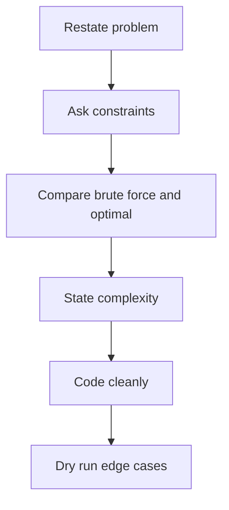
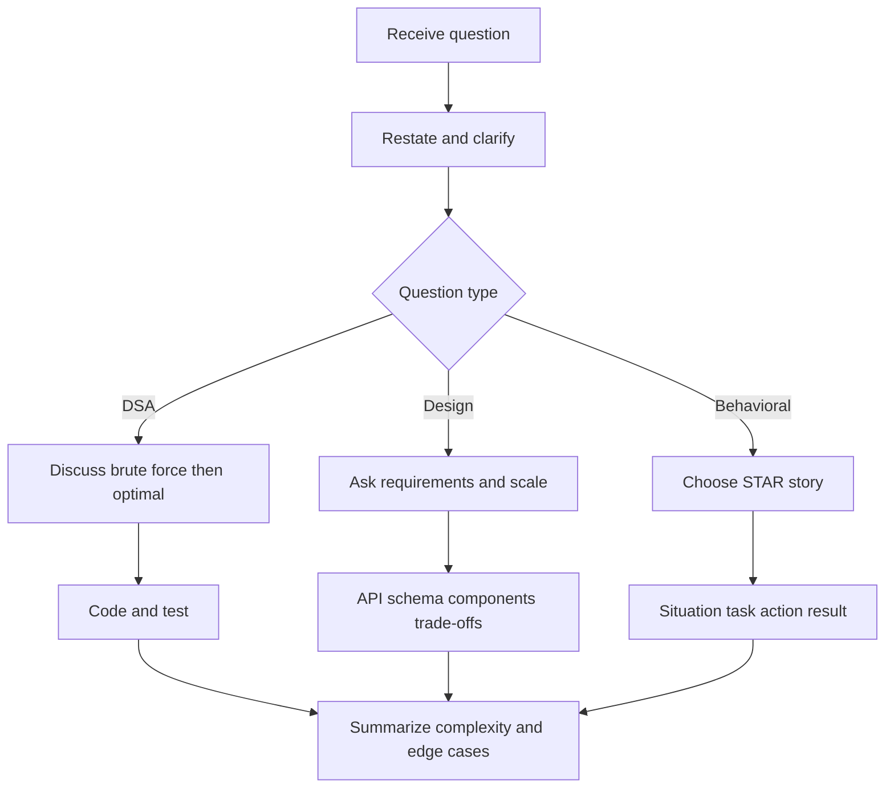

# 21 · Interview Strategy and Negotiation

This guide focuses on **how to communicate** in interviews: thinking aloud, clarifying, recovering, recruiter screens, negotiation, referrals, and interview-day execution.

**Table of Contents**
- [Communication scripts](#communication-scripts)
- [Round time management](#round-time-management)
- [OA strategy](#oa-strategy)
- [Questions to ask interviewer](#questions-to-ask-interviewer)
- [Recruiter and negotiation scripts](#recruiter-and-negotiation-scripts)
- [Templates](#templates)
- [Pre-interview checklist](#pre-interview-checklist)
- [Interview-day flowchart](#interview-day-flowchart)
- [Revision Cheat Sheet](#revision-cheat-sheet)
- [Flashcards](#flashcards)

🟢 Beginner · 🟡 Intermediate · 🔴 Advanced · ⚫ FAANG · 🔥 = very frequently asked

**Accuracy note:** Use scripts as templates, not fake facts. Fill compensation, notice period, dates, and competing offers truthfully.

## Communication scripts

### Q1. How do I think aloud during coding?
`🟡 Intermediate` `🔥` `Must-know SDE-1`

**Why they ask:** Interviewers evaluate reasoning, not only final code.

**Short answer (say this first, 20-40 sec):**
Narrate the problem, constraints, options, chosen approach, complexity, and tests. Keep it concise and invite correction before coding.

**Detailed answer:**
Use this script:
1. `Let me restate the problem to confirm: ...`
2. `The input size suggests [O(n log n)/O(n)] should be acceptable.`
3. `A brute force approach is ..., but it costs ...`
4. `A better approach is ... because ...`
5. `I will code this in Java using [HashMap/Deque/PriorityQueue].`
6. `Before coding, I will test edge cases: empty input, duplicates, negatives, large values.`

**Common mistakes:**
- Going silent instead of narrating reasoning.
- Sounding defensive when corrected.
- Skipping examples, edge cases, or trade-offs.

**Follow-ups:**
- *Should I talk while typing every line?* → No. Narrate decisions (data structure, invariant, edge case), then type quietly and summarize after each block.
- *What if the interviewer interrupts with a new constraint?* → Pause, restate it, say how it changes the approach: `Good point - that rules out sorting, so I'll switch to a hash map.`

### Q2. How do I clarify requirements and state assumptions?
`🟡 Intermediate` `🔥` `Must-know SDE-1`

**Why they ask:** Clarifying questions show product and engineering judgment.

**Short answer (say this first, 20-40 sec):**
Ask about input, output, constraints, edge cases, and failure modes before solving. If something remains open, state a reasonable assumption and continue.

**Detailed answer:**
Exact phrases:
- `Can I assume the input fits in memory?`
- `Are duplicates allowed?`
- `Should I optimize for latency, memory, or implementation simplicity?`
- `For this LLD, should I focus on classes and APIs or also persistence?`
- `I will assume [X]. If that is wrong, I can adjust.`

For backend design, clarify users, QPS, read/write ratio, consistency, data retention, security, idempotency, and observability.

**Common mistakes:**
- Going silent instead of narrating reasoning.
- Sounding defensive when corrected.
- Skipping examples, edge cases, or trade-offs.

**Follow-ups:**
- *How many clarifying questions are too many?* → Aim for 3-6 high-impact ones (input size, duplicates, empty input, output format, constraints); then state remaining assumptions and move on.
- *What if the interviewer says 'you decide'?* → Pick the most common real-world assumption, say it out loud, and note how the solution would change otherwise.

### Q3. What should I say when I am stuck?
`🟡 Intermediate` `🔥` `Must-know SDE-1`

**Why they ask:** They want resilience under uncertainty.

**Short answer (say this first, 20-40 sec):**
Do not go silent. Explain where you are stuck, solve a simpler version, and ask for a small hint only after showing attempts.

**Detailed answer:**
Exact phrases:
- `I am stuck choosing between two approaches. Let me test them on a small example.`
- `I do not immediately see the optimal solution, so I will start with brute force and improve it.`
- `The bottleneck is repeated lookup; I am thinking of a HashMap/heap/two-pointer optimization.`
- `May I have a small hint on the direction: data structure or recurrence?`
- `I know the concept but not the exact API; I will write clear pseudocode and then translate to Java.`

**Common mistakes:**
- Going silent instead of narrating reasoning.
- Sounding defensive when corrected.
- Skipping examples, edge cases, or trade-offs.

**Follow-ups:**
- *How long should I stay stuck before asking for a hint?* → After ~3-5 minutes of no progress, summarize what you tried and ask a targeted question: `Is there a property of the sorted order I should exploit?`
- *Does taking a hint fail the round?* → No. Using a hint well and finishing correctly is much better than silence; interviewers score how you incorporate it.

### Q4. How do I say I do not know without failing?
`🟡 Intermediate` `🔥` `Must-know SDE-1`

**Why they ask:** Honesty plus recovery is better than bluffing.

**Short answer (say this first, 20-40 sec):**
Say what you know, what you do not know, and how you would reason or verify. Never fake expertise.

**Detailed answer:**
Use:
> `I have not used that exact technology in production. What I do know is [related concept]. I would approach it by [docs/spike/test], and I can reason about the trade-offs from first principles.`

For projects:
> `I built this as a project, not a large production system, so I can explain the design and limitations honestly.`

**Common mistakes:**
- Going silent instead of narrating reasoning.
- Sounding defensive when corrected.
- Skipping examples, edge cases, or trade-offs.

**Follow-ups:**
- *What if it is a core concept for my role (e.g., HashMap internals)?* → Give the part you do know, reason from first principles, and follow up after the interview by studying it - never bluff.
- *Can I say 'I would look it up'?* → Yes, once, paired with how you would verify it (docs, a quick experiment, a test).

### Q5. How do I recover from a bad answer?
`🟡 Intermediate` `🔥` `Must-know SDE-1`

**Why they ask:** Corrections are common; recovery shows coachability.

**Short answer (say this first, 20-40 sec):**
Acknowledge, correct, and continue. A bad first attempt is recoverable if you stay calm.

**Detailed answer:**
Recovery script:
- `You are right; my first approach misses [edge case]. I will correct the invariant.`
- `Let me step back and re-evaluate with a smaller example.`
- `I made an implementation mistake, not an approach issue. I will fix it and rerun the dry test.`
- `If we had more time, I would add tests for [case].`

Do not apologize repeatedly; one concise correction is enough.

**Common mistakes:**
- Going silent instead of narrating reasoning.
- Sounding defensive when corrected.
- Skipping examples, edge cases, or trade-offs.

**Follow-ups:**
- *Should I go back and correct a wrong earlier answer?* → Yes: `I want to correct something I said earlier...` - self-correction is a positive signal.
- *How do I stop one bad round affecting the next?* → Take 2 minutes between rounds to reset; each interviewer usually scores independently.

## Round time management

| Round | Typical duration | Time split | What to say |
|---|---:|---|---|
| DSA coding | 45 min | 5 clarify, 10 approach, 20 code, 10 test/optimize | `I will first get a correct solution, then optimize if needed.` |
| LLD/machine coding | 60-90 min | 10 requirements, 15 model/API, 25-45 code/design, 10 tests | `I will keep scope small but extensible.` |
| HLD | 45-60 min | 5 requirements, 10 APIs/schema, 15 architecture, 10 bottlenecks, 5 recap | `I will start with a simple design and scale the bottleneck.` |
| Java/backend | 45-60 min | 10 fundamentals, 20 scenarios, 10 code/SQL, 10 projects | `I will tie this to a Spring/JPA example.` |
| Behavioral | 30-45 min | 2-min stories, 30-sec follow-ups | `I will use a concrete example from [project/work].` |
| Recruiter screen | 20-30 min | role fit, timeline, compensation, questions | `I would like to understand level and process before anchoring compensation.` |

### Q6. What is the best OA strategy?
`🟡 Intermediate` `🔥` `Must-know SDE-1`

**Why they ask:** OA performance depends on speed, pattern recognition, and avoiding hidden-case failures.

**Short answer (say this first, 20-40 sec):**
Solve the easiest accepted solution first, test aggressively, then optimize. Do not spend 40 minutes stuck on one problem.

**Detailed answer:**
OA checklist:
- Read all problems for 2-3 minutes; identify easy/medium/hard.
- Solve high-confidence problem first.
- Use Java templates for input, arrays, maps, heaps, BFS/DFS.
- Test empty, one item, duplicates, sorted/reverse, overflow.
- If stuck 15 minutes, switch.
- Submit only after local mental dry run.

HackerRank/CodeSignal tip: watch function signature, imports, long vs int, and zero/one indexing.

**Common mistakes:**
- Going silent instead of narrating reasoning.
- Sounding defensive when corrected.
- Skipping examples, edge cases, or trade-offs.

**Follow-ups:**
- *Should I submit brute force if I can't find the optimal solution?* → Yes. Passing partial test cases usually beats an unfinished optimal attempt; then optimize if time remains.
- *What do I do when hidden test cases fail?* → Check edge cases first: empty input, single element, duplicates, negative numbers, overflow (use `long`), and time limits on max input.

## Questions to ask interviewer

| Round | 20 strong questions |
|---|---|
| Recruiter | 1. What level is this role mapped to? 2. What is the interview loop? 3. Is there OA? 4. What language/platform? 5. What is the team/product area? |
| Hiring manager | 6. What would success in 6 months look like? 7. What are the team's biggest technical challenges? 8. How is ownership divided? 9. How are incidents handled? 10. What mentorship exists for early-career engineers? |
| Technical | 11. What scale does this service handle? 12. What are common reliability bottlenecks? 13. How do teams balance speed and quality? 14. What testing strategy is expected? 15. How are design decisions reviewed? |
| Behavioral/culture | 16. What behaviors distinguish strong engineers here? 17. How is feedback given? 18. How do teams collaborate across functions? |
| Offer/team match | 19. What is the tech stack and roadmap? 20. What is the expected joining timeline? |

## Recruiter and negotiation scripts

### Q7. How do I handle CTC, expected CTC, and notice period?
`🟡 Intermediate` `🔥` `Must-know SDE-1`

**Why they ask:** Recruiters need timeline and compensation alignment.

**Short answer (say this first, 20-40 sec):**
Be honest on notice period, avoid early hard anchoring on salary, and ask about level and total compensation.

**Detailed answer:**
- Current CTC: `My current CTC is [amount]. I am evaluating role scope, level, and total compensation.`
- Expected CTC: `Based on market research for similar backend roles, I am targeting [range], but I am flexible for the right role and overall package.`
- Notice: `My official notice period is [duration]. I can request early release, but I do not want to promise before approval.`

**Common mistakes:**
- Going silent instead of narrating reasoning.
- Sounding defensive when corrected.
- Skipping examples, edge cases, or trade-offs.

**Follow-ups:**
- *What if HR insists on a number first?* → Give a researched range anchored slightly above your target, based on role, level, and market data - not on your current CTC.
- *Can I negotiate the notice period?* → Often yes: mention a buyout option or an early-release request, and confirm the joining date only after the offer is in writing.

### Q8. How do I compare offers and negotiate?
`🟡 Intermediate` `🔥` `Must-know SDE-1`

**Why they ask:** Negotiation requires structure, not emotion.

**Short answer (say this first, 20-40 sec):**
Compare total compensation, role quality, learning, location, stability, and joining constraints. Negotiate respectfully with evidence and enthusiasm.

**Detailed answer:**
| Component | Ask/compare |
|---|---|
| Base | Fixed annual salary and monthly in-hand estimate |
| Bonus | Target %, payout history if recruiter can share, joining/performance conditions |
| RSU/ESOP | Grant value, vesting schedule, refreshers, liquidity/tax basics |
| Joining bonus | Buyout support, clawback, first-year gap coverage |
| Benefits | Insurance, relocation, learning budget, leaves |
| Role | Team, tech stack, manager, growth, on-call expectations |

Negotiation email:
> Thank you for the offer. I am excited about [team/company] because [reason]. Based on my current process and market research for similar Java backend roles, is there flexibility to improve the [base/joining bonus/RSU] to [specific ask]? If possible, that would help me make a confident decision quickly.

**Common mistakes:**
- Going silent instead of narrating reasoning.
- Sounding defensive when corrected.
- Skipping examples, edge cases, or trade-offs.

**Follow-ups:**
- *Is it risky to negotiate a first offer?* → A polite, data-backed ask is normal and rarely withdrawn; avoid ultimatums and bluffing about competing offers.
- *Base, bonus, or RSUs - what matters most?* → Compare year-1 and 4-year total compensation, vesting schedule and cliffs, joining bonus clawbacks, and growth and learning - not just base pay.

## Templates

### Referral outreach LinkedIn template

> Hi [Name], I am Mohd Azam Ansari, a Java/backend-focused engineer with experience in SQL performance, automation, Spring Boot APIs, and RAG projects using pgvector/LangChain. I saw [Company] is hiring for [Role]. If you are comfortable after reviewing my profile, could you refer me? Resume: [link]. I appreciate your time.

### Follow-up after referral

> Thank you for considering my request. I have applied to [Job ID/link]. Please let me know if you need any other details.

### Thank-you email after interview

> Hi [Name], thank you for the discussion today. I enjoyed talking about [specific topic]. The conversation reinforced my interest in [role/team] because [reason]. I appreciate your time and look forward to next steps.

### Recovering after a poor round email

> Hi [Recruiter], thank you for coordinating the interview. I realized after the round that I could have explained [topic] more clearly. I have revisited the approach and learned from it. I remain very interested in the role and appreciate the opportunity.

## Pre-interview checklist

| Time | Checklist |
|---|---|
| Day before | Confirm time zone/link, read JD, review resume stories, solve 2 easy + 1 medium, revise Java/Spring notes, prepare questions, test laptop/internet, sleep |
| 1 hour before | Water, notebook, IDE ready, close distractions, open resume/JD, review STAR bank, rehearse intro, check camera/mic, breathe |
| 5 minutes before | Join early if allowed, keep phone silent, set notepad with constraints/edge cases headings |

## Interview-day flowchart

## Revision Cheat Sheet

- Never go silent; narrate reasoning.
- Clarify constraints before solving.
- Start brute force if optimal is not obvious.
- Ask for a hint only after showing work.
- Recovery phrase: `You are right; let me correct that assumption.`
- DSA: reserve 10 minutes for tests.
- LLD: requirements → classes → APIs → edge cases → tests.
- HLD: requirements → APIs → data → architecture → bottlenecks.
- Recruiter: be honest on notice, flexible on salary until level is clear.
- Negotiation: enthusiasm + evidence + specific ask.

## Flashcards

1. Q → First coding sentence? A → `Let me restate the problem.`
2. Q → Stuck script? A → `I will start brute force and improve it.`
3. Q → Clarifying categories? A → input, output, constraints, edge cases, failures.
4. Q → Recovery phrase? A → `You are right; my first approach misses...`
5. Q → DSA time split? A → 5 clarify, 10 approach, 20 code, 10 test.
6. Q → LLD order? A → requirements, model, APIs, code/design, tests.
7. Q → HLD order? A → requirements, APIs/schema, architecture, bottlenecks, recap.
8. Q → Salary safe answer? A → level and total compensation first.
9. Q → Notice safe answer? A → official notice plus no overpromise.
10. Q → Negotiation tone? A → grateful, specific, evidence-based.
