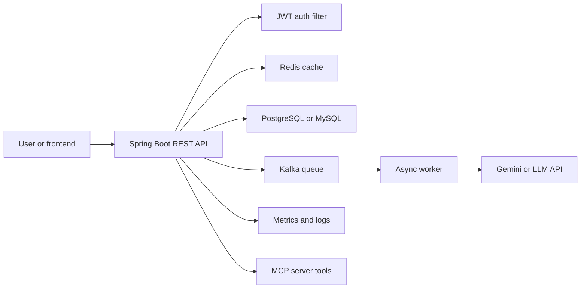

# 23 · Gap Analysis and Roadmaps

This guide assumes you have **3-4 hours/day on weekdays** and **6-8 hours/day on weekends**. If time drops below 2 hours/day, keep DSA daily and rotate Java/LLD/projects on alternate days; if time increases, add mocks and project implementation.

**Table of Contents**
- [Assumptions](#assumptions)
- [Resume gap heatmap](#resume-gap-heatmap)
- [Prioritized gaps](#prioritized-gaps)
- [Time allocation](#time-allocation)
- [30-day FAANG roadmap](#30-day-faang-roadmap)
- [60-day product-company roadmap](#60-day-product-company-roadmap)
- [Project upgrade plan](#project-upgrade-plan)
- [Last-24-hour and last-1-hour revision](#last-24-hour-and-last-1-hour-revision)
- [Mock schedule and rubric](#mock-schedule-and-rubric)
- [Progress tracker](#progress-tracker)
- [Revision Cheat Sheet](#revision-cheat-sheet)
- [Flashcards](#flashcards)

🟢 Beginner · 🟡 Intermediate · 🔴 Advanced · ⚫ FAANG · 🔥 = very frequently asked

**Accuracy note:** This plan uses assumed self-ratings because no live interview dates or ratings were provided. Replace estimates with your actual scores, dates, and constraints. Do not add project upgrades to your resume until built and verified.

## Assumptions

Because no live self-ratings/interview dates were provided, this plan assumes: DSA = 3/5, Java/Spring = 3/5, SQL = 3.5/5, LLD = 2/5, HLD = 2/5, Concurrency = 2/5, CS fundamentals = 2.5/5, GenAI/RAG = 3.5/5, Behavioral = 2.5/5. Adjust weekly using mock scores.

### Q1. What is my current interview gap profile?
`🟡 Intermediate` `🔥` `Must-know SDE-1`

**Why they ask:** A roadmap should be based on target-role gaps, not random topic lists.

**Short answer (say this first, 20-40 sec):**
Your strengths are SQL/performance, automation, BI/Fabric exposure, and GenAI/RAG projects. Highest-priority gaps for Java backend product roles are DSA consistency, LLD/machine coding, Spring/JPA depth, concurrency, and production-style project evidence.

**Detailed answer:**
Use the heatmap below as a starting point and update after mocks.

**Common mistakes:**
- Spending all time on new technologies while DSA remains weak.
- Listing Kafka/Redis on resume without implementing them.
- Ignoring behavioral stories until recruiter screen.

**Follow-ups:**
- *Should I target SDE-2?* → Try if JD matches, but prepare SDE-1 fundamentals strongly; SDE-2 loops may expect deeper design/ownership.
- *Should I remove BI from resume?* → No; frame it as performance, SQL, data correctness, and stakeholder impact.

## Resume gap heatmap

| Skill / signal | FAANG SDE-1 | FAANG SDE-2 | Indian product SDE-1 | Indian product SDE-2 | Current evidence | Gap level |
|---|---|---|---|---|---|---|
| DSA patterns | High | High | High | High | Not explicit on resume | 🔴 High |
| Java 17 + collections | High | High | High | High | Stack listed | 🟡 Medium |
| Spring Boot REST | Medium | High | High | High | Email Assistant | 🟡 Medium |
| JPA/Hibernate transactions | Medium | High | High | High | Stack listed | 🔴 High if not project-demonstrated |
| SQL indexing/query tuning | Medium | Medium | High | High | MAQ performance work | 🟢 Strong |
| Concurrency | Medium | High | Medium | High | Not explicit | 🔴 High |
| LLD/machine coding | Medium | Medium | High | High | Not explicit | 🔴 High |
| HLD basics | Medium | High | Medium | High | Project-level only | 🟡 Medium |
| Redis/cache | Medium | Medium | Medium | High | Stack listed, not project proof | 🟡 Medium |
| Kafka/queues | Medium | Medium | Medium | High | Not listed as built | 🔴 High |
| Testing/CI/CD | Medium | High | Medium | High | JUnit/Docker listed | 🟡 Medium |
| GenAI/RAG | Bonus | Bonus | Bonus | Bonus | Lafz | 🟢 Strong |
| MCP/agentic AI | Bonus | Bonus | Bonus | Bonus | Not explicit | 🟡 Medium |
| Behavioral stories | High | High | High | High | Raw material exists | 🟡 Medium |

## Prioritized gaps

| Priority | Gap | How to close | Proof to add |
|---:|---|---|---|
| 1 | DSA consistency | 2 problems/day weekdays, 4-5 weekends; revise patterns every 7 days | Solved list with notes and mistakes |
| 2 | LLD/machine coding | 3 designs/week from `10a-10f`; implement 1 in Java each weekend | GitHub repo or snippets with tests |
| 3 | Spring/JPA/SQL backend depth | Read `04`, `05`, `06a`, build APIs with transactions and indexes | Email Assistant upgrade PRs |
| 4 | Concurrency | Read `03`; implement producer-consumer, executor, locks, CompletableFuture | Small Java demos and notes |
| 5 | Project productionization | Add Redis, Kafka, JWT, tests, CI/CD, metrics, MCP server | Deployed/demo-ready project README |
| 6 | Behavioral | Build S1-S10 story bank from `19 HR` | 90-sec rehearsed stories |
| 7 | CS fundamentals | Read `24 CS fundamentals` weekly | OS/CN/DBMS flashcards |

## Time allocation

| Area | Share | Weekly hours if 25h/week | What to do |
|---|---:|---:|---|
| DSA | 50% | 12.5h | 10-15 problems + revision |
| Java + Spring + JPA + SQL + Concurrency | 20% | 5h | `02`, `03`, `04`, `05`, `06a` |
| LLD | 10% | 2.5h | `10a-10f` + one coded design |
| Resume + GenAI + MCP | 10% | 2.5h | `01`, `17`, `25`, project upgrades |
| CS fundamentals | 5% | 1.25h | `24` flashcards |
| Behavioral + HLD basics + rest | 5% | 1.25h | `19`, `09a`, mocks |

## 30-day FAANG roadmap

Assume Day 1 is Monday. Weekdays are 3-4h; Saturdays/Sundays are 6-8h. The month roughly preserves the target split: DSA ~50%, Java/Spring/JPA/SQL/concurrency ~20%, LLD ~10%, resume/GenAI/MCP ~10%, CS fundamentals ~5%, behavioral/HLD/rest ~5%.

| Day | DSA topic + guide file | 2-4 specific LeetCode problems that match the pattern | Theory block (guide file + specific sections) | Hours |
|---|---|---|---|---:|
| Day 1 Mon | Arrays/hash maps · `08a` | Two Sum (1); Contains Duplicate (217); Valid Anagram (242); Group Anagrams (49) | `01a/01b` resume baseline: verify project metrics and 2-minute intro | 3-4h |
| Day 2 Tue | Prefix/sort/interval foundations · `08a` | Product of Array Except Self (238); Maximum Subarray (53); Merge Intervals (56) | `02a` Java collections, equals/hashCode, Big-O of List/Map/Set | 3-4h |
| Day 3 Wed | Two pointers + sliding window · `08b` | Container With Most Water (11); 3Sum (15); Longest Substring Without Repeating Characters (3); Valid Palindrome (125) | `02b` JVM memory, GC basics, string immutability | 3-4h |
| Day 4 Thu | Binary search patterns · `08b` | Binary Search (704); Search Insert Position (35); Search in Rotated Sorted Array (33); Find Minimum in Rotated Sorted Array (153) | `06a` indexes, B-tree intuition, execution plans | 3-4h |
| Day 5 Fri | Week-1 timed coding mock + revision · `08a/08b` | Best Time to Buy and Sell Stock (121); Top K Frequent Elements (347); Subarray Sum Equals K (560) | Mock: use file 22 prompt if available / peer; `19` STAR story: conflict + ownership | 3-4h |
| Day 6 Sat | Linked list, stack, queue · `08c` | Reverse Linked List (206); Merge Two Sorted Lists (21); Valid Parentheses (20); Min Stack (155) | `10a` LLD fundamentals; timed 90-min machine coding: Parking Lot skeleton | 6-8h |
| Day 7 Sun | Heap + weekly revision · `08c` | Kth Largest Element in an Array (215); Top K Frequent Elements (347); Merge k Sorted Lists (23); Find Median from Data Stream (295) | Revise week mistakes; peer mock 45 min; `03` thread pools and synchronization flashcards | 6-8h |
| Day 8 Mon | Binary tree traversal · `08d` | Maximum Depth of Binary Tree (104); Invert Binary Tree (226); Binary Tree Level Order Traversal (102) | `04a` Spring Core/Boot: DI, beans, configuration | 3-4h |
| Day 9 Tue | BST + tree recursion · `08d` | Validate Binary Search Tree (98); Kth Smallest Element in a BST (230); Lowest Common Ancestor of a Binary Tree (236); Serialize and Deserialize Binary Tree (297) | `05` JPA mappings, lazy loading, N+1 problem | 3-4h |
| Day 10 Wed | Trie + backtracking basics · `08d/08f` | Implement Trie (208); Word Search (79); Letter Combinations of a Phone Number (17); Subsets (78) | `04b` REST API design, pagination, idempotency, versioning | 3-4h |
| Day 11 Thu | Graph BFS/DFS · `08e` | Number of Islands (200); Clone Graph (133); Rotting Oranges (994) | `24a` OS basics: process/thread, deadlock, context switch | 3-4h |
| Day 12 Fri | Topological sort + week-2 mock · `08e` | Course Schedule (207); Course Schedule II (210); Pacific Atlantic Water Flow (417) | Mock: use file 22 prompt / peer; `19` STAR: failure + learning; `15` test strategy | 3-4h |
| Day 13 Sat | Tree/heap revision + LLD · `08c/08d` | Binary Tree Right Side View (199); Diameter of Binary Tree (543); Path Sum II (113) | `10b/10c` timed 90-min machine coding: Elevator or Splitwise; add unit-test plan | 6-8h |
| Day 14 Sun | Weekly mixed revision · `08a-08e` | Merge Intervals (56); Number of Islands (200); LRU Cache (146) | Peer mock 60 min; `06b/06c` 10 SQL queries: joins, group by, window basics | 6-8h |
| Day 15 Mon | 1D DP · `08f` | Climbing Stairs (70); House Robber (198); Coin Change (322) | `03` concurrency: volatile, synchronized, locks, ConcurrentHashMap | 3-4h |
| Day 16 Tue | String DP · `08f` | Longest Palindromic Substring (5); Decode Ways (91); Word Break (139); Longest Common Subsequence (1143) | `05` transactions, isolation, optimistic/pessimistic locking | 3-4h |
| Day 17 Wed | Backtracking + greedy · `08f` | Combination Sum (39); Permutations (46); Jump Game (55); Task Scheduler (621) | `07` Redis caching: cache-aside, TTL, invalidation, stampede | 3-4h |
| Day 18 Thu | Union-find + weighted graphs · `08e` | Redundant Connection (684); Accounts Merge (721); Network Delay Time (743) | `24b` networking: HTTP/TCP/TLS, latency, retries | 3-4h |
| Day 19 Fri | Design data structures + week-3 mock · `08c/08g` | Time Based Key-Value Store (981); Design Add and Search Words Data Structure (211); Insert Delete GetRandom O(1) (380) | Mock: use file 22 prompt / peer; `09a` HLD framework: requirements, scale, APIs | 3-4h |
| Day 20 Sat | LLD machine-coding weekend · `10d/10e` | LRU Cache (146); LFU Cache (460); Design Twitter (355) | Timed 90-min machine coding: Rate Limiter or Coupon Engine; `10f` concurrency/schema/refactoring review | 6-8h |
| Day 21 Sun | HLD basics + weekly revision · `09a/09b` | Random Pick with Weight (528); K Closest Points to Origin (973); Meeting Rooms II (253); Serialize and Deserialize Binary Tree (297) | HLD mock 60 min: URL Shortener or Notification Service; revise DP/graphs misses | 6-8h |
| Day 22 Mon | Meta/Google mixed strings + intervals · `08b/08g` | Minimum Remove to Make Valid Parentheses (1249); Valid Palindrome II (680); Subarray Sum Equals K (560) | `09c/09d` HLD Tier 1: feed/chat/search case-study skim | 3-4h |
| Day 23 Tue | Hard graph/search exposure · `08e/08g` | Word Ladder (127); Shortest Path in Binary Matrix (1091); Alien Dictionary (269) | `24c` DBMS: ACID, isolation, indexing, normalization vs denormalization | 3-4h |
| Day 24 Wed | Monotonic stack + binary-search review · `08b/08c` | Find Peak Element (162); Koko Eating Bananas (875); Daily Temperatures (739); Largest Rectangle in Histogram (84) | `17` GenAI/RAG: embeddings, vector search, chunking, evaluation; connect Lafz project | 3-4h |
| Day 25 Thu | Linked-list advanced + SQL/CS mock · `08c` | Reverse Nodes in k-Group (25); Copy List with Random Pointer (138); Merge k Sorted Lists (23) | `25` MCP and `26` AI-assisted coding: safe tool use, explainability, constraints | 3-4h |
| Day 26 Fri | Company-style mixed mock · `08g/20a/20b` | Merge Intervals (56); Number of Islands (200); Word Break (139); LRU Cache (146) | Mock: use file 22 prompt / peer; `19` behavioral: Amazon LP + Googleyness + Microsoft growth mindset | 3-4h |
| Day 27 Sat | LLD + HLD Tier 1 · `10b/10c/09c` | Design Parking System (1603); Time Based Key-Value Store (981); Design Underground System (1396) | Timed 90-min machine coding: Food Ordering or Parking Lot; HLD mock: E-commerce Checkout | 6-8h |
| Day 28 Sun | Full-length mock + weekly revision · `08a-08g` | Minimum Window Substring (76); Trapping Rain Water (42); Course Schedule (207) | Full mock: 2 coding + 1 behavioral + 30-min HLD; revise error log and flashcards | 6-8h |
| Day 29 Mon | Final revision day 1 · `08g` | Two Sum (1); Longest Substring Without Repeating Characters (3); LRU Cache (146); Number of Islands (200) | `01a/01b` resume deep dive; `17` and `25` project Q&A; no new topics | 3-4h |
| Day 30 Tue | Final revision day 2 + rest buffer · `08g/19/21` | Valid Parentheses (20); Best Time to Buy and Sell Stock (121); Validate Binary Search Tree (98); Merge Intervals (56) | Final peer mock; revise STAR stories, company "why", HLD templates, SQL/concurrency cheat sheets | 3-4h |

## 60-day product-company roadmap

| Week | Focus | Deliverables | Guide references |
|---|---|---|---|
| 1 | Resume calibration + arrays/strings/hashing | 12-15 DSA, verified resume metrics, 2-minute intro, first STAR bank | `01a`, `01b`, `08a`, `19` |
| 2 | Two pointers, sliding window, binary search + Java collections/JVM | 12-15 DSA, Java collections/JVM notes, one peer coding mock | `08b`, `02a`, `02b`, `22 prompt / peer` |
| 3 | Linked list, stack, queue, heap + Spring REST | 10-12 DSA, Spring controller/service/repository review, API error-handling checklist | `08c`, `04a`, `04b`, `15` |
| 4 | Trees/BST/trie + JPA/SQL | 10-12 DSA, transaction/isolation/index notes, 20 SQL practice queries | `08d`, `05`, `06a`, `06b`, `06c` |
| 5 | Graphs/union-find + Redis/Kafka + CS fundamentals | 10 DSA, cache design note, async event-flow note, OS/network/DBMS flashcards | `08e`, `07`, `12`, `24a`, `24b`, `24c` |
| 6 | DP/backtracking/greedy + LLD fundamentals | 10 DSA, 2 timed 90-min machine-coding attempts, design-pattern checklist | `08f`, `10a`, `10b`, `10c`, `10f` |
| 7 | Product-company LLD + HLD basics | 3-4 LLD designs, 1 runnable Java LLD, 2 HLD mocks, company-specific round plan | `10d`, `10e`, `09a`, `09b`, `09c`, `20a`, `20b` |
| 8 | GenAI/RAG, MCP, AI-assisted coding, security/testing, final mocks | Lafz + AI Email deep-dive, MCP explanation, 3 full mocks, behavioral/story polish | `17`, `25`, `26`, `16`, `15`, `19`, `21` |
| Final 4 days | Consolidation and interview simulation | Error-log revision, top-50 DSA redo, 2 coding mocks, 1 LLD mock, 1 HLD mock, offer/negotiation prep | `08g`, `10a-10f`, `09a-09f`, `19`, `21` |

## Project upgrade plan

### Target architecture

| Week | Upgrade | Concrete tasks | Interview payoff |
|---|---|---|---|
| 1 | JWT auth | register/login, password hashing, JWT filter, protected endpoint | Security + Spring filters |
| 2 | Redis caching | cache generated replies or retrieval results, TTL, cache invalidation note | Performance and cache trade-offs |
| 3 | Kafka queue | async email generation or RAG job, retry/DLQ notes | Event-driven backend |
| 4 | Tests | unit tests for service, controller tests, repository tests | Quality evidence |
| 5 | CI/CD | GitHub Actions build/test, Docker image build | Production hygiene |
| 6 | Metrics/logging | Micrometer-style metrics, structured logs, error counters | Observability |
| 7 | MCP server | expose safe tools like `generateReply`, `searchPoemContext` | AI-assisted/backend differentiation |
| 8 | README/demo | architecture diagram, setup, env vars, trade-offs, screenshots | Recruiter/interviewer proof |

## Last-24-hour and last-1-hour revision

| Time | Do | Do not |
|---|---|---|
| Last 24h | Revise 20 patterns, 5 Java topics, 3 LLD templates, 10 STAR stories, resume projects | Start a new hard topic |
| Last 12h | 2 easy + 1 medium, dry-run intro, check laptop | Grind until exhausted |
| Last 1h | Read resume, JD, story bank, complexity cheat sheet, questions to ask | Open random company rumors |
| Last 10m | Breathe, water, join link, notepad ready | Panic-search solutions |

## Mock schedule and rubric

| Week | Mock type | Frequency | Scoring focus |
|---|---|---|---|
| 1-2 | DSA peer/self mock | 2/week | clarity, correctness, edge cases |
| 3-4 | DSA + Java | 2/week | Java implementation, collections, complexity |
| 5-6 | LLD/machine coding | 1/week | requirements, classes, APIs, tests |
| 7 | HLD basics + behavioral | 2/week | trade-offs, STAR, communication |
| 8 | Full loop simulation | 2 loops | stamina, recovery, recruiter scripts |

| Category | 1 | 3 | 5 |
|---|---|---|---|
| Problem solving | No clear approach | Correct with hints | Optimal with clear reasoning |
| Coding | Many syntax/logic bugs | Works after fixes | Clean, tested, idiomatic Java |
| Communication | Silent or scattered | Understandable | Structured and collaborative |
| Design | Missing requirements | Basic components | Trade-offs, scale, failure modes |
| Behavioral | Generic stories | STAR but light metrics | Specific, honest, measured |

## Progress tracker

| Date | Hours | DSA solved | Topic studied | Mock score | Mistake found | Fix for next session |
|---|---:|---:|---|---:|---|---|
| `[date]` | `[h]` | `[count]` | `[topic]` | `[1-5]` | `[mistake]` | `[fix]` |
| `[date]` | `[h]` | `[count]` | `[topic]` | `[1-5]` | `[mistake]` | `[fix]` |
| `[date]` | `[h]` | `[count]` | `[topic]` | `[1-5]` | `[mistake]` | `[fix]` |

## Revision Cheat Sheet

- Default split: DSA 50%, backend fundamentals 20%, LLD 10%, resume/projects 10%, CS 5%, behavioral/HLD/rest 5%.
- If weekday time is only 1-2h, keep one DSA problem daily and alternate Java/LLD.
- If weekend time is 6-8h, do one mock plus project implementation.
- Biggest gaps: DSA consistency, LLD, concurrency, Spring/JPA depth, production project proof.
- Strongest differentiators: SQL performance, automation, data validation, RAG/pgvector, Spring Boot AI assistant.
- Project upgrades must be real, tested, and demoable before adding to resume.
- Use `08a-08g` for DSA, `02-06` for backend, `10a-10f` for LLD, `09a` for HLD basics.
- Final day is for revision and confidence, not new topics.
- Track mistakes; repeated mistakes become next week's plan.
- Verify every resume metric and company claim.

## Flashcards

1. Q → Highest ROI area? A → DSA at 50% of time.
2. Q → Biggest backend gap? A → Spring/JPA/concurrency demonstrated in projects.
3. Q → Best project upgrade first? A → JWT + Redis because they are interview-discussable quickly.
4. Q → Kafka payoff? A → Async processing, retries, idempotency, DLQ discussion.
5. Q → CI/CD payoff? A → Shows production hygiene and testing discipline.
6. Q → Last 24h rule? A → Revise; do not start new hard topics.
7. Q → Mock rubric categories? A → problem solving, coding, communication, design, behavioral.
8. Q → FAANG roadmap daily core? A → DSA + one backend/design/revision block.
9. Q → What to do with BI experience? A → Frame as SQL performance and data correctness.
10. Q → What to add to progress tracker? A → hours, problems, topic, score, mistake, fix.
