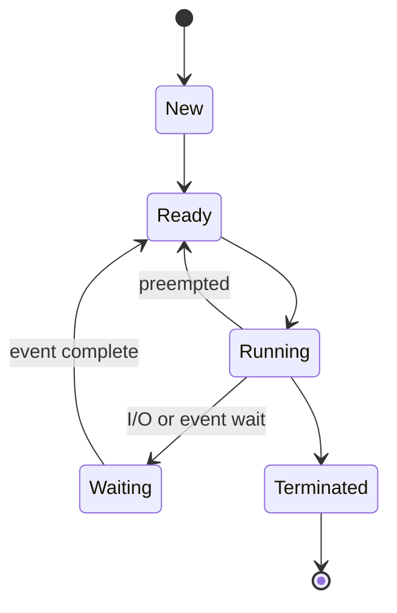
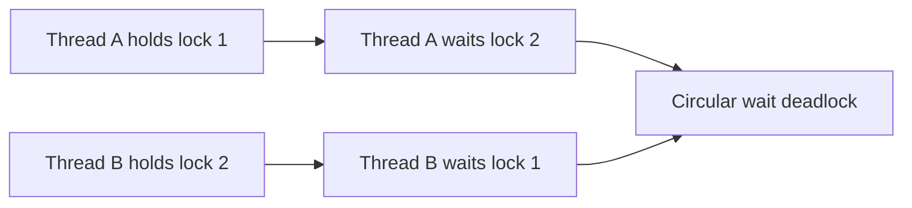
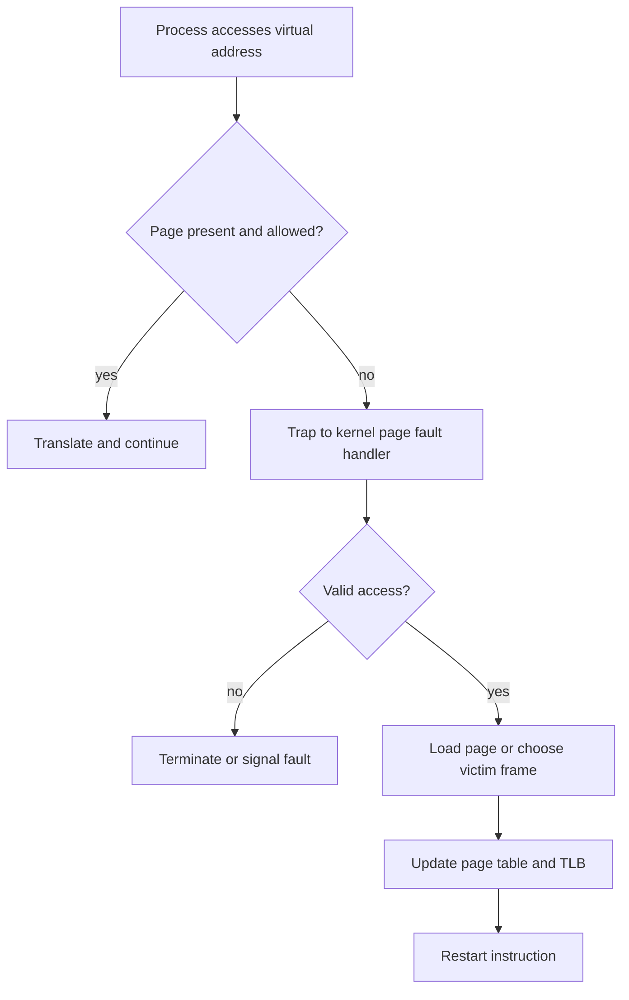
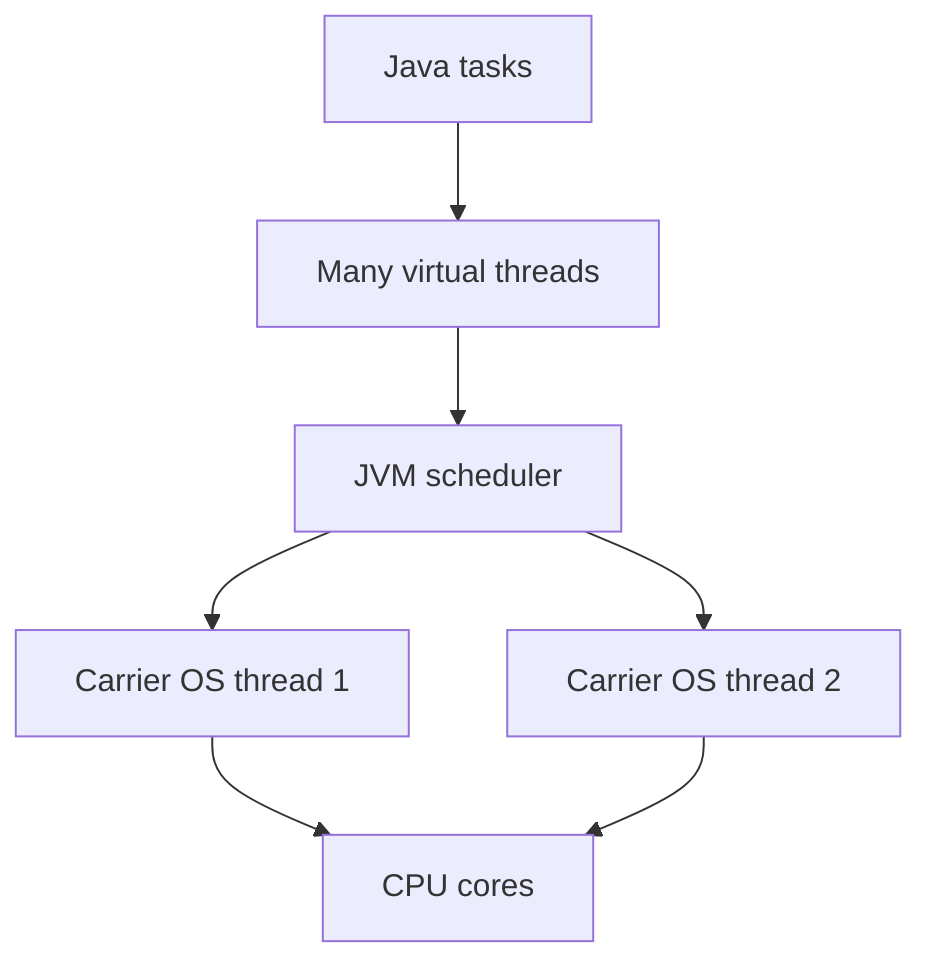

# 24a · CS Fundamentals: Operating Systems

Operating systems questions test whether you understand how Java backend code actually runs: processes, threads, scheduling, synchronization, memory, files, and IPC. Use these answers to connect theory to Spring Boot servers, JVM threads, database clients, Redis clients, and containerized deployments.

**Legend:** 🟢 Beginner · 🟡 Intermediate · 🔴 Advanced · ⚫ FAANG · 🔥 = very frequently asked

## Table of Contents
- [Processes, Threads, and CPU Execution](#processes-threads-and-cpu-execution)
- [Scheduling](#scheduling)
- [Synchronization and Deadlocks](#synchronization-and-deadlocks)
- [Memory Management](#memory-management)
- [IPC, Files, and Java Thread Models](#ipc-files-and-java-thread-models)
- [Revision Cheat Sheet](#revision-cheat-sheet)
- [Flashcards](#flashcards)

## Processes, Threads, and CPU Execution

### Q1. What is the difference between a process and a thread?
`🟢 Beginner` `🔥` `Must-know SDE-1`

**Why they ask:** It is the base for concurrency, JVM, and web-server questions.

**Short answer (say this first, 20-40 sec):**
A process is an independent running program with its own address space and resources. A thread is an execution path inside a process that shares memory with other threads of the same process. Processes are isolated but heavier; threads are lighter but require synchronization.

**Detailed answer:**
| Aspect | Process | Thread |
|---|---|---|
| Memory | Separate address space | Shared process memory |
| Creation | Heavier | Lighter |
| Failure isolation | Better | One bad thread can corrupt process state |
| Communication | IPC | Shared variables, queues |
| Java example | JVM process | request-handling thread |
- Spring Boot usually runs as one JVM process with many threads serving HTTP requests.

**Common mistakes:**
- Saying threads never have private memory; each has its own stack/registers.
- Ignoring synchronization for shared heap objects.
- Assuming threads always improve performance.

**Follow-ups:**
- *Why use processes?* → Isolation, security, separate failures.
- *Why use threads?* → Concurrency with lower overhead and shared memory.

### Q2. What is a Process Control Block (PCB)?
`🟢 Beginner` `Medium` `Must-know SDE-1`

**Why they ask:** It checks OS internals behind context switching.

**Short answer (say this first, 20-40 sec):**
A PCB is the kernel data structure that stores everything needed to manage and resume a process: PID, state, registers, program counter, memory info, open files, scheduling info, and accounting data.

**Detailed answer:**
- Identity: PID, parent PID, user.
- CPU context: registers, program counter, stack pointer.
- Scheduling: priority, state, CPU time.
- Memory: page table pointer, address-space metadata.
- Resources: open file descriptors, signals, IPC handles.

**Common mistakes:**
- Confusing PCB with the process memory itself.
- Forgetting open files and scheduling info.
- Saying PCB is stored in user space; it is maintained by the kernel.

**Follow-ups:**
- *Why PCB needed?* → To pause and later resume a process correctly.
- *Does a thread have similar metadata?* → Yes, thread control block stores thread context.

### Q3. What is a context switch?
`🟢 Beginner` `🔥` `Must-know SDE-1`

**Why they ask:** It explains CPU scheduling overhead and latency.

**Short answer (say this first, 20-40 sec):**
A context switch is when the CPU stops running one process or thread and starts another by saving the old execution context and loading the new one. It enables multitasking but costs CPU time and cache/TLB locality.

**Detailed answer:**
- Triggered by timer interrupt, blocking I/O, higher-priority task, syscall, or page fault.
- Kernel saves registers/program counter and updates state.
- Scheduler chooses next runnable task.
- CPU caches may become less useful after switching.
- In Java servers, too many runnable threads can increase context-switch overhead.

**Common mistakes:**
- Calling every function call a context switch.
- Ignoring cache effects.
- Assuming more threads always means more throughput.

**Follow-ups:**
- *Thread vs process context switch?* → Thread switch within same process is usually cheaper because address space may remain same.
- *How reduce context switches?* → Use sensible thread pools, async I/O where suitable, and avoid blocking unnecessarily.

### Q4. What are user mode and kernel mode?
`🟢 Beginner` `🔥` `Must-know SDE-1`

**Why they ask:** It tests OS protection fundamentals.

**Short answer (say this first, 20-40 sec):**
User mode runs application code with restricted privileges. Kernel mode runs OS code with full hardware access. Switching to kernel mode happens through controlled mechanisms like system calls, interrupts, and exceptions.

**Detailed answer:**
- User mode cannot directly access arbitrary memory or devices.
- Kernel mode can manage memory, scheduling, files, networking, and devices.
- Protection prevents a buggy app from crashing the entire OS.
- Java file or socket operations eventually invoke kernel services through the JVM/native libraries.

**Common mistakes:**
- Saying all Java code runs in kernel mode.
- Confusing kernel mode with admin/root user.
- Ignoring the cost of frequent user-kernel transitions.

**Follow-ups:**
- *What is a trap?* → Controlled switch to kernel mode due to syscall/exception.
- *Why not run everything in kernel mode?* → Security and stability.

### Q5. What is a system call?
`🟢 Beginner` `🔥` `Must-know SDE-1`

**Why they ask:** Backend code constantly uses OS services.

**Short answer (say this first, 20-40 sec):**
A system call is a controlled request from a user program to the kernel for privileged operations like file I/O, networking, process creation, or memory mapping.

**Detailed answer:**
- Examples: `open`, `read`, `write`, `socket`, `connect`, `fork`, `exec`, `mmap`.
- Java wrappers: `Files.readString`, JDBC socket I/O, HTTP clients, `ProcessBuilder`.
- Syscalls involve user-kernel transition, so batching I/O can improve performance.

**Common mistakes:**
- Thinking library calls and syscalls are identical; libraries may call syscalls internally.
- Ignoring failure codes and partial reads/writes.
- Assuming all syscalls are slow equally.

**Follow-ups:**
- *Why are syscalls controlled?* → To protect hardware and OS resources.
- *What is blocking syscall?* → A syscall that sleeps until I/O/resource is ready.

### Q6. What are process states?
`🟢 Beginner` `🔥` `Must-know SDE-1`

**Why they ask:** It checks scheduling basics.

**Short answer (say this first, 20-40 sec):**
Typical process states are new, ready, running, waiting or blocked, and terminated. The scheduler moves processes between ready and running; I/O moves running processes to waiting; completion moves them to terminated.

**Detailed answer:**

- Ready: can run but waiting for CPU.
- Waiting: cannot run until event/I/O completes.
- Running: currently on CPU.

**Common mistakes:**
- Confusing ready with waiting.
- Forgetting preemption from running to ready.
- Assuming a waiting process consumes CPU.

**Follow-ups:**
- *What creates ready queue?* → Processes ready for CPU scheduling.
- *What causes blocked to ready?* → I/O completion, signal, lock availability.

## Scheduling

### Q7. Explain FCFS, SJF, Round Robin, and Priority scheduling.
`🟡 Intermediate` `🔥` `Must-know SDE-1`

**Why they ask:** Scheduling appears in OS rounds and aptitude-style examples.

**Short answer (say this first, 20-40 sec):**
FCFS runs jobs in arrival order, SJF runs the shortest burst first, Round Robin gives each process a time quantum, and Priority scheduling runs higher-priority processes first. Each optimizes different trade-offs like fairness, waiting time, and response time.

**Detailed answer:**
| Algorithm | Idea | Strength | Weakness |
|---|---|---|---|
| FCFS | arrival order | simple | convoy effect |
| SJF | shortest CPU burst | minimum average waiting if known | starvation, needs prediction |
| RR | time quantum rotation | fair, interactive | too-small quantum causes overhead |
| Priority | highest priority first | important work first | starvation |
- Backend analogy: thread pools schedule tasks; long blocking tasks can delay short requests.

**Common mistakes:**
- Saying SJF is always practical; exact future burst is usually unknown.
- Ignoring context-switch overhead in Round Robin.
- Ignoring starvation in priority scheduling.

**Follow-ups:**
- *What is preemptive SJF called?* → Shortest Remaining Time First.
- *What is convoy effect?* → Short jobs wait behind a long job in FCFS.

### Q8. Work a scheduling Gantt example.
`🟡 Intermediate` `🔥` `Must-know SDE-1`

**Why they ask:** They test if you can compute, not just define.

**Short answer (say this first, 20-40 sec):**
For processes P1=5, P2=3, P3=1 all arriving at time 0, FCFS order P1-P2-P3 gives waiting times 0, 5, 8 and average 4.33. SJF order P3-P2-P1 gives waiting times 0, 1, 4 and average 1.67.

**Detailed answer:**
| Algorithm | Timeline | Waiting times | Average waiting |
|---|---|---|---|
| FCFS | `0 P1 5 P2 8 P3 9` | P1=0, P2=5, P3=8 | 4.33 |
| SJF | `0 P3 1 P2 4 P1 9` | P3=0, P2=1, P1=4 | 1.67 |
- Waiting time = start time - arrival time for non-preemptive cases.
- Turnaround time = completion time - arrival time.

**Common mistakes:**
- Mixing waiting time and turnaround time.
- Forgetting arrival times when not all are zero.
- Ignoring preemption in preemptive algorithms.

**Follow-ups:**
- *Why SJF wins here?* → It reduces time short jobs spend waiting.
- *What if P1 arrives earlier?* → With non-preemptive SJF, already-running process continues.

### Q9. What are starvation and aging?
`🟡 Intermediate` `Medium` `Must-know SDE-1`

**Why they ask:** It checks fairness in scheduling and locks.

**Short answer (say this first, 20-40 sec):**
Starvation occurs when a process waits indefinitely because others keep getting resources first. Aging prevents starvation by gradually increasing the priority of waiting processes.

**Detailed answer:**
- Can happen in priority scheduling, SJF, reader-writer locks, and unfair queues.
- Aging example: increase priority by 1 every second spent waiting.
- In backend systems, starvation can appear when high-priority queues never allow low-priority jobs to run.

**Common mistakes:**
- Confusing starvation with deadlock.
- Ignoring fairness in locks and thread pools.
- Making aging too aggressive and destroying priority semantics.

**Follow-ups:**
- *Deadlock vs starvation?* → Deadlock is circular waiting; starvation is indefinite postponement.
- *How else prevent starvation?* → Fair queues, quotas, bounded priority boosts.

### Q10. How does Round Robin quantum affect performance?
`🟡 Intermediate` `Medium` `Must-know SDE-1`

**Why they ask:** It tests trade-off thinking.

**Short answer (say this first, 20-40 sec):**
A small quantum improves responsiveness but increases context-switch overhead. A large quantum reduces overhead but behaves like FCFS and may hurt interactive response time.

**Detailed answer:**
- Quantum should be large compared with context-switch time.
- Interactive systems favor responsiveness.
- Batch systems may use larger quanta.
- If quantum is 10 ms and context switch is 1 ms, overhead can be significant under load.

**Common mistakes:**
- Saying smaller quantum is always better.
- Ignoring CPU cache effects.
- Not considering workload type.

**Follow-ups:**
- *What happens when quantum approaches infinity?* → Round Robin becomes similar to FCFS.
- *What happens with quantum near zero?* → Excessive context switching.

## Synchronization and Deadlocks

### Q11. What is a critical section?
`🟢 Beginner` `🔥` `Must-know SDE-1`

**Why they ask:** It is the foundation of locks.

**Short answer (say this first, 20-40 sec):**
A critical section is code that accesses shared mutable state and must not be executed by multiple threads at the same time unless the state is protected. Correct solutions require mutual exclusion, progress, and bounded waiting.

**Detailed answer:**
- Example: incrementing a shared counter is not atomic.
- Protection tools: mutex, semaphore, monitor, atomic variables, message passing.
- In Java, `synchronized`, `ReentrantLock`, `AtomicInteger`, and concurrent collections are common.

**Common mistakes:**
- Synchronizing too little and leaving races.
- Synchronizing too much and killing concurrency.
- Assuming `volatile` makes compound operations atomic.

**Follow-ups:**
- *What is race condition?* → Result depends on unpredictable interleaving.
- *What is mutual exclusion?* → Only one thread enters the protected section at a time.

### Q12. Mutex vs semaphore?
`🟢 Beginner` `🔥` `Must-know SDE-1`

**Why they ask:** This is a frequent OS synchronization question.

**Short answer (say this first, 20-40 sec):**
A mutex allows one owner to enter a critical section. A semaphore is a counter that allows up to N permits and can coordinate access to a pool of resources. Binary semaphores resemble mutexes but ownership semantics differ.

**Detailed answer:**
| Feature | Mutex | Semaphore |
|---|---|---|
| Count | 1 | 0 to N |
| Ownership | Usually owner releases | Any thread may signal in many models |
| Use | Protect critical section | Limit resource count, producer-consumer |
- Java: `synchronized`/`ReentrantLock` for mutex; `Semaphore` for permits.

**Common mistakes:**
- Using semaphore when lock ownership matters.
- Forgetting to release in `finally`.
- Deadlocking by acquiring multiple locks inconsistently.

**Follow-ups:**
- *What is binary semaphore?* → Semaphore with one permit.
- *What is counting semaphore?* → Semaphore with multiple permits.

### Q13. What is a monitor?
`🟡 Intermediate` `Medium` `Must-know SDE-1`

**Why they ask:** Java's `synchronized` is monitor-based.

**Short answer (say this first, 20-40 sec):**
A monitor combines mutual exclusion with condition synchronization. In Java, every object can act as a monitor using `synchronized`, `wait`, `notify`, and `notifyAll`.

**Detailed answer:**
```java
class BoundedBuffer<T> {
    private final Queue<T> q = new ArrayDeque<>();
    private final int capacity = 10;
    synchronized void put(T item) throws InterruptedException {
        while (q.size() == capacity) wait();
        q.add(item);
        notifyAll();
    }
    synchronized T take() throws InterruptedException {
        while (q.isEmpty()) wait();
        T item = q.remove();
        notifyAll();
        return item;
    }
}
```
- Use `while`, not `if`, around waits due to spurious wakeups.

**Common mistakes:**
- Calling `wait` without holding the monitor.
- Using `if` instead of `while`.
- Calling `notify` when multiple condition types exist.

**Follow-ups:**
- *Why `notifyAll`?* → Safer when multiple conditions may be waiting.
- *What modern Java class helps?* → `BlockingQueue`.

### Q14. Explain producer-consumer.
`🟡 Intermediate` `🔥` `Must-know SDE-1`

**Why they ask:** It checks practical synchronization patterns.

**Short answer (say this first, 20-40 sec):**
Producer-consumer has producers adding items to a bounded buffer and consumers removing them. Synchronization must prevent producers from overflowing the buffer and consumers from reading empty buffer.

**Detailed answer:**
- Semaphores: `empty` initialized to capacity, `full` to 0, mutex for queue access.
- Java production code: prefer `ArrayBlockingQueue` or `LinkedBlockingQueue`.
```java
BlockingQueue<Job> q = new ArrayBlockingQueue<>(100);
q.put(job);      // producer blocks if full
Job job = q.take(); // consumer blocks if empty
```

**Common mistakes:**
- Busy waiting instead of blocking.
- Not bounding the queue, causing memory pressure.
- Forgetting interruption handling.

**Follow-ups:**
- *Why bounded queue?* → Backpressure.
- *Where used in backend?* → Async jobs, logging, event processing.

### Q15. Explain readers-writers and dining philosophers.
`🟡 Intermediate` `Medium` `Must-know SDE-1`

**Why they ask:** Classic problems reveal concurrency design trade-offs.

**Short answer (say this first, 20-40 sec):**
Readers-writers allows many concurrent readers but exclusive writers. Dining philosophers models deadlock risk when multiple actors acquire multiple resources. Both show fairness and deadlock issues.

**Detailed answer:**
- Readers-writers risk: writer starvation if readers keep arriving.
- Dining philosophers deadlock: each philosopher holds one fork and waits for the next.
- Fixes: resource ordering, waiter/arbitrator, try-lock with backoff, allowing at most N-1 philosophers to compete.


**Common mistakes:**
- Ignoring starvation while preventing deadlock.
- Taking locks in inconsistent order.
- Thinking read locks always improve performance.

**Follow-ups:**
- *How Java supports read/write locks?* → `ReentrantReadWriteLock` and `StampedLock`.
- *Simplest dining philosopher fix?* → Total order resources and acquire in order.

### Q16. What are the four necessary conditions for deadlock?
`🟢 Beginner` `🔥` `Must-know SDE-1`

**Why they ask:** Deadlock prevention depends on these conditions.

**Short answer (say this first, 20-40 sec):**
Deadlock requires mutual exclusion, hold and wait, no preemption, and circular wait. Break any one condition to prevent deadlock.

**Detailed answer:**
- Mutual exclusion: resource cannot be shared.
- Hold and wait: process holds one resource while waiting for another.
- No preemption: resource cannot be forcibly taken.
- Circular wait: chain of processes each waiting for the next.

**Common mistakes:**
- Listing starvation as a deadlock condition.
- Forgetting no preemption.
- Saying all four are sufficient in every informal scenario; they are necessary for deadlock.

**Follow-ups:**
- *Most practical prevention?* → Lock ordering breaks circular wait.
- *Can databases deadlock?* → Yes, transactions can wait on locks cyclically.

### Q17. Compare deadlock prevention, avoidance, detection, and recovery.
`🟡 Intermediate` `🔥` `Must-know SDE-1`

**Why they ask:** It tests a complete view of deadlock handling.

**Short answer (say this first, 20-40 sec):**
Prevention structurally breaks deadlock conditions, avoidance grants resources only if the system remains safe, detection finds deadlocks after they occur, and recovery kills/rolls back/preempts work.

**Detailed answer:**
| Strategy | Idea | Example |
|---|---|---|
| Prevention | break one condition | global lock ordering |
| Avoidance | safe-state check | Banker's algorithm |
| Detection | wait-for graph cycle | DB deadlock detector |
| Recovery | resolve deadlock | abort transaction |

**Common mistakes:**
- Calling timeout prevention; it is detection/recovery-ish.
- Using avoidance without knowing max resource needs.
- Ignoring rollback cost.

**Follow-ups:**
- *What do databases often use?* → Detection plus victim rollback.
- *Why not always use Banker's?* → It needs known maximum resource demands.

### Q18. Work a Banker's algorithm example.
`🔴 Advanced` `Medium` `Stretch`

**Why they ask:** It checks resource-allocation reasoning.

**Short answer (say this first, 20-40 sec):**
Banker's algorithm checks whether granting a request leaves at least one safe sequence where every process can finish. If no safe sequence exists, the request is delayed.

**Detailed answer:**
Available `A B C = 3 3 2`

| P | Allocation | Max | Need |
|---|---|---|---|
| P1 | 0 1 0 | 7 5 3 | 7 4 3 |
| P2 | 2 0 0 | 3 2 2 | 1 2 2 |
| P3 | 3 0 2 | 9 0 2 | 6 0 0 |
| P4 | 2 1 1 | 2 2 2 | 0 1 1 |
| P5 | 0 0 2 | 4 3 3 | 4 3 1 |

Safe sequence exists:
1. P2 need `1 2 2` ≤ available `3 3 2`; finish, available becomes `5 3 2`.
2. P4 need `0 1 1`; finish, available `7 4 3`.
3. P5 need `4 3 1`; finish, available `7 4 5`.
4. P1 need `7 4 3`; finish.
5. P3 finish.

**Common mistakes:**
- Comparing Max to Available instead of Need.
- Forgetting to add released Allocation after finish.
- Thinking safe means no waiting; safe means eventual completion is possible.

**Follow-ups:**
- *What is unsafe state?* → Not necessarily deadlocked, but deadlock may occur.
- *Where used today?* → Mostly teaching; real systems often use simpler policies.

## Memory Management

### Q19. What is paging?
`🟢 Beginner` `🔥` `Must-know SDE-1`

**Why they ask:** Paging underlies virtual memory.

**Short answer (say this first, 20-40 sec):**
Paging divides virtual memory into fixed-size pages and physical memory into frames. The page table maps virtual pages to physical frames, allowing non-contiguous allocation and process isolation.

**Detailed answer:**
- Virtual address = page number + offset.
- Physical address = frame number + offset.
- Eliminates external fragmentation but can cause internal fragmentation in the last page.
- Page tables are per process and protected by the OS.

**Common mistakes:**
- Saying pages and frames are different sizes; they are same size.
- Confusing paging with swapping.
- Ignoring page-table memory overhead.

**Follow-ups:**
- *Why fixed size?* → Simpler allocation and mapping.
- *What is page size?* → Commonly 4 KB, but systems also support huge pages.

### Q20. What is segmentation?
`🟢 Beginner` `Medium` `Must-know SDE-1`

**Why they ask:** It contrasts logical memory division with paging.

**Short answer (say this first, 20-40 sec):**
Segmentation divides memory into variable-sized logical segments such as code, stack, heap, and data. It matches programmer view but can suffer external fragmentation.

**Detailed answer:**
- Address = segment number + offset.
- Segment table stores base and limit.
- Easy to protect/share logical units.
- Modern systems often combine paging concepts with segmentation-like protection abstractions.

**Common mistakes:**
- Saying segmentation uses fixed-size blocks.
- Forgetting external fragmentation.
- Confusing segment fault cause with only segmentation; invalid memory access can fault in paged systems too.

**Follow-ups:**
- *Paging vs segmentation?* → Paging is fixed-size physical management; segmentation is variable-size logical management.
- *Which has external fragmentation?* → Segmentation.

### Q21. What is virtual memory?
`🟢 Beginner` `🔥` `Must-know SDE-1`

**Why they ask:** It explains why programs can use more memory than physical RAM.

**Short answer (say this first, 20-40 sec):**
Virtual memory gives each process a large private address space and maps only needed pages to physical memory. It provides isolation, simpler programming, demand paging, and the ability to use disk as backing store.

**Detailed answer:**
- Each process sees addresses starting from its own virtual space.
- OS maps virtual pages to RAM frames or disk.
- Enables memory protection between processes.
- Too much working set can cause thrashing.

**Common mistakes:**
- Saying virtual memory is only swap space.
- Ignoring process isolation benefits.
- Assuming virtual memory has no performance cost.

**Follow-ups:**
- *What is demand paging?* → Load pages only when referenced.
- *What is working set?* → Pages actively used by a process over a time window.

### Q22. What happens during a page fault?
`🟡 Intermediate` `🔥` `Must-know SDE-1`

**Why they ask:** It connects memory and OS exception handling.

**Short answer (say this first, 20-40 sec):**
A page fault occurs when a referenced virtual page is not currently mapped in physical memory or violates permissions. The CPU traps to the OS, which validates access, loads the page if valid, updates page tables, and resumes the instruction.

**Detailed answer:**


**Common mistakes:**
- Treating every page fault as an error.
- Forgetting permission faults.
- Ignoring disk I/O cost for major page faults.

**Follow-ups:**
- *Minor vs major page fault?* → Minor does not need disk I/O; major does.
- *Why restart instruction?* → The original memory access must complete after mapping is fixed.

### Q23. What is a TLB?
`🟡 Intermediate` `🔥` `Must-know SDE-1`

**Why they ask:** It explains address-translation performance.

**Short answer (say this first, 20-40 sec):**
The Translation Lookaside Buffer is a small fast cache of recent virtual-page to physical-frame translations. It avoids expensive page-table walks on every memory access.

**Detailed answer:**
- TLB hit: translation found quickly.
- TLB miss: hardware/OS walks page table and fills TLB.
- Context switches may flush or tag TLB entries.
- Large working sets can reduce TLB locality.

**Common mistakes:**
- Calling TLB a data cache; it caches translations.
- Ignoring context-switch impact.
- Assuming page table lookup is free.

**Follow-ups:**
- *What are huge pages good for?* → Fewer TLB entries needed for large memory regions.
- *What is TLB reach?* → Amount of memory covered by TLB entries.

### Q24. What is thrashing?
`🟡 Intermediate` `Medium` `Must-know SDE-1`

**Why they ask:** It connects memory pressure to system performance.

**Short answer (say this first, 20-40 sec):**
Thrashing happens when the system spends more time swapping pages in and out than doing useful work because active working sets exceed physical memory.

**Detailed answer:**
- Symptoms: high disk I/O, low CPU utilization, slow response.
- Causes: too many processes, memory leaks, oversized heaps, poor locality.
- Fixes: reduce degree of multiprogramming, add memory, tune heap, optimize data structures, improve locality.
- Java example: oversized JVM heaps or many services on one host can pressure memory.

**Common mistakes:**
- Blaming CPU when disk paging is the bottleneck.
- Increasing concurrency under memory pressure.
- Ignoring memory leaks.

**Follow-ups:**
- *What metric hints thrashing?* → High page fault rate and swap I/O.
- *How can containers worsen this?* → Memory limits can cause OOM or heavy reclaim if not sized correctly.

### Q25. Work a page replacement example for FIFO, LRU, and Optimal.
`🔴 Advanced` `🔥` `Stretch`

**Why they ask:** It tests algorithmic precision.

**Short answer (say this first, 20-40 sec):**
For reference string `1 2 3 4 1 2 5 1 2 3 4 5` with 3 frames, FIFO has 9 faults, LRU has 10 faults, and Optimal has 7 faults. Optimal is theoretical because it needs future knowledge.

**Detailed answer:**
| Algorithm | Fault count | Key idea |
|---|---:|---|
| FIFO | 9 | evict oldest loaded page |
| LRU | 10 | evict least recently used page |
| Optimal | 7 | evict page used farthest in future |
- FIFO can suffer Belady's anomaly.
- LRU approximations are used in real systems.

**Common mistakes:**
- Updating LRU order on load but not on hit.
- Believing FIFO always improves with more frames.
- Treating Optimal as implementable in production.

**Follow-ups:**
- *What is Belady's anomaly?* → More frames can cause more FIFO faults for some strings.
- *Why use LRU?* → It exploits temporal locality without future knowledge.

### Q26. Internal vs external fragmentation?
`🟢 Beginner` `🔥` `Must-know SDE-1`

**Why they ask:** It is a standard memory-management concept.

**Short answer (say this first, 20-40 sec):**
Internal fragmentation is wasted space inside allocated blocks. External fragmentation is free memory split into small non-contiguous holes, making large allocation difficult despite enough total free memory.

**Detailed answer:**
- Paging can have internal fragmentation in the last page.
- Segmentation and variable-size allocation can have external fragmentation.
- Compaction can reduce external fragmentation but is expensive.
- Buddy allocators and slab allocators manage fragmentation trade-offs.

**Common mistakes:**
- Mixing internal and external definitions.
- Saying paging causes external fragmentation.
- Ignoring allocation metadata overhead.

**Follow-ups:**
- *How fix external fragmentation?* → Compaction or fixed-size paging.
- *How reduce internal fragmentation?* → Smaller block size, but with more metadata/translation overhead.

## IPC, Files, and Java Thread Models

### Q27. What are common IPC mechanisms?
`🟡 Intermediate` `🔥` `Must-know SDE-1`

**Why they ask:** Processes need communication despite isolation.

**Short answer (say this first, 20-40 sec):**
Common IPC mechanisms are pipes, message queues, shared memory, signals, sockets, and memory-mapped files. Choice depends on speed, structure, host boundary, and synchronization needs.

**Detailed answer:**
| IPC | Best for |
|---|---|
| Pipe | parent-child byte stream |
| Message queue | structured async messages |
| Shared memory | fastest same-machine sharing |
| Socket | local or network communication |
| Signal | small notifications |
- Shared memory needs synchronization because both processes can access same region.

**Common mistakes:**
- Using shared memory without locks.
- Thinking sockets are only remote; Unix domain sockets are local.
- Using signals for large data.

**Follow-ups:**
- *What IPC does HTTP use?* → TCP sockets.
- *Fastest IPC?* → Often shared memory, but complexity increases.

### Q28. What are `fork` and `exec`?
`🟡 Intermediate` `Medium` `Must-know SDE-1`

**Why they ask:** It is classic Unix process creation.

**Short answer (say this first, 20-40 sec):**
`fork` creates a new child process as a copy of the parent. `exec` replaces the current process image with a new program. Shells often fork, then the child execs the requested command.

**Detailed answer:**
- Modern OS uses copy-on-write so fork does not immediately copy all memory.
- Parent and child get different return values from `fork`.
- `exec` keeps PID but replaces code/data/stack with new program.
- Java `ProcessBuilder` eventually relies on OS process creation primitives.

**Common mistakes:**
- Saying exec creates a new process; it replaces current image.
- Ignoring copy-on-write optimization.
- Forgetting file descriptors may be inherited.

**Follow-ups:**
- *Why fork then exec?* → Lets child set up file descriptors/env before running new program.
- *What is copy-on-write?* → Pages are copied only when modified.

### Q29. Zombie vs orphan process?
`🟢 Beginner` `Medium` `Must-know SDE-1`

**Why they ask:** It checks process lifecycle details.

**Short answer (say this first, 20-40 sec):**
A zombie process has finished execution but still has an entry in the process table because the parent has not collected its exit status. An orphan process is still running after its parent exits and is adopted by init/system process.

**Detailed answer:**
- Zombie: terminated but not reaped with `wait`.
- Orphan: running child whose parent died.
- Many zombies can exhaust process table entries.
- Daemon/service managers handle reaping and adoption.

**Common mistakes:**
- Thinking zombies consume CPU; they are already terminated.
- Confusing orphan with zombie.
- Ignoring parent responsibility to wait on children.

**Follow-ups:**
- *How remove zombie?* → Parent calls `wait`, or parent dies and init adopts/reaps.
- *Is orphan always bad?* → Not necessarily; daemons may intentionally detach.

### Q30. Green threads vs OS threads vs Java virtual threads?
`🔴 Advanced` `🔥` `Stretch`

**Why they ask:** Java 21 virtual threads are important for backend interviews.

**Short answer (say this first, 20-40 sec):**
OS threads are scheduled by the kernel. Green threads are user-level threads scheduled by a runtime and invisible to the OS. Java virtual threads are lightweight JVM-managed threads that run on carrier OS threads and are excellent for many blocking I/O tasks.

**Detailed answer:**

- Virtual threads reduce thread-per-request overhead for blocking I/O.
- They do not make CPU-bound code faster.
- Avoid pinning carrier threads with long synchronized/native blocking sections.

**Common mistakes:**
- Calling virtual threads the same as old green threads.
- Using virtual threads to solve CPU bottlenecks.
- Keeping huge platform-thread pools and adding virtual threads blindly.

**Follow-ups:**
- *Best use case?* → High-concurrency blocking I/O services.
- *Do virtual threads need synchronization?* → Yes, shared state rules remain.

### Q31. What are inodes and basic file-system metadata?
`🟡 Intermediate` `Medium` `Must-know SDE-1`

**Why they ask:** File storage questions appear in OS and systems rounds.

**Short answer (say this first, 20-40 sec):**
An inode is a Unix-like file-system structure storing metadata and pointers to file data blocks. It stores permissions, owner, size, timestamps, and block references, but not usually the filename.

**Detailed answer:**
- Directories map names to inode numbers.
- Hard links are multiple directory entries pointing to same inode.
- File descriptors reference open file descriptions.
- Metadata operations can be expensive at scale.

**Common mistakes:**
- Saying inode stores filename.
- Confusing hard links and symbolic links.
- Ignoring permissions and ownership metadata.

**Follow-ups:**
- *What happens when deleting a file?* → Directory entry removed; data freed when link count and open references drop.
- *What is symlink?* → Separate file containing path to target.

### Q32. How do OS concepts affect Java backend performance?
`🟡 Intermediate` `🔥` `Must-know SDE-1`

**Why they ask:** They want theory connected to real backend engineering.

**Short answer (say this first, 20-40 sec):**
OS concepts affect backend latency through thread scheduling, context switches, blocking I/O, page faults, file descriptors, socket buffers, and memory pressure. A good Java backend engineer tunes thread pools, timeouts, heap, connection pools, and resource limits.

**Detailed answer:**
- Too many platform threads → context switching and memory overhead.
- Too small DB pool → queueing; too large → DB overload.
- Memory leaks → GC pressure, paging, OOM.
- Unbounded queues → latency spikes and memory growth.
- File descriptor leaks → cannot accept connections/files.

**Common mistakes:**
- Debugging only application code and ignoring OS metrics.
- Increasing every pool size during incidents.
- No timeouts on sockets and external calls.

**Follow-ups:**
- *What metrics matter?* → CPU run queue, context switches, memory/swap, open FDs, network errors, disk I/O.
- *How tie to containers?* → CPU/memory limits change scheduling, GC, and OOM behavior.

## Revision Cheat Sheet
- Process = isolated program; thread = execution path sharing process memory.
- PCB stores process state, registers, scheduling, memory, and resource info.
- Context switches enable multitasking but cost CPU/cache/TLB locality.
- User mode is restricted; kernel mode manages hardware and privileged operations.
- Syscalls bridge user programs to kernel services.
- Process states: new, ready, running, waiting, terminated.
- FCFS is simple but convoy-prone; SJF minimizes waiting if burst known; RR is fair; priority can starve.
- Mutex protects one critical section; semaphore counts permits.
- Use `while` around Java monitor waits.
- Deadlock requires mutual exclusion, hold-and-wait, no preemption, circular wait.
- Banker's algorithm checks safe sequences before granting resources.
- Paging maps fixed virtual pages to physical frames; segmentation maps logical variable-size regions.
- Page faults trap to OS; TLB caches translations.
- Thrashing means page I/O dominates useful work.
- Virtual threads help blocking I/O concurrency, not CPU-bound speed.

## Flashcards
- Q: Process vs thread? → A: Process has isolated address space; thread shares process memory.
- Q: PCB stores? → A: PID, state, registers, scheduling info, memory info, files.
- Q: Context switch cost? → A: Save/load context plus cache/TLB disruption.
- Q: Ready vs waiting? → A: Ready can run; waiting needs an event.
- Q: Convoy effect? → A: Short jobs wait behind a long FCFS job.
- Q: Starvation fix? → A: Aging or fair scheduling.
- Q: Mutex vs semaphore? → A: Lock ownership vs counted permits.
- Q: Deadlock conditions? → A: Mutual exclusion, hold-and-wait, no preemption, circular wait.
- Q: Page table role? → A: Maps virtual pages to physical frames.
- Q: TLB role? → A: Caches address translations.
- Q: Thrashing? → A: Excessive paging due to memory pressure.
- Q: FIFO anomaly? → A: More frames can cause more page faults.
- Q: Zombie process? → A: Terminated child not reaped by parent.
- Q: `fork` vs `exec`? → A: Copy process vs replace process image.
- Q: Virtual threads best for? → A: Many blocking I/O tasks.
