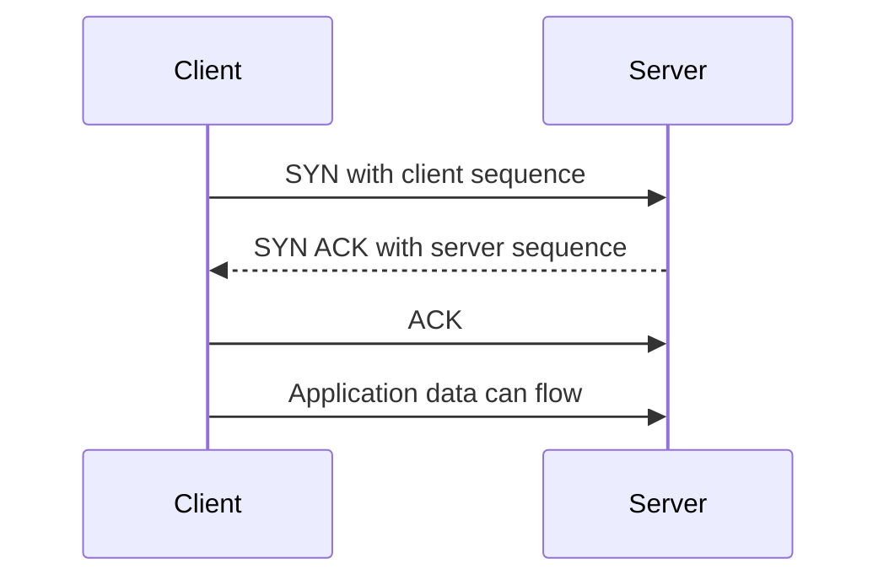
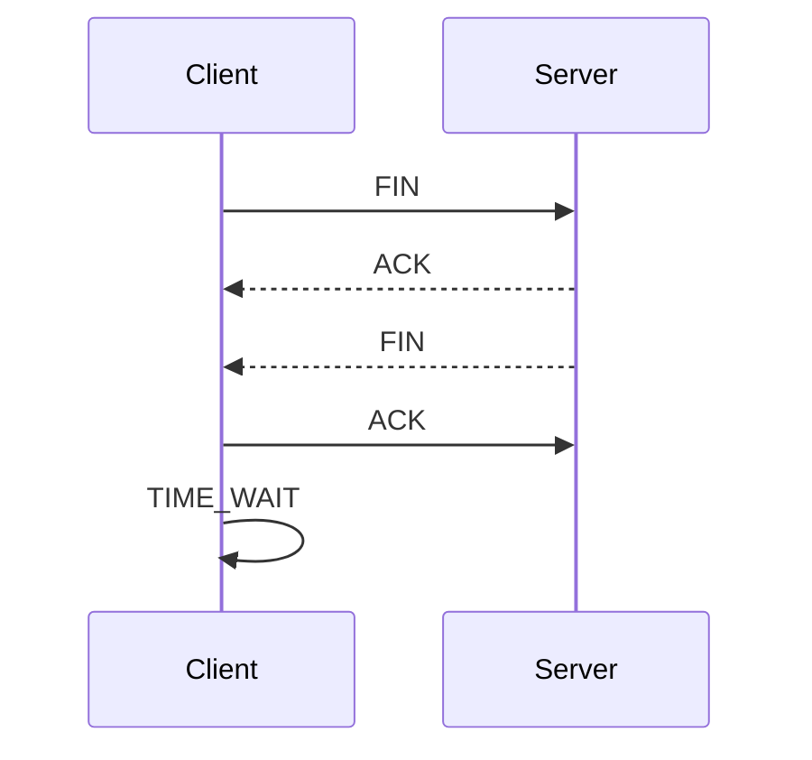
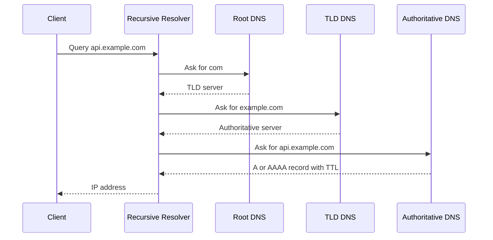
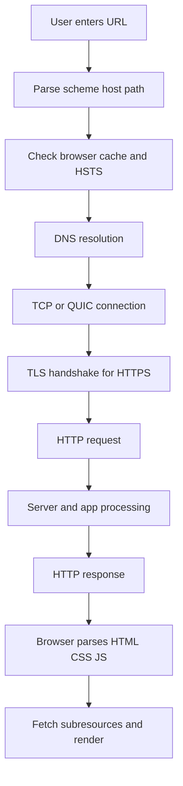

# 24b · CS Fundamentals: Computer Networks

Networks questions test whether you understand what happens between a Java backend, a browser, a database, Redis, DNS, proxies, load balancers, and the public internet. These answers focus on interview-length precision and backend relevance.

**Legend:** 🟢 Beginner · 🟡 Intermediate · 🔴 Advanced · ⚫ FAANG · 🔥 = very frequently asked

## Table of Contents
- [Beginner guide to this file](#beginner-guide-to-this-file)
- [Network Models and Transport](#network-models-and-transport)
- [TCP, UDP, TLS, and HTTP](#tcp-udp-tls-and-http)
- [DNS, URL Flow, IP, and NAT](#dns-url-flow-ip-and-nat)
- [Proxies, Load Balancers, CDN, and Realtime](#proxies-load-balancers-cdn-and-realtime)
- [REST, Cookies, Sessions, and Tokens](#rest-cookies-sessions-and-tokens)
- [Revision Cheat Sheet](#revision-cheat-sheet)
- [Flashcards](#flashcards)

## Beginner guide to this file

### What this file teaches

Networking explains how a request actually travels from a browser or Java service to another system and
back. Interviews ask it because backend reliability often depends on Domain Name System (DNS) lookup,
Transmission Control Protocol (TCP) or User Datagram Protocol (UDP), Transport Layer Security (TLS),
Hypertext Transfer Protocol (HTTP), routing, proxies, load balancers, and latency. A concrete flow is: the
client parses a Uniform Resource Locator (URL), resolves a name to an Internet Protocol (IP) address,
opens or reuses a connection, negotiates TLS, sends an HTTP request, passes through routing and load
balancing, reaches Spring Boot, and returns a response through the same network path.

### Mental model

Think of the network like sending a package through a city: the address is looked up, roads and
intersections route it, couriers choose reliable or fast delivery, security seals protect the contents,
and checkpoints add delay.

- Layers separate responsibilities: application meaning, transport delivery, network routing, and link movement.
- DNS turns human names into addresses before most client connections can start.
- TCP favors ordered reliability; UDP favors small, low-overhead messages or custom reliability.
- TLS protects the conversation but does not replace application authentication or authorization.
- HTTP gives method, path, header, body, status, caching, and retry semantics to backend APIs.
- Latency comes from lookups, handshakes, routing distance, queuing, retransmission, and server work.

### How to think through any question here

1. Start with the request flow: client -> DNS -> connection -> TLS -> HTTP -> proxy or load balancer -> service.
2. Identify the layer: application, transport, network, data link, or infrastructure component.
3. Decide whether the issue is naming, routing, connection setup, encryption, protocol semantics, or app logic.
4. For transport questions, compare reliability, ordering, congestion, and latency trade-offs.
5. For HTTP questions, name the method, status code, headers, body, cache behavior, and idempotency.
6. For production questions, add timeouts, retries, connection pools, load balancing, caching, and observability.
7. For latency questions, count round trips and ask whether reuse, caching, or closer placement removes one.

### Pattern recognition cues

| If the question mentions... | Think about... | Why it fits |
|---|---|---|
| OSI, TCP/IP, layer, or where a protocol lives | Network model | The interviewer wants you to place responsibilities correctly. |
| SYN, FIN, ACK, retransmission, or ordering | TCP | These are reliable connection and byte-stream mechanics. |
| DNS, CNAME, TTL, resolver, or URL typed in browser | Name resolution | The request cannot route to a service until a name becomes an address. |
| HTTPS, certificate, handshake, or SNI | TLS | The topic is protecting HTTP traffic and authenticating the server. |
| GET, POST, status code, header, cache, or idempotency | HTTP semantics | These decide how clients, proxies, and servers interpret the request. |
| NAT, subnet, CIDR, port, or IP address | Addressing and routing | Packets need source/destination addresses and sometimes translation. |
| Load balancer, proxy, gateway, or CDN | Infrastructure hop | These components sit between client and service and affect routing or caching. |
| Timeout, retry, pooling, packet loss, or latency | Resilience and performance | Production systems must survive slow or partial network failure. |
| WebSocket, SSE, long polling, or realtime | Connection pattern | The choice changes connection lifetime, directionality, and scaling. |
| MTU, fragmentation, or PMTUD | Packet sizing | Oversized packets can be fragmented or dropped along the path. |

### Abbreviations and key terms

| Short form | Expanded form | Plain meaning |
|---|---|---|
| A/AAAA | Address record / IPv6 address record | DNS records mapping a name to IPv4 or IPv6 addresses. |
| ACK | Acknowledgment | TCP signal confirming data or a connection step was received. |
| API | Application Programming Interface | Contract used by clients to call backend functionality. |
| ARP | Address Resolution Protocol | Finds a local link-layer address for an IP address. |
| BBR | Bottleneck Bandwidth and Round-trip propagation time | TCP congestion-control algorithm. |
| CDN | Content Delivery Network | Edge network that caches and serves content near users. |
| CIDR | Classless Inter-Domain Routing | Compact notation for IP network ranges. |
| CNAME | Canonical Name | DNS alias record from one name to another. |
| CORS | Cross-Origin Resource Sharing | Browser rule system for cross-origin API calls. |
| CRUD | Create, Read, Update, Delete | Basic data operations often mapped to HTTP APIs. |
| CSRF | Cross-Site Request Forgery | Browser-based attack using an authenticated user's cookies. |
| CSS | Cascading Style Sheets | Browser styling language fetched as a page subresource. |
| CPU | Central Processing Unit | Processor resource that may be low even when network waits are high. |
| CUBIC | CUBIC congestion control | Common TCP congestion-control algorithm. |
| DB | Database | Persistent storage such as PostgreSQL or MySQL. |
| DF | Don't Fragment | IP packet flag asking routers not to fragment. |
| DELETE/GET/OPTIONS/PATCH/POST/PUT | HTTP methods | Common request verbs with different safety and idempotency expectations. |
| DNS | Domain Name System | Distributed system that maps names to records and addresses. |
| FAANG | Facebook, Amazon, Apple, Netflix, Google | Shorthand for large product-company interview style. |
| FIN | Finish | TCP signal that one side is done sending data. |
| gRPC | gRPC Remote Procedure Call | RPC framework commonly using HTTP/2 and Protocol Buffers. |
| HATEOAS | Hypermedia as the Engine of Application State | REST constraint where responses link available next actions. |
| HOL | Head-of-Line | Blocking where one stalled item delays later items. |
| HPACK | HTTP/2 header compression | Compression format for HTTP/2 headers. |
| HSTS | HTTP Strict Transport Security | Header telling browsers to use HTTPS for a site. |
| HTML | Hypertext Markup Language | Browser document format. |
| HTTP | Hypertext Transfer Protocol | Web request/response protocol. |
| HTTPS | Hypertext Transfer Protocol Secure | HTTP protected by TLS. |
| ICMP | Internet Control Message Protocol | Network control messages such as ping and path errors. |
| ID | Identifier | Value used to refer to a record, user, resource, or object. |
| IDOR | Insecure Direct Object Reference | Broken access control by changing an object identifier. |
| IP | Internet Protocol | Addressing and routing protocol for packets. |
| JS | JavaScript | Browser scripting language often fetched after the main HTML response. |
| JSON | JavaScript Object Notation | Common API data format. |
| JWT | JSON Web Token | Signed token often used for stateless identity. |
| L4 | Layer 4 | Transport-layer view, commonly TCP or UDP port based. |
| L7 | Layer 7 | Application-layer view, commonly HTTP aware. |
| LB | Load Balancer | Component that distributes traffic across backends. |
| MAC | Media Access Control | Link-layer hardware address on a local network. |
| MSS | Maximum Segment Size | Largest TCP payload size for one segment. |
| MTU | Maximum Transmission Unit | Largest packet size a link can carry without fragmentation. |
| NAT | Network Address Translation | Rewrites addresses or ports between networks. |
| OS | Operating System | System software managing processes, sockets, and network interfaces. |
| OSI | Open Systems Interconnection | Seven-layer teaching model for networking responsibilities. |
| PAT | Port Address Translation | NAT form that rewrites ports so many clients share one address. |
| PMTUD | Path MTU Discovery | Process for finding the smallest MTU along a path. |
| QPACK | QUIC header compression | Header compression used with HTTP/3. |
| QUIC | Quick UDP Internet Connections | Modern transport over UDP used by HTTP/3. |
| REST | Representational State Transfer | HTTP API style based on resources and standard methods. |
| RPC | Remote Procedure Call | Calling a remote operation as if it were a local function. |
| RST | Reset | TCP signal that aborts a connection. |
| RTT | Round-Trip Time | Time for a packet to go to a peer and for a response to return. |
| SDE-1 | Software Development Engineer level 1 | Entry-level software engineering role. |
| SMTP | Simple Mail Transfer Protocol | Protocol for sending email between servers. |
| SNAT | Source Network Address Translation | NAT that rewrites the source address or port. |
| SNI | Server Name Indication | TLS extension telling the server which hostname the client wants. |
| SQL | Structured Query Language | Language used with relational databases. |
| SSE | Server-Sent Events | One-way server-to-browser event stream over HTTP. |
| SYN | Synchronize | TCP signal used to start a connection. |
| TCP | Transmission Control Protocol | Reliable, ordered, congestion-controlled transport. |
| TLS | Transport Layer Security | Protocol that protects network traffic. |
| TLD | Top-Level Domain | DNS suffix such as com or org. |
| TTL | Time To Live | DNS cache lifetime or IP hop limit depending on context. |
| UDP | User Datagram Protocol | Connectionless transport without built-in delivery guarantees. |
| URL | Uniform Resource Locator | Address used to locate a resource. |
| VPN | Virtual Private Network | Encrypted private network overlay. |
| WAF | Web Application Firewall | Filter that blocks common web attacks before the app. |
| XSS | Cross-Site Scripting | Browser script injection attack. |
| Routing | Routing | Choosing the next network hop toward a destination. |
| Latency | Latency | Delay before a network operation completes. |

### Common beginner traps

- Reciting OSI layers without mapping them to a real browser-to-Spring request.
- Saying UDP is always faster without mentioning lost packets, app-level reliability, or congestion.
- Confusing TLS server authentication with application user authentication.
- Treating HTTP status codes as random numbers instead of client/server contract signals.
- Ignoring DNS cache, connection reuse, and TLS resumption when reasoning about latency.
- Retrying every failed request without checking idempotency, timeout budget, or duplicate side effects.
- Forgetting that load balancers, gateways, proxies, and CDNs can change headers, source IP, and caching.

### How to study this file

1. For each question, narrate the request flow before memorizing definitions.
2. Use the short answer as your interview opening, then add one concrete backend example.
3. Use the detailed answer to draw packet, connection, or proxy diagrams from memory.
4. Turn flashcards into drills: name the layer, production failure, and mitigation for each card.
5. Practice explaining one Spring Boot API call from DNS through HTTP response and logs.
6. When stuck, ask whether the problem is naming, routing, transport, security, HTTP semantics, or latency.

### Scalability and production lens

A single-machine answer can say "the client calls the server." A production answer names each hop and its
failure modes: recursive DNS resolver, public edge, CDN, load balancer, API gateway, Kubernetes service,
pod, database, cache, and external API. Each hop can add latency, drop packets, rewrite headers, terminate
TLS, queue traffic, or retry requests. Scalable systems reduce work with DNS and HTTP caching, reuse
TCP/TLS connections, pool backend connections, place services closer to users, use timeouts and backoff,
and measure p50, p95, and p99 latency separately.

## Network Models and Transport

### Q33. Explain OSI vs TCP/IP model.
`🟢 Beginner` `🔥` `Must-know SDE-1`

**Why they ask:** It checks your mental map of networking layers.

**Beginner lens:** The OSI and TCP/IP models are maps, not the territory. Use them to place a problem in
the request flow: HTTP meaning at the application layer, TCP or UDP delivery at transport, IP routing at
network, and Wi-Fi or Ethernet movement at link. Interviewers test whether you can debug by layer, such as
separating a DNS failure from a TLS failure or an application 500 error.

**Short answer (say this first, 20-40 sec):**
OSI is a 7-layer teaching model; TCP/IP is the practical internet model. For backend interviews, map HTTP to application, TCP/UDP to transport, IP to internet/network, and Ethernet/Wi-Fi to link.

**Detailed answer:**
| OSI layer | TCP/IP rough layer | Example |
|---|---|---|
| Application | Application | HTTP, DNS, TLS concepts |
| Presentation | Application | JSON, compression, encoding |
| Session | Application | sessions, connection management |
| Transport | Transport | TCP, UDP, QUIC over UDP |
| Network | Internet | IP, routing, ICMP |
| Data Link | Link | Ethernet, Wi-Fi, ARP |
| Physical | Link/physical | cables, radio |
- Models help isolate where failures occur: DNS, TCP, TLS, HTTP, app.

**Common mistakes:**
- Treating OSI as exact implementation.
- Placing HTTP at transport layer.
- Forgetting TLS sits between application protocol and transport in practice.

**Follow-ups:**
- *Where is TLS?* → Often considered between application and transport.
- *Where is DNS?* → Application-layer protocol.

### Q34. What happens at the application layer?
`🟢 Beginner` `Medium` `Must-know SDE-1`

**Why they ask:** Backend work mostly uses application protocols.

**Beginner lens:** The application layer is where programs agree on meaning. Think of lower layers as
delivery trucks and the application layer as the business document inside the package. Recognize it when
questions mention HTTP methods, URLs, headers, DNS names, JSON bodies, Redis commands, or PostgreSQL
protocol messages. A backend developer uses this layer to design clear API semantics while relying on
transport and routing below.

**Short answer (say this first, 20-40 sec):**
The application layer defines protocol semantics that programs understand, such as HTTP methods, URLs, headers, status codes, DNS names, and message formats like JSON.

**Detailed answer:**
- HTTP: request/response API semantics.
- DNS: maps names to IP addresses.
- SMTP: email transfer.
- Redis/PostgreSQL protocols: database/cache communication.
- Application layer still relies on lower layers for delivery.

**Common mistakes:**
- Thinking JSON itself is a network protocol.
- Ignoring status codes and method semantics.
- Confusing app errors with TCP errors.

**Follow-ups:**
- *HTTP uses which transport?* → Usually TCP for HTTP/1.1 and HTTP/2; QUIC over UDP for HTTP/3.
- *DNS uses TCP or UDP?* → Mostly UDP, TCP for large responses/zone transfers/fallback.

### Q35. TCP vs UDP?
`🟢 Beginner` `🔥` `Must-know SDE-1`

**Why they ask:** Transport choice affects reliability, latency, and app design.

**Beginner lens:** TCP and UDP are transport choices with different promises. TCP is like a tracked
package service that orders and resends pieces; UDP is like sending individual postcards with little
built-in ceremony. Recognize the choice when reliability, ordering, latency, streaming, DNS, VoIP, or QUIC
comes up. Production design asks whether the application needs built-in reliability or can tolerate loss
and implement its own behavior.

**Short answer (say this first, 20-40 sec):**
TCP is connection-oriented, reliable, ordered, and congestion-controlled. UDP is connectionless, message-oriented, and does not guarantee delivery or order. UDP is useful where low latency or custom reliability matters.

**Detailed answer:**
| Feature | TCP | UDP |
|---|---|---|
| Connection | yes | no |
| Reliability | retransmission and ACKs | app handles it |
| Ordering | guaranteed byte stream | not guaranteed |
| Overhead | higher | lower |
| Examples | HTTP/1.1, HTTP/2, DB connections | DNS, VoIP, QUIC |

**Common mistakes:**
- Saying UDP is always faster; apps may add reliability.
- Treating TCP as message-based; it is a byte stream.
- Ignoring congestion control.

**Follow-ups:**
- *Why DNS often uses UDP?* → Small query/response with low overhead.
- *How does QUIC use UDP reliably?* → Reliability, streams, and congestion control are implemented above UDP.

## TCP, UDP, TLS, and HTTP

### Q36. Explain TCP 3-way handshake.
`🟢 Beginner` `🔥` `Must-know SDE-1`

**Why they ask:** It is the classic transport setup question.

**Beginner lens:** The TCP three-way handshake is connection setup before application data can flow. Think
of client and server both saying, "I can talk, can you hear me?" Recognize it when SYN, SYN-ACK, ACK,
connection latency, or SYN floods are mentioned. For a web request, this handshake may happen before TLS
and HTTP unless a pooled or keep-alive connection is reused.

**Short answer (say this first, 20-40 sec):**
TCP establishes a connection with SYN, SYN-ACK, and ACK. Both sides exchange initial sequence numbers and confirm they can send and receive.

**Detailed answer:**

- Sequence numbers support ordered delivery and retransmission.
- Handshake adds latency before HTTP/1.1 or HTTP/2 over TCP can send data.

**Common mistakes:**
- Saying two packets are enough for both directions.
- Ignoring SYN backlog and SYN flood risk.
- Confusing TCP handshake with TLS handshake.

**Follow-ups:**
- *What is SYN flood?* → Attack exhausting half-open connection resources.
- *How reduce handshake cost?* → Connection reuse, keep-alive, TLS resumption, HTTP/3 optimizations.

### Q37. Explain TCP 4-way connection close.
`🟡 Intermediate` `🔥` `Must-know SDE-1`

**Why they ask:** Closing connections reveals TCP full-duplex behavior.

**Beginner lens:** TCP close is separate for each direction because the connection is full-duplex. Think
of two phone callers each saying they are done speaking. Recognize this when FIN, ACK, RST, TIME_WAIT, or
many closed sockets appear. The production lesson is that connection lifecycle matters: leaking sockets,
closing too aggressively, or misunderstanding TIME_WAIT can hurt busy Java services and load balancers.

**Short answer (say this first, 20-40 sec):**
TCP is full-duplex, so each direction closes independently. One side sends FIN, the other ACKs, later sends its own FIN, and the first ACKs; TIME_WAIT handles delayed packets.

**Detailed answer:**

- `FIN` means no more data from that side.
- `RST` aborts connection.
- TIME_WAIT prevents old duplicate packets from corrupting future connections.

**Common mistakes:**
- Thinking close is always exactly four packets; FINs can combine.
- Confusing FIN with RST.
- Ignoring TIME_WAIT.

**Follow-ups:**
- *Who enters TIME_WAIT?* → Usually the active closer.
- *Can server have many TIME_WAIT sockets?* → Yes, depending on who closes first and traffic pattern.

### Q38. Flow control vs congestion control?
`🟡 Intermediate` `🔥` `Must-know SDE-1`

**Why they ask:** Candidates often mix receiver and network limits.

**Beginner lens:** Flow control protects the receiver; congestion control protects the network path. A
simple analogy is a warehouse saying how much it can accept versus roads slowing traffic during jams.
Recognize this when receive windows, slow start, packet loss, or throughput appear. For backend systems,
these mechanics explain why latency and throughput change under load even when the application code did
not change.

**Short answer (say this first, 20-40 sec):**
Flow control prevents overwhelming the receiver using the advertised receive window. Congestion control prevents overwhelming the network using algorithms that adjust the sending rate based on loss, delay, and acknowledgments.

**Detailed answer:**
- Flow control: receiver says how much buffer it has.
- Congestion control: sender estimates network capacity.
- TCP uses sliding windows.
- Congestion algorithms include slow start, congestion avoidance, fast retransmit/recovery, and modern variants such as CUBIC/BBR.

**Common mistakes:**
- Saying both protect the server only.
- Ignoring packet loss and RTT.
- Confusing application backpressure with TCP flow control.

**Follow-ups:**
- *What is slow start?* → TCP begins with small congestion window and grows quickly until threshold/loss.
- *What is zero window?* → Receiver says it has no buffer space.

### Q39. What is HTTPS and what does TLS provide?
`🟢 Beginner` `🔥` `Must-know SDE-1`

**Why they ask:** Secure backend APIs require HTTPS.

**Beginner lens:** HTTPS means HTTP carried inside TLS. The mental model is a normal web conversation
placed inside a sealed, authenticated tunnel. Recognize it when certificates, confidentiality, integrity,
server authentication, or man-in-the-middle attacks are discussed. A key interview distinction is that TLS
authenticates the server and protects bytes in transit, while your Spring app still authenticates users
and authorizes API actions.

**Short answer (say this first, 20-40 sec):**
HTTPS is HTTP over TLS. TLS provides confidentiality, integrity, and server authentication using certificates, key exchange, and symmetric encryption for application data.

**Detailed answer:**
- Confidentiality: attackers cannot read traffic.
- Integrity: tampering is detected.
- Authentication: client verifies server certificate chain and hostname.
- Does not replace authentication/authorization at the application layer.
- For internal services, mTLS can authenticate both sides.

**Common mistakes:**
- Disabling certificate validation in clients.
- Thinking TLS hides domain from all observers; SNI may reveal hostname unless protected by newer mechanisms.
- Treating HTTPS as protection against SQL injection or auth bugs.

**Follow-ups:**
- *What is certificate authority?* → Trusted issuer that signs certificates.
- *What is mTLS?* → Mutual TLS where client also presents certificate.

### Q40. HTTP/1.1 vs HTTP/2 vs HTTP/3?
`🟡 Intermediate` `🔥` `Must-know SDE-1`

**Why they ask:** Modern backend performance depends on protocol behavior.

**Beginner lens:** HTTP versions mostly change how requests share connections and handle blocking.
HTTP/1.1 is like one or limited checkout lanes, HTTP/2 multiplexes many streams over one TCP connection,
and HTTP/3 uses QUIC over UDP to reduce some TCP-level blocking. Recognize this when performance,
head-of-line blocking, mobile networks, or many small resources are mentioned. The app semantics remain
HTTP methods, headers, and statuses.

**Short answer (say this first, 20-40 sec):**
HTTP/1.1 uses text requests and limited connection reuse/pipelining. HTTP/2 multiplexes many streams over one TCP connection with binary framing and header compression. HTTP/3 runs over QUIC/UDP, reducing TCP head-of-line blocking and improving connection setup.

**Detailed answer:**
| Feature | HTTP/1.1 | HTTP/2 | HTTP/3 |
|---|---|---|---|
| Transport | TCP | TCP | QUIC over UDP |
| Multiplexing | limited | yes | yes |
| Header compression | no standard HPACK | HPACK | QPACK |
| HOL blocking | app-level | TCP-level remains | reduced by QUIC streams |
- Backend services often still expose HTTP/1.1 internally; clients/CDNs may use HTTP/2/3.

**Common mistakes:**
- Saying HTTP/2 uses UDP.
- Believing HTTP/2 removes all head-of-line blocking; TCP still can block.
- Assuming HTTP/3 is always faster in every environment.

**Follow-ups:**
- *What is keep-alive?* → Reusing connections for multiple requests.
- *What is multiplexing?* → Multiple independent streams over one connection.

### Q41. What are HTTP methods and idempotency?
`🟢 Beginner` `🔥` `Must-know SDE-1`

**Why they ask:** REST API correctness depends on method semantics.

**Beginner lens:** HTTP methods communicate intent and retry safety. Think of GET as reading a page, POST
as creating or submitting, PUT as replacing, PATCH as partial change, and DELETE as removal. Recognize
idempotency questions when retries, duplicate requests, or payment-like side effects appear. Production
clients and gateways rely on these semantics to decide whether a timeout can be retried safely.

**Short answer (say this first, 20-40 sec):**
GET reads, POST creates or triggers processing, PUT replaces, PATCH partially updates, and DELETE removes. Idempotent methods can be repeated with the same intended effect, such as GET, PUT, and DELETE.

**Detailed answer:**
| Method | Safe | Idempotent | Use |
|---|---|---|---|
| GET | yes | yes | read |
| POST | no | usually no | create/action |
| PUT | no | yes | replace resource |
| PATCH | no | depends | partial update |
| DELETE | no | yes | delete resource |
- Idempotency keys make retrying POST safe for payments/orders.

**Common mistakes:**
- Using GET for state changes.
- Making PUT act like partial PATCH without saying so.
- Ignoring retries by clients/load balancers.

**Follow-ups:**
- *What is safe method?* → It should not change server state from client's perspective.
- *How make POST idempotent?* → Use idempotency key stored server-side.

### Q42. What HTTP status codes should backend developers know?
`🟢 Beginner` `🔥` `Must-know SDE-1`

**Why they ask:** Good APIs communicate failures precisely.

**Beginner lens:** Status codes are a compact contract between client and server. The mental model is
first digit as category: 2xx success, 3xx redirect, 4xx client problem, and 5xx server problem. Recognize
this when API design, retries, validation errors, authentication, or rate limiting appear. Good backend
answers choose precise codes so clients know whether to fix input, reauthenticate, back off, or retry
later.

**Short answer (say this first, 20-40 sec):**
Use 2xx for success, 3xx for redirects, 4xx for client errors, and 5xx for server errors. Common codes are 200, 201, 204, 400, 401, 403, 404, 409, 422, 429, 500, and 503.

**Detailed answer:**
- `400`: malformed or invalid request.
- `401`: unauthenticated.
- `403`: authenticated but forbidden.
- `404`: resource not found; sometimes used to hide forbidden resource existence.
- `409`: conflict such as version mismatch.
- `429`: rate limit.
- `503`: temporarily unavailable.

**Common mistakes:**
- Returning 200 for errors.
- Confusing 401 and 403.
- Exposing stack traces in 500 responses.

**Follow-ups:**
- *201 vs 200?* → 201 means resource created.
- *404 vs 403 for IDOR?* → Either can be valid; be consistent and avoid leaking existence.

## DNS, URL Flow, IP, and NAT

### Q43. How does DNS resolution work?
`🟡 Intermediate` `🔥` `Must-know SDE-1`

**Why they ask:** Many production incidents start with DNS.

**Beginner lens:** DNS resolution is the name-to-address step before most network connections. Think of it
as asking directories from local cache outward until you find where the service lives. Recognize it when
hostnames, resolvers, TTL, CNAME, A, or AAAA records appear. Production concerns include caching, stale
records, split-horizon DNS, failover delays, and the fact that DNS time adds to request latency.

**Short answer (say this first, 20-40 sec):**
DNS maps domain names to records like IP addresses. A client asks a resolver, which may use cache or query root, TLD, and authoritative name servers, then returns records with a TTL.

**Detailed answer:**

- Caches exist in browser, OS, resolver, and sometimes app runtimes.

**Common mistakes:**
- Assuming DNS change is instant.
- Ignoring negative caching.
- Confusing CNAME and A record.

**Follow-ups:**
- *What is TTL?* → How long a record may be cached.
- *What is CNAME?* → Alias record pointing one name to another.

### Q44. What happens when you type a URL in a browser?
`🟡 Intermediate` `🔥` `Must-know SDE-1`

**Why they ask:** It integrates DNS, TCP, TLS, HTTP, caching, and rendering.

**Beginner lens:** Typing a URL triggers a full request flow, not just "browser calls server." Walk it in
order: parse URL, check caches, resolve DNS, connect with TCP or QUIC, negotiate TLS for HTTPS, send HTTP
request, route through proxies or load balancers, run backend code, and render the response. Interviewers
use this question to test whether you can connect network layers, HTTP, TLS, routing, and latency.

**Short answer (say this first, 20-40 sec):**
The browser parses the URL, checks caches/HSTS, resolves DNS, opens a connection, performs TLS for HTTPS, sends an HTTP request, receives the response, processes redirects/cache, and renders the page while fetching subresources.

**Detailed answer:**

Detailed flow: browser may reuse an existing connection, proxy, or service worker; load balancer routes request; backend may query cache/DB; response headers control caching, cookies, and security.

**Common mistakes:**
- Skipping DNS/TLS.
- Saying server always sees the full URL fragment; fragment after `#` is client-side only.
- Ignoring redirects and caches.

**Follow-ups:**
- *Where does load balancer fit?* → After DNS/connection reaches service IP or edge.
- *When is a new TCP handshake skipped?* → Existing keep-alive connection or HTTP/2/3 connection reuse.

### Q45. Explain IP address, subnet, and CIDR with an example.
`🟡 Intermediate` `🔥` `Must-know SDE-1`

**Why they ask:** Subnetting appears in cloud/backend interviews.

**Beginner lens:** IP addresses identify network endpoints, subnets group address ranges, and CIDR
describes those ranges compactly. Think of a street address plus neighborhood boundary. Recognize this
when routing, private networks, Kubernetes pods, databases, or firewall rules appear. The production skill
is knowing whether two systems are in the same network range, need a gateway, or require rules to reach
each other.

**Short answer (say this first, 20-40 sec):**
CIDR notation like `192.168.1.0/24` means the first 24 bits are network bits and the remaining 8 bits are host bits. A `/24` has 256 addresses, usually 254 usable in traditional IPv4 subnets after network and broadcast addresses.

**Detailed answer:**
Example: `192.168.1.0/26`
- Host bits = 32 - 26 = 6.
- Addresses = 2^6 = 64.
- Range = `192.168.1.0` to `192.168.1.63`.
- Usable traditional host range = `192.168.1.1` to `192.168.1.62`.
- Next `/26` block starts at `192.168.1.64`.

**Common mistakes:**
- Thinking `/26` means 26 hosts.
- Forgetting network and broadcast in traditional IPv4.
- Mixing private and public IP ranges.

**Follow-ups:**
- *What is private IPv4?* → Ranges like `10.0.0.0/8`, `172.16.0.0/12`, `192.168.0.0/16`.
- *What is IPv6 CIDR?* → Same prefix idea with 128-bit addresses.

### Q46. What is NAT?
`🟢 Beginner` `🔥` `Must-know SDE-1`

**Why they ask:** NAT affects connectivity and service exposure.

**Beginner lens:** NAT rewrites addresses or ports as packets cross a boundary. Think of an apartment
building where many residents share one public mailing address but have internal unit numbers. Recognize
it when private IPs access the internet, containers talk through nodes, or source IPs look unexpected.
Production concerns include port exhaustion, logging real client identity, and firewall rules that see
translated addresses.

**Short answer (say this first, 20-40 sec):**
Network Address Translation rewrites IP addresses or ports as packets cross a router or gateway. It lets many private hosts share a public IP and hides internal addressing, but it is not a full security boundary.

**Detailed answer:**
- SNAT: source address/port rewritten for outbound traffic.
- DNAT/port forwarding: destination rewritten for inbound traffic.
- NAT table maps internal connection to external address/port.
- Common in home routers, cloud NAT gateways, Kubernetes networking.

**Common mistakes:**
- Treating NAT as encryption or authentication.
- Forgetting NAT can break inbound connectivity.
- Ignoring source IP preservation behind proxies/NAT.

**Follow-ups:**
- *What is PAT?* → Port Address Translation, many private hosts share one public IP using different ports.
- *Why IPv6 reduces NAT need?* → Huge address space supports globally routable addresses.

### Q47. What are ports?
`🟢 Beginner` `🔥` `Must-know SDE-1`

**Why they ask:** Every backend service binds or connects to ports.

**Beginner lens:** Ports identify which process or service should receive traffic on a host. Think of IP
as the building address and port as the apartment or service desk. Recognize ports when URLs include
:8080, firewalls block traffic, Spring Boot binds to a port, or databases listen on known ports.
Production needs clear exposure rules: public load balancer ports differ from private service and database
ports.

**Short answer (say this first, 20-40 sec):**
A port identifies an application endpoint on a host for TCP or UDP. IP gets packets to a machine; port gets data to the right process/socket.

**Detailed answer:**
- Well-known ports: 80 HTTP, 443 HTTPS, 5432 PostgreSQL, 6379 Redis.
- Client usually uses ephemeral source ports.
- A TCP connection is identified by source IP, source port, destination IP, destination port, and protocol.
- One service cannot bind same IP:port:protocol unless using special socket options.

**Common mistakes:**
- Saying port is a physical connector.
- Confusing listening port with source ephemeral port.
- Forgetting UDP and TCP port spaces are separate.

**Follow-ups:**
- *Why port 0?* → Ask OS to allocate an ephemeral port.
- *What is socket?* → Endpoint abstraction for network communication.

### Q48. What is ARP?
`🟡 Intermediate` `Medium` `Must-know SDE-1`

**Why they ask:** It connects IP layer to local link delivery.

**Beginner lens:** ARP is local-network address discovery. The mental model is asking, "Who on this local
link owns this IP address, and what is your hardware address?" Recognize it when traffic is within the
same subnet, gateways, MAC addresses, or local connectivity issues appear. Backend interviews rarely go
deep here, but ARP helps explain why IP routing still needs link-layer delivery at each hop.

**Short answer (say this first, 20-40 sec):**
Address Resolution Protocol maps an IPv4 address on a local network to a MAC address. Before sending to a local host or gateway, a machine may ARP for the target MAC.

**Detailed answer:**
- Host checks if destination IP is local subnet; if not, sends to default gateway MAC.
- ARP request is broadcast; ARP reply gives MAC.
- Entries are cached.
- IPv6 uses Neighbor Discovery instead of ARP.

**Common mistakes:**
- ARPing across the internet; ARP is local-link only.
- Confusing MAC address with IP address.
- Ignoring ARP spoofing risks on LANs.

**Follow-ups:**
- *What is default gateway?* → Router used for non-local destinations.
- *What is MAC address?* → Link-layer hardware/interface address.

## Proxies, Load Balancers, CDN, and Realtime

### Q49. Proxy vs reverse proxy?
`🟢 Beginner` `🔥` `Must-know SDE-1`

**Why they ask:** Backend deployments often sit behind proxies.

**Beginner lens:** A proxy acts on behalf of a client; a reverse proxy acts in front of servers. Think of
a forward proxy as an office receptionist making outside calls for employees, and a reverse proxy as a
public front desk routing visitors to internal teams. Recognize it when caching, TLS termination, hiding
backend services, or adding headers appears. Production APIs often sit behind reverse proxies or gateways.

**Short answer (say this first, 20-40 sec):**
A forward proxy represents clients when accessing servers. A reverse proxy represents servers to clients, accepting inbound requests and forwarding to backend services.

**Detailed answer:**
| Type | Sits near | Example use |
|---|---|---|
| Forward proxy | client side | corporate internet proxy |
| Reverse proxy | server side | Nginx, API gateway, ingress |
- Reverse proxies terminate TLS, route paths, add headers, compress responses, and protect backends.

**Common mistakes:**
- Mixing proxy direction.
- Trusting `X-Forwarded-For` from untrusted clients.
- Forgetting proxy timeouts and body limits.

**Follow-ups:**
- *What is API gateway?* → Reverse proxy with auth, routing, rate limits, transformations.
- *What is TLS termination?* → Proxy decrypts HTTPS and forwards internally.

### Q50. What is a load balancer?
`🟢 Beginner` `🔥` `Must-know SDE-1`

**Why they ask:** Scalable services use load balancing.

**Beginner lens:** A load balancer distributes incoming requests across healthy backends. Think of it as a
traffic director deciding which checkout counter handles the next customer. Recognize it when horizontal
scaling, health checks, sticky sessions, TLS termination, or L4 versus L7 routing appear. Production
concerns include uneven load, failing instances, connection draining, preserving client IP, and whether
sessions require stickiness or shared storage.

**Short answer (say this first, 20-40 sec):**
A load balancer distributes traffic across multiple backend instances to improve availability and scalability. It uses health checks and algorithms like round-robin, least connections, or consistent hashing.

**Detailed answer:**
- L4 load balancer: routes by IP/port/TCP/UDP.
- L7 load balancer: routes by HTTP host/path/header.
- Health checks remove bad instances.
- Sticky sessions bind users to instance, but stateless apps scale better.

**Common mistakes:**
- No health checks.
- Storing session only in one instance without stickiness/shared store.
- Ignoring load balancer timeouts.

**Follow-ups:**
- *Least connections vs round robin?* → Least connections accounts for long-lived requests.
- *What is consistent hashing?* → Stable key-to-node mapping useful for caches.

### Q51. What is a CDN?
`🟢 Beginner` `Medium` `Must-know SDE-1`

**Why they ask:** CDNs affect latency, caching, and deployment.

**Beginner lens:** A CDN serves cacheable content from locations closer to users. Think of popular files
copied to nearby shelves instead of fetched from the origin every time. Recognize it when static assets,
images, downloads, edge caching, or global latency appear. For APIs, be careful: only cache safe responses
with correct headers, vary by authorization when needed, and purge or version content on updates.

**Short answer (say this first, 20-40 sec):**
A Content Delivery Network caches and serves content from edge locations near users. It reduces latency and origin load for static assets and sometimes dynamic/API content with careful cache rules.

**Detailed answer:**
- Caches images, JS, CSS, downloads, public API responses.
- Uses cache keys, TTL, invalidation/purge.
- Can provide DDoS protection, TLS termination, WAF, HTTP/2/3.
- Avoid caching personalized responses unless varied correctly.

**Common mistakes:**
- Caching authenticated data publicly.
- Forgetting invalidation after deploy.
- Not including query/header variations in cache key.

**Follow-ups:**
- *What is cache hit ratio?* → Percentage served from cache.
- *What is origin?* → Backend/storage CDN fetches from on miss.

### Q52. WebSockets vs long polling vs Server-Sent Events?
`🟡 Intermediate` `🔥` `Must-know SDE-1`

**Why they ask:** Realtime features need correct protocol choice.

**Beginner lens:** Realtime choices differ by connection lifetime and direction. Long polling repeatedly
asks, WebSockets keep a two-way channel open, and Server-Sent Events keep a one-way server-to-client
stream. Recognize this when chat, notifications, progress updates, or dashboards appear. Production
trade-offs include load balancer support, connection counts, backpressure, reconnection behavior, message
ordering, and whether the client needs to send frequent messages back.

**Short answer (say this first, 20-40 sec):**
WebSockets provide full-duplex persistent communication. Long polling repeatedly holds HTTP requests until data arrives. Server-Sent Events provide one-way server-to-client streaming over HTTP.

**Detailed answer:**
| Technique | Direction | Use |
|---|---|---|
| WebSocket | bidirectional | chat, collaborative apps |
| Long polling | server to client via repeated requests | simple compatibility |
| SSE | server to client | notifications, event streams |
- WebSockets require connection management and scaling strategy.
- SSE is simpler for one-way updates and works over HTTP.

**Common mistakes:**
- Using WebSockets for rare updates.
- Forgetting load balancer idle timeouts.
- Not handling reconnect/backoff.

**Follow-ups:**
- *Can WebSockets use HTTP?* → Starts with HTTP upgrade, then WebSocket frames.
- *Which is best for stock ticker?* → SSE or WebSocket depending on bidirectionality and scale.

### Q53. What is connection pooling?
`🟡 Intermediate` `🔥` `Must-know SDE-1`

**Why they ask:** Java services use HTTP and DB connection pools.

**Beginner lens:** Connection pooling reuses expensive network connections instead of opening a new one
for every operation. Think of keeping a fleet of taxis ready rather than buying a car per trip. Recognize
it with databases, Redis, HTTP clients, or thread pools. Production tuning balances pool size, timeouts,
and server limits; too small causes waiting, too large overloads dependencies and increases failure blast
radius.

**Short answer (say this first, 20-40 sec):**
Connection pooling reuses established connections instead of creating a new TCP/TLS/DB connection per request. It reduces latency and resource overhead but must be sized carefully to avoid queueing or overloading downstream systems.

**Detailed answer:**
- DB pools: HikariCP in Spring Boot.
- HTTP clients: keep-alive connection pools.
- Too small: requests wait.
- Too large: downstream overloaded, more memory/sockets.
- Always configure timeouts.

**Common mistakes:**
- Creating new HTTP client per request.
- Increasing pool size without measuring downstream capacity.
- No idle/read/connect timeouts.

**Follow-ups:**
- *What is keep-alive?* → Reuse TCP connection for multiple requests.
- *How size DB pool?* → Based on DB capacity, latency, workload, and measurement.

## REST, Cookies, Sessions, and Tokens

### Q54. What is REST over HTTP?
`🟢 Beginner` `🔥` `Must-know SDE-1`

**Why they ask:** Backend APIs should use HTTP semantics correctly.

**Beginner lens:** REST over HTTP models business things as resources and uses HTTP methods for actions.
Think of URLs as nouns and methods as verbs with agreed semantics. Recognize it when designing CRUD APIs,
status codes, pagination, filtering, and caching. The key distinction is that REST is a style using HTTP
well; it is not simply any JSON endpoint, and it should respect stateless requests.

**Short answer (say this first, 20-40 sec):**
REST is an architectural style where resources are identified by URLs and manipulated using standard HTTP methods and representations. Good REST APIs are stateless, cache-aware, and use status codes and media types consistently.

**Detailed answer:**
- Resource: `/users/123/replies`.
- Representation: JSON response body.
- Stateless: each request carries needed auth/context.
- Use nouns in paths; actions can be subresources when necessary.
- HATEOAS is part of original REST but not always used in pragmatic APIs.

**Common mistakes:**
- Verb-heavy paths like `/getUser`.
- Ignoring status codes.
- Server-side hidden session state required for every REST call.

**Follow-ups:**
- *Is REST a protocol?* → No, architectural style commonly implemented over HTTP.
- *PUT vs PATCH?* → Replace vs partial update.

### Q55. Cookies vs sessions vs tokens?
`🟡 Intermediate` `🔥` `Must-know SDE-1`

**Why they ask:** Web auth depends on these distinctions.

**Beginner lens:** Cookies, sessions, and tokens are ways identity state travels with requests. A cookie
is browser storage sent automatically, a server session stores state on the backend, and a token carries
signed claims to the API. Recognize this when login, logout, scaling, CSRF, mobile clients, or JWTs
appear. Production trade-offs include revocation, expiry, secure cookie flags, token storage, and
load-balanced session sharing.

**Short answer (say this first, 20-40 sec):**
A cookie is browser storage sent automatically to matching sites. A session is server-side state often referenced by a session cookie. A token is a credential like JWT or opaque token sent by client to prove authorization.

**Detailed answer:**
- Cookie attributes: `HttpOnly`, `Secure`, `SameSite`, `Domain`, `Path`, `Max-Age`.
- Session ID should be random and rotated after login.
- Tokens may be bearer tokens; whoever has them can use them.
- Browser cookie auth needs CSRF protection for state-changing requests.

**Common mistakes:**
- Saying cookies are always insecure.
- Storing JWT in localStorage without considering XSS.
- Not expiring sessions.

**Follow-ups:**
- *HttpOnly means?* → JavaScript cannot read cookie.
- *SameSite helps with?* → CSRF risk reduction.

### Q56. What is CORS in REST API integration?
`🟡 Intermediate` `🔥` `Must-know SDE-1`

**Why they ask:** Frontend-backend integration often fails here.

**Beginner lens:** CORS is the browser asking whether frontend code from one origin may call and read
another origin's API. Think of it as a permission slip checked by the browser, not by curl or backend
services. Recognize it when local UI and API ports differ, preflight OPTIONS requests appear, or
credentials are involved. Production should allow specific origins and headers rather than broad
wildcards.

**Short answer (say this first, 20-40 sec):**
CORS is browser-enforced permission for cross-origin JavaScript to read responses. The API must allow trusted origins, methods, headers, and credentials only when required.

**Detailed answer:**
- Origin = scheme + host + port.
- Preflight is an `OPTIONS` request before non-simple requests.
- `Access-Control-Allow-Origin` should not be blindly `*` for credentialed APIs.
- CORS does not replace authentication or authorization.

**Common mistakes:**
- Trying to fix CORS in Postman.
- Allowing all origins with credentials.
- Forgetting `Authorization` header in allowed headers.

**Follow-ups:**
- *Is CORS server security?* → Mostly browser read protection; server still needs auth.
- *What is same-origin policy?* → Browser restriction on cross-origin reads.

### Q57. What are API timeouts and retries?
`🟡 Intermediate` `🔥` `Must-know SDE-1`

**Why they ask:** Reliable services fail fast and avoid retry storms.

**Beginner lens:** Timeouts and retries define how long a caller waits and whether it tries again after
uncertainty. The mental model is a deadline budget: DNS, connection, TLS, server work, and response all
consume time. Recognize it when partial failures, slow dependencies, or duplicate writes appear.
Production retries need backoff, jitter, idempotency, and a limit so they do not amplify an outage.

**Short answer (say this first, 20-40 sec):**
Timeouts bound how long a client waits for connect, read, or total operation. Retries handle transient failures but must use backoff, jitter, idempotency, and limits to avoid amplifying outages.

**Detailed answer:**
- Connect timeout: time to establish connection.
- Read/request timeout: time waiting for response.
- Retry only safe/idempotent operations unless using idempotency keys.
- Use exponential backoff and jitter.
- Combine with circuit breakers for unstable dependencies.

**Common mistakes:**
- Infinite retries.
- No timeout, causing thread exhaustion.
- Retrying non-idempotent payment/order creation.

**Follow-ups:**
- *What is jitter?* → Randomness added to spread retry traffic.
- *What is retry storm?* → Many clients retry and overload a recovering service.

### Q58. What is head-of-line blocking?
`🟡 Intermediate` `Medium` `Must-know SDE-1`

**Why they ask:** It explains HTTP protocol evolution.

**Beginner lens:** Head-of-line blocking means one stuck item prevents later items from moving. Picture a
single-lane bridge blocked by one slow truck. Recognize it with TCP packet loss, HTTP/1.1 request queues,
or multiplexed protocols. The production concern is latency tail amplification: one lost packet or slow
request can delay unrelated work, so systems use multiplexing, connection pools, HTTP/2 or HTTP/3, and
timeouts.

**Short answer (say this first, 20-40 sec):**
Head-of-line blocking means one delayed item blocks later items. In HTTP/1.1, request ordering on a connection can block; in HTTP/2, TCP packet loss can block all streams on that TCP connection; HTTP/3 reduces this with QUIC streams.

**Detailed answer:**
- HTTP/1.1: browsers opened multiple connections to reduce blocking.
- HTTP/2: multiplexed streams but still one TCP connection.
- QUIC: independent streams over UDP with stream-level loss recovery.

**Common mistakes:**
- Saying HTTP/2 removes all HOL blocking.
- Confusing queue HOL with TCP HOL.
- Assuming more connections always solves it.

**Follow-ups:**
- *Why HTTP/3 helps?* → Loss on one QUIC stream need not block other streams.
- *Does app queue have HOL too?* → Yes, slow tasks can block queue workers.

### Q59. What is packet loss and retransmission?
`🟢 Beginner` `Medium` `Must-know SDE-1`

**Why they ask:** Network reliability affects latency.

**Beginner lens:** Packet loss is normal on networks; retransmission is how reliable protocols recover.
Think of missing pages in a mailed document and asking for those pages again. Recognize it when latency
spikes, throughput drops, or TCP retransmits appear. Production impact is often seen as high p95 or p99
latency even if the app is healthy, so monitoring should separate network symptoms from server processing
time.

**Short answer (say this first, 20-40 sec):**
Packet loss occurs when packets are dropped due to congestion, errors, or routing issues. TCP detects loss via duplicate ACKs or timeouts and retransmits, increasing latency and reducing congestion window.

**Detailed answer:**
- Loss can be normal under congestion.
- Wireless networks often have variable loss.
- TCP retransmission hides loss from app but increases response time.
- UDP apps must implement their own recovery if needed.

**Common mistakes:**
- Treating every timeout as server CPU issue.
- Assuming packet loss means data corruption reaches app.
- Ignoring network metrics in latency incidents.

**Follow-ups:**
- *What is RTT?* → Round-trip time between sender and receiver.
- *What is duplicate ACK?* → ACK indicating same expected sequence, hinting missing segment.

### Q60. What is an API gateway?
`🟡 Intermediate` `Medium` `Must-know SDE-1`

**Why they ask:** Modern microservice systems use gateways.

**Beginner lens:** An API gateway is a managed front door for services. It can route requests,
authenticate, rate-limit, transform headers, collect metrics, and centralize cross-cutting policy.
Recognize it when many services need consistent entry behavior or external clients should not know
internal topology. Production trade-offs include another hop of latency, configuration risk, and deciding
which authorization belongs at the gateway versus inside each service.

**Short answer (say this first, 20-40 sec):**
An API gateway is a reverse proxy at the edge of APIs that handles routing, authentication, rate limiting, TLS termination, request transformation, observability, and sometimes aggregation.

**Detailed answer:**
- Benefits: central policy, simpler clients, consistent metrics.
- Risks: bottleneck, over-centralized business logic, misconfiguration.
- Should not replace service-level authorization for sensitive resources.

**Common mistakes:**
- Putting all business logic in gateway.
- Trusting gateway headers without network controls.
- No per-route rate limits.

**Follow-ups:**
- *Gateway vs load balancer?* → Gateway is L7 API policy/routing; LB focuses traffic distribution.
- *Should services trust gateway auth?* → Often yes with mTLS/private network, but validate critical permissions too.

### Q61. What is gRPC compared with REST?
`🔴 Advanced` `Medium` `Stretch`

**Why they ask:** Many backend teams use both.

**Beginner lens:** gRPC is a typed remote procedure call style, while REST is resource-oriented HTTP.
Think of gRPC as calling a strongly defined service method and REST as manipulating resources with
standard web semantics. Recognize the comparison when internal service communication, streaming,
contracts, or polyglot clients appear. Production trade-offs include browser support, debugging, load
balancer compatibility, schema evolution, and whether humans need easy curl-style inspection.

**Short answer (say this first, 20-40 sec):**
gRPC uses HTTP/2 and Protocol Buffers for strongly typed, efficient RPC. REST uses HTTP resource semantics and often JSON. gRPC is strong for internal service-to-service communication; REST is simple and browser-friendly.

**Detailed answer:**
| Aspect | REST | gRPC |
|---|---|---|
| Contract | OpenAPI optional | `.proto` required |
| Payload | JSON common | Protobuf |
| Streaming | limited patterns | built-in streams |
| Browser | easy | needs proxy/grpc-web |
- gRPC has deadlines, status codes, and generated clients.

**Common mistakes:**
- Saying gRPC is always faster; payload and workload matter.
- Exposing gRPC directly to browsers without support.
- Ignoring schema compatibility.

**Follow-ups:**
- *What is protobuf?* → Binary serialization with schema.
- *Where use REST?* → Public APIs, browser clients, simple CRUD.

### Q62. What is caching in HTTP?
`🟡 Intermediate` `Medium` `Must-know SDE-1`

**Why they ask:** Caching improves performance but can leak data.

**Beginner lens:** HTTP caching avoids repeating work by reusing a previous response when it is still
valid. Think of a client or proxy keeping a copy with rules for freshness and revalidation. Recognize it
when Cache-Control, ETag, Last-Modified, CDN, or repeated GET requests appear. Production safety depends
on caching only appropriate responses and varying by authorization, language, or other headers when
content differs per user.

**Short answer (say this first, 20-40 sec):**
HTTP caching uses headers like `Cache-Control`, `ETag`, `Last-Modified`, and `Vary` to let browsers/proxies reuse responses or revalidate them. It reduces latency and server load when used safely.

**Detailed answer:**
- `Cache-Control: max-age=60` allows freshness for 60 seconds.
- `no-store` for sensitive responses.
- `ETag` enables conditional `If-None-Match` and `304 Not Modified`.
- `Vary: Authorization` or avoiding shared caching protects personalized data.

**Common mistakes:**
- Caching user-specific data publicly.
- Not invalidating CDN cache.
- Ignoring `Vary` headers.

**Follow-ups:**
- *What is 304?* → Resource not modified; client can use cached copy.
- *ETag strong vs weak?* → Strong means byte-for-byte; weak means semantically equivalent.

### Q63. What is MTU and fragmentation?
`🔴 Advanced` `Low` `Stretch`

**Why they ask:** It appears in deeper networking rounds and incidents.

**Beginner lens:** MTU is the largest packet a link can carry without fragmentation. Think of a package
size limit on each road segment; an oversized package must be split or rejected. Recognize it when
fragmentation, VPNs, Kubernetes networking, or mysterious connection stalls appear. Production issues
often happen when Path MTU Discovery fails, so protocols may reduce segment size or avoid large packets.

**Short answer (say this first, 20-40 sec):**
MTU is the maximum transmission unit for a link, commonly 1500 bytes on Ethernet. Packets larger than path MTU may be fragmented or dropped, causing performance issues if path MTU discovery fails.

**Detailed answer:**
- TCP usually uses MSS to avoid IP fragmentation.
- IPv4 routers may fragment unless DF bit set; IPv6 routers do not fragment packets.
- Tunnels/VPNs reduce effective MTU.
- Symptoms include large requests hanging while small pings work.

**Common mistakes:**
- Ignoring VPN/container overlay overhead.
- Assuming all links use 1500 MTU.
- Confusing TCP segmentation with IP fragmentation.

**Follow-ups:**
- *What is MSS?* → TCP maximum segment size, payload size excluding IP/TCP headers.
- *What is PMTUD?* → Path MTU Discovery.

### Q64. How do network concepts affect a Spring Boot service?
`🟡 Intermediate` `🔥` `Must-know SDE-1`

**Why they ask:** They want theory tied to production debugging.

**Beginner lens:** Network concepts affect Spring Boot through every outbound and inbound call. A
controller may wait on DNS, TCP connection setup, TLS, load balancer queues, database pools, Redis, Kafka,
or another HTTP service. Recognize this when an app is "slow" but CPU is low. Production debugging follows
the flow: measure client latency, gateway latency, app time, dependency time, pool waits, retries, and
errors.

**Short answer (say this first, 20-40 sec):**
Spring Boot service latency depends on DNS, connection pooling, TCP/TLS handshakes, timeouts, load balancers, proxies, HTTP versions, downstream retries, and network failures. Good services set timeouts, reuse clients, expose metrics, and fail gracefully.

**Detailed answer:**
- Use one configured HTTP client, not a new client per request.
- Set connect/read/request timeouts.
- Monitor DNS failures, connection pool saturation, 5xx, 429, and latency percentiles.
- Respect proxy headers only from trusted proxies.
- Use idempotency keys for retryable writes.

**Common mistakes:**
- Debugging every timeout as application CPU.
- Missing DNS TTL/caching behavior.
- Infinite retry loops during downstream outage.

**Follow-ups:**
- *What logs help?* → Correlation ID, downstream host, status, latency, timeout type.
- *What metric shows LB issue?* → Uneven backend traffic, failed health checks, elevated 502/503/504.

## Revision Cheat Sheet
- OSI is teaching model; TCP/IP is practical model.
- HTTP is application layer; TCP/UDP are transport; IP routes packets.
- TCP is reliable ordered byte stream; UDP is connectionless datagram service.
- TCP handshake: SYN, SYN-ACK, ACK. TCP close: FIN/ACK per direction.
- Flow control protects receiver; congestion control protects network.
- HTTPS = HTTP over TLS with encryption, integrity, and authentication.
- HTTP/2 multiplexes over TCP; HTTP/3 uses QUIC over UDP.
- DNS resolves names through caches, recursive resolver, root, TLD, authoritative servers.
- URL flow includes cache, DNS, connection, TLS, HTTP, server processing, rendering.
- CIDR `/n` means n network bits.
- NAT rewrites addresses/ports; ports identify app endpoints.
- Reverse proxy represents servers; load balancer distributes traffic; CDN caches at edge.
- WebSocket is bidirectional; SSE is server-to-client; long polling is repeated HTTP wait.
- REST uses resources, methods, status codes, statelessness, and representations.
- Timeouts, retries, connection pools, and idempotency are production essentials.

## Flashcards
- Q: TCP vs UDP? → A: Reliable ordered connection vs connectionless datagrams.
- Q: TCP handshake? → A: SYN, SYN-ACK, ACK.
- Q: Flow vs congestion control? → A: Receiver capacity vs network capacity.
- Q: HTTP/2 transport? → A: TCP.
- Q: HTTP/3 transport? → A: QUIC over UDP.
- Q: DNS TTL? → A: Cache lifetime for a DNS record.
- Q: `/26` hosts? → A: 64 addresses, traditionally 62 usable.
- Q: NAT does? → A: Rewrites IPs/ports across network boundary.
- Q: Reverse proxy? → A: Server-side proxy for incoming client requests.
- Q: CDN benefit? → A: Edge caching reduces latency and origin load.
- Q: WebSocket direction? → A: Full-duplex.
- Q: Safe HTTP method? → A: Should not change server state, like GET.
- Q: 401 vs 403? → A: Unauthenticated vs authenticated but forbidden.
- Q: API retry rule? → A: Backoff, jitter, limits, and idempotency.
- Q: Connection pooling? → A: Reuse established connections to reduce overhead.
