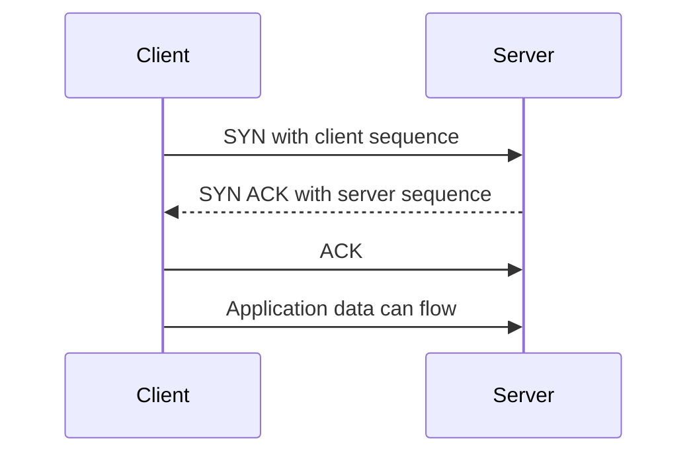
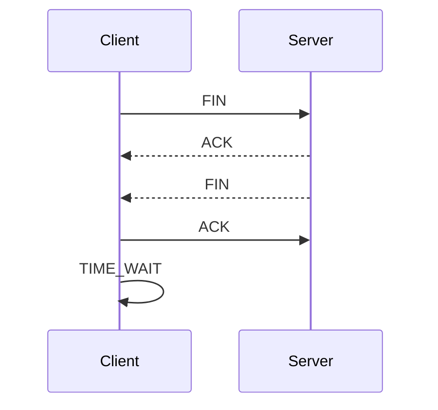
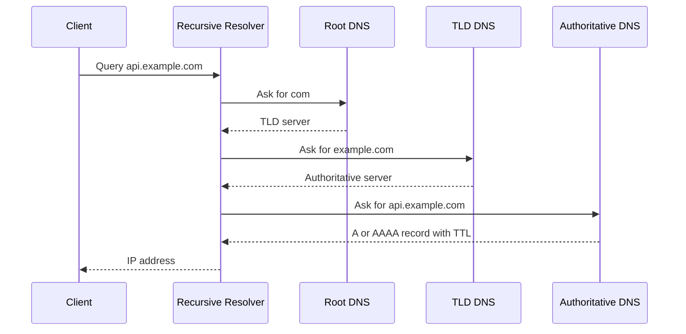
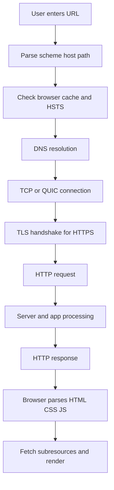

# 24b · CS Fundamentals: Computer Networks

Networks questions test whether you understand what happens between a Java backend, a browser, a database, Redis, DNS, proxies, load balancers, and the public internet. These answers focus on interview-length precision and backend relevance.

**Legend:** 🟢 Beginner · 🟡 Intermediate · 🔴 Advanced · ⚫ FAANG · 🔥 = very frequently asked

## Table of Contents
- [Network Models and Transport](#network-models-and-transport)
- [TCP, UDP, TLS, and HTTP](#tcp-udp-tls-and-http)
- [DNS, URL Flow, IP, and NAT](#dns-url-flow-ip-and-nat)
- [Proxies, Load Balancers, CDN, and Realtime](#proxies-load-balancers-cdn-and-realtime)
- [REST, Cookies, Sessions, and Tokens](#rest-cookies-sessions-and-tokens)
- [Revision Cheat Sheet](#revision-cheat-sheet)
- [Flashcards](#flashcards)

## Network Models and Transport

### Q33. Explain OSI vs TCP/IP model.
`🟢 Beginner` `🔥` `Must-know SDE-1`

**Why they ask:** It checks your mental map of networking layers.

**Short answer (say this first, 20-40 sec):**
OSI is a 7-layer teaching model; TCP/IP is the practical internet model. For backend interviews, map HTTP to application, TCP/UDP to transport, IP to internet/network, and Ethernet/Wi-Fi to link.

**Detailed answer:**
| OSI layer | TCP/IP rough layer | Example |
|---|---|---|
| Application | Application | HTTP, DNS, TLS concepts |
| Presentation | Application | JSON, compression, encoding |
| Session | Application | sessions, connection management |
| Transport | Transport | TCP, UDP, QUIC over UDP |
| Network | Internet | IP, routing, ICMP |
| Data Link | Link | Ethernet, Wi-Fi, ARP |
| Physical | Link/physical | cables, radio |
- Models help isolate where failures occur: DNS, TCP, TLS, HTTP, app.

**Common mistakes:**
- Treating OSI as exact implementation.
- Placing HTTP at transport layer.
- Forgetting TLS sits between application protocol and transport in practice.

**Follow-ups:**
- *Where is TLS?* → Often considered between application and transport.
- *Where is DNS?* → Application-layer protocol.

### Q34. What happens at the application layer?
`🟢 Beginner` `Medium` `Must-know SDE-1`

**Why they ask:** Backend work mostly uses application protocols.

**Short answer (say this first, 20-40 sec):**
The application layer defines protocol semantics that programs understand, such as HTTP methods, URLs, headers, status codes, DNS names, and message formats like JSON.

**Detailed answer:**
- HTTP: request/response API semantics.
- DNS: maps names to IP addresses.
- SMTP: email transfer.
- Redis/PostgreSQL protocols: database/cache communication.
- Application layer still relies on lower layers for delivery.

**Common mistakes:**
- Thinking JSON itself is a network protocol.
- Ignoring status codes and method semantics.
- Confusing app errors with TCP errors.

**Follow-ups:**
- *HTTP uses which transport?* → Usually TCP for HTTP/1.1 and HTTP/2; QUIC over UDP for HTTP/3.
- *DNS uses TCP or UDP?* → Mostly UDP, TCP for large responses/zone transfers/fallback.

### Q35. TCP vs UDP?
`🟢 Beginner` `🔥` `Must-know SDE-1`

**Why they ask:** Transport choice affects reliability, latency, and app design.

**Short answer (say this first, 20-40 sec):**
TCP is connection-oriented, reliable, ordered, and congestion-controlled. UDP is connectionless, message-oriented, and does not guarantee delivery or order. UDP is useful where low latency or custom reliability matters.

**Detailed answer:**
| Feature | TCP | UDP |
|---|---|---|
| Connection | yes | no |
| Reliability | retransmission and ACKs | app handles it |
| Ordering | guaranteed byte stream | not guaranteed |
| Overhead | higher | lower |
| Examples | HTTP/1.1, HTTP/2, DB connections | DNS, VoIP, QUIC |

**Common mistakes:**
- Saying UDP is always faster; apps may add reliability.
- Treating TCP as message-based; it is a byte stream.
- Ignoring congestion control.

**Follow-ups:**
- *Why DNS often uses UDP?* → Small query/response with low overhead.
- *How does QUIC use UDP reliably?* → Reliability, streams, and congestion control are implemented above UDP.

## TCP, UDP, TLS, and HTTP

### Q36. Explain TCP 3-way handshake.
`🟢 Beginner` `🔥` `Must-know SDE-1`

**Why they ask:** It is the classic transport setup question.

**Short answer (say this first, 20-40 sec):**
TCP establishes a connection with SYN, SYN-ACK, and ACK. Both sides exchange initial sequence numbers and confirm they can send and receive.

**Detailed answer:**

- Sequence numbers support ordered delivery and retransmission.
- Handshake adds latency before HTTP/1.1 or HTTP/2 over TCP can send data.

**Common mistakes:**
- Saying two packets are enough for both directions.
- Ignoring SYN backlog and SYN flood risk.
- Confusing TCP handshake with TLS handshake.

**Follow-ups:**
- *What is SYN flood?* → Attack exhausting half-open connection resources.
- *How reduce handshake cost?* → Connection reuse, keep-alive, TLS resumption, HTTP/3 optimizations.

### Q37. Explain TCP 4-way connection close.
`🟡 Intermediate` `🔥` `Must-know SDE-1`

**Why they ask:** Closing connections reveals TCP full-duplex behavior.

**Short answer (say this first, 20-40 sec):**
TCP is full-duplex, so each direction closes independently. One side sends FIN, the other ACKs, later sends its own FIN, and the first ACKs; TIME_WAIT handles delayed packets.

**Detailed answer:**

- `FIN` means no more data from that side.
- `RST` aborts connection.
- TIME_WAIT prevents old duplicate packets from corrupting future connections.

**Common mistakes:**
- Thinking close is always exactly four packets; FINs can combine.
- Confusing FIN with RST.
- Ignoring TIME_WAIT.

**Follow-ups:**
- *Who enters TIME_WAIT?* → Usually the active closer.
- *Can server have many TIME_WAIT sockets?* → Yes, depending on who closes first and traffic pattern.

### Q38. Flow control vs congestion control?
`🟡 Intermediate` `🔥` `Must-know SDE-1`

**Why they ask:** Candidates often mix receiver and network limits.

**Short answer (say this first, 20-40 sec):**
Flow control prevents overwhelming the receiver using the advertised receive window. Congestion control prevents overwhelming the network using algorithms that adjust the sending rate based on loss, delay, and acknowledgments.

**Detailed answer:**
- Flow control: receiver says how much buffer it has.
- Congestion control: sender estimates network capacity.
- TCP uses sliding windows.
- Congestion algorithms include slow start, congestion avoidance, fast retransmit/recovery, and modern variants such as CUBIC/BBR.

**Common mistakes:**
- Saying both protect the server only.
- Ignoring packet loss and RTT.
- Confusing application backpressure with TCP flow control.

**Follow-ups:**
- *What is slow start?* → TCP begins with small congestion window and grows quickly until threshold/loss.
- *What is zero window?* → Receiver says it has no buffer space.

### Q39. What is HTTPS and what does TLS provide?
`🟢 Beginner` `🔥` `Must-know SDE-1`

**Why they ask:** Secure backend APIs require HTTPS.

**Short answer (say this first, 20-40 sec):**
HTTPS is HTTP over TLS. TLS provides confidentiality, integrity, and server authentication using certificates, key exchange, and symmetric encryption for application data.

**Detailed answer:**
- Confidentiality: attackers cannot read traffic.
- Integrity: tampering is detected.
- Authentication: client verifies server certificate chain and hostname.
- Does not replace authentication/authorization at the application layer.
- For internal services, mTLS can authenticate both sides.

**Common mistakes:**
- Disabling certificate validation in clients.
- Thinking TLS hides domain from all observers; SNI may reveal hostname unless protected by newer mechanisms.
- Treating HTTPS as protection against SQL injection or auth bugs.

**Follow-ups:**
- *What is certificate authority?* → Trusted issuer that signs certificates.
- *What is mTLS?* → Mutual TLS where client also presents certificate.

### Q40. HTTP/1.1 vs HTTP/2 vs HTTP/3?
`🟡 Intermediate` `🔥` `Must-know SDE-1`

**Why they ask:** Modern backend performance depends on protocol behavior.

**Short answer (say this first, 20-40 sec):**
HTTP/1.1 uses text requests and limited connection reuse/pipelining. HTTP/2 multiplexes many streams over one TCP connection with binary framing and header compression. HTTP/3 runs over QUIC/UDP, reducing TCP head-of-line blocking and improving connection setup.

**Detailed answer:**
| Feature | HTTP/1.1 | HTTP/2 | HTTP/3 |
|---|---|---|---|
| Transport | TCP | TCP | QUIC over UDP |
| Multiplexing | limited | yes | yes |
| Header compression | no standard HPACK | HPACK | QPACK |
| HOL blocking | app-level | TCP-level remains | reduced by QUIC streams |
- Backend services often still expose HTTP/1.1 internally; clients/CDNs may use HTTP/2/3.

**Common mistakes:**
- Saying HTTP/2 uses UDP.
- Believing HTTP/2 removes all head-of-line blocking; TCP still can block.
- Assuming HTTP/3 is always faster in every environment.

**Follow-ups:**
- *What is keep-alive?* → Reusing connections for multiple requests.
- *What is multiplexing?* → Multiple independent streams over one connection.

### Q41. What are HTTP methods and idempotency?
`🟢 Beginner` `🔥` `Must-know SDE-1`

**Why they ask:** REST API correctness depends on method semantics.

**Short answer (say this first, 20-40 sec):**
GET reads, POST creates or triggers processing, PUT replaces, PATCH partially updates, and DELETE removes. Idempotent methods can be repeated with the same intended effect, such as GET, PUT, and DELETE.

**Detailed answer:**
| Method | Safe | Idempotent | Use |
|---|---|---|---|
| GET | yes | yes | read |
| POST | no | usually no | create/action |
| PUT | no | yes | replace resource |
| PATCH | no | depends | partial update |
| DELETE | no | yes | delete resource |
- Idempotency keys make retrying POST safe for payments/orders.

**Common mistakes:**
- Using GET for state changes.
- Making PUT act like partial PATCH without saying so.
- Ignoring retries by clients/load balancers.

**Follow-ups:**
- *What is safe method?* → It should not change server state from client's perspective.
- *How make POST idempotent?* → Use idempotency key stored server-side.

### Q42. What HTTP status codes should backend developers know?
`🟢 Beginner` `🔥` `Must-know SDE-1`

**Why they ask:** Good APIs communicate failures precisely.

**Short answer (say this first, 20-40 sec):**
Use 2xx for success, 3xx for redirects, 4xx for client errors, and 5xx for server errors. Common codes are 200, 201, 204, 400, 401, 403, 404, 409, 422, 429, 500, and 503.

**Detailed answer:**
- `400`: malformed or invalid request.
- `401`: unauthenticated.
- `403`: authenticated but forbidden.
- `404`: resource not found; sometimes used to hide forbidden resource existence.
- `409`: conflict such as version mismatch.
- `429`: rate limit.
- `503`: temporarily unavailable.

**Common mistakes:**
- Returning 200 for errors.
- Confusing 401 and 403.
- Exposing stack traces in 500 responses.

**Follow-ups:**
- *201 vs 200?* → 201 means resource created.
- *404 vs 403 for IDOR?* → Either can be valid; be consistent and avoid leaking existence.

## DNS, URL Flow, IP, and NAT

### Q43. How does DNS resolution work?
`🟡 Intermediate` `🔥` `Must-know SDE-1`

**Why they ask:** Many production incidents start with DNS.

**Short answer (say this first, 20-40 sec):**
DNS maps domain names to records like IP addresses. A client asks a resolver, which may use cache or query root, TLD, and authoritative name servers, then returns records with a TTL.

**Detailed answer:**

- Caches exist in browser, OS, resolver, and sometimes app runtimes.

**Common mistakes:**
- Assuming DNS change is instant.
- Ignoring negative caching.
- Confusing CNAME and A record.

**Follow-ups:**
- *What is TTL?* → How long a record may be cached.
- *What is CNAME?* → Alias record pointing one name to another.

### Q44. What happens when you type a URL in a browser?
`🟡 Intermediate` `🔥` `Must-know SDE-1`

**Why they ask:** It integrates DNS, TCP, TLS, HTTP, caching, and rendering.

**Short answer (say this first, 20-40 sec):**
The browser parses the URL, checks caches/HSTS, resolves DNS, opens a connection, performs TLS for HTTPS, sends an HTTP request, receives the response, processes redirects/cache, and renders the page while fetching subresources.

**Detailed answer:**

Detailed flow: browser may reuse an existing connection, proxy, or service worker; load balancer routes request; backend may query cache/DB; response headers control caching, cookies, and security.

**Common mistakes:**
- Skipping DNS/TLS.
- Saying server always sees the full URL fragment; fragment after `#` is client-side only.
- Ignoring redirects and caches.

**Follow-ups:**
- *Where does load balancer fit?* → After DNS/connection reaches service IP or edge.
- *When is a new TCP handshake skipped?* → Existing keep-alive connection or HTTP/2/3 connection reuse.

### Q45. Explain IP address, subnet, and CIDR with an example.
`🟡 Intermediate` `🔥` `Must-know SDE-1`

**Why they ask:** Subnetting appears in cloud/backend interviews.

**Short answer (say this first, 20-40 sec):**
CIDR notation like `192.168.1.0/24` means the first 24 bits are network bits and the remaining 8 bits are host bits. A `/24` has 256 addresses, usually 254 usable in traditional IPv4 subnets after network and broadcast addresses.

**Detailed answer:**
Example: `192.168.1.0/26`
- Host bits = 32 - 26 = 6.
- Addresses = 2^6 = 64.
- Range = `192.168.1.0` to `192.168.1.63`.
- Usable traditional host range = `192.168.1.1` to `192.168.1.62`.
- Next `/26` block starts at `192.168.1.64`.

**Common mistakes:**
- Thinking `/26` means 26 hosts.
- Forgetting network and broadcast in traditional IPv4.
- Mixing private and public IP ranges.

**Follow-ups:**
- *What is private IPv4?* → Ranges like `10.0.0.0/8`, `172.16.0.0/12`, `192.168.0.0/16`.
- *What is IPv6 CIDR?* → Same prefix idea with 128-bit addresses.

### Q46. What is NAT?
`🟢 Beginner` `🔥` `Must-know SDE-1`

**Why they ask:** NAT affects connectivity and service exposure.

**Short answer (say this first, 20-40 sec):**
Network Address Translation rewrites IP addresses or ports as packets cross a router or gateway. It lets many private hosts share a public IP and hides internal addressing, but it is not a full security boundary.

**Detailed answer:**
- SNAT: source address/port rewritten for outbound traffic.
- DNAT/port forwarding: destination rewritten for inbound traffic.
- NAT table maps internal connection to external address/port.
- Common in home routers, cloud NAT gateways, Kubernetes networking.

**Common mistakes:**
- Treating NAT as encryption or authentication.
- Forgetting NAT can break inbound connectivity.
- Ignoring source IP preservation behind proxies/NAT.

**Follow-ups:**
- *What is PAT?* → Port Address Translation, many private hosts share one public IP using different ports.
- *Why IPv6 reduces NAT need?* → Huge address space supports globally routable addresses.

### Q47. What are ports?
`🟢 Beginner` `🔥` `Must-know SDE-1`

**Why they ask:** Every backend service binds or connects to ports.

**Short answer (say this first, 20-40 sec):**
A port identifies an application endpoint on a host for TCP or UDP. IP gets packets to a machine; port gets data to the right process/socket.

**Detailed answer:**
- Well-known ports: 80 HTTP, 443 HTTPS, 5432 PostgreSQL, 6379 Redis.
- Client usually uses ephemeral source ports.
- A TCP connection is identified by source IP, source port, destination IP, destination port, and protocol.
- One service cannot bind same IP:port:protocol unless using special socket options.

**Common mistakes:**
- Saying port is a physical connector.
- Confusing listening port with source ephemeral port.
- Forgetting UDP and TCP port spaces are separate.

**Follow-ups:**
- *Why port 0?* → Ask OS to allocate an ephemeral port.
- *What is socket?* → Endpoint abstraction for network communication.

### Q48. What is ARP?
`🟡 Intermediate` `Medium` `Must-know SDE-1`

**Why they ask:** It connects IP layer to local link delivery.

**Short answer (say this first, 20-40 sec):**
Address Resolution Protocol maps an IPv4 address on a local network to a MAC address. Before sending to a local host or gateway, a machine may ARP for the target MAC.

**Detailed answer:**
- Host checks if destination IP is local subnet; if not, sends to default gateway MAC.
- ARP request is broadcast; ARP reply gives MAC.
- Entries are cached.
- IPv6 uses Neighbor Discovery instead of ARP.

**Common mistakes:**
- ARPing across the internet; ARP is local-link only.
- Confusing MAC address with IP address.
- Ignoring ARP spoofing risks on LANs.

**Follow-ups:**
- *What is default gateway?* → Router used for non-local destinations.
- *What is MAC address?* → Link-layer hardware/interface address.

## Proxies, Load Balancers, CDN, and Realtime

### Q49. Proxy vs reverse proxy?
`🟢 Beginner` `🔥` `Must-know SDE-1`

**Why they ask:** Backend deployments often sit behind proxies.

**Short answer (say this first, 20-40 sec):**
A forward proxy represents clients when accessing servers. A reverse proxy represents servers to clients, accepting inbound requests and forwarding to backend services.

**Detailed answer:**
| Type | Sits near | Example use |
|---|---|---|
| Forward proxy | client side | corporate internet proxy |
| Reverse proxy | server side | Nginx, API gateway, ingress |
- Reverse proxies terminate TLS, route paths, add headers, compress responses, and protect backends.

**Common mistakes:**
- Mixing proxy direction.
- Trusting `X-Forwarded-For` from untrusted clients.
- Forgetting proxy timeouts and body limits.

**Follow-ups:**
- *What is API gateway?* → Reverse proxy with auth, routing, rate limits, transformations.
- *What is TLS termination?* → Proxy decrypts HTTPS and forwards internally.

### Q50. What is a load balancer?
`🟢 Beginner` `🔥` `Must-know SDE-1`

**Why they ask:** Scalable services use load balancing.

**Short answer (say this first, 20-40 sec):**
A load balancer distributes traffic across multiple backend instances to improve availability and scalability. It uses health checks and algorithms like round-robin, least connections, or consistent hashing.

**Detailed answer:**
- L4 load balancer: routes by IP/port/TCP/UDP.
- L7 load balancer: routes by HTTP host/path/header.
- Health checks remove bad instances.
- Sticky sessions bind users to instance, but stateless apps scale better.

**Common mistakes:**
- No health checks.
- Storing session only in one instance without stickiness/shared store.
- Ignoring load balancer timeouts.

**Follow-ups:**
- *Least connections vs round robin?* → Least connections accounts for long-lived requests.
- *What is consistent hashing?* → Stable key-to-node mapping useful for caches.

### Q51. What is a CDN?
`🟢 Beginner` `Medium` `Must-know SDE-1`

**Why they ask:** CDNs affect latency, caching, and deployment.

**Short answer (say this first, 20-40 sec):**
A Content Delivery Network caches and serves content from edge locations near users. It reduces latency and origin load for static assets and sometimes dynamic/API content with careful cache rules.

**Detailed answer:**
- Caches images, JS, CSS, downloads, public API responses.
- Uses cache keys, TTL, invalidation/purge.
- Can provide DDoS protection, TLS termination, WAF, HTTP/2/3.
- Avoid caching personalized responses unless varied correctly.

**Common mistakes:**
- Caching authenticated data publicly.
- Forgetting invalidation after deploy.
- Not including query/header variations in cache key.

**Follow-ups:**
- *What is cache hit ratio?* → Percentage served from cache.
- *What is origin?* → Backend/storage CDN fetches from on miss.

### Q52. WebSockets vs long polling vs Server-Sent Events?
`🟡 Intermediate` `🔥` `Must-know SDE-1`

**Why they ask:** Realtime features need correct protocol choice.

**Short answer (say this first, 20-40 sec):**
WebSockets provide full-duplex persistent communication. Long polling repeatedly holds HTTP requests until data arrives. Server-Sent Events provide one-way server-to-client streaming over HTTP.

**Detailed answer:**
| Technique | Direction | Use |
|---|---|---|
| WebSocket | bidirectional | chat, collaborative apps |
| Long polling | server to client via repeated requests | simple compatibility |
| SSE | server to client | notifications, event streams |
- WebSockets require connection management and scaling strategy.
- SSE is simpler for one-way updates and works over HTTP.

**Common mistakes:**
- Using WebSockets for rare updates.
- Forgetting load balancer idle timeouts.
- Not handling reconnect/backoff.

**Follow-ups:**
- *Can WebSockets use HTTP?* → Starts with HTTP upgrade, then WebSocket frames.
- *Which is best for stock ticker?* → SSE or WebSocket depending on bidirectionality and scale.

### Q53. What is connection pooling?
`🟡 Intermediate` `🔥` `Must-know SDE-1`

**Why they ask:** Java services use HTTP and DB connection pools.

**Short answer (say this first, 20-40 sec):**
Connection pooling reuses established connections instead of creating a new TCP/TLS/DB connection per request. It reduces latency and resource overhead but must be sized carefully to avoid queueing or overloading downstream systems.

**Detailed answer:**
- DB pools: HikariCP in Spring Boot.
- HTTP clients: keep-alive connection pools.
- Too small: requests wait.
- Too large: downstream overloaded, more memory/sockets.
- Always configure timeouts.

**Common mistakes:**
- Creating new HTTP client per request.
- Increasing pool size without measuring downstream capacity.
- No idle/read/connect timeouts.

**Follow-ups:**
- *What is keep-alive?* → Reuse TCP connection for multiple requests.
- *How size DB pool?* → Based on DB capacity, latency, workload, and measurement.

## REST, Cookies, Sessions, and Tokens

### Q54. What is REST over HTTP?
`🟢 Beginner` `🔥` `Must-know SDE-1`

**Why they ask:** Backend APIs should use HTTP semantics correctly.

**Short answer (say this first, 20-40 sec):**
REST is an architectural style where resources are identified by URLs and manipulated using standard HTTP methods and representations. Good REST APIs are stateless, cache-aware, and use status codes and media types consistently.

**Detailed answer:**
- Resource: `/users/123/replies`.
- Representation: JSON response body.
- Stateless: each request carries needed auth/context.
- Use nouns in paths; actions can be subresources when necessary.
- HATEOAS is part of original REST but not always used in pragmatic APIs.

**Common mistakes:**
- Verb-heavy paths like `/getUser`.
- Ignoring status codes.
- Server-side hidden session state required for every REST call.

**Follow-ups:**
- *Is REST a protocol?* → No, architectural style commonly implemented over HTTP.
- *PUT vs PATCH?* → Replace vs partial update.

### Q55. Cookies vs sessions vs tokens?
`🟡 Intermediate` `🔥` `Must-know SDE-1`

**Why they ask:** Web auth depends on these distinctions.

**Short answer (say this first, 20-40 sec):**
A cookie is browser storage sent automatically to matching sites. A session is server-side state often referenced by a session cookie. A token is a credential like JWT or opaque token sent by client to prove authorization.

**Detailed answer:**
- Cookie attributes: `HttpOnly`, `Secure`, `SameSite`, `Domain`, `Path`, `Max-Age`.
- Session ID should be random and rotated after login.
- Tokens may be bearer tokens; whoever has them can use them.
- Browser cookie auth needs CSRF protection for state-changing requests.

**Common mistakes:**
- Saying cookies are always insecure.
- Storing JWT in localStorage without considering XSS.
- Not expiring sessions.

**Follow-ups:**
- *HttpOnly means?* → JavaScript cannot read cookie.
- *SameSite helps with?* → CSRF risk reduction.

### Q56. What is CORS in REST API integration?
`🟡 Intermediate` `🔥` `Must-know SDE-1`

**Why they ask:** Frontend-backend integration often fails here.

**Short answer (say this first, 20-40 sec):**
CORS is browser-enforced permission for cross-origin JavaScript to read responses. The API must allow trusted origins, methods, headers, and credentials only when required.

**Detailed answer:**
- Origin = scheme + host + port.
- Preflight is an `OPTIONS` request before non-simple requests.
- `Access-Control-Allow-Origin` should not be blindly `*` for credentialed APIs.
- CORS does not replace authentication or authorization.

**Common mistakes:**
- Trying to fix CORS in Postman.
- Allowing all origins with credentials.
- Forgetting `Authorization` header in allowed headers.

**Follow-ups:**
- *Is CORS server security?* → Mostly browser read protection; server still needs auth.
- *What is same-origin policy?* → Browser restriction on cross-origin reads.

### Q57. What are API timeouts and retries?
`🟡 Intermediate` `🔥` `Must-know SDE-1`

**Why they ask:** Reliable services fail fast and avoid retry storms.

**Short answer (say this first, 20-40 sec):**
Timeouts bound how long a client waits for connect, read, or total operation. Retries handle transient failures but must use backoff, jitter, idempotency, and limits to avoid amplifying outages.

**Detailed answer:**
- Connect timeout: time to establish connection.
- Read/request timeout: time waiting for response.
- Retry only safe/idempotent operations unless using idempotency keys.
- Use exponential backoff and jitter.
- Combine with circuit breakers for unstable dependencies.

**Common mistakes:**
- Infinite retries.
- No timeout, causing thread exhaustion.
- Retrying non-idempotent payment/order creation.

**Follow-ups:**
- *What is jitter?* → Randomness added to spread retry traffic.
- *What is retry storm?* → Many clients retry and overload a recovering service.

### Q58. What is head-of-line blocking?
`🟡 Intermediate` `Medium` `Must-know SDE-1`

**Why they ask:** It explains HTTP protocol evolution.

**Short answer (say this first, 20-40 sec):**
Head-of-line blocking means one delayed item blocks later items. In HTTP/1.1, request ordering on a connection can block; in HTTP/2, TCP packet loss can block all streams on that TCP connection; HTTP/3 reduces this with QUIC streams.

**Detailed answer:**
- HTTP/1.1: browsers opened multiple connections to reduce blocking.
- HTTP/2: multiplexed streams but still one TCP connection.
- QUIC: independent streams over UDP with stream-level loss recovery.

**Common mistakes:**
- Saying HTTP/2 removes all HOL blocking.
- Confusing queue HOL with TCP HOL.
- Assuming more connections always solves it.

**Follow-ups:**
- *Why HTTP/3 helps?* → Loss on one QUIC stream need not block other streams.
- *Does app queue have HOL too?* → Yes, slow tasks can block queue workers.

### Q59. What is packet loss and retransmission?
`🟢 Beginner` `Medium` `Must-know SDE-1`

**Why they ask:** Network reliability affects latency.

**Short answer (say this first, 20-40 sec):**
Packet loss occurs when packets are dropped due to congestion, errors, or routing issues. TCP detects loss via duplicate ACKs or timeouts and retransmits, increasing latency and reducing congestion window.

**Detailed answer:**
- Loss can be normal under congestion.
- Wireless networks often have variable loss.
- TCP retransmission hides loss from app but increases response time.
- UDP apps must implement their own recovery if needed.

**Common mistakes:**
- Treating every timeout as server CPU issue.
- Assuming packet loss means data corruption reaches app.
- Ignoring network metrics in latency incidents.

**Follow-ups:**
- *What is RTT?* → Round-trip time between sender and receiver.
- *What is duplicate ACK?* → ACK indicating same expected sequence, hinting missing segment.

### Q60. What is an API gateway?
`🟡 Intermediate` `Medium` `Must-know SDE-1`

**Why they ask:** Modern microservice systems use gateways.

**Short answer (say this first, 20-40 sec):**
An API gateway is a reverse proxy at the edge of APIs that handles routing, authentication, rate limiting, TLS termination, request transformation, observability, and sometimes aggregation.

**Detailed answer:**
- Benefits: central policy, simpler clients, consistent metrics.
- Risks: bottleneck, over-centralized business logic, misconfiguration.
- Should not replace service-level authorization for sensitive resources.

**Common mistakes:**
- Putting all business logic in gateway.
- Trusting gateway headers without network controls.
- No per-route rate limits.

**Follow-ups:**
- *Gateway vs load balancer?* → Gateway is L7 API policy/routing; LB focuses traffic distribution.
- *Should services trust gateway auth?* → Often yes with mTLS/private network, but validate critical permissions too.

### Q61. What is gRPC compared with REST?
`🔴 Advanced` `Medium` `Stretch`

**Why they ask:** Many backend teams use both.

**Short answer (say this first, 20-40 sec):**
gRPC uses HTTP/2 and Protocol Buffers for strongly typed, efficient RPC. REST uses HTTP resource semantics and often JSON. gRPC is strong for internal service-to-service communication; REST is simple and browser-friendly.

**Detailed answer:**
| Aspect | REST | gRPC |
|---|---|---|
| Contract | OpenAPI optional | `.proto` required |
| Payload | JSON common | Protobuf |
| Streaming | limited patterns | built-in streams |
| Browser | easy | needs proxy/grpc-web |
- gRPC has deadlines, status codes, and generated clients.

**Common mistakes:**
- Saying gRPC is always faster; payload and workload matter.
- Exposing gRPC directly to browsers without support.
- Ignoring schema compatibility.

**Follow-ups:**
- *What is protobuf?* → Binary serialization with schema.
- *Where use REST?* → Public APIs, browser clients, simple CRUD.

### Q62. What is caching in HTTP?
`🟡 Intermediate` `Medium` `Must-know SDE-1`

**Why they ask:** Caching improves performance but can leak data.

**Short answer (say this first, 20-40 sec):**
HTTP caching uses headers like `Cache-Control`, `ETag`, `Last-Modified`, and `Vary` to let browsers/proxies reuse responses or revalidate them. It reduces latency and server load when used safely.

**Detailed answer:**
- `Cache-Control: max-age=60` allows freshness for 60 seconds.
- `no-store` for sensitive responses.
- `ETag` enables conditional `If-None-Match` and `304 Not Modified`.
- `Vary: Authorization` or avoiding shared caching protects personalized data.

**Common mistakes:**
- Caching user-specific data publicly.
- Not invalidating CDN cache.
- Ignoring `Vary` headers.

**Follow-ups:**
- *What is 304?* → Resource not modified; client can use cached copy.
- *ETag strong vs weak?* → Strong means byte-for-byte; weak means semantically equivalent.

### Q63. What is MTU and fragmentation?
`🔴 Advanced` `Low` `Stretch`

**Why they ask:** It appears in deeper networking rounds and incidents.

**Short answer (say this first, 20-40 sec):**
MTU is the maximum transmission unit for a link, commonly 1500 bytes on Ethernet. Packets larger than path MTU may be fragmented or dropped, causing performance issues if path MTU discovery fails.

**Detailed answer:**
- TCP usually uses MSS to avoid IP fragmentation.
- IPv4 routers may fragment unless DF bit set; IPv6 routers do not fragment packets.
- Tunnels/VPNs reduce effective MTU.
- Symptoms include large requests hanging while small pings work.

**Common mistakes:**
- Ignoring VPN/container overlay overhead.
- Assuming all links use 1500 MTU.
- Confusing TCP segmentation with IP fragmentation.

**Follow-ups:**
- *What is MSS?* → TCP maximum segment size, payload size excluding IP/TCP headers.
- *What is PMTUD?* → Path MTU Discovery.

### Q64. How do network concepts affect a Spring Boot service?
`🟡 Intermediate` `🔥` `Must-know SDE-1`

**Why they ask:** They want theory tied to production debugging.

**Short answer (say this first, 20-40 sec):**
Spring Boot service latency depends on DNS, connection pooling, TCP/TLS handshakes, timeouts, load balancers, proxies, HTTP versions, downstream retries, and network failures. Good services set timeouts, reuse clients, expose metrics, and fail gracefully.

**Detailed answer:**
- Use one configured HTTP client, not a new client per request.
- Set connect/read/request timeouts.
- Monitor DNS failures, connection pool saturation, 5xx, 429, and latency percentiles.
- Respect proxy headers only from trusted proxies.
- Use idempotency keys for retryable writes.

**Common mistakes:**
- Debugging every timeout as application CPU.
- Missing DNS TTL/caching behavior.
- Infinite retry loops during downstream outage.

**Follow-ups:**
- *What logs help?* → Correlation ID, downstream host, status, latency, timeout type.
- *What metric shows LB issue?* → Uneven backend traffic, failed health checks, elevated 502/503/504.

## Revision Cheat Sheet
- OSI is teaching model; TCP/IP is practical model.
- HTTP is application layer; TCP/UDP are transport; IP routes packets.
- TCP is reliable ordered byte stream; UDP is connectionless datagram service.
- TCP handshake: SYN, SYN-ACK, ACK. TCP close: FIN/ACK per direction.
- Flow control protects receiver; congestion control protects network.
- HTTPS = HTTP over TLS with encryption, integrity, and authentication.
- HTTP/2 multiplexes over TCP; HTTP/3 uses QUIC over UDP.
- DNS resolves names through caches, recursive resolver, root, TLD, authoritative servers.
- URL flow includes cache, DNS, connection, TLS, HTTP, server processing, rendering.
- CIDR `/n` means n network bits.
- NAT rewrites addresses/ports; ports identify app endpoints.
- Reverse proxy represents servers; load balancer distributes traffic; CDN caches at edge.
- WebSocket is bidirectional; SSE is server-to-client; long polling is repeated HTTP wait.
- REST uses resources, methods, status codes, statelessness, and representations.
- Timeouts, retries, connection pools, and idempotency are production essentials.

## Flashcards
- Q: TCP vs UDP? → A: Reliable ordered connection vs connectionless datagrams.
- Q: TCP handshake? → A: SYN, SYN-ACK, ACK.
- Q: Flow vs congestion control? → A: Receiver capacity vs network capacity.
- Q: HTTP/2 transport? → A: TCP.
- Q: HTTP/3 transport? → A: QUIC over UDP.
- Q: DNS TTL? → A: Cache lifetime for a DNS record.
- Q: `/26` hosts? → A: 64 addresses, traditionally 62 usable.
- Q: NAT does? → A: Rewrites IPs/ports across network boundary.
- Q: Reverse proxy? → A: Server-side proxy for incoming client requests.
- Q: CDN benefit? → A: Edge caching reduces latency and origin load.
- Q: WebSocket direction? → A: Full-duplex.
- Q: Safe HTTP method? → A: Should not change server state, like GET.
- Q: 401 vs 403? → A: Unauthenticated vs authenticated but forbidden.
- Q: API retry rule? → A: Backoff, jitter, limits, and idempotency.
- Q: Connection pooling? → A: Reuse established connections to reduce overhead.
