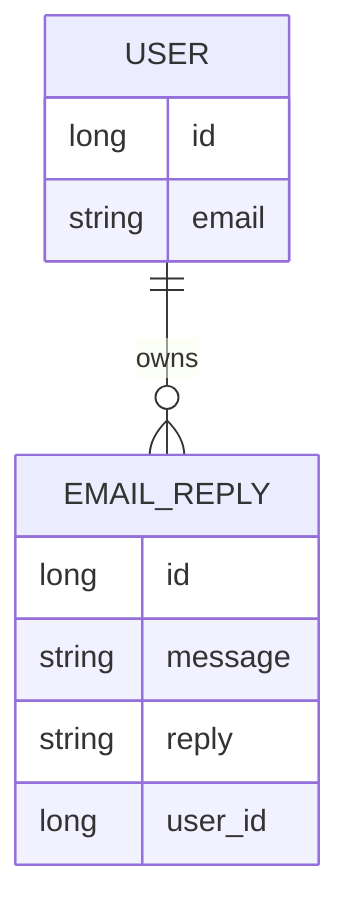
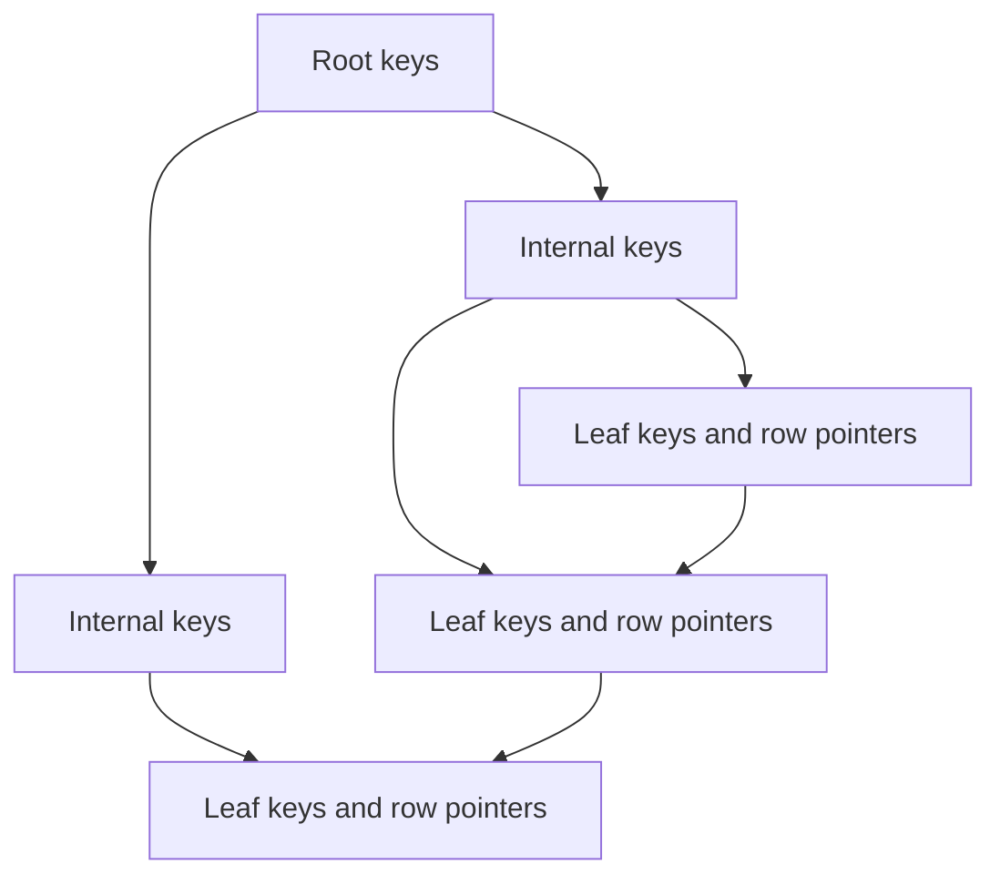
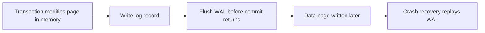

# 24c · CS Fundamentals: DBMS Theory

DBMS interviews test whether you can reason about transactions, data modeling, indexes, concurrency, recovery, and distributed trade-offs. These answers use backend examples from Java, Spring Data JPA, PostgreSQL/MySQL, Redis, and RAG/vector-search systems.

**Legend:** 🟢 Beginner · 🟡 Intermediate · 🔴 Advanced · ⚫ FAANG · 🔥 = very frequently asked

## Table of Contents
- [Beginner guide to this file](#beginner-guide-to-this-file)
- [Transactions, ACID, and Schedules](#transactions-acid-and-schedules)
- [Modeling, Keys, and Normalization](#modeling-keys-and-normalization)
- [Indexes and Query Execution](#indexes-and-query-execution)
- [Concurrency Control and Recovery](#concurrency-control-and-recovery)
- [Distributed Data and CAP](#distributed-data-and-cap)
- [Top 50 Thirty-Second Answers](#top-50-thirty-second-answers)
- [Revision Cheat Sheet](#revision-cheat-sheet)
- [Flashcards](#flashcards)

## Beginner guide to this file

### What this file teaches
This file teaches Database Management System (DBMS) theory for interviews: transactions, schedules, keys,
normalization, indexes, recovery, replication, and distributed trade-offs. Interviewers ask it because
backend engineers must explain why a money transfer is safe, why a query is slow, why a crash does not lose
committed rows, and why a distributed store may return stale data.

### Mental model
Think of a DBMS as a bank branch with clerks, account ledgers, line tickets, audit logs, and branch
replicas. The rules decide who may read or write which ledger page, when the page becomes official, and how
another branch catches up.
- Transactions group related reads and writes into one safe unit.
- Atomicity, Consistency, Isolation, and Durability (ACID) properties describe the safety promises that make the unit trustworthy.
- Schedules, locks, timestamps, and Multiversion Concurrency Control (MVCC) explain how concurrent transactions interleave.
- Keys, Entity-Relationship modeling, and normalization shape data so facts live in the right place.
- Indexes and execution plans explain how the DBMS finds rows quickly.
- Write-Ahead Logging (WAL), checkpoints, recovery, replication, sharding, and Consistency, Availability, and Partition tolerance (CAP) explain survival and scale.

### How to think through any question here
1. Turn the theory into a tiny story: two transfers, two doctors on call, one order lookup, or one replica read.
2. Name the data items and invariants, such as account balance cannot go negative.
3. For concurrency questions, write the interleaving of reads, writes, commits, and aborts.
4. For modeling questions, identify entities, keys, dependencies, and duplicated facts.
5. For indexing questions, state the predicate, order, selectivity, and rows read.
6. For recovery questions, explain what is in the log before the data page and what replay or undo does.
7. For distributed questions, say what happens during network delay, replica lag, or partition failure.

### Pattern recognition cues
| If the question mentions... | Think about... | Why it fits |
|---|---|---|
| all-or-nothing transfer | ACID and commit/rollback | Debit and credit must succeed together |
| dirty, phantom, or lost update | Isolation anomalies | These are unsafe concurrent observations or writes |
| interleaved T1 and T2 operations | Schedules and serializability | The question asks whether the interleaving equals a serial order |
| repeated customer address in rows | Normalization | Duplicated facts cause update, insert, and delete anomalies |
| WHERE customer_id = 42 | Index selectivity and execution plan | A good index reduces rows read before filtering |
| crash after commit | WAL and recovery | The log decides what committed work is redone |
| reads from followers | Replication lag and consistency | A replica can be available but stale |
| data too large for one machine | Sharding or partitioning | Split data by key or range to reduce per-node work |
| network partition | CAP theorem | You must choose availability or strong consistency during the partition |

### Abbreviations and key terms
| Short form | Expanded form | Plain meaning |
|---|---|---|
| ACID | Atomicity, Consistency, Isolation, Durability | Transaction correctness and durability guarantees |
| ACK / SYN / FIN | Acknowledge / synchronize / finish | Transmission Control Protocol flags in the revision material |
| AP / CP / CA | Availability-Partition tolerance / Consistency-Partition tolerance / Consistency-Availability | CAP-style system categories |
| API | Application Programming Interface | Service boundary whose behavior depends on the database |
| ARIES | Algorithm for Recovery and Isolation Exploiting Semantics | Classic WAL-based recovery algorithm family |
| BCNF | Boyce-Codd Normal Form | Strong normalization form based on determinants and candidate keys |
| CAP | Consistency, Availability, Partition tolerance | Distributed-systems trade-off during network partitions |
| CDC | Change Data Capture | Stream of database changes used for replication or events |
| DB / DBMS | Database / Database Management System | Persistent store and the software managing it |
| DNS / IP / TCP / UDP | Domain Name System / Internet Protocol / Transmission Control Protocol / User Datagram Protocol | Network terms in the revision section |
| ER | Entity-Relationship | Modeling approach for entities, attributes, and relationships |
| FIFO / LRU | First-In First-Out / Least Recently Used | Replacement or ordering policies |
| GIN / HNSW | Generalized Inverted Index / Hierarchical Navigable Small World | Index types for text, JSON, or vector search examples |
| HTTP / HTTPS / REST | Hypertext Transfer Protocol / HTTP Secure / Representational State Transfer | Web API communication terms |
| GET / POST | Hypertext Transfer Protocol request methods | Read and create/change style API operations used in examples |
| JPA | Java Persistence API | Java object-relational persistence standard |
| JSON | JavaScript Object Notation | Text format for structured documents |
| JVM | Java Virtual Machine | Runtime for Java and Spring applications |
| LLM | Large Language Model | Generative AI model used with RAG examples |
| MVCC | Multiversion Concurrency Control | Row-versioning technique for concurrent reads and writes |
| N+1 | One query plus one query per parent row | ORM query explosion pattern |
| OLAP / OLTP | Online Analytical Processing / Online Transaction Processing | Analytics scans versus request-time transactions |
| OS / OSI | Operating System / Open Systems Interconnection | Platform and networking model terms |
| RAG | Retrieval-Augmented Generation | Search data first, then generate an answer |
| RAM | Random Access Memory | Main memory used for buffers and processes |
| SDE-1 | Software Development Engineer level 1 | Entry-level engineering interview target |
| SQL | Structured Query Language | Relational query and data-change language |
| TLB / TLS | Translation Lookaside Buffer / Transport Layer Security | Memory-translation cache and network security protocol |
| URL / UUID | Uniform Resource Locator / Universally Unique Identifier | Web resource address and globally unique identifier |
| VACUUM | PostgreSQL cleanup process | Removes dead row versions |
| WAL | Write-Ahead Logging | Log-first durability and crash-recovery mechanism |

### Common beginner traps
- Reciting ACID without explaining the actual transfer or rollback scenario.
- Memorizing isolation names but not the anomaly each level prevents.
- Confusing primary, candidate, and foreign keys instead of tying them to uniqueness and relationships.
- Treating normalization as always better; production may denormalize deliberately for read-heavy paths.
- Saying indexes are free; they speed reads but add write cost and storage.
- Describing replication as instant; followers can lag behind the primary.

### How to study this file
1. For each short answer, invent a two-table example such as accounts, orders, customers, or doctors_on_call.
2. Draw transaction timelines for schedule, isolation, locking, MVCC, and recovery questions.
3. Convert normalization answers into dependencies: order_id determines order_date, customer_id determines customer_name.
4. For index questions, write the WHERE and ORDER BY first, then decide what the index can skip.
5. Use flashcards after reading; if you miss one, explain it with a concrete request or failure.

## Transactions, ACID, and Schedules

### Q65. What are ACID properties?
`🟢 Beginner` `🔥` `Must-know SDE-1`

**Why they ask:** ACID is the base of transaction correctness.

**Beginner lens:** Atomicity, Consistency, Isolation, Durability (ACID) is the database's safety checklist for
one unit of work. In a transfer, debit account A and credit account B either both happen, obey rules like
nonnegative balances, stay protected from concurrent readers or writers, and remain after a crash. The mental
model is not one magic flag; each letter maps to mechanisms such as rollback, constraints, isolation control,
and Write-Ahead Logging (WAL). Interviewers are checking whether you separate ACID consistency from replica
consistency and know that Spring transactions still rely on database enforcement.

**Short answer (say this first, 20-40 sec):**
ACID means Atomicity, Consistency, Isolation, and Durability. A transaction should fully happen or not happen, preserve valid database rules, appear isolated from concurrent transactions, and survive committed failures.

**Detailed answer:**
| Property | Meaning | Example |
|---|---|---|
| Atomicity | all-or-nothing | debit and credit both succeed |
| Consistency | constraints remain valid | no negative balance if rule forbids |
| Isolation | concurrent transactions behave safely | no dirty reads at proper isolation |
| Durability | committed data survives crash | WAL flushed before commit returns |
- In Spring, `@Transactional` defines transaction boundaries, but database isolation and constraints do the real enforcement.

**Common mistakes:**
- Saying consistency means eventual consistency; in ACID it means valid state after transaction.
- Thinking `@Transactional` fixes all race conditions.
- Ignoring durability details like WAL/fsync.

**Follow-ups:**
- *Which ACID property uses locks/MVCC?* → Isolation.
- *Which uses logs?* → Atomicity and durability through WAL/undo/redo mechanisms.

### Q66. What is a transaction?
`🟢 Beginner` `🔥` `Must-know SDE-1`

**Why they ask:** Backend code must group related writes correctly.

**Beginner lens:** A transaction is a boundary around related reads and writes, like `BEGIN;` update debit,
update credit, then `COMMIT;`. If the credit update fails, rollback should erase the debit so users never see a
half-transfer. Think of it as one logical promise, not necessarily one SQL statement; autocommit makes each
statement its own tiny transaction unless you start a bigger one. The interviewer is testing where you place
the boundary in service code. A common production trap is holding it open during slow HTTP calls, which keeps
locks and snapshots alive.

**Short answer (say this first, 20-40 sec):**
A transaction is a sequence of database operations treated as one logical unit of work. It commits if all required operations succeed and rolls back if any required operation fails.

**Detailed answer:**
```sql
BEGIN;
UPDATE accounts SET balance = balance - 100 WHERE id = 1;
UPDATE accounts SET balance = balance + 100 WHERE id = 2;
COMMIT;
```
- If the second update fails, rollback prevents partial transfer.
- Transactions can be read-only or read-write.
- Long transactions hold resources and can block cleanup or writers.

**Common mistakes:**
- Doing remote API calls inside long DB transactions.
- Assuming each SQL statement is always outside a transaction; many DBs have autocommit.
- Forgetting rollback rules in frameworks.

**Follow-ups:**
- *What is autocommit?* → Each statement commits automatically unless explicit transaction starts.
- *What should not be in transaction?* → Slow network calls unless carefully designed.

### Q67. What are common isolation anomalies?
`🟡 Intermediate` `🔥` `Must-know SDE-1`

**Why they ask:** Isolation levels exist to prevent anomalies.

**Beginner lens:** An isolation anomaly is a bad story caused by interleaving transactions. One transaction
reads an uncommitted balance that later rolls back: dirty read. It rereads the same order and sees a changed
status: non-repeatable read. It reruns `WHERE status='OPEN'` and a new row appears: phantom. Two requests
increment a counter from 5 to 6 instead of 7: lost update. Two doctors each go off call after seeing another on
call: write skew. The mental model is a schedule of reads and writes. Interviewers want anomaly recognition
plus a fix, not just isolation-level names.

**Short answer (say this first, 20-40 sec):**
Common anomalies are dirty read, non-repeatable read, phantom read, lost update, and write skew. Higher isolation levels prevent more anomalies but may reduce concurrency.

**Detailed answer:**
| Anomaly | Meaning |
|---|---|
| Dirty read | read uncommitted data later rolled back |
| Non-repeatable read | same row read twice gives different values |
| Phantom read | same predicate returns new/deleted rows |
| Lost update | concurrent updates overwrite each other |
| Write skew | transactions read overlapping data then write disjoint rows breaking invariant |
- PostgreSQL `READ COMMITTED` prevents dirty reads but not all anomalies.

**Common mistakes:**
- Equating phantom and non-repeatable read.
- Ignoring lost updates in read-modify-write code.
- Assuming all DBs implement isolation names identically.

**Follow-ups:**
- *How prevent lost update?* → Optimistic locking, `SELECT FOR UPDATE`, atomic update, or serializable isolation.
- *What is write skew?* → Invariant broken by concurrent transactions writing different rows.

### Q68. Explain isolation levels.
`🟡 Intermediate` `🔥` `Must-know SDE-1`

**Why they ask:** Java backends set isolation in transactions.

**Beginner lens:** Isolation levels are presets for how much a transaction must be protected from concurrent
changes. Read Committed can see a fresh committed value on a second statement; Repeatable Read tries to keep a
stable view; Serializable makes the outcome match some one-at-a-time order. PostgreSQL defaults to Read
Committed and implements Repeatable Read as snapshot isolation; MySQL InnoDB defaults to Repeatable Read and
uses next-key locks for many phantom cases. The signal is choosing the weakest level plus constraints or locks
that protect the invariant. A trap is setting Serializable globally and creating avoidable retries or
blocking.

**Short answer (say this first, 20-40 sec):**
SQL isolation levels are Read Uncommitted, Read Committed, Repeatable Read, and Serializable. As you go higher, fewer anomalies are allowed but concurrency may decrease.

**Detailed answer:**
| Level | Usually prevents |
|---|---|
| Read Uncommitted | very little; dirty reads may happen |
| Read Committed | dirty reads |
| Repeatable Read | dirty and non-repeatable reads |
| Serializable | equivalent to serial order |
- Actual behavior differs by DB. PostgreSQL Repeatable Read is snapshot isolation and prevents phantoms for a transaction snapshot but can still have serialization concerns handled at Serializable.

**Common mistakes:**
- Assuming MySQL and PostgreSQL behave exactly the same.
- Setting Serializable everywhere without measuring contention.
- Relying on isolation when constraints are better.

**Follow-ups:**
- *Default PostgreSQL isolation?* → Read Committed.
- *Default MySQL InnoDB isolation?* → Repeatable Read.

### Q69. What is a schedule in DBMS?
`🟢 Beginner` `Medium` `Must-know SDE-1`

**Why they ask:** Serializability questions use schedules.

**Beginner lens:** A schedule is the timeline formed when operations from multiple transactions are
interleaved. Example: T1 reads A, T2 reads A, T1 writes A, T2 writes A, then both commit. The question is not
whether interleaving exists, but whether that timeline is equivalent to a safe serial order. Picture writing
R1(A), W2(A), C1 on a whiteboard and marking conflicting pairs. Interviewers are testing whether you can reason
from order, reads, writes, commits, and aborts. Trap: treating every overlap as wrong; many read-only or
independent-row interleavings are harmless.

**Short answer (say this first, 20-40 sec):**
A schedule is the order in which operations from multiple transactions execute. A serial schedule runs one transaction completely before another; a concurrent schedule interleaves operations.

**Detailed answer:**
Example:
```text
T1: R(A)      W(A)      C
T2:      R(A)      W(A) C
Schedule: R1(A), R2(A), W1(A), W2(A), C1, C2
```
- Correctness asks whether the interleaved schedule is equivalent to some serial order.
- Conflict serializability is one formal test.

**Common mistakes:**
- Calling every interleaving unsafe.
- Ignoring read-write and write-write conflicts.
- Forgetting commit/abort effects.

**Follow-ups:**
- *What is serial schedule?* → No interleaving; one transaction finishes before next starts.
- *Why allow interleaving?* → Better throughput and resource utilization.

### Q70. What is conflict serializability?
`🔴 Advanced` `🔥` `Stretch`

**Why they ask:** It is a core DB theory topic.

**Beginner lens:** Conflict serializability gives a mechanical test for whether an interleaved schedule
behaves like one serial order. Draw one node per transaction; add an edge from T1 to T2 when T1's read or
write on the same item must stay before T2's conflicting write or read. If the graph has no cycle, a serial
order exists; a cycle means no sequence of safe swaps can untangle it. The interviewer is testing formal
reasoning, especially that read-read pairs do not conflict. A common trap is ignoring the same-data-item
condition.

**Short answer (say this first, 20-40 sec):**
A schedule is conflict-serializable if it can be transformed into a serial schedule by swapping non-conflicting operations. Build a precedence graph; if it has no cycle, the schedule is conflict-serializable.

**Detailed answer:**
Conflicts occur when operations are from different transactions, access same item, and at least one is write.
Example schedule: `R1(A), W1(A), R2(A), W2(A), R1(B), W1(B)`
- `W1(A)` before `R2(A)` gives edge T1 → T2.
- If later `W2(B)` before `R1(B)`, edge T2 → T1 would create cycle.
- Acyclic graph means serial order exists.

**Common mistakes:**
- Treating read-read as conflict.
- Forgetting same data item condition.
- Confusing conflict and view serializability.

**Follow-ups:**
- *Is every conflict-serializable schedule view-serializable?* → Yes.
- *Is every view-serializable schedule conflict-serializable?* → No.

### Q71. What is recoverability in schedules?
`🟡 Intermediate` `Medium` `Must-know SDE-1`

**Why they ask:** It connects concurrency with rollback correctness.

**Beginner lens:** Recoverability is about what happens if someone aborts after another transaction has
depended on its data. Suppose T2 reads a row written by T1 and commits before T1 commits; if T1 later rolls
back, T2 has committed a value that never really existed. A recoverable schedule forces T2 to wait to commit
until T1 commits. Cascadeless and strict schedules go further by avoiding reads, or reads and writes, of
uncommitted data. Interviewers are testing rollback awareness, not only serial order. Trap: assuming
serializable automatically means easy crash recovery.

**Short answer (say this first, 20-40 sec):**
A recoverable schedule ensures a transaction commits only after any transaction whose data it read has committed. This avoids committing results based on data that may later roll back.

**Detailed answer:**
- Cascading rollback occurs when T2 reads uncommitted T1 data and T1 aborts, so T2 must also abort.
- Strict schedules avoid reading or writing items modified by uncommitted transactions.
- Strictness simplifies recovery and is common in DB systems.

**Common mistakes:**
- Ignoring aborts in concurrency examples.
- Thinking serializable always means recoverable.
- Confusing dirty read with non-repeatable read.

**Follow-ups:**
- *What is cascadeless schedule?* → Transactions only read committed data.
- *What is strict schedule?* → No read/write of an item until last writer commits/aborts.

## Modeling, Keys, and Normalization

### Q72. What are primary, candidate, super, foreign, and composite keys?
`🟢 Beginner` `🔥` `Must-know SDE-1`

**Why they ask:** Keys are central to schema design and indexing.

**Beginner lens:** Keys are about row identity and relationships, not just indexes. In `Enrollment(student_id,
course_id, grade)`, `(student_id, course_id)` can uniquely identify one enrollment, so it is a composite
candidate key; if you choose it as the primary key, each column can also be part of foreign keys to Student
and Course. A super key may include extra columns, while a candidate key is minimal. Interviewers are checking
whether you separate uniqueness, chosen identity, and references. Production concern: mutable natural keys
such as email can make foreign-key updates painful, so surrogate IDs are common.

**Short answer (say this first, 20-40 sec):**
A super key uniquely identifies rows. A candidate key is a minimal super key. A primary key is the chosen candidate key. A foreign key references another table's key. A composite key uses multiple columns.

**Detailed answer:**
| Key | Meaning |
|---|---|
| Super key | any unique column set |
| Candidate key | minimal unique set |
| Primary key | selected candidate key |
| Alternate key | candidate not selected |
| Foreign key | references another table |
| Composite key | key with multiple columns |
- Example: `enrollments(student_id, course_id)` may use composite primary key.

**Common mistakes:**
- Saying every unique column is primary key.
- Ignoring minimality of candidate key.
- Using mutable business fields as primary keys without thinking.

**Follow-ups:**
- *Surrogate vs natural key?* → Generated ID vs meaningful business identifier.
- *Can foreign key be nullable?* → Yes, if relationship is optional.

### Q73. What is ER modeling?
`🟢 Beginner` `Medium` `Must-know SDE-1`

**Why they ask:** You must translate requirements to schema.

**Beginner lens:** Entity-Relationship (ER) modeling is the sketch before tables. If a User can have many
EmailReply rows, the model captures entities, attributes, cardinality, optionality, and the foreign key
direction before anyone writes `CREATE TABLE`. The mental model is nouns become entities, facts become
attributes, and verbs often become relationships. Interviewers are testing whether you ask requirements
questions such as 'Can one order have many products?' and 'Can this field be missing?' A trap is jumping
straight to tables and missing a many-to-many join table or a uniqueness rule.

**Short answer (say this first, 20-40 sec):**
ER modeling represents entities, attributes, and relationships before creating tables. It helps identify cardinality, keys, optionality, and constraints.

**Detailed answer:**

- One user owns many email replies.
- The foreign key `email_reply.user_id` enforces relationship.
- Cardinality matters for indexes and joins.

**Common mistakes:**
- Designing tables before clarifying relationships.
- Missing many-to-many join tables.
- Not modeling uniqueness and optionality.

**Follow-ups:**
- *How model many-to-many?* → Join table with two foreign keys.
- *What is weak entity?* → Entity identified partly by owner entity.

### Q74. Explain 1NF, 2NF, 3NF, and BCNF.
`🟡 Intermediate` `🔥` `Must-know SDE-1`

**Why they ask:** Normalization tests data-design fundamentals.

**Beginner lens:** Normalization forms are checkpoints for where each fact belongs. First Normal Form (1NF)
says one cell should not hide a list; Second Normal Form (2NF) matters when a composite key exists and a
column depends on only part of it; Third Normal Form (3NF) removes facts that depend on another non-key fact;
Boyce-Codd Normal Form (BCNF) is stricter about determinants. The interviewer is testing dependency reasoning,
not memorized slogans. A practical trap is normalizing blindly without considering read paths, but
denormalization should be a measured optimization with consistency rules.

**Short answer (say this first, 20-40 sec):**
1NF removes repeating groups and uses atomic values. 2NF removes partial dependency on part of a composite key. 3NF removes transitive dependency on non-key attributes. BCNF requires every determinant to be a candidate key.

**Detailed answer:**
| Form | Rule |
|---|---|
| 1NF | atomic columns, no repeating groups |
| 2NF | no partial dependency on composite key |
| 3NF | no transitive dependency on non-key |
| BCNF | every determinant is candidate key |
- Goal: reduce redundancy and update anomalies.

**Common mistakes:**
- Saying 2NF matters when table has single-column key; partial dependency requires composite key.
- Over-normalizing without considering read patterns.
- Confusing 3NF and BCNF.

**Follow-ups:**
- *When denormalize?* → For performance/read simplicity after measuring and maintaining consistency.
- *What anomaly does normalization reduce?* → Insert, update, delete anomalies.

### Q75. Work a normalization example from 1NF to BCNF.
`🔴 Advanced` `🔥` `Stretch`

**Why they ask:** It checks practical decomposition skills.

**Beginner lens:** Treat the example as a cleanup of duplicated facts. In `Enroll(student_id, student_name,
course_id, course_name, instructor, dept, grade)`, grade belongs to the student-course pair, student_name
belongs to student_id, course_name and instructor belong to course_id, and dept belongs to instructor.
Decomposition means making Student, Course, Instructor, and Enrollment so changing an instructor's department
updates one row. The mental model is functional dependencies pointing to table boundaries. Interviewers are
testing lossless, dependency-aware decomposition. Trap: splitting tables so far that needed constraints can no
longer be enforced without awkward joins.

**Short answer (say this first, 20-40 sec):**
Start with a table containing student, course, instructor, and department facts. Separate repeating course data, remove dependencies on only part of a composite key, then move instructor-to-department dependency into its own table if instructor determines department.

**Detailed answer:**
Bad table:
`Enroll(student_id, student_name, course_id, course_name, instructor, dept, grade)`
Functional dependencies:
- `student_id -> student_name`
- `course_id -> course_name, instructor`
- `instructor -> dept`
- `(student_id, course_id) -> grade`

Decomposition:
- `Student(student_id, student_name)`
- `Course(course_id, course_name, instructor)`
- `Instructor(instructor, dept)`
- `Enrollment(student_id, course_id, grade)`

Now facts live once; updating instructor department happens in one row.

**Common mistakes:**
- Keeping `student_name` in enrollment.
- Ignoring transitive dependency `course_id -> instructor -> dept`.
- Decomposing without preserving needed joins/constraints.

**Follow-ups:**
- *What is lossless decomposition?* → Joining decomposed tables reconstructs original valid data.
- *Dependency preservation?* → Constraints can be checked without joining all decomposed tables.

### Q76. When should you denormalize?
`🟡 Intermediate` `Medium` `Must-know SDE-1`

**Why they ask:** Production databases balance theory and performance.

**Beginner lens:** Denormalization deliberately stores a derived or duplicate fact because the measured read
path needs it. Example: keeping `order_count` on Customer avoids counting millions of Order rows on every
dashboard load, butevery insert, delete, or status change now needs a maintenance plan. The key distinction is
optimization versus design shortcut: normalized data remains the source of truth unless you choose otherwise.
Interviewers are testing whether you mention evidence, consistency repair, and alternatives such as indexes,
materialized views,caches, or reporting tables. Trap: using denormalization to hide a missing composite index.

**Short answer (say this first, 20-40 sec):**
Denormalize after measuring read bottlenecks or simplifying high-volume queries, while adding controls to keep duplicated data consistent. It is a performance optimization, not a default design.

**Detailed answer:**
- Examples: cached aggregate counts, search tables, reporting marts, materialized views.
- Use triggers, jobs, application writes, or CDC to maintain consistency.
- In analytics/Power BI semantic models, denormalized/star schemas often improve query performance.

**Common mistakes:**
- Denormalizing before understanding access patterns.
- No consistency plan for duplicated columns.
- Using denormalization to hide missing indexes.

**Follow-ups:**
- *What is materialized view?* → Stored query result refreshed periodically or on demand.
- *OLTP vs OLAP?* → OLTP favors normalized transactions; OLAP favors analytical reads.

## Indexes and Query Execution

### Q77. What is an index?
`🟢 Beginner` `🔥` `Must-know SDE-1`

**Why they ask:** Indexing is central to backend performance and your resume.

**Beginner lens:** An index is a separate access path, like a table of sorted keys pointing back to rows. If
`orders` has ten million rows and you filter by `customer_id=42`, a suitable B-tree can jump near that key
instead of scanning everything. The mental model is faster reads paid for by storage and write maintenance.
Interviewers are testing selectivity, query shape, and verification with `EXPLAIN`, not 'add indexes
everywhere.' Traps include indexing low-cardinality columns alone, forgetting composite order, and missing
that PostgreSQL and MySQL may choose a sequential scan when it is cheaper.

**Short answer (say this first, 20-40 sec):**
An index is an auxiliary data structure that speeds up reads by helping the database find rows without scanning the whole table. It costs extra storage and slows writes because the index must be maintained.

**Detailed answer:**
- Common index types: B-tree/B+ tree, hash, GiST/GIN in PostgreSQL, full-text, vector indexes.
- Good for selective filters, joins, ordering, uniqueness.
- Bad indexes waste memory and write cost.
- Use `EXPLAIN` to verify usage.

**Common mistakes:**
- Indexing every column.
- Expecting index use for low-selectivity columns always.
- Ignoring composite index order.

**Follow-ups:**
- *What is selectivity?* → Fraction of rows filtered; high selectivity means fewer matches.
- *Can indexes slow inserts?* → Yes, each index needs updates.

### Q78. B-tree vs B+ tree?
`🟡 Intermediate` `🔥` `Must-know SDE-1`

**Why they ask:** Most relational indexes use B-tree/B+ tree variants.

**Beginner lens:** B-tree and B+ tree indexes keep keys balanced so lookup height stays small even with
millions of rows. In a B+ tree, leaf pages hold the ordered key entries and are linked, so `WHERE id BETWEEN
100 AND 200` can find the first leaf and walk forward. The mental model is a shallow directory with sorted
pages at the bottom. Interviewers are checking why relational indexes are good for equality, ranges, joins,
and ordering. Trap:saying hashing is always faster; hash indexes do not naturally support range scans or
`ORDER BY`.

**Short answer (say this first, 20-40 sec):**
B-trees store keys and data pointers in internal and leaf nodes. B+ trees store actual row pointers mainly in leaf nodes and link leaves, making range scans efficient. Databases commonly use B+ tree-like indexes.

**Detailed answer:**

- High fanout keeps tree height low.
- Sorted leaves support range queries and ORDER BY.
- Balanced tree keeps search `O(log n)`.

**Common mistakes:**
- Saying B+ tree is binary tree.
- Ignoring disk/page locality.
- Thinking hash index supports range queries well.

**Follow-ups:**
- *Why high fanout?* → Each node/page stores many keys, reducing disk reads.
- *Why linked leaves?* → Efficient ordered scans.

### Q79. Clustered vs non-clustered index?
`🟡 Intermediate` `🔥` `Must-know SDE-1`

**Why they ask:** Index storage affects query cost.

**Beginner lens:** Clustered versus non-clustered is about where the row lives relative to the index. MySQL
InnoDB stores table rows in primary-key order, so secondary indexes point to the primary key and then find the
row. PostgreSQL normally stores rows in a heap; `CLUSTER` can rewrite physical order, but later writes do not
maintain it automatically. The mental model is 'index is the table' versus 'index points to heap rows.'
Interviewers are testing storage awareness and cost of secondary lookups. Trap: assuming every database has
one automatically maintained clustered index.

**Short answer (say this first, 20-40 sec):**
A clustered index defines the physical or logical row order of table storage, depending on DB implementation. A non-clustered secondary index stores key values with pointers or primary-key references to rows.

**Detailed answer:**
- MySQL InnoDB clusters data by primary key.
- Secondary indexes in InnoDB store primary key values as row references.
- PostgreSQL heap tables are not permanently clustered by primary key; `CLUSTER` can rewrite order but is not automatically maintained.
- Clustered order helps range scans on that key.

**Common mistakes:**
- Assuming every DB has exactly one always-maintained clustered index.
- Choosing random UUID primary key without considering locality.
- Forgetting secondary lookup cost.

**Follow-ups:**
- *Can a table have many clustered indexes?* → Usually only one physical clustering order.
- *Why UUID can hurt locality?* → Random inserts scatter pages and increase splits.

### Q80. How do composite indexes work?
`🟡 Intermediate` `🔥` `Must-know SDE-1`

**Why they ask:** Composite index order is a common interview and production issue.

**Beginner lens:** A composite index is sorted by the first column, then the second within each first-column
value, and so on. With `(user_id, status, created_at)`, queries for one user and status can also get rows in
created_at order; aquery only on status skips the leading order and may not benefit much. The mental model is
a phone book sortedby last name, then first name. Interviewers are testing the leftmost-prefix rule and
equality-before-range planning. Production trap: creating three single-column indexes when one composite index
matches the real filter and sort.

**Short answer (say this first, 20-40 sec):**
A composite index on `(a, b, c)` is most useful for filters starting from the leftmost prefix: `a`, `a,b`, or `a,b,c`. It may not help much for filtering only on `b` without `a`.

**Detailed answer:**
```sql
CREATE INDEX idx_orders_user_status_created
ON orders(user_id, status, created_at);
```
Good:
```sql
WHERE user_id = ? AND status = ? ORDER BY created_at
```
Less useful:
```sql
WHERE status = ?
```
- Equality columns usually before range/order columns.

**Common mistakes:**
- Creating separate single-column indexes when composite better matches query.
- Wrong column order.
- Ignoring sort direction and range predicates.

**Follow-ups:**
- *What is covering index?* → Index contains all columns needed by query.
- *Does index help LIKE?* → Prefix `LIKE 'abc%'` can; leading wildcard usually cannot use B-tree effectively.

### Q81. What is a query execution plan?
`🟡 Intermediate` `🔥` `Must-know SDE-1`

**Why they ask:** You claimed query optimization; this is practical.

**Beginner lens:** A query execution plan is the database's chosen route through tables and indexes. For
`SELECT ... FROM orders JOIN users`, the plan may scan orders, use an index on users, choose a hash join, then
sort. Compare rows estimated with rows actually returned: huge gaps point to stale statistics or misleading
predicates. Interviewers are testing whether you use `EXPLAIN` and, when safe, `EXPLAIN ANALYZE` before
guessing. Trap: assuming an index will be used just because it exists; PostgreSQL or MySQL may prefer a table
scan for small or low-selectivity data.

**Short answer (say this first, 20-40 sec):**
A query execution plan is the database's chosen strategy to run SQL: scan methods, join order, join algorithms, index usage, sorting, and estimated costs. Use `EXPLAIN` or `EXPLAIN ANALYZE` to inspect it.

**Detailed answer:**
- Sequential scan reads table.
- Index scan uses index then table lookup.
- Nested loop, hash join, merge join are common joins.
- Bad stats can lead to bad plans; `ANALYZE` updates statistics.
- `EXPLAIN ANALYZE` executes query and shows actual timing/rows.

**Common mistakes:**
- Assuming index exists means index is used.
- Reading only total cost without row estimates.
- Running `EXPLAIN ANALYZE` on dangerous writes without care.

**Follow-ups:**
- *Why DB choose seq scan despite index?* → Table small or predicate not selective.
- *What is cardinality estimate?* → Estimated number of rows after operation.

## Concurrency Control and Recovery

### Q82. What is Two-Phase Locking (2PL)?
`🔴 Advanced` `🔥` `Stretch`

**Why they ask:** It is a classic serializability mechanism.

**Beginner lens:** Two-Phase Locking (2PL) is a rule for lock timing: first a transaction only grows its lock
set, then after releasing one lock it cannot acquire more. Strict 2PL keeps write locks until commit, so other
transactions cannot read values that might roll back. Picture two seat-booking transactions both needing row
locks before deciding availability. The mental model is conflict serializability through controlled waiting.
Interviewers are testing that you distinguish Two-Phase Locking from two-phase commit. Trap: 2PL can deadlock,
so engines need detection, timeouts, victim aborts, or ordered locking.

**Short answer (say this first, 20-40 sec):**
Two-Phase Locking has a growing phase where a transaction acquires locks and a shrinking phase where it releases locks and cannot acquire new ones. Strict 2PL holds write locks until commit, ensuring conflict serializability and easier recovery.

**Detailed answer:**
- Shared lock for read, exclusive lock for write.
- Basic 2PL guarantees conflict serializability but can deadlock.
- Strict 2PL avoids cascading aborts by holding exclusive locks until commit.
- Databases may use locking plus MVCC, depending on engine.

**Common mistakes:**
- Saying 2PL prevents deadlock; it can cause deadlocks.
- Confusing 2PL with two-phase commit.
- Releasing locks too early in strict 2PL.

**Follow-ups:**
- *2PL vs 2PC?* → Locking protocol vs distributed commit protocol.
- *How handle deadlocks in 2PL?* → Detection and abort victim, or prevention timeouts/order.

### Q83. What is timestamp ordering?
`🔴 Advanced` `Medium` `Stretch`

**Why they ask:** It is an alternative concurrency-control concept.

**Beginner lens:** Timestamp ordering gives each transaction a logical place in line before operations run. If
an older transaction tries to read a row already written by a newer one, or a newer write would violate
recorded read/write timestamps, the database aborts and restarts one transaction instead of waiting. The mental
model is preserving a timestamp order by rejection rather than by locks. Interviewers are testing an
alternative to locking and why it avoids deadlock cycles. Trap: fewer waits does not mean free concurrency;
hot rows can cause repeated aborts and wasted work.

**Short answer (say this first, 20-40 sec):**
Timestamp ordering assigns each transaction a timestamp and ensures conflicting operations execute in timestamp order. If an operation would violate the order, the transaction may abort and restart.

**Detailed answer:**
- Each item tracks read timestamp and write timestamp.
- Older transaction cannot read a value written by newer transaction.
- Newer transaction may be rejected if it writes item already read by older ordering rules.
- Avoids deadlocks because transactions do not wait in cycles; they abort instead.

**Common mistakes:**
- Thinking timestamp means wall-clock only; logical timestamps can be used.
- Ignoring restart overhead.
- Confusing with MVCC snapshots.

**Follow-ups:**
- *Benefit over locks?* → No deadlock waiting cycles.
- *Downside?* → More aborts under contention.

### Q84. What is MVCC?
`🟡 Intermediate` `🔥` `Must-know SDE-1`

**Why they ask:** PostgreSQL and many modern DBs use MVCC.

**Beginner lens:** Multiversion Concurrency Control (MVCC) stores row versions so readers can see a stable
snapshot while writers create newer versions. In PostgreSQL, an old reporting transaction can keep seeing
yesterday's tuple version while checkout updates produce new tuples; later VACUUM removes versions no active
snapshot needs. MySQL InnoDB uses undo records for consistent reads. The key distinction is readers not
blocking many writers, but writers can still conflict with writers. Interviewers are testing snapshot
visibility and cleanup costs. Trap: snapshot isolation is not automatically serializable; write skew may still
need Serializable isolation or constraints.

**Short answer (say this first, 20-40 sec):**
Multi-Version Concurrency Control keeps multiple versions of rows so readers can see a consistent snapshot while writers create new versions. It improves read-write concurrency but needs cleanup of old versions.

**Detailed answer:**
- Readers do not block writers in many cases.
- Writers may still conflict with writers.
- PostgreSQL uses MVCC tuples and VACUUM to clean dead rows.
- Snapshot isolation can still allow anomalies like write skew unless Serializable is used.

**Common mistakes:**
- Saying MVCC means no locks at all.
- Ignoring vacuum/bloat.
- Assuming snapshot isolation equals serializable in all cases.

**Follow-ups:**
- *Why VACUUM?* → Remove obsolete row versions and reclaim visibility metadata.
- *What is snapshot?* → Consistent view of committed data at a point/time/transaction.

### Q85. What is Write-Ahead Logging (WAL)?
`🟡 Intermediate` `🔥` `Must-know SDE-1`

**Why they ask:** WAL explains durability and crash recovery.

**Beginner lens:** Write-Ahead Logging (WAL) is the crash-recovery diary written before changed data pages are
flushed. When a transfer commits, the database can force the log record to durable storage and write the
actual account pages later. After a crash, recovery replays committed log records and discards or undoes
unfinished work. The mental model is sequential log first, random data pages later. Interviewers are testing
durability and atomicity internals. Production traps include weakening fsync settings, filling the WAL
directory, or confusing database WAL with ordinary application logs.

**Short answer (say this first, 20-40 sec):**
Write-Ahead Logging means changes are recorded in a log before database pages are written to disk. After a crash, the DB uses the log to redo committed changes and undo or ignore incomplete ones.

**Detailed answer:**

- WAL enables durability without flushing every data page at commit.
- Log is sequential, usually faster than random page writes.

**Common mistakes:**
- Thinking commit always writes all data pages immediately.
- Ignoring fsync/durability settings.
- Confusing WAL with application logs.

**Follow-ups:**
- *What is redo log?* → Log records used to reapply committed changes.
- *Why WAL before data page?* → Recovery can reconstruct consistent state.

### Q86. What are checkpoints?
`🟡 Intermediate` `Medium` `Must-know SDE-1`

**Why they ask:** Checkpoints limit recovery time.

**Beginner lens:** A checkpoint is a recovery bookmark saying that dirty pages up to a certain log position
have been written or made safely recoverable. Without checkpoints, crash recovery might need to replay a very
long Write-Ahead Logging (WAL) history; with very frequent checkpoints, normal traffic pays extra disk
input/output. The mental model is trading restart time against background write pressure. Interviewers are
testing whether you connect checkpoints to WAL replay, not backups. PostgreSQL exposes checkpoint tuning, and
MySQL InnoDB has similar checkpointing around its redo log and buffer pool.

**Short answer (say this first, 20-40 sec):**
A checkpoint records a point where dirty pages up to some log position have been flushed or made recoverable, reducing how much WAL must be replayed after crash.

**Detailed answer:**
- More frequent checkpoints reduce recovery time but increase write I/O.
- Less frequent checkpoints reduce background I/O but lengthen recovery.
- Databases tune checkpoint intervals and dirty-page flushing.

**Common mistakes:**
- Saying checkpoint means no WAL needed.
- Ignoring I/O spikes from aggressive checkpoints.
- Confusing DB checkpoint with application checkpoint.

**Follow-ups:**
- *What is dirty page?* → In-memory page changed but not yet flushed to disk.
- *Why not checkpoint every commit?* → Too expensive.

### Q87. What is database recovery after crash?
`🔴 Advanced` `Medium` `Stretch`

**Why they ask:** It tests internals beyond SQL syntax.

**Beginner lens:** Crash recovery restores the rule: committed work survives, incomplete work does not become
visible. After restart, the engine reads logs from a checkpoint, identifies in-flight transactions, redoes
idempotent committed changes that had not reached data pages, and undoes or ignores uncommitted changes. The
mental model is 'analysis, redo, undo' rather than re-running application code. Interviewers are testing how
Write-Ahead Logging(WAL), checkpoints, and transaction status fit together. Production concern: recovery time
depends on log volume, checkpoint age, storage speed, and whether durability settings were relaxed.

**Short answer (say this first, 20-40 sec):**
After a crash, the database analyzes logs, redoes committed changes that may not be on disk, and undoes incomplete transactions if needed. WAL and checkpoints make this efficient and correct.

**Detailed answer:**
- Analysis: find transaction/page state at crash.
- Redo: repeat idempotent logged changes from checkpoint.
- Undo: roll back uncommitted transactions, depending on engine.
- Goal: committed data durable, uncommitted data not visible.

**Common mistakes:**
- Assuming crash means database scans every table.
- Confusing OS file-system recovery with DB transaction recovery.
- Ignoring torn pages and checksums.

**Follow-ups:**
- *What is ARIES?* → Classic recovery algorithm using analysis, redo, undo.
- *Why idempotent redo?* → Recovery may replay records safely even if partially applied.

### Q88. Optimistic vs pessimistic locking?
`🟡 Intermediate` `🔥` `Must-know SDE-1`

**Why they ask:** Java/JPA apps use both.

**Beginner lens:** Pessimistic locking assumes conflict is likely, so a transaction locks first, for example
`SELECT ... FOR UPDATE` on an inventory row before decrementing stock. Optimistic locking assumes conflict is
rare: two users edit the same order, and the update succeeds only if the version column is unchanged. The
mental model is wait before work versus retry after detecting conflict. Interviewers are testing workload fit
and Java Persistence API (JPA) version handling. Trap: optimistic locking still needs retry or user feedback;
pessimistic locking can block, deadlock, and should not cover slow external calls.

**Short answer (say this first, 20-40 sec):**
Pessimistic locking locks data before updating, assuming conflicts are likely. Optimistic locking allows concurrent reads and checks a version at commit/update time, assuming conflicts are rare.

**Detailed answer:**
JPA optimistic locking:
```java
@Entity
class Order {
    @Id Long id;
    @Version long version;
}
```
- Pessimistic: `SELECT ... FOR UPDATE`.
- Optimistic: update includes version condition; conflict throws exception.
- Use optimistic for low contention; pessimistic for high-contention critical sections.

**Common mistakes:**
- No retry strategy for optimistic conflicts.
- Holding pessimistic locks during remote calls.
- Assuming optimistic locking prevents all business races.

**Follow-ups:**
- *What exception in JPA?* → `OptimisticLockException`.
- *What is lost update fix?* → Version column or atomic update.

## Distributed Data and CAP

### Q89. SQL vs NoSQL?
`🟢 Beginner` `🔥` `Must-know SDE-1`

**Why they ask:** You should choose storage by workload.

**Beginner lens:** Structured Query Language (SQL) databases are strongest when relationships, joins,
constraints, and multi-row transactions matter, such as orders with customers, payments, and inventory. NoSQL
is a family: key-value for cache-like lookups, document stores for flexible JSON aggregates, graph stores for
traversals, and wide-column stores for high-scale keyed access. The mental model is choose by access pattern
and invariants, not fashion. Interviewers are testing trade-offs and overlap; PostgreSQL can store JSON and
vectors, while many NoSQL systems offer some transactions. Trap: using NoSQL to avoid data modeling.

**Short answer (say this first, 20-40 sec):**
SQL databases use relational tables, schema, joins, and strong transaction support. NoSQL covers key-value, document, column-family, and graph stores optimized for flexible schema, scale, low latency, or specific access patterns.

**Detailed answer:**
| Need | Better fit often |
|---|---|
| Complex joins, transactions | SQL |
| Simple cache lookups | key-value |
| Flexible JSON documents | document DB |
| Graph traversal | graph DB |
| Massive write/read scale by key | wide-column/key-value |
- PostgreSQL can also store JSON and vectors, so categories overlap.

**Common mistakes:**
- Saying NoSQL means no consistency.
- Choosing NoSQL to avoid schema design.
- Ignoring access patterns.

**Follow-ups:**
- *Can SQL scale?* → Yes, with indexing, replicas, partitioning, sharding, caching.
- *Can NoSQL have transactions?* → Some provide limited or multi-document transactions.

### Q90. What is CAP theorem?
`🟡 Intermediate` `🔥` `Must-know SDE-1`

**Why they ask:** Distributed systems trade-offs matter.

**Beginner lens:** Consistency, Availability, Partition tolerance (CAP) is only interesting when nodes cannot
communicate reliably. During a network split, a distributed store must either reject or delay some requests to
keep every read latest, or keep answering and reconcile later. Partition tolerance is not optional once data
is distributed across machines. The mental model is behavior under failure, not a permanent 'pick any two'
label. Interviewers are testing whether you distinguish CAP consistency from Atomicity, Consistency, Isolation,
Durability (ACID) consistency. Trap: applying CAP to a single-node database or normal latency tuning.

**Short answer (say this first, 20-40 sec):**
CAP says that during a network partition, a distributed data system must choose between consistency and availability. Partition tolerance is necessary in distributed systems, so practical designs choose CP or AP behavior under partition.

**Detailed answer:**
- Consistency: every read sees latest write or error.
- Availability: every request receives non-error response.
- Partition tolerance: system continues despite network split.
- CA without partition tolerance is not realistic for distributed systems under partitions.

**Common mistakes:**
- Saying a system chooses any two forever.
- Treating CAP as latency/normal-operation theorem.
- Confusing ACID consistency with CAP consistency.

**Follow-ups:**
- *CP example?* → Systems that reject/timeout requests to preserve consistency during partition.
- *AP example?* → Systems that accept writes and reconcile later.

### Q91. What is eventual consistency?
`🟡 Intermediate` `Medium` `Must-know SDE-1`

**Why they ask:** Caches, replicas, and distributed stores often use it.

**Beginner lens:** Eventual consistency means replicas may disagree briefly, but if writes stop, they
converge. Example: after updating a profile, a nearby replica shows the new name while another region still
returns the old name for a few seconds. The mental model is stale reads with convergence, often chosen for
availability and latency. Interviewers are testing whether you mention user-facing guarantees such as
read-your-writes, conflict resolution, version vectors, or last-write-wins. Trap: using eventual consistency
for invariants like 'one seat left' without a strongly consistent authority or compensating workflow.

**Short answer (say this first, 20-40 sec):**
Eventual consistency means if no new updates occur, replicas will eventually converge to the same value. Reads may temporarily return stale data.

**Detailed answer:**
- Used in DNS, caches, async replication, many distributed databases.
- Benefits: availability and lower latency.
- Costs: stale reads, conflict resolution, harder user experience.
- Techniques: version vectors, last-write-wins, CRDTs, read repair.

**Common mistakes:**
- Saying eventual means random inconsistency forever.
- Using it where strict invariants are required without safeguards.
- Ignoring user-visible anomalies.

**Follow-ups:**
- *What is read-your-writes?* → User sees their own latest write.
- *How handle conflicts?* → Deterministic merge, versioning, app-level resolution.

### Q92. What is replication?
`🟢 Beginner` `Medium` `Must-know SDE-1`

**Why they ask:** Replication improves read scale and availability.

**Beginner lens:** Replication keeps copies of data on other nodes. A primary may commit an order and stream
it to read replicas; synchronous replication waits for another node before success, while asynchronous
replication returns sooner but can leave replicas behind. The mental model is copies improve read capacity and
failover, but freshness and disaster recovery still need design. Interviewers are testing replica lag,
failover, and backup distinctions. Trap: sending a user's immediate post-write read to a lagging replica, or
assuming a replica protects against accidental deletes because it will faithfully copy the delete too.

**Short answer (say this first, 20-40 sec):**
Replication copies data from one database node to others. It can be synchronous or asynchronous, primary-replica or multi-primary, and is used for availability, read scaling, and disaster recovery.

**Detailed answer:**
- Synchronous: stronger consistency, higher write latency.
- Asynchronous: lower write latency, possible replica lag.
- Read replicas can serve queries but may be stale.
- Failover promotes replica if primary fails.

**Common mistakes:**
- Reading immediately from replica after write and expecting fresh data.
- No monitoring for replication lag.
- Assuming replication replaces backups.

**Follow-ups:**
- *What is replica lag?* → Delay between primary commit and replica applying it.
- *Replication vs backup?* → Replica copies corruption/deletes too; backup preserves point-in-time recovery.

### Q93. What is sharding or partitioning?
`🟡 Intermediate` `Medium` `Must-know SDE-1`

**Why they ask:** Large systems split data.

**Beginner lens:** Partitioning splits a logical table into pieces; sharding places those pieces across
machines. Monthly partitions on `orders` let October reports ignore old months, while hashing `tenant_id`
across shards spreads tenants over nodes. The mental model is pruning and manageability inside one database
versus distributing storage or write load across databases. Interviewers are testing shard-key choice: high
cardinality, even distribution, and aligned with common queries. Traps include hot shards, cross-shard joins,
global unique IDs, rebalancing, and sharding before simpler indexes, replicas, or vertical scaling are
exhausted.

**Short answer (say this first, 20-40 sec):**
Partitioning splits one logical dataset into smaller pieces. Sharding usually means distributing partitions across different machines. The shard key determines data placement.

**Detailed answer:**
- Range partition: by date or ID range.
- Hash partition: hash key across shards.
- Good shard key is high-cardinality, evenly distributed, and matches access patterns.
- Cross-shard joins/transactions are harder.

**Common mistakes:**
- Choosing low-cardinality shard key like status.
- Ignoring hot shards.
- Sharding before exhausting simpler scaling options.

**Follow-ups:**
- *What is hot shard?* → One shard receives disproportionate traffic.
- *How reshard?* → Split/move partitions, consistent hashing, online migration.

### Q94. What are database constraints and why use them?
`🟢 Beginner` `🔥` `Must-know SDE-1`

**Why they ask:** Database constraints protect data even if app has bugs.

**Beginner lens:** Constraints are database-level rules that protect data even when an application bug or bulk
import skips validation. A unique constraint on `users.email` prevents duplicate accounts; a foreign key from
`orders.user_id` prevents orphan orders; a check constraint rejects negative age. The mental model is
application validation for friendly errors, database constraints for final truth. Interviewers are testing
whether you put invariants close to the data instead of trusting one service. Production concerns include
naming constraints for clear errors, adding them online on large tables, and handling violations during
migrations.

**Short answer (say this first, 20-40 sec):**
Constraints enforce rules at the database level: primary key, foreign key, unique, not null, check, and exclusion constraints. They preserve integrity across all clients, not just one application.

**Detailed answer:**
```sql
CREATE TABLE users (
  id BIGSERIAL PRIMARY KEY,
  email TEXT NOT NULL UNIQUE,
  age INT CHECK (age >= 0)
);
```
- Use constraints for invariants that must always hold.
- Application validation gives better UX; DB constraints give final correctness.

**Common mistakes:**
- Relying only on application checks.
- No unique constraint on fields assumed unique.
- Disabling foreign keys for convenience.

**Follow-ups:**
- *Constraint vs index?* → Some constraints use indexes, but constraints define correctness rules.
- *Can check constraint call external service?* → No; keep deterministic DB expressions.

### Q95. What is a vector index and how is it relevant to RAG?
`🟡 Intermediate` `Medium` `Must-know SDE-1`

**Why they ask:** It connects DBMS to your RAG project with pgvector.

**Beginner lens:** A vector index speeds nearest-neighbor search over embedding arrays. In Retrieval-Augmented
Generation (RAG), aquestion is embedded, compared with document chunk embeddings, and the top matching chunks
are sent to the language model. PostgreSQL with pgvector can use exact search or approximate indexes such as
Hierarchical Navigable Small World (HNSW) and Inverted File Flat (IVFFlat), trading recall for latency. The
mental model is semantic distance rather than equality. Interviewers are testing whether you connect indexes
to retrieval quality, filters, and tenant isolation. Trap: retrieving fast but leaking another user's
documents.

**Short answer (say this first, 20-40 sec):**
A vector index speeds similarity search over embedding vectors. In RAG, user query embeddings are compared with document embeddings to retrieve top-K relevant chunks before sending context to the LLM.

**Detailed answer:**
- PostgreSQL pgvector supports exact and approximate indexes such as HNSW and IVFFlat depending on version/config.
- Similarity metrics include cosine, inner product, and L2 distance.
- Approximate indexes trade some recall for latency.
- Always filter by tenant/user before or during retrieval to avoid data leakage.

**Common mistakes:**
- Treating vector search like exact keyword search.
- No metadata filters for authorization.
- Not measuring recall/latency trade-off.

**Follow-ups:**
- *What is Top-K?* → Return K nearest vectors by distance/similarity.
- *Why chunk documents?* → Embeddings work better on semantically coherent smaller text.

### Q96. How do DBMS concepts affect Spring Boot API design?
`🟡 Intermediate` `🔥` `Must-know SDE-1`

**Why they ask:** They want theory applied to backend engineering.

**Beginner lens:** Database Management System (DBMS) theory shows up in Spring Boot API design at service
boundaries. A checkout endpoint needs a short `@Transactional` unit, database constraints for invariants,
indexes matching repository queries, and isolation or locks for inventory races. The mental model is
controller validates input, service owns the transaction, database enforces truth, and observability proves
performance. Interviewers are testing practical translation from theory to code. Traps include N+1
Object-Relational Mapping (ORM) queries, missing migrations with Flyway or Liquibase, overwide transactions,
and tuning by intuition instead of execution plans.

**Short answer (say this first, 20-40 sec):**
Spring Boot APIs depend on correct transactions, constraints, indexes, isolation, connection pools, query plans, and migrations. Good design keeps transactions short, validates at boundaries, enforces invariants in DB, indexes real queries, and monitors slow SQL.

**Detailed answer:**
- Use `@Transactional` at service boundaries, not controllers by default.
- Avoid N+1 queries with fetch joins/entity graphs/projections.
- Add unique and foreign-key constraints for integrity.
- Use migrations with Flyway/Liquibase.
- For MAQ-style optimization, use `EXPLAIN`, indexes, and query tuning rather than guessing.

**Common mistakes:**
- Long transactions around external API calls.
- Lazy-loading surprises in JSON serialization.
- Indexes created without measuring query plans.

**Follow-ups:**
- *How detect N+1?* → SQL logs, profiler, query count tests, APM traces.
- *How handle schema changes?* → Backward-compatible migrations and rolling deploy plan.

## Top 50 Thirty-Second Answers
1. Process vs thread → Process is isolated with its own address space; thread is an execution path sharing process memory.
2. PCB → Kernel structure storing PID, state, registers, memory, scheduling, and resources.
3. Context switch → Save old execution context, load new one; useful but costly.
4. User vs kernel mode → Apps run restricted; kernel runs privileged OS operations.
5. System call → Controlled request from app to kernel for I/O, files, network, process operations.
6. Process states → New, ready, running, waiting, terminated.
7. FCFS → Simple arrival-order scheduling but suffers convoy effect.
8. SJF → Minimizes average waiting if burst times are known, but can starve.
9. Round Robin → Fair time quantum scheduling; quantum trades responsiveness and overhead.
10. Starvation → Indefinite waiting; aging raises priority over time.
11. Mutex vs semaphore → Mutex is one-owner lock; semaphore is counted permits.
12. Producer-consumer → Bounded buffer with blocking/backpressure; Java `BlockingQueue` helps.
13. Deadlock conditions → Mutual exclusion, hold-and-wait, no preemption, circular wait.
14. Banker's algorithm → Grant resources only if a safe completion sequence remains.
15. Paging → Fixed virtual pages mapped to physical frames using page tables.
16. Segmentation → Variable logical memory regions; can externally fragment.
17. Virtual memory → Per-process address space mapped to RAM/disk for isolation and demand loading.
18. Page fault → Trap when page absent/invalid; OS loads page or signals error.
19. TLB → Fast cache of virtual-to-physical translations.
20. Thrashing → System spends most time paging due to memory pressure.
21. Page replacement → FIFO oldest, LRU least recently used, Optimal farthest future use.
22. IPC → Pipes, queues, shared memory, signals, sockets.
23. `fork` and `exec` → Copy process, then replace process image.
24. Zombie vs orphan → Zombie is terminated not reaped; orphan is running child whose parent exited.
25. Virtual threads → JVM-managed lightweight threads best for high-concurrency blocking I/O.
26. OSI vs TCP/IP → OSI is 7-layer model; TCP/IP is practical internet stack.
27. TCP vs UDP → TCP reliable ordered byte stream; UDP lightweight datagrams.
28. TCP handshake → SYN, SYN-ACK, ACK establish connection.
29. TCP close → FIN/ACK per direction; TIME_WAIT handles delayed packets.
30. Flow vs congestion control → Receiver capacity vs network capacity.
31. HTTPS/TLS → Encrypts, authenticates server, preserves integrity.
32. HTTP versions → 1.1 simple TCP, 2 multiplexed TCP, 3 QUIC over UDP.
33. DNS → Resolver maps names to IPs using cache/root/TLD/authoritative servers.
34. URL flow → Parse, cache, DNS, TCP/QUIC, TLS, HTTP, server, render.
35. CIDR → Prefix bits define network; host bits define address count.
36. NAT → Rewrites private/public addresses and ports.
37. Proxy vs reverse proxy → Client-side representative vs server-side representative.
38. Load balancer → Distributes traffic using health checks and algorithms.
39. CDN → Edge cache reducing latency and origin load.
40. WebSocket/SSE/long polling → Bidirectional persistent vs one-way stream vs repeated held HTTP.
41. REST → Resource URLs, HTTP methods, status codes, stateless representations.
42. Cookies/sessions/tokens → Browser storage, server state, portable credential.
43. ACID → Atomicity, Consistency, Isolation, Durability.
44. Isolation anomalies → Dirty read, non-repeatable read, phantom, lost update, write skew.
45. Conflict serializability → Precedence graph without cycle.
46. Normalization → Remove redundancy and update anomalies through 1NF, 2NF, 3NF, BCNF.
47. B+ tree → Balanced high-fanout index with linked leaves for range scans.
48. MVCC → Multiple row versions let readers see snapshots while writers proceed.
49. WAL → Log changes before data pages to support durability and recovery.
50. CAP → Under partition, distributed systems trade consistency vs availability.

## Revision Cheat Sheet
- ACID is all-or-nothing, valid state, isolated concurrency, durable commits.
- Isolation levels differ by DB; know PostgreSQL and MySQL defaults.
- Conflict serializability uses precedence graph cycles.
- Keys: super, candidate, primary, alternate, foreign, composite.
- ER modeling captures entities, relationships, cardinality, optionality.
- Normalization reduces redundancy; denormalization is measured optimization.
- Indexes speed reads but cost writes/storage.
- B+ trees are high-fanout balanced indexes good for range scans.
- Composite index order follows leftmost prefix.
- Execution plans reveal scans, joins, estimates, and actual costs.
- 2PL guarantees conflict serializability but can deadlock.
- MVCC improves read-write concurrency but needs cleanup.
- WAL plus checkpoints enable crash recovery.
- SQL vs NoSQL choice depends on transactions, schema, access patterns, and scale.
- CAP applies during partitions; do not confuse with ACID consistency.

## Flashcards
- Q: ACID? → A: Atomicity, Consistency, Isolation, Durability.
- Q: Dirty read? → A: Reading uncommitted data that may roll back.
- Q: Conflict serializable test? → A: Precedence graph has no cycle.
- Q: Candidate key? → A: Minimal super key.
- Q: 3NF removes? → A: Transitive dependency on non-key attributes.
- Q: BCNF rule? → A: Every determinant is a candidate key.
- Q: Index trade-off? → A: Faster reads, slower writes, more storage.
- Q: B+ tree benefit? → A: Low height and efficient range scans.
- Q: Composite index rule? → A: Leftmost prefix.
- Q: 2PL phases? → A: Growing acquire, shrinking release.
- Q: MVCC benefit? → A: Readers and writers block each other less.
- Q: WAL rule? → A: Log before data page write.
- Q: Checkpoint purpose? → A: Reduce crash recovery work.
- Q: CAP under partition? → A: Choose consistency or availability behavior.
- Q: RAG vector index risk? → A: Similarity search must include tenant/user authorization filters.
