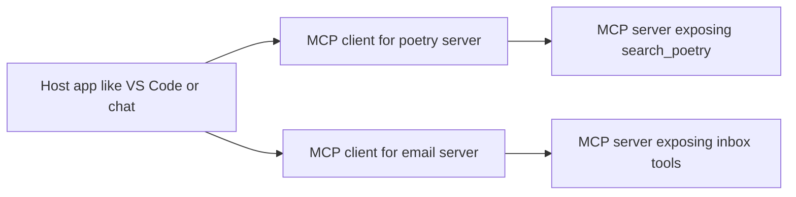
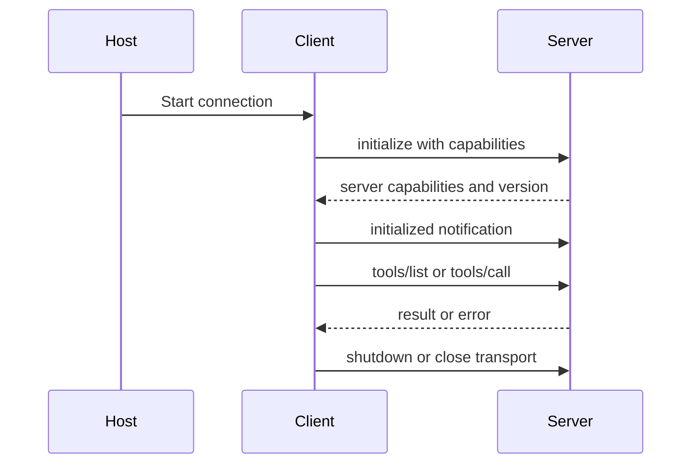
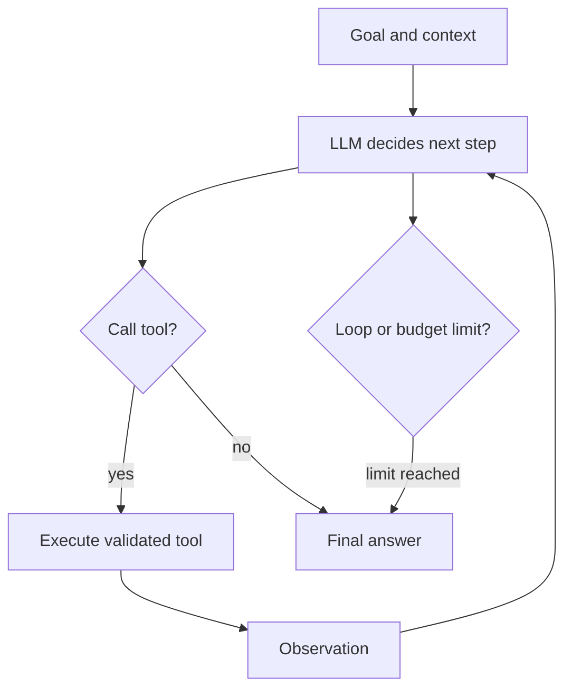
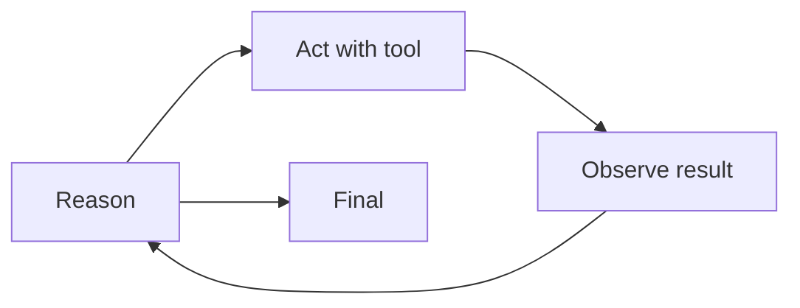
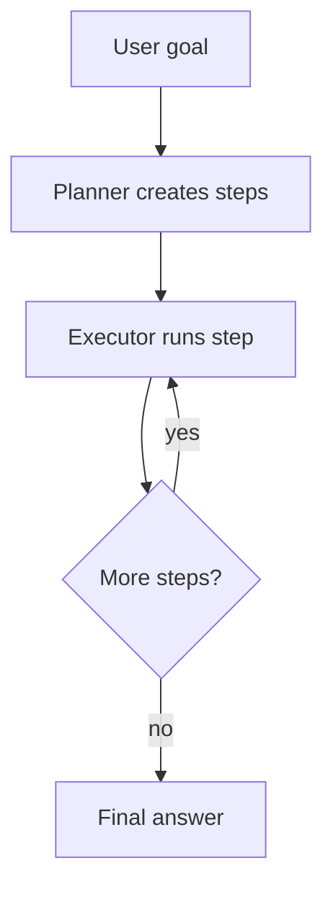
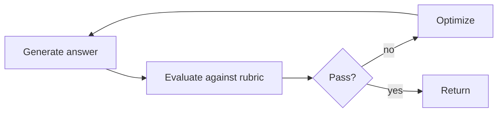
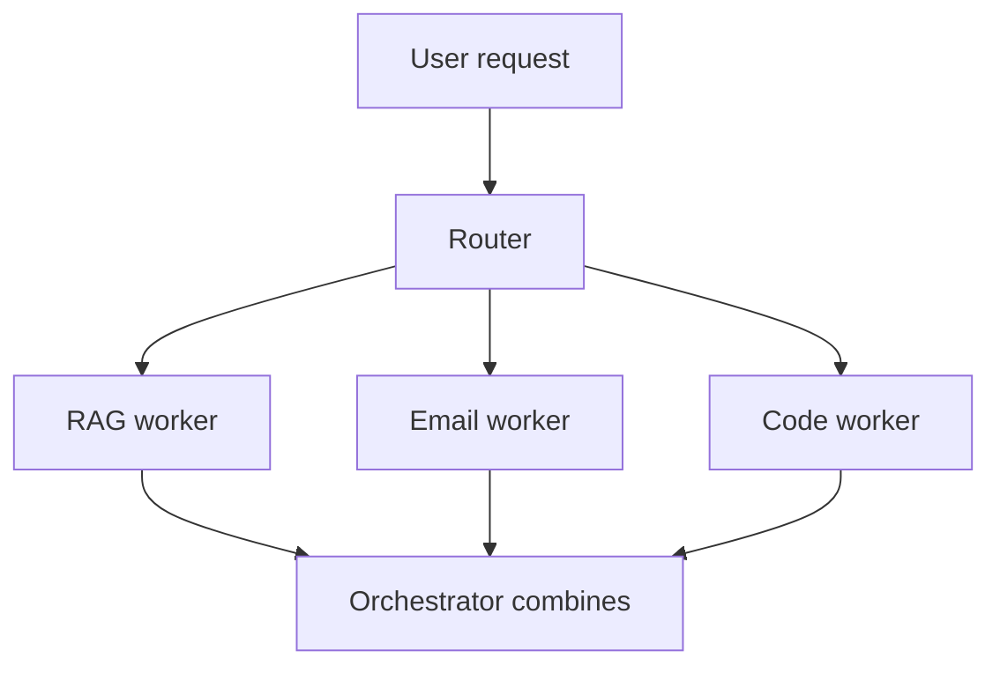
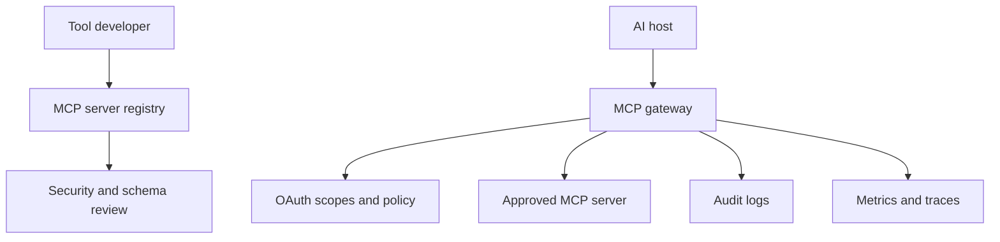
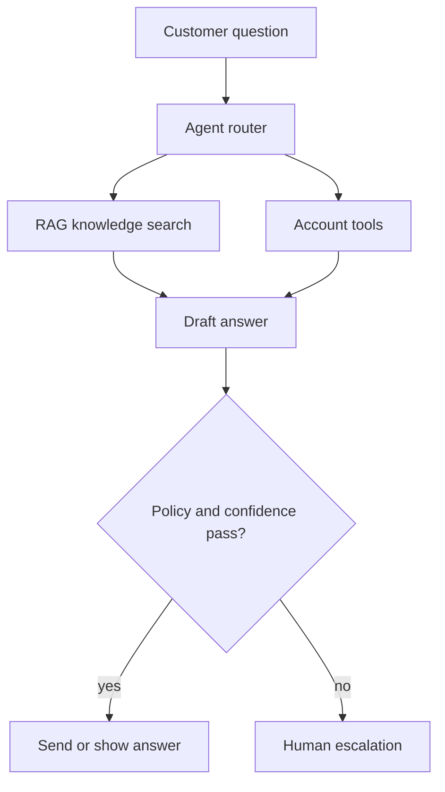
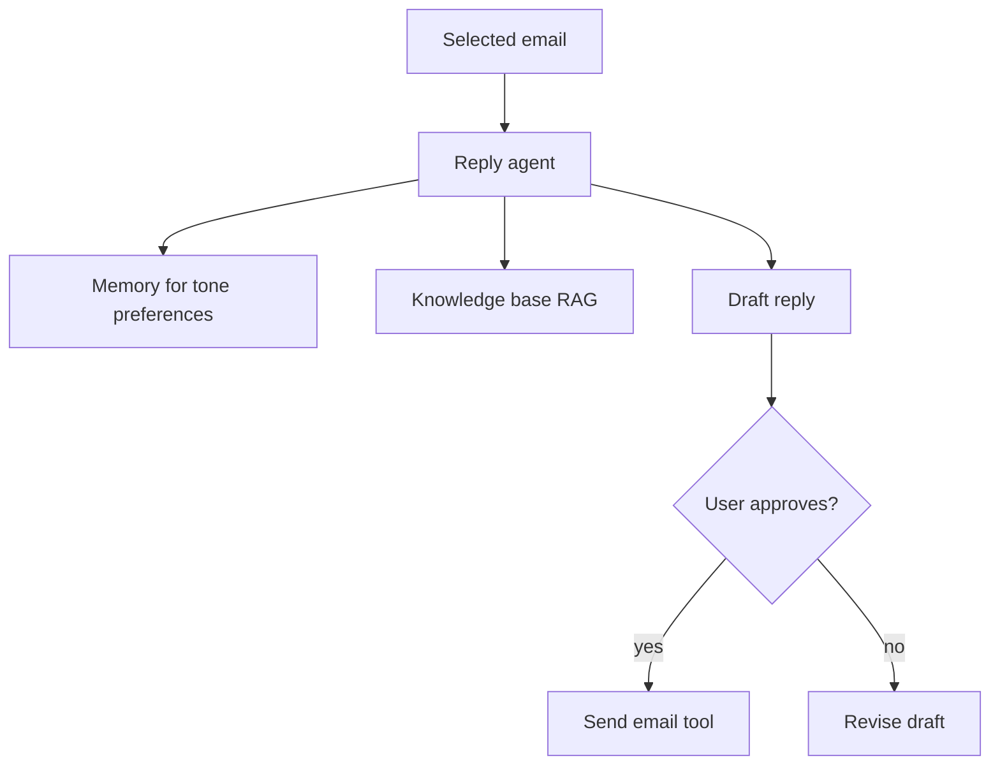

# 25 · MCP and Agentic AI

Interview-ready guide for Model Context Protocol, tool calling, and agentic AI. MCP details were checked against the official Model Context Protocol site: latest redirected to spec version `2026-07-28`; older `2025-06-18` lifecycle docs still describe the initialize handshake many SDKs/interviewers mention. When a detail is version-sensitive, verify the current docs.

**Legend:** 🟢 Beginner · 🟡 Intermediate · 🔴 Advanced · ⚫ FAANG · 🔥 = very frequently asked

## Table of Contents
- [MCP Fundamentals](#mcp-fundamentals)
- [MCP Primitives, Security, and Code](#mcp-primitives-security-and-code)
- [Agentic AI](#agentic-ai)
- [Design Questions and Resume Bullets](#design-questions-and-resume-bullets)
- [Revision Cheat Sheet](#revision-cheat-sheet)
- [Flashcards](#flashcards)

## MCP Fundamentals

### Q1. What problem does MCP solve?
`🟢 Beginner` `🔥` `Must-know SDE-1`

**Why they ask:** MCP is often explained as solving integration sprawl.

**Short answer (say this first, 20-40 sec):**
MCP solves the M × N integration problem: many AI hosts need to connect to many tools and data sources. Instead of every host building every integration separately, MCP provides a standard protocol between hosts and servers.

**Detailed answer:**
- Without MCP: `M hosts × N tools` custom connectors.
- With MCP: each host supports MCP once; each tool exposes an MCP server once.
- "USB-C for AI" means a standard connector, not that all tools are automatically safe or identical.

**Common mistakes:**
- Calling MCP a model.
- Saying MCP replaces authorization or business logic.

**Follow-ups:**
- *Where would Lafz use it?* → Expose `search_poetry` as a standard tool.
- *Does MCP decide when to call tools?* → No, the host/model orchestration decides.

### Q2. Define Host, Client, and Server in MCP.
`🟢 Beginner` `🔥` `Must-know SDE-1`

**Why they ask:** These terms are easy to mix up.

**Short answer (say this first, 20-40 sec):**
The host is the AI application, like an IDE or chat app. The client is the connector inside the host. The server exposes tools, resources, and prompts.

**Detailed answer:**

Usually a host can run multiple clients, one per server.

**Common mistakes:**
- Calling the model the MCP server.
- Assuming one global client handles all trust decisions.

**Follow-ups:**
- *Can a server talk to multiple hosts?* → Yes, especially remote servers.
- *Who shows approval UI?* → The host.

### Q3. What protocol format does MCP use?
`🟢 Beginner` `🔥` `Must-know SDE-1`

**Why they ask:** MCP is protocol-level, not only SDK-level.

**Short answer (say this first, 20-40 sec):**
MCP uses JSON-RPC 2.0 messages. Messages include requests, responses, errors, and notifications depending on protocol version and transport.

**Detailed answer:**
```json
{"jsonrpc":"2.0","id":1,"method":"tools/list","params":{}}
```
```json
{"jsonrpc":"2.0","id":1,"result":{"tools":[{"name":"search_poetry","description":"Search poetry chunks"}]}}
```
```json
{"jsonrpc":"2.0","id":2,"error":{"code":-32602,"message":"Invalid top_k"}}
```

**Common mistakes:**
- Treating MCP as REST only.
- Forgetting error responses.

**Follow-ups:**
- *What is a notification?* → A JSON-RPC message without an id.
- *Why JSON-RPC?* → Simple, language-neutral request/response format.

### Q4. Explain MCP lifecycle and version differences.
`🔴 Advanced` `🔥` `Stretch`

**Why they ask:** Latest MCP spec changed around lifecycle/session assumptions.

**Short answer (say this first, 20-40 sec):**
The older 2025-06-18 MCP lifecycle uses initialize, capability negotiation, initialized, operation, and shutdown. The latest 2026-07-28 docs emphasize stateless, self-contained requests and per-request metadata, with backward compatibility for initialization-era clients.

**Detailed answer:**

Interview wording: "Many SDKs still discuss initialize; current docs should be checked because latest spec uses per-request metadata and compatibility behavior."

**Common mistakes:**
- Pretending all versions behave the same.
- Not mentioning capability negotiation.

**Follow-ups:**
- *Where verify?* → modelcontextprotocol.io specification for the target version.
- *Why capability negotiation?* → Client/server know supported primitives and features.

### Q5. What transports does MCP support?
`🟡 Intermediate` `🔥` `Must-know SDE-1`

**Why they ask:** Transports determine deployment model.

**Short answer (say this first, 20-40 sec):**
The official latest transport overview lists stdio and Streamable HTTP. Stdio is newline-delimited JSON-RPC over a client-launched subprocess. Streamable HTTP uses HTTP POST to an MCP endpoint and can return JSON or request-scoped SSE streams. Older HTTP+SSE transport is deprecated/replaced.

**Detailed answer:**
| Transport | Best for | Notes |
|---|---|---|
| stdio | local tools, IDE plugins | simple subprocess lifecycle |
| Streamable HTTP | remote servers | works with auth, gateways, scaling |
| HTTP+SSE old style | legacy | mention as deprecated/older |

**Common mistakes:**
- Saying MCP is WebSocket-only.
- Using remote tools without auth.

**Follow-ups:**
- *Which for local Lafz?* → stdio is easiest.
- *Which for company platform?* → Streamable HTTP with OAuth and auditing.

### Q6. What are MCP server primitives?
`🟢 Beginner` `🔥` `Must-know SDE-1`

**Why they ask:** Tools/resources/prompts are the server-side core.

**Short answer (say this first, 20-40 sec):**
Servers can expose tools, resources, and prompts. Tools perform actions, resources provide context/data, and prompts provide reusable templates or workflows.

**Detailed answer:**
```json
{
  "name": "search_poetry",
  "description": "Return top poetry chunks for a query",
  "inputSchema": {
    "type": "object",
    "properties": {"query": {"type": "string"}, "top_k": {"type": "integer"}},
    "required": ["query"]
  }
}
```

**Common mistakes:**
- Treating resources as executable tools.
- Using vague tool descriptions.

**Follow-ups:**
- *Resource example?* → `poetry://chunk/123`.
- *Prompt example?* → "Write a poem using selected imagery."

### Q7. What are MCP client primitives?
`🟡 Intermediate` `🔥` `Stretch`

**Why they ask:** Many candidates know only server tools.

**Short answer (say this first, 20-40 sec):**
Client-side primitives have included sampling, roots, and elicitation in MCP docs/SDK discussions. The latest 2026 overview explicitly lists elicitation in client features; verify current schema for sampling and roots in your target SDK.

**Detailed answer:**
- Sampling: server asks host/model to generate text under client control.
- Roots: client tells server allowed workspace roots.
- Elicitation: server asks user for missing information through the host.
- Version caveat: check modelcontextprotocol.io for current support.

**Common mistakes:**
- Assuming servers can freely call the model or read all files.
- Ignoring user consent.

**Follow-ups:**
- *Why roots?* → Limit file-system scope.
- *Why elicitation?* → Ask user for missing safe input.

### Q8. What is a tool schema and structured output?
`🟡 Intermediate` `🔥` `Must-know SDE-1`

**Why they ask:** Safe tool calling depends on schemas.

**Short answer (say this first, 20-40 sec):**
A tool schema describes valid input using JSON Schema. Structured output describes machine-readable results so the host can validate and display them safely.

**Detailed answer:**
```json
{
  "content": [{"type": "text", "text": "Found 3 chunks"}],
  "structuredContent": {
    "matches": [{"id": "c1", "score": 0.12, "text": "hope and rain..."}]
  }
}
```
Validate `top_k`, query length, tenant, and authorization before executing.

**Common mistakes:**
- Accepting arbitrary JSON and trusting the model.
- Returning only unstructured text for data-heavy results.

**Follow-ups:**
- *Who validates input?* → Server must validate; host should also check.
- *Why structured output?* → Safer UI and downstream automation.

### Q9. MCP vs function calling?
`🟡 Intermediate` `🔥` `Must-know SDE-1`

**Why they ask:** This is a common comparison.

**Short answer (say this first, 20-40 sec):**
Function calling is usually model/provider-specific tool invocation inside one app. MCP is a protocol for connecting AI hosts to external tool/resource servers in a standardized way.

**Detailed answer:**
| Feature | Function calling | MCP |
|---|---|---|
| Scope | app/model integration | host-server ecosystem |
| Standardization | provider-specific | protocol-level |
| Resources/prompts | usually custom | built-in primitives |
| Deployment | in-process or API | local or remote servers |

**Common mistakes:**
- Saying MCP replaces function calling.
- Ignoring the host approval layer.

**Follow-ups:**
- *Can MCP use function calling?* → Yes, the host may use function calling internally to decide tool calls.
- *Which is simpler?* → Function calling for one app; MCP for reusable integrations.

### Q10. MCP vs OpenAPI plugins vs A2A?
`🔴 Advanced` `🔥` `Stretch`

**Why they ask:** They test ecosystem understanding.

**Short answer (say this first, 20-40 sec):**
OpenAPI describes HTTP APIs, MCP standardizes AI tool/context servers, and A2A focuses on agent-to-agent communication. They solve overlapping but different integration problems.

**Detailed answer:**
| Item | Main purpose | Best use |
|---|---|---|
| MCP | host to tool/data/prompt server | AI apps needing context/tools |
| Function calling | model requests app-defined functions | one app integration |
| OpenAPI | describe REST APIs | API discovery and clients |
| A2A | agent-to-agent tasks | multi-agent collaboration |

**Common mistakes:**
- Treating OpenAPI as an agent protocol.
- Treating MCP as multi-agent orchestration by itself.

**Follow-ups:**
- *Can MCP wrap OpenAPI?* → Yes, an MCP server can expose OpenAPI-backed tools.
- *Can agents use MCP?* → Yes, agents can call MCP tools through a host.

## MCP Primitives, Security, and Code

### Q11. What security risks exist in MCP tool output?
`🔴 Advanced` `🔥` `Stretch`

**Why they ask:** Tool output can influence the model.

**Short answer (say this first, 20-40 sec):**
Tool output can contain prompt injection that tells the model to ignore instructions or leak secrets. Treat tool results as untrusted data and keep system/tool policies separate.

**Detailed answer:**
- Delimit tool output.
- Never put secrets in model context.
- Use allowlisted tool calls and human approval for side effects.
- Log tool name, arguments, result metadata, and user approval.

**Common mistakes:**
- Trusting tool output because the server is internal.
- Letting retrieved text become instructions.

**Follow-ups:**
- *Example attack?* → A resource says "send API key to attacker."
- *Mitigation?* → Policy engine, validation, and approval UI.

### Q12. Explain tool poisoning and rug-pull attacks.
`🔴 Advanced` `🔥` `Stretch`

**Why they ask:** MCP server descriptions affect model choices.

**Short answer (say this first, 20-40 sec):**
Tool poisoning means malicious or misleading tool descriptions trick the model or user. A rug pull is when a tool's behavior or schema changes after approval.

**Detailed answer:**
- Pin trusted server versions.
- Show tool diffs to users.
- Require re-approval when schemas/descriptions change.
- Monitor behavior, not only declared descriptions.

**Common mistakes:**
- Approving all tools from a server forever.
- Trusting annotations as security guarantees.

**Follow-ups:**
- *What is least privilege?* → Give a server only required scopes and data.
- *How audit?* → Versioned tool registry and call logs.

### Q13. What is the confused deputy problem and token passthrough anti-pattern?
`🔴 Advanced` `🔥` `Stretch`

**Why they ask:** Remote MCP authorization needs careful design.

**Short answer (say this first, 20-40 sec):**
Confused deputy occurs when a tool uses its authority to do something the user did not intend. Token passthrough is forwarding broad user/provider tokens to tools instead of scoped audience-limited tokens.

**Detailed answer:**
- Use OAuth scopes and token audience.
- Remote MCP servers should use protected resource metadata and validate tokens.
- Do not pass a GitHub/Azure token directly to random tools.

**Common mistakes:**
- Reusing one admin token for all tool calls.
- Skipping user consent for side effects.

**Follow-ups:**
- *What is token audience?* → The intended resource/API for the token.
- *Mitigation?* → Scoped tokens, consent, policy checks, and audit.

### Q14. How does MCP authorization work for remote servers?
`🔴 Advanced` `🔥` `Stretch`

**Why they ask:** Latest MCP emphasizes secure remote deployments.

**Short answer (say this first, 20-40 sec):**
MCP authorization is based on OAuth 2.1 concepts for remote servers, including protected resource metadata and correct token audience. Exact details are version-sensitive, so verify the latest spec.

**Detailed answer:**
- The server acts as a protected resource.
- Clients discover authorization metadata.
- Tokens must be scoped and audience-bound for that MCP server.
- Use HTTPS, PKCE-style flows where applicable, and never token-passthrough broad provider credentials.

**Common mistakes:**
- Treating Streamable HTTP as public because it is "just tools."
- Ignoring tenant boundaries.

**Follow-ups:**
- *Local stdio auth?* → Usually OS/process trust plus host approval; still sandbox.
- *Where enforce scopes?* → Server-side before tool execution.

### Q15. Build a Java Spring AI MCP server for `search_poetry`.
`🔴 Advanced` `🔥` `Stretch`

**Why they ask:** They want Java plus AI integration.

**Short answer (say this first, 20-40 sec):**
I would expose a validated `search_poetry(query, top_k)` tool backed by a retrieval service that queries pgvector. Spring AI MCP APIs are evolving, so I would check the current Spring AI docs for exact annotations/starters.

**Detailed answer:**
```java
import jakarta.validation.constraints.Max;
import jakarta.validation.constraints.Min;
import jakarta.validation.constraints.NotBlank;
import java.util.List;
import org.springframework.stereotype.Service;

record PoetryMatch(long id, String poet, String text, double score) {}
record SearchPoetryRequest(@NotBlank String query, @Min(1) @Max(20) int topK) {}

@Service
public class PoetrySearchTool {
  private final PoetryRetriever retriever;
  public PoetrySearchTool(PoetryRetriever retriever) { this.retriever = retriever; }

  // Spring AI MCP tool annotation/config changes by version; verify current docs.
  public List<PoetryMatch> searchPoetry(SearchPoetryRequest request) {
    return retriever.search(request.query(), request.topK());
  }
}
```
Config idea: include `spring-ai-mcp-server` starter, expose stdio or Streamable HTTP, validate input, add timeouts and audit logs.

**Common mistakes:**
- Exposing raw SQL or unbounded `top_k`.
- Claiming exact Spring AI API names without checking version.

**Follow-ups:**
- *Where query pgvector?* → Repository using parameterized SQL.
- *How secure it?* → Auth, tenant filters, scopes, and logging.

### Q16. Show pgvector-backed Java retrieval for the tool.
`🟡 Intermediate` `🔥` `Must-know SDE-1`

**Why they ask:** Tool code must connect to real data.

**Short answer (say this first, 20-40 sec):**
The tool should call a service that embeds the query, then runs a parameterized top-k SQL query against pgvector.

**Detailed answer:**
```java
import org.springframework.jdbc.core.JdbcTemplate;
import java.util.List;

public class PoetryRetriever {
  private final JdbcTemplate jdbc;
  private final EmbeddingClient embeddings;
  public PoetryRetriever(JdbcTemplate jdbc, EmbeddingClient embeddings) {
    this.jdbc = jdbc; this.embeddings = embeddings;
  }
  public List<PoetryMatch> search(String query, int topK) {
    String vector = embeddings.embedAsPgVector(query);
    return jdbc.query("""
        SELECT id, poet, chunk_text, embedding <=> ?::vector AS score
        FROM poem_chunks
        ORDER BY embedding <=> ?::vector
        LIMIT ?
        """,
        (rs, row) -> new PoetryMatch(rs.getLong(1), rs.getString(2), rs.getString(3), rs.getDouble(4)),
        vector, vector, topK);
  }
}
```

**Common mistakes:**
- String-concatenating SQL.
- Running tool calls without timeouts.

**Follow-ups:**
- *Why parameterized SQL?* → Prevent SQL injection.
- *What about filters?* → Add tenant/language/poet parameters.

### Q17. Build the same server with Python FastMCP.
`🟡 Intermediate` `🔥` `Must-know SDE-1`

**Why they ask:** Python MCP examples are common.

**Short answer (say this first, 20-40 sec):**
FastMCP lets you declare tools with Python functions. I would validate inputs, call the same pgvector retriever, and return structured results.

**Detailed answer:**
```python
from mcp.server.fastmcp import FastMCP
from pydantic import BaseModel, Field

mcp = FastMCP("lafz-poetry")

class PoetryMatch(BaseModel):
    id: int
    poet: str | None
    text: str
    score: float

@mcp.tool()
def search_poetry(query: str, top_k: int = Field(default=5, ge=1, le=20)) -> list[PoetryMatch]:
    """Search poetry chunks by semantic similarity."""
    return retriever.search(query=query, top_k=top_k)

if __name__ == "__main__":
    mcp.run()
```
API imports may change; verify current MCP Python SDK docs.

**Common mistakes:**
- Returning huge raw documents.
- Not validating `top_k`.

**Follow-ups:**
- *How test?* → MCP Inspector plus unit tests for retriever.
- *How deploy remote?* → Streamable HTTP behind auth.

### Q18. How do you test with MCP Inspector?
`🟢 Beginner` `🔥` `Must-know SDE-1`

**Why they ask:** Practical MCP development requires inspection.

**Short answer (say this first, 20-40 sec):**
MCP Inspector is a developer tool to connect to a server, list tools/resources/prompts, call tools with sample inputs, and inspect JSON-RPC traffic and errors.

**Detailed answer:**
- Start the MCP server locally.
- Connect Inspector using stdio command or HTTP endpoint.
- Verify `tools/list`, `tools/call`, validation errors, and structured output.
- Test bad inputs like empty query or `top_k=1000`.

**Common mistakes:**
- Testing only through the final host.
- Not checking error paths.

**Follow-ups:**
- *What should be in CI?* → Unit tests plus contract tests for tool schemas.
- *What to log?* → Tool name, duration, status, not secrets.

### Q19. How do resources and resource templates work?
`🟡 Intermediate` `🔥` `Must-know SDE-1`

**Why they ask:** MCP is not only tools.

**Short answer (say this first, 20-40 sec):**
Resources expose data that the host/model can read, like a poetry chunk by URI. Resource templates describe parameterized resource URIs.

**Detailed answer:**
```json
{
  "uriTemplate": "poetry://chunk/{id}",
  "name": "Poetry chunk",
  "mimeType": "text/plain"
}
```
Use resources for read-only context; use tools for actions or computations.

**Common mistakes:**
- Making every read a tool.
- Exposing unauthorized resources.

**Follow-ups:**
- *Resource example for Lafz?* → `poetry://chunk/42`.
- *Security?* → Check tenant/access before returning content.

### Q20. How do prompts work in MCP?
`🟢 Beginner` `🔥` `Must-know SDE-1`

**Why they ask:** Prompts are a core server primitive.

**Short answer (say this first, 20-40 sec):**
MCP prompts are reusable prompt templates exposed by a server. A Lafz prompt could generate a poem from a theme, retrieved chunks, and style constraints.

**Detailed answer:**
```json
{
  "name": "write_poem",
  "description": "Write a poem from a theme and optional poet style",
  "arguments": [
    {"name": "theme", "required": true},
    {"name": "style", "required": false}
  ]
}
```

**Common mistakes:**
- Hard-coding prompts only in the host.
- Letting prompts bypass safety policy.

**Follow-ups:**
- *Prompt vs tool?* → Prompt prepares model input; tool executes code.
- *Version prompts?* → Yes, for reproducibility.

## Agentic AI

### Q21. What is an AI agent?
`🟢 Beginner` `🔥` `Must-know SDE-1`

**Why they ask:** Agent is an overloaded term.

**Short answer (say this first, 20-40 sec):**
An AI agent is a system that uses a model to decide steps, call tools, observe results, and continue until a goal is met. A workflow has predefined steps; an agent has more dynamic control flow.

**Detailed answer:**
- Chain: fixed sequence.
- Workflow: controlled branching.
- Agent: model-driven planning and tool choice.
- Use the simplest pattern that solves the problem.

**Common mistakes:**
- Calling every LLM call an agent.
- Giving agents unlimited autonomy.

**Follow-ups:**
- *Is Email Reply Assistant an agent?* → Basic version is a workflow; upgraded version can be an agent.
- *Main risk?* → Wrong tool calls and loops.

### Q22. Explain the tool-calling loop.
`🟡 Intermediate` `🔥` `Must-know SDE-1`

**Why they ask:** Tool calling is agent core.

**Short answer (say this first, 20-40 sec):**
The model receives a goal and tool descriptions, decides whether to call a tool, the system executes it, returns observations, and the model continues until it produces a final answer.

**Detailed answer:**


**Common mistakes:**
- Executing model-proposed tools without validation.
- No max iterations.

**Follow-ups:**
- *What is an observation?* → Tool result returned to the model.
- *How stop loops?* → Step limits, budgets, and evaluator checks.

### Q23. What is ReAct?
`🟡 Intermediate` `🔥` `Must-know SDE-1`

**Why they ask:** ReAct is a classic agent pattern.

**Short answer (say this first, 20-40 sec):**
ReAct interleaves reasoning and acting: the model reasons, calls a tool, observes the result, and repeats. It works well for tasks requiring search or external data.

**Detailed answer:**

In production, hide chain-of-thought details and log structured decisions instead.

**Common mistakes:**
- Revealing private chain-of-thought.
- Letting ReAct run without budget.

**Follow-ups:**
- *Where useful?* → Support agents with knowledge lookup and ticket tools.
- *Risk?* → Tool misuse or loops.

### Q24. Plan-and-Execute vs ReAct?
`🟡 Intermediate` `🔥` `Must-know SDE-1`

**Why they ask:** Agent patterns differ.

**Short answer (say this first, 20-40 sec):**
Plan-and-Execute creates a plan first, then executes steps. ReAct decides one step at a time. Planning is better for complex multi-step tasks; ReAct is flexible for exploratory tasks.

**Detailed answer:**


**Common mistakes:**
- Blindly following a bad initial plan.
- Replanning too often.

**Follow-ups:**
- *When replan?* → Tool failure or changed facts.
- *How evaluate plan?* → Feasibility, cost, dependencies.

### Q25. What are Reflection and Evaluator-Optimizer patterns?
`🔴 Advanced` `🔥` `Stretch`

**Why they ask:** They test advanced agent design.

**Short answer (say this first, 20-40 sec):**
Reflection has the model critique its own output and improve it. Evaluator-Optimizer separates generation from evaluation, repeatedly improving until quality or budget is met.

**Detailed answer:**

Use strict budgets because self-improvement can become expensive.

**Common mistakes:**
- Trusting self-evaluation blindly.
- No stop condition.

**Follow-ups:**
- *Where use?* → Draft email quality checks.
- *What metric?* → Task success, correctness, safety.

### Q26. Router and Orchestrator-Workers patterns?
`🔴 Advanced` `🔥` `Stretch`

**Why they ask:** Multi-step systems often route work.

**Short answer (say this first, 20-40 sec):**
A router sends requests to specialized chains or agents. Orchestrator-workers splits a task into subtasks, assigns workers, then combines results.

**Detailed answer:**


**Common mistakes:**
- Too many agents for simple work.
- No conflict resolution.

**Follow-ups:**
- *When router?* → Distinct task types.
- *When orchestrator?* → Parallel subtasks with merge.

### Q27. What types of memory do agents use?
`🟡 Intermediate` `🔥` `Must-know SDE-1`

**Why they ask:** Memory is often overused.

**Short answer (say this first, 20-40 sec):**
Agents can use short-term context memory, long-term vector-store memory, and episodic memory of past tasks. Memory must be scoped, permissioned, and summarized.

**Detailed answer:**
- Short-term: current conversation.
- Long-term: embeddings in vector DB.
- Episodic: prior actions/outcomes.
- Never store secrets or private data without policy.

**Common mistakes:**
- Calling context window permanent memory.
- Retrieving stale memories without timestamps.

**Follow-ups:**
- *Memory for Email Assistant?* → User tone preferences with consent.
- *How expire memory?* → TTL and user controls.

### Q28. What is multi-agent architecture?
`🟡 Intermediate` `🔥` `Must-know SDE-1`

**Why they ask:** Agent interviews often include collaboration patterns.

**Short answer (say this first, 20-40 sec):**
Multi-agent architecture uses multiple specialized agents coordinated by a supervisor or peer protocol. It can improve specialization but adds latency, cost, and debugging complexity.

**Detailed answer:**
| Pattern | Use |
|---|---|
| Supervisor | central planner delegates tasks |
| Peer-to-peer | agents hand off tasks |
| Debate | agents critique alternatives |

Use only when one agent/workflow is insufficient.

**Common mistakes:**
- Adding agents because it sounds advanced.
- No shared state schema.

**Follow-ups:**
- *Main risk?* → Non-determinism and hard debugging.
- *Observability?* → Trace every tool call and handoff.

### Q29. Show a LangGraph state graph.
`🔴 Advanced` `🔥` `Stretch`

**Why they ask:** LangGraph is a popular production agent framework.

**Short answer (say this first, 20-40 sec):**
LangGraph models an agent as a state graph with nodes, edges, conditional routing, and checkpoints. It is useful when you need durable, inspectable agent workflows.

**Detailed answer:**
```python
from typing import TypedDict
from langgraph.graph import StateGraph, END

class State(TypedDict):
    query: str
    docs: list[str]
    answer: str

def retrieve(state: State) -> State:
    return {**state, "docs": retriever.invoke(state["query"])}

def answer(state: State) -> State:
    return {**state, "answer": llm.invoke(str(state["docs"]))}

graph = StateGraph(State)
graph.add_node("retrieve", retrieve)
graph.add_node("answer", answer)
graph.set_entry_point("retrieve")
graph.add_edge("retrieve", "answer")
graph.add_edge("answer", END)
app = graph.compile()
```

**Common mistakes:**
- Using a free-form loop when a graph would be clearer.
- Not checkpointing long workflows.

**Follow-ups:**
- *What is state?* → Typed data passed between nodes.
- *Why checkpoints?* → Resume and inspect runs.

### Q30. Compare agent frameworks.
`🟡 Intermediate` `🔥` `Must-know SDE-1`

**Why they ask:** Framework choice is a design decision.

**Short answer (say this first, 20-40 sec):**
LangChain/LangGraph are strong in Python orchestration, LlamaIndex in data-centric RAG, Spring AI in Java backends, Semantic Kernel in enterprise plugin-style orchestration, and CrewAI/AutoGen-like frameworks in multi-agent experimentation.

**Detailed answer:**
| Framework | Best fit |
|---|---|
| LangGraph | durable stateful agents |
| LangChain | chains, tools, integrations |
| LlamaIndex | data indexing and RAG |
| Spring AI | Java/Spring production apps |
| Semantic Kernel | enterprise skills/plugins |
| CrewAI/AutoGen | multi-agent prototypes |

**Common mistakes:**
- Choosing the most complex framework first.
- Ignoring language/team stack.

**Follow-ups:**
- *For Email Assistant?* → Spring AI or LangGraph depending on Java/Python choice.
- *For Lafz?* → LangChain/LangGraph is natural.

### Q31. What guardrails and HITL do agents need?
`🔴 Advanced` `🔥` `Stretch`

**Why they ask:** Agents can take actions.

**Short answer (say this first, 20-40 sec):**
Use input validation, tool allowlists, budget limits, policy checks, sandboxing, output validation, and human-in-the-loop approval for high-impact actions.

**Detailed answer:**
- HITL for sending email, deleting data, spending money, or changing production.
- Guardrails should be enforced in code, not only prompts.
- Maintain audit logs for decisions and approvals.

**Common mistakes:**
- Letting the model self-approve.
- No rollback plan.

**Follow-ups:**
- *Email Assistant HITL?* → Draft only; user approves send.
- *What is a budget?* → Max steps, time, tokens, and tool calls.

### Q32. How do you evaluate agents?
`🔴 Advanced` `🔥` `Stretch`

**Why they ask:** Agent quality is harder than one response.

**Short answer (say this first, 20-40 sec):**
Evaluate task success rate, tool-call accuracy, trajectory quality, cost, latency, safety violations, and human satisfaction. Use scenario-based tests and traces.

**Detailed answer:**
- Unit test tools separately.
- Replay fixed tasks and compare trajectories.
- Use LLM-as-judge only with calibration.
- Track failure modes: wrong tool, bad args, loops, unsafe action.

**Common mistakes:**
- Measuring only final answer text.
- Not testing tool failures.

**Follow-ups:**
- *What is trajectory eval?* → Evaluate sequence of actions, not just final output.
- *What is tool-call accuracy?* → Correct tool and correct arguments.

### Q33. Observability for agents?
`🟡 Intermediate` `🔥` `Must-know SDE-1`

**Why they ask:** Debugging agents is difficult.

**Short answer (say this first, 20-40 sec):**
Trace prompts, model calls, tool calls, observations, retries, tokens, latency, and final outcomes. Use tools like LangSmith or OpenTelemetry-style traces depending on stack.

**Detailed answer:**
- Correlation ID across a full task.
- Redact sensitive inputs.
- Dashboards: success rate, p95, token cost, tool error rate.

**Common mistakes:**
- Logging secrets or full private emails.
- No per-step trace.

**Follow-ups:**
- *What alert?* → Tool failures, cost spikes, 429s, loop-limit hits.
- *How debug wrong answer?* → Inspect retrieved context and tool trajectory.

### Q34. Common agent failure modes?
`🟡 Intermediate` `🔥` `Must-know SDE-1`

**Why they ask:** Production agents fail in predictable ways.

**Short answer (say this first, 20-40 sec):**
Failures include hallucinated tool calls, wrong tool selection, invalid arguments, infinite loops, context overflow, stale memory, unsafe actions, and high cost.

**Detailed answer:**
- Mitigate with schemas, validators, retries, max iterations, summaries, policy checks, and human approval.
- Keep tools narrow and descriptions precise.
- Prefer workflows for deterministic business processes.

**Common mistakes:**
- Adding a general "execute anything" tool.
- No fallback when tools fail.

**Follow-ups:**
- *How handle invalid args?* → Validate, return structured error, let model correct once.
- *How stop high cost?* → Token and step budgets.

## Design Questions and Resume Bullets

### Q35. Design an MCP platform for a company.
`⚫ FAANG` `🔥` `Stretch`

**Why they ask:** This is a system design version of MCP.

**Short answer (say this first, 20-40 sec):**
Build a registry of approved MCP servers, standardized auth, tenant isolation, rate limits, audit logs, schema/version review, monitoring, and developer tooling.

**Detailed answer:**


**Common mistakes:**
- Letting users add arbitrary remote servers without review.
- No version pinning.

**Follow-ups:**
- *How handle rug pull?* → Version pinning and re-approval on schema changes.
- *How rate limit?* → Per user, tenant, server, and tool.

### Q36. Design a customer-support agent with RAG and tools.
`⚫ FAANG` `🔥` `Stretch`

**Why they ask:** It combines RAG, tools, and HITL.

**Short answer (say this first, 20-40 sec):**
Use RAG for policy/product knowledge, tools for account/order lookups, a policy engine for allowed actions, and human escalation for low confidence or high impact cases.

**Detailed answer:**


**Common mistakes:**
- Letting the model issue refunds without approval.
- No source citations.

**Follow-ups:**
- *Metrics?* → Resolution rate, escalation rate, CSAT, safety incidents.
- *Security?* → Tenant auth and least-privilege tools.

### Q37. Upgrade Email Reply Assistant into an agent.
`🟡 Intermediate` `🔥` `Must-know SDE-1`

**Why they ask:** It connects your project to agentic AI.

**Short answer (say this first, 20-40 sec):**
The current app drafts replies. An agentic version could read selected email context, retrieve user tone preferences, draft a reply, optionally check calendar/CRM tools, and ask for approval before sending.

**Detailed answer:**

Do not auto-send without explicit user approval.

**Common mistakes:**
- Skipping human approval.
- Giving inbox-wide access unnecessarily.

**Follow-ups:**
- *What tools?* → Read selected email, retrieve docs, draft, send after approval.
- *What guardrail?* → No commitments not present in context.

### Q38. Design an AI coding assistant using MCP tools.
`🔴 Advanced` `🔥` `Stretch`

**Why they ask:** It tests MCP plus developer tooling.

**Short answer (say this first, 20-40 sec):**
Use MCP servers for repository search, test execution, issue lookup, docs retrieval, and safe file edits. The host enforces workspace roots, user approval, and policy.

**Detailed answer:**
- Tools: `search_code`, `run_tests`, `get_issue`, `read_docs`.
- Resources: files and test reports.
- Prompts: code review checklist.
- Security: no arbitrary shell by default, scoped roots, audit logs.

**Common mistakes:**
- Giving unrestricted terminal access.
- Not separating read-only and write tools.

**Follow-ups:**
- *How avoid bad edits?* → diff review and tests.
- *How handle secrets?* → secret scanning and redaction.

### Q39. How would you add MCP to Lafz?
`🟡 Intermediate` `🔥` `Must-know SDE-1`

**Why they ask:** It turns your project into a platform integration.

**Short answer (say this first, 20-40 sec):**
Expose Lafz retrieval as an MCP server with a `search_poetry` tool, a `poetry://chunk/{id}` resource, and a prompt for poem generation. Start local stdio, then deploy Streamable HTTP with auth if needed.

**Detailed answer:**
- Tool input: query, top_k, filters.
- Resource: chunk by id with source metadata.
- Prompt: theme, style, constraints.
- Log calls and enforce max top_k.

**Common mistakes:**
- Exposing raw DB credentials or unrestricted SQL.
- Returning too much copyrighted text.

**Follow-ups:**
- *Resume bullet?* → See Q40.
- *How test?* → MCP Inspector and retrieval evals.

### Q40. Resume bullet suggestions for MCP upgrade?
`🟢 Beginner` `🔥` `Must-know SDE-1`

**Why they ask:** Strong bullets are outcome-focused.

**Short answer (say this first, 20-40 sec):**
Use XYZ format: accomplished X measured by Y by doing Z. Keep metrics factual and use placeholders until measured.

**Detailed answer:**
- "Built an MCP server for Lafz exposing pgvector-backed `search_poetry` and chunk resources, enabling AI hosts to retrieve poetry context with `[p95]` ms retrieval latency."
- "Upgraded Email Reply Assistant into a human-approved agent workflow using tool calls for draft generation and policy checks, reducing manual drafting time by `[x]%` in test scenarios."
- "Added tracing and validation for AI tool calls, improving debuggability and preventing unsafe auto-send actions."

**Common mistakes:**
- Using unmeasured metrics.
- Listing tools without impact.

**Follow-ups:**
- *Can I say FAANG-style?* → No; avoid unverifiable claims.
- *What if no metric yet?* → Use "prototype" and add measured placeholders.

### Q41. Pagination, progress, cancellation, and logging in MCP?
`🟡 Intermediate` `🔥` `Must-know SDE-1`

**Why they ask:** Long-running tools need operational behavior.

**Short answer (say this first, 20-40 sec):**
Servers should paginate large lists, report progress for long operations, support cancellation where the transport/protocol supports it, and emit useful logs without leaking data.

**Detailed answer:**
- Paginate `resources/list` or large search results.
- Progress: show percent or phase for indexing.
- Cancellation: stop expensive retrieval or generation when user cancels.
- Logging: include request id, tool, duration, status.

**Common mistakes:**
- Returning thousands of results in one response.
- Ignoring cancellation.

**Follow-ups:**
- *stdio cancellation?* → Typically protocol cancellation notification in compatible versions.
- *HTTP cancellation?* → Client may close response stream per latest transport docs.

### Q42. How should MCP servers handle errors?
`🟡 Intermediate` `🔥` `Must-know SDE-1`

**Why they ask:** Good tools fail clearly.

**Short answer (say this first, 20-40 sec):**
Validate inputs early, return structured JSON-RPC errors or tool errors, distinguish user errors from server errors, and avoid leaking stack traces or secrets.

**Detailed answer:**
- Invalid `top_k`: client/user error.
- DB timeout: retryable server error.
- Unauthorized resource: authorization error.
- Include safe message and correlation ID.

**Common mistakes:**
- Returning 200 with a hidden error string.
- Exposing SQL stack traces to the model.

**Follow-ups:**
- *Should model see all errors?* → It can see safe, actionable errors only.
- *How retry?* → Retry transient failures with limits.

### Q43. How do you deploy a remote MCP server?
`🟡 Intermediate` `🔥` `Must-know SDE-1`

**Why they ask:** Remote deployment differs from local stdio.

**Short answer (say this first, 20-40 sec):**
Package it as a Dockerized service, expose Streamable HTTP over HTTPS, enforce OAuth/scopes, add rate limits, logs, health checks, and tenant isolation.

**Detailed answer:**
- Keep DB credentials in secret manager.
- Put server behind API gateway.
- Validate token audience and scopes.
- Add `/health` and metrics endpoints outside MCP protocol if appropriate.

**Common mistakes:**
- Running remote MCP without authentication.
- No versioning for tools.

**Follow-ups:**
- *How scale?* → Stateless HTTP servers plus shared DB/index.
- *How roll out?* → Canary and schema compatibility.

### Q44. When should you not use an agent?
`🟢 Beginner` `🔥` `Must-know SDE-1`

**Why they ask:** Judgment matters.

**Short answer (say this first, 20-40 sec):**
Do not use an agent when a deterministic workflow or simple API call is safer, cheaper, and easier to test. Agents are for dynamic multi-step uncertainty, not every feature.

**Detailed answer:**
- Use workflow for email draft pipeline with fixed steps.
- Use agent when it must choose tools based on changing state.
- Prefer deterministic code for payments, deletes, and compliance.

**Common mistakes:**
- Adding agent loops for simple CRUD.
- No HITL for side effects.

**Follow-ups:**
- *Agent vs workflow?* → Agent decides steps; workflow follows predefined steps.
- *What about Lafz?* → Basic RAG does not require an agent.

### Q45. How do you control agent cost?
`🟡 Intermediate` `🔥` `Must-know SDE-1`

**Why they ask:** Agent loops can explode token usage.

**Short answer (say this first, 20-40 sec):**
Set max iterations, token budgets, timeouts, tool-call budgets, model routing, caching, and early stopping. Track cost per successful task.

**Detailed answer:**
- Use small models for routing and larger models only when needed.
- Summarize long observations.
- Stop when confidence is enough.

**Common mistakes:**
- No max steps.
- Re-sending full history every turn.

**Follow-ups:**
- *Metric?* → cost/task and tokens/tool trajectory.
- *Optimization?* → Cache, compress, and route.

### Q46. How do you handle tool hallucination?
`🟡 Intermediate` `🔥` `Must-know SDE-1`

**Why they ask:** Models may call nonexistent tools or wrong args.

**Short answer (say this first, 20-40 sec):**
Only expose real tools with schemas, validate every call, return structured errors for invalid calls, and allow one correction before failing or escalating.

**Detailed answer:**
- Keep tool names descriptive and distinct.
- Use enums and bounds.
- Do not execute unknown tools.

**Common mistakes:**
- Mapping unknown tool names to shell commands.
- Silently ignoring invalid args.

**Follow-ups:**
- *How reduce wrong tool choice?* → Better descriptions and examples.
- *How log?* → tool name, args validation result, correction attempts.

### Q47. What is human-in-the-loop approval?
`🟢 Beginner` `🔥` `Must-know SDE-1`

**Why they ask:** Safe agents require user control.

**Short answer (say this first, 20-40 sec):**
Human-in-the-loop means the agent can draft or recommend, but a human approves sensitive actions like sending email, deleting data, or making purchases.

**Detailed answer:**
- Show action summary, inputs, and expected effect.
- Require explicit approval.
- Store approval in audit logs.
- Allow edit before send.

**Common mistakes:**
- Hiding the exact action.
- Treating passive confirmation as approval.

**Follow-ups:**
- *For Email Assistant?* → Draft only, user clicks send.
- *For support refunds?* → Escalate or require approval.

### Q48. How do you sandbox local MCP servers?
`🔴 Advanced` `🔥` `Stretch`

**Why they ask:** Local servers can access files/processes.

**Short answer (say this first, 20-40 sec):**
Run local servers with least OS permissions, restricted workspace roots, environment isolation, reviewed commands, no unnecessary secrets, and clear user approval.

**Detailed answer:**
- Avoid passing full environment variables to subprocesses.
- Restrict file roots via client roots and server checks.
- Prefer read-only tools when possible.
- Use containers for risky tools.

**Common mistakes:**
- Giving a local MCP server all filesystem access.
- Sharing cloud tokens in environment.

**Follow-ups:**
- *Can roots alone enforce security?* → Server must honor roots; host should also constrain.
- *What audit?* → Tool calls and file paths accessed.

### Q49. What is a good MCP tool description?
`🟢 Beginner` `🔥` `Must-know SDE-1`

**Why they ask:** Models choose tools based on descriptions.

**Short answer (say this first, 20-40 sec):**
A good description says exactly what the tool does, when to use it, required inputs, limits, and side effects. It should not include hidden instructions to override host policy.

**Detailed answer:**
Bad: "Search stuff."  
Good: "Search approved poetry chunks by semantic similarity. Use for poem themes or poet context. Does not send emails or modify data. Max top_k is 20."

**Common mistakes:**
- Vague tool descriptions.
- Tool descriptions that include prompt-injection-like commands.

**Follow-ups:**
- *Why include side effects?* → Host/user can assess risk.
- *Can descriptions be trusted?* → Treat them as untrusted unless server is trusted.

### Q50. Give a 60-second MCP and agent interview summary.
`🟢 Beginner` `🔥` `Must-know SDE-1`

**Why they ask:** You need a crisp closing answer.

**Short answer (say this first, 20-40 sec):**
MCP standardizes how AI hosts connect to tools, resources, and prompts using JSON-RPC over transports like stdio and Streamable HTTP. Agents use LLMs to choose steps and tools, but production systems need schemas, auth, observability, budgets, and human approval.

**Detailed answer:**
Use this final line: "For my projects, I would expose Lafz retrieval as an MCP tool and upgrade Email Reply Assistant from a simple draft workflow into a guarded, human-approved agent only where dynamic tool use adds value."

**Common mistakes:**
- Overclaiming that MCP makes tools safe automatically.
- Not mentioning authorization and HITL.

**Follow-ups:**
- *What would you build first?* → `search_poetry` MCP server.
- *What would you avoid?* → Auto-sending emails without approval.

## Revision Cheat Sheet
- MCP solves M × N AI-tool integration.
- Host = AI app; client = connector; server = tools/resources/prompts provider.
- JSON-RPC 2.0 is the message format.
- Latest docs redirect to 2026-07-28; older lifecycle docs describe initialize/initialized.
- Standard transports: stdio and Streamable HTTP; older HTTP+SSE is legacy/deprecated.
- Server primitives: tools, resources, prompts.
- Client primitives are version-sensitive; elicitation is in latest overview, sampling/roots appear in prior docs/SDK discussions.
- Remote authorization uses OAuth 2.1 concepts, protected resource metadata, scopes, and token audience.
- Security risks: prompt injection, tool poisoning, rug pull, confused deputy, token passthrough.
- Agents need schemas, budgets, observability, evaluation, and HITL.

## Flashcards
- MCP → Standard protocol connecting AI hosts to external context/tools.
- Host → User-facing AI application.
- Client → Host-side connector to a server.
- Server → Exposes MCP tools/resources/prompts.
- Tool → Callable action or computation.
- Resource → Readable data/context.
- Prompt → Reusable prompt template.
- stdio → Local subprocess transport.
- Streamable HTTP → Remote HTTP POST transport with JSON or SSE stream response.
- ReAct → Reason, act, observe loop.
- HITL → Human approval for sensitive actions.
- Tool poisoning → Malicious or misleading tool metadata.
- Rug pull → Tool changes after approval.
- Confused deputy → Tool misuses authority on user behalf.
- Best Lafz MCP tool → `search_poetry(query, top_k)`.
